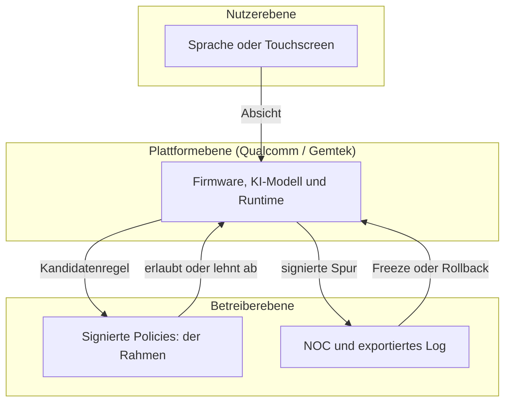
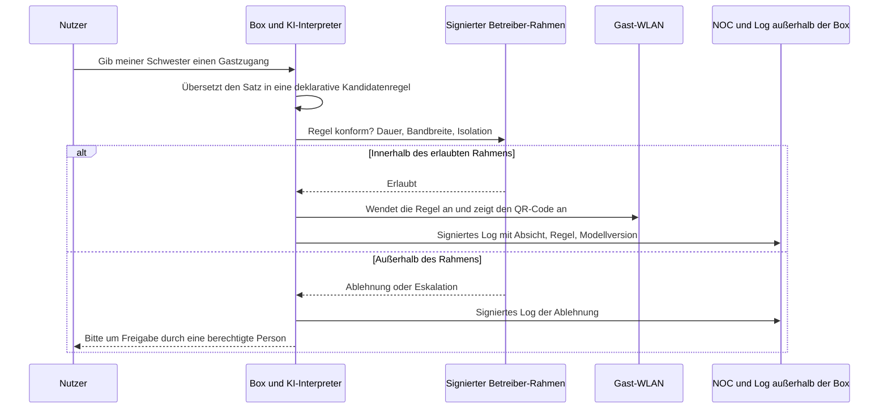

## Ein Satz vor der Box, eine Regel im Netz

Ein Elternteil stellt sich vor seine Internet-Box und spricht mit ihr. Er bittet sie, die sozialen Netzwerke auf den Geräten der Kinder bis 19 Uhr zu pausieren, und die Box führt es aus. Später braucht ein Gast Zugang: Auf dem kleinen Touchscreen an der Gerätefront erscheint ein QR-Code, bereit zum Scannen.

Das ist die Demo, die gFiber (das frühere Google Fiber), Qualcomm und Gemtek am 12. Oktober 2026 auf der Messe Network X vorgestellt haben, rund um ein künftiges Gateway namens gFiber Wi-Fi 8 Premium Gateway [1]. Auf dem Papier ist es ein Highend-Produkt für amerikanische Glasfaserkunden. In der Praxis ist es ein Signal an alle, die Wi-Fi im Auftrag anderer betreiben: Hotels, Studentenwohnheime, Handelsketten mit mehreren hundert Filialen, IT-Abteilungen mit mehreren Standorten.

Denn die Demo zeigt keine schnellere Box. Sie zeigt eine Box, die interpretiert.

Die Zugriffsregel wird nicht mehr von dem geschrieben, geprüft und ausgerollt, der das Netz betreibt. Sie wird vor Ort abgeleitet, aus einem Satz, den jemand im Raum ausspricht.

Meine Position passt in zwei Sätze. Solange diese Absicht nicht in eine explizite, signierte, außerhalb der Box protokollierte und von einem Rahmen des Betreibers begrenzte Policy übersetzt wird, verschiebt lokale KI die Entscheidung, ohne die Verantwortung zu verschieben. Und diese Verantwortung trägt immer der Betreiber.

## Was gezeigt wurde, und was wirklich neu ist

Zuerst die Fakten. Das Gateway basiert auf der Qualcomm-Plattform Dragonwing NPro A8 Elite. Angekündigt sind Wi-Fi 8 (der künftige Standard IEEE 802.11bn) auf vier gleichzeitigen Bändern, ein Prozessor mit fünf Kernen, eine dedizierte KI-Recheneinheit (Qualcomms Hexagon NPU) und ein Touchscreen an der Front [1][2]. gFiber präsentiert das Gateway als Internet-Hub des Haushalts und als lokale Plattform für agentische KI.

Drei Demos begleiteten die Ankündigung: eine Kindersicherung in natürlicher Sprache, die per Sprachbefehl ausgelöste Weitergabe von Gast-Zugangsdaten mit QR-Code auf dem Display und eine Smart-Home-Steuerung, gekoppelt mit Netzdiagnose in Echtzeit. Laut gFiber und Qualcomm läuft die KI direkt auf dem Gateway, nicht in der Cloud [1][4]. Das Argument: weniger Abhängigkeit von entfernten Servern, und die Daten des Haushalts bleiben zu Hause. Gemtek hatte übrigens schon auf dem MWC 2026 eine Wi-Fi-8-Strategie vorgestellt, die auf Gateways mit eingebetteter KI-Rechenleistung zielt [9].

Ein Wort zu den Zahlen, denn sie werden kursieren. „20G“ bezeichnet den Tarif: 20 Gbit/s symmetrisch über Glasfaser, die gFiber mit 25G-PON ausrollt, der Generation des passiven optischen Netzes mit 25 Gbit/s [1]. Das ist keine Wi-Fi-Datenrate. Die mitunter genannten 33 Gbit/s sind die theoretische physische Spitzenrate der Qualcomm-Plattform, im März ohne Angabe von Testbedingungen veröffentlicht [5]. Über diese Box sagen sie nichts. Und der Standard selbst ist nicht fertig: 802.11bn ist weiterhin ein Entwurf, die Zertifizierung der Wi-Fi Alliance wird etwa für Januar 2028 erwartet [8].

Die lokale Berechnung haben wir am 16. September behandelt, anlässlich der NPU, die in den Technikschrank einzieht. Neu ist hier ein Schritt, den es in der Kette bisher nicht gab: die Interpretation einer Absicht, ausgeführt auf dem beim Kunden installierten Gerät.

Nehmen Sie ein Mietshaus. Bisher glich die Zugriffs-Policy der Hausordnung: von der Hausverwaltung verfasst, beschlossen, im Eingangsbereich ausgehängt, per datiertem Nachtrag geändert. Der Hausmeister setzt sie durch; er schreibt sie nicht. Die gFiber-Demo ist ein Hausmeister, dem ein Bewohner im Treppenhaus zuruft „Lass heute Abend meine Schwester rein“, und der allein entscheidet, was „heute Abend“ heißt, welche Türen er öffnet und was er in sein Heft einträgt. Der Hausmeister ist vielleicht brillant. Aber am Tag, an dem der falsche Besucher hereinkommt, ruft man die Hausverwaltung an.

Im Netz lässt sich das direkt übertragen. Eine Gastzugangs-Policy ist eine Konfiguration: ein Gastnetzname (SSID), eine Dauer, eine Bandbreitenobergrenze, die Isolation zwischen Geräten, ein dediziertes Netzsegment (VLAN). Sie wird geschrieben, versioniert, getestet und dann vom Überwachungszentrum des Betreibers (NOC) ausgerollt. Mit der Demo wird sie zu einem Satz, der im Inneren der Box zur Regel kompiliert wird.

Daraus ergeben sich vier Fragen an jeden Anbieter. Was passiert mit der Absicht: gespeichert, transkribiert, verworfen? In welche deterministische Regel wird sie übersetzt? Wer kann sie ablehnen? Wo liegt die Spur, außerhalb des Geräts?

*Von der Stimme zur Regel: Zwischen dem gesprochenen Satz und dem Netz fehlt ein Riegel, den nur der Betreiber halten sollte.*

## Was wir nicht wissen, und warum es mehr zählt als das, was wir wissen

Eine Messe-Demo ist kein Datenblatt. Die weißen Flecken sind zahlreich, und sie betreffen genau die Governance.

- **Kein Produktdatenblatt.** Weder KI-Rechenleistung noch Speicher, Ports oder Anzahl der Funkstreams. Für die Box sind vier Bänder angekündigt, für die Plattform werden fünf aufgeführt [5]: Produkt und Chip müssen nicht übereinstimmen.
- **Kein Preis, kein Termin, keine Stückzahl.** gFiber sagt lediglich, dass seine bestehenden 20G-Kunden zuerst bedient und nach der vollständigen Zertifizierung migriert werden [1]. Nichts deutet darauf hin, dass Sprachbefehle heute für Kunden verfügbar sind.
- **Eine undurchsichtige Sprachkette.** Spracherkennung, Interpretation durch ein Sprachmodell, Übersetzung in eine Regel, Anwendung: Die Quellen sprechen von lokaler Verarbeitung, ohne jede Stufe zu beschreiben. Rückfall in die Cloud, verwendetes Modell, Updates, Ort des Mikrofons (Box oder Mobile App?): nicht veröffentlicht.
- **Eine undokumentierte Governance.** Wer darf mit der Box sprechen? Kann ein Gast selbst einen Befehl absetzen? Gibt es eine Bestätigung vor der Ausführung, ein Protokoll der Absichten, einen Export? Welche Rolle hat der Betreiber gegenüber dem Kunden? Bislang nichts Öffentliches.
- **Die genaue Rolle von Gemtek.** Benannter Partner; die Fertigung ist nicht ausdrücklich bestätigt.

Ich mache aus diesem Schweigen keine Mängel. Es sind offene Fragen, und es sind genau die, die ein Käufer vor der Unterschrift stellen muss.

## Drei Hände am selben Steuer

Auf einer von einem Betreiber betriebenen Box wirken bereits drei Akteure auf dieselbe Policy ein. Die gFiber-Demo schafft diesen Konflikt nicht. Sie fügt ihm einen schnellen, informellen Eingangskanal hinzu.

- **Die Nutzerebene**: Sprache und Touchscreen. Schnell, natürlich, mehrdeutig. Eine Stimme ist keine Identität: Außer bei einem dedizierten Mechanismus, von dem hier nichts veröffentlicht ist, hört die Box einen Satz, keine Person.
- **Die Betreiberebene**: die Managementsysteme (OSS) und die Fernverwaltung der Boxen über die Protokolle TR-069 und TR-369. Hier leben Überwachung, regulatorische Vorgaben und Policies für den Gerätepark.
- **Die Plattformebene**: Firmware, KI-Modell, Laufzeitumgebung, Updates. Hier Qualcomm, und Gemtek in einer noch zu klärenden Rolle.

Auf derselben Messe hat Qualcomm ein weiteres Produkt vorgestellt, das seine Sicht auf dieses Gleichgewicht beleuchtet: Dragonwing Security and Management, kurz SAM [3]. Ein auf dem Gateway installierter Software-Agent sammelt Telemetrie (Geräte, Dienste, Netz). In Gegenrichtung werden Policies und Dienste aus der Cloud auf das Gateway gepusht und dann an die Systeme des Betreibers und an Drittanwendungen angebunden. Qualcomm will die Rolle des Gateways über die Konnektivität hinaus zu einer Serviceplattform erweitern [6].

Im Katalog: Identifikation von Geräten und Diensten, Deep Packet Inspection, dynamische Firewall, kontextabhängige Kindersicherung. Das Ganze wird nativ oder als Container installiert, oberhalb der offenen Betriebssysteme für Boxen (RDK-B, prplOS, OpenWrt). Das Solutions Brief hält fest, dass die Funktionen je nach Policies des Betreibers variieren.

Achtung: Keine Quelle sagt, dass die gFiber-Box SAM an Bord hat. Es sind zwei getrennte Produkte, die auf derselben Messe vorgestellt wurden. Aber der Hinweis zählt. In dem Modell, das Qualcomm den Betreibern vorschlägt, steigt die Policy aus der Cloud zum Agenten ab, und das ist die richtige Richtung. Was keine öffentliche Quelle erklärt, ist, was passiert, wenn ein im Wohnzimmer gesprochener Satz der am Vortag heruntergereichten Policy widerspricht.

Daher die Regel, die ich vorschlage und bei der ich keine Kompromisse machen würde. Die Absicht des Nutzers darf eine Policy nur innerhalb eines vom Betreiber festgelegten Rahmens instanziieren: geschlossene Liste erlaubter Aktionen, Obergrenzen für Dauer, Bandbreite und Zahl der Gäste, gesperrte Netzsegmente. Was den Rahmen verlässt, wird abgelehnt oder zur Freigabe eskaliert. Niemals *großzügig ausgelegt*.

*Drei Kontrollebenen, eine Rangordnung: Der Nutzer schlägt vor, der Betreiber begrenzt, die Plattform führt aus und legt Rechenschaft ab.*

Diese Rangordnung muss schwarz auf weiß festgehalten sein. Das Gegenteil, eine Plattform, die interpretiert, und ein Betreiber, der es hinterher erfährt, ist genau das, was man ablehnen muss.

## „Wer hat dieses Gastnetz geöffnet?“

Stellen wir uns einen Dienstag vor, 7:40 Uhr. Der Support erhält einen Anruf: An einem Standort läuft seit drei Tagen ein Gastnetz ohne Isolation zwischen den Geräten, und niemand erinnert sich, es angelegt zu haben. In der Welt von früher steckt die Antwort in der Konfigurationshistorie: wer, wann, auf welches Ticket. In der Welt der Demo hängt sie davon ab, was die Box aufbewahren wollte.

Um in fünf Minuten antworten zu können, braucht das NOC pro Absicht einen vollständigen Eintrag. Zeitstempel. Identität des Absenders: ein Konto, ein Gerät oder eine bloße Stimme? Text des Satzes oder sein kryptografischer Hash. Erzeugte Regel. Versionen von Modell und Firmware. Ergebnis: angewendet, abgelehnt, eskaliert.

Ohne diese Felder fallen wir in die Falle zurück, die wir hier schon bei KI-Agenten beschrieben haben, die ihre Spuren löschen: Ein Log, das auf dem Gerät bleibt, ist kein Beweis. Es muss die Box verlassen, per Syslog, Flow-Export (IPFIX) oder Telemetrie, und es muss signiert sein.

*Die Zielkette: Absicht, deklarative Regel, Prüfung durch den Betreiber-Rahmen, in beiden Fällen exportierte Spur.*

Dieses Log dient auch dazu, die Lücke zwischen dem Gesagten und dem Getanen zu messen. Ablehnungsquote, Mehrdeutigkeitsquote, Quote angeforderter Bestätigungen: drei einfache Kennzahlen, die zeigen, ob der Interpreter zuverlässig ist oder improvisiert.

Zweite Schutzvorkehrung: der Circuit Breaker, nach dem Vorbild dessen, was wir für agentische KI in den NOCs vertreten haben. Eine Obergrenze für Aktionen pro Stunde. Eine Sperre für „eingefrorene“ Policies, die das NOC aus der Ferne setzen kann. Ein automatischer Rückfall auf die letzte signierte Policy, sobald etwas aus dem Ruder läuft.

Dritte Schutzvorkehrung, die am meisten unterschätzte: die Drift. Ein Modell-Update kann die Übersetzung desselben Satzes verändern. „Bis heute Abend“ entsprach gestern 23 Uhr; morgen sind es vielleicht Mitternacht oder 6 Uhr morgens. Das Gegenmittel kennen Softwareteams: ein Satzset für Regressionstests, bei jeder Modellversion erneut abgespielt, mit den erwarteten Regeln als Ausgabe.

*Ein exportiertes, signiertes Intent-Log: die einzige Möglichkeit, „Wer hat dieses Netz geöffnet?“ zu beantworten, ohne von der Box selbst abzuhängen.*

## Der Vertrag kommt vor der Demo

Eine Demo verkauft ein Erlebnis. Ein Vertrag verteilt ein Risiko. Hier die Klauseln, die ich verlangen würde, bevor ich eine Intent-KI auf einem Gerät zulasse, das wir betreiben.

1. **Eine veröffentlichte Spezifikation der Kette von Absicht zu Policy**, mit der geschlossenen Liste der möglichen Aktionen. Was nicht auf der Liste steht, kann die Box nicht.
2. **Ein vom Betreiber abschaltbarer Intent-Modus**, ohne Verlust der Grundfunktion: QR-Code und klassisches Portal bleiben verfügbar.
3. **Das Recht, die Logs zu exportieren**, in offenem Format, mit konfigurierbarer Aufbewahrung, um sich an die gesetzlichen Pflichten jedes Kunden anzupassen.
4. **Ein geregeltes Management von Modell-Updates**: Vorankündigung, Rollback möglich und eine Software-Stückliste (SBOM), die das Modell und seine Laufzeitumgebung abdeckt, nicht nur die Firmware.
5. **Explizite Verpflichtungen zum Cyber Resilience Act (CRA).** Seit dem 11. September 2026 verpflichtet diese europäische Verordnung die Hersteller, aktiv ausgenutzte Schwachstellen und schwerwiegende Vorfälle zu melden, über die zentrale Meldeplattform, die an den koordinierenden nationalen CSIRT und an die ENISA, die europäische Cybersicherheitsagentur, weiterleitet [7]. Der Takt: Frühwarnung binnen 24 Stunden, Meldung binnen 72 Stunden, Abschlussbericht 14 Tage nach Verfügbarkeit eines Patches bei einer ausgenutzten Schwachstelle oder einen Monat nach der Meldung bei einem schwerwiegenden Vorfall. Der Rest der Verordnung greift ab dem 11. Dezember 2027. Der Vertrag muss festlegen, wer meldet, wer den Betreiber warnt und binnen welcher Frist.
6. **Eine geteilte Verantwortung bei Fehlinterpretation.** Ein Zugang, der aufgrund einer falschen Lesart eines Satzes geöffnet wurde, darf nicht damit enden, dass man auf den Nutzer verweist, weil er es ja verlangt habe.
7. **Transparenz bei Sprachdaten**: Ort der Verarbeitung, Speicherdauer, mögliche Nutzung für das Training, Rückfall in die Cloud, Auftragsverarbeitungsvertrag im Sinne der DSGVO. Heute ist nichts veröffentlicht. Alles ist schriftlich einzuholen.

Die Frage nach dem Garanten haben wir bereits bei den 5G-Boxen von Nokia und Inseego gestellt. Mit einem eingebetteten KI-Modell kommt eine Frage der Taktung hinzu: Jede Weiterentwicklung des Modells kann das Verhalten der Box verändern. Eine einfache Matrix strukturiert die Diskussion.

| Gegenstand | Teilnehmer oder Nutzer | Betreiber | Plattform und Hersteller |
|---|---|---|---|
| Geäußerte Absicht | Äußert | Legt den Rahmen fest | Interpretiert |
| Angewendete Policy | Sieht ein | Signiert und versioniert | Führt aus |
| Intent-Log | Kann einsehen | Archiviert außerhalb der Box | Erzeugt und signiert |
| Modell-Update | Informiert | Gibt frei oder lehnt ab | Liefert und dokumentiert |
| CRA-Meldung | — | Vertraglich informiert | Meldet binnen 24 und 72 Stunden |

Bleibt nach der Verhandlung eine Zeile dieser Tabelle leer, ist das entsprechende Risiko nicht verschwunden. Es ist schlicht bei Ihnen gelandet.

## Hotel, Studentenwohnheim: was ich übertrage

Ich verlasse hier den Rahmen der Ankündigung und weise darauf hin: gFiber verkauft Premium-Privatkundenprodukte, nichts in den Quellen zielt auf die Hotellerie. Was folgt, ist meine Analyse als Wi-Fi-Betreiber in Hotels und Studentenwohnheimen, keine Information über das Produkt.

Erster Punkt: der Sprecher. Auf dem Zimmer haben der Gast und der Besucher des Gastes nicht dieselben Rechte. Im Studentenwohnheim haben der Mietvertragsinhaber und der Freund auf der Durchreise sie ebenso wenig. Ein Sprachbefehl, so wie er präsentiert wurde, sagt nichts darüber, wer spricht.

Zweiter Punkt: der Voucher. Der auf dem Display angezeigte QR-Code ist ein Voucher, nicht mehr und nicht weniger. In der Hotellerie ist die Ausgabe einer Zugangskennung aber an die Hotelverwaltungssoftware (PMS, Property Management System) oder an den Mietvertrag gekoppelt: Aufenthaltsdauer, Anzahl der Geräte, Isolation zwischen Zimmern. Diese Kennung lokal zu erzeugen, ohne Verbindung zum Identitätssystem, ist unser Hausmeister, der einen Zutrittsausweis aushändigt, ohne das Register aufzuschlagen.

Dritter Punkt: die Aufbewahrung. Die Hotelfachpresse weist seit Jahren darauf hin, dass ein Betrieb, der der Öffentlichkeit einen Wi-Fi-Zugang anbietet, selbst einen kostenlosen, einem Betreiber gleichgestellt werden kann, der Verbindungsdaten aufbewahren muss [10]. Die Quellen, die mir zu Dauer und genauem Umfang vorliegen, sind alt: Lassen Sie das mit Ihrer Rechtsabteilung nach geltendem Recht neu prüfen. Das Prinzip selbst bleibt bestehen. Eine per Sprache angelegte Regel muss genau denselben Eintrag erzeugen, zugeordnet zu einer identifizierbaren Person, wie eine im Portal angelegte Regel.

Vierter Punkt: die Skalierung. Ein Betreiber von Hotel-Wi-Fi verwaltet Hunderte Standorte, mit einer Policy, die von einem zum anderen konsistent bleiben muss. Eine lokale Intelligenz pro Box vervielfacht die möglichen Abweichungen, wenn die Policy nicht zentralisiert ist. Dreihundert Boxen, zwei Modellversionen, und derselbe Satz erzeugt von Hotel zu Hotel nicht mehr dieselbe Regel.

Das ist die Logik, die wir am 12. Oktober mit Blick auf Zugriffsgruppen vertreten haben, die über das Authentifizierungsprotokoll RADIUS transportiert werden: Die Zugriffsautorität lebt auf der Serverseite, das Gerät vor Ort setzt durch. Lokale KI muss ein Client der Policy-Ebene des Betreibers sein, nicht ihr Konkurrent.

*Hunderte Zimmer, eine einzige Policy: Die Intelligenz darf lokal sein, die Autorität muss zentral bleiben.*

## Fazit: fünf Bedingungen, sonst ist es ein Nein

Ich lehne Intent-KI auf der Box nicht ab. Ich lege den Eintrittspreis fest. Ich würde sie auf einem Gerät, das wir betreiben, akzeptieren, wenn und nur wenn die folgenden fünf Bedingungen erfüllt sind.

1. **Die erzeugte Policy ist ein deklaratives, versioniertes Objekt**, lesbar und wiederholbar ohne das Modell, das sie erzeugt hat.
2. **Der Betreiber-Rahmen ist nicht umgehbar**, auch nicht durch einen geschickt formulierten Satz.
3. **Das Intent-Log wird aus der Box exportiert und ist signiert.**
4. **Es gibt einen degradierten Modus ohne KI**, der denselben Basisdienst leistet: QR-Code, Portal, Voucher.
5. **Der Rollback auf die letzte signierte Policy ist automatisch.**

Fehlt eine, lautet die Antwort Nein. Oder die Funktion bleibt auf den unmanaged Privatkundenbereich beschränkt, wo der Kunde zugleich Nutzer, Administrator und Verantwortlicher ist.

Die gFiber-Demo verdient es, ernst genommen zu werden. Die Daten des Haushalts lokal zu verarbeiten, ist eine gute Nachricht für die Privatsphäre, und mit dem eigenen Netz zu sprechen wird schnell alltäglich sein. Aber die eigentliche Frage war nie, ob die Box verstehen kann. Sondern wer unterschreibt, was sie verstanden hat.

Lokale KI muss ein Client der Policy sein. Nicht die Policy.

---

_Persönliche Ansichten, keine Position von Wifirst._

## Quellen

1. Light Reading, « gFiber teams with Gemtek and Qualcomm on Wi-Fi 8 router », 12 octobre 2026 — https://lightreading.com/broadband/gfiber-teams-with-gemtek-and-qualcomm-on-wi-fi-8-router
2. Qualcomm, communiqué « gFiber, Qualcomm, and Gemtek Unveil an AI-Native Wi-Fi 8 Broadband Gateway at Network X 2026 », octobre 2026 — https://www.qualcomm.com/news/releases/2026/10/gfiber--qualcomm--and-gemtek-unveil-an-ai-native-wi-fi-8-broadba
3. Qualcomm, Dragonwing Security and Management (SAM) Solutions Brief, révision 10/2026 — https://www.qualcomm.com/content/dam/qcomm-martech/dm-assets/documents/Qualcomm-Dragonwing-SAM-Solutions-Brief.pdf
4. Fierce Network, « Qualcomm goes all-AI across FWA, Wi-Fi and fiber at Network X 2026 », 12 octobre 2026 — https://www.fierce-network.com/wireless/qualcomm-goes-all-ai-across-fwa-wi-fi-and-fiber-network-x-2026
5. CNX Software, Qualcomm Wi-Fi 8 : FastConnect 8800 et plateformes Dragonwing Networking, 3 mars 2026 — https://www.cnx-software.com/2026/03/03/qualcomm-wifi-8-solutions-fastconnect-8800-mobile-client-and-qualcomm-dragonwing-networking-platforms/
6. Let's Data Science, « Qualcomm Introduces Dragonwing AI-Native Broadband Portfolio », 12 octobre 2026 — https://letsdatascience.com/news/qualcomm-introduces-dragonwing-ai-native-broadband-portfolio-b4cef025
7. Commission européenne, Cyber Resilience Act : obligations de notification — https://digital-strategy.ec.europa.eu/en/policies/cra-reporting
8. Wi-Fi NOW, calendrier du standard 802.11bn — https://wifinowglobal.com/news-blog/wi-fi-8-standard-on-track-for-completion-in-1h2028-with-certification-scheduled-for-january-2028/ ; TechSpot — https://www.techspot.com/news/110830-wi-fi-8-already-peeking-out-ces-2026.html
9. EverythingRF, stratégie Wi-Fi 8 de Gemtek au MWC 2026 — https://www.everythingrf.com/news/details/21600-gemtek-introduces-wi-fi-8-broadband-strategy-for-ai-driven-service-networks-at-mwc-2026
10. L'Hôtellerie Restauration, « Proposer internet à ses clients : obligations et responsabilité » — https://www.lhotellerie-restauration.fr/actualite/proposer-internet-a-ses-clients-obligations-et-responsabilite-53307
