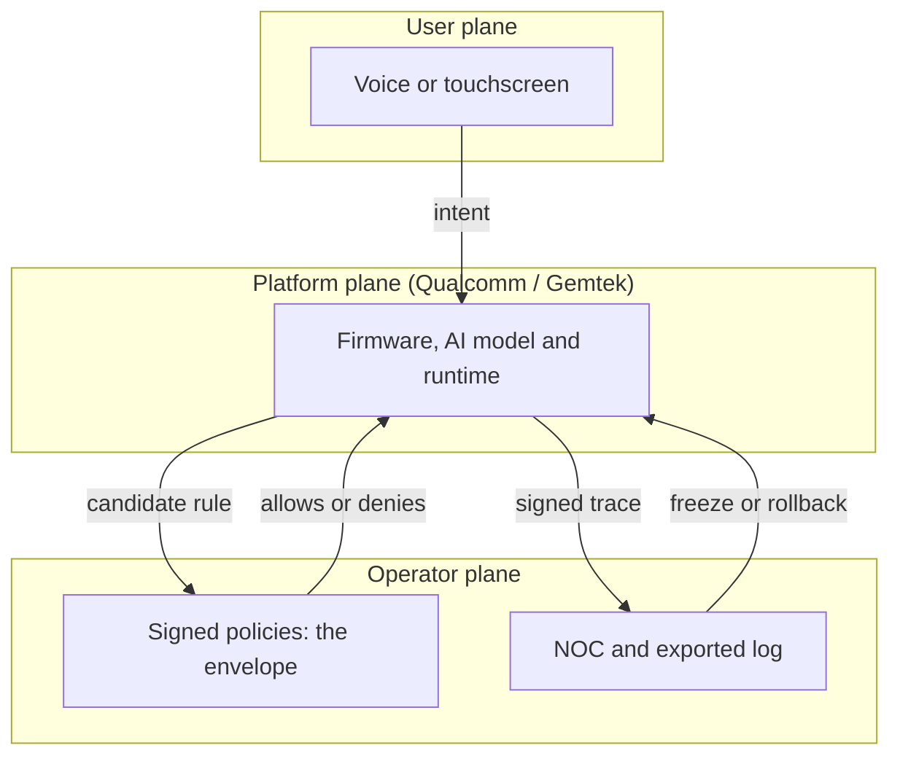
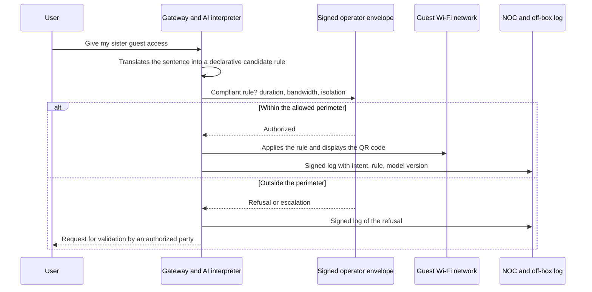

## A sentence spoken at the gateway, a rule enforced on the network

A parent plants themselves in front of the home gateway and talks to it. They ask it to pause social media on the kids' devices until 7 p.m., and the gateway complies. Later, someone needs access for a guest: a QR code appears on the small touchscreen on the front panel, ready to scan.

That is the demo gFiber (formerly Google Fiber), Qualcomm and Gemtek announced on October 12, 2026, at the Network X show, around an upcoming device called the gFiber Wi-Fi 8 Premium Gateway [1]. On paper, it is a high-end product for American fiber subscribers. In practice, it is a signal to everyone who runs Wi-Fi on behalf of others: hotels, student residences, retail chains with several hundred stores, multi-site IT departments.

Because what the demo shows is not a faster box. It is a box that interprets.

The access rule is no longer written, reviewed and deployed by whoever operates the network. It is inferred on the spot, from a sentence spoken by someone in the room.

My position fits in two sentences. Until that intent is translated into an explicit policy, signed, logged off the box and bounded by a framework the operator controls, local AI moves the decision without moving the responsibility. And that responsibility always lands on the operator.

## What was shown, and what is really new

The facts first. The gateway is built on the Qualcomm Dragonwing NPro A8 Elite platform. It advertises Wi-Fi 8 (the upcoming IEEE 802.11bn standard) across four simultaneous bands, a five-core processor, a dedicated AI compute unit (Qualcomm's Hexagon NPU) and a front-panel touchscreen [1][2]. gFiber presents it as the home's internet hub and as a local agentic AI platform.

Three demos came with the announcement: parental controls expressed in natural language, guest credential sharing triggered by voice with a QR code on screen, and smart-home control paired with real-time network diagnostics. According to gFiber and Qualcomm, the AI runs directly on the gateway, not in the cloud [1][4]. The pitch: less dependence on remote servers, and household data that stays at home. Gemtek, for its part, had already laid out a Wi-Fi 8 strategy at MWC 2026 built around gateways that embed AI compute [9].

A word on the numbers, because they are going to circulate. "20G" refers to the subscription: 20 Gbps symmetrical over fiber, which gFiber deploys on 25G-PON, the 25 Gbps generation of passive optical networking [1]. It is not a Wi-Fi speed. The 33 Gbps figure you sometimes see is the theoretical peak PHY rate of the Qualcomm platform, published in March with no test conditions [5]. It says nothing about this gateway. As for the standard, it is not finished: 802.11bn is still a draft, and Wi-Fi Alliance certification is expected around January 2028 [8].

We covered local compute on September 16, in the piece on the NPU moving into the equipment rack. What is new here is a step that did not exist in the chain: interpreting an intent, executed on the equipment installed at the customer's premises.

Think of an apartment building. Until now, the access policy looked like the condo bylaws: drafted by the board, voted on, posted in the lobby, changed by a dated amendment. The doorman enforces them; he does not write them. The gFiber demo is a doorman to whom a resident calls out on the stairs, "let my sister in tonight," and who decides on his own what "tonight" means, which doors to open and what to write in his logbook. The doorman may well be brilliant. But the day the wrong visitor gets in, it is the board that gets the call.

In networking terms, the translation is direct. A guest access policy is a configuration: a guest network name (SSID), a duration, a bandwidth cap, isolation between devices, a dedicated network segment (VLAN). It is written, versioned, tested, then deployed by the operator's network operations center (NOC). With the demo, it becomes a sentence, compiled into a rule inside the box.

Hence four questions to put to any vendor. What happens to the intent: stored, transcribed, discarded? Into which deterministic rule is it translated? Who can refuse it? Where is the trace, outside the device?

*From voice to rule: between the spoken sentence and the network, a lock is missing, and only the operator should hold the key.*

## What we don't know, and why it matters more than what we do

A trade-show demo is not a datasheet. The blank spots are many, and they concern governance in particular.

- **No product sheet.** No AI compute figure, no memory, no ports, no number of radio streams. Four bands are announced for the gateway, five are listed for the platform [5]: product and chip do not necessarily match.
- **No price, no date, no volume.** gFiber only says that its existing 20G subscribers will be served first, then migrated after full certification [1]. Nothing indicates that voice commands are available to customers today.
- **An opaque voice chain.** Speech recognition, interpretation by a language model, translation into a rule, enforcement: the sources speak of local processing without detailing each stage. Cloud fallback, the model used, updates, microphone location (gateway or mobile app?): not published.
- **Undocumented governance.** Who is allowed to talk to the gateway? Can a guest issue a command themselves? Is there a confirmation before execution, an intent log, an export? What role does the operator have versus the subscriber? Nothing public at this stage.
- **Gemtek's exact role.** Named partner; manufacturing is not explicitly confirmed.

I am not turning these silences into flaws. They are open questions, and they are exactly the ones a buyer must ask before signing.

## Three hands on the same wheel

On a gateway run by an operator, three players already act on the same policy. The gFiber demo does not create this conflict. It adds a fast, informal input channel to it.

- **The user plane**: voice and touchscreen. Fast, natural, ambiguous. A voice is not an identity: unless a dedicated mechanism exists, and nothing is published here, the gateway hears a sentence, not a person.
- **The operator plane**: management systems (OSS) and remote administration of the gateways via the TR-069 and TR-369 protocols. This is where supervision, regulatory constraints and fleet policies live.
- **The platform plane**: firmware, AI model, execution engine, updates. Here that means Qualcomm, and Gemtek in a role yet to be clarified.

At the same show, Qualcomm presented another product that sheds light on its vision of this balance: Dragonwing Security and Management, or SAM [3]. A software agent installed on the gateway collects telemetry (devices, services, network). In the other direction, policies and services from the cloud are pushed to the gateway, then connected to the operator's systems and to third-party applications. Qualcomm says it wants to extend the gateway's role beyond connectivity, toward a services platform [6].

The catalog includes device and service identification, deep packet inspection, a dynamic firewall, and context-aware parental controls. It all installs natively or in a container, on top of the open systems for gateways (RDK-B, prplOS, OpenWrt). The brief specifies that capabilities vary according to operator policies.

A caveat: no source says the gFiber gateway embeds SAM. These are two distinct products presented at the same show. But the clue matters. In the model Qualcomm proposes to operators, policy flows down from the cloud to the agent, and that is the right direction. What no public source explains is what happens when a sentence spoken in the living room contradicts the policy pushed down the day before.

Hence the rule I propose, and on which I would not compromise. The user's intent can only instantiate a policy inside an envelope set by the operator: a closed list of permitted actions, caps on duration, bandwidth and number of guests, forbidden network segments. Anything outside the envelope is refused or escalated for validation. Never *interpreted generously*.

*Three control planes, one order of precedence: the user proposes, the operator bounds, the platform executes and reports.*

That order of precedence must be written in black and white. The reverse, a platform that interprets and an operator who finds out after the fact, is precisely what must be refused.

## "Who opened this guest network?"

Picture a Tuesday, 7:40 a.m. Support gets a call: at one site, a guest network has been running for three days with no isolation between devices, and nobody remembers creating it. In the old world, the answer is in the configuration history: who, when, on which ticket. In the demo's world, it depends on what the box chose to keep.

To answer within five minutes, the NOC needs a complete record for each intent. Timestamp. Identity of the issuer: an account, a device, or just a voice? Text of the sentence, or its cryptographic hash. Generated rule. Model and firmware versions. Outcome: applied, refused, escalated.

Without these fields, we fall back into the pitfall already described here regarding AI agents that erase their tracks: a log left on the device is not evidence. It must leave the box, via syslog, flow export (IPFIX) or telemetry, and it must be signed.

*The target chain: intent, declarative rule, check against the operator envelope, trace exported in both cases.*

This log also serves to measure the gap between what was said and what was done. Rejection rate, ambiguity rate, confirmation-requested rate: three simple indicators that tell you whether the interpreter is reliable or improvising.

The second safeguard is the circuit breaker, modeled on what we advocated for agentic AI in NOCs. A cap on actions per hour. A "frozen" policy lock that the NOC can set remotely. An automatic return to the last signed policy as soon as something goes wrong.

The third safeguard, the most underestimated: drift. A model update can change the translation of the same sentence. "Until tonight" meant 11 p.m. yesterday; tomorrow it might be midnight, or 6 a.m. The countermeasure is well known to software teams: a set of non-regression sentences, replayed with every model version, with the expected rules as output.

*An exported, signed intent log: the only way to answer "who opened this network?" without depending on the box itself.*

## The contract comes before the demo

A demo sells an experience. A contract allocates a risk. Here are the clauses I would require before allowing an intent-based AI on equipment we operate.

1. **A published specification of the intent-to-policy chain**, with the closed list of possible actions. If it is not on the list, the box cannot do it.
2. **An intent mode the operator can disable**, with no loss of basic function: the QR code and the classic portal remain available.
3. **The right to export logs**, in an open format, with configurable retention to align with each customer's legal obligations.
4. **Managed handling of model updates**: advance notice, rollback possible, and a software bill of materials (SBOM) that covers the model and its runtime, not just the firmware.
5. **Explicit Cyber Resilience Act (CRA) commitments.** Since September 11, 2026, this European regulation requires manufacturers to report actively exploited vulnerabilities and severe incidents, through the single reporting platform, which forwards to the coordinating national CSIRT and to ENISA, the European cybersecurity agency [7]. The cadence: early warning within 24 hours, notification within 72 hours, final report 14 days after a fix becomes available for an exploited vulnerability, or one month after notification for a severe incident. The rest of the regulation follows on December 11, 2027. The contract must say who reports, who informs the operator, and within what time.
6. **Shared liability in case of misinterpretation.** An access opened on the wrong reading of a sentence cannot end with the blame sent back to the user on the grounds that they asked for it.
7. **Transparency on voice data**: where it is processed, retention period, any use for training, cloud fallback, a data processing agreement within the meaning of the GDPR. Nothing is published today. Everything must be obtained in writing.

We already raised the question of who stands behind the 5G boxes from Nokia and Inseego. With an embedded AI model, it is compounded by a question of cadence: every model change can alter the box's behavior. A simple matrix frames the discussion.

| Item | Subscriber or user | Operator | Platform and manufacturer |
|---|---|---|---|
| Expressed intent | Issues | Sets the envelope | Interprets |
| Applied policy | Views | Signs and versions | Executes |
| Intent log | Can view | Retains off the box | Produces and signs |
| Model update | Informed | Approves or refuses | Delivers and documents |
| CRA notification | — | Informed by contract | Notifies within 24 h and 72 h |

If a row of this table is still empty after the negotiation, the corresponding risk has not disappeared. It has simply landed on you.

## Hotels, student residences: what I carry over

I am stepping outside the scope of the announcement here, and I say so: gFiber sells premium residential, and nothing in the sources targets hospitality. What follows is my analysis as a Wi-Fi operator in hotels and student residences, not information about the product.

First point: the speaker. In a hotel room, the guest and the guest's visitor do not have the same rights. In a student residence, neither do the leaseholder and the friend passing through. A voice command, as it was presented, says nothing about who is speaking.

Second point: the voucher. The QR code displayed on screen is a voucher, no more, no less. In hospitality, though, issuing a credential is tied to the property management system (PMS) or to the lease: length of stay, number of devices, isolation between rooms. Generating that credential locally, with no link to the identity system, is our doorman handing out a pass without opening the register.

Third point: retention. The hospitality trade press has been reminding us for years that an establishment offering Wi-Fi access to the public, even for free, can be treated as an operator required to retain connection data [10]. The sources I have on the exact duration and scope are old: revalidate with your legal counsel under the law currently in force. The principle, though, does not change. A rule created by voice must produce exactly the same record, tied to an identifiable person, as a rule created in the portal.

Fourth point: scale. A hotel Wi-Fi operator manages hundreds of sites, with a policy that must stay consistent from one to the next. Local intelligence in every box multiplies the possible drift if the policy is not centralized. Three hundred boxes, two model versions, and the same sentence no longer produces the same rule from one hotel to another.

That is the logic we defended on October 12 regarding access groups carried by the RADIUS authentication protocol: access authority lives server-side, field equipment enforces. Local AI must be a client of the operator's policy plane, not its competitor.

*Hundreds of rooms, a single policy: the intelligence can be local, the authority must stay central.*

## Verdict: five conditions, or it's a no

I am not rejecting intent-based AI on the box. I am setting its entry price. I would accept it on equipment we operate if, and only if, the following five conditions are met.

1. **The generated policy is a declarative, versioned object**, readable and replayable without the model that produced it.
2. **The operator envelope cannot be bypassed**, including by a cleverly worded sentence.
3. **The intent log is exported off the box and signed.**
4. **A degraded mode without AI exists** and delivers the same basic service: QR code, portal, vouchers.
5. **Rollback to the last signed policy is automatic.**

If even one is missing, the answer is no. Or else the feature stays confined to unmanaged residential, where the subscriber is at once the user, the administrator and the party responsible.

The gFiber demo deserves to be taken seriously. Processing household data locally is good news for privacy, and talking to your network will quickly become commonplace. But the real question was never whether the box can understand. It is who signs off on what it understood.

Local AI must be a client of the policy. Not the policy.

---

_Personal views, not Wifirst's position._

## Sources

1. Light Reading, « gFiber teams with Gemtek and Qualcomm on Wi-Fi 8 router », 12 octobre 2026 — https://lightreading.com/broadband/gfiber-teams-with-gemtek-and-qualcomm-on-wi-fi-8-router
2. Qualcomm, communiqué « gFiber, Qualcomm, and Gemtek Unveil an AI-Native Wi-Fi 8 Broadband Gateway at Network X 2026 », octobre 2026 — https://www.qualcomm.com/news/releases/2026/10/gfiber--qualcomm--and-gemtek-unveil-an-ai-native-wi-fi-8-broadba
3. Qualcomm, Dragonwing Security and Management (SAM) Solutions Brief, révision 10/2026 — https://www.qualcomm.com/content/dam/qcomm-martech/dm-assets/documents/Qualcomm-Dragonwing-SAM-Solutions-Brief.pdf
4. Fierce Network, « Qualcomm goes all-AI across FWA, Wi-Fi and fiber at Network X 2026 », 12 octobre 2026 — https://www.fierce-network.com/wireless/qualcomm-goes-all-ai-across-fwa-wi-fi-and-fiber-network-x-2026
5. CNX Software, Qualcomm Wi-Fi 8 : FastConnect 8800 et plateformes Dragonwing Networking, 3 mars 2026 — https://www.cnx-software.com/2026/03/03/qualcomm-wifi-8-solutions-fastconnect-8800-mobile-client-and-qualcomm-dragonwing-networking-platforms/
6. Let's Data Science, « Qualcomm Introduces Dragonwing AI-Native Broadband Portfolio », 12 octobre 2026 — https://letsdatascience.com/news/qualcomm-introduces-dragonwing-ai-native-broadband-portfolio-b4cef025
7. Commission européenne, Cyber Resilience Act : obligations de notification — https://digital-strategy.ec.europa.eu/en/policies/cra-reporting
8. Wi-Fi NOW, calendrier du standard 802.11bn — https://wifinowglobal.com/news-blog/wi-fi-8-standard-on-track-for-completion-in-1h2028-with-certification-scheduled-for-january-2028/ ; TechSpot — https://www.techspot.com/news/110830-wi-fi-8-already-peeking-out-ces-2026.html
9. EverythingRF, stratégie Wi-Fi 8 de Gemtek au MWC 2026 — https://www.everythingrf.com/news/details/21600-gemtek-introduces-wi-fi-8-broadband-strategy-for-ai-driven-service-networks-at-mwc-2026
10. L'Hôtellerie Restauration, « Proposer internet à ses clients : obligations et responsabilité » — https://www.lhotellerie-restauration.fr/actualite/proposer-internet-a-ses-clients-obligations-et-responsabilite-53307
