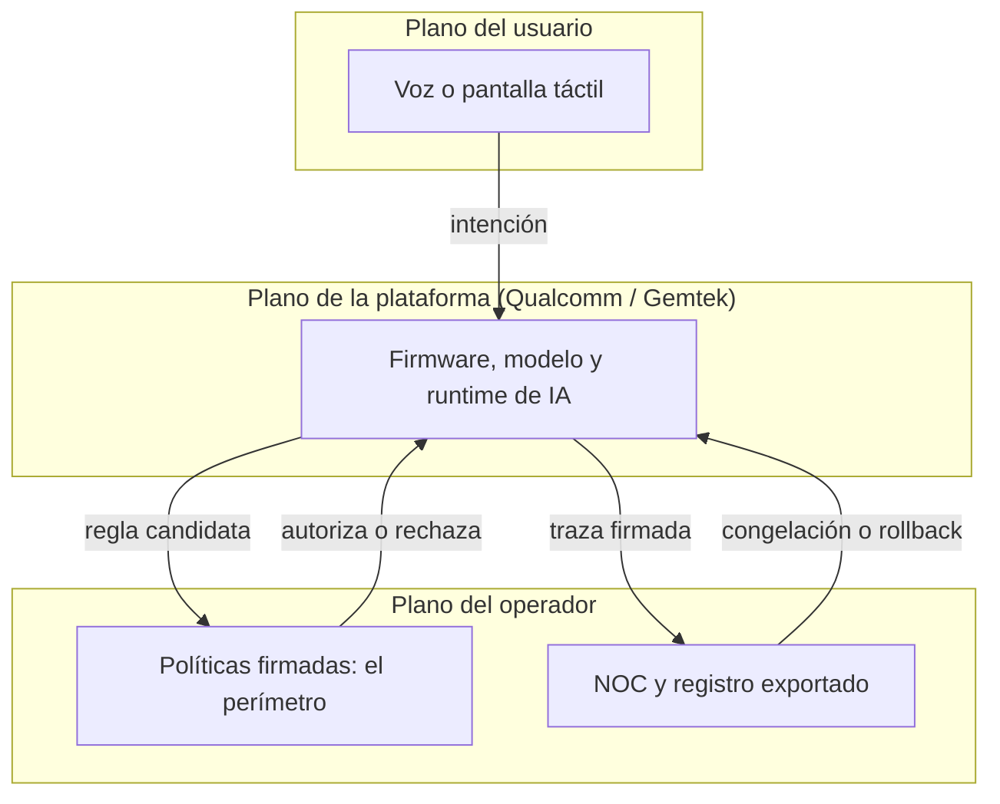
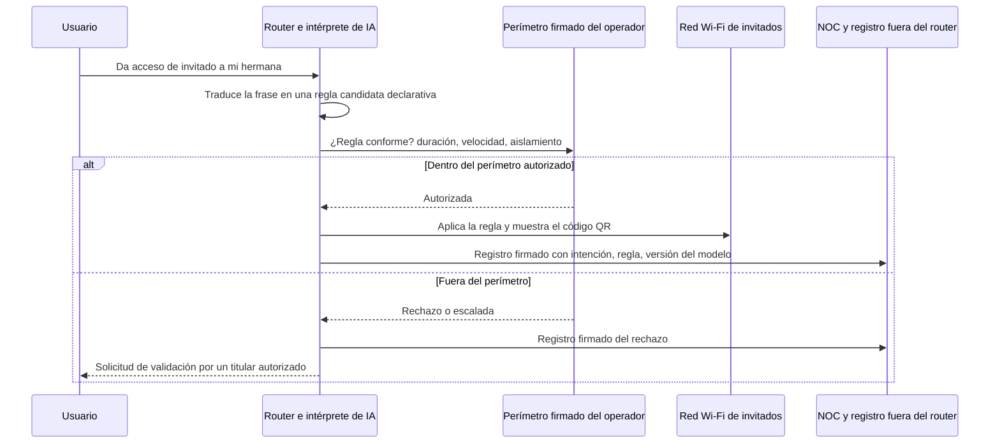

## Una frase dicha ante el router, una regla aplicada en la red

Un padre se planta delante de su router de internet y le habla. Le pide que ponga en pausa las redes sociales en los dispositivos de los niños hasta las 19:00, y el router obedece. Más tarde, alguien pide acceso para un invitado: aparece un código QR en la pequeña pantalla táctil del frontal, listo para escanear.

Es la demostración que gFiber (la antigua Google Fiber), Qualcomm y Gemtek anunciaron el 12 de octubre de 2026, con motivo del salón Network X, en torno a una futura pasarela llamada gFiber Wi-Fi 8 Premium Gateway [1]. Sobre el papel, es un producto de gama alta para abonados de fibra estadounidenses. En la práctica, es una señal para todos los que operan Wi-Fi por cuenta de terceros: hoteles, residencias de estudiantes, cadenas con varios cientos de tiendas, departamentos de TI multisede.

Porque lo que muestra la demo no es un router más rápido. Es un router que interpreta.

La regla de acceso ya no la escribe, la revisa y la despliega quien opera la red. Se deduce in situ, a partir de una frase pronunciada por alguien que está en la habitación.

Mi postura cabe en dos frases. Mientras esa intención no se traduzca en una política explícita, firmada, registrada fuera del router y acotada por un marco que el operador controla, la IA local desplaza la decisión sin desplazar la responsabilidad. Y esa responsabilidad la carga siempre el operador.

## Lo que se mostró y lo que realmente es nuevo

Primero, los hechos. La pasarela se basa en la plataforma Qualcomm Dragonwing NPro A8 Elite. Anuncia Wi-Fi 8 (la futura norma IEEE 802.11bn) en cuatro bandas simultáneas, un procesador de cinco núcleos, una unidad de cálculo dedicada a la IA (la NPU Hexagon de Qualcomm) y una pantalla táctil en el frontal [1][2]. gFiber la presenta como el hub de internet del hogar y como una plataforma local de IA agéntica.

Tres demos acompañaban el anuncio: un control parental expresado en lenguaje natural, un uso compartido de credenciales de invitado activado por voz con código QR en pantalla, y un control domótico combinado con un diagnóstico de red en tiempo real. Según gFiber y Qualcomm, la IA se ejecuta directamente en la pasarela, no en la nube [1][4]. El argumento: menos dependencia de servidores remotos y datos del hogar que se quedan en casa. Por cierto, Gemtek ya había mostrado en el MWC 2026 una estrategia Wi-Fi 8 orientada a pasarelas que integran cálculo de IA [9].

Unas palabras sobre las cifras, porque van a circular. El «20G» designa la suscripción: 20 Gbit/s simétricos sobre fibra, que gFiber despliega en 25G-PON, la generación de fibra óptica pasiva de 25 Gbit/s [1]. No es una velocidad Wi-Fi. Los 33 Gbit/s que a veces se citan son la velocidad física máxima teórica de la plataforma Qualcomm, publicada en marzo sin condiciones de prueba [5]. No dicen nada de este router. En cuanto a la norma, no está terminada: el 802.11bn sigue siendo un borrador, y la certificación de la Wi-Fi Alliance se espera hacia enero de 2028 [8].

El cálculo local lo tratamos el 16 de septiembre, a propósito de la NPU que entra en la sala técnica. Lo nuevo aquí es una etapa que no existía en la cadena: la interpretación de una intención, ejecutada en el equipo instalado en casa del cliente.

Piense en un edificio de viviendas. Hasta ahora, la política de acceso se parecía al reglamento de la comunidad de propietarios: redactado por el administrador, votado, colgado en el portal, modificado mediante una adenda fechada. El conserje lo aplica; no lo escribe. La demo de gFiber es un conserje al que un vecino le dice en la escalera «deja entrar a mi hermana esta noche», y que decide solo qué significa «esta noche», qué puertas abre y qué anota en su cuaderno. Puede que el conserje sea brillante. Pero el día que entra el visitante equivocado, a quien se llama es al administrador.

En una red, la traducción es directa. Una política de acceso de invitados es una configuración: un nombre de red de invitados (SSID), una duración, un límite de velocidad, el aislamiento entre dispositivos, un segmento de red dedicado (VLAN). Se escribe, se versiona, se prueba y luego la despliega el centro de supervisión del operador (NOC). Con la demo, se convierte en una frase, compilada como regla dentro del router.

De ahí cuatro preguntas para cualquier proveedor. ¿Qué pasa con la intención: se almacena, se transcribe, se descarta? ¿En qué regla determinista se traduce? ¿Quién puede rechazarla? ¿Dónde está el rastro, fuera del equipo?

*De la voz a la regla: entre la frase pronunciada y la red falta un cerrojo que solo el operador debería tener.*

## Lo que no sabemos, y que pesa más que lo que sabemos

Una demo de feria no es una ficha técnica. Las zonas en blanco son numerosas, y afectan precisamente a la gobernanza.

- **Sin ficha de producto.** Ni potencia de cálculo de IA, ni memoria, ni puertos, ni número de flujos de radio. Se anuncian cuatro bandas para el router, y cinco figuran para la plataforma [5]: producto y chip no coinciden necesariamente.
- **Sin precio, sin fecha, sin volumen.** gFiber solo indica que sus abonados 20G actuales serán atendidos primero, y migrados después de la certificación completa [1]. Nada indica que los comandos de voz estén hoy al alcance de los clientes.
- **Una cadena de voz opaca.** Reconocimiento del habla, interpretación por un modelo de lenguaje, traducción a regla, aplicación: las fuentes hablan de procesamiento local sin detallar cada etapa. Respaldo en la nube, modelo utilizado, actualizaciones, ubicación del micrófono (¿router o aplicación móvil?): no publicados.
- **Una gobernanza sin documentar.** ¿Quién tiene derecho a hablarle al router? ¿Puede un invitado emitir un comando por sí mismo? ¿Hay una confirmación antes de la ejecución, un registro de intenciones, una exportación? ¿Qué papel tiene el operador frente al abonado? Nada público por ahora.
- **El papel exacto de Gemtek.** Socio nombrado; la fabricación no está confirmada de forma explícita.

No convierto estos silencios en defectos. Son preguntas abiertas, y son exactamente las que un comprador debe plantear antes de firmar.

## Tres manos en el mismo volante

En un router explotado por un operador, tres actores ya actúan sobre la misma política. La demo de gFiber no crea este conflicto. Le añade un canal de entrada rápido e informal.

- **El plano del usuario**: la voz y la pantalla táctil. Rápido, natural, ambiguo. Una voz no es una identidad: salvo un mecanismo específico, del que aquí no se publica nada, el router oye una frase, no a una persona.
- **El plano del operador**: los sistemas de gestión (OSS) y la administración remota de los routers mediante los protocolos TR-069 y TR-369. Ahí viven la supervisión, las restricciones regulatorias y las políticas de flota.
- **El plano de la plataforma**: firmware, modelo de IA, motor de ejecución, actualizaciones. Aquí, Qualcomm, y Gemtek en un papel por precisar.

En el mismo salón, Qualcomm presentó otro producto que aclara su visión de este equilibrio: Dragonwing Security and Management, o SAM [3]. Un agente de software instalado en la pasarela recopila la telemetría (dispositivos, servicios, red). En sentido inverso, políticas y servicios procedentes de la nube se envían a la pasarela y luego se conectan con los sistemas del operador y con aplicaciones de terceros. Qualcomm dice querer ampliar el papel de la pasarela más allá de la conectividad, hacia una plataforma de servicios [6].

En el catálogo: identificación de dispositivos y servicios, inspección profunda de paquetes, firewall dinámico, control parental con conocimiento del contexto. Todo se instala de forma nativa o en contenedor, sobre los sistemas abiertos para routers (RDK-B, prplOS, OpenWrt). La ficha precisa que las capacidades varían según las políticas del operador.

Atención: ninguna fuente dice que el router de gFiber integre SAM. Son dos productos distintos presentados en el mismo salón. Pero el indicio importa. En el modelo que Qualcomm propone a los operadores, la política desciende de la nube al agente, y es la dirección correcta. Lo que ninguna fuente pública explica es qué ocurre cuando una frase pronunciada en el salón contradice la política descargada el día anterior.

De ahí la regla que propongo, y en la que no cedería. La intención del usuario solo puede instanciar una política dentro de un perímetro fijado por el operador: lista cerrada de acciones autorizadas, límites de duración, de velocidad y de número de invitados, segmentos de red prohibidos. Lo que sale del perímetro se rechaza o se eleva para su validación. Jamás se *interpreta con generosidad*.

*Tres planos de control, un orden de precedencia: el usuario propone, el operador acota, la plataforma ejecuta y rinde cuentas.*

Ese orden de precedencia debe quedar escrito negro sobre blanco. Lo contrario, una plataforma que interpreta y un operador que se entera después, es justo lo que hay que rechazar.

## «¿Quién abrió esta red de invitados?»

Imaginemos un martes, a las 7:40. El soporte recibe una llamada: en una sede, una red de invitados lleva tres días funcionando sin aislamiento entre dispositivos, y nadie recuerda haberla creado. En el mundo de antes, la respuesta está en el historial de configuración: quién, cuándo, en qué ticket. En el mundo de la demo, depende de lo que el router haya querido conservar.

Para responder en cinco minutos, el NOC necesita un registro completo por intención. Marca de tiempo. Identidad de quien la emite: ¿una cuenta, un dispositivo o una simple voz? Texto de la frase, o su huella criptográfica. Regla generada. Versiones del modelo y del firmware. Resultado: aplicada, rechazada, escalada.

Sin estos campos, se cae en el defecto que ya describimos aquí a propósito de los agentes de IA que borran sus huellas: un registro que se queda en el equipo no es una prueba. Debe salir del router, por syslog, exportación de flujos (IPFIX) o telemetría, y debe estar firmado.

*La cadena objetivo: intención, regla declarativa, control por el perímetro del operador, traza exportada en ambos casos.*

Este registro sirve también para medir la distancia entre lo que se dijo y lo que se hizo. Tasa de rechazo, tasa de ambigüedad, tasa de confirmaciones solicitadas: tres indicadores simples que dicen si el intérprete es fiable o si improvisa.

Segunda salvaguarda, el disyuntor, siguiendo el modelo de lo que defendíamos para la IA agéntica en los NOC. Un tope de acciones por hora. Un bloqueo de política «congelada», que el NOC puede activar a distancia. Una vuelta automática a la última política firmada en cuanto algo se desvía.

Tercera salvaguarda, la más subestimada: la deriva. Una actualización del modelo puede cambiar la traducción de una misma frase. «Hasta esta noche» equivalía a las 23:00 ayer; mañana, quizá sea medianoche, o las 6 de la mañana. La solución la conocen los equipos de software: un conjunto de frases de no regresión, reproducido con cada versión del modelo, con las reglas esperadas como salida.

*Un registro de intenciones exportado y firmado: la única forma de responder a «¿quién abrió esta red?» sin depender del propio router.*

## El contrato va antes que la demo

Una demo vende una experiencia. Un contrato reparte un riesgo. Estas son las cláusulas que exigiría antes de autorizar una IA de intención en un equipo que operamos.

1. **Una especificación publicada de la cadena intención-política**, con la lista cerrada de las acciones posibles. Si no está en la lista, el router no sabe hacerlo.
2. **Un modo intención que el operador pueda desactivar**, sin pérdida de funciones básicas: el código QR y el portal clásico siguen disponibles.
3. **El derecho a exportar los registros**, en formato abierto, con una retención configurable para ajustarse a las obligaciones legales de cada cliente.
4. **Una gestión regulada de las actualizaciones del modelo**: preaviso, posibilidad de vuelta atrás, y una lista de materiales de software (SBOM) que cubra el modelo y su motor de ejecución, no solo el firmware.
5. **Compromisos explícitos con el Cyber Resilience Act (CRA).** Desde el 11 de septiembre de 2026, este reglamento europeo obliga a los fabricantes a notificar las vulnerabilidades explotadas activamente y los incidentes graves, a través de la plataforma única de notificación, que transmite al CSIRT nacional coordinador y a la ENISA, la agencia europea de ciberseguridad [7]. El ritmo: alerta temprana en 24 horas, notificación en 72 horas, informe final 14 días después de que haya un parche disponible para una vulnerabilidad explotada, o un mes después de la notificación en caso de incidente grave. El resto del reglamento se aplica a partir del 11 de diciembre de 2027. El contrato debe decir quién notifica, quién avisa al operador y en qué plazo.
6. **Una responsabilidad compartida en caso de error de interpretación.** Un acceso abierto por una mala lectura de una frase no puede saldarse devolviendo la pelota al usuario, con el argumento de que lo pidió él.
7. **Transparencia sobre los datos de voz**: lugar de procesamiento, plazo de conservación, posible uso para el entrenamiento, respaldo en la nube, acuerdo de encargado del tratamiento en el sentido del RGPD. Hoy no se publica nada. Todo hay que obtenerlo por escrito.

Ya planteamos la cuestión del garante con los routers 5G de Nokia e Inseego. Con un modelo de IA embarcado, se duplica con una cuestión de cadencia: cada evolución del modelo puede cambiar el comportamiento del router. Una matriz sencilla enmarca la discusión.

| Objeto | Abonado o usuario | Operador | Plataforma y fabricante |
|---|---|---|---|
| Intención expresada | Emite | Fija el perímetro | Interpreta |
| Política aplicada | Consulta | Firma y versiona | Ejecuta |
| Registro de intenciones | Puede consultar | Conserva fuera del router | Produce y firma |
| Actualización del modelo | Informado | Valida o rechaza | Entrega y documenta |
| Notificación CRA | — | Informado por contrato | Notifica en 24 h y 72 h |

Si una fila de esta tabla sigue vacía tras la negociación, el riesgo correspondiente no ha desaparecido. Simplemente ha aterrizado en su casa.

## Hotel, residencia de estudiantes: lo que traslado

Salgo aquí del perímetro del anuncio, y lo señalo: gFiber vende residencial premium, nada en las fuentes apunta a la hotelería. Lo que sigue es mi análisis como operador Wi-Fi en hoteles y residencias de estudiantes, no información sobre el producto.

Primer punto: el hablante. En una habitación, el cliente y el invitado del cliente no tienen los mismos derechos. En una residencia de estudiantes, tampoco el titular del contrato y el amigo de paso. Un comando de voz, tal como se presentó, no dice nada de quién habla.

Segundo punto: el voucher. El código QR que se muestra en pantalla es un voucher, ni más ni menos. Ahora bien, en hotelería la emisión de una credencial está ligada al software de gestión hotelera (PMS, Property Management System) o al contrato: duración de la estancia, número de dispositivos, aislamiento entre habitaciones. Generar esa credencial localmente, sin vínculo con el sistema de identidad, es nuestro conserje entregando un pase sin abrir el registro.

Tercer punto: la conservación. La prensa profesional hotelera recuerda desde hace años que un establecimiento que ofrece acceso Wi-Fi al público, aunque sea gratuito, puede ser asimilado a un operador obligado a conservar los datos de conexión [10]. Las fuentes de que dispongo sobre la duración y el alcance exactos son antiguas: hay que revalidarlas con su departamento jurídico según el derecho vigente. El principio, en cambio, no cambia. Una regla creada por voz debe producir exactamente el mismo registro, vinculado a una persona identificable, que una regla creada en el portal.

Cuarto punto: la escala. Un operador de Wi-Fi hotelero gestiona cientos de sedes, con una política que debe seguir siendo coherente de una a otra. Una inteligencia local por router multiplica las posibles derivas si la política no está centralizada. Trescientos routers, dos versiones de modelo, y la misma frase ya no produce la misma regla de un hotel a otro.

Es la lógica que defendíamos el 12 de octubre a propósito de los grupos de acceso transportados por el protocolo de autenticación RADIUS: la autoridad de acceso vive en el servidor, el equipo de campo aplica. La IA local debe ser un cliente del plano de políticas del operador, no su competidora.

*Cientos de habitaciones, una sola política: la inteligencia puede ser local, la autoridad debe seguir siendo central.*

## Veredicto: cinco condiciones, o la respuesta es no

No rechazo la IA de intención en el router. Fijo su precio de entrada. La aceptaría en un equipo que operamos si, y solo si, se cumplen las cinco condiciones siguientes.

1. **La política generada es un objeto declarativo y versionado**, legible y reproducible sin el modelo que la produjo.
2. **El perímetro del operador es infranqueable**, incluso para una frase hábilmente formulada.
3. **El registro de intenciones se exporta fuera del router y está firmado.**
4. **Existe un modo degradado sin IA** que presta el mismo servicio básico: código QR, portal, vouchers.
5. **La vuelta atrás a la última política firmada es automática.**

Si falta una, la respuesta es no. O bien la función se queda confinada al residencial no gestionado, donde el abonado es a la vez el usuario, el administrador y el responsable.

La demo de gFiber merece que se la tome en serio. Procesar localmente los datos del hogar es una buena noticia para la privacidad, y hablarle a la red pronto será algo corriente. Pero la verdadera pregunta nunca ha sido si el router puede entender. Es quién firma lo que ha entendido.

La IA local debe ser un cliente de la política. No la política.

---

_Opiniones personales, no posición de Wifirst._

## Fuentes

1. Light Reading, « gFiber teams with Gemtek and Qualcomm on Wi-Fi 8 router », 12 octobre 2026 — https://lightreading.com/broadband/gfiber-teams-with-gemtek-and-qualcomm-on-wi-fi-8-router
2. Qualcomm, communiqué « gFiber, Qualcomm, and Gemtek Unveil an AI-Native Wi-Fi 8 Broadband Gateway at Network X 2026 », octobre 2026 — https://www.qualcomm.com/news/releases/2026/10/gfiber--qualcomm--and-gemtek-unveil-an-ai-native-wi-fi-8-broadba
3. Qualcomm, Dragonwing Security and Management (SAM) Solutions Brief, révision 10/2026 — https://www.qualcomm.com/content/dam/qcomm-martech/dm-assets/documents/Qualcomm-Dragonwing-SAM-Solutions-Brief.pdf
4. Fierce Network, « Qualcomm goes all-AI across FWA, Wi-Fi and fiber at Network X 2026 », 12 octobre 2026 — https://www.fierce-network.com/wireless/qualcomm-goes-all-ai-across-fwa-wi-fi-and-fiber-network-x-2026
5. CNX Software, Qualcomm Wi-Fi 8 : FastConnect 8800 et plateformes Dragonwing Networking, 3 mars 2026 — https://www.cnx-software.com/2026/03/03/qualcomm-wifi-8-solutions-fastconnect-8800-mobile-client-and-qualcomm-dragonwing-networking-platforms/
6. Let's Data Science, « Qualcomm Introduces Dragonwing AI-Native Broadband Portfolio », 12 octobre 2026 — https://letsdatascience.com/news/qualcomm-introduces-dragonwing-ai-native-broadband-portfolio-b4cef025
7. Commission européenne, Cyber Resilience Act : obligations de notification — https://digital-strategy.ec.europa.eu/en/policies/cra-reporting
8. Wi-Fi NOW, calendrier du standard 802.11bn — https://wifinowglobal.com/news-blog/wi-fi-8-standard-on-track-for-completion-in-1h2028-with-certification-scheduled-for-january-2028/ ; TechSpot — https://www.techspot.com/news/110830-wi-fi-8-already-peeking-out-ces-2026.html
9. EverythingRF, stratégie Wi-Fi 8 de Gemtek au MWC 2026 — https://www.everythingrf.com/news/details/21600-gemtek-introduces-wi-fi-8-broadband-strategy-for-ai-driven-service-networks-at-mwc-2026
10. L'Hôtellerie Restauration, « Proposer internet à ses clients : obligations et responsabilité » — https://www.lhotellerie-restauration.fr/actualite/proposer-internet-a-ses-clients-obligations-et-responsabilite-53307
