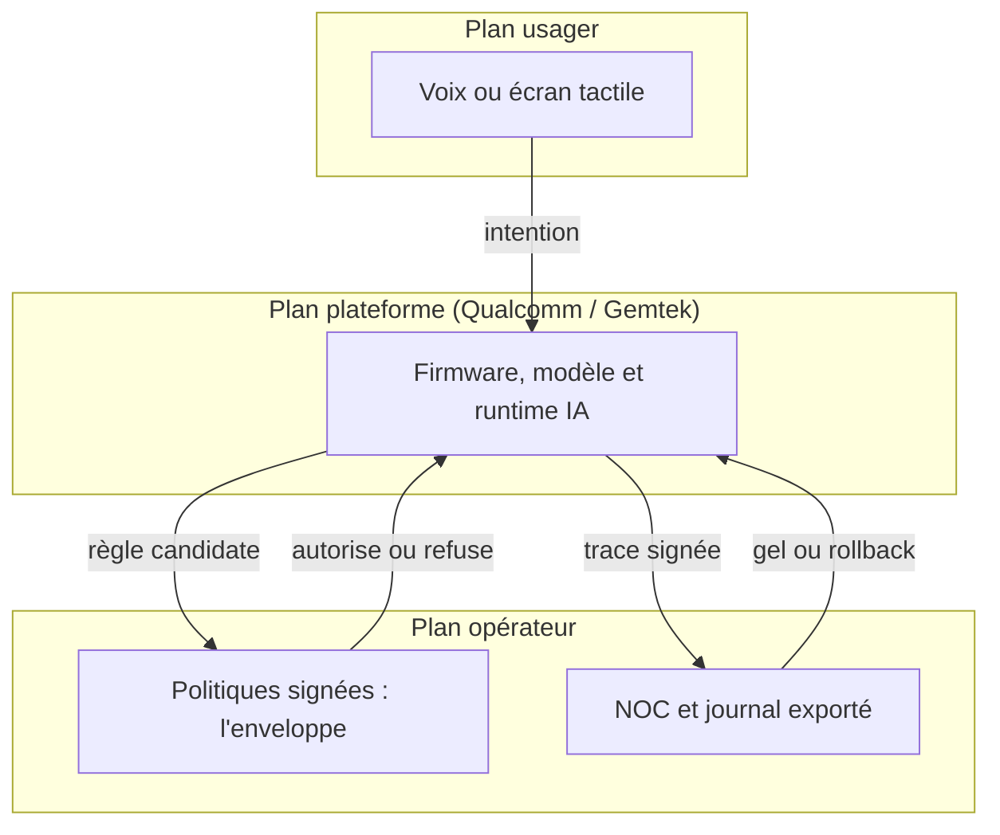
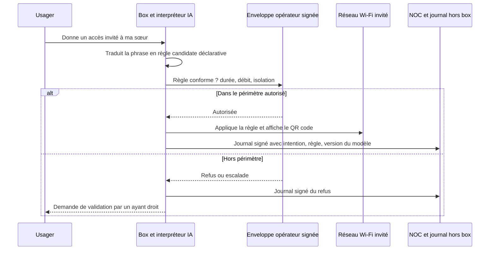

## Une phrase dite devant la box, une règle appliquée sur le réseau

Un parent se plante devant sa box internet et lui parle. Il lui demande de mettre en pause les réseaux sociaux sur les appareils des enfants jusqu'à 19 heures, et la box s'exécute. Plus tard, quelqu'un réclame un accès pour un invité : un QR code apparaît sur le petit écran tactile en façade, prêt à être scanné.

C'est la démonstration que gFiber (l'ex-Google Fiber), Qualcomm et Gemtek ont annoncée le 12 octobre 2026, à l'occasion du salon Network X, autour d'une future passerelle baptisée gFiber Wi-Fi 8 Premium Gateway [1]. Sur le papier, c'est un produit haut de gamme pour abonnés fibre américains. En pratique, c'est un signal pour tous ceux qui exploitent du Wi-Fi pour le compte d'autres : hôtels, résidences étudiantes, enseignes à plusieurs centaines de magasins, DSI multi-sites.

Car ce que montre la démo, ce n'est pas une box plus rapide. C'est une box qui interprète.

La règle d'accès n'est plus écrite, relue et déployée par celui qui exploite le réseau. Elle est déduite sur place, à partir d'une phrase prononcée par quelqu'un dans la pièce.

Ma position tient en deux phrases. Tant que cette intention n'est pas traduite en politique explicite, signée, journalisée hors de la box et bornée par un cadre que l'opérateur contrôle, l'IA locale déplace la décision sans déplacer la responsabilité. Et cette responsabilité-là, c'est toujours l'opérateur qui la porte.

## Ce qui a été montré, et ce qui est vraiment neuf

Les faits, d'abord. La passerelle repose sur la plateforme Qualcomm Dragonwing NPro A8 Elite. Elle annonce du Wi-Fi 8 (la future norme IEEE 802.11bn) sur quatre bandes simultanées, un processeur à cinq cœurs, une unité de calcul dédiée à l'IA (le NPU Hexagon de Qualcomm) et un écran tactile en façade [1][2]. gFiber la présente comme le hub internet du foyer et comme une plateforme locale d'IA agentique.

Trois démos accompagnaient l'annonce : un contrôle parental exprimé en langage naturel, un partage d'identifiants invités déclenché à la voix avec QR code à l'écran, et un pilotage domotique couplé à un diagnostic réseau en temps réel. Selon gFiber et Qualcomm, l'IA tourne directement sur la passerelle, pas dans le cloud [1][4]. L'argument : moins de dépendance aux serveurs distants, et des données du foyer qui restent à la maison. Gemtek avait d'ailleurs affiché dès le MWC 2026 une stratégie Wi-Fi 8 tournée vers des passerelles embarquant du calcul IA [9].

Un mot sur les chiffres, parce qu'ils vont circuler. Le « 20G » désigne l'abonnement : 20 Gbit/s symétriques sur fibre, que gFiber déploie en 25G-PON, la génération de fibre optique passive à 25 Gbit/s [1]. Ce n'est pas un débit Wi-Fi. Les 33 Gbit/s parfois cités sont le débit physique crête théorique de la plateforme Qualcomm, publié en mars sans conditions de test [5]. Ils ne disent rien de cette box. Quant à la norme, elle n'est pas finie : le 802.11bn reste un brouillon, et la certification Wi-Fi Alliance est attendue vers janvier 2028 [8].

Le calcul local, nous l'avons traité le 16 septembre, à propos du NPU qui s'invite dans la baie technique. Ce qui est neuf ici, c'est une étape qui n'existait pas dans la chaîne : l'interprétation d'une intention, exécutée sur l'équipement installé chez le client.

Prenez un immeuble. Jusqu'ici, la politique d'accès ressemblait au règlement de copropriété : rédigé par le syndic, voté, affiché dans le hall, modifié par avenant daté. Le gardien l'applique ; il ne l'écrit pas. La démo gFiber, c'est un gardien à qui un résident lance dans l'escalier « laisse entrer ma sœur ce soir », et qui décide seul de ce que « ce soir » veut dire, des portes qu'il ouvre et de ce qu'il note dans son cahier. Le gardien est peut-être brillant. Mais le jour où le mauvais visiteur entre, c'est le syndic qu'on appelle.

En réseau, la traduction est directe. Une politique d'accès invité est une configuration : un nom de réseau invité (SSID), une durée, un plafond de débit, l'isolation entre appareils, un segment réseau dédié (VLAN). Elle est écrite, versionnée, testée, puis déployée par le centre de supervision de l'opérateur (NOC). Avec la démo, elle devient une phrase, compilée en règle à l'intérieur de la box.

D'où quatre questions à poser à tout fournisseur. Que devient l'intention : stockée, transcrite, rejetée ? En quelle règle déterministe est-elle traduite ? Qui peut la refuser ? Où se trouve la trace, hors de l'équipement ?

*De la voix à la règle : entre la phrase prononcée et le réseau, il manque un verrou que seul l'opérateur devrait détenir.*

## Ce qu'on ne sait pas, et qui compte plus que ce qu'on sait

Une démo de salon n'est pas une fiche technique. Les zones blanches sont nombreuses, et elles portent précisément sur la gouvernance.

- **Pas de fiche produit.** Ni puissance de calcul IA, ni mémoire, ni ports, ni nombre de flux radio. Quatre bandes sont annoncées pour la box, cinq sont listées pour la plateforme [5] : produit et puce ne coïncident pas forcément.
- **Pas de prix, pas de date, pas de volume.** gFiber indique seulement que ses abonnés 20G existants seront servis en premier, puis migrés après certification complète [1]. Rien n'indique que les commandes vocales soient accessibles aux clients aujourd'hui.
- **Une chaîne vocale opaque.** Reconnaissance de la parole, interprétation par un modèle de langage, traduction en règle, application : les sources parlent de traitement local sans détailler chaque étage. Repli vers le cloud, modèle utilisé, mises à jour, emplacement du micro (box ou application mobile ?) : non publiés.
- **Une gouvernance non documentée.** Qui a le droit de parler à la box ? Un invité peut-il émettre lui-même une commande ? Y a-t-il une confirmation avant exécution, un journal des intentions, un export ? Quel rôle pour l'opérateur face à l'abonné ? Rien de public à ce stade.
- **Le rôle exact de Gemtek.** Partenaire nommé ; la fabrication n'est pas explicitement confirmée.

Je ne transforme pas ces silences en défauts. Ce sont des questions ouvertes, et ce sont exactement celles qu'un acheteur doit poser avant de signer.

## Trois mains sur le même volant

Sur une box exploitée par un opérateur, trois acteurs agissent déjà sur la même politique. La démo gFiber ne crée pas ce conflit. Elle lui ajoute un canal d'entrée rapide et informel.

- **Le plan usager** : la voix et l'écran tactile. Rapide, naturel, ambigu. Une voix n'est pas une identité : sauf mécanisme dédié, dont rien n'est publié ici, la box entend une phrase, pas une personne.
- **Le plan opérateur** : les systèmes de gestion (OSS) et l'administration à distance des box via les protocoles TR-069 et TR-369. C'est là que vivent la supervision, les contraintes réglementaires et les politiques de parc.
- **Le plan plateforme** : firmware, modèle d'IA, moteur d'exécution, mises à jour. Ici Qualcomm, et Gemtek dans un rôle à préciser.

Au même salon, Qualcomm a présenté un autre produit qui éclaire sa vision de cet équilibre : Dragonwing Security and Management, ou SAM [3]. Un agent logiciel installé sur la passerelle collecte la télémétrie (appareils, services, réseau). En sens inverse, des politiques et des services venus du cloud sont poussés vers la passerelle, puis raccordés aux systèmes de l'opérateur et à des applications tierces. Qualcomm dit vouloir étendre le rôle de la passerelle au-delà de la connectivité, vers une plateforme de services [6].

Au catalogue : identification des appareils et des services, inspection approfondie des paquets, pare-feu dynamique, contrôle parental tenant compte du contexte. Le tout s'installe en natif ou en conteneur, au-dessus des systèmes ouverts pour box (RDK-B, prplOS, OpenWrt). La fiche précise que les capacités varient selon les politiques de l'opérateur.

Attention : aucune source ne dit que la box gFiber embarque SAM. Ce sont deux produits distincts présentés au même salon. Mais l'indice compte. Dans le modèle que Qualcomm propose aux opérateurs, la politique descend du cloud vers l'agent, et c'est la bonne direction. Ce qu'aucune source publique n'explique, c'est ce qui se passe quand une phrase prononcée dans le salon contredit la politique descendue la veille.

D'où la règle que je propose, et sur laquelle je ne transigerais pas. L'intention de l'usager ne peut qu'instancier une politique à l'intérieur d'une enveloppe fixée par l'opérateur : liste fermée des actions autorisées, plafonds de durée, de débit et de nombre d'invités, segments réseau interdits. Ce qui sort de l'enveloppe est refusé ou remonté pour validation. Jamais *interprété généreusement*.

*Trois plans de contrôle, un ordre de préséance : l'usager propose, l'opérateur borne, la plateforme exécute et rend compte.*

Cet ordre de préséance doit être écrit noir sur blanc. L'inverse, une plateforme qui interprète et un opérateur qui découvre après coup, c'est précisément ce qu'il faut refuser.

## « Qui a ouvert ce réseau invité ? »

Imaginons un mardi, 7 h 40. Le support reçoit un appel : sur un site, un réseau invité tourne depuis trois jours sans isolation entre appareils, et personne ne se souvient de l'avoir créé. Dans le monde d'avant, la réponse tient dans l'historique de configuration : qui, quand, sur quel ticket. Dans le monde de la démo, elle dépend de ce que la box a bien voulu garder.

Pour répondre en cinq minutes, le NOC a besoin d'un enregistrement complet par intention. Horodatage. Identité de l'émetteur : un compte, un appareil, ou une simple voix ? Texte de la phrase, ou son empreinte cryptographique. Règle générée. Versions du modèle et du firmware. Résultat : appliquée, refusée, escaladée.

Sans ces champs, on retombe dans le travers déjà décrit ici à propos des agents IA qui effacent leurs traces : un journal resté sur l'équipement n'est pas une preuve. Il doit sortir de la box, par syslog, export de flux (IPFIX) ou télémétrie, et il doit être signé.

*La chaîne cible : intention, règle déclarative, contrôle par l'enveloppe opérateur, trace exportée dans les deux cas.*

Ce journal sert aussi à mesurer l'écart entre ce qui a été dit et ce qui a été fait. Taux de rejet, taux d'ambiguïté, taux de confirmation demandée : trois indicateurs simples qui disent si l'interpréteur est fiable ou s'il improvise.

Deuxième garde-fou, le disjoncteur, sur le modèle de ce que nous défendions pour l'IA agentique dans les NOC. Un plafond d'actions par heure. Un verrou de politique « gelée », que le NOC peut poser à distance. Un retour automatique à la dernière politique signée dès que quelque chose dérape.

Troisième garde-fou, le plus sous-estimé : la dérive. Une mise à jour du modèle peut changer la traduction d'une même phrase. « Jusqu'à ce soir » valait 23 heures hier ; demain, ce sera peut-être minuit, ou 6 heures du matin. La parade est connue des équipes logicielles : un jeu de phrases de non-régression, rejoué à chaque version du modèle, avec les règles attendues en sortie.

*Un journal d'intentions exporté et signé : la seule façon de répondre à « qui a ouvert ce réseau ? » sans dépendre de la box elle-même.*

## Le contrat passe avant la démo

Une démo vend une expérience. Un contrat répartit un risque. Voici les clauses que j'exigerais avant d'autoriser une IA d'intention sur un équipement que nous exploitons.

1. **Une spécification publiée de la chaîne intention-politique**, avec la liste fermée des actions possibles. Si ce n'est pas dans la liste, la box ne sait pas le faire.
2. **Un mode intention désactivable par l'opérateur**, sans perte de fonction de base : le QR code et le portail classique restent disponibles.
3. **Le droit d'exporter les journaux**, en format ouvert, avec une rétention configurable pour s'aligner sur les obligations légales de chaque client.
4. **Une gestion encadrée des mises à jour de modèle** : préavis, retour arrière possible, et une nomenclature logicielle (SBOM) qui couvre le modèle et son moteur d'exécution, pas seulement le firmware.
5. **Des engagements Cyber Resilience Act (CRA) explicites.** Depuis le 11 septembre 2026, ce règlement européen impose aux fabricants de notifier les vulnérabilités activement exploitées et les incidents graves, via la plateforme unique de notification, qui transmet au CSIRT national coordinateur et à l'ENISA, l'agence européenne de cybersécurité [7]. Le rythme : alerte précoce sous 24 heures, notification sous 72 heures, rapport final 14 jours après la disponibilité d'un correctif pour une vulnérabilité exploitée, ou un mois après la notification pour un incident grave. Le reste du règlement suit au 11 décembre 2027. Le contrat doit dire qui notifie, qui prévient l'opérateur, et sous quel délai.
6. **Une responsabilité partagée en cas d'erreur d'interprétation.** Un accès ouvert sur la mauvaise lecture d'une phrase ne peut pas se solder par un renvoi vers l'utilisateur, au motif qu'il l'aurait demandé.
7. **De la transparence sur les données vocales** : lieu de traitement, durée de conservation, usage éventuel pour l'entraînement, repli vers le cloud, accord de sous-traitance au sens du RGPD. Rien n'est publié aujourd'hui. Tout est à obtenir par écrit.

Nous posions déjà la question du garant pour les box 5G de Nokia et d'Inseego. Avec un modèle d'IA embarqué, elle se double d'une question de cadence : chaque évolution du modèle peut changer le comportement de la box. Une matrice simple cadre la discussion.

| Objet | Abonné ou usager | Opérateur | Plateforme et fabricant |
|---|---|---|---|
| Intention exprimée | Émet | Fixe l'enveloppe | Interprète |
| Politique appliquée | Consulte | Signe et versionne | Exécute |
| Journal d'intentions | Peut consulter | Conserve hors box | Produit et signe |
| Mise à jour du modèle | Informé | Valide ou refuse | Livre et documente |
| Notification CRA | — | Informé par contrat | Notifie sous 24 h et 72 h |

Si une ligne de ce tableau reste vide après la négociation, le risque correspondant n'a pas disparu. Il a simplement atterri chez vous.

## Hôtel, résidence étudiante : ce que je transpose

Je sors ici du périmètre de l'annonce, et je le signale : gFiber vend du résidentiel premium, rien dans les sources ne vise l'hôtellerie. Ce qui suit est mon analyse d'opérateur Wi-Fi en hôtels et en résidences étudiantes, pas une information sur le produit.

Premier point : l'orateur. En chambre, le client et l'invité du client n'ont pas les mêmes droits. En résidence étudiante, le titulaire du bail et l'ami de passage non plus. Une commande vocale, telle qu'elle a été présentée, ne dit rien de qui parle.

Deuxième point : le voucher. Le QR code affiché à l'écran, c'est un voucher, ni plus ni moins. Or en hôtellerie, l'émission d'un identifiant est adossée au logiciel de gestion hôtelière (PMS, Property Management System) ou au bail : durée du séjour, nombre d'appareils, isolation entre chambres. Générer cet identifiant localement, sans lien avec le système d'identité, c'est notre gardien d'immeuble qui remet un passe sans ouvrir le registre.

Troisième point : la conservation. La presse professionnelle hôtelière rappelle depuis des années qu'un établissement qui offre un accès Wi-Fi au public, même gratuit, peut être assimilé à un opérateur tenu de conserver les données de connexion [10]. Les sources dont je dispose sur la durée et le périmètre exacts sont anciennes : à revalider avec votre juriste dans le droit en vigueur. Le principe, lui, ne bouge pas. Une règle créée à la voix doit produire exactement le même enregistrement, rattaché à une personne identifiable, qu'une règle créée dans le portail.

Quatrième point : l'échelle. Un opérateur de Wi-Fi hôtelier gère des centaines de sites, avec une politique qui doit rester cohérente de l'un à l'autre. Une intelligence locale par box multiplie les dérives possibles si la politique n'est pas centralisée. Trois cents box, deux versions de modèle, et la même phrase ne produit plus la même règle d'un hôtel à l'autre.

C'est la logique que nous défendions le 12 octobre à propos des groupes d'accès portés par le protocole d'authentification RADIUS : l'autorité d'accès vit côté serveur, l'équipement de terrain applique. L'IA locale doit être un client du plan de politique de l'opérateur, pas son concurrent.

*Des centaines de chambres, une seule politique : l'intelligence peut être locale, l'autorité doit rester centrale.*

## Verdict : cinq conditions, sinon c'est non

Je ne rejette pas l'IA d'intention sur la box. J'en fixe le prix d'entrée. Je l'accepterais sur un équipement que nous exploitons si, et seulement si, les cinq conditions suivantes sont réunies.

1. **La politique générée est un objet déclaratif et versionné**, lisible et rejouable sans le modèle qui l'a produite.
2. **L'enveloppe opérateur est non contournable**, y compris par une phrase habilement tournée.
3. **Le journal d'intentions est exporté hors de la box et signé.**
4. **Un mode dégradé sans IA existe** et rend le même service de base : QR code, portail, vouchers.
5. **Le retour arrière vers la dernière politique signée est automatique.**

S'il en manque une, la réponse est non. Ou alors la fonction reste cantonnée au résidentiel non managé, là où l'abonné est à la fois l'usager, l'administrateur et le responsable.

La démo gFiber mérite qu'on la prenne au sérieux. Traiter localement les données du foyer est une bonne nouvelle pour la vie privée, et parler à son réseau deviendra vite banal. Mais la vraie question n'a jamais été de savoir si la box peut comprendre. C'est de savoir qui signe ce qu'elle a compris.

L'IA locale doit être un client de la politique. Pas la politique.

---

_Vues personnelles, pas position Wifirst._

## Sources

1. Light Reading, « gFiber teams with Gemtek and Qualcomm on Wi-Fi 8 router », 12 octobre 2026 — https://lightreading.com/broadband/gfiber-teams-with-gemtek-and-qualcomm-on-wi-fi-8-router
2. Qualcomm, communiqué « gFiber, Qualcomm, and Gemtek Unveil an AI-Native Wi-Fi 8 Broadband Gateway at Network X 2026 », octobre 2026 — https://www.qualcomm.com/news/releases/2026/10/gfiber--qualcomm--and-gemtek-unveil-an-ai-native-wi-fi-8-broadba
3. Qualcomm, Dragonwing Security and Management (SAM) Solutions Brief, révision 10/2026 — https://www.qualcomm.com/content/dam/qcomm-martech/dm-assets/documents/Qualcomm-Dragonwing-SAM-Solutions-Brief.pdf
4. Fierce Network, « Qualcomm goes all-AI across FWA, Wi-Fi and fiber at Network X 2026 », 12 octobre 2026 — https://www.fierce-network.com/wireless/qualcomm-goes-all-ai-across-fwa-wi-fi-and-fiber-network-x-2026
5. CNX Software, Qualcomm Wi-Fi 8 : FastConnect 8800 et plateformes Dragonwing Networking, 3 mars 2026 — https://www.cnx-software.com/2026/03/03/qualcomm-wifi-8-solutions-fastconnect-8800-mobile-client-and-qualcomm-dragonwing-networking-platforms/
6. Let's Data Science, « Qualcomm Introduces Dragonwing AI-Native Broadband Portfolio », 12 octobre 2026 — https://letsdatascience.com/news/qualcomm-introduces-dragonwing-ai-native-broadband-portfolio-b4cef025
7. Commission européenne, Cyber Resilience Act : obligations de notification — https://digital-strategy.ec.europa.eu/en/policies/cra-reporting
8. Wi-Fi NOW, calendrier du standard 802.11bn — https://wifinowglobal.com/news-blog/wi-fi-8-standard-on-track-for-completion-in-1h2028-with-certification-scheduled-for-january-2028/ ; TechSpot — https://www.techspot.com/news/110830-wi-fi-8-already-peeking-out-ces-2026.html
9. EverythingRF, stratégie Wi-Fi 8 de Gemtek au MWC 2026 — https://www.everythingrf.com/news/details/21600-gemtek-introduces-wi-fi-8-broadband-strategy-for-ai-driven-service-networks-at-mwc-2026
10. L'Hôtellerie Restauration, « Proposer internet à ses clients : obligations et responsabilité » — https://www.lhotellerie-restauration.fr/actualite/proposer-internet-a-ses-clients-obligations-et-responsabilite-53307
