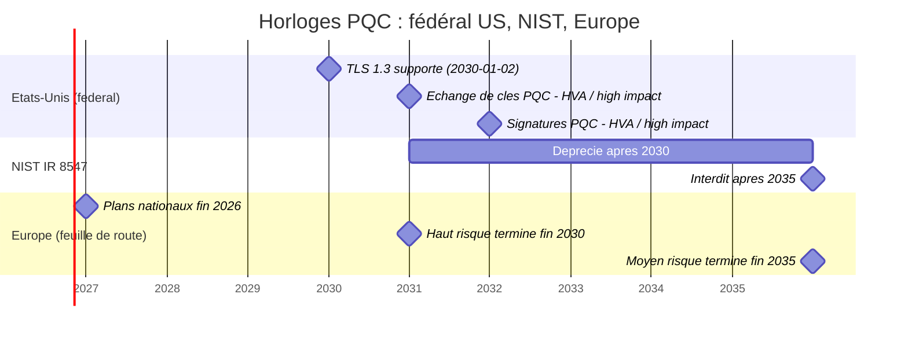
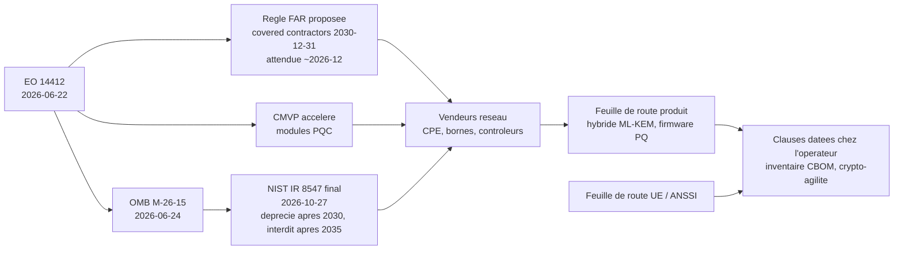

# Brief — NIST IR 8547 (Final, 2026-10-27) : le calendrier post-quantique vu par un opérateur Wi-Fi managé B2B

Rédigé le 2026-10-31 (mode brief). Vigilance maximale : sujet à portée réglementaire.
Légende de vérification : **[P]** = lu dans le document primaire (PDF/texte officiel) ; **[S]** = trouvé uniquement dans une synthèse tierce ; **[I]** = inférence de l'analyste (non écrite dans la source).

---

## 1. Thèse (1 phrase)

L'IR 8547 ne lie pas Wifirst, mais il fournit la règle de mesure (déprécié après 2030, interdit après 2035) que ses fournisseurs vont se voir imposer via le FAR, le CMVP et les appels d'offres ; l'opérateur qui ne transforme pas ces dates en jalons contractuels datés, composant par composant (CPE, bornes, contrôleur, RadSec, portail, VPN), et en inventaire cryptographique tenu à jour, achètera aujourd'hui du matériel déjà hors calendrier avant sa fin de vie.

## 2. Prémisses de la commande à corriger (à ne pas écrire telles quelles dans l'article)

1. **« Le calendrier devient contractuel » n'est pas ce que dit l'IR 8547.** Le rapport est un NIST Internal Report ; il s'adresse aux agences fédérales, fournisseurs de technologie, organismes de normalisation et laboratoires CMVP (§1.2, p.2) [P]. Il se présente comme « blueprint » pour les opérateurs d'infrastructures critiques (§1.1, p.2) [P], pas comme une obligation. Le seul vecteur contractuel documenté est l'**EO 14412 §6(c)** : une règle FAR *proposée* (délai 180 jours = environ 2026-12-19 [I, calcul depuis le 2026-06-22]) imposerait aux « covered contractors » de se conformer aux FIPS incluant les algorithmes PQC au plus tard le 2030-12-31 [P, texte EO]. « Covered contractors » n'est pas défini à l'article 2 de l'EO [P] ; aucune publication de la règle trouvée au 2026-10-31 (sources de cabinets uniquement) [S].
2. **« Interdiction après 2035 » : c'est « disallowed … under NIST standards and guidelines »**, c'est-à-dire non autorisé dans le périmètre des standards NIST/FIPS/CMVP, pas une interdiction légale générale [P]. Et « dépréciation après 2030 » signifie « utilisable, mais le propriétaire des données doit évaluer et accepter le risque » (définition SP 800-131A reprise p.14) [P].
3. **Le titre RFC 10024 n'est pas cité par l'IR 8547** : aucune occurrence de « 10024 », « X25519 » ou « CNSA » dans le PDF (grep sur le texte extrait) [P]. Le rapprochement RFC 10024 ↔ IR 8547 est le nôtre.

## 3. Angle distinct des articles déjà publiés

- 2026-10-01 « Chiffré n'est pas post-quantique : mesurez l'écart client/origine » = mesure du taux de handshakes hybrides côté Cloudflare/origine.
- 2026-10-02 « Cloudflare veut devenir CA : le post-quantique attendra 2027 » = PKI / Merkle Tree Certificates / ACME.
- Autres PQC déjà au catalogue à ne pas redoubler : ANSSI 2027 (`anssi-calendrier-post-quantique-2027-sourcing-equipements`), IPsec (`tunnels-ipsec-quatre-ans-retard-post-quantique`), RFC 9958, SD-WAN, Let's Encrypt MTC, DNSSEC ML-DSA.
- **Angle de cet article** : (a) ce que le texte final dit réellement du calendrier et ce qui a changé depuis le draft de 2024 ; (b) la chaîne d'application (EO 14412 → FAR → CMVP → vendeurs → clauses) ; (c) l'inventaire cryptographique d'un parc d'opérateur Wi-Fi managé, ordonné par risque HNDL (échange de clés) vs signatures (firmware, PKI) ; (d) un modèle de clauses fournisseurs datées. Ne pas détailler la mesure du taux hybride ni la PKI MTC (renvoyer par lien interne).

## 4. Plan proposé de l'article (≈ 1 400-1 800 mots)

1. **Accroche** : la phrase de NIST « deprecate after 2030 / disallow after 2035 » est sans effet direct sur Wifirst, mais elle règle l'horloge de vos fournisseurs. Poser la correction de prémisse (ce n'est pas contractuel tant qu'on ne l'écrit pas dans le contrat).
2. **Ce que dit vraiment le texte final** : deux dates, deux sens (déprécié ≠ interdit) ; ce qui change vs draft 2024 (la dépréciation 2030 s'étend désormais à tous les niveaux de sécurité : X25519/P-256/RSA-3072 inclus) ; ML-KEM-768 par défaut ; hybride toléré et « temporaire ».
3. **Les trois horloges à ne pas confondre** : NIST 2030/2035 (périmètre standards fédéraux) ; échéances fédérales plus tôt (2030 échange de clés, 2031 signatures, HVA/high-impact) ; Europe (feuille de route UE : 2026 plans nationaux, 2030 haut risque, 2035 reste ; ANSSI : voir article interne, source officielle non relue ici).
4. **Comment cela arrive chez vous** (schéma Mermaid n°2) : FAR → vendeurs → leurs clients ; CMVP accéléré ; CISA product categories (réseau = « en transition ») ; RFC 10024 / OpenSSL 3.5 = ce qui existe déjà côté piles.
5. **Inventaire du parc** (tableau) : composant → usage crypto → exposition HNDL ou signature → ce qu'on peut exiger → échéance. Portail captif, VPN/IPsec, RadSec/RADIUS, EAP-TLS 802.1X, WPA3-SAE/OWE (rien de standardisé), firmware CPE/bornes, API de gestion, PKI interne.
6. **Clauses fournisseurs** (liste courte, datée) : feuille de route hybride, crypto-agilité vérifiable, CBOM/SBOM, signatures de firmware PQC, statut CMVP, fenêtre de support des librairies, pas de downgrade, remplacement des matériels non migrables.
7. **Ce qu'on ne sait pas** (zones d'incertitude) et **calendrier de revue** : FAR (déc. 2026), lignes directrices CBOM CISA (mars 2027), SP 800-52 révisé, IEEE 802.11 PQC.
8. **Conclusion tranchée** : lundi matin = inventaire + une clause-type dans chaque renouvellement/appel d'offres ; ne pas acheter de matériel dont le vendeur ne date pas la feuille de route.

## 5. Faits vérifiés (avec URL et date)

### 5.1 NIST IR 8547 — document primaire [P], PDF lu intégralement (34 p., extrait par pdftotext)

| # | Fait | Où | Statut |
|---|------|----|--------|
| F1 | Titre : « Transition to Post-Quantum Cryptography Standards », NIST IR 8547, daté « October 2026 ». Auteurs : Moody, Perlner, Regenscheid, Robinson, Cooper (Cooper : « former NIST employee »). Approuvé par l'Editorial Review Board le 2026-10-21 ; historique de la page CSRC : version finale 2026-10-27. | PDF p. i-ii ; page CSRC | [P] |
| F2 | IPD publié le 2024-11-12, désormais « obsoleted » par la version finale (2026-10-27). | https://csrc.nist.gov/pubs/ir/8547/ipd ; https://csrc.nist.gov/pubs/ir/8547/final | [P] |
| F3 | Citation exacte (mot pour mot, vérifiée dans le PDF) : « NIST will deprecate quantum-vulnerable public-key cryptography after 2030 and disallow its use under NIST standards and guidelines after 2035. » | §4, p.13 | [P] |
| F4 | « The 2030-2035 deprecation window accommodates lower-risk systems and applications with legacy constraints while full migration concludes. » et « this window does not alter the earlier deadlines that apply to high value assets, high impact systems, and other high-sensitivity federal systems under EO 14412 and OMB M-26-15. » | §4, p.13 | [P] |
| F5 | Tables 2 et 4 : ECDSA, RSA (≥112 bits), EdDSA (≥128 bits), DH/MQV finite field et EC (≥112), RSA key establishment (≥112) = « Deprecated after 2030 / Disallowed after 2035 ». Aucune date au jour près (pas de « 31 décembre 2035 », pas de « 1er janvier 2031 » pour la dépréciation) dans le texte. | p.15-17 | [P] |
| F6 | **Changement vs draft 2024** : dans l'IPD, seuls les paramètres à 112 bits étaient « Deprecated after 2030 » ; les paramètres ≥128 bits étaient seulement « Disallowed after 2035 ». Dans le final, tous les niveaux listés sont « Deprecated after 2030 ». Conséquence : X25519/P-256/RSA-3072 passent en « déprécié » dès 2031. | IPD (https://nvlpubs.nist.gov/nistpubs/ir/2024/NIST.IR.8547.ipd.pdf, tables 2 et 4) vs final p.15-17 | [P] (comparaison faite par nous sur les deux PDF) |
| F7 | Le final explique que SP 800-57pt1 projetait la fin des paramètres 112 bits au 1er janvier 2031, et que NIST choisit à la place « deprecate … after 2030 and … disallow … after 2035 ». | p.15 | [P] |
| F8 | « NIST recommends using ML-KEM-768 as the default parameter set » (« large security margin at a reasonable performance cost »). Autres jeux permis si impraticable ou si niveau supérieur requis. ML-KEM est « the only approved post-quantum key-establishment scheme based on public-key cryptography » à ce jour ; HQC sélectionné comme alternative, FIPS en développement. Cette phrase « default » n'existe pas dans l'IPD (recherche textuelle négative). | §4.1.2, p.17 | [P] |
| F9 | Hybride : NIST « leaves the decision to each specific application » (coût, performance, complexité). Les solutions hybrides sont « typically expected to be temporary measures that lead to a second transition » vers du PQC seul. NIST s'engage à accepter un mode hybride (et les doubles signatures) dans la validation FIPS 140 « when suitably combined with a NIST-approved scheme ». | §3.2, p.10-11 | [P] |
| F10 | Composite KEM : SP 800-56C autorise le secret composite Z‖T, même si T vient d'une source non approuvée ; **NIST « intends to update » SP 800-56C** pour accepter FIPS 203 comme source de Z et l'ordre inversé T‖Z (futur, pas fait). Une combinaison dont au moins une entrée est approuvée peut être validée FIPS 140. | §3.2.1, p.11 ; §4.1.2, p.17-18 | [P] |
| F11 | Signatures duales acceptées si au moins une composante est approuvée NIST. | §3.2.2, p.12 | [P] |
| F12 | Priorité TLS/IKE : NIST prévoit de prioriser l'échange de clés dans les mises à jour de lignes directrices (HNDL) « particularly in interactive protocols like TLS and Internet Key Exchange (IKE) » ; TLS 1.3 « provides a practical near-term path … including through hybrid key-exchange mechanisms that combine ML-KEM with classical algorithms » ; le guide TLS sera reflété dans la prochaine révision de SP 800-52. | §4.2, p.20 | [P] |
| F13 | Les agences doivent *supporter* TLS 1.3 au plus tard le 2030-01-02 (EO 14306 et M-26-15). Le mot est « support », pas « enforce ». | §4, p.13 ; §4.2, p.20 | [P] |
| F14 | Authentification (signatures) : pas de menace HNDL ; l'authentification peut continuer avec des algorithmes vulnérables jusqu'à l'arrivée d'ordinateurs quantiques capables, puis devra basculer « immediately ». Les signatures restent urgentes à cause de la durée et de la coordination nécessaires. | §3, p.8 ; §3.1.2, p.9 | [P] |
| F15 | Firmware / matériel : si le code de vérification de signature ne peut pas être mis à jour après fabrication, l'appareil doit être conçu pour exiger des signatures résistantes quantique s'il risque d'être en service après l'arrivée d'un CRQC. Les fournisseurs matériels doivent « initiate the integration of PQC support immediately » (délais de conception/fabrication). Les signatures à état (LMS/XMSS) ne sont « not intended for general use but may be useful for applications like software and firmware signing ». | §3.1.1, p.8 ; §2.2.3, p.6 ; §2.1.1, p.3 | [P] |
| F16 | Symétrique : AES-128/192/256, SHA-2, SHA-3, Ascon restent approuvés ; les standards à 112 bits « will be disallowed in 2030 ». SHA-1 : interdit dans les modules FIPS après 2030 (note 4). | §4.1.3, p.18 | [P] |
| F17 | CMVP : NIST révise ses processus pour accélérer la validation des modules PQC (« as directed by EO 14412 »). | §3, p.8 ; EO §6(b) | [P] |
| F18 | « Organizations should treat the migration to PQC as a current operational priority, beginning with cryptographic inventories, migration planning, and early deployments of PQC-enabled products and services. » ; l'agilité cryptographique est présentée comme objectif de long terme. | §1, p.1 ; §1.1, p.2 | [P] |
| F19 | Le PDF ne contient aucune mention de Wi-Fi, RADIUS, 802.1X, VPN, portail captif, CBOM, contrats ou fournisseurs en tant que clauses (recherche textuelle). Tout ce qui concerne ces cas d'usage dans l'article est déduction ou provient d'autres sources. | PDF complet | [P] (absence) |

Communiqué NIST du 2026-10-27 : confirme 2030/2031 pour les HVA et high-impact et que « organizations that work with the federal government » seront touchées ; ne cite pas M-26-15 ni le mot « ML-KEM » : https://www.nist.gov/news-events/news/2026/10/nist-report-provides-guidelines-transition-post-quantum-cryptography [P, 2026-10-27].

### 5.2 EO 14412 — texte primaire [P] (Federal Register vol. 91, n°121, 2026-06-25, p. 38483-38486 ; signé 2026-06-22)
URL : https://www.whitehouse.gov/wp-content/uploads/2026/06/eo-14412.pdf
- Titre exact : « Securing the Nation Against Advanced Cryptographic Attacks ». Politique : migration des systèmes fédéraux vers les FIPS PQC et assistance aux opérateurs d'infrastructures critiques (§1).
- §4(b) : OMB doit, sous 90 jours, imposer aux agences la transition de tous les HVA et systèmes high-impact vers le PQC pour l'échange de clés au 2030-12-31 et pour les signatures au 2031-12-31, avec plan (HVA et high-impact hors systèmes de sécurité nationale).
- §5(d) : sous 270 jours (≈ 2027-03-19 [I, calcul]), CISA publie le contenu minimal d'un cryptographic bill of materials (CBOM).
- §6(b) : sous 180 jours, NIST révise le CMVP pour accélérer les validations.
- §6(c) : sous 180 jours (≈ 2026-12-19 [I]), le Conseil FAR publie une **règle proposée** exigeant des « covered contractors » la conformité aux FIPS (dont PQC) au plus tard le 2030-12-31.
- §6(d) : règle FAR proposée sur les politiques de divulgation de vulnérabilités, incluant les vulnérabilités cryptographiques (270 jours).
- §7(c) : l'EO ne crée pas de droit opposable. Rappel : le projet de loi H.R. 9516 (donner force de loi à l'EO) est « pending » selon des résultats de recherche secondaires [S] ; non vérifié sur congress.gov.

### 5.3 OMB M-26-15 — texte primaire [P] (2026-06-24, 5 p. + annexes)
URL : https://www.whitehouse.gov/wp-content/uploads/2026/06/M-26-15-Execution-of-the-Migration-to-Post-Quantum-Cryptography.pdf (PDF lu via pdftotext)
- Ne s'applique pas aux systèmes de sécurité nationale. Objectif : réduire autant de risque quantique que faisable au 2030-12-31 ; plan de migration sous 120 jours.
- Phases : 1 (2026-2027) inventaire/découverte ; 2 (2027-2028) pilotes ; 3 (2028-2030) échange de clés ; 4 (2031) signatures ; 5 (2035) migration complète « by 2035 » selon risque et disponibilité commerciale. Les plans doivent s'aligner sur l'IR 8547 « or successor ». Note : la note de bas de page de M-26-15 renvoie au lien *ipd* de l'IR 8547 (le mémo date de juin, avant le final).
- Systèmes incapables de supporter PQC ou le chiffrement hybride : à identifier et prioriser pour remplacement ou mise hors service ; intégrer le PQC aux renouvellements matériels (§3.C.3).
- §3.C.4 : exigences produit alignées sur les catégories CISA ; clarifier les responsabilités PQC avec les CSP FedRAMP.
- Annexe A : hybride = « intricate and resource-intensive stopgap » (terme du mémo) ; TLS 1.3 : exemple de groupe hybride avec x25519 + ML-KEM-768 ; crypto-agilité = algorithmes dans la configuration, pas compilés ; négociation de suites ; configuration pour n'accepter que les algorithmes acceptables (anti-downgrade) ; KMS/HSM capables de gérer clés ECC et PQC ; inventaire automatisé alimentant un CBOM (SCA/SBOM, SAST/DAST, scanners réseau).

### 5.4 RFC 10024 — standard IETF [P]
URL : https://datatracker.ietf.org/doc/rfc10024/ et https://www.rfc-editor.org/rfc/rfc10024.html
- **Titre exact** : « Post-Quantum Traditional (PQ/T) Hybrid Key Agreement Mechanisms for TLS 1.3 ». Date : **août 2026** (datatracker : dernière mise à jour 2026-08-10). Statut : Proposed Standard (voie Standards Track IETF). Auteurs : K. Kwiatkowski (PQShield), P. Kampanakis (AWS), B. E. Westerbaan (Cloudflare), D. Stebila (Univ. of Waterloo). Groupe de travail TLS (ex draft-ietf-tls-ecdhe-mlkem).
- Trois groupes définis : **X25519MLKEM768** (0x11EC, 4588) — IANA « Recommended = Y » ; SecP256r1MLKEM768 (0x11EB, 4587) — Recommended = N ; SecP384r1MLKEM1024 (0x11ED, 4589) — Recommended = N. Le § 7.4 rend obsolètes les entrées pré-standard Kyber768 draft.
- S'appuie normativement sur RFC 9846 (TLS 1.3) et RFC 9954 (« Hybrid Key Exchange in TLS 1.3 », juillet 2026, **Informational**, Stebila/Fluhrer/Gueron : https://www.rfc-editor.org/rfc/rfc9954.html).
- **Chronologie à respecter** : RFC 10024 (août 2026) est antérieur de ~2 mois à l'IR 8547 final (2026-10-27) ; elle n'a pas été publiée « en même temps ». Le seul lien documenté est l'exemple x25519 + ML-KEM-768 dans M-26-15 (juin 2026) et dans le texte de l'IR (hybride ML-KEM + classique dans TLS 1.3, sans nommer le groupe).

### 5.5 Mise en œuvre côté piles et normes Wi-Fi/EAP
- **OpenSSL 3.5** (LTS publié le 2025-04-08, supporté jusqu'au 2030-04-08 ; ajoute ML-KEM, ML-DSA, SLH-DSA) : https://openssl-library.org/post/2025-04-08-openssl-35-final-release/ [P]. Les notes de version indiquent que les key shares TLS par défaut offrent X25519MLKEM768 et X25519 et que la liste des groupes préfère les KEM hybrides PQC : https://github.com/openssl/openssl/discussions/27299 [P]. OpenSSL 3.0 : correctifs de sécurité jusqu'au 2026-09-07 (donc terminé au 2026-10-31) [P, même page de release].
- **draft-ietf-emu-pqc-eap-tls-02** (T. Reddy, Nokia ; 2026-09-23 ; expire 2027-03-27 ; Standards Track visé ; **Internet-Draft = travail en cours**) : https://www.ietf.org/archive/id/draft-ietf-emu-pqc-eap-tls-02.html [P]. Exige, pour les déploiements à confidentialité longue durée, TLS 1.3 et un groupe d'accord de clés PQ ou hybride ; renvoie à RFC 9954/10024 ; X25519MLKEM768 est le seul groupe hybride « Recommended » au moment de l'écriture ; une chaîne de certificats doit être PQ ou hybride jusqu'à l'ancre de confiance ; ne mentionne ni RADIUS ni RadSec ni 802.1X nommément (Wi-Fi/AP cités seulement). Couvre EAP-TLS, EAP-TTLS, PEAP, TEAP.
- **IEEE 802.11 PQC Study Group** (présidence Stephen Orr, Cisco) : PAR/CSD approuvés au plenary de juillet 2025 et soumis ; objectifs : mettre à jour ou créer des AKM résistants, et examiner SAE, OWE, AP PeerKey, FILS, PASN : https://grouper.ieee.org/groups/802/11/Reports/pqc_update.htm [P]. Aucune mise à jour postérieure trouvée ; **aucun standard Wi-Fi PQC publié** à ma connaissance de cette recherche [I].
- **CISA – Product Categories for Technologies That Use PQC Standards** (2026-01-23) : « Networking Hardware », « Networking Software », ICAM software/hardware (PKI, HSM) sont dans la liste « Transitioning » (pas encore largement disponibles) ; pas de catégorie explicite pour points d'accès Wi-Fi ni VPN : https://www.cisa.gov/resources-tools/resources/product-categories-technologies-use-post-quantum-cryptography-standards [P].

### 5.6 Cadre européen / français (pertinent pour un opérateur français)
- **Feuille de route UE coordonnée, partie 1, v1.1, 11.06.2025** (Groupe de coopération NIS ; page Commission datée 2025-06-23 : https://digital-strategy.ec.europa.eu/en/library/coordinated-implementation-roadmap-transition-post-quantum-cryptography ; texte lu sur un miroir PDF du document, https://www.key4biz.it/wp-content/uploads/2025/06/Roadmap_on_postquantum_cryptography_PzBJxNUYyeuEdVUacWL696DofZQ_117507.pdf) [P, via miroir] : fin 2026 plans nationaux et pilotes ; **fin 2030** transition des cas d'usage à haut risque terminée et « quantum-safe software and firmware upgrades are enabled by default » ; **fin 2035** cas à risque moyen terminés, faible risque « as much as feasible » ; pour le haut risque, les mécanismes à clé publique vulnérables « shall not be used stand-alone after the end of 2030 » (2035 pour risque moyen) ; hybride standardisé recommandé « whenever feasible and suitable » ; recommandation de mettre à jour au moins les routines de mise à jour firmware avec des signatures quantum-safe ; crypto-agilité à intégrer dans les achats publics ; lien avec NIS2/DORA/CRA. Le texte cite l'*initial public draft* de l'IR 8547, pas le final.
- **ANSSI** : l'ANSSI viserait des obligations PQC pour l'entrée en qualification des produits à partir de 2027 et déconseillerait l'achat de produits sans PQC après 2030 ; préconise l'hybridation. **Seulement [S]** : synthèses de presse (Clubic, 2026-06-19, qui précise que les dates sont des paraphrases du journaliste d'une intervention de l'ANSSI, pas une citation) ; la page cyber.gouv.fr (FAQ PQC) est protégée anti-bot (Incapsula) et n'a pas pu être lue. L'article doit donc renvoyer à notre papier interne `anssi-calendrier-post-quantique-2027-sourcing-equipements` ou citer la FAQ ANSSI après relecture manuelle.

### 5.7 Synthèses tierces sur l'IR 8547 (écarts constatés contre le PDF)
Sources : Quantum Computing Report (2026-10-27) https://quantumcomputingreport.com/nist-releases-final-ir-8547-establishing-definitive-post-quantum-cryptography-transition-timeline-and-deprecation-schedules/ ; postquantum.com https://postquantum.com/security-pqc/nist-ir-8547-final/ ; Help Net Security (2026-10-28) https://www.helpnetsecurity.com/?p=389358.

| Affirmation de la synthèse | Constat vs PDF |
|---|---|
| QCR : « disallowance on December 31, 2035 » ; fenêtre « 2031–2035 » | **Non écrit dans le PDF** : le texte dit « after 2030 » / « after 2035 ». À ne pas reprendre au jour près. |
| QCR : agences doivent « enforce TLS 1.3 by January 2, 2030 » | Le PDF et M-26-15 disent *support* TLS 1.3 au plus tard le 2030-01-02. |
| QCR : SP 800-56C et SP 800-227 « were updated » pour composer PQC et classique | Le PDF dit que NIST **« intends to update »** SP 800-56C (futur) ; SP 800-227 est citée pour les combineurs de clés. |
| QCR : hybride « advised for immediate deployment » | Le PDF laisse la décision à chaque application et qualifie l'hybride de mesure « typically expected to be temporary » ; ce n'est pas une recommandation d'urgence de NIST. (Le communiqué NIST dit seulement que l'hybride est accommodé.) |
| QCR : LMS/XMSS « approved only for software, firmware, and secure boot signing » | Le PDF dit « not intended for general use but may be useful for applications like software and firmware signing » ; pas de restriction formelle trouvée dans ce rapport. |
| QCR : Ascon « Category 1–5 » | Tables 7-8 : Ascon-AEAD128 catégorie 1 ; Ascon-Hash256 catégorie 2. |
| QCR : « FN-DSA » | Le PDF écrit « a digital signature algorithm derived from FALCON » ; le nom FN-DSA n'apparaît pas. |
| QCR : « 112-bit legacy symmetric disallowed after 2030 » | PDF : « will be disallowed in 2030 ». Nuance de formulation. |
| QCR : ML-KEM-768 par défaut ; EO 14412 / M-26-15 ; 2030/2031 ; dépréciation après 2030 et interdiction après 2035 ; hybride autorisé en FIPS 140 si une entrée approuvée | Confirmé par le PDF. |
| postquantum.com : nombreux numéros de sections/tables, « Section 5 » citant RFC 10024, errata de tables | **Non retrouvé** dans le PDF (aucune mention de RFC 10024) ; ne pas citer cette source pour des détails de structure. Les dates 2030/2035 et les seuils 112/128 bits concordent. |

QCR et postquantum.com ne doivent donc pas être cités comme source des faits NIST : utiliser le PDF NIST (https://nvlpubs.nist.gov/nistpubs/ir/2026/NIST.IR.8547.pdf) ou la page CSRC.

## 6. Sources retenues (numérotées — 17 sources distinctes)

1. **NIST CSRC – page IR 8547 Final** — https://csrc.nist.gov/pubs/ir/8547/final — primaire — 2026-10-27
2. **NIST IR 8547 (PDF final)** — https://nvlpubs.nist.gov/nistpubs/ir/2026/NIST.IR.8547.pdf — primaire — 2026-10 (approuvé 2026-10-21)
3. **NIST – communiqué** — https://www.nist.gov/news-events/news/2026/10/nist-report-provides-guidelines-transition-post-quantum-cryptography — primaire — 2026-10-27
4. **NIST IR 8547 IPD (page + PDF)** — https://csrc.nist.gov/pubs/ir/8547/ipd ; https://nvlpubs.nist.gov/nistpubs/ir/2024/NIST.IR.8547.ipd.pdf — primaire (draft) — 2024-11-12
5. **EO 14412** — https://www.whitehouse.gov/wp-content/uploads/2026/06/eo-14412.pdf (Federal Register 91 FR 38483) — réglementaire — 2026-06-22 / 2026-06-25
6. **OMB M-26-15** — https://www.whitehouse.gov/wp-content/uploads/2026/06/M-26-15-Execution-of-the-Migration-to-Post-Quantum-Cryptography.pdf — réglementaire — 2026-06-24
7. **RFC 10024** — https://datatracker.ietf.org/doc/rfc10024/ — standard IETF — août 2026
8. **RFC 9954** — https://www.rfc-editor.org/rfc/rfc9954.html — standard IETF (Informational) — juillet 2026
9. **draft-ietf-emu-pqc-eap-tls-02** — https://www.ietf.org/archive/id/draft-ietf-emu-pqc-eap-tls-02.html — Internet-Draft — 2026-09-23
10. **IEEE 802.11 PQC Study Group** — https://grouper.ieee.org/groups/802/11/Reports/pqc_update.htm — normalisation — juillet 2025 (dernier compte rendu)
11. **CISA – Product Categories for PQC** — https://www.cisa.gov/resources-tools/resources/product-categories-technologies-use-post-quantum-cryptography-standards — régulateur — 2026-01-23
12. **OpenSSL 3.5 release + notes** — https://openssl-library.org/post/2025-04-08-openssl-35-final-release/ ; https://github.com/openssl/openssl/discussions/27299 — vendor/open source — 2025-04-08
13. **Feuille de route UE PQC (NIS CG), v1.1** — https://digital-strategy.ec.europa.eu/en/library/coordinated-implementation-roadmap-transition-post-quantum-cryptography (page Commission, 2025-06-23) ; texte via miroir key4biz — régulateur UE — 2025-06-11
14. **Quantum Computing Report** — URL ci-dessus — actu/synthèse (secondaire, écarts listés §5.7) — 2026-10-27
15. **postquantum.com** — https://postquantum.com/security-pqc/nist-ir-8547-final/ — analyse (secondaire, écarts listés) — 2026-10
16. **Help Net Security** — https://www.helpnetsecurity.com/?p=389358 — presse spécialisée — 2026-10-28
17. **Clubic (ANSSI 2027/2030, paraphrase)** — https://www.clubic.com/actualite-617680-face-a-la-menace-quantique-l-anssi-renforce-ses-exigences-de-certification.html — presse — 2026-06-19

Mix : 1 source primaire (NIST) x4, réglementaire x3 (EO, OMB, UE) + régulateur CISA, standards/techniques x4 (RFC 10024, 9954, draft EMU, IEEE) + OpenSSL, validation presse/analyse x4 (dont 3 secondaires à écarts signalés). Pas d'analyste tiers type Dell'Oro/Gartner/IDC trouvé sur ce sujet : ne pas en inventer.

## 7. Où le parc d'un opérateur Wi-Fi managé est concerné (matrice pour le tableau de l'article)

Rappel : ce tableau est de l'**analyse [I]** appuyée sur F12-F15, M-26-15 et l'EU roadmap ; le PDF NIST ne traite pas ces cas d'usage.

| Composant | Crypto à clé publique en jeu | Priorité (logique NIST) | Que demander / mesurer |
|---|---|---|---|
| Portail captif (HTTPS, API vers contrôleur/CRM) | ECDHE/RSA (échange) + certificat RSA/ECDSA | Échange de clés d'abord (HNDL : identifiants et données de séjour) ; certificat ensuite (voir article MTC) | TLS 1.3 de bout en bout ; groupe X25519MLKEM768 négocié côté client et origine ; lien interne vers la mesure client/origine |
| VPN / IPsec CPE↔cœur, SD-WAN | IKEv2 (ECDH), certificats | Priorité haute (NIST cite IKE explicitement, F12) | Échange de clés hybride ML-KEM dans IKE ; voir article interne IPsec ; clause de date |
| RadSec (RADIUS sur TLS) bornes/contrôleur ↔ AAA | TLS + certificats mutuels | Haute (tunnel qui transporte l'authentification) | TLS 1.3 + groupe hybride ; bibliothèque (OpenSSL ≥ 3.5 ou équivalent) ; chaînes de certificats internes |
| 802.1X EAP-TLS / PEAP / TEAP | Handshake TLS interne + certificats clients | Haute pour l'échange de clés ; signatures plus tard | draft EMU (non final) : à suivre, non à exiger comme conformité |
| WPA3-Personal (SAE), OWE | ECDH (SAE/OWE) ; chiffrement radio AES | Pas de solution standardisée aujourd'hui | Suivi IEEE 802.11 PQC SG ; ne pas promettre de « Wi-Fi post-quantique » ; AES lui-même reste approuvé (F16) [I pour le lien AES/WPA3] |
| Firmware CPE/bornes (secure boot, OTA) | Signatures RSA/ECDSA | Signatures : durée de vie du matériel > 2035 est le vrai risque (F15 + EU 2030 « firmware upgrades enabled by default ») | Racine de confiance capable de vérifier une signature PQ/hybride ; LMS/XMSS ou ML-DSA ; mise à jour de la clé de vérif possible |
| Gestion distante (TR-069/TR-369, SSH, MQTT, API cloud) | TLS/SSH + certificats | Haute si trafic traverse Internet | TLS 1.3 + groupes hybrides ; SSH hybride à vérifier fournisseur par fournisseur |
| PKI interne / HSM / ACME | CA RSA/ECDSA | Signatures 2031 pour les périmètres prioritaires fédéraux ; pour vous : plan de CA hybride/PQ | HSM capable ML-DSA/ML-KEM ; CBOM ; agilité des profils de certificats |
| Bibliothèques crypto embarquées | OpenSSL 1.1.1 / 3.0 / 3.5, wolfSSL, mbedTLS… | Dépend de l'âge du firmware | OpenSSL 3.0 : plus de correctifs de sécurité depuis 2026-09-07 ; OpenSSL 3.5 : fin de support 2030-04-08 = même année que la dépréciation NIST [I : un firmware livré avec 3.5 devra changer de LTS avant 2030] |

## 8. Clauses fournisseurs à proposer (présentées comme proposition d'analyste, pas comme exigence NIST)

1. **Feuille de route datée par produit** (modèle/SoC/firmware) : date de disponibilité de l'échange de clés hybride ML-KEM (référence : groupe X25519MLKEM768, RFC 10024) pour TLS (RadSec, EAP-TLS, gestion), IKEv2 et SSH, avec ML-KEM-768 par défaut (F8).
2. **Crypto-agilité vérifiable** : algorithmes et groupes pilotables par configuration, négociation sans recompilation, possibilité de n'autoriser que des algorithmes acceptables (anti-downgrade) — reprise de M-26-15 Annexe A §5.
3. **Signature des mises à jour** : le vendeur s'engage sur une date pour des signatures de firmware résistantes quantique (ou hybrides) et sur la possibilité de mettre à jour la clé de vérification (F15 ; UE 2030).
4. **Inventaire livré** : SBOM + CBOM par version de firmware (M-26-15 Annexe A §6 ; EO §5(d) : contenu minimal CISA attendu vers mars 2027 [I]).
5. **Statut CMVP/FIPS 140-3** des modules (et délai de validation des modules PQC) ; engagement de suivre les révisions NIST (SP 800-52, SP 800-56C, SP 800-131A).
6. **Fenêtre de support** : version de la bibliothèque crypto livrée, date de fin de support, engagement de montée de LTS avant 2030.
7. **Pas de rétrogradation silencieuse** : journalisation des groupes négociés ; refus configurable des suites classiques seules.
8. **Remplacement** : si le matériel ne peut techniquement pas supporter le PQC/hybride, droit de remplacement ou de réduction de prix (M-26-15 §3.C.3 raisonne ainsi pour les agences).
9. **Clause de flow-down** : si le vendeur est lui-même soumis au FAR (sous-traitant fédéral), il informe de la date de conformité qu'il a déclarée à ses clients américains — [I], utile pour obtenir sa feuille de route réelle.

## 9. Contradictions / zones grises (à signaler dans l'article)

- **Dates exactes** : « après 2030 » et « après 2035 » ne sont pas convertis en jours dans l'IR ; les synthèses qui écrivent « 31 décembre 2035 » ou « 2031-2035 » extrapolent. Seules les échéances des EO/OMB sont au jour près (2030-12-31, 2031-12-31, 2030-01-02).
- **Portée juridique** : IR 8547 = guide NIST pour les agences fédérales ; hors États-Unis, aucun effet direct. Le FAR n'est qu'une règle *proposée* dont le périmètre (« covered contractors ») n'est pas défini ; au 2026-10-31 non publiée d'après des sources secondaires. H.R. 9516 : statut non vérifié à la source.
- **Hybride** : NIST le tolère et le dit temporaire ; M-26-15 le qualifie de « stopgap » complexe ; l'UE et l'ANSSI [S] le recommandent. Message honnête : l'hybride est un choix de politique selon la juridiction, pas une exigence NIST.
- **Statut du groupe X25519MLKEM768** : « Recommended » dans le registre IANA/RFC 10024 ; le groupe est de type ECDHE-d'abord/ML-KEM, donc la validation FIPS 140 d'une combinaison où l'une des entrées est non approuvée est permise (F10) mais le détail pour les entrées « Z‖T » inversées dépend d'une mise à jour future de SP 800-56C (futur).
- **IR 8547 vs EU roadmap** : l'UE s'appuie encore sur le draft de 2024 ; dans le final, la dépréciation 2030 couvre aussi les paramètres à 128 bits (F6). Ne pas affirmer que « l'UE s'est alignée sur le final ».
- **ANSSI** : seulement des paraphrases de presse lues ; dates 2027/2030 et position hybride à confirmer sur cyber.gouv.fr avant publication.
- **Wi-Fi** : aucun standard IEEE 802.11 ni profil Wi-Fi Alliance PQC publié ; le draft EMU n'est pas un standard ; des affirmations sur hostapd/FreeRADIUS/ISE n'ont pas été vérifiées (un forum Cisco indiquait qu'ISE ne supportait que RADIUS/DTLS, daté incertain : ne pas citer).
- **Pas d'analyste tiers** : aucune donnée Dell'Oro/IDC/Gartner sur l'état du PQC dans les CPE/AP trouvée ; ne pas avancer de taux d'adoption.
- **Revue à prévoir après publication** : règle FAR (≈ 2026-12-19), CBOM CISA (≈ 2027-03-19), SP 800-52 révisé, SP 800-56C révisé, SP 800-131A r3 final.

## 10. Schémas Mermaid suggérés (à valider dans le rendu du blog)

**Schéma 1 — Les deux horloges (frise)**

Note de rédaction : les dates NIST « après 2030 / après 2035 » sont représentées par des bornes de convenance ; l'article doit le préciser en légende.

**Schéma 2 — Comment une règle américaine arrive dans votre contrat Wi-Fi**

(Option : un tableau d'inventaire plutôt qu'un 3e schéma.)

## 11. Prompts d'images (anglais, nano-banana-pro) — illustration éditoriale tech, sans texte ni logo

**Cover**
Flat editorial tech illustration, deep navy and teal palette: a long calendar-like timeline road crossing a split sky, classical padlock icons fading into dotted lines on the left and lattice-shaped quantum-safe keys glowing on the right, a distant Wi-Fi access point on a ceiling; clean vector style, no text, no logo.

**Inline 1 — the two meanings of the dates**
Minimal editorial illustration of two gates on a road: a half-open amber gate labeled only by a warning-triangle icon (deprecated) and a closed red gate further away (disallowed), tiny network devices queued before them, isometric flat style, muted blue background, no text, no logo.

**Inline 2 — the contract chain**
Isometric diagram-style illustration of a chain of documents flowing from a government-building silhouette through a factory of routers and access points down to a hotel lobby with a Wi-Fi ceiling unit, arrows as clean lines, teal and orange accents on dark navy, no text, no logo.

**Inline 3 — inventory of the fleet**
Top-down editorial illustration of a warehouse shelf grid holding Wi-Fi access points, routers and customer premises boxes, each tagged with a small colored key-shaped marker (green, amber, red) and a magnifying glass scanning one row, flat vector style, calm blue-gray palette, no text, no logo.

## 12. Vérifications restant à faire par le writer / fact-checker

- Relire la FAQ ANSSI sur cyber.gouv.fr (bloquée ici) avant toute phrase sur 2027/2030/hybridation ; sinon renvoyer vers l'article interne.
- Ne pas écrire « 31 décembre 2035 », « 2031-2035 », « enforce TLS 1.3 », « SP 800-56C mis à jour », « l'hybride est recommandé par NIST ».
- Écrire RFC 10024 = août 2026 ; IR 8547 final = 2026-10-27 ; RFC 9954 = juillet 2026 (Informational).
- Citer les chiffres du PDF avec leur page (p.13, p.15-17) ; seules citations littérales validées : F3, F8 (« NIST recommends using ML-KEM-768 as the default parameter set »), F9 (« typically expected to be temporary measures »), F18, F12 (« a practical near-term path »).
- Les tableaux §7 et §8 sont de l'analyse du blog ; le marquer comme tel dans l'article.
