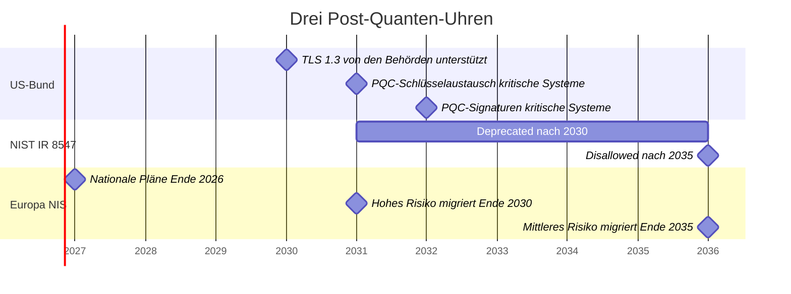
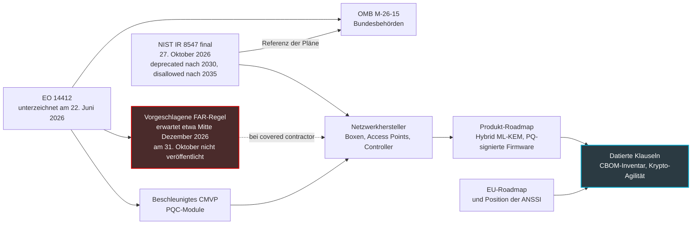

## Acht Jahre an der Decke

In einem Hotel, einem Studierendenwohnheim oder einem Geschäft hat ein WLAN-Access-Point nichts mit einem Smartphone gemein. Man schraubt ihn an die Decke, steuert ihn aus der Ferne und fasst ihn jahrelang nicht mehr an. In unserem Geschäft sind acht Jahre Betrieb nichts Außergewöhnliches. Der Access Point, den ein Netzwerkeinkäufer im Frühjahr 2027 bestellt, wird also mit guter Wahrscheinlichkeit 2035 noch in Betrieb sein.

Und 2035 steht jetzt schwarz auf weiß fest. Am 27. Oktober hat das NIST (National Institute of Standards and Technology, das US-Institut, dessen Kryptografie-Normen weit über die Vereinigten Staaten hinaus maßgeblich sind) die finale Fassung seines Berichts zum Übergang zur Post-Quanten-Kryptografie veröffentlicht, also zu jener Kryptografie, die künftigen Quantencomputern standhalten soll. Die Botschaft besteht aus zwei Jahreszahlen. Die Public-Key-Kryptografie, die wir überall einsetzen, vom Captive Portal bis zum Firmware-Update, wird nach 2030 als *deprecated* eingestuft und nach 2035 im Geltungsbereich der NIST-Standards untersagt.

Dieser Bericht bindet kein französisches Unternehmen. Er verpflichtet weder den Hotelier noch die Handelskette noch den Betreiber, der deren Netz verwaltet. Aber er stellt die Uhr der Hersteller, die ihnen Access Points, Boxen und Controller verkaufen, und zwar genau in dem Moment, in dem Washington eine Beschaffungsregel vorbereitet, die für einen Teil von ihnen verbindlich werden könnte.

Eine Uhr, die in keinem Vertrag steht, klingelt bei niemandem. Das eigentliche Thema ist also nicht das NIST. Es ist Ihre nächste Ausschreibung.

## Deprecated heißt nicht disallowed

Ein Satz des Berichts wird in den kommenden Monaten in jeder Verkaufspräsentation auftauchen. Lesen wir ihn lieber im genauen Wortlaut (§4, S. 13): „NIST will deprecate quantum-vulnerable public-key cryptography after 2030 and disallow its use under NIST standards and guidelines after 2035."

Zwei Verben, zwei Regime. Stellen Sie sich zwei Schranken auf derselben Straße vor. Die erste, orange, bleibt halb offen: Man kommt durch, unterschreibt aber einen Haftungsverzicht. Genau das bedeutet *deprecated* in der NIST-Doktrin (Definition der SP 800-131A, auf S. 14 übernommen): Der Algorithmus bleibt nutzbar, sofern der Dateneigner das Risiko bewertet und akzeptiert.

Die zweite Schranke, rot, ist geschlossen. Aber sie sperrt nur die Straße der NIST-Standards. *Disallowed* heißt: in den Bundesstandards und den daraus abgeleiteten Validierungen nicht zugelassen, nicht etwa gesetzlich verboten.

Ein weiterer Punkt, den eilige Zusammenfassungen unterschlagen: Keines der beiden Daten ist tagesgenau angegeben. Einige kurz nach der Veröffentlichung erschienene Zusammenfassungen haben sie in Kalendertage umgerechnet; im PDF steht das nirgends. Nur die Texte des Weißen Hauses setzen tagesgenaue Fristen.

### Was sich seit 2024 wirklich bewegt hat

Die gewichtigste Änderung gegenüber dem Entwurf vom November 2024 steckt in zwei Tabellen (Tabellen 2 und 4, S. 15-17). Im Entwurf wurden nur die Parameter mit 112 Bit Sicherheit, etwa RSA-2048, nach 2030 als deprecated eingestuft; die stärkeren Größen waren nur vom Verbot 2035 erfasst. In der finalen Fassung rutschen alle aufgeführten Sicherheitsstufen nach 2030 in die orange Zone. In der Praxis heißt das: Die Optionen, die man für zehn Jahre als komfortabel ansah (RSA-3072, die elliptischen Kurven P-256 oder X25519), fallen zusammen mit allen anderen unter den Haftungsverzicht.

Die zweite Neuerung ist für einen Einkäufer nützlicher: Das NIST nennt endlich einen Standardwert. „NIST recommends using ML-KEM-768 as the default parameter set" (§4.1.2, S. 17). ML-KEM ist der post-quantensichere Schlüsselaustausch, der unter der Bezeichnung FIPS 203 normiert ist (die FIPS sind die US-Bundesnormen zur Informationsverarbeitung). Es ist bis heute das einzige zugelassene Verfahren dieser Art; HQC wurde als Alternative ausgewählt, aber seine Norm ist noch in Arbeit. Dieser Satz fehlte im Entwurf, und er verändert das Leben all derer, die Lastenhefte schreiben: Man kann endlich einen konkreten Namen hineinschreiben statt einer Absichtserklärung.

Bleibt der Hybrid, der in einem einzigen Austausch einen klassischen Schlüssel und einen ML-KEM-Schlüssel kombiniert. Hält der eine nicht, hält der andere: Gürtel und Hosenträger. Das NIST schreibt ihn nicht vor. Es überlässt die Entscheidung der jeweiligen Anwendung und erinnert daran, dass solche Konstruktionen „typically expected to be temporary measures" sind, eine Etappe vor einem zweiten Übergang zur reinen Post-Quanten-Kryptografie. Dafür sagt es zu, sie in der FIPS-140-Validierung, der US-Zertifizierung für kryptografische Module, zu akzeptieren, sobald einer der kombinierten Bausteine zugelassen ist.

Das Umsetzungsmemo des Weißen Hauses, auf das wir weiter unten kommen, sieht im Hybrid ein komplexes und ressourcenhungriges Notpflaster. Die europäische Roadmap empfiehlt ihn dagegen überall dort, wo es machbar ist. Dasselbe Wort, drei Haltungen.

Meine ist einfach: Für einen französischen Betreiber ist der Hybrid bis 2030 der einzig gangbare Weg. Europa drängt darauf, das NIST duldet ihn, und kein CIO will sein Netz auf eine einzige, im Produktivbetrieb noch junge Algorithmenfamilie setzen.

*Deprecated nach 2030, disallowed nach 2035: zwei Schranken, zwei unterschiedliche Rechtsregime und kein tagesgenaues Datum im NIST-Text.*

## Drei Uhren an derselben Wand

Der NIST-Bericht ist nicht die einzige Uhr, auf die man achten muss, und auch nicht die eiligste. Die US-Behörden müssen schneller sein als er.

Am 22. Juni 2026 hat die Executive Order 14412 (ein US-Präsidialerlass) die Linie vorgegeben. Zwei Tage später hat das Memo M-26-15 des OMB (Office of Management and Budget, das Haushaltsamt des Weißen Hauses) sie konkretisiert. Bundessysteme mit hohem Wert oder hoher Auswirkung müssen ihren Schlüsselaustausch bis zum 31. Dezember 2030 und ihre Signaturen bis zum 31. Dezember 2031 auf Post-Quanten-Kryptografie (PQC, für post-quantum cryptography) umstellen. Das NIST stellt selbst klar, dass sein Zeitfenster 2030-2035 diese früheren Fristen nicht verschiebt (§4, S. 13).

Die Behörden müssen außerdem spätestens am 2. Januar 2030 TLS 1.3 unterstützen. Unterstützen, nicht erzwingen.

Das Memo hat noch einen weiteren Vorzug: Es gliedert den Weg in Phasen, die ein privater CIO fast unverändert übernehmen kann. Inventur und Discovery 2026-2027, Pilotprojekte 2027-2028, Schlüsselaustausch von 2028 bis 2030, Signaturen 2031, vollständige Migration bis 2035 je nach Risiko und verfügbarem kommerziellem Angebot.

Die dritte Uhr ist unsere eigene. Die koordinierte Roadmap, die die NIS-Kooperationsgruppe im Juni 2025 veröffentlicht hat (sie versammelt die Mitgliedstaaten rund um die europäische Cybersicherheitsrichtlinie), sieht nationale Pläne und Pilotprojekte für Ende 2026 vor. Es folgen die Migration der Anwendungsfälle mit hohem Risiko bis Ende 2030, die der Fälle mit mittlerem Risiko bis Ende 2035 und die des geringen Risikos, soweit machbar. Für das hohe Risiko dürfen verwundbare Public-Key-Mechanismen nach Ende 2030 nicht mehr allein eingesetzt werden. Dieselbe Frist gilt für resistente Software- und Firmware-Updates, die standardmäßig aktiviert sein sollen.

Ein Detail, das zählt: Dieses europäische Dokument stützt sich auf den NIST-Entwurf von 2024, nicht auf die finale Fassung. Man kann also nicht behaupten, Brüssel sei auf die ausgeweitete Deprecation für die stärksten Parameter abgestimmt.

Auf französischer Seite würde die ANSSI ab 2027 post-quantensichere Anforderungen für die Qualifizierung von Produkten anstreben und nach 2030 vom Kauf von Produkten ohne Post-Quanten-Kryptografie abraten. Diese Daten stammen aus einer Presseparaphrase (Clubic, 19. Juni 2026) eines Auftritts der Behörde, nicht aus einem offiziellen Text, den ich gegengelesen hätte; die Hybridisierung, die die ANSSI in ihrer FAQ empfehlen würde, wird dort nicht behandelt und muss an der Quelle überprüft werden. Diese Angaben sind an der Quelle zu bestätigen, und genau darum geht es in [unserem Artikel zum ANSSI-Kalender 2027 und zur Beschaffung von Geräten](https://wifirst-tech-blog.web.app/post?slug=anssi-calendrier-post-quantique-2027-sourcing-equipements).

*Drei Uhren an derselben Wand. Die NIST-Grenzen sind per Konvention auf den 1. Januar 2031 und den 1. Januar 2036 gelegt: Der Bericht sagt lediglich „nach 2030" und „nach 2035". Kritische Systeme bezeichnet hier die Bundessysteme mit hohem Wert oder hoher Auswirkung.*

## Von Washington bis zur Lobbydecke

Ihr Access-Point-Hersteller verkauft vielleicht auch an die US-Regierung. In wenigen Monaten könnte er sich dort schriftlich auf ein Datum für die Post-Quanten-Konformität festlegen müssen. An diesem Tag wird er eine datierte Roadmap besitzen. Die ganze Frage ist, ob Sie Zugang dazu haben werden.

Gehen wir vom Text selbst aus. Der IR 8547 ist ein interner NIST-Bericht (NIST Internal Report), gerichtet an Bundesbehörden, Technologieanbieter, Normungsorganisationen und Validierungslabore (§1.2, S. 2). Für Betreiber kritischer Infrastrukturen versteht er sich als Referenzplan (§1.1), nicht als Verpflichtung. Er enthält übrigens keinerlei Erwähnung von WLAN, RADIUS, VPN oder Lieferantenklauseln.

Der vertragliche Hebel liegt woanders, in Abschnitt 6(c) des Erlasses 14412. Dieser fordert den für das FAR zuständigen Rat (Federal Acquisition Regulation, das Beschaffungsrecht des US-Bundes) auf, binnen 180 Tagen eine *vorgeschlagene* Regel zu veröffentlichen. Sie würde die *covered contractors* verpflichten, spätestens am 31. Dezember 2030 die FIPS-Standards einzuhalten, einschließlich der Post-Quanten-Algorithmen. Die Frist läuft etwa Mitte Dezember 2026 ab.

Drei Vorbehalte sind nötig. Es handelt sich nur um eine vorgeschlagene, nicht um eine endgültige Regel, und ich habe bis zum 31. Oktober keine Veröffentlichung davon gefunden. Der Erlass definiert nicht, wer die *covered contractors* sind. Und er stellt selbst klar, dass er keine einklagbaren Rechte begründet. Alles Folgende steht also im Konjunktiv.

*Die Umsetzungskette, wie ich sie lese. Nur die FAR-Regel würde eine vertragliche Verpflichtung schaffen, und zwar ausschließlich für die betroffenen Lieferanten. Alles andere gelangt nur über Ihren eigenen Vertrag zu Ihnen.*

Die übrigen Zahnräder drehen sich bereits. Derselbe Erlass fordert das NIST auf, das CMVP (Cryptographic Module Validation Program, das Programm, das die FIPS-140-Validierungen vergibt) für Post-Quanten-Module zu beschleunigen, und der Bericht bestätigt, dass seine Prozesse gerade überarbeitet werden. Die CISA, die US-Bundesbehörde für Cybersicherheit, führt Netzwerkhardware und -software seit Januar 2026 unter den Übergangskategorien, in denen Post-Quanten-Produkte noch nicht breit verfügbar sind. Keine Kategorie nennt ausdrücklich WLAN-Access-Points oder VPNs.

Bei den Protokollen ist das Material vorhanden. Die RFC 10024, im August 2026 von der IETF (der Organisation, die die Internetprotokolle standardisiert) veröffentlicht, definiert die hybriden Schlüsselaustauschgruppen für TLS 1.3. Nur eine der drei ist im IANA-Register als empfohlen markiert: X25519MLKEM768, die die Kurve X25519 mit ML-KEM-768 verbindet.

Der NIST-Bericht zitiert diese RFC nicht; die Verknüpfung stammt von mir. Er beschreibt TLS 1.3 aber als „a practical near-term path" zur Post-Quanten-Kryptografie, Hybridisierung eingeschlossen (§4.2, S. 20). Das Memo M-26-15 nennt übrigens die Kombination aus X25519 und ML-KEM-768 als Beispiel für eine hybride Gruppe. Und OpenSSL hat nicht auf die RFC gewartet: Seine im April 2025 mit Langzeitunterstützung veröffentlichte Version 3.5 bietet diese Gruppe standardmäßig an.

Meine Lesart, und das ist eher eine Wette als ein Fakt: Wenige Hersteller werden zwei kryptografische Zweige pflegen, einen für Washington und einen für den Rest der Welt. Sollte die FAR-Regel durchkommen, wird das US-Datum faktisch zum Datum für alle. Vorausgesetzt, man lässt es in den Vertrag schreiben.

*Von der Bundesregel bis zur Lobbydecke schließt sich die Kette nur an einem einzigen Dokument: dem Lieferantenvertrag.*

## Der Brief und das Schloss

Ein Angreifer, der heute den Verkehr eines Captive Portals aufzeichnet, muss ihn heute nicht lesen. Er kann ihn speichern. Und warten.

Das NIST ordnet die Migration nach genau diesem Unterschied. Beim Schlüsselaustausch besteht die Bedrohung schon jetzt: Das ist das HNDL-Szenario (harvest now, decrypt later, jetzt ernten, später entschlüsseln). Ein 2026 abgefangener Brief lässt sich lesen, sobald der Quantencomputer existiert. Daher die Priorität, die der Bericht dem Schlüsselaustausch einräumt, insbesondere in interaktiven Protokollen wie TLS und IKE, dem Schlüsselaustauschmechanismus der IPsec-Tunnel (§4.2).

Signaturen folgen einer anderen Logik. Eine Signatur verbirgt nichts, sie beweist. Es gibt nichts zu ernten. Sie ist ein Schloss: Man wechselt es erst, wenn der Dietrich existiert. Es sei denn, es ist in die Tür eingelötet.

Genau das ist bei der Firmware der Fall. Der Bericht ist deutlich (§3.1.1). Wenn der Code, der Signaturen prüft, nach der Fertigung nicht mehr aktualisiert werden kann, muss das Gerät schon jetzt so ausgelegt werden, dass es resistente Signaturen verlangt. Zumindest dann, wenn es noch im Einsatz sein könnte, sobald ein Quantencomputer verfügbar ist, der die heutige Kryptografie brechen kann. Der Bericht fordert die Hardwarehersteller zudem auf, die Integration der Post-Quanten-Kryptografie angesichts ihrer Entwicklungszyklen sofort anzugehen. Zustandsbehaftete Signaturen (LMS, XMSS), die nicht für den allgemeinen Gebrauch gedacht sind, werden dort als nützlich zum Signieren von Software und Firmware dargestellt. Meines Erachtens fällt ein 2027 für acht Jahre montierter Access Point genau in diesen Fall: Niemand kann das Eintreffen dieser Maschine datieren.

Die Methode gibt das NIST in einem Satz vor (§1, S. 1): „Organizations should treat the migration to PQC as a current operational priority, beginning with cryptographic inventories, migration planning, and early deployments of PQC-enabled products and services." Zuerst die Inventur.

Die folgende Tabelle ist meine Lesart, angewandt auf einen gemanagten WLAN-Bestand: Access Points, Controller, beim Kunden installierte Boxen (CPE) und die Dienste drumherum. Der NIST-Bericht erwähnt weder WLAN noch RADIUS, 802.1X oder Captive Portal. Alles Folgende sind Schlussfolgerungen des Autors.

| Komponente | Betroffene Public-Key-Kryptografie | Exposition | Was man verlangen kann |
|---|---|---|---|
| Captive Portal und API zum Controller | ECDHE-Austausch, RSA- oder ECDSA-Zertifikat | Harvest: Zugangsdaten, Aufenthaltsdaten | TLS 1.3 durchgängig, Gruppe X25519MLKEM768 ausgehandelt |
| IPsec- und SD-WAN-Tunnel zwischen Box und Kernnetz | IKEv2 und Zertifikate | Harvest, ausdrückliche NIST-Priorität für IKE | Hybrider ML-KEM-Schlüsselaustausch in IKEv2, mit Datum |
| RadSec (RADIUS über TLS) zwischen Access Points und Authentifizierungsserver | Gegenseitiges TLS und Zertifikate | Harvest: Der Tunnel transportiert die Authentifizierung | Hybrides TLS 1.3, aktuelle Bibliothek |
| 802.1X-Authentifizierung (EAP-TLS, PEAP, TEAP) | Inneres TLS und Client-Zertifikate | Zuerst Harvest, dann Signaturen | Verfolgung des IETF-Entwurfs, keine Konformitätsanforderung |
| WPA3-Personal (SAE) und verschlüsseltes offenes WLAN (OWE) | Diffie-Hellman auf elliptischen Kurven | Harvest in der Theorie | Nichts veröffentlicht: Amendment IEEE P802.11bt im Entwurf, beobachten |
| Firmware der Boxen und Access Points | RSA- oder ECDSA-Signaturen | In die Hardware eingelötetes Schloss | Root of Trust, die eine Post-Quanten- oder hybride Signatur prüfen kann, austauschbarer Prüfschlüssel |
| Fernverwaltung (TR-069, TR-369, SSH, Cloud-API) | TLS, SSH und Zertifikate | Harvest, wenn der Datenstrom das Internet durchquert | Hybrides TLS 1.3; SSH Lieferant für Lieferant prüfen |
| Interne PKI und HSM (Hardware-Schlüsseltresore) | RSA- oder ECDSA-Zertifizierungsstellen | Signaturen | HSM mit ML-KEM- und ML-DSA-Unterstützung, agile Zertifikatsprofile |
| Eingebettete Krypto-Bibliotheken | OpenSSL, wolfSSL, mbedTLS | Hängt vom Alter der Firmware ab | Ausgelieferte Version und Support-Ende schriftlich festhalten |

Drei Zeilen verdienen einen Kommentar.

**Für den Funk gibt es noch keine veröffentlichte Lösung.** WPA3-Personal und das verschlüsselte offene WLAN beruhen auf einem Diffie-Hellman-Austausch auf elliptischen Kurven. Soweit ich weiß, ist kein post-quantensicherer IEEE-802.11-Standard veröffentlicht: Das Amendment P802.11bt befindet sich erst im Entwurfsstadium. Eine eigene Arbeitsgruppe, die Task Group BT unter dem Vorsitz von Stephen Orr (Cisco), bereitet das Amendment P802.11bt vor. Ihr Mandat (PAR und CSD) wurde im Juli 2025 von der 802.11-Plenarsitzung genehmigt. Ihr Entwurf D1.0 ging in die Gruppenabstimmung (Letter Ballot 297), und die Klärung der 650 eingegangenen Kommentare lief bei der Sitzung im September 2026. Er zielt auf resistente Suiten für Authentifizierung und Schlüsselverwaltung (AKM), einen post-quantensicheren passwortbasierten Schlüsselaustausch und die Überarbeitung der Schlüsselaustausche ab, mit Blick insbesondere auf SAE und OWE. Eine relativ gute Nachricht, und das ist meine Lesart: Die Verschlüsselung der Funkstrecke beruht auf AES, das das NIST weiterhin unter den zugelassenen Algorithmen führt. Mein Fazit: Versprechen Sie keinem Kunden ein Post-Quanten-WLAN. Es existiert nicht.

**Die 802.1X-Authentifizierung ist in Arbeit.** Ein IETF-Entwurf (draft-ietf-emu-pqc-eap-tls, Version 02 vom September 2026) verlangt für Deployments, die langfristige Vertraulichkeit fordern, TLS 1.3 mit einer Post-Quanten- oder hybriden Gruppe sowie eine Post-Quanten- oder hybride Zertifikatskette bis zum Vertrauensanker. Das ist Arbeit im Fluss, die man verfolgen und nicht einfordern sollte. Er nennt übrigens weder RADIUS noch RadSec.

**Die Bibliotheken haben ihren eigenen Kalender.** OpenSSL 3.0 wird seit dem 7. September 2026 nicht mehr durch die Sicherheitspatches des Projekts abgedeckt. OpenSSL 3.5 ist es bis zum 8. April 2030, etwa neun Monate bevor sich das Deprecation-Fenster öffnet. Meine Rechnung: Eine Firmware, die heute mit 3.5 ausgeliefert wird, muss vor April 2030 auf eine Version mit Langzeitunterstützung wechseln. Das gehört in den Vertrag und sollte nicht erst 2029 entdeckt werden.

Die Messung der tatsächlich ausgehandelten Verschlüsselung und die Zertifikatsfrage waren Thema unserer Artikel vom Oktober ([*Chiffré n'est pas post-quantique : mesurez l'écart client/origine*](https://wifirst-tech-blog.web.app/post?slug=chiffre-pas-post-quantique-mesurer-ecart-client-origine) und [*Cloudflare veut devenir CA : le post-quantique attendra 2027*](https://wifirst-tech-blog.web.app/post?slug=cloudflare-ca-merkle-tree-certificates-ari-rfc-9773)); die Tunnel behandelt [unser Beitrag zum Post-Quanten-Rückstand von IPsec](https://wifirst-tech-blog.web.app/post?slug=tunnels-ipsec-quatre-ans-retard-post-quantique).

*Ein brauchbares Inventar ordnet jedes Gerät danach, was es schützt: ein Geheimnis, das sich schon heute aufzeichnen lässt, oder eine in die Hardware eingelötete Signatur.*

## Neun Klauseln mit Datum

Die folgenden Klauseln sind ein Vorschlag des Autors, keine NIST-Anforderung. Mehrere übertragen Anhang A des Memos M-26-15, der für die Bundesbehörden verfasst wurde, auf einen privaten Käufer. Für alle gilt dieselbe Regel: ein Datum, ein Produkt, eine Version. Keine Absichtserklärung.

1. **Roadmap pro Produkt.** Für jedes Modell, jeden Chip (SoC) und jeden Firmware-Zweig: Verfügbarkeitsdatum des hybriden Schlüsselaustauschs für TLS (RadSec, EAP-TLS, Verwaltung), IKEv2 und SSH, mit der Gruppe X25519MLKEM768 der RFC 10024 und ML-KEM-768 als Standard.
2. **Überprüfbare Krypto-Agilität.** Algorithmen und Gruppen werden über die Konfiguration gesteuert, nicht fest einkompiliert; Wechsel der Suite ohne neue Firmware.
3. **Kein stilles Downgrade.** Möglichkeit, rein klassische Suiten abzulehnen, Protokollierung der tatsächlich ausgehandelten Gruppe.
4. **Signatur der Updates.** Zeitpunkt, ab dem resistente oder hybride Firmware-Signaturen verfügbar sind, und Fähigkeit, den Prüfschlüssel im bereits installierten Bestand auszutauschen.
5. **Gelieferte Inventare.** SBOM (die Software-Stückliste) und CBOM (cryptographic bill of materials, das Inventar der eingebetteten Algorithmen, Schlüssel und Bibliotheken) pro Firmware-Version, abgestimmt auf den Mindestinhalt, den die CISA etwa Mitte März 2027 veröffentlichen muss.
6. **Validierungsstatus.** FIPS-140-3-Validierung der Module, angestrebte Frist für die Post-Quanten-Module und Zusage, die angekündigten Überarbeitungen des NIST zu verfolgen, insbesondere die SP 800-52 für TLS und die SP 800-56C für die Kombination der Geheimnisse.
7. **Supportfenster.** Ausgelieferte Kryptobibliothek, Support-Ende, Zusage zum Versions-Upgrade vor 2030.
8. **Austausch.** Wenn die Hardware technisch nicht auf Post-Quanten oder Hybrid umgestellt werden kann: Austauschrecht oder Preisminderung. Das Memo M-26-15 fordert die Behörden auf, diese Systeme zu identifizieren und für den Austausch zu priorisieren; ein privater Käufer kann genauso vorgehen.
9. **Bundestransparenz.** Erklärt der Lieferant gegenüber US-Bundeskunden ein Konformitätsdatum, teilt er es Ihnen mit. Das ist mein Zusatz, und wahrscheinlich der schnellste Weg zu seiner echten Roadmap.

Ein Lieferant, der seine Roadmap 2027 nicht datieren kann, hat keine. Und die Kosten eines vorgezogenen Austauschs landen immer bei dem, der ohne Datum unterschrieben hat.

## Was noch niemand weiß

Ehrlicherweise fehlen mehrere Teile. Ich notiere sie hier mit ihrem Prüftermin, denn sie entscheiden über den genauen Inhalt der Klauseln.

- **Etwa Mitte Dezember 2026**: die vorgeschlagene FAR-Regel, falls sie fristgerecht erscheint. Sie wird endlich sagen, wer die *covered contractors* sind.
- **Etwa Mitte März 2027**: der Mindestinhalt des CBOM, den die CISA in Anwendung desselben Erlasses veröffentlichen muss.
- **Ohne Datum**: die Überarbeitung der SP 800-52 zu TLS, die Aktualisierung der SP 800-56C, die das NIST nach eigener Aussage vornehmen will, um den Hybrid besser einzurahmen, die Veröffentlichung des Amendments IEEE P802.11bt, die Entwicklung des IETF-Entwurfs zu EAP-TLS und die offizielle Bestätigung des ANSSI-Kalenders.

Ich habe im Übrigen keine verlässlichen öffentlichen Daten zum Anteil der Boxen und Access Points gefunden, die bereits einen hybriden Schlüsselaustausch beherrschen. Misstrauen Sie jedem, der Ihnen eine Prozentzahl nennt.

## Der Vertrag ist der einzige Wecker, der klingeln wird

Das NIST hat seinen Teil getan: zwei Daten, einen Standardparameter, eine klare Hierarchie zwischen dem, was sich heute aufzeichnen lässt, und dem, was in die Hardware eingelötet ist. Den Rest wird es nicht an Ihrer Stelle erledigen.

Meine Position besteht aus drei Entscheidungen. Die Inventur des Bestands jetzt starten, Komponente für Komponente, und dabei den Schlüsselaustausch von den Signaturen trennen. In jede Verlängerung und jede Ausschreibung eine datierte Klausel einfügen, ab der nächsten. Und Hardware ablehnen, deren Hersteller seine Post-Quanten-Roadmap nicht datiert: 2027 montiert, hängt sie auch nach 2030 noch an der Decke, vielleicht sogar nach 2035.

Ein letzter Rat für den Vertrieb. Verkaufen Sie kein Post-Quanten-WLAN: Es existiert noch nicht. Verkaufen Sie ein Netz, in dem jeder Tunnel, jede Authentifizierung und jedes Update ein schriftlich festgehaltenes Migrationsdatum hat. Das ist weniger spektakulär. Dafür ist es überprüfbar.

Die Uhr ist gestellt. Niemand wird sie in Ihren Verträgen nachziehen.

---

_Persönliche Ansichten, keine Position von Wifirst._

## Quellen

1. NIST CSRC, page NIST IR 8547 (version finale, 27 octobre 2026) : https://csrc.nist.gov/pubs/ir/8547/final
2. NIST IR 8547, *Transition to Post-Quantum Cryptography Standards*, PDF final (octobre 2026) : https://nvlpubs.nist.gov/nistpubs/ir/2026/NIST.IR.8547.pdf
3. NIST, communiqué du 27 octobre 2026 : https://www.nist.gov/news-events/news/2026/10/nist-report-provides-guidelines-transition-post-quantum-cryptography
4. NIST IR 8547, version préliminaire (12 novembre 2024) : https://csrc.nist.gov/pubs/ir/8547/ipd et https://nvlpubs.nist.gov/nistpubs/ir/2024/NIST.IR.8547.ipd.pdf
5. Executive Order 14412, *Securing the Nation Against Advanced Cryptographic Attacks* (22 juin 2026, 91 FR 38483) : https://www.whitehouse.gov/wp-content/uploads/2026/06/eo-14412.pdf
6. OMB, mémo M-26-15 sur l'exécution de la migration post-quantique (24 juin 2026) : https://www.whitehouse.gov/wp-content/uploads/2026/06/M-26-15-Execution-of-the-Migration-to-Post-Quantum-Cryptography.pdf
7. IETF, RFC 10024, *Post-Quantum Traditional (PQ/T) Hybrid Key Agreement Mechanisms for TLS 1.3* (août 2026) : https://datatracker.ietf.org/doc/rfc10024/
8. IETF, RFC 9954, *Hybrid Key Exchange in TLS 1.3* (juillet 2026, Informational) : https://www.rfc-editor.org/rfc/rfc9954.html
9. IETF, draft-ietf-emu-pqc-eap-tls-02 (Internet-Draft, 23 septembre 2026) : https://www.ietf.org/archive/id/draft-ietf-emu-pqc-eap-tls-02.html
10. IEEE 802.11, Task Group BT (PQC), P802.11bt, compte rendu (réunion de septembre 2026) : https://grouper.ieee.org/groups/802/11/Reports/tgbt_update.htm
11. CISA, catégories de produits utilisant les standards PQC (23 janvier 2026) : https://www.cisa.gov/resources-tools/resources/product-categories-technologies-use-post-quantum-cryptography-standards
12. OpenSSL 3.5, annonce de version (8 avril 2025) et notes : https://openssl-library.org/post/2025-04-08-openssl-35-final-release/ et https://github.com/openssl/openssl/discussions/27299
13. Commission européenne, feuille de route coordonnée pour la transition post-quantique (groupe de coopération NIS, partie 1, v1.1, juin 2025) : https://digital-strategy.ec.europa.eu/en/library/coordinated-implementation-roadmap-transition-post-quantum-cryptography
14. Quantum Computing Report, synthèse secondaire (27 octobre 2026) : https://quantumcomputingreport.com/nist-releases-final-ir-8547-establishing-definitive-post-quantum-cryptography-transition-timeline-and-deprecation-schedules/
15. postquantum.com, analyse secondaire de l'IR 8547 final : https://postquantum.com/security-pqc/nist-ir-8547-final/
16. Help Net Security (28 octobre 2026) : https://www.helpnetsecurity.com/?p=389358
17. Clubic, paraphrase d'une intervention de l'ANSSI (19 juin 2026) : https://www.clubic.com/actualite-617680-face-a-la-menace-quantique-l-anssi-renforce-ses-exigences-de-certification.html
