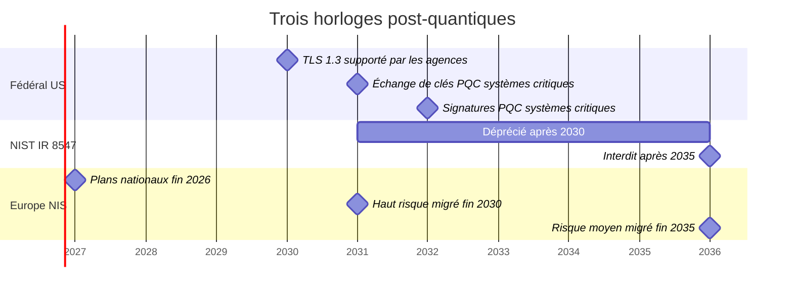
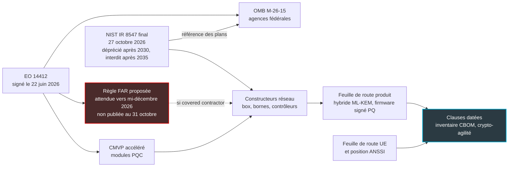

## Huit ans au plafond

Dans un hôtel, une résidence étudiante ou un magasin, un point d'accès Wi-Fi n'a rien d'un smartphone. On le visse au plafond, on le pilote à distance, et on n'y touche plus pendant des années. Dans nos métiers, huit ans de service n'ont rien d'exceptionnel. La borne qu'un acheteur réseau commandera au printemps 2027 a donc de bonnes chances d'être encore allumée en 2035.

Or 2035 est désormais une date écrite noir sur blanc. Le 27 octobre, le NIST (National Institute of Standards and Technology, l'institut américain dont les normes cryptographiques font référence bien au-delà des États-Unis) a publié la version finale de son rapport sur la transition vers la cryptographie post-quantique, celle qui doit résister aux futurs ordinateurs quantiques. Le message tient en deux dates. La cryptographie à clé publique que nous utilisons partout, du portail captif à la mise à jour de firmware, sera dépréciée après 2030, puis interdite après 2035 dans le périmètre des normes NIST.

Ce rapport ne lie aucune entreprise française. Il n'oblige ni l'hôtelier, ni l'enseigne, ni l'opérateur qui gère leur réseau. Mais il règle l'horloge des constructeurs qui leur vendent bornes, box et contrôleurs, au moment précis où Washington prépare une règle d'achat qui pourrait la rendre contraignante pour une partie d'entre eux.

Une horloge qui n'est écrite dans aucun contrat ne sonne pour personne. Le vrai sujet n'est donc pas le NIST. C'est votre prochain appel d'offres.

## Déprécié n'est pas interdit

Une phrase du rapport va circuler dans toutes les présentations commerciales des prochains mois. Autant la lire dans sa version exacte (§4, p. 13) : « NIST will deprecate quantum-vulnerable public-key cryptography after 2030 and disallow its use under NIST standards and guidelines after 2035. »

Deux verbes, deux régimes. Imaginez deux barrières sur la même route. La première, orange, reste à moitié levée : on passe, mais en signant une décharge. C'est le sens exact de *déprécié* dans la doctrine du NIST (définition de la SP 800-131A, reprise p. 14) : l'algorithme reste utilisable, à condition que le propriétaire des données évalue et accepte le risque.

La seconde barrière, rouge, est fermée. Mais elle ne barre que la route des normes NIST. *Interdit* veut dire non autorisé dans les standards fédéraux et dans les validations qui en découlent, pas prohibé par une loi.

Autre point que les résumés pressés escamotent : aucune de ces deux dates n'est donnée au jour près. Certaines synthèses parues dans la foulée les ont converties en jours calendaires ; le PDF ne le fait nulle part. Seuls les textes de la Maison-Blanche fixent des échéances au jour près.

### Ce qui a vraiment bougé depuis 2024

Le changement le plus lourd par rapport au brouillon de novembre 2024 tient dans deux tableaux (tableaux 2 et 4, p. 15-17). Dans le brouillon, seuls les paramètres offrant 112 bits de sécurité, comme RSA-2048, étaient dépréciés après 2030 ; les tailles plus robustes n'étaient visées que par l'interdiction de 2035. Dans la version finale, tous les niveaux listés passent en zone orange après 2030. En pratique, les choix qu'on jugeait confortables pour dix ans (RSA-3072, courbes elliptiques P-256 ou X25519) entrent dans la décharge en même temps que les autres.

Deuxième nouveauté, plus utile pour un acheteur : le NIST nomme enfin une valeur par défaut. « NIST recommends using ML-KEM-768 as the default parameter set » (§4.1.2, p. 17). ML-KEM est le mécanisme d'échange de clés post-quantique normalisé sous le nom FIPS 203 (les FIPS sont les normes fédérales américaines de traitement de l'information). C'est à ce jour le seul schéma de ce type approuvé ; HQC a été retenu comme alternative, mais sa norme est encore en préparation. Absente du brouillon, cette phrase change la vie des rédacteurs de cahiers des charges : on peut enfin écrire un nom précis plutôt qu'une intention.

Reste l'hybride, qui combine dans un même échange une clé classique et une clé ML-KEM. Si l'une cède, l'autre tient : c'est la ceinture et les bretelles. Le NIST ne l'impose pas. Il laisse la décision à chaque application et rappelle que ces montages sont « typically expected to be temporary measures », une étape avant une seconde transition vers le post-quantique seul. Il s'engage en revanche à les accepter en validation FIPS 140, la certification américaine des modules cryptographiques, dès lors qu'une des briques combinées est approuvée.

Le mémo d'application de la Maison-Blanche, que l'on retrouvera plus bas, voit dans l'hybride un palliatif complexe et gourmand en ressources. La feuille de route européenne, elle, le recommande partout où c'est faisable. Même mot, trois postures.

La mienne est simple : pour un opérateur français, l'hybride est le seul chemin praticable d'ici 2030. L'Europe le pousse, le NIST le tolère, et aucun DSI ne voudra miser son réseau sur une seule famille d'algorithmes encore jeune en production.

*Déprécié après 2030, interdit après 2035 : deux barrières, deux régimes juridiques différents, et aucune date au jour près dans le texte du NIST.*

## Trois horloges sur le même mur

Le rapport du NIST n'est pas la seule pendule à surveiller, ni la plus pressée. Les administrations américaines doivent aller plus vite que lui.

Le 22 juin 2026, l'Executive Order 14412 (un décret présidentiel américain) a fixé la ligne. Deux jours plus tard, le mémo M-26-15 de l'OMB (Office of Management and Budget, l'office du budget de la Maison-Blanche) l'a déclinée. Les systèmes fédéraux classés à haute valeur ou à fort impact doivent basculer leur échange de clés vers la cryptographie post-quantique (PQC, pour post-quantum cryptography) au 31 décembre 2030, et leurs signatures au 31 décembre 2031. Le NIST précise lui-même que sa fenêtre 2030-2035 ne repousse pas ces échéances plus précoces (§4, p. 13).

Les agences doivent par ailleurs supporter TLS 1.3 au plus tard le 2 janvier 2030. Supporter, pas imposer.

Le mémo a une autre vertu : il découpe la marche en phases qu'un DSI privé peut reprendre presque telles quelles. Inventaire et découverte en 2026-2027, pilotes en 2027-2028, échange de clés de 2028 à 2030, signatures en 2031, migration complète d'ici 2035 selon le risque et l'offre commerciale disponible.

Troisième horloge, la nôtre. La feuille de route coordonnée publiée en juin 2025 par le groupe de coopération NIS, qui réunit les États membres autour de la directive européenne de cybersécurité, prévoit des plans nationaux et des pilotes fin 2026. Viennent ensuite la migration des cas d'usage à haut risque fin 2030, celle du risque moyen fin 2035, et le faible risque autant que faisable. Pour le haut risque, les mécanismes à clé publique vulnérables ne doivent plus être employés seuls après fin 2030. La même échéance vise des mises à jour logicielles et firmware résistantes activées par défaut.

Détail qui compte : ce document européen s'appuie sur le brouillon NIST de 2024, pas sur la version finale. On ne peut donc pas affirmer que Bruxelles est alignée sur la dépréciation étendue aux paramètres les plus robustes.

Côté français, l'ANSSI viserait des exigences post-quantiques pour la qualification des produits à partir de 2027, et déconseillerait l'achat de produits sans post-quantique après 2030. Ces dates proviennent d'une paraphrase de presse (Clubic, 19 juin 2026) d'une intervention de l'agence, pas d'un texte officiel que j'aurais relu ; l'hybridation, que l'ANSSI recommanderait dans sa FAQ, n'y est pas abordée et reste à vérifier à la source. Ces éléments sont à confirmer à la source, et c'est l'objet de [notre article consacré au calendrier ANSSI 2027 et au sourcing d'équipements](https://wifirst-tech-blog.web.app/post?slug=anssi-calendrier-post-quantique-2027-sourcing-equipements).

*Trois horloges sur un même mur. Les bornes NIST sont placées par convention au 1er janvier 2031 et au 1er janvier 2036 : le rapport dit seulement après 2030 et après 2035. Systèmes critiques désigne ici les systèmes fédéraux à haute valeur ou à fort impact.*

## De Washington au plafond du lobby

Votre constructeur de bornes vend peut-être aussi à l'administration américaine. D'ici quelques mois, il pourrait devoir s'y engager par écrit sur une date de conformité post-quantique. Ce jour-là, il disposera d'une feuille de route datée. Toute la question est de savoir si vous y aurez accès.

Partons du texte lui-même. L'IR 8547 est un rapport interne du NIST (NIST Internal Report) adressé aux agences fédérales, aux fournisseurs de technologie, aux organismes de normalisation et aux laboratoires de validation (§1.2, p. 2). Pour les opérateurs d'infrastructures critiques, il se présente comme un plan de référence (§1.1), pas comme une obligation. Il ne contient d'ailleurs aucune mention de Wi-Fi, de RADIUS, de VPN ou de clauses fournisseurs.

Le levier contractuel est ailleurs, à l'article 6(c) du décret 14412. Celui-ci demande au conseil chargé du FAR (Federal Acquisition Regulation, le règlement des achats fédéraux américains) de publier sous 180 jours une règle *proposée*. Elle imposerait aux *covered contractors* de se conformer aux normes FIPS, algorithmes post-quantiques compris, au plus tard le 31 décembre 2030. Le délai expire vers la mi-décembre 2026.

Trois réserves s'imposent. Il ne s'agit que d'une règle proposée, pas définitive, et je n'en ai trouvé aucune publication au 31 octobre. Le décret ne définit pas qui sont les *covered contractors*. Et il précise lui-même qu'il ne crée aucun droit opposable. Tout ce qui suit reste donc au conditionnel.

*La chaîne d'application telle que je la lis. Seule la règle FAR créerait une obligation contractuelle, et uniquement pour les fournisseurs concernés. Tout le reste n'entre chez vous que par votre propre contrat.*

Les autres engrenages tournent déjà. Le même décret demande au NIST d'accélérer le CMVP (Cryptographic Module Validation Program, le programme qui délivre les validations FIPS 140) pour les modules post-quantiques, et le rapport confirme que ses processus sont en cours de révision. La CISA, l'agence fédérale de cybersécurité, range depuis janvier 2026 le matériel et le logiciel réseau parmi les catégories en transition, où les produits post-quantiques ne sont pas encore largement disponibles. Aucune catégorie ne vise explicitement les points d'accès Wi-Fi ou les VPN.

Côté protocoles, la matière existe. La RFC 10024, publiée en août 2026 par l'IETF (l'organisme qui normalise les protocoles d'Internet), définit les groupes hybrides d'échange de clés pour TLS 1.3. Un seul des trois est marqué comme recommandé dans le registre tenu par l'IANA : X25519MLKEM768, qui marie la courbe X25519 et ML-KEM-768.

Le rapport du NIST ne cite pas cette RFC ; le rapprochement est le mien. Mais il décrit TLS 1.3 comme « a practical near-term path » vers le post-quantique, hybridation comprise (§4.2, p. 20). Le mémo M-26-15 donne d'ailleurs l'association de X25519 et ML-KEM-768 comme exemple de groupe hybride. Quant à OpenSSL, il n'a pas attendu la RFC : sa version 3.5, publiée en avril 2025 avec un support long, propose ce groupe par défaut.

Ma lecture, et c'est un pari plus qu'un fait : peu de constructeurs entretiendront deux branches cryptographiques, l'une pour Washington, l'autre pour le reste du monde. Si la règle FAR aboutit, la date américaine deviendra la date de fait pour tout le monde. À condition de la faire écrire dans le contrat.

*De la règle fédérale au plafond du lobby, la chaîne ne se referme que sur un seul document : le contrat fournisseur.*

## La lettre et la serrure

Un attaquant qui enregistre aujourd'hui le trafic d'un portail captif n'a aucun besoin de le lire aujourd'hui. Il peut le stocker. Et attendre.

Le NIST hiérarchise la migration autour de cette différence. Pour l'échange de clés, la menace existe déjà : c'est le scénario HNDL (harvest now, decrypt later, récolter maintenant, déchiffrer plus tard). Une lettre interceptée en 2026 pourra se lire le jour où l'ordinateur quantique existera. D'où la priorité que le rapport donne à l'échange de clés, en particulier dans les protocoles interactifs comme TLS et IKE, le mécanisme d'échange de clés des tunnels IPsec (§4.2).

Les signatures obéissent à une autre logique. Une signature ne cache rien, elle prouve. Il n'y a rien à récolter. C'est une serrure : on ne la change que le jour où le passe-partout existe. Sauf si elle est soudée dans la porte.

C'est exactement le cas du firmware. Le rapport est net (§3.1.1). Si le code qui vérifie les signatures ne peut pas être mis à jour après fabrication, l'appareil doit être conçu dès maintenant pour exiger des signatures résistantes. Du moins s'il risque d'être encore en service quand un ordinateur quantique capable de casser la cryptographie actuelle sera disponible. Le rapport demande aussi aux fabricants de matériel d'engager l'intégration du post-quantique immédiatement, vu leurs délais de conception. Les signatures dites à état (LMS, XMSS), qui ne sont pas destinées à un usage général, y sont présentées comme utiles pour signer logiciels et firmwares. À mes yeux, une borne posée en 2027 pour huit ans entre précisément dans ce cas de figure : personne ne sait dater l'arrivée de cette machine.

La méthode, le NIST la donne en une phrase (§1, p. 1) : « Organizations should treat the migration to PQC as a current operational priority, beginning with cryptographic inventories, migration planning, and early deployments of PQC-enabled products and services. » L'inventaire d'abord.

Le tableau ci-dessous est ma lecture appliquée à un parc Wi-Fi managé : bornes, contrôleurs, box installées chez le client (CPE) et services autour. Le rapport du NIST ne mentionne ni Wi-Fi, ni RADIUS, ni 802.1X, ni portail captif. Tout ce qui suit est déduction de l'auteur.

| Composant | Crypto à clé publique en jeu | Exposition | Ce qu'on peut exiger |
|---|---|---|---|
| Portail captif et API vers le contrôleur | Échange ECDHE, certificat RSA ou ECDSA | Récolte : identifiants, données de séjour | TLS 1.3 de bout en bout, groupe X25519MLKEM768 négocié |
| Tunnels IPsec et SD-WAN entre box et cœur de réseau | IKEv2 et certificats | Récolte, priorité explicite du NIST pour IKE | Échange de clés hybride ML-KEM dans IKEv2, avec une date |
| RadSec (RADIUS transporté dans TLS) entre bornes et serveur d'authentification | TLS mutuel et certificats | Récolte : le tunnel transporte l'authentification | TLS 1.3 hybride, bibliothèque à jour |
| Authentification 802.1X (EAP-TLS, PEAP, TEAP) | TLS interne et certificats clients | Récolte d'abord, signatures ensuite | Suivi du brouillon IETF, pas d'exigence de conformité |
| WPA3-Personal (SAE) et Wi-Fi ouvert chiffré (OWE) | Diffie-Hellman sur courbes elliptiques | Récolte en théorie | Rien de publié : amendement IEEE P802.11bt en brouillon, à suivre |
| Firmware des box et des bornes | Signatures RSA ou ECDSA | Serrure soudée dans le matériel | Racine de confiance capable de vérifier une signature post-quantique ou hybride, clé de vérification remplaçable |
| Gestion distante (TR-069, TR-369, SSH, API cloud) | TLS, SSH et certificats | Récolte si le flux traverse Internet | TLS 1.3 hybride ; SSH à vérifier fournisseur par fournisseur |
| PKI interne et HSM (coffres à clés matériels) | Autorités de certification RSA ou ECDSA | Signatures | HSM compatibles ML-KEM et ML-DSA, profils de certificats agiles |
| Bibliothèques crypto embarquées | OpenSSL, wolfSSL, mbedTLS | Dépend de l'âge du firmware | Version livrée et date de fin de support écrites |

Trois lignes méritent un commentaire.

**La radio n'a pas encore de solution publiée.** WPA3-Personal et le Wi-Fi ouvert chiffré reposent sur un échange Diffie-Hellman sur courbes elliptiques. À ma connaissance, aucun standard IEEE 802.11 post-quantique n'est publié : l'amendement P802.11bt n'en est qu'au stade du brouillon. Un groupe de travail dédié, le Task Group BT présidé par Stephen Orr (Cisco), prépare l'amendement P802.11bt. Son mandat (PAR et CSD) a été approuvé par la plénière 802.11 en juillet 2025. Son projet D1.0 est passé en vote de groupe (Letter Ballot 297) et la résolution des 650 commentaires reçus était en cours à la réunion de septembre 2026. Il vise des suites d'authentification et de gestion de clés (AKM) résistantes, un échange de clé par mot de passe post-quantique et la révision des échanges de clés, en regardant notamment SAE et OWE. Bonne nouvelle relative, et c'est ma lecture : le chiffrement de la liaison radio repose sur AES, que le NIST maintient parmi les algorithmes approuvés. Ma conclusion : ne promettez à aucun client un Wi-Fi post-quantique. Il n'existe pas.

**L'authentification 802.1X est en chantier.** Un brouillon IETF (draft-ietf-emu-pqc-eap-tls, version 02 de septembre 2026) exige, pour les déploiements qui demandent une confidentialité longue durée, TLS 1.3 avec un groupe post-quantique ou hybride, et une chaîne de certificats post-quantique ou hybride jusqu'à l'ancre de confiance. C'est un travail en cours, à suivre et non à exiger. Il ne nomme d'ailleurs ni RADIUS ni RadSec.

**Les bibliothèques ont leur propre calendrier.** OpenSSL 3.0 n'est plus couverte par les correctifs de sécurité du projet depuis le 7 septembre 2026. OpenSSL 3.5 l'est jusqu'au 8 avril 2030, environ neuf mois avant que la fenêtre de dépréciation ne s'ouvre. Mon calcul : un firmware livré aujourd'hui avec la 3.5 devra changer de version à support long avant avril 2030. À écrire dans le contrat, pas à découvrir en 2029.

La mesure du chiffrement réellement négocié et la question des certificats ont fait l'objet de nos articles d'octobre ([*Chiffré n'est pas post-quantique : mesurez l'écart client/origine*](https://wifirst-tech-blog.web.app/post?slug=chiffre-pas-post-quantique-mesurer-ecart-client-origine) et [*Cloudflare veut devenir CA : le post-quantique attendra 2027*](https://wifirst-tech-blog.web.app/post?slug=cloudflare-ca-merkle-tree-certificates-ari-rfc-9773)) ; les tunnels, de [notre papier sur le retard post-quantique de l'IPsec](https://wifirst-tech-blog.web.app/post?slug=tunnels-ipsec-quatre-ans-retard-post-quantique).

*Un inventaire utile classe chaque équipement selon ce qu'il protège : un secret qu'on peut enregistrer dès aujourd'hui, ou une signature soudée dans le matériel.*

## Neuf clauses à dater

Les clauses qui suivent sont une proposition d'auteur, pas une exigence du NIST. Plusieurs transposent à un acheteur privé l'annexe A du mémo M-26-15, rédigée pour les agences fédérales. Toutes obéissent à la même règle : une date, un produit, une version. Pas d'intention.

1. **Feuille de route par produit.** Pour chaque modèle, puce (SoC) et branche de firmware : date de disponibilité de l'échange de clés hybride pour TLS (RadSec, EAP-TLS, gestion), IKEv2 et SSH, avec le groupe X25519MLKEM768 de la RFC 10024 et ML-KEM-768 par défaut.
2. **Crypto-agilité vérifiable.** Algorithmes et groupes pilotés par la configuration, pas compilés en dur ; changement de suite sans nouveau firmware.
3. **Pas de rétrogradation silencieuse.** Possibilité de refuser les suites purement classiques, journalisation du groupe effectivement négocié.
4. **Signature des mises à jour.** Date d'arrivée de signatures de firmware résistantes ou hybrides, et capacité à remplacer la clé de vérification sur le parc déjà installé.
5. **Inventaire livré.** SBOM (la nomenclature logicielle) et CBOM (cryptographic bill of materials, l'inventaire des algorithmes, clés et bibliothèques embarqués) par version de firmware, alignés sur le contenu minimal que la CISA doit publier vers la mi-mars 2027.
6. **Statut de validation.** Validation FIPS 140-3 des modules, délai visé pour les modules post-quantiques, et engagement de suivre les révisions annoncées par le NIST, notamment la SP 800-52 pour TLS et la SP 800-56C pour la combinaison des secrets.
7. **Fenêtre de support.** Bibliothèque cryptographique livrée, date de fin de support, engagement de montée de version avant 2030.
8. **Remplacement.** Si le matériel ne peut techniquement pas passer au post-quantique ou à l'hybride : droit de remplacement ou réduction de prix. Le mémo M-26-15 demande aux agences d'identifier ces systèmes et de les prioriser pour remplacement ; un acheteur privé peut raisonner de la même façon.
9. **Transparence fédérale.** Si le fournisseur déclare une date de conformité à des clients fédéraux américains, il vous la communique. C'est mon ajout, et probablement le moyen le plus rapide d'obtenir sa vraie feuille de route.

Un fournisseur incapable de dater sa feuille de route en 2027 n'en a pas. Et le coût d'un remplacement anticipé finit toujours chez celui qui a signé sans date.

## Ce que personne ne sait encore

Honnêteté oblige, plusieurs pièces manquent. Je les note ici avec leur date de revue, parce qu'elles décideront du contenu exact des clauses.

- **Vers la mi-décembre 2026** : la règle FAR proposée, si elle paraît dans les délais. Elle dira enfin qui sont les *covered contractors*.
- **Vers la mi-mars 2027** : le contenu minimal du CBOM, que la CISA doit publier en application du même décret.
- **Sans date** : la révision de la SP 800-52 consacrée à TLS, la mise à jour de la SP 800-56C que le NIST dit vouloir mener pour mieux encadrer l'hybride, la publication de l'amendement IEEE P802.11bt, l'évolution du brouillon IETF sur EAP-TLS, et la confirmation officielle du calendrier ANSSI.

Je n'ai trouvé par ailleurs aucune donnée publique fiable sur la proportion de box et de bornes déjà capables d'échange de clés hybride. Méfiez-vous de quiconque vous avance un pourcentage.

## Le contrat est le seul réveil qui sonnera

Le NIST a fait sa part : deux dates, un paramètre par défaut, une hiérarchie claire entre ce qu'on peut enregistrer aujourd'hui et ce qui est soudé dans le matériel. Il ne fera pas la suite à votre place.

Ma position tient en trois décisions. Lancer l'inventaire du parc maintenant, composant par composant, en séparant l'échange de clés des signatures. Glisser une clause datée dans chaque renouvellement et chaque appel d'offres, dès le prochain. Et refuser le matériel dont le constructeur ne date pas sa feuille de route post-quantique : posé en 2027, il sera encore au plafond après 2030, peut-être après 2035.

Un dernier conseil, côté commercial. Ne vendez pas de Wi-Fi post-quantique : il n'existe pas encore. Vendez un réseau dont chaque tunnel, chaque authentification et chaque mise à jour a une date de migration écrite. C'est moins spectaculaire. C'est vérifiable.

L'horloge est réglée. Personne ne viendra la remonter dans vos contrats.

---

_Vues personnelles, pas position Wifirst._

## Sources

1. NIST CSRC, page NIST IR 8547 (version finale, 27 octobre 2026) : https://csrc.nist.gov/pubs/ir/8547/final
2. NIST IR 8547, *Transition to Post-Quantum Cryptography Standards*, PDF final (octobre 2026) : https://nvlpubs.nist.gov/nistpubs/ir/2026/NIST.IR.8547.pdf
3. NIST, communiqué du 27 octobre 2026 : https://www.nist.gov/news-events/news/2026/10/nist-report-provides-guidelines-transition-post-quantum-cryptography
4. NIST IR 8547, version préliminaire (12 novembre 2024) : https://csrc.nist.gov/pubs/ir/8547/ipd et https://nvlpubs.nist.gov/nistpubs/ir/2024/NIST.IR.8547.ipd.pdf
5. Executive Order 14412, *Securing the Nation Against Advanced Cryptographic Attacks* (22 juin 2026, 91 FR 38483) : https://www.whitehouse.gov/wp-content/uploads/2026/06/eo-14412.pdf
6. OMB, mémo M-26-15 sur l'exécution de la migration post-quantique (24 juin 2026) : https://www.whitehouse.gov/wp-content/uploads/2026/06/M-26-15-Execution-of-the-Migration-to-Post-Quantum-Cryptography.pdf
7. IETF, RFC 10024, *Post-Quantum Traditional (PQ/T) Hybrid Key Agreement Mechanisms for TLS 1.3* (août 2026) : https://datatracker.ietf.org/doc/rfc10024/
8. IETF, RFC 9954, *Hybrid Key Exchange in TLS 1.3* (juillet 2026, Informational) : https://www.rfc-editor.org/rfc/rfc9954.html
9. IETF, draft-ietf-emu-pqc-eap-tls-02 (Internet-Draft, 23 septembre 2026) : https://www.ietf.org/archive/id/draft-ietf-emu-pqc-eap-tls-02.html
10. IEEE 802.11, Task Group BT (PQC), P802.11bt, compte rendu (réunion de septembre 2026) : https://grouper.ieee.org/groups/802/11/Reports/tgbt_update.htm
11. CISA, catégories de produits utilisant les standards PQC (23 janvier 2026) : https://www.cisa.gov/resources-tools/resources/product-categories-technologies-use-post-quantum-cryptography-standards
12. OpenSSL 3.5, annonce de version (8 avril 2025) et notes : https://openssl-library.org/post/2025-04-08-openssl-35-final-release/ et https://github.com/openssl/openssl/discussions/27299
13. Commission européenne, feuille de route coordonnée pour la transition post-quantique (groupe de coopération NIS, partie 1, v1.1, juin 2025) : https://digital-strategy.ec.europa.eu/en/library/coordinated-implementation-roadmap-transition-post-quantum-cryptography
14. Quantum Computing Report, synthèse secondaire (27 octobre 2026) : https://quantumcomputingreport.com/nist-releases-final-ir-8547-establishing-definitive-post-quantum-cryptography-transition-timeline-and-deprecation-schedules/
15. postquantum.com, analyse secondaire de l'IR 8547 final : https://postquantum.com/security-pqc/nist-ir-8547-final/
16. Help Net Security (28 octobre 2026) : https://www.helpnetsecurity.com/?p=389358
17. Clubic, paraphrase d'une intervention de l'ANSSI (19 juin 2026) : https://www.clubic.com/actualite-617680-face-a-la-menace-quantique-l-anssi-renforce-ses-exigences-de-certification.html
