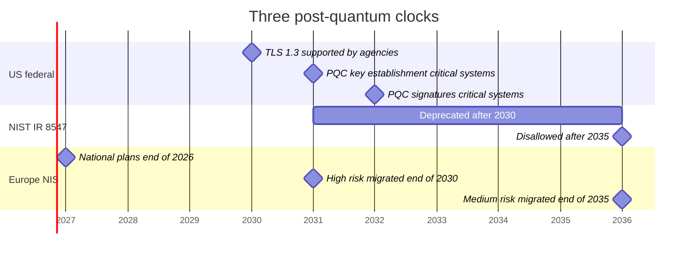
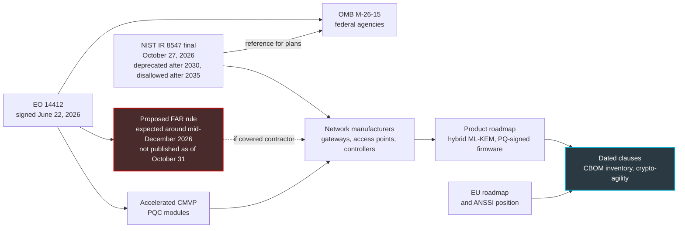

## Eight Years on the Ceiling

In a hotel, a student residence or a store, a Wi-Fi access point is nothing like a smartphone. You screw it to the ceiling, manage it remotely, and don't touch it again for years. In our line of work, eight years of service is nothing unusual. So the access point a network buyer orders in spring 2027 has a good chance of still being powered on in 2035.

And 2035 is now a date written in black and white. On October 27, NIST (the National Institute of Standards and Technology, the US institute whose cryptographic standards are a reference well beyond the United States) published the final version of its report on the transition to post-quantum cryptography, the kind that has to withstand future quantum computers. The message comes down to two dates. The public-key cryptography we use everywhere, from the captive portal to the firmware update, will be deprecated after 2030, then disallowed after 2035 within the scope of NIST standards.

This report binds no French company. It doesn't compel the hotelier, the retail chain, or the operator that runs their network. But it sets the clock for the manufacturers who sell them access points, gateways and controllers, at the very moment Washington is preparing a procurement rule that could make it binding for some of them.

A clock that isn't written into any contract rings for no one. So the real subject isn't NIST. It's your next call for tenders.

## Deprecated Is Not Disallowed

One sentence from the report is going to circulate in every sales presentation over the coming months. Better to read it in its exact form (§4, p. 13): "NIST will deprecate quantum-vulnerable public-key cryptography after 2030 and disallow its use under NIST standards and guidelines after 2035."

Two verbs, two regimes. Picture two barriers on the same road. The first, orange, stays half raised: you can drive through, but only after signing a waiver. That is the exact meaning of *deprecated* in NIST doctrine (the SP 800-131A definition, restated on p. 14): the algorithm remains usable, provided the data owner assesses and accepts the risk.

The second barrier, red, is closed. But it only blocks the road of NIST standards. *Disallowed* means not authorized in federal standards and in the validations that flow from them, not prohibited by law.

Another point that hasty summaries skip: neither date is given down to the day. Some syntheses published in the aftermath converted them into calendar days; the PDF does so nowhere. Only the White House texts set deadlines to the day.

### What Has Really Changed Since 2024

The heaviest change from the November 2024 draft lies in two tables (Tables 2 and 4, pp. 15-17). In the draft, only the parameters offering 112 bits of security, such as RSA-2048, were deprecated after 2030; the stronger sizes were targeted only by the 2035 disallowance. In the final version, every listed level moves into the orange zone after 2030. In practice, the choices that were considered comfortable for ten years (RSA-3072, the P-256 or X25519 elliptic curves) fall under the waiver at the same time as the others.

Second novelty, more useful for a buyer: NIST finally names a default value. "NIST recommends using ML-KEM-768 as the default parameter set" (§4.1.2, p. 17). ML-KEM is the post-quantum key-establishment mechanism standardized as FIPS 203 (the FIPS are the US federal information processing standards). To date it is the only approved scheme of its kind; HQC has been selected as an alternative, but its standard is still being drafted. Absent from the draft, this sentence changes life for the people who write specifications: you can finally write a precise name instead of an intention.

That leaves hybrid, which combines a classical key and an ML-KEM key in the same exchange. If one gives way, the other holds: belt and suspenders. NIST doesn't mandate it. It leaves the decision to each application and notes that these constructions are "typically expected to be temporary measures," a step before a second transition to post-quantum alone. It does, however, commit to accepting them in FIPS 140 validation, the US certification for cryptographic modules, as long as one of the combined components is approved.

The White House implementation memo, which we'll come to below, sees hybrid as a complex, resource-hungry stopgap. The European roadmap, for its part, recommends it wherever feasible. Same word, three postures.

My own is simple: for a French operator, hybrid is the only workable path by 2030. Europe pushes it, NIST tolerates it, and no IT director will want to bet their network on a single family of algorithms that is still young in production.

*Deprecated after 2030, disallowed after 2035: two barriers, two different legal regimes, and no date down to the day in the NIST text.*

## Three Clocks on the Same Wall

The NIST report is not the only clock to watch, nor the most pressing. US government agencies have to move faster than it does.

On June 22, 2026, Executive Order 14412 (a US presidential order) set the line. Two days later, OMB memo M-26-15 (OMB being the Office of Management and Budget, the White House budget office) spelled it out. Federal systems classified as high-value or high-impact must switch their key establishment to post-quantum cryptography (PQC) by December 31, 2030, and their signatures by December 31, 2031. NIST itself specifies that its 2030-2035 window does not push back these earlier deadlines (§4, p. 13).

Agencies must also support TLS 1.3 by January 2, 2030 at the latest. Support, not mandate.

The memo has another virtue: it breaks the climb into phases that a private-sector IT director can adopt almost as they stand. Inventory and discovery in 2026-2027, pilots in 2027-2028, key establishment from 2028 to 2030, signatures in 2031, full migration by 2035 depending on risk and available commercial offerings.

Third clock, ours. The coordinated roadmap published in June 2025 by the NIS Cooperation Group, which brings Member States together around the European cybersecurity directive, provides for national plans and pilots by the end of 2026. Next come the migration of high-risk use cases by the end of 2030, medium risk by the end of 2035, and low risk as far as feasible. For high risk, vulnerable public-key mechanisms must no longer be used alone after the end of 2030. The same deadline targets resilient software and firmware updates enabled by default.

A detail that matters: this European document builds on the 2024 NIST draft, not on the final version. So we can't claim that Brussels is aligned with the deprecation extended to the strongest parameters.

On the French side, ANSSI would reportedly aim for post-quantum requirements in product qualification from 2027, and would advise against buying products without post-quantum after 2030. These dates come from a press paraphrase (Clubic, June 19, 2026) of a talk given by the agency, not from an official text that I have read; hybridization, which ANSSI would recommend in its FAQ, is not addressed there and remains to be verified at the source. These items need confirming at the source, and that is the purpose of [our article on the 2027 ANSSI timeline and equipment sourcing](https://wifirst-tech-blog.web.app/post?slug=anssi-calendrier-post-quantique-2027-sourcing-equipements).

*Three clocks on the same wall. The NIST boundaries are placed by convention at January 1, 2031 and January 1, 2036: the report only says after 2030 and after 2035. Critical systems here means high-value or high-impact federal systems.*

## From Washington to the Lobby Ceiling

Your access point manufacturer may also sell to the US government. Within a few months, it could have to commit in writing to a post-quantum compliance date. On that day, it will have a dated roadmap. The whole question is whether you will have access to it.

Let's start from the text itself. IR 8547 is a NIST internal report (NIST Internal Report) addressed to federal agencies, technology vendors, standards bodies and validation laboratories (§1.2, p. 2). For critical-infrastructure operators, it presents itself as a reference plan (§1.1), not an obligation. It also contains no mention of Wi-Fi, RADIUS, VPN or vendor clauses.

The contractual lever is elsewhere, in section 6(c) of Order 14412. It asks the FAR Council (the Federal Acquisition Regulation being the US federal procurement rulebook) to publish a *proposed* rule within 180 days. That rule would require *covered contractors* to comply with FIPS standards, post-quantum algorithms included, no later than December 31, 2030. The deadline expires around mid-December 2026.

Three caveats are in order. It is only a proposed rule, not a final one, and I found no publication of it as of October 31. The order doesn't define who the *covered contractors* are. And it states itself that it creates no enforceable right. Everything that follows therefore stays in the conditional.

*The enforcement chain as I read it. Only the FAR rule would create a contractual obligation, and only for the suppliers concerned. Everything else reaches you only through your own contract.*

The other gears are already turning. The same order asks NIST to accelerate the CMVP (Cryptographic Module Validation Program, the program that issues FIPS 140 validations) for post-quantum modules, and the report confirms that its processes are under revision. CISA, the federal cybersecurity agency, has since January 2026 ranked network hardware and software among the transitioning categories, where post-quantum products are not yet widely available. No category explicitly targets Wi-Fi access points or VPNs.

On the protocol side, the material exists. RFC 10024, published in August 2026 by the IETF (the body that standardizes Internet protocols), defines the hybrid key exchange groups for TLS 1.3. Only one of the three is marked as recommended in the registry maintained by IANA: X25519MLKEM768, which pairs the X25519 curve with ML-KEM-768.

The NIST report doesn't cite this RFC; the connection is mine. But it describes TLS 1.3 as "a practical near-term path" toward post-quantum, hybridization included (§4.2, p. 20). Memo M-26-15 also gives the pairing of X25519 and ML-KEM-768 as an example of a hybrid group. As for OpenSSL, it didn't wait for the RFC: its version 3.5, released in April 2025 with long-term support, offers this group by default.

My reading, and it's a bet more than a fact: few manufacturers will maintain two cryptographic branches, one for Washington, the other for the rest of the world. If the FAR rule goes through, the US date will become the de facto date for everyone. Provided you get it written into the contract.

*From the federal rule to the lobby ceiling, the chain closes on only one document: the vendor contract.*

## The Letter and the Lock

An attacker who records a captive portal's traffic today has no need to read it today. They can store it. And wait.

NIST ranks the migration around this difference. For key establishment, the threat already exists: it's the HNDL scenario (harvest now, decrypt later). A letter intercepted in 2026 can be read the day the quantum computer exists. Hence the priority the report gives to key establishment, particularly in interactive protocols like TLS and IKE, the key exchange mechanism of IPsec tunnels (§4.2).

Signatures follow a different logic. A signature hides nothing, it proves. There is nothing to harvest. It's a lock: you change it only the day the skeleton key exists. Unless it's welded into the door.

That is exactly the case for firmware. The report is clear (§3.1.1). If the code that verifies signatures can't be updated after manufacture, the device must be designed now to require resilient signatures. At least if it risks still being in service when a quantum computer capable of breaking today's cryptography becomes available. The report also asks hardware manufacturers to start integrating post-quantum immediately, given their design lead times. Stateful signatures (LMS, XMSS), which are not intended for general use, are presented there as useful for signing software and firmware. In my view, an access point installed in 2027 for eight years falls squarely within that scenario: nobody can date the arrival of that machine.

NIST gives the method in a single sentence (§1, p. 1): "Organizations should treat the migration to PQC as a current operational priority, beginning with cryptographic inventories, migration planning, and early deployments of PQC-enabled products and services." Inventory first.

The table below is my reading applied to a managed Wi-Fi estate: access points, controllers, gateways installed at the customer's site (CPE) and the services around them. The NIST report mentions neither Wi-Fi, nor RADIUS, nor 802.1X, nor captive portal. Everything that follows is the author's deduction.

| Component | Public-key crypto involved | Exposure | What you can require |
|---|---|---|---|
| Captive portal and API to the controller | ECDHE exchange, RSA or ECDSA certificate | Harvest: credentials, stay data | End-to-end TLS 1.3, X25519MLKEM768 group negotiated |
| IPsec and SD-WAN tunnels between gateways and the core network | IKEv2 and certificates | Harvest, explicit NIST priority for IKE | Hybrid ML-KEM key exchange in IKEv2, with a date |
| RadSec (RADIUS carried over TLS) between access points and authentication server | Mutual TLS and certificates | Harvest: the tunnel carries the authentication | Hybrid TLS 1.3, up-to-date library |
| 802.1X authentication (EAP-TLS, PEAP, TEAP) | Inner TLS and client certificates | Harvest first, signatures later | Track the IETF draft, no compliance requirement |
| WPA3-Personal (SAE) and Opportunistic Wireless Encryption (OWE) | Elliptic-curve Diffie-Hellman | Harvest in theory | Nothing published: IEEE P802.11bt amendment in draft, to be tracked |
| Gateway and access point firmware | RSA or ECDSA signatures | Lock welded into the hardware | Root of trust able to verify a post-quantum or hybrid signature, replaceable verification key |
| Remote management (TR-069, TR-369, SSH, cloud API) | TLS, SSH and certificates | Harvest if the flow crosses the Internet | Hybrid TLS 1.3; SSH to be checked vendor by vendor |
| Internal PKI and HSM (hardware key vaults) | RSA or ECDSA certificate authorities | Signatures | HSMs compatible with ML-KEM and ML-DSA, agile certificate profiles |
| Embedded crypto libraries | OpenSSL, wolfSSL, mbedTLS | Depends on the age of the firmware | Shipped version and end-of-support date in writing |

Three rows deserve a comment.

**The radio has no published solution yet.** WPA3-Personal and Opportunistic Wireless Encryption rely on an elliptic-curve Diffie-Hellman exchange. To my knowledge, no post-quantum IEEE 802.11 standard is published: the P802.11bt amendment is only at the draft stage. A dedicated working group, Task Group BT, chaired by Stephen Orr (Cisco), is preparing the P802.11bt amendment. Its mandate (PAR and CSD) was approved by the 802.11 plenary in July 2025. Its D1.0 draft went to a group vote (Letter Ballot 297), and the resolution of the 650 comments received was under way at the September 2026 meeting. It targets resilient authentication and key management (AKM) suites, a post-quantum password-based key exchange, and the revision of key exchanges, looking in particular at SAE and OWE. Relatively good news, and this is my reading: radio link encryption relies on AES, which NIST keeps among the approved algorithms. My conclusion: don't promise any customer post-quantum Wi-Fi. It doesn't exist.

**802.1X authentication is a work in progress.** An IETF draft (draft-ietf-emu-pqc-eap-tls, version 02 of September 2026) requires, for deployments that call for long-term confidentiality, TLS 1.3 with a post-quantum or hybrid group, and a post-quantum or hybrid certificate chain up to the trust anchor. It's work in progress, to be tracked and not to be required. It names neither RADIUS nor RadSec, incidentally.

**Libraries have their own calendar.** OpenSSL 3.0 has not been covered by the project's security fixes since September 7, 2026. OpenSSL 3.5 is covered until April 8, 2030, about nine months before the deprecation window opens. My calculation: a firmware shipped today with 3.5 will have to move to a long-term-support version before April 2030. Write that into the contract, don't discover it in 2029.

Measuring the encryption actually negotiated and the certificate question were the subject of our October articles ([*Chiffré n'est pas post-quantique : mesurez l'écart client/origine*](https://wifirst-tech-blog.web.app/post?slug=chiffre-pas-post-quantique-mesurer-ecart-client-origine) and [*Cloudflare veut devenir CA : le post-quantique attendra 2027*](https://wifirst-tech-blog.web.app/post?slug=cloudflare-ca-merkle-tree-certificates-ari-rfc-9773)); tunnels, of [our piece on IPsec's post-quantum lag](https://wifirst-tech-blog.web.app/post?slug=tunnels-ipsec-quatre-ans-retard-post-quantique).

*A useful inventory classifies each device by what it protects: a secret that can be recorded starting today, or a signature welded into the hardware.*

## Nine Clauses to Date

The clauses below are an author's proposal, not a NIST requirement. Several adapt to a private buyer Annex A of memo M-26-15, written for federal agencies. All follow the same rule: a date, a product, a version. No intentions.

1. **Roadmap per product.** For each model, chip (SoC) and firmware branch: availability date of hybrid key exchange for TLS (RadSec, EAP-TLS, management), IKEv2 and SSH, with the X25519MLKEM768 group of RFC 10024 and ML-KEM-768 by default.
2. **Verifiable crypto-agility.** Algorithms and groups driven by configuration, not hard-coded; suite change without new firmware.
3. **No silent downgrade.** Ability to refuse purely classical suites, logging of the group actually negotiated.
4. **Update signing.** Arrival date of resilient or hybrid firmware signatures, and ability to replace the verification key across the installed base.
5. **Delivered inventory.** SBOM (the software bill of materials) and CBOM (cryptographic bill of materials, the inventory of embedded algorithms, keys and libraries) per firmware version, aligned with the minimum content that CISA is due to publish around mid-March 2027.
6. **Validation status.** FIPS 140-3 validation of the modules, target timeline for post-quantum modules, and a commitment to follow the revisions announced by NIST, notably SP 800-52 for TLS and SP 800-56C for the combination of secrets.
7. **Support window.** Shipped cryptographic library, end-of-support date, commitment to upgrade the version before 2030.
8. **Replacement.** If the hardware technically cannot move to post-quantum or hybrid: right of replacement or price reduction. Memo M-26-15 asks agencies to identify these systems and prioritize them for replacement; a private buyer can reason the same way.
9. **Federal transparency.** If the supplier declares a compliance date to US federal customers, it shares it with you. That one is my addition, and probably the fastest way to get its real roadmap.

A supplier unable to date its roadmap in 2027 doesn't have one. And the cost of an early replacement always ends up with whoever signed without a date.

## What Nobody Knows Yet

In the interest of honesty, several pieces are missing. I note them here with their review date, because they will decide the exact content of the clauses.

- **Around mid-December 2026**: the proposed FAR rule, if it appears on schedule. It will finally say who the *covered contractors* are.
- **Around mid-March 2027**: the minimum content of the CBOM, which CISA must publish under the same order.
- **No date**: the revision of SP 800-52 on TLS, the update of SP 800-56C that NIST says it wants to carry out to better frame hybrid, the publication of the IEEE P802.11bt amendment, the evolution of the IETF draft on EAP-TLS, and the official confirmation of the ANSSI timeline.

I also found no reliable public data on the proportion of gateways and access points already capable of hybrid key exchange. Be wary of anyone who offers you a percentage.

## The Contract Is the Only Alarm That Will Ring

NIST has done its part: two dates, a default parameter, a clear hierarchy between what can be recorded today and what is welded into the hardware. It won't do the rest for you.

My position comes down to three decisions. Launch the estate inventory now, component by component, separating key establishment from signatures. Slip a dated clause into every renewal and every call for tenders, starting with the next one. And refuse hardware whose manufacturer doesn't date its post-quantum roadmap: installed in 2027, it will still be on the ceiling after 2030, perhaps after 2035.

One last piece of advice, for the sales side. Don't sell post-quantum Wi-Fi: it doesn't exist yet. Sell a network where every tunnel, every authentication and every update has a written migration date. It's less spectacular. It's verifiable.

The clock is set. Nobody will come and wind it back up in your contracts.

---

_Personal views, not Wifirst's position._

## Sources

1. NIST CSRC, NIST IR 8547 page (final version, October 27, 2026): https://csrc.nist.gov/pubs/ir/8547/final
2. NIST IR 8547, *Transition to Post-Quantum Cryptography Standards*, final PDF (October 2026): https://nvlpubs.nist.gov/nistpubs/ir/2026/NIST.IR.8547.pdf
3. NIST, press release of October 27, 2026: https://www.nist.gov/news-events/news/2026/10/nist-report-provides-guidelines-transition-post-quantum-cryptography
4. NIST IR 8547, initial public draft (November 12, 2024): https://csrc.nist.gov/pubs/ir/8547/ipd and https://nvlpubs.nist.gov/nistpubs/ir/2024/NIST.IR.8547.ipd.pdf
5. Executive Order 14412, *Securing the Nation Against Advanced Cryptographic Attacks* (June 22, 2026, 91 FR 38483): https://www.whitehouse.gov/wp-content/uploads/2026/06/eo-14412.pdf
6. OMB, memo M-26-15 on the execution of the post-quantum migration (June 24, 2026): https://www.whitehouse.gov/wp-content/uploads/2026/06/M-26-15-Execution-of-the-Migration-to-Post-Quantum-Cryptography.pdf
7. IETF, RFC 10024, *Post-Quantum Traditional (PQ/T) Hybrid Key Agreement Mechanisms for TLS 1.3* (August 2026): https://datatracker.ietf.org/doc/rfc10024/
8. IETF, RFC 9954, *Hybrid Key Exchange in TLS 1.3* (July 2026, Informational): https://www.rfc-editor.org/rfc/rfc9954.html
9. IETF, draft-ietf-emu-pqc-eap-tls-02 (Internet-Draft, September 23, 2026): https://www.ietf.org/archive/id/draft-ietf-emu-pqc-eap-tls-02.html
10. IEEE 802.11, Task Group BT (PQC), P802.11bt, meeting report (September 2026 meeting): https://grouper.ieee.org/groups/802/11/Reports/tgbt_update.htm
11. CISA, product categories using PQC standards (January 23, 2026): https://www.cisa.gov/resources-tools/resources/product-categories-technologies-use-post-quantum-cryptography-standards
12. OpenSSL 3.5, release announcement (April 8, 2025) and notes: https://openssl-library.org/post/2025-04-08-openssl-35-final-release/ and https://github.com/openssl/openssl/discussions/27299
13. European Commission, coordinated roadmap for the transition to post-quantum cryptography (NIS Cooperation Group, part 1, v1.1, June 2025): https://digital-strategy.ec.europa.eu/en/library/coordinated-implementation-roadmap-transition-post-quantum-cryptography
14. Quantum Computing Report, secondary summary (October 27, 2026): https://quantumcomputingreport.com/nist-releases-final-ir-8547-establishing-definitive-post-quantum-cryptography-transition-timeline-and-deprecation-schedules/
15. postquantum.com, secondary analysis of the final IR 8547: https://postquantum.com/security-pqc/nist-ir-8547-final/
16. Help Net Security (October 28, 2026): https://www.helpnetsecurity.com/?p=389358
17. Clubic, paraphrase of an ANSSI talk (June 19, 2026): https://www.clubic.com/actualite-617680-face-a-la-menace-quantique-l-anssi-renforce-ses-exigences-de-certification.html
