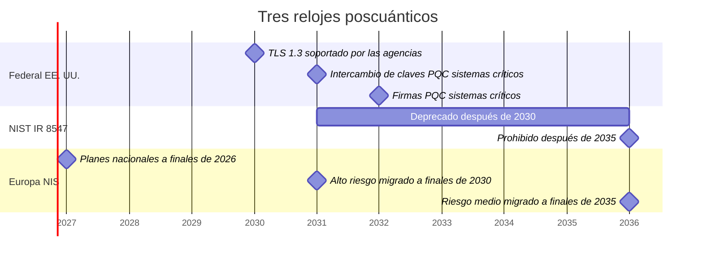
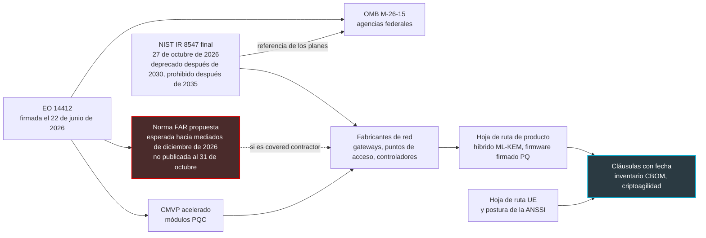

## Ocho años en el techo

En un hotel, una residencia de estudiantes o una tienda, un punto de acceso Wi-Fi no tiene nada que ver con un smartphone. Se atornilla al techo, se gestiona de forma remota y no se toca durante años. En nuestro sector, ocho años de servicio no tienen nada de excepcional. El punto de acceso que un comprador de redes pedirá en la primavera de 2027 tiene, por tanto, muchas probabilidades de seguir encendido en 2035.

Pues bien, 2035 es ahora una fecha escrita negro sobre blanco. El 27 de octubre, el NIST (National Institute of Standards and Technology, el instituto estadounidense cuyas normas criptográficas son una referencia mucho más allá de Estados Unidos) publicó la versión final de su informe sobre la transición a la criptografía poscuántica, la que debe resistir a los futuros ordenadores cuánticos. El mensaje se resume en dos fechas. La criptografía de clave pública que usamos en todas partes, del portal cautivo a la actualización de firmware, será deprecada después de 2030 y luego prohibida después de 2035 en el perímetro de las normas NIST.

Este informe no obliga a ninguna empresa francesa. No obliga ni al hotelero, ni a la cadena comercial, ni al operador que gestiona su red. Pero fija el reloj de los fabricantes que les venden puntos de acceso, gateways y controladores, justo cuando Washington prepara una norma de compras que podría volverlo vinculante para una parte de ellos.

Un reloj que no figura en ningún contrato no suena para nadie. El verdadero tema no es, pues, el NIST. Es su próxima licitación.

## Deprecado no es prohibido

Una frase del informe va a circular en todas las presentaciones comerciales de los próximos meses. Conviene leerla en su versión exacta (§4, p. 13): «NIST will deprecate quantum-vulnerable public-key cryptography after 2030 and disallow its use under NIST standards and guidelines after 2035.»

Dos verbos, dos regímenes. Imagine dos barreras en la misma carretera. La primera, naranja, queda a medio levantar: se pasa, pero firmando un descargo de responsabilidad. Ese es el sentido exacto de *deprecado* en la doctrina del NIST (definición de la SP 800-131A, recogida en la p. 14): el algoritmo sigue siendo utilizable, siempre que el propietario de los datos evalúe y acepte el riesgo.

La segunda barrera, roja, está cerrada. Pero solo corta la carretera de las normas NIST. *Prohibido* significa no autorizado en los estándares federales y en las validaciones que se derivan de ellos, no vetado por una ley.

Hay otro punto que los resúmenes apresurados pasan por alto: ninguna de las dos fechas se da con precisión de día. Algunas síntesis publicadas a continuación las convirtieron en días naturales; el PDF no lo hace en ningún momento. Solo los textos de la Casa Blanca fijan plazos con precisión de día.

### Lo que realmente ha cambiado desde 2024

El cambio más importante respecto al borrador de noviembre de 2024 está en dos tablas (tablas 2 y 4, p. 15-17). En el borrador, solo los parámetros que ofrecían 112 bits de seguridad, como RSA-2048, quedaban deprecados después de 2030; los tamaños más robustos solo estaban afectados por la prohibición de 2035. En la versión final, todos los niveles listados pasan a la zona naranja después de 2030. En la práctica, las opciones que se consideraban cómodas para diez años (RSA-3072, curvas elípticas P-256 o X25519) entran en el descargo de responsabilidad al mismo tiempo que las demás.

Segunda novedad, más útil para un comprador: el NIST nombra por fin un valor por defecto. «NIST recommends using ML-KEM-768 as the default parameter set» (§4.1.2, p. 17). ML-KEM es el mecanismo de intercambio de claves poscuántico normalizado con el nombre FIPS 203 (los FIPS son las normas federales estadounidenses de procesamiento de la información). Es, a día de hoy, el único esquema de este tipo aprobado; HQC ha sido seleccionado como alternativa, pero su norma aún está en preparación. Ausente del borrador, esta frase le cambia la vida a quienes redactan pliegos de condiciones: por fin se puede escribir un nombre preciso en lugar de una intención.

Queda el híbrido, que combina en un mismo intercambio una clave clásica y una clave ML-KEM. Si una cede, la otra aguanta: es el cinturón y los tirantes. El NIST no lo impone. Deja la decisión a cada aplicación y recuerda que estos montajes se consideran «typically expected to be temporary measures», una etapa antes de una segunda transición hacia lo poscuántico puro. En cambio, se compromete a aceptarlos en la validación FIPS 140, la certificación estadounidense de los módulos criptográficos, siempre que uno de los componentes combinados esté aprobado.

El memorando de aplicación de la Casa Blanca, que veremos más abajo, ve en el híbrido un paliativo complejo y voraz en recursos. La hoja de ruta europea, por su parte, lo recomienda siempre que sea factible. La misma palabra, tres posturas.

La mía es simple: para un operador francés, el híbrido es el único camino practicable de aquí a 2030. Europa lo impulsa, el NIST lo tolera, y ningún CIO querrá apostar su red a una sola familia de algoritmos aún joven en producción.

*Deprecado después de 2030, prohibido después de 2035: dos barreras, dos regímenes jurídicos distintos, y ninguna fecha con precisión de día en el texto del NIST.*

## Tres relojes en la misma pared

El informe del NIST no es el único péndulo que vigilar, ni el más apremiante. Las administraciones estadounidenses deben ir más rápido que él.

El 22 de junio de 2026, la Executive Order 14412 (una orden ejecutiva presidencial estadounidense) marcó la línea. Dos días después, el memorando M-26-15 de la OMB (Office of Management and Budget, la oficina de presupuesto de la Casa Blanca) la desarrolló. Los sistemas federales clasificados como de alto valor o de alto impacto deben migrar su intercambio de claves a la criptografía poscuántica (PQC, por post-quantum cryptography) el 31 de diciembre de 2030, y sus firmas el 31 de diciembre de 2031. El propio NIST precisa que su ventana 2030-2035 no aplaza estos plazos más tempranos (§4, p. 13).

Además, las agencias deben soportar TLS 1.3 a más tardar el 2 de enero de 2030. Soportar, no imponer.

El memorando tiene otra virtud: divide la marcha en fases que un CIO del sector privado puede retomar casi tal cual. Inventario y descubrimiento en 2026-2027, pilotos en 2027-2028, intercambio de claves de 2028 a 2030, firmas en 2031, migración completa de aquí a 2035 según el riesgo y la oferta comercial disponible.

Tercer reloj, el nuestro. La hoja de ruta coordinada publicada en junio de 2025 por el grupo de cooperación NIS, que reúne a los Estados miembros en torno a la directiva europea de ciberseguridad, prevé planes nacionales y pilotos a finales de 2026. Vienen después la migración de los casos de uso de alto riesgo a finales de 2030, la del riesgo medio a finales de 2035, y el riesgo bajo en la medida de lo posible. Para el alto riesgo, los mecanismos de clave pública vulnerables ya no deben emplearse solos después de finales de 2030. El mismo plazo apunta a actualizaciones de software y firmware resistentes activadas por defecto.

Un detalle que importa: este documento europeo se apoya en el borrador del NIST de 2024, no en la versión final. Por tanto, no se puede afirmar que Bruselas esté alineada con la deprecación extendida a los parámetros más robustos.

En el lado francés, la ANSSI exigiría requisitos poscuánticos para la cualificación de productos a partir de 2027, y desaconsejaría la compra de productos sin criptografía poscuántica después de 2030. Estas fechas proceden de una paráfrasis de prensa (Clubic, 19 de junio de 2026) de una intervención de la agencia, no de un texto oficial que yo haya podido releer; la hibridación, que la ANSSI recomendaría en su FAQ, no se aborda en ella y queda por verificar en la fuente. Estos elementos están pendientes de confirmación en la fuente, y es el objeto de [nuestro artículo sobre el calendario ANSSI 2027 y el sourcing de equipos](https://wifirst-tech-blog.web.app/post?slug=anssi-calendrier-post-quantique-2027-sourcing-equipements).

*Tres relojes en una misma pared. Los hitos del NIST se sitúan por convención el 1 de enero de 2031 y el 1 de enero de 2036: el informe dice solo después de 2030 y después de 2035. Sistemas críticos designa aquí los sistemas federales de alto valor o de alto impacto.*

## De Washington al techo del lobby

Su fabricante de puntos de acceso quizá también venda a la administración estadounidense. De aquí a unos meses, podría verse obligado a comprometerse por escrito con una fecha de conformidad poscuántica. Ese día dispondrá de una hoja de ruta con fechas. Toda la cuestión es si usted tendrá acceso a ella.

Partamos del texto mismo. El IR 8547 es un informe interno del NIST (NIST Internal Report) dirigido a las agencias federales, los proveedores de tecnología, los organismos de normalización y los laboratorios de validación (§1.2, p. 2). Para los operadores de infraestructuras críticas, se presenta como un plan de referencia (§1.1), no como una obligación. Además, no contiene ninguna mención a Wi-Fi, RADIUS, VPN o cláusulas de proveedores.

La palanca contractual está en otra parte, en el artículo 6(c) de la orden ejecutiva 14412. Este pide al consejo encargado del FAR (Federal Acquisition Regulation, el reglamento de compras federales estadounidense) que publique en un plazo de 180 días una norma *propuesta*. Esta obligaría a los *covered contractors* a cumplir las normas FIPS, algoritmos poscuánticos incluidos, a más tardar el 31 de diciembre de 2030. El plazo vence hacia mediados de diciembre de 2026.

Se imponen tres reservas. Se trata solo de una norma propuesta, no definitiva, y no he encontrado ninguna publicación al 31 de octubre. La orden no define quiénes son los *covered contractors*. Y precisa por sí misma que no crea ningún derecho exigible. Todo lo que sigue queda, por tanto, en condicional.

*La cadena de aplicación tal como yo la leo. Solo la norma FAR crearía una obligación contractual, y únicamente para los proveedores afectados. Todo lo demás solo llega a su casa a través de su propio contrato.*

Los demás engranajes ya están girando. La misma orden pide al NIST que acelere el CMVP (Cryptographic Module Validation Program, el programa que otorga las validaciones FIPS 140) para los módulos poscuánticos, y el informe confirma que sus procesos están en revisión. La CISA, la agencia federal de ciberseguridad, incluye desde enero de 2026 el hardware y el software de red entre las categorías en transición, donde los productos poscuánticos aún no están ampliamente disponibles. Ninguna categoría apunta explícitamente a los puntos de acceso Wi-Fi ni a las VPN.

En cuanto a los protocolos, la materia existe. La RFC 10024, publicada en agosto de 2026 por la IETF (el organismo que normaliza los protocolos de Internet), define los grupos híbridos de intercambio de claves para TLS 1.3. Solo uno de los tres está marcado como recomendado en el registro que mantiene la IANA: X25519MLKEM768, que combina la curva X25519 y ML-KEM-768.

El informe del NIST no cita esta RFC; la conexión es mía. Pero describe TLS 1.3 como «a practical near-term path» hacia lo poscuántico, hibridación incluida (§4.2, p. 20). El memorando M-26-15 da, por cierto, la asociación de X25519 y ML-KEM-768 como ejemplo de grupo híbrido. En cuanto a OpenSSL, no esperó a la RFC: su versión 3.5, publicada en abril de 2025 con soporte a largo plazo, ofrece este grupo por defecto.

Mi lectura, y es una apuesta más que un hecho: pocos fabricantes mantendrán dos ramas criptográficas, una para Washington y otra para el resto del mundo. Si la norma FAR prospera, la fecha estadounidense se convertirá en la fecha de facto para todos. Siempre que usted consiga que se escriba en el contrato.

*De la norma federal al techo del lobby, la cadena solo se cierra sobre un único documento: el contrato con el proveedor.*

## La carta y la cerradura

Un atacante que registra hoy el tráfico de un portal cautivo no necesita leerlo hoy. Puede almacenarlo. Y esperar.

El NIST jerarquiza la migración en torno a esta diferencia. Para el intercambio de claves, la amenaza ya existe: es el escenario HNDL (harvest now, decrypt later, recolectar ahora, descifrar después). Una carta interceptada en 2026 podrá leerse el día en que exista el ordenador cuántico. De ahí la prioridad que el informe da al intercambio de claves, en particular en los protocolos interactivos como TLS e IKE, el mecanismo de intercambio de claves de los túneles IPsec (§4.2).

Las firmas obedecen a otra lógica. Una firma no oculta nada, prueba. No hay nada que recolectar. Es una cerradura: solo se cambia el día en que existe la ganzúa. Salvo que esté soldada a la puerta.

Es exactamente el caso del firmware. El informe es claro (§3.1.1). Si el código que verifica las firmas no puede actualizarse después de la fabricación, el dispositivo debe diseñarse desde ahora para exigir firmas resistentes. Al menos si es probable que siga en servicio cuando haya un ordenador cuántico capaz de romper la criptografía actual. El informe pide también a los fabricantes de hardware que inicien la integración de lo poscuántico de inmediato, dados sus plazos de diseño. Las firmas llamadas con estado (LMS, XMSS), que no están destinadas a un uso general, se presentan allí como útiles para firmar software y firmware. A mi juicio, un punto de acceso instalado en 2027 para ocho años entra precisamente en este supuesto: nadie sabe fechar la llegada de esa máquina.

El método, el NIST lo da en una frase (§1, p. 1): «Organizations should treat the migration to PQC as a current operational priority, beginning with cryptographic inventories, migration planning, and early deployments of PQC-enabled products and services.» Primero, el inventario.

La tabla siguiente es mi lectura aplicada a un parque Wi-Fi gestionado: puntos de acceso, controladores, gateways instalados en casa del cliente (CPE) y servicios alrededor. El informe del NIST no menciona Wi-Fi, ni RADIUS, ni 802.1X, ni portal cautivo. Todo lo que sigue es deducción del autor.

| Componente | Criptografía de clave pública en juego | Exposición | Lo que se puede exigir |
|---|---|---|---|
| Portal cautivo y API hacia el controlador | Intercambio ECDHE, certificado RSA o ECDSA | Recolección: credenciales, datos de la estancia | TLS 1.3 de extremo a extremo, grupo X25519MLKEM768 negociado |
| Túneles IPsec y SD-WAN entre gateways y núcleo de red | IKEv2 y certificados | Recolección, prioridad explícita del NIST para IKE | Intercambio de claves híbrido ML-KEM en IKEv2, con fecha |
| RadSec (RADIUS transportado sobre TLS) entre puntos de acceso y servidor de autenticación | TLS mutuo y certificados | Recolección: el túnel transporta la autenticación | TLS 1.3 híbrido, biblioteca actualizada |
| Autenticación 802.1X (EAP-TLS, PEAP, TEAP) | TLS interno y certificados de cliente | Primero recolección, firmas después | Seguimiento del borrador de la IETF, sin exigencia de conformidad |
| WPA3-Personal (SAE) y Wi-Fi abierto cifrado (OWE) | Diffie-Hellman sobre curvas elípticas | Recolección en teoría | Nada publicado: enmienda IEEE P802.11bt en borrador, a seguir |
| Firmware de gateways y puntos de acceso | Firmas RSA o ECDSA | Cerradura soldada en el hardware | Raíz de confianza capaz de verificar una firma poscuántica o híbrida, clave de verificación sustituible |
| Gestión remota (TR-069, TR-369, SSH, API cloud) | TLS, SSH y certificados | Recolección si el flujo atraviesa Internet | TLS 1.3 híbrido; SSH a verificar proveedor por proveedor |
| PKI interna y HSM (módulos de seguridad de hardware para claves) | Autoridades de certificación RSA o ECDSA | Firmas | HSM compatibles con ML-KEM y ML-DSA, perfiles de certificados ágiles |
| Bibliotecas criptográficas embebidas | OpenSSL, wolfSSL, mbedTLS | Depende de la antigüedad del firmware | Versión entregada y fecha de fin de soporte por escrito |

Tres filas merecen un comentario.

**La radio aún no tiene una solución publicada.** WPA3-Personal y el Wi-Fi abierto cifrado se basan en un intercambio Diffie-Hellman sobre curvas elípticas. Que yo sepa, no hay publicado ningún estándar IEEE 802.11 poscuántico: la enmienda P802.11bt solo está en fase de borrador. Un grupo de trabajo dedicado, el Task Group BT presidido por Stephen Orr (Cisco), prepara la enmienda P802.11bt. Su mandato (PAR y CSD) fue aprobado por la plenaria 802.11 en julio de 2025. Su proyecto D1.0 pasó a votación del grupo (Letter Ballot 297) y la resolución de los 650 comentarios recibidos estaba en curso en la reunión de septiembre de 2026. Apunta a suites de autenticación y gestión de claves (AKM) resistentes, a un intercambio de clave por contraseña poscuántico y a la revisión de los intercambios de claves, mirando en particular SAE y OWE. Buena noticia relativa, y es mi lectura: el cifrado del enlace radio se basa en AES, que el NIST mantiene entre los algoritmos aprobados. Mi conclusión: no le prometa a ningún cliente un Wi-Fi poscuántico. No existe.

**La autenticación 802.1X está en obras.** Un borrador de la IETF (draft-ietf-emu-pqc-eap-tls, versión 02 de septiembre de 2026) exige, para los despliegues que requieren confidencialidad a largo plazo, TLS 1.3 con un grupo poscuántico o híbrido, y una cadena de certificados poscuántica o híbrida hasta el ancla de confianza. Es un trabajo en curso, para seguir y no para exigir. Por cierto, no nombra ni RADIUS ni RadSec.

**Las bibliotecas tienen su propio calendario.** OpenSSL 3.0 ya no está cubierta por los parches de seguridad del proyecto desde el 7 de septiembre de 2026. OpenSSL 3.5 lo está hasta el 8 de abril de 2030, unos nueve meses antes de que se abra la ventana de deprecación. Mi cálculo: un firmware entregado hoy con la 3.5 deberá cambiar a una versión con soporte a largo plazo antes de abril de 2030. Hay que escribirlo en el contrato, no descubrirlo en 2029.

La medición del cifrado realmente negociado y la cuestión de los certificados fueron objeto de nuestros artículos de octubre ([*Chiffré n'est pas post-quantique : mesurez l'écart client/origine*](https://wifirst-tech-blog.web.app/post?slug=chiffre-pas-post-quantique-mesurer-ecart-client-origine) y [*Cloudflare veut devenir CA : le post-quantique attendra 2027*](https://wifirst-tech-blog.web.app/post?slug=cloudflare-ca-merkle-tree-certificates-ari-rfc-9773)); los túneles, de [nuestro artículo sobre el retraso poscuántico de IPsec](https://wifirst-tech-blog.web.app/post?slug=tunnels-ipsec-quatre-ans-retard-post-quantique).

*Un inventario útil clasifica cada equipo según lo que protege: un secreto que puede registrarse desde hoy, o una firma soldada en el hardware.*

## Nueve cláusulas que fechar

Las cláusulas que siguen son una propuesta del autor, no una exigencia del NIST. Varias trasladan a un comprador privado el anexo A del memorando M-26-15, redactado para las agencias federales. Todas obedecen a la misma regla: una fecha, un producto, una versión. Nada de intenciones.

1. **Hoja de ruta por producto.** Para cada modelo, chip (SoC) y rama de firmware: fecha de disponibilidad del intercambio de claves híbrido para TLS (RadSec, EAP-TLS, gestión), IKEv2 y SSH, con el grupo X25519MLKEM768 de la RFC 10024 y ML-KEM-768 por defecto.
2. **Criptoagilidad verificable.** Algoritmos y grupos controlados por configuración, no compilados de forma fija; cambio de suite sin nuevo firmware.
3. **Sin degradación silenciosa.** Posibilidad de rechazar las suites puramente clásicas, registro del grupo efectivamente negociado.
4. **Firma de las actualizaciones.** Fecha de llegada de firmas de firmware resistentes o híbridas, y capacidad de sustituir la clave de verificación en el parque ya instalado.
5. **Inventario entregado.** SBOM (la lista de materiales de software) y CBOM (cryptographic bill of materials, el inventario de algoritmos, claves y bibliotecas embebidos) por versión de firmware, alineados con el contenido mínimo que la CISA debe publicar hacia mediados de marzo de 2027.
6. **Estado de validación.** Validación FIPS 140-3 de los módulos, plazo previsto para los módulos poscuánticos, y compromiso de seguir las revisiones anunciadas por el NIST, en particular la SP 800-52 para TLS y la SP 800-56C para la combinación de secretos.
7. **Ventana de soporte.** Biblioteca criptográfica entregada, fecha de fin de soporte, compromiso de subir de versión antes de 2030.
8. **Sustitución.** Si el hardware técnicamente no puede pasar a lo poscuántico o al híbrido: derecho de sustitución o reducción de precio. El memorando M-26-15 pide a las agencias que identifiquen estos sistemas y los prioricen para su sustitución; un comprador privado puede razonar de la misma manera.
9. **Transparencia federal.** Si el proveedor declara una fecha de conformidad a clientes federales estadounidenses, se la comunica a usted. Es una adición mía, y probablemente la forma más rápida de obtener su verdadera hoja de ruta.

Un proveedor incapaz de fechar su hoja de ruta en 2027 no tiene ninguna. Y el coste de una sustitución anticipada acaba siempre en manos de quien firmó sin fecha.

## Lo que nadie sabe todavía

Por honestidad, faltan varias piezas. Las anoto aquí con su fecha de revisión, porque decidirán el contenido exacto de las cláusulas.

- **Hacia mediados de diciembre de 2026**: la norma FAR propuesta, si aparece en plazo. Dirá por fin quiénes son los *covered contractors*.
- **Hacia mediados de marzo de 2027**: el contenido mínimo del CBOM, que la CISA debe publicar en aplicación de la misma orden.
- **Sin fecha**: la revisión de la SP 800-52 dedicada a TLS, la actualización de la SP 800-56C que el NIST dice querer llevar a cabo para encuadrar mejor el híbrido, la publicación de la enmienda IEEE P802.11bt, la evolución del borrador de la IETF sobre EAP-TLS, y la confirmación oficial del calendario de la ANSSI.

Por otra parte, no he encontrado ningún dato público fiable sobre la proporción de gateways y puntos de acceso ya capaces de intercambio de claves híbrido. Desconfíe de quien le adelante un porcentaje.

## El contrato es el único despertador que sonará

El NIST ha hecho su parte: dos fechas, un parámetro por defecto, una jerarquía clara entre lo que se puede registrar hoy y lo que está soldado en el hardware. No hará el resto por usted.

Mi posición se resume en tres decisiones. Lanzar ahora el inventario del parque, componente por componente, separando el intercambio de claves de las firmas. Incluir una cláusula con fecha en cada renovación y cada licitación, desde la próxima. Y rechazar el hardware cuyo fabricante no fecha su hoja de ruta poscuántica: instalado en 2027, seguirá en el techo después de 2030, quizá después de 2035.

Un último consejo, en el lado comercial. No venda Wi-Fi poscuántico: todavía no existe. Venda una red en la que cada túnel, cada autenticación y cada actualización tiene una fecha de migración escrita. Es menos espectacular. Pero es verificable.

El reloj está puesto en hora. Nadie vendrá a darle cuerda en sus contratos.

---

_Opiniones personales, no la posición de Wifirst._

## Fuentes

1. NIST CSRC, page NIST IR 8547 (version finale, 27 octobre 2026) : https://csrc.nist.gov/pubs/ir/8547/final
2. NIST IR 8547, *Transition to Post-Quantum Cryptography Standards*, PDF final (octobre 2026) : https://nvlpubs.nist.gov/nistpubs/ir/2026/NIST.IR.8547.pdf
3. NIST, communiqué du 27 octobre 2026 : https://www.nist.gov/news-events/news/2026/10/nist-report-provides-guidelines-transition-post-quantum-cryptography
4. NIST IR 8547, version préliminaire (12 novembre 2024) : https://csrc.nist.gov/pubs/ir/8547/ipd et https://nvlpubs.nist.gov/nistpubs/ir/2024/NIST.IR.8547.ipd.pdf
5. Executive Order 14412, *Securing the Nation Against Advanced Cryptographic Attacks* (22 juin 2026, 91 FR 38483) : https://www.whitehouse.gov/wp-content/uploads/2026/06/eo-14412.pdf
6. OMB, mémo M-26-15 sur l'exécution de la migration post-quantique (24 juin 2026) : https://www.whitehouse.gov/wp-content/uploads/2026/06/M-26-15-Execution-of-the-Migration-to-Post-Quantum-Cryptography.pdf
7. IETF, RFC 10024, *Post-Quantum Traditional (PQ/T) Hybrid Key Agreement Mechanisms for TLS 1.3* (août 2026) : https://datatracker.ietf.org/doc/rfc10024/
8. IETF, RFC 9954, *Hybrid Key Exchange in TLS 1.3* (juillet 2026, Informational) : https://www.rfc-editor.org/rfc/rfc9954.html
9. IETF, draft-ietf-emu-pqc-eap-tls-02 (Internet-Draft, 23 septembre 2026) : https://www.ietf.org/archive/id/draft-ietf-emu-pqc-eap-tls-02.html
10. IEEE 802.11, Task Group BT (PQC), P802.11bt, compte rendu (réunion de septembre 2026) : https://grouper.ieee.org/groups/802/11/Reports/tgbt_update.htm
11. CISA, catégories de produits utilisant les standards PQC (23 janvier 2026) : https://www.cisa.gov/resources-tools/resources/product-categories-technologies-use-post-quantum-cryptography-standards
12. OpenSSL 3.5, annonce de version (8 avril 2025) et notes : https://openssl-library.org/post/2025-04-08-openssl-35-final-release/ et https://github.com/openssl/openssl/discussions/27299
13. Commission européenne, feuille de route coordonnée pour la transition post-quantique (groupe de coopération NIS, partie 1, v1.1, juin 2025) : https://digital-strategy.ec.europa.eu/en/library/coordinated-implementation-roadmap-transition-post-quantum-cryptography
14. Quantum Computing Report, synthèse secondaire (27 octobre 2026) : https://quantumcomputingreport.com/nist-releases-final-ir-8547-establishing-definitive-post-quantum-cryptography-transition-timeline-and-deprecation-schedules/
15. postquantum.com, analyse secondaire de l'IR 8547 final : https://postquantum.com/security-pqc/nist-ir-8547-final/
16. Help Net Security (28 octobre 2026) : https://www.helpnetsecurity.com/?p=389358
17. Clubic, paraphrase d'une intervention de l'ANSSI (19 juin 2026) : https://www.clubic.com/actualite-617680-face-a-la-menace-quantique-l-anssi-renforce-ses-exigences-de-certification.html
