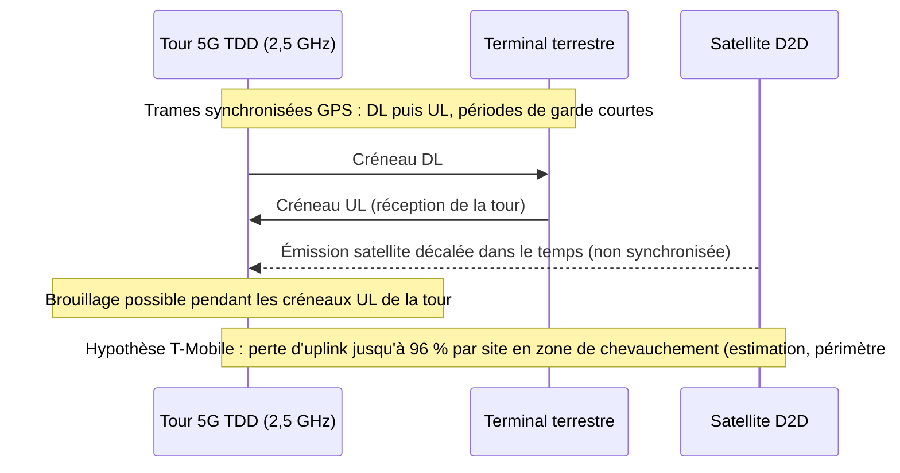
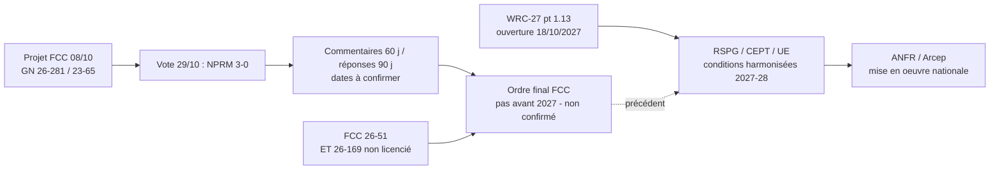

# Brief — FCC : AT&T, Verizon, T-Mobile et CTIA veulent sortir le 2,5 GHz et le 3,45 GHz du D2D (SCS). Vote du 29/10/2026 = NPRM adopté, bandes TDD non tranchées

Rédigé le 2026-11-01. Mode brief (pas l'article). Sujet réglementaire : tout ce qui n'est pas confirmé sur source primaire est balisé **[NON CONFIRMÉ]** ou **[REVENDICATION]** (affirmation d'une partie intéressée).

---

## 0. Verdict de vérification (à lire avant d'écrire)

| Point | Statut | Détail |
|---|---|---|
| Le vote du 29/10/2026 a eu lieu | **CONFIRMÉ** (3 sources de presse) | Vote **unanime 3-0** (Carr, Gomez, Trusty) — Fierce Network (via extrait de recherche, page 403 en fetch), Broadband Breakfast 2026-10-29, Telecompetitor 2026-10-30, Light Reading 2026-10-29. |
| Nature de l'acte | **CONFIRMÉ** | **NPRM** (notice of proposed rulemaking) : on **demande des commentaires**, aucune règle finale. Light Reading 10-29 : « The votes did not adopt specific new rules ». Commentaires : 60 j / réponses 90 j après publication au Federal Register **dans le projet circulé** ; le texte adopté et les dates réelles ne sont **pas confirmés** (Light Reading : « deadlines to be set »). |
| Dockets exacts du NPRM SCS | **CONFIRMÉ (source primaire FCC)** | **GN Docket No. 26-281** et **GN Docket No. 23-65** (fact sheet FCC du 2026-10-08). Titre du projet : « Unleashing Licensed Spectrum for Direct-to-Device / Single Network Future: Supplemental Coverage from Space ». Une page FCC l'intitule aussi « Modernizing the Supplemental Coverage from Space Rules » (via résultat de recherche, page 403 en fetch). |
| Docket « 26-169 » | **CONFIRMÉ** | **ET Docket No. 26-169**, « Unleashing Unlicensed Spectrum for Direct-to-Device », **FCC 26-51**, adopté **2026-08-06**, publié **2026-08-07** (texte officiel lu). Procédure **distincte** du NPRM SCS. |
| 2,5 GHz et 3,45 GHz dans le **projet circulé** (08/10) | **CONFIRMÉ** | Les deux sont dans la liste des 13 bandes (2500–2690 MHz et 3450–3550 MHz), avec proposition d'allocation MSS secondaire. |
| 2,5 GHz et 3,45 GHz dans le **texte adopté** le 29/10 | **NON CONFIRMÉ** | Je n'ai pas pu obtenir le texte adopté (fcc.gov répond 403 ; pas de FCC-26-xx trouvé). Ce que disent les sources post-vote : Fierce — le plus gros changement est dans « how the agency seeks comments on bands used for TDD » ; Broadband Breakfast cite Taubenblatt : « We adjusted how we're seeking comment on bands that can be used for TDD » ; Light Reading 10-29 : « It's unclear if the 2.5GHz and 3.45GHz bands will be part of a follow-on rulemaking ». **Il n'existe aucune source disant que les bandes ont été retirées, ni qu'elles ont été maintenues telles quelles.** Formulation sûre : « le FCC a adapté la façon de solliciter des commentaires sur les bandes TDD ; le sort final des deux bandes reste ouvert ». |
| « 482 MHz » | **CONFIRMÉ** | FCC fact sheet : « an additional 482 megahertz », bandes SCS **de 5 à 13**. |
| « 290 MHz » (2,5 + 3,45 GHz) | **DÉRIVÉ, cohérent** | 2500–2690 = 190 MHz ; 3450–3550 = 100 MHz → 290 MHz (calcul sur le texte FCC) ; Tech Times 10-27 écrit « 290 MHz, ~60 % de 482 » ; 482 − 290 = 192 MHz. **Cela suppose que les 190 + 100 MHz sont intégralement comptés dans les 482 MHz — le FCC ne publie pas ce décompte, à ne pas présenter comme chiffre FCC.** |

---

## 1. Thèse (1 phrase)

Le 29 octobre, le FCC a ouvert à consultation l'extension du D2D à 13 bandes (dont, dans le projet, deux bandes 5G mid-band TDD), mais la querelle 2,5/3,45 GHz montre qu'une bande TDD terrestre ne se « prête » pas à un satellite sans résoudre un problème de synchronisation que l'industrie dit insoluble et que le FCC lui-même dit ne pas savoir résoudre : pour un opérateur B2B, le D2D ne doit pas être traité comme un lien de secours gratuit, et le FWA/5G mid-band reste un lien de secours dont la robustesse dépend d'arbitrages spectre encore ouverts.

(Formulation à tempérer dans l'article : les chiffres de perte de couverture sont des **estimations de T-Mobile**, non vérifiées de façon indépendante, et le FCC n'a rien tranché.)

---

## 2. Faits vérifiés (URL + date)

### 2.1 Cadre réglementaire (sources primaires FCC)

1. **Fact sheet FCC du 2026-10-08, NPRM SCS, GN Docket 26-281 / 23-65** — propose d'ajouter « 482 megahertz » au SCS, de faire passer les bandes autorisées « from five to 13 », de remplacer l'exigence de bail par des accords de coexistence, de définir des licences à zone sur mesure, de fixer une limite de PFD aux frontières de licence et des exigences de performance D2D. https://docs.fcc.gov/public/attachments/DOC-425711A1.pdf (lu en intégralité via pdftotext). Le document est un **projet circulé** (« FCC-CIRC2610-02 », « subject to change »), pas le texte adopté.
2. **Même document, ¶3** : « 482 megahertz » en plus des « 344 megahertz already included in the framework ». (Le total 826 MHz est **mon addition**, pas un chiffre FCC.)
3. **Même document, ¶18 et note 43** : le FCC reconnaît que le D2D en bandes TDD « could potentially create coexistence challenges » et que « Because TDD uses time delay instead of spectral separation between uplink and downlink, SCS licensees must protect both terrestrial base stations and receivers across the entire band ». Il demande si l'on doit autoriser le bidirectionnel (TDD) ou limiter la direction SCS à la voie montante ou descendante pour les bandes non appariées (1,4 GHz, 1670–1675 MHz, 2,5 GHz, 3,45 GHz, AWS-3).
4. **Même document, ¶74–75** : le FCC demande s'il est « technically possible » d'obtenir la synchronisation temporelle entre émissions SCS et réseaux terrestres TDD et note que les limites proposées sont fondées sur la protection des terminaux, pas des stations de base ; elles pourraient devoir être différentes pour protéger les stations de base TDD.
5. **Même document, ¶122** : « the current 3GPP standards for NTN focus mainly on FDD, rather than TDD ». Argument technique central côté opérateurs, ici reconnu par le régulateur.
6. **Même document, ¶29–30** : proposition d'allocation MSS **secondaire** dans 2500–2690 MHz et 3450–3550 MHz. Le FCC rappelle qu'en 2024 il avait **écarté** le 2,5 GHz « because of the number of users and licensing complexities » (SCS Report and Order, 39 FCC Rcd 2622, ¶45). T-Mobile détient la majorité du 2,5 GHz (« mode TDD ») et AT&T est « the primary holder » du 3,45 GHz.
7. **Même document, ¶121** : les études **WRC-27 point 1.13** (MSS pour connexion directe aux terminaux IMT, 694/698 MHz–2,7 GHz) « assume that these D2D systems will operate with existing IMT user equipment and thus the interference environment on the uplink will not change… conducted only for downlink operations » ; fin des études attendue fin 2026. **À exploiter** : le postulat « uplink inchangé » est justement ce que T-Mobile conteste (perte d'uplink côté station de base).
8. **FCC 26-51, ET Docket 26-169 (D2D en bandes non licenciées), adopté 2026-08-06, publié 2026-08-07** : propose d'autoriser des appareils Part 15 à communiquer avec des satellites autorisés, sur **2400–2483,5 MHz** et **5725–5850 MHz** (propositions d'allocation, EIRP Part 15 inchangé : jusqu'à 4 W / 36 dBm), « more than 200 megahertz » au total ; régime « non-interference basis ». Le FCC cite explicitement comme précédent européen « ECC Decision (25)02 » et « ECC Report 357 » (bande 862–870 MHz). https://docs.fcc.gov/public/attachments/FCC-26-51A1.pdf (lu en intégralité). Broadband Breakfast (2026-08-05, avant le vote) cite aussi 902–928 MHz comme trois bandes dans le projet : https://broadbandbreakfast.com/spacex-unlicensed-spectrum-users-want-tweaks-to-fcc-direct-to-device-proposal/ — **le texte adopté se concentre sur 2,4 et 5,8 GHz pour l'allocation ; le rôle exact du 902–928 MHz est à ne pas affirmer.** Dates de commentaire : « 60 / 90 jours après publication au Federal Register » (dates calendaires non confirmées).

### 2.2 Position des opérateurs et chiffres (avec périmètre)

9. **Réunion CTIA + AT&T, T-Mobile, Verizon avec le personnel senior du FCC le 2026-10-20** ; dépôt ex parte (ECFS 26110083511) : « Supplemental Coverage from Space is not technically feasible in TDD bands, and the Commission should remove the 2.5 GHz and 3.45 GHz bands from its proposal » (citation reprise par Fierce/Light Reading). Les bandes concernées servent « about 300 million » d'utilisateurs 5G (**[REVENDICATION]** des opérateurs ; périmètre : États-Unis, usage 5G sur ces bandes). Light Reading, 2026-10-26 : https://www.lightreading.com/satellite/big-three-warn-that-running-d2d-in-5g-bands-will-cripple-network-performance — l'article ne donne **aucune déclaration individuelle** d'AT&T ou de Verizon ; le sous-titre dit « 3GHz », en contradiction avec le corps du texte (« 3,45 GHz ») : erreur de l'article.
10. **T-Mobile, dépôt séparé (Dombrowsky, réunion du 2026-10-19, ECFS 26110083200)** — chiffres **[REVENDICATION T-Mobile]**, estimations propres, non vérifiées de façon indépendante :
    - **jusqu'à 96 %** de la zone de couverture **uplink d'un site cellulaire** perdue **là où la couverture satellite déborde** sur le site (périmètre : site par site, zones de chevauchement ; **pas** réseau complet) ;
    - débit uplink en baisse de **88 % à 99 %** (périmètre : mêmes sites affectés) ;
    - uplink réduit d'**environ 35 %** même à **15 miles** (Telesemana : « 24 kilómetros ») de la limite du marché autorisé ;
    - un seul téléphone satellite proche de la limite peut « noyer » un site situé à 1–3 miles ;
    - un signal satellite déborderait « jusqu'à **35 miles** » de sa cible (Broadband Breakfast, 2026-10-26, https://broadbandbreakfast.com/wireless-carriers-opposed-to-fcc-plan-for-direct-to-device-in-5g-bands/).
    Sources : Light Reading 2026-10-26 (96 %, 88–99 %, 35 % à 15 miles, 1–3 miles) ; Telesemana 2026-10-27 (https://www.telesemana.com/blog/2026/10/27/estados-unidos-att-t-mobile-y-verizon-piden-a-la-fcc-excluir-las-bandas-de-25-ghz-y-345-ghz-del-uso-satelital-d2d/) confirme 96 %, 88–99 %, 35 % / 24 km, 300 millions.
11. **Chiffre divergent à ne PAS mélanger** : Fierce et PhoneArena rapportent « environ **60 %** de l'uplink dans **6 miles** de la zone de service sous licence » (2,5 GHz, émissions satellites non synchronisées). Ce n'est **pas** le même périmètre que « jusqu'à 96 % d'un site » et je n'ai pas pu rapprocher les deux dans le dépôt original (ECFS inaccessible, 403). Soit citer les deux avec leur périmètre propre, soit n'en citer aucun. **[NON RECONCILIÉ]**
12. **Le chiffre « 20–25 % du spectre en jachère dans un bloc de 100 MHz »** (stratégie de coexistence) apparaît dans un résumé de recherche automatisé sans que je l'aie retrouvé dans une page lue. **[NON CONFIRMÉ — ne pas utiliser.]**
13. Argument de fond (T-Mobile, Light Reading) : le TDD fonctionne car toutes les tours partagent le même rythme ; un satellite, à cause du délai de propagation, ne peut pas s'y caler ; un signal satellite peut tomber sur une tour pendant ses créneaux de réception uplink. Le 2,5 GHz est le « core foundation » de l'Ultra Capacity 5G de T-Mobile (Light Reading). T-Mobile rappelle que le D2D au 2,5 GHz avait été examiné et rejeté en 2024.
14. Demande CTIA de rédaction : que le texte dise que le D2D en bandes TDD « **would** » (et non « could ») créer des difficultés de coexistence (Light Reading, 2026-10-26).

### 2.3 Issue du vote (29/10/2026)

15. **Vote unanime, NPRM adopté** : Broadband Breakfast, 2026-10-29 — https://broadbandbreakfast.com/fcc-clears-slate-of-spectrum-items-including-proposal-to-expand-direct-to-device/ ; Telecompetitor, 2026-10-30 — https://www.telecompetitor.com/fcc-begins-clearing-the-way-for-increased-d2d-communications/ ; Light Reading, 2026-10-29 — https://www.lightreading.com/satellite/fcc-seeks-feedback-on-carrier-warnings-about-running-d2d-in-5g-bands (**cette URL a bien répondu 200 lors de ma lecture** ; l'instruction signalait un 404, probablement un problème intermittent/cache — à re-tester avant de la citer dans l'article).
16. Même séance : NPRM d'**enchère de 25 MHz** (1675–1695 MHz + 2020–2025 MHz ; Light Reading écrit « 1655MHz-1695MHz », **erreur probable** : 20 + 5 = 25 MHz) conditionné à l'étude NTIA ; ordre drones en 800 MHz (~50 MHz) (Broadband Breakfast).
17. Light Reading 10-29 : le FCC a **rejeté la demande de SpaceX d'ajouter le 902–928 MHz** (détail du périmètre procédural non précisé ; ne pas extrapoler).
18. Carr (Light Reading 10-29) : « important technical questions to answer about whether satellite and terrestrial uses can successfully coexist » (à propos de l'enchère/NTIA, pas explicitement des bandes TDD — **ne pas lui faire dire plus**). Gomez : « I worry about competition and making sure that everyone that wants to have access to spectrum, within reason, can get it. » Gomez (Telecompetitor) : « do not inadvertently allow one or two providers to dominate the market ».
19. Réaction de marché citée par Light Reading : AT&T et T-Mobile ont clôturé en baisse de plus de 7 % le vendredi (23/10), Verizon de 1,19 % ; rebond partiel le lundi. **Le lien causal avec ce dossier n'est pas établi** ; ne pas l'écrire comme cause.

### 2.4 Europe / France (précédent)

20. **RSPG** (opinion D2D, cité par l'ANFR, 2025-07-23) : distingue le D2D dans les bandes des opérateurs mobiles (« D2D-IMT ») et dans les bandes satellites ; défi principal = protéger les réseaux mobiles et les services des bandes adjacentes/frontières ; modèle privilégié : l'opérateur mobile « libère une partie de son spectre » pour le D2D ; conditions techniques harmonisées européennes attendues 2027/28 ; mandat CEPT à venir. https://www.anfr.fr/en/anfr/news/all-news/detail-of-the-news/direct-to-device-mobile-coverage-everywhere-coming-soon — **l'ANFR n'y exprime pas de position française propre.**
21. **Arcep, communiqué du 2026-07-20** : seconde consultation sur la bande L (1518–1559, 1610–1660,5, 1670–1675, 2483,5–2500 MHz), licences expirant 2027–2030, scénario d'extension à novembre 2030 ; D2D et IoT mentionnés ; contributions avant le 2026-09-30. https://en.arcep.fr/news/press-releases/view/n/frequencies-200726.html — **aucune position Arcep/ANFR sur le D2D dans les bandes TDD mobiles (3,4–3,8 GHz, 2,6 GHz) n'a été trouvée** ; ne pas en inventer.
22. **Commission européenne, 2026-05-27** : proposition de règlement pour une sélection à l'échelle UE des fournisseurs MSS en bande 2 GHz (licences actuelles expirant en 2027) ; « La bande MSS 2 GHz est idéale pour les services D2D ». https://digital-strategy.ec.europa.eu/fr/news/commission-proposes-new-authorisation-mobile-satellite-services-eus-resilience-and-competitiveness
23. **RCR Wireless, 2026-10-19** (panel NTN Integration Forum) : WRC-27 conférence ouverte le 2027-10-18 à Shanghai ; point 1.13 couvre ~13 arrangements de fréquences et exige la protection des incumbents FDD **et** TDD ; Espagne (RSPG) : essais 2,6 GHz D2D (MasOrange/Starlink) « contrôlés et localisés parce que la bande est problématique » ; Ofcom : D2D déjà permis en spectre IMT. https://rcrwireless.com/20261019/networks/wrc-27-direct-to-device-spectrum — l'article ne mentionne ni Arcep ni ANFR ni CEPT.
24. **CEPT ECC/DEC/(25)02** (adoptée 2025-06-27, ECC#67) : dispositif « low power devices communicating with satellites » en **862–870 MHz**, fondé sur ECC Report 357 (PFD de -142 dB(W/(m²·4 kHz)) à ne pas dépasser). Seule référence que le FCC cite lui-même comme précédent européen pour le D2D en non licencié (FCC 26-51, ¶21 et notes). Source : base docdb.cept.org (via moteur de recherche ; texte final non lu, seul le projet l'a été) et FCC 26-51.

---

## 3. Sources retenues (numérotées)

1. **FCC — Fact sheet + projet de NPRM SCS** — https://docs.fcc.gov/public/attachments/DOC-425711A1.pdf — primaire (projet circulé) — 2026-10-08
2. **FCC 26-51 — NPRM D2D non licencié (ET 26-169)** — https://docs.fcc.gov/public/attachments/FCC-26-51A1.pdf — primaire (adopté) — 2026-08-06/07
3. **Light Reading (Baumgartner) — Big Three warn…** — https://www.lightreading.com/satellite/big-three-warn-that-running-d2d-in-5g-bands-will-cripple-network-performance — presse spé / primaire de la demande — 2026-10-26
4. **Light Reading — FCC seeks feedback on carrier D2D concerns** — https://www.lightreading.com/satellite/fcc-seeks-feedback-on-carrier-warnings-about-running-d2d-in-5g-bands — presse spé — 2026-10-29
5. **Broadband Breakfast — Wireless carriers opposed…** — https://broadbandbreakfast.com/wireless-carriers-opposed-to-fcc-plan-for-direct-to-device-in-5g-bands/ — presse — 2026-10-26
6. **Broadband Breakfast — FCC clears slate of spectrum items…** — https://broadbandbreakfast.com/fcc-clears-slate-of-spectrum-items-including-proposal-to-expand-direct-to-device/ — presse — 2026-10-29
7. **Telecompetitor — FCC begins clearing the way for D2D** — https://www.telecompetitor.com/fcc-begins-clearing-the-way-for-increased-d2d-communications/ — presse — 2026-10-30
8. **Fierce Network — FCC doubles down on D2D with spectrum plays** — https://www.fierce-network.com/wireless/fcc-doubles-down-d2d-spectrum-plays — presse — ~2026-10-29/30 (**page non lisible : 403 ; contenu connu uniquement par extrait de recherche**, à relire par l'humain avant citation)
9. **Telesemana** — https://www.telesemana.com/blog/2026/10/27/estados-unidos-att-t-mobile-y-verizon-piden-a-la-fcc-excluir-las-bandas-de-25-ghz-y-345-ghz-del-uso-satelital-d2d/ — presse (confirme les chiffres T-Mobile) — 2026-10-27
10. **RCR Wireless — WRC-27 D2D** — https://rcrwireless.com/20261019/networks/wrc-27-direct-to-device-spectrum — presse/analyse — 2026-10-19
11. **ANFR — Direct to Device** — https://www.anfr.fr/en/anfr/news/all-news/detail-of-the-news/direct-to-device-mobile-coverage-everywhere-coming-soon — régulateur — 2025-07-23
12. **Arcep — consultation bande L** — https://en.arcep.fr/news/press-releases/view/n/frequencies-200726.html — régulateur — 2026-07-20
13. **Commission européenne — autorisation MSS 2 GHz** — https://digital-strategy.ec.europa.eu/fr/news/commission-proposes-new-authorisation-mobile-satellite-services-eus-resilience-and-competitiveness — régulateur — 2026-05-27
14. **Broadband Breakfast — SpaceX, unlicensed spectrum users want tweaks** — https://broadbandbreakfast.com/spacex-unlicensed-spectrum-users-want-tweaks-to-fcc-direct-to-device-proposal/ — presse — 2026-08-05
15. **CEPT ECC/DEC/(25)02 + ECC Report 357** — https://docdb.cept.org/document/28652 — standard/régulateur européen — 2025-06-27 (texte final non lu)

Sources lues mais **à faible fiabilité, ne pas citer comme preuve** : Tech Times 2026-10-27 (incohérences : titre « Wednesday », jour/dates, 65 vs 50 MHz EchoStar) ; Tech-Insider 2026-10-25 (aucun docket, chiffres non sourcés) ; IEEE ComSoc Technology Blog 2026-10-26 (rédigé avec Gemini, ne contient pas 96 %, nombreuses valeurs non sourcées, dont 2–10 ms de délai).

**Total : 15 sources retenues** (dont 4 primaires/régulateur FCC, 3 régulateurs UE/FR, 8 presse), + 3 écartées. Mix conforme : 1 primaire (FCC), 2–3 techniques (documents FCC, CEPT), 3+ validations presse.

---

## 4. Contradictions / zones grises

- **Issue 2,5/3,45 GHz** : non tranchée dans les sources (voir §0).
- **96 % vs 60 %** : deux chiffres T-Mobile de périmètres différents (site cellulaire vs zone à 6 miles) — non rapprochés.
- **Sous-titre Light Reading « 3GHz »** vs corps « 3,45 GHz ».
- **Date du dépôt CTIA** : réunion du 20/10 (sûr) ; « pétition du 22/10 » (Tech Times/IEEE, source faible) ; ECFS 26110083511 daté d'après les IDs de fin octobre. Ne pas affirmer une date de dépôt.
- **Enchère** : « 1655–1695 » (Light Reading) vs « 1675–1695 » (Broadband Breakfast, Fierce, Telecompetitor + 2020–2025 MHz = 25 MHz au total) — retenir 1675–1695.
- **Bandes non licenciées** : 3 bandes (902–928, 2400–2483,5, 5725–5850) dans Broadband Breakfast pré-vote vs propositions d'allocation limitées à 2,4 et 5,8 GHz dans le texte adopté.
- **Numéros de docket** : GN 26-281 et GN 23-65 viennent du projet circulé (08/10) ; l'adoption n'est pas documentée par un FCC-26-xx lisible.
- **Capacité 3GPP** : le FCC écrit que le NTN 3GPP se concentre « mainly » sur le FDD ; ne pas écrire « exclusivement ».
- **Aucun chiffre FWA T-Mobile Q3 2026 fiable** trouvé (base ~6,8 M vs ~8 M selon sources résumées) : **ne pas citer de base d'abonnés FWA**.

---

## 5. Angle B2B opérateur (Wifirst : hôtellerie, retail, entreprise, résidence étudiante)

À traiter comme **analyse**, pas comme faits :

1. **Robustesse du lien de secours 5G/FWA** : beaucoup de designs de continuité (backup LTE/5G) reposent sur le mid-band TDD (US : 2,5 et 3,45 GHz ; Europe : 3,4–3,8 GHz). Si un jour le D2D empiète sur ces bandes, l'effet décrit (uplink dégradé, effet de bord autour des frontières de licence) frappe **d'abord la voie montante**, c'est-à-dire la remontée cloud, VoIP, caisses, badgeuses. À formuler comme **risque scénarisé selon T-Mobile**, pas comme dégradation observée.
2. **SLA et architecture** : le D2D (téléphone) ne remplace pas un lien WAN de site ; il est secondaire, sans garantie de débit, et le FCC lui-même reste dans le « supplemental ». Dans un cahier des charges, distinguer 3 couches : lien principal (fibre), secours terrestre (5G/FWA, bande à surveiller), secours satellite dédié (LEO fixe, hors D2D).
3. **Précédent réglementaire pour l'Europe** : le FCC (projet) demande lui-même si la synchronisation est « technically possible » et note que le NTN 3GPP vise surtout le FDD ; l'Europe (RSPG) a déjà posé « D2D-IMT : protéger les réseaux mobiles et bandes adjacentes/frontières », avec des conditions harmonisées attendues 2027/28 et WRC-27 point 1.13 qui exige la protection FDD et TDD. **Aucune position ANFR/Arcep sur le TDD n'a été trouvée** : l'article doit dire « pas de position publique identifiée » plutôt que de spéculer.
4. **Sujet de gouvernance** : qui arbitre ? Au FCC, des accords de coexistence entre détenteur de licence terrestre et opérateur SCS ; en Europe, RSPG/CEPT/Commission. Pour un MVNO/opérateur B2B, la question pratique est contractuelle : qui est titulaire de la bande qui porte votre lien de secours, et quelle clause de protection ?
5. **D2D en bandes non licenciées (second plan)** : ET 26-169 propose des appareils Part 15 vers satellites sur 2,4 et 5,8 GHz (EIRP Part 15 inchangé, non-interférence). Pour des opérateurs Wi-Fi comme Wifirst, c'est le sujet à **surveiller** : mêmes bandes que le Wi-Fi 2,4/5 GHz ; le FCC écrit vouloir « preserve the operational status quo » mais Broadcom, Intel et Cisco ont demandé davantage d'assurances (Broadband Breakfast, 05/08). Précédent européen : ECC/DEC/(25)02 en 862–870 MHz (SRD basse puissance), **pas** en 2,4 GHz/5 GHz. Aucun cadre équivalent n'est confirmé en Europe pour les bandes Wi-Fi.

---

## 6. Plan suggéré de l'article (~1 400–1 800 mots)

1. **Accroche** : ce qui s'est passé le 29 octobre (NPRM unanime, 482 MHz, 5→13 bandes) et ce qui ne s'est pas passé (aucune règle, sort du 2,5/3,45 GHz non tranché).
2. **Le contexte technique en 5 lignes** : TDD vs FDD, pourquoi un satellite à plusieurs centaines de km n'a pas le même « rythme » qu'une tour (rester qualitatif, pas de valeurs de délai non sourcées).
3. **Ce que demandent CTIA + les trois opérateurs** et les chiffres T-Mobile **avec leur périmètre et la mention « estimation de T-Mobile »** ; 96 % (site cellulaire, zone de chevauchement), 35 % à 15 miles, 88–99 % uplink.
4. **Ce que le FCC écrit lui-même** (projet circulé) : ¶18, ¶74–75, ¶121–122 ; il pose les bonnes questions avant même le lobbying.
5. **L'issue du vote** et la ligne « on a ajusté la façon de demander des commentaires ».
6. **Lecture B2B : robustesse du FWA/5G** comme lien de secours (3 couches), avec les limites (pas de chiffres FWA).
7. **Précédent pour l'Europe** : RSPG, WRC-27 1.13, ECC/DEC/(25)02, MSS 2 GHz, consultation Arcep bande L ; honnêteté sur l'absence de position TDD ANFR/Arcep.
8. **Second plan : D2D non licencié (ET 26-169)** et enjeu Wi-Fi.
9. **Ce qu'il faut surveiller** : dates de commentaires/réponses (60/90 j après publication au Federal Register, à confirmer), étude NTIA, WRC-27 (ouverture 2027-10-18), conditions harmonisées UE 2027/28.

---

## 7. Schémas Mermaid suggérés

**Schéma 1 — Pourquoi le TDD n'est pas « appariable »** (diagramme de séquence simplifié, qualitatif) :

**Schéma 2 — Chaîne de décision US vs UE** (flowchart) :

(La flèche pointillée est une lecture éditoriale, pas un lien juridique.)

---

## 8. Métadonnées suggérées

- **Titre** : « D2D satellite : pourquoi les opérateurs américains veulent sortir le 2,5 et le 3,45 GHz de la course »
- **Alternative** : « Le FCC ouvre 482 MHz au satellite-vers-mobile : la bataille du TDD ne fait que commencer »
- **Slug** : `fcc-d2d-scs-bandes-tdd-2-5-3-45-ghz-operateurs`
- **Category** : `tech`
- **Genre (taxonomie sourcing)** : `reglementaire` (secondaire : `wifi-mobilite`)
- **Tags** : `FCC`, `D2D`, `SCS`, `satellite`, `5G`, `TDD`, `FWA`, `spectre`, `CTIA`, `T-Mobile`, `Arcep`, `WRC-27`, `Wi-Fi`
- **Note anti-redondance** : l'historique des 60 derniers titres n'a pas été revérifié dans ce brief (script `list-articles.ts` non exécuté ici, mode brief) — à contrôler par l'orchestrateur.

---

## 9. Prompts d'images (nano-banana-pro, anglais, sans texte ni logo)

**Cover** : Isometric technical illustration of a 5G cell tower and a low-earth-orbit satellite exchanging misaligned time-sliced signal blocks above a night city grid, deep navy and teal palette, clean vector style, no text, no logos.

**Inline 1** : Minimalist diagram-style illustration of two frequency timelines, one split into alternating uplink and downlink time slots, the other into two separate parallel frequency channels, flat design, blue and orange, no text, no logos.

**Inline 2** : Aerial view of a cellular coverage map with a service boundary line and a translucent satellite beam overlapping the border, shrinking uplink coverage zones around nearby towers, muted technical palette, no text, no logos.

**Inline 3** : Wide editorial illustration of Europe and North America connected by thin lines of spectrum bands, a regulator's table with transparent frequency blocks in the foreground, calm professional style, no text, no logos.

---

## 10. Limites de cette vérification

- fcc.gov (pages HTML) et ECFS renvoient **403** : les dépôts ex parte originaux (T-Mobile 26110083200, CTIA 26110083511) n'ont **pas** été lus ; les chiffres T-Mobile viennent de Light Reading, Telesemana et Broadband Breakfast (cohérents entre eux, sauf le « 60 % / 6 miles » de Fierce/PhoneArena).
- Fierce, PhoneArena, DCD : 403 en fetch ; contenu connu seulement par extraits de recherche.
- Le **texte adopté** du NPRM du 29/10 n'est pas obtenu ; tout ce qui concerne son contenu final est **NON CONFIRMÉ**.
- Aucune position publique ANFR/Arcep sur le D2D en bandes TDD trouvée.
