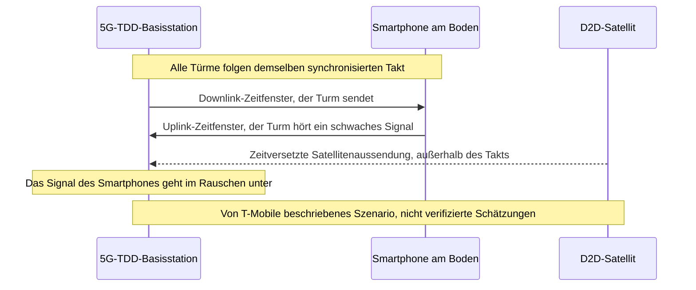
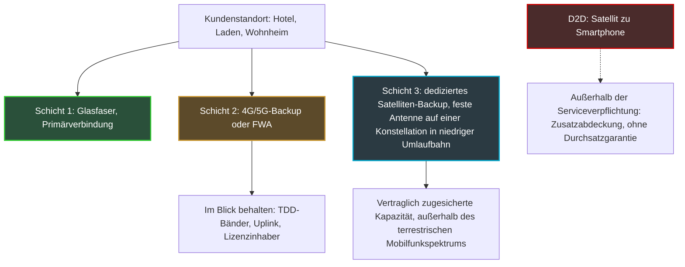

## Dreihundert Millionen Nutzer und ein Satellit zu viel

Dreihundert Millionen. So viele 5G-Nutzer, sagen AT&T, Verizon und T-Mobile, bedienen sie auf zwei Frequenzbändern, die sie heute einem Neuankömmling verschließen wollen: dem Satelliten, der direkt mit einem handelsüblichen Smartphone sprechen kann. Am 20. Oktober saßen die drei Rivalen gemeinsam mit ihrem Branchenverband auf derselben Seite des Tisches, gegenüber Verantwortlichen der Federal Communications Commission (FCC), der US-Telekomregulierungsbehörde. Ihre Botschaft passte in einen Satz: Auf diesen Frequenzen kann das nicht funktionieren.

Neun Tage später hat die FCC abgestimmt. Einstimmig hat sie ein Konsultationsverfahren zur Ausweitung von „Direct-to-Device“ eröffnet (D2D, die Direktverbindung zwischen einem Satelliten und einem handelsüblichen Telefon). Der Anfang Oktober vorgestellte Entwurf sah vor, die Zahl der zugelassenen Bänder von 5 auf 13 zu erhöhen, also 482 MHz zusätzlich. Zu den beiden umstrittenen Bändern hat die Behörde meines Wissens öffentlich nichts entschieden.

Warum von Europa aus einen Frequenzstreit in Washington verfolgen? Erstens, weil sich die Frage, die dort gestellt wird, auch bei uns längst stellt: Kann man einem Satelliten eine 5G-Frequenz leihen, die im Takt eines Metronoms läuft? Die Weltfunkkonferenz 2027 (Tagesordnungspunkt 1.13, Bänder von 694 MHz bis 2,7 GHz) wird einen Teil davon behandeln müssen. Zweitens, ganz handfest: Die 4G/5G-Backup-Verbindungen, die die Kassen eines Ladens oder die Rezeption eines Hotels am Laufen halten, wenn die Glasfaser ausfällt, stützen sich für ihre 5G-Kapazität auf Frequenzen dieser Art. Und das Risiko, das die US-Betreiber beschreiben, trifft zuerst den Uplink (vom Endgerät zur Antenne). Also genau den Weg, auf dem die Transaktionen und die Sprachtelefonie Ihrer Standorte nach oben gelangen.

## Eine einspurige Brücke und ein Lkw vom Himmel

Stellen Sie sich eine einspurige Brücke vor. Damit der Verkehr in beide Richtungen fließen kann, schalten Ampeln im Wechsel: ein paar Augenblicke für die, die hinüberfahren, ein paar Augenblicke für die, die zurückkommen. Solange alle Ampeln des Netzes im selben Takt schalten, stößt niemand zusammen. Nun taucht ein Lkw auf, der die Ampeln nicht sieht. Er kommt nicht von der Straße, sondern vom Himmel, und er fährt los, wann es ihm passt.

Das ist im Kern das Argument der US-Betreiber.

Ein Telefon und eine Antenne können ihre Kommunikation auf zwei Arten organisieren. Erste Option: FDD (Frequency Division Duplex), zwei getrennte Frequenzblöcke, einer für den Downlink (von der Antenne zum Telefon), der andere für den Uplink. Eine Straße mit zwei getrennten Fahrbahnen. Zweite Option: TDD (Time Division Duplex), ein einziger Block, der zeitlich geteilt wird. Der Turm spricht, dann hört er zu, dann spricht er wieder. Das ist unsere einspurige Brücke. Und es ist auch die Betriebsart der 5G-Kapazitätsbänder, um die es in diesem Fall geht: 2,5 GHz und 3,45 GHz in den USA, 3,4–3,8 GHz in Europa.

*FDD trennt die beiden Kommunikationsrichtungen über die Frequenz, TDD über die Zeit: Genau diese zweite Logik bringt der Satellit durcheinander.*

TDD stellt eine nicht verhandelbare Anforderung: Synchronisation. Alle Basisstationen eines Gebiets wechseln im selben Augenblick zwischen Senden und Empfangen, getaktet von einer gemeinsamen Uhr. Sonst brüllt ein sendender Turm genau dann los, wenn sein Nachbar gerade auf weit entfernte Telefone lauscht. Ein Satellit in niedriger Umlaufbahn, mehrere hundert Kilometer hoch, lebt nicht im selben Rhythmus. Nach Aussage der Betreiber verhindert die Laufzeit seines Signals, dass er sich auf diesen Takt einstellen kann. Daraus ergibt sich das zentrale Risiko, wie T-Mobile es formuliert: eine Satellitenaussendung, die auf einen Turm trifft, während dieser in seinen Empfangsfenstern ist.

Das ist nicht nur das Argument eines Lobbyisten. Der Textentwurf, den die FCC am 8. Oktober in Umlauf gebracht hat, sagt es fast wortgleich. Weil TDD „uses time delay instead of spectral separation between uplink and downlink“, schreibt die Behörde, muss ein Satellitenbetreiber sowohl die Basisstationen als auch die terrestrischen Empfänger „across the entire band“ schützen. Weiter hinten fragt die FCC, ob es überhaupt „technically possible“ sei, Satellitenaussendungen und terrestrische TDD-Netze zu synchronisieren. Schließlich hält sie fest, dass sich die aktuellen Normen des 3GPP (der Organisation, die die Mobilfunkstandards schreibt) für nicht-terrestrische Netze „focus mainly on FDD, rather than TDD“.

Ein letztes Detail, das keines ist: Die Leistungsgrenzen des Entwurfs wurden darauf ausgelegt, die Endgeräte zu schützen, nicht die Basisstationen. Die FCC räumt ein, dass es womöglich weitere braucht, um TDD-Stationen zu schützen. Das Berechnungsraster deckt also das Szenario, das die Betreiber fürchten, noch gar nicht ab.

## 96 %: Die Zahl von T-Mobile und was sie wirklich misst

Ein einziges Smartphone im Satellitenmodus, nahe der Grenze eines Lizenzgebiets. Wenige Kilometer entfernt eine 5G-Basisstation, die die Telefone, die sie versorgt, nicht mehr hören kann. Das ist das Szenario, das T-Mobile der Behörde bei einem Treffen am 19. Oktober dargelegt hat, festgehalten in einer Eingabe, die von der seiner Wettbewerber getrennt ist. Laut dem Betreiber kann ein einziges Gerät genügen, um einen Standort in 1 bis 3 Meilen Entfernung (rund 1,5 bis 5 km) zu „ertränken“.

Die Zahlen, die dieses Szenario begleiten, müssen mit ihrem genauen Geltungsbereich gelesen werden:

- **bis zu 96 %** der Uplink-Abdeckungszone eines Mobilfunkstandorts gehen verloren, **dort, wo die Satellitenabdeckung auf diesen Standort übergreift**. Es ist eine Zahl pro Standort, im Überlappungsbereich, keine Schätzung für das gesamte Netz;
- ein um **88 % bis 99 %** niedrigerer Uplink-Durchsatz an genau diesen Standorten;
- ein um **etwa 35 %** gekappter Uplink selbst in 15 Meilen (rund 24 km) Entfernung von der Grenze des lizenzierten Marktes;
- ein Satellitensignal, das **bis zu 35 Meilen** über sein Zielgebiet hinausreichen könnte.

Das sind Schätzungen von T-Mobile, erstellt von T-Mobile, um sein strategisch wichtigstes Gut zu verteidigen: das 2,5-GHz-Band, von dem der Betreiber den Großteil hält und das Light Reading als Fundament seines 5G-Angebots „Ultra Capacity“ beschreibt. Diese Zahlen wurden nicht unabhängig überprüft. Ich zitiere sie so, wie Light Reading und Telesemana sie berichten (Broadband Breakfast bestätigt die 35 Meilen). Andere Medien nennen eine abweichende Zahl, rund 60 % des Uplinks in 6 Meilen Entfernung von der lizenzierten Zone: Ich konnte sie nicht mit der ursprünglichen Eingabe abgleichen.

*Der befürchtete Mechanismus: Ein Satellitensignal trifft außerhalb des Takts ein, während die Basisstation auf ihre Endgeräte lauscht.*

Die gemeinsame Eingabe, getragen von der CTIA (dem US-Mobilfunkverband) mit AT&T, T-Mobile und Verizon, ist nüchterner: „Supplemental Coverage from Space is not technically feasible in TDD bands, and the Commission should remove the 2.5 GHz and 3.45 GHz bands from its proposal.“ SCS, Supplemental Coverage from Space, ist die amerikanische regulatorische Bezeichnung für D2D in den Bändern der Mobilfunkbetreiber. Light Reading berichtet dagegen von keiner individuellen Stellungnahme von AT&T, dem größten Inhaber des 3,45-GHz-Bands, und auch nicht von Verizon.

Die FCC kennt das Terrain. Schon 2024 hatte sie das 2,5-GHz-Band aus dem D2D-Rahmen ausgeklammert, „because of the number of users and licensing complexities“. T-Mobile hat nicht versäumt, daran zu erinnern.

Meine Einschätzung: 96 % ist eine Szenario-Obergrenze, keine Prognose. Ein Betreiber, der sein wertvollstes Band verteidigt, wählt nicht die beruhigendste Annahme. Aber es wäre ebenso naiv, die Physik zusammen mit dem Lobbying zu verwerfen. Die Behörde stellt selbst, schwarz auf weiß, die Fragen, auf die T-Mobile mit Zahlen antwortet.

## 29. Oktober: Ein einstimmiges Votum, das nichts entscheidet

Was die FCC am 29. Oktober mit 3 zu 0 Stimmen angenommen hat (Vorsitzender Brendan Carr, Anna Gomez und Olivia Trusty), ist eine NPRM, kurz für notice of proposed rulemaking. Auf Deutsch: ein Regelentwurf, der zur Stellungnahme vorgelegt wird. „Today's spectrum-related votes don't propose any specific new rules yet“, fasst Light Reading zusammen. Noch ist nichts anwendbar.

Der am 8. Oktober in Umlauf gebrachte Entwurf, abgelegt in den Verfahren GN 26-281 und GN 23-65, geht dennoch weit. Er schlägt vor, den 344 MHz, die bereits für D2D geöffnet sind, 482 MHz hinzuzufügen und die Zahl der zulässigen Bänder von 5 auf 13 zu erhöhen. Er schlägt außerdem vor, die Mietpflicht zwischen Mobilfunk- und Satellitenbetreiber durch Koexistenzvereinbarungen zu ersetzen. Schließlich sieht er maßgeschneiderte Gebietslizenzen vor, Leistungsanforderungen und eine Obergrenze für die „Leistungsflussdichte“ an den Lizenzgrenzen. Übersetzt: eine Begrenzung der Funkenergie, die ein Satellit am Rand des Gebiets, das er abdecken darf, auf den Boden fallen lassen darf.

In der Liste der 13 Bänder standen 2500–2690 MHz und 3450–3550 MHz, mit dem Vorschlag einer Zuweisung an den mobilen Satellitenfunkdienst mit „sekundärem“ Status. Im Vokabular der Frequenzregulierung heißt sekundär: Sie kommen nach dem Primärdienst und dürfen ihn nicht stören.

*Der Kern des Falls: Wo ein Satellitenstrahl über eine Lizenzgrenze hinausragt, riskieren benachbarte Basisstationen nach Aussage der Betreiber, einen Teil ihres Uplinks zu verlieren.*

Was bleibt nach dem Votum von diesen beiden Bändern? Auf Seiten der FCC fasst Taubenblatt die Anpassung in einem Satz zusammen, zitiert von Broadband Breakfast: „We adjusted how we're seeking comment on bands that can be used for TDD.“ Light Reading bleibt vorsichtig: „It's unclear if the 2.5GHz and 3.45GHz bands will be part of a follow-on rulemaking.“ Den angenommenen Text konnte ich nicht einsehen. Meines Wissens sagt keine öffentliche Quelle, dass die beiden Bänder gestrichen wurden, noch dass sie unverändert beibehalten wurden. Die ehrliche Formulierung lautet daher: Die FCC hat die Art und Weise geändert, wie sie zu den TDD-Bändern konsultiert, und das Schicksal des 2,5-GHz- und des 3,45-GHz-Bands bleibt offen.

Der Entwurf erwähnte auch einen Mittelweg: den Satelliten in den ungepaarten Bändern wie 2,5 und 3,45 GHz auf eine einzige Richtung zu beschränken, Uplink oder Downlink. Die Idee hat ihre Logik. Aber die beiden von T-Mobile beschriebenen Szenarien scheinen jeweils eine andere Richtung zu betreffen: ein Satellit, der sendet, während der Turm lauscht, und ein Telefon, das nahe einer Grenze zum Satelliten sendet. Das eine zu kappen, löst das andere nicht.

Zum Zeitplan: Der Entwurf sah 60 Tage für Stellungnahmen und 90 Tage für Erwiderungen vor, gerechnet ab der Veröffentlichung im Federal Register, dem amtlichen Verkündungsblatt der USA. Die tatsächlichen Termine stehen noch aus.

## Für einen Kundenstandort ist D2D keine Backup-Verbindung

Räumen wir zunächst ein Missverständnis aus, das ich in Ausschreibungen kommen sehe. D2D heißt: Ein Smartphone verbindet sich mit einem Satelliten, wenn keine Antenne mehr da ist. Wertvoll in Funklöchern oder im Notfall. Aber der amerikanische Rahmen nennt sich selbst „Supplemental Coverage from Space“. Eine Zusatzabdeckung, ohne Durchsatzgarantie, gedacht für einzelne Endgeräte. Nichts in den aktuellen Texten macht daraus eine Anbindung für einen Standort.

Das eigentliche Thema für uns liegt woanders. Hotel, Laden, Studentenwohnheim: Seriöse Kontinuitätsarchitekturen kombinieren eine primäre Glasfaserverbindung mit einem 4G/5G-Funk-Backup, mitunter in Form von FWA (Fixed Wireless Access, der feste Internetzugang über Mobilfunk). Ein guter Teil der 5G-Kapazität dieser Backups liegt in TDD-Bändern.

Sollten diese Bänder eines Tages mit D2D geteilt werden, träfe das von T-Mobile beschriebene Szenario zuerst den Uplink. Ich sage ausdrücklich: ein Szenario, keine beobachtete Verschlechterung. Doch für einen gewerblichen Standort ist der Uplink der Datenstrom der Zahlungsterminals, die IP-Telefonie, die Zutrittsleser, die Videoüberwachung, die in die Cloud hochgeladen wird, die nächtlichen Backups. Der Kunde lädt herunter. Das Geschäft dagegen sendet.

Daher eine Resilienz in drei getrennten Schichten, ohne D2D jemals in eine davon einzurechnen.

*Drei Resilienzschichten für einen gewerblichen Standort. D2D bleibt außerhalb der Serviceverpflichtung.*

Konkret drei Reflexe, die Sie schon jetzt in ein Pflichtenheft aufnehmen sollten:

1. **Fragen, auf welchen Bändern die Backup-Verbindung beruht und wer deren Lizenzinhaber ist.** Würde der US-Entwurf unverändert angenommen, liefe der Schutz des terrestrischen Netzes über eine Koexistenzvereinbarung zwischen Mobilfunk- und Satellitenbetreiber. Eine Vereinbarung, die Sie nicht unterzeichnen werden. Ihr einziger Hebel ist vertraglich: Welche Klausel schützt Sie, wenn sich der Uplink verschlechtert?
2. **Den Uplink eigenständig überwachen**: Durchsatz, Latenz und Verluste beim Senden, nicht nur den Zustand „up/down“ der Verbindung.
3. **Frequenzportfolios diversifizieren**: zwei Betreiber mit unterschiedlichen Bändern oder ein dediziertes Satelliten-Backup mit vertraglich zugesicherter Kapazität. Und D2D niemals in einem SLA (Service Level Agreement, der Vereinbarung über das Serviceniveau) aufführen.

## Europa hat die richtige Frage gestellt, noch nicht die Antwort

Europa hat nicht auf Washington gewartet. In einer Stellungnahme, die die ANFR (Agence nationale des fréquences) im Juli 2025 weitergegeben hat, unterscheidet die RSPG, die Gruppe, die die Europäische Kommission zum Frequenzspektrum berät, zwei Arten von D2D. Auf der einen Seite jenes, das in den Bändern der Mobilfunkbetreiber arbeitet, getauft „D2D-IMT“ (IMT ist die regulatorische Bezeichnung für Mobilfunktechnologien). Auf der anderen Seite jenes, das in Satellitenbändern arbeitet. Für Ersteres ist die Herausforderung klar benannt: die Mobilfunknetze sowie die angrenzenden Bänder und die Grenzen zu schützen.

Das Modell, das die RSPG bevorzugt, ist interessant. Der Mobilfunkbetreiber „gibt einen Teil seines Spektrums frei“ für D2D: Er wird zum freiwilligen Partner statt zum Nachbarn, der es erdulden muss. Das ist im Grunde das, was die FCC mit ihren Koexistenzvereinbarungen versucht. Harmonisierte technische Bedingungen werden für 2027/28 erwartet, wobei die CEPT, die europäische Organisation der Post- und Telekommunikationsregulierer, ein Mandat erhalten soll.

In der Praxis überwiegt die Vorsicht. Bei einem Panel, über das RCR Wireless im Oktober berichtet hat, beschrieb ein spanischer Teilnehmer die D2D-Tests von MasOrange und Starlink im 2,6-GHz-Band als „kontrolliert und lokal begrenzt, weil das Band problematisch ist“. Laut demselben Panel erlaubt die Ofcom D2D im Mobilfunkspektrum im Vereinigten Königreich bereits.

Der eigentliche Termin ist die WRC-27, die Weltfunkkonferenz, die am 18. Oktober 2027 in Shanghai beginnt. Ihr Tagesordnungspunkt 1.13, der der direkten Verbindung zwischen Satelliten und mobilen Endgeräten gewidmet ist, verlangt den Schutz bestehender Dienste, FDD wie TDD. Doch eine Passage im FCC-Entwurf sollte die europäischen Delegationen aufhorchen lassen. Die Vorstudien zu diesem Punkt gehen vom Einsatz bestehender mobiler Endgeräte aus und damit von einem Störumfeld im Uplink, das „will not change“. Sie betreffen nur den Downlink, mit einem Ergebnis, das Ende 2026 erwartet wird. Genau auf den Uplink konzentriert T-Mobile jedoch seine Warnungen. Wenn ich einen Punkt ganz oben auf die europäische Agenda setzen müsste, wäre es dieser.

*Auf beiden Seiten des Atlantiks kommen die Regulierer beim Thema Satellit-zu-Mobilfunk voran. Die TDD-Bänder bleiben der wunde Punkt.*

Und Frankreich? Die Arcep, die französische Telekomregulierungsbehörde, hat im Juli eine zweite Konsultation zum L-Band eröffnet, einer Gruppe von Satellitenfrequenzen zwischen 1,5 und 2,5 GHz, deren Genehmigungen zwischen 2027 und 2030 auslaufen. D2D und das Internet der Dinge werden dort erwähnt. Die Europäische Kommission hat im Mai eine unionsweite Auswahl der Satellitenbetreiber im 2-GHz-Band vorgeschlagen, das sie als „ideal für D2D-Dienste“ einstuft. Beide Vorhaben betreffen Satellitenbänder. Zu D2D in den TDD-Mobilfunkbändern, 3,4–3,8 GHz oder 2,6 GHz, habe ich keine öffentliche Position der ANFR oder der Arcep gefunden.

Der europäische Vorteil ist real: Das Modell der RSPG geht von der Zustimmung des Mobilfunkbetreibers aus, während der US-Entwurf von einer Bänderliste ausgeht. Doch die Physik von TDD endet nicht am Atlantik.

## Im Hintergrund blickt auch das WLAN zum Himmel

Ein weiteres amerikanisches Dossier, weniger beachtet, betrifft unmittelbar das WLAN. Am 6. August hat die FCC eine eigene Konsultation angenommen (FCC 26-51, Verfahren ET 26-169), um lizenzfreien Geräten die Kommunikation mit Satelliten zu erlauben, auf 2400–2483,5 MHz und 5725–5850 MHz. Mit anderen Worten: dem 2,4-GHz-WLAN und dem oberen Teil des 5-GHz-Bands.

Es gibt Leitplanken: unveränderte Leistungsgrenzen (bis zu 4 Watt abgestrahlt) und ein Störungsverbot. Die FCC will nach eigener Aussage „preserve the operational status quo“. Vor dem Votum hatten Broadcom, Intel und Cisco laut Broadband Breakfast dennoch mehr Zusicherungen gefordert. Und der einzige europäische Präzedenzfall, den die FCC anführt, die CEPT-Entscheidung ECC/DEC/(25)02, betrifft Geräte geringer Leistung im Bereich 862–870 MHz. Nicht die WLAN-Bänder.

Eher ein Punkt der Wachsamkeit als ein Alarm. Mich interessiert nicht die Leistung, die ohnehin gedeckelt ist, sondern die Airtime. In einem geteilten Band ist jede Millisekunde, die ein Objekt belegt, das mit dem Weltraum spricht, eine Millisekunde weniger für die Gäste eines Hotels.

## Meine Position: Die Beweislast muss die Seite wechseln

Ich bin kein Gegner von D2D. Funklöcher schließen, von einer Bergstraße aus den Notruf erreichen: Das öffentliche Interesse liegt auf der Hand. Aber man lässt keinen unsynchronisierten Sender in ein TDD-Band, in der Hoffnung, dass eine Koexistenzvereinbarung die Physik regelt.

Ich denke, dass die US-Betreiber in der Diagnose recht haben, auch wenn ihre Zahlen vom schlimmsten Szenario ausgehen. Und dass die FCC bei der Methode recht hatte: Indem sie ihre Konsultation anpasst, statt den Entwurf unverändert festzuschreiben, verschafft sie sich Zeit, Antworten zu finden, die sie noch nicht hat.

Meine Linie ist einfach. In einem massiv genutzten TDD-Band muss der Neueinsteiger beweisen, dass er den Uplink nicht verschlechtert, nicht der Bestandsnutzer, dass er darunter leidet. Drei Bedingungen scheinen mir vor jeder Öffnung notwendig: 3GPP-Normen, die TDD für nicht-terrestrische Netze wirklich behandeln, internationale Studien, die den Uplink einschließen, und Feldtests, deren Messwerte öffentlich sind. Solange sie nicht erfüllt sind, muss TDD aus dem bidirektionalen D2D herausgehalten werden.

Was in den kommenden Monaten zu beobachten ist:

- die Veröffentlichung des angenommenen Textes im Federal Register, die die Fristen für Stellungnahmen auslöst (60 und 90 Tage im Entwurf, zu bestätigen);
- der Abschluss der Vorstudien zu Punkt 1.13 der WRC-27, erwartet Ende 2026;
- die Eröffnung der WRC-27 am 18. Oktober 2027 in Shanghai;
- die harmonisierten europäischen technischen Bedingungen, erwartet für 2027/28.

Dieser ganze Streit hängt im Grunde an einem Verb. Der FCC-Entwurf schreibt, D2D im TDD-Band „could“ Koexistenzprobleme verursachen. Die CTIA verlangt, dass er „would“ schreibt. In einem Regulierungstext ist das keine Grammatik: Es ist der Unterschied zwischen einem zu untersuchenden Risiko und einem festgeschriebenen Hindernis. Dazwischen liegt der Uplink gewerblicher Standorte, die noch nicht wissen, dass es sie betrifft.

_Persönliche Meinung, keine Position von Wifirst._

## Sources

1. FCC — Fact sheet et projet de NPRM « Supplemental Coverage from Space » (GN Docket 26-281 / 23-65), projet circulé, 8 octobre 2026 — https://docs.fcc.gov/public/attachments/DOC-425711A1.pdf
2. FCC 26-51 — NPRM « Unleashing Unlicensed Spectrum for Direct-to-Device » (ET Docket 26-169), adopté le 6 août 2026, publié le 7 août 2026 — https://docs.fcc.gov/public/attachments/FCC-26-51A1.pdf
3. Light Reading — Big Three warn that running D2D in 5G bands will cripple network performance, 26 octobre 2026 — https://www.lightreading.com/satellite/big-three-warn-that-running-d2d-in-5g-bands-will-cripple-network-performance
4. Light Reading — FCC seeks feedback on carrier warnings about running D2D in 5G bands, 29 octobre 2026 — https://www.lightreading.com/satellite/fcc-seeks-feedback-on-carrier-warnings-about-running-d2d-in-5g-bands
5. Broadband Breakfast — Wireless carriers opposed to FCC plan for direct-to-device in 5G bands, 26 octobre 2026 — https://broadbandbreakfast.com/wireless-carriers-opposed-to-fcc-plan-for-direct-to-device-in-5g-bands/
6. Broadband Breakfast — FCC clears slate of spectrum items, including proposal to expand direct-to-device, 29 octobre 2026 — https://broadbandbreakfast.com/fcc-clears-slate-of-spectrum-items-including-proposal-to-expand-direct-to-device/
7. Telecompetitor — FCC begins clearing the way for increased D2D communications, 30 octobre 2026 — https://www.telecompetitor.com/fcc-begins-clearing-the-way-for-increased-d2d-communications/
8. Telesemana — AT&T, T-Mobile et Verizon demandent à la FCC d'exclure le 2,5 GHz et le 3,45 GHz du D2D, 27 octobre 2026 — https://www.telesemana.com/blog/2026/10/27/estados-unidos-att-t-mobile-y-verizon-piden-a-la-fcc-excluir-las-bandas-de-25-ghz-y-345-ghz-del-uso-satelital-d2d/
9. RCR Wireless — WRC-27 et spectre direct-to-device, 19 octobre 2026 — https://rcrwireless.com/20261019/networks/wrc-27-direct-to-device-spectrum
10. ANFR — Direct to Device, avis du RSPG, 23 juillet 2025 — https://www.anfr.fr/en/anfr/news/all-news/detail-of-the-news/direct-to-device-mobile-coverage-everywhere-coming-soon
11. Arcep — Consultation sur la bande L, 20 juillet 2026 — https://en.arcep.fr/news/press-releases/view/n/frequencies-200726.html
12. Commission européenne — Nouvelle autorisation des services mobiles par satellite (bande 2 GHz), 27 mai 2026 — https://digital-strategy.ec.europa.eu/fr/news/commission-proposes-new-authorisation-mobile-satellite-services-eus-resilience-and-competitiveness
13. Broadband Breakfast — SpaceX, unlicensed spectrum users want tweaks to FCC direct-to-device proposal, 5 août 2026 — https://broadbandbreakfast.com/spacex-unlicensed-spectrum-users-want-tweaks-to-fcc-direct-to-device-proposal/
14. CEPT — ECC/DEC/(25)02 et ECC Report 357, 27 juin 2025 — https://docdb.cept.org/document/28652
