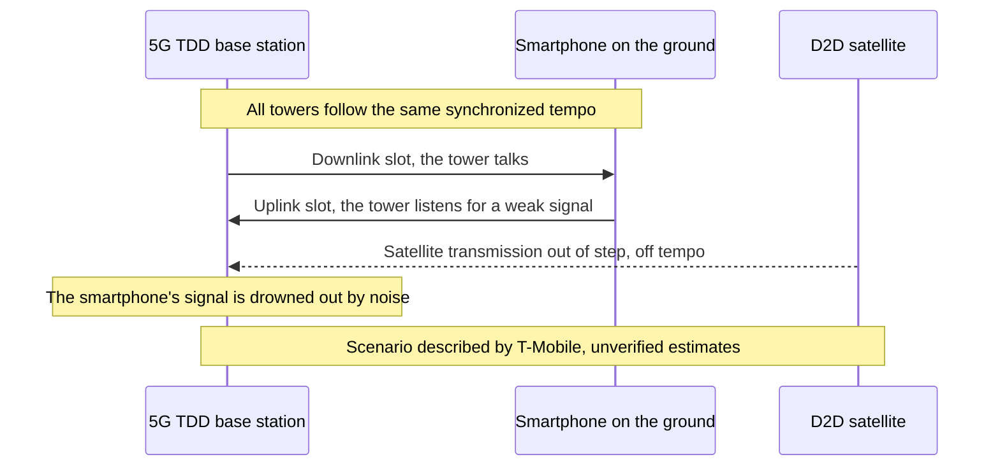
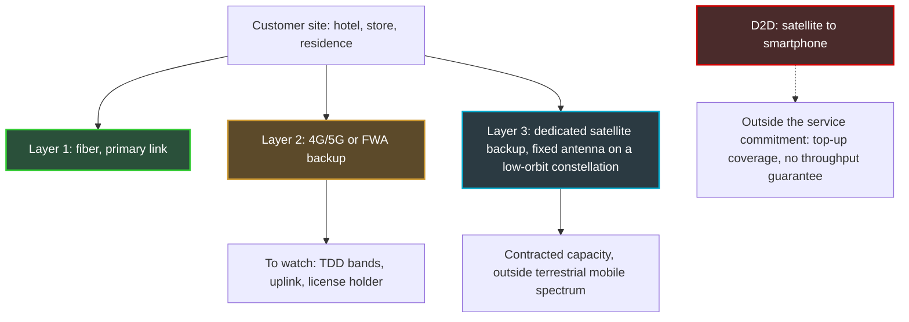

## Three hundred million users and one satellite too many

Three hundred million. That is the number of 5G users that AT&T, Verizon and T-Mobile say they serve on two frequency bands they now want to close to a newcomer: satellites that can talk directly to an ordinary smartphone. On October 20, the three rivals found themselves on the same side of the table, together with their joint trade association, facing officials of the Federal Communications Commission (FCC), the US telecom regulator. Their message fit in one sentence: on these frequencies, it can't work.

Nine days later, the FCC voted. Unanimously, it opened a consultation on expanding "direct-to-device" (D2D, the direct link between a satellite and an off-the-shelf phone). The draft circulated in early October proposed going from 5 to 13 authorized bands, or 482 MHz of additional spectrum. On the two contested bands, the regulator has, to my knowledge, said nothing conclusive in public.

Why follow a spectrum fight in Washington from Europe? First, because the question being asked there is already ours: can you lend a satellite a 5G frequency that is tuned like a metronome? The 2027 World Radiocommunication Conference (agenda item 1.13, bands from 694 MHz to 2.7 GHz) will have to deal with part of it. Second, and more down to earth: the 4G/5G backup links that keep a store's checkout lanes or a hotel's front desk running when the fiber goes down rely, for their 5G capacity, on exactly this kind of spectrum. And the risk the American carriers describe hits the uplink first (from the terminal to the antenna). The one that carries your sites' transactions and voice traffic.

## A one-lane bridge, and a truck from the sky

Picture a one-lane bridge. To let traffic flow in both directions, traffic lights alternate: a few moments for those leaving, a few moments for those coming back. As long as every light in the network beats to the same clock, nobody collides. Now bring in a truck that can't see the lights. It doesn't come from the road but from the sky, and it pulls in whenever it pleases.

That is, in essence, the American carriers' argument.

A phone and an antenna have two ways of organizing their conversation. Option one, FDD (Frequency Division Duplex): two separate blocks of frequencies, one for the downlink (from the antenna to the phone), the other for the uplink. A road with two separate carriageways. Option two, TDD (Time Division Duplex): a single block, shared over time. The tower talks, then listens, then talks again. That is our one-lane bridge. It is also how the 5G capacity bands at the heart of this story operate: 2.5 GHz and 3.45 GHz in the United States, 3.4–3.8 GHz in Europe.

*FDD separates the two directions of communication by frequency, TDD by time: it is this second logic that the satellite upsets.*

TDD has one non-negotiable requirement: synchronization. All the base stations in an area switch between transmitting and receiving at the same instant, locked to a common clock. Otherwise, a tower that is transmitting blasts at the very moment its neighbor is straining to hear distant phones. A low-orbit satellite, several hundred kilometers up, doesn't live at the same rhythm. According to the carriers, the propagation delay of its signal keeps it from locking onto that tempo. Hence the central risk, as T-Mobile puts it: a satellite transmission landing on a tower during its listening slots.

This is not just a lobbyist's argument. The draft text the FCC circulated on October 8 says almost the same thing. Because TDD "uses time delay instead of spectral separation between uplink and downlink," writes the regulator, a satellite operator must protect both base stations and terrestrial receivers "across the entire band." Further on, the FCC asks whether it is even "technically possible" to synchronize satellite transmissions with terrestrial TDD networks. Finally, it notes that the current 3GPP standards (the body that writes mobile standards) for non-terrestrial networks "focus mainly on FDD, rather than TDD."

One last detail, and not a minor one: the power limits in the draft were designed to protect terminals, not base stations. The FCC admits that others may be needed to protect TDD stations. The calculation framework therefore does not yet cover the scenario the carriers fear.

## 96%: T-Mobile's number, and what it really measures

A single smartphone in satellite mode, near the edge of a license area. A few kilometers away, a 5G base station that can no longer hear the phones it serves. That is the scenario T-Mobile laid out for the regulator at a meeting on October 19, recorded in a filing separate from its competitors'. According to the carrier, a single device can be enough to "drown out" a site located 1 to 3 miles away (about 1.5 to 5 km).

The numbers that go with this scenario have to be read within their exact scope:

- **up to 96%** of a cell site's uplink coverage area lost, **where satellite coverage spills over onto that site**. This is a site-by-site figure, in an overlap zone, not a network-wide estimate;
- uplink throughput down by **88% to 99%** at those same sites;
- an uplink cut by **about 35%** even 15 miles (about 24 km) from the edge of the licensed market;
- a satellite signal that could spill over **up to 35 miles** beyond its target area.

These are T-Mobile's estimates, produced by T-Mobile, to defend its most strategic asset: the 2.5 GHz band, of which the carrier holds the majority and which Light Reading describes as the foundation of its "Ultra Capacity" 5G offering. These figures have not been independently verified. I cite them as reported by Light Reading and Telesemana (Broadband Breakfast confirms the 35 miles). Other outlets put forward a different figure, about 60% of the uplink at 6 miles from the licensed area: I was not able to reconcile it with the original filing.

*The feared mechanism: a satellite signal arriving off tempo while the base station is listening for its terminals.*

The collective filing, led by CTIA (the American wireless trade association) with AT&T, T-Mobile and Verizon, is blunter: "Supplemental Coverage from Space is not technically feasible in TDD bands, and the Commission should remove the 2.5 GHz and 3.45 GHz bands from its proposal." SCS, for Supplemental Coverage from Space, is the American regulatory name for D2D in mobile carriers' bands. Light Reading, however, reports no individual statement from AT&T, the main holder of 3.45 GHz, nor from Verizon.

The FCC knows the terrain. In 2024, it had already kept 2.5 GHz out of the D2D framework, "because of the number of users and licensing complexities." T-Mobile did not hold back from reminding it.

My view: 96% is a scenario ceiling, not a forecast. A carrier defending its most valuable band does not pick the most reassuring assumption. But it would be just as naive to throw out the physics along with the lobbying. The regulator itself asks, in black and white, the questions that T-Mobile answers with numbers.

## October 29: a unanimous vote that settles nothing

What the FCC adopted on October 29, by a vote of 3 to 0 (Chairman Brendan Carr, Anna Gomez and Olivia Trusty), is an NPRM, a notice of proposed rulemaking. In plain terms: a draft set of rules open for comment. "Today's spectrum-related votes don't propose any specific new rules yet," sums up Light Reading. Nothing is enforceable yet.

The draft circulated on October 8, filed under dockets GN 26-281 and GN 23-65, nonetheless goes far. It proposes adding 482 MHz to the 344 MHz already open to D2D and going from 5 to 13 eligible bands. It also proposes replacing the lease requirement between mobile carrier and satellite operator with coexistence agreements. Finally, it provides for custom-fit area licenses, performance requirements, and a cap on "power flux density" at license boundaries. Translation: a limit on the radio energy a satellite may drop on the ground, at the edge of the area it is allowed to cover.

The list of 13 bands included 2500–2690 MHz and 3450–3550 MHz, with a proposed allocation to the mobile satellite service on a "secondary" basis. In spectrum vocabulary, secondary means: you come after the primary service, and you must not interfere with it.

*The crux of the matter: where a satellite beam spills over a license boundary, neighboring base stations risk, according to the carriers, losing part of their uplink.*

What is left of these two bands after the vote? On the FCC side, Taubenblatt sums up the adjustment in one sentence, quoted by Broadband Breakfast: "We adjusted how we're seeking comment on bands that can be used for TDD." Light Reading stays cautious: "It's unclear if the 2.5GHz and 3.45GHz bands will be part of a follow-on rulemaking." I was not able to read the adopted text. To my knowledge, no public source says the two bands were withdrawn, or that they were kept as they were. The honest wording is therefore this: the FCC changed the way it is seeking comment on TDD bands, and the fate of 2.5 GHz and 3.45 GHz remains open.

The draft also floated an intermediate option: limiting the satellite to a single direction, uplink or downlink, in unpaired bands such as 2.5 and 3.45 GHz. The idea has its logic. But the two scenarios described by T-Mobile each seem to affect a different direction: a satellite transmitting while the tower listens, a phone transmitting toward the satellite near a boundary. Cutting one does not fix the other.

On the calendar, the draft provided for 60 days for comments and 90 days for replies, counting from publication in the Federal Register, the US official gazette. The actual dates have yet to be set.

## For a customer site, D2D is not a backup link

Let me start by clearing up a confusion I can see coming in procurement tenders. D2D is a smartphone latching onto a satellite when there is no antenna left: valuable in dead zones or in an emergency. But the American framework calls itself "Supplemental Coverage from Space." Top-up coverage, with no throughput guarantee, designed for individual terminals. Nothing in the current texts makes it a site connectivity link.

The real issue for us lies elsewhere. Hotel, store, student residence: serious continuity architectures combine a primary fiber link with a 4G/5G radio backup, sometimes as FWA (Fixed Wireless Access, fixed access over mobile radio). A good part of the 5G capacity of these backups lives in TDD bands.

If these bands were ever to be shared with D2D, the scenario described by T-Mobile would hit the uplink first. I do mean a scenario, not an observed degradation. Now, for a business site, the uplink is the traffic from payment terminals, voice over IP, badge readers, video surveillance streaming to the cloud, nightly backups. The customer downloads. The business uploads.

Hence a resilience design built on three distinct layers, never counting D2D in any of them.

*Three layers of resilience for a business site. D2D stays outside the service commitment.*

In practice, three reflexes to build into a requirements document right now:

1. **Ask which bands the backup link relies on, and who holds the license.** If the American draft were adopted as is, protection of the terrestrial network would go through a coexistence agreement between the mobile carrier and the satellite operator. An agreement you will not sign. Your only leverage is contractual: which clause protects you if the uplink degrades?
2. **Monitor the uplink in its own right**: throughput, latency and loss on transmit, not just the "up/down" state of the link.
3. **Diversify spectrum portfolios**: two carriers on different bands, or a dedicated satellite backup with contracted capacity. And never let D2D appear in an SLA (Service Level Agreement, the service-level commitment).

## Europe has asked the right question, but not yet found the answer

Europe did not wait for Washington. In an opinion relayed by ANFR (Agence nationale des fréquences, the French spectrum agency) in July 2025, the RSPG, the group that advises the European Commission on spectrum, distinguishes two kinds of D2D. On one side, the kind that operates in mobile carriers' bands, dubbed "D2D-IMT" (IMT being the regulatory name for mobile technologies). On the other, the kind that operates in satellite bands. For the first, the challenge is clearly named: protecting mobile networks, as well as adjacent bands and borders.

The model the RSPG favors is interesting. The mobile carrier "frees up part of its spectrum" for D2D: it becomes a willing partner rather than a neighbor on the receiving end. That is, in a way, what the FCC is attempting with its coexistence agreements. Harmonized technical conditions are expected for 2027/28, with a mandate to be given to CEPT, the European organization of postal and telecom regulators.

On the ground, caution prevails. At a panel reported by RCR Wireless in October, a Spanish speaker described the D2D trials run at 2.6 GHz by MasOrange and Starlink as "controlled and localized because the band is problematic." According to the same panel, Ofcom already allows D2D in mobile spectrum in the United Kingdom.

The real milestone is WRC-27, the World Radiocommunication Conference, which will open on October 18, 2027 in Shanghai. Its item 1.13, devoted to direct connection between satellites and mobile terminals, requires protection of existing services, FDD and TDD alike. But one passage of the FCC draft should alert European delegations. The preparatory studies for this item assume the use of existing mobile terminals, and therefore an uplink interference environment that "will not change." They cover only the downlink, with a conclusion expected at the end of 2026. Yet the uplink is precisely where T-Mobile concentrates its warnings. If I had one item to put at the top of the European agenda, it would be that one.

*On both sides of the Atlantic, regulators are moving forward on satellite-to-mobile. TDD bands remain the sticking point.*

And France? Arcep, the French telecom regulator, opened a second consultation in July on the L band, a set of satellite frequencies between 1.5 and 2.5 GHz whose authorizations expire between 2027 and 2030. D2D and the Internet of Things are mentioned there. In May, the European Commission proposed an EU-wide selection of satellite operators for the 2 GHz band, judged "ideal for D2D services." Both workstreams concern satellite bands. On D2D in TDD mobile bands, 3.4–3.8 GHz or 2.6 GHz, I have identified no public position from ANFR or Arcep.

Europe's advantage is real: the RSPG model starts from the mobile carrier's agreement, where the American draft starts from a list of bands. But the physics of TDD doesn't stop at the Atlantic.

## In the background, Wi-Fi is looking skyward too

Another American file, less publicized, directly affects Wi-Fi. On August 6, the FCC adopted a separate consultation (FCC 26-51, docket ET 26-169) to allow unlicensed devices to communicate with satellites, on 2400–2483.5 MHz and 5725–5850 MHz. In other words, 2.4 GHz Wi-Fi and the upper part of the 5 GHz band.

Safeguards exist: unchanged power caps (up to 4 watts radiated) and a non-interference regime. The FCC says it wants to "preserve the operational status quo." Before the vote, however, Broadcom, Intel and Cisco had asked for more assurances, according to Broadband Breakfast. As for the only European precedent the FCC cites, CEPT decision ECC/DEC/(25)02, it concerns low-power objects at 862–870 MHz. Not Wi-Fi bands.

A point of vigilance rather than an alarm. The question that interests me is not power, already capped, but airtime. In a shared band, every millisecond occupied by an object talking to space is one millisecond less for a hotel's guests.

## My position: the burden of proof must change sides

I am not hostile to D2D. Covering dead zones, reaching emergency services from a mountain road: the public interest is obvious. But you don't bring an unsynchronized transmitter into a TDD band hoping that a coexistence agreement will settle the physics.

I think the American carriers are right on the diagnosis, even if their numbers reflect a worst case. And that the FCC was right on method: by adjusting its consultation rather than locking the draft in as is, it buys itself the time to find answers it doesn't have.

My line is simple. In a heavily used TDD band, it is up to the newcomer to prove it does not degrade the uplink, not up to the incumbent to prove it is suffering. Three conditions seem necessary to me before any opening: 3GPP standards that truly address TDD for non-terrestrial networks, international studies that include the uplink, and field trials whose measurements are public. Until they are met, TDD should stay out of two-way D2D.

What to watch in the coming months:

- publication of the adopted text in the Federal Register, which will trigger the comment deadlines (60 and 90 days in the draft, to be confirmed);
- the end of the preparatory studies for WRC-27 item 1.13, expected at the end of 2026;
- the opening of WRC-27, on October 18, 2027 in Shanghai;
- the harmonized European technical conditions, expected for 2027/28.

This whole battle comes down, at bottom, to one verb. The FCC draft says that D2D in a TDD band "could" create coexistence difficulties. CTIA asks that it say "would." In a regulatory text, that is not grammar: it is the difference between a risk to be studied and an established obstacle. Between the two sits the uplink of business sites that don't yet know they are affected.

_Personal views, not Wifirst's position._

## Sources

1. FCC — Fact sheet et projet de NPRM « Supplemental Coverage from Space » (GN Docket 26-281 / 23-65), projet circulé, 8 octobre 2026 — https://docs.fcc.gov/public/attachments/DOC-425711A1.pdf
2. FCC 26-51 — NPRM « Unleashing Unlicensed Spectrum for Direct-to-Device » (ET Docket 26-169), adopté le 6 août 2026, publié le 7 août 2026 — https://docs.fcc.gov/public/attachments/FCC-26-51A1.pdf
3. Light Reading — Big Three warn that running D2D in 5G bands will cripple network performance, 26 octobre 2026 — https://www.lightreading.com/satellite/big-three-warn-that-running-d2d-in-5g-bands-will-cripple-network-performance
4. Light Reading — FCC seeks feedback on carrier warnings about running D2D in 5G bands, 29 octobre 2026 — https://www.lightreading.com/satellite/fcc-seeks-feedback-on-carrier-warnings-about-running-d2d-in-5g-bands
5. Broadband Breakfast — Wireless carriers opposed to FCC plan for direct-to-device in 5G bands, 26 octobre 2026 — https://broadbandbreakfast.com/wireless-carriers-opposed-to-fcc-plan-for-direct-to-device-in-5g-bands/
6. Broadband Breakfast — FCC clears slate of spectrum items, including proposal to expand direct-to-device, 29 octobre 2026 — https://broadbandbreakfast.com/fcc-clears-slate-of-spectrum-items-including-proposal-to-expand-direct-to-device/
7. Telecompetitor — FCC begins clearing the way for increased D2D communications, 30 octobre 2026 — https://www.telecompetitor.com/fcc-begins-clearing-the-way-for-increased-d2d-communications/
8. Telesemana — AT&T, T-Mobile et Verizon demandent à la FCC d'exclure le 2,5 GHz et le 3,45 GHz du D2D, 27 octobre 2026 — https://www.telesemana.com/blog/2026/10/27/estados-unidos-att-t-mobile-y-verizon-piden-a-la-fcc-excluir-las-bandas-de-25-ghz-y-345-ghz-del-uso-satelital-d2d/
9. RCR Wireless — WRC-27 et spectre direct-to-device, 19 octobre 2026 — https://rcrwireless.com/20261019/networks/wrc-27-direct-to-device-spectrum
10. ANFR — Direct to Device, avis du RSPG, 23 juillet 2025 — https://www.anfr.fr/en/anfr/news/all-news/detail-of-the-news/direct-to-device-mobile-coverage-everywhere-coming-soon
11. Arcep — Consultation sur la bande L, 20 juillet 2026 — https://en.arcep.fr/news/press-releases/view/n/frequencies-200726.html
12. Commission européenne — Nouvelle autorisation des services mobiles par satellite (bande 2 GHz), 27 mai 2026 — https://digital-strategy.ec.europa.eu/fr/news/commission-proposes-new-authorisation-mobile-satellite-services-eus-resilience-and-competitiveness
13. Broadband Breakfast — SpaceX, unlicensed spectrum users want tweaks to FCC direct-to-device proposal, 5 août 2026 — https://broadbandbreakfast.com/spacex-unlicensed-spectrum-users-want-tweaks-to-fcc-direct-to-device-proposal/
14. CEPT — ECC/DEC/(25)02 et ECC Report 357, 27 juin 2025 — https://docdb.cept.org/document/28652
