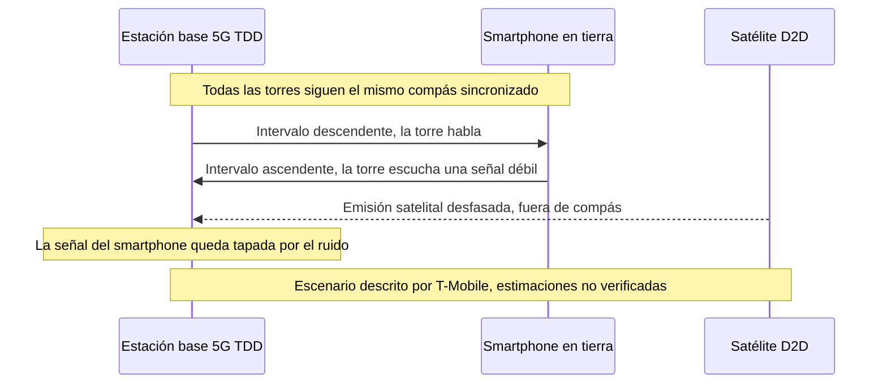
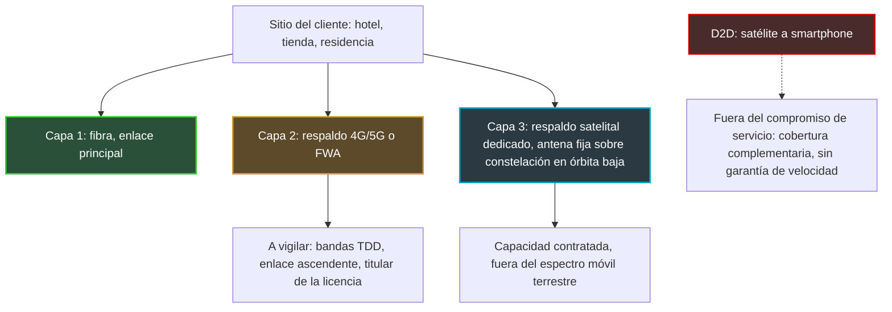

## Trescientos millones de usuarios y un satélite de más

Trescientos millones. Es el número de usuarios de 5G que AT&T, Verizon y T-Mobile dicen atender en dos bandas de frecuencias que ahora quieren cerrar a un recién llegado: el satélite capaz de hablar directamente con un smartphone corriente. El 20 de octubre, los tres rivales se sentaron del mismo lado de la mesa, junto con su asociación sectorial común, frente a responsables de la Federal Communications Commission (FCC), el regulador estadounidense de las telecomunicaciones. Su mensaje cabía en una frase: en esas frecuencias, no puede funcionar.

Nueve días después, la FCC votó. Por unanimidad, abrió una consulta sobre la ampliación del «direct-to-device» (D2D, el enlace directo entre un satélite y un teléfono comercial). El proyecto presentado a principios de octubre proponía pasar de 5 a 13 bandas autorizadas, es decir, 482 MHz adicionales. Sobre las dos bandas en disputa, el regulador, que yo sepa, no ha resuelto nada públicamente.

¿Por qué seguir desde Europa una disputa de frecuencias en Washington? Primero, porque la pregunta que se plantea allí ya se plantea aquí: ¿se puede prestar a un satélite una frecuencia 5G ajustada como un metrónomo? La Conferencia Mundial de Radiocomunicaciones de 2027 (punto 1.13, bandas de 694 MHz a 2,7 GHz) tendrá que tratar una parte. Después, algo más terrenal: los enlaces de respaldo 4G/5G que mantienen en marcha las cajas de una tienda o la recepción de un hotel cuando cae la fibra se apoyan, para su capacidad 5G, en este tipo de frecuencias. Y el riesgo que describen los operadores estadounidenses golpea primero al enlace ascendente (del terminal a la antena). El que hace subir las transacciones y la voz de sus sedes.

## Un puente de un solo carril y un camión llegado del cielo

Imagine un puente de un solo carril. Para que el tráfico circule en los dos sentidos, unos semáforos se alternan: unos instantes para los que salen, unos instantes para los que vuelven. Mientras todos los semáforos de la red marquen el mismo reloj, nadie choca. Haga ahora que llegue un camión que no ve los semáforos. No viene por la carretera sino del cielo, y entra cuando le parece.

Ese es, en esencia, el argumento de los operadores estadounidenses.

Un teléfono y una antena tienen dos maneras de organizar su conversación. Primera opción, el FDD (Frequency Division Duplex): dos bloques de frecuencias distintos, uno para el enlace descendente (de la antena al teléfono), otro para el enlace ascendente. Una carretera con dos calzadas separadas. Segunda opción, el TDD (Time Division Duplex): un solo bloque, compartido en el tiempo. La torre habla, luego escucha, luego vuelve a hablar. Es nuestro puente de un solo carril. Y es también el modo de funcionamiento de las bandas 5G de capacidad en el centro de este asunto: 2,5 GHz y 3,45 GHz en Estados Unidos, 3,4–3,8 GHz en Europa.

*El FDD separa los dos sentidos de la comunicación por frecuencia, el TDD por tiempo: es esta segunda lógica la que el satélite viene a trastocar.*

El TDD tiene una exigencia innegociable: la sincronización. Todas las estaciones base de una zona conmutan entre emisión y recepción en el mismo instante, ajustadas a un reloj común. Si no, una torre que emite grita justo cuando su vecina aguza el oído para captar teléfonos lejanos. Un satélite en órbita baja, a varios cientos de kilómetros de altitud, no vive al mismo ritmo. Según los operadores, el retardo de propagación de su señal le impide ajustarse a ese compás. De ahí el riesgo central, tal como lo formula T-Mobile: una emisión satelital que cae sobre una torre durante sus intervalos de escucha.

No es solo un argumento de lobista. El proyecto de texto que la FCC hizo circular el 8 de octubre lo dice casi en los mismos términos. Como el TDD «uses time delay instead of spectral separation between uplink and downlink», escribe el regulador, un operador satelital debe proteger tanto las estaciones base como los receptores terrestres «across the entire band». Más adelante, la FCC pregunta si es siquiera «technically possible» sincronizar las emisiones satelitales con las redes TDD en tierra. Por último, señala que las normas actuales del 3GPP (el organismo que escribe los estándares móviles) para las redes no terrestres «focus mainly on FDD, rather than TDD».

Un último detalle, y no menor: los límites de potencia del proyecto se pensaron para proteger los terminales, no las estaciones base. La FCC admite que quizá harían falta otros para proteger las estaciones TDD. La rejilla de cálculo todavía no cubre, pues, el escenario que temen los operadores.

## 96 %: la cifra de T-Mobile y lo que mide realmente

Un solo smartphone en modo satélite, cerca del límite de una zona de licencia. A unos kilómetros, una estación base 5G que ya no consigue oír a los teléfonos a los que da servicio. Es el escenario que T-Mobile expuso al regulador en una reunión el 19 de octubre, recogida en un escrito distinto del de sus competidores. Según el operador, un solo dispositivo puede bastar para «ahogar» un sitio situado a entre 1 y 3 millas (aproximadamente 1,5 a 5 km).

Las cifras que acompañan a este escenario deben leerse con su perímetro exacto:

- **hasta un 96 %** de la zona de cobertura ascendente de un sitio celular perdida, **allí donde la cobertura satelital se extiende sobre ese sitio**. Es una cifra sitio por sitio, en zona de solapamiento, no una estimación a escala de red;
- una velocidad de subida que cae entre un **88 % y un 99 %** en esos mismos sitios;
- un enlace ascendente recortado en **aproximadamente un 35 %** incluso a 15 millas (aproximadamente 24 km) del límite del mercado con licencia;
- una señal satelital que podría desbordarse **hasta 35 millas** de su zona objetivo.

Son estimaciones de T-Mobile, producidas por T-Mobile, para defender su activo más estratégico: los 2,5 GHz, de los que el operador posee la mayoría y que Light Reading describe como el pilar de su oferta 5G «Ultra Capacity». Estas cifras no han sido verificadas de forma independiente. Las cito tal como las recogen Light Reading y Telesemana (Broadband Breakfast confirma las 35 millas). Otros medios avanzan una cifra distinta, cerca de un 60 % del enlace ascendente a 6 millas de la zona con licencia: no he podido contrastarla con el escrito original.

*El mecanismo temido: una señal satelital que llega fuera de compás mientras la estación base escucha a sus terminales.*

El escrito colectivo, encabezado por la CTIA (la asociación sectorial de la telefonía móvil estadounidense) con AT&T, T-Mobile y Verizon, es más seco: «Supplemental Coverage from Space is not technically feasible in TDD bands, and the Commission should remove the 2.5 GHz and 3.45 GHz bands from its proposal.» El SCS, por Supplemental Coverage from Space, es el nombre regulatorio estadounidense del D2D en las bandas de los operadores móviles. Light Reading, en cambio, no recoge ninguna declaración individual de AT&T, que sin embargo es el principal titular de los 3,45 GHz, ni de Verizon.

La FCC conoce el terreno. En 2024 ya había apartado los 2,5 GHz del marco D2D, «because of the number of users and licensing complexities». T-Mobile no ha dejado de recordarlo.

Mi opinión: 96 % es un techo de escenario, no una previsión. Un operador que defiende su banda más valiosa no se queda con la hipótesis más tranquilizadora. Pero sería igual de ingenuo tirar la física junto con el lobbying. El propio regulador plantea, negro sobre blanco, las preguntas a las que T-Mobile responde con cifras.

## 29 de octubre: un voto unánime que no resuelve nada

Lo que la FCC adoptó el 29 de octubre, por 3 votos a 0 (el presidente Brendan Carr, Anna Gomez y Olivia Trusty), es una NPRM, por notice of proposed rulemaking. En claro: un proyecto de normas sometido a comentarios. «Today's spectrum-related votes don't propose any specific new rules yet», resume Light Reading. Nada es aplicable todavía.

El proyecto circulado el 8 de octubre, incorporado a los expedientes GN 26-281 y GN 23-65, llega sin embargo lejos. Propone añadir 482 MHz a los 344 MHz ya abiertos al D2D y pasar de 5 a 13 bandas elegibles. Propone también sustituir la obligación de arrendamiento entre operador móvil y operador satelital por acuerdos de coexistencia. Prevé, por último, licencias de zona a medida, requisitos de rendimiento y un tope de «densidad de flujo de potencia» en las fronteras de licencia. Traducción: un límite a la energía radioeléctrica que un satélite puede hacer caer en tierra, en el borde de la zona que tiene derecho a cubrir.

En la lista de las 13 bandas figuraban 2500–2690 MHz y 3450–3550 MHz, con una propuesta de asignación al servicio móvil por satélite a título «secundario». En el vocabulario del espectro, secundario significa: usted va después del servicio principal y no debe interferirlo.

*El nudo del asunto: allí donde un haz satelital desborda una frontera de licencia, las estaciones base vecinas corren el riesgo, según los operadores, de perder parte de su enlace ascendente.*

¿Qué queda de estas dos bandas tras la votación? Del lado de la FCC, Taubenblatt resume el ajuste en una frase, citada por Broadband Breakfast: «We adjusted how we're seeking comment on bands that can be used for TDD.» Light Reading se mantiene prudente: «It's unclear if the 2.5GHz and 3.45GHz bands will be part of a follow-on rulemaking.» No he podido consultar el texto adoptado. Que yo sepa, ninguna fuente pública dice que las dos bandas se hayan retirado, ni que se hayan mantenido tal cual. La formulación honesta es, pues, esta: la FCC modificó su manera de consultar sobre las bandas TDD, y la suerte de los 2,5 GHz y los 3,45 GHz sigue abierta.

El proyecto mencionaba también una vía intermedia: limitar el satélite a un solo sentido, ascendente o descendente, en las bandas no emparejadas como los 2,5 y los 3,45 GHz. La idea tiene su lógica. Pero los dos escenarios descritos por T-Mobile parecen afectar cada uno a un sentido distinto: un satélite que emite mientras la torre escucha, un teléfono que emite hacia el satélite cerca de una frontera. Cortar uno no resuelve el otro.

En cuanto al calendario, el proyecto preveía 60 días para los comentarios y 90 días para las respuestas, a contar desde la publicación en el Federal Register, el diario oficial estadounidense. Las fechas reales están por fijar.

## Para un sitio de cliente, el D2D no es un enlace de respaldo

Empecemos por despejar una confusión que veo venir en las licitaciones. El D2D es un smartphone que se engancha a un satélite cuando ya no hay antena: valioso en zonas sin cobertura o en situaciones de emergencia. Pero el marco estadounidense se llama a sí mismo «Supplemental Coverage from Space». Una cobertura complementaria, sin garantía de velocidad, pensada para terminales individuales. Nada en los textos actuales lo convierte en un enlace de conexión de sede.

El verdadero tema para nosotros está en otro lado. Hotel, tienda, residencia de estudiantes: las arquitecturas de continuidad serias combinan un enlace principal de fibra y un respaldo radio 4G/5G, a veces en forma de FWA (Fixed Wireless Access, el acceso fijo mediante radio móvil). Buena parte de la capacidad 5G de esos respaldos vive en bandas TDD.

Si algún día esas bandas tuvieran que compartirse con D2D, el escenario descrito por T-Mobile golpearía primero al enlace ascendente. Digo bien un escenario, no una degradación observada. Y, para una sede profesional, el enlace ascendente es el flujo de los terminales de pago, la telefonía IP, los lectores de control de acceso y fichaje, la videovigilancia que sube a la nube, las copias de seguridad nocturnas. El cliente descarga. El negocio, en cambio, envía.

De ahí una resiliencia pensada en tres capas distintas, sin contar nunca el D2D en ninguna de ellas.

*Tres capas de resiliencia para un sitio profesional. El D2D queda fuera del compromiso de servicio.*

En concreto, tres reflejos que conviene integrar ya en un pliego de condiciones:

1. **Preguntar en qué bandas se apoya el enlace de respaldo y quién es su titular.** Si el proyecto estadounidense se adoptara tal cual, la protección de la red terrestre pasaría por un acuerdo de coexistencia entre operador móvil y operador satelital. Un acuerdo que usted no firmará. Su único asidero es contractual: ¿qué cláusula le protege si el enlace ascendente se degrada?
2. **Supervisar el enlace ascendente por sí mismo**: velocidad, latencia y pérdidas en emisión, no solo el estado «up/down» del enlace.
3. **Diversificar las carteras de espectro**: dos operadores con bandas distintas, o un respaldo satelital dedicado con capacidad contratada. Y no hacer figurar nunca el D2D en un SLA (Service Level Agreement, el acuerdo de nivel de servicio).

## Europa ha planteado la pregunta correcta, todavía no la respuesta

Europa no esperó a Washington. En un dictamen difundido por la ANFR (Agence nationale des fréquences) en julio de 2025, el RSPG, el grupo que asesora a la Comisión Europea en materia de espectro, distingue dos D2D. Por un lado, el que opera en las bandas de los operadores móviles, bautizado «D2D-IMT» (IMT es el nombre regulatorio de las tecnologías móviles). Por otro, el que opera en las bandas satelitales. Para el primero, el reto está claramente nombrado: proteger las redes móviles, así como las bandas adyacentes y las fronteras.

El modelo que privilegia el RSPG es interesante. El operador móvil «libera una parte de su espectro» para el D2D: se convierte en socio voluntario en lugar de vecino que lo sufre. Es, en cierto modo, lo que la FCC intenta con sus acuerdos de coexistencia. Se esperan condiciones técnicas armonizadas para 2027/28, con un mandato que debe confiarse a la CEPT, la organización europea de los reguladores de correos y telecomunicaciones.

Sobre el terreno, domina la prudencia. En un panel recogido por RCR Wireless en octubre, un ponente español describió las pruebas D2D realizadas en 2,6 GHz por MasOrange y Starlink como «controladas y localizadas porque la banda es problemática». Según el mismo panel, Ofcom ya autoriza el D2D en el espectro móvil en el Reino Unido.

La cita que importa de verdad es la WRC-27, la conferencia mundial de radiocomunicaciones, que se abrirá el 18 de octubre de 2027 en Shanghái. Su punto 1.13, dedicado a la conexión directa entre satélites y terminales móviles, exige la protección de los servicios existentes, tanto FDD como TDD. Pero un pasaje del proyecto de la FCC debería alertar a las delegaciones europeas. Los estudios preparatorios de este punto suponen el uso de los terminales móviles existentes y, por tanto, un entorno de interferencia en el enlace ascendente que «will not change». Se refieren solo al enlace descendente, con una conclusión esperada a finales de 2026. Ahora bien, es precisamente en el enlace ascendente donde T-Mobile concentra sus alertas. Si tuviera que poner un punto a la cabeza de la agenda europea, sería ese.

*A ambos lados del Atlántico, los reguladores avanzan en el satélite a móvil. Las bandas TDD siguen siendo el punto duro.*

¿Y Francia? La Arcep, el regulador francés de las telecomunicaciones, abrió en julio una segunda consulta sobre la banda L, un conjunto de frecuencias satelitales situadas entre 1,5 y 2,5 GHz cuyas autorizaciones expiran entre 2027 y 2030. El D2D y el Internet de las cosas se mencionan en ella. La Comisión Europea propuso en mayo una selección a escala de la Unión de los operadores satelitales de la banda de 2 GHz, considerada «ideal para los servicios D2D». Los dos proyectos se refieren a bandas satelitales. Sobre el D2D en las bandas móviles TDD, 3,4–3,8 GHz o 2,6 GHz, no he identificado ninguna posición pública de la ANFR ni de la Arcep.

La ventaja europea es real: el modelo del RSPG parte del acuerdo del operador móvil, mientras que el proyecto estadounidense parte de una lista de bandas. Pero la física del TDD no se detiene en el Atlántico.

## En segundo plano, el Wi-Fi también mira al cielo

Otro expediente estadounidense, menos mediático, afecta directamente al Wi-Fi. El 6 de agosto, la FCC adoptó una consulta distinta (FCC 26-51, expediente ET 26-169) para autorizar que dispositivos sin licencia se comuniquen con satélites, en 2400–2483,5 MHz y 5725–5850 MHz. Dicho de otro modo, el Wi-Fi de 2,4 GHz y la parte alta de la banda de 5 GHz.

Existen salvaguardas: topes de potencia sin cambios (hasta 4 vatios radiados) y régimen de no interferencia. La FCC dice querer «preserve the operational status quo». Antes de la votación, sin embargo, Broadcom, Intel y Cisco habían pedido más garantías, según Broadband Breakfast. En cuanto al único precedente europeo que cita la FCC, la decisión ECC/DEC/(25)02 de la CEPT, se refiere a objetos de baja potencia en 862–870 MHz. No a las bandas Wi-Fi.

Punto de vigilancia más que alerta. La cuestión que me interesa no es la potencia, ya limitada, sino el tiempo de aire. En una banda compartida, cada milisegundo ocupado por un objeto que habla con el espacio es un milisegundo menos para los clientes de un hotel.

## Mi posición: la carga de la prueba debe cambiar de bando

No soy hostil al D2D. Cubrir las zonas sin cobertura, llamar a los servicios de emergencia desde una carretera de montaña: el interés público es evidente. Pero no se mete un emisor no sincronizado en una banda TDD esperando que un acuerdo de coexistencia arregle la física.

Creo que los operadores estadounidenses tienen razón en el diagnóstico, aunque sus cifras correspondan al peor escenario. Y que la FCC ha acertado en el método: al ajustar su consulta en lugar de grabar el proyecto tal cual, se da tiempo para encontrar respuestas que no tiene.

Mi línea es simple. En una banda TDD masivamente utilizada, le corresponde al recién llegado demostrar que no degrada el enlace ascendente, no al ocupante demostrar que sufre. Me parecen necesarias tres condiciones antes de cualquier apertura: normas 3GPP que traten de verdad el TDD para las redes no terrestres, estudios internacionales que incluyan el enlace ascendente y pruebas de campo cuyas mediciones sean públicas. Mientras no se reúnan, el TDD debe quedar fuera del D2D bidireccional.

Lo que hay que vigilar en los próximos meses:

- la publicación del texto adoptado en el Federal Register, que activará los plazos de comentarios (60 y 90 días en el proyecto, por confirmar);
- el final de los estudios preparatorios del punto 1.13 de la WRC-27, esperado a finales de 2026;
- la apertura de la WRC-27, el 18 de octubre de 2027 en Shanghái;
- las condiciones técnicas armonizadas europeas, esperadas para 2027/28.

Toda esta batalla se reduce, en el fondo, a un verbo. El proyecto de la FCC escribe que el D2D en banda TDD «could» crear dificultades de coexistencia. La CTIA pide que escriba «would». En un texto regulatorio, eso no es gramática: es la diferencia entre un riesgo que estudiar y un obstáculo consumado. Entre uno y otro está el enlace ascendente de sedes profesionales que aún no saben que están afectadas.

_Opiniones personales, no posición de Wifirst._

## Fuentes

1. FCC — Fact sheet et projet de NPRM « Supplemental Coverage from Space » (GN Docket 26-281 / 23-65), projet circulé, 8 octobre 2026 — https://docs.fcc.gov/public/attachments/DOC-425711A1.pdf
2. FCC 26-51 — NPRM « Unleashing Unlicensed Spectrum for Direct-to-Device » (ET Docket 26-169), adopté le 6 août 2026, publié le 7 août 2026 — https://docs.fcc.gov/public/attachments/FCC-26-51A1.pdf
3. Light Reading — Big Three warn that running D2D in 5G bands will cripple network performance, 26 octobre 2026 — https://www.lightreading.com/satellite/big-three-warn-that-running-d2d-in-5g-bands-will-cripple-network-performance
4. Light Reading — FCC seeks feedback on carrier warnings about running D2D in 5G bands, 29 octobre 2026 — https://www.lightreading.com/satellite/fcc-seeks-feedback-on-carrier-warnings-about-running-d2d-in-5g-bands
5. Broadband Breakfast — Wireless carriers opposed to FCC plan for direct-to-device in 5G bands, 26 octobre 2026 — https://broadbandbreakfast.com/wireless-carriers-opposed-to-fcc-plan-for-direct-to-device-in-5g-bands/
6. Broadband Breakfast — FCC clears slate of spectrum items, including proposal to expand direct-to-device, 29 octobre 2026 — https://broadbandbreakfast.com/fcc-clears-slate-of-spectrum-items-including-proposal-to-expand-direct-to-device/
7. Telecompetitor — FCC begins clearing the way for increased D2D communications, 30 octobre 2026 — https://www.telecompetitor.com/fcc-begins-clearing-the-way-for-increased-d2d-communications/
8. Telesemana — AT&T, T-Mobile et Verizon demandent à la FCC d'exclure le 2,5 GHz et le 3,45 GHz du D2D, 27 octobre 2026 — https://www.telesemana.com/blog/2026/10/27/estados-unidos-att-t-mobile-y-verizon-piden-a-la-fcc-excluir-las-bandas-de-25-ghz-y-345-ghz-del-uso-satelital-d2d/
9. RCR Wireless — WRC-27 et spectre direct-to-device, 19 octobre 2026 — https://rcrwireless.com/20261019/networks/wrc-27-direct-to-device-spectrum
10. ANFR — Direct to Device, avis du RSPG, 23 juillet 2025 — https://www.anfr.fr/en/anfr/news/all-news/detail-of-the-news/direct-to-device-mobile-coverage-everywhere-coming-soon
11. Arcep — Consultation sur la bande L, 20 juillet 2026 — https://en.arcep.fr/news/press-releases/view/n/frequencies-200726.html
12. Commission européenne — Nouvelle autorisation des services mobiles par satellite (bande 2 GHz), 27 mai 2026 — https://digital-strategy.ec.europa.eu/fr/news/commission-proposes-new-authorisation-mobile-satellite-services-eus-resilience-and-competitiveness
13. Broadband Breakfast — SpaceX, unlicensed spectrum users want tweaks to FCC direct-to-device proposal, 5 août 2026 — https://broadbandbreakfast.com/spacex-unlicensed-spectrum-users-want-tweaks-to-fcc-direct-to-device-proposal/
14. CEPT — ECC/DEC/(25)02 et ECC Report 357, 27 juin 2025 — https://docdb.cept.org/document/28652
