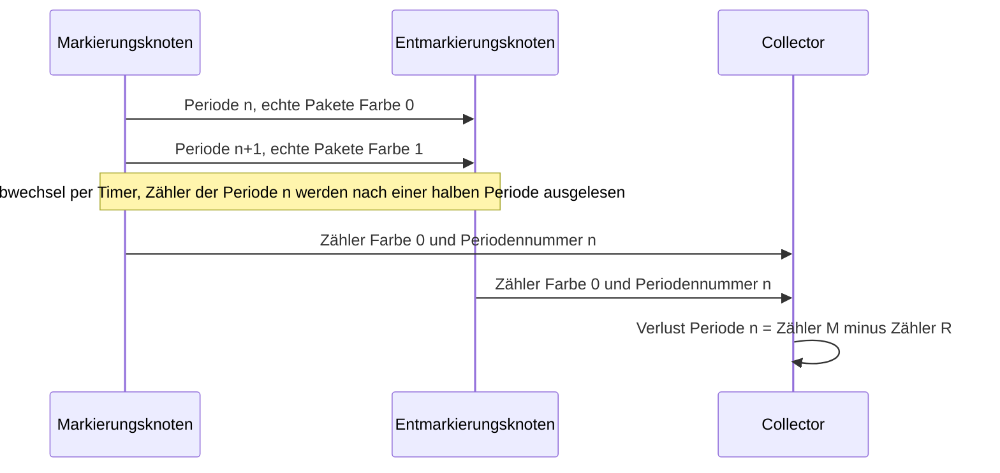
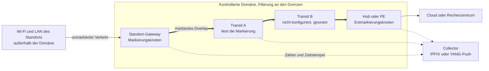
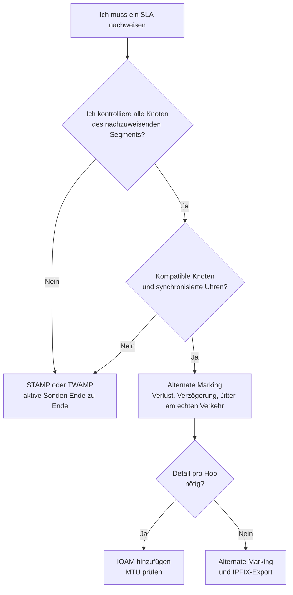

## Der Bericht ist grün, vor Ort sieht man rot

Stellen Sie sich den Betriebsleiter einer Kette mit zweihundert Hotels vor. Er öffnet den Monatsbericht seines Netzanbieters: alles grün. Seine Teams haben die Woche damit verbracht, eingefrorene Videokonferenzen neu zu starten und Zahlungsterminals zurückzusetzen, die an der Kasse in den Timeout liefen. Wem soll er glauben, dem Dashboard oder dem, was vor Ort passiert?

Jeder, der Hunderte von Standorten betreibt, kennt diese Szene, ob in der Hotellerie, im Einzelhandel, in Studentenwohnheimen oder auf Unternehmenscampus. Der Vertrag verspricht ein SLA (Service Level Agreement, die zahlenmäßig festgelegte Zusage zum Servicelevel) mit Obergrenzen für Verlust, Latenz und Jitter. Der Nachweis stützt sich aber meist auf Sonden, jene kleinen Testpakete, die in regelmäßigen Abständen verschickt werden. Sie messen zuverlässig ... die Sonden. Nicht den Verkehr des Kunden.

Dabei gibt es seit Dezember 2022 eine von der IETF (der Organisation, die die Standards des Internets verfasst) normierte Methode, um die echten Pakete direkt zu zählen: Alternate Marking. Am 30. Oktober 2026 hat eine Arbeitsgruppe derselben IETF einen Draft veröffentlicht, der beschreibt, wie man sie im Betrieb einsetzt. Das ist eine gute Nachricht, und sie kommt mit einer Einschränkung, die niemand unterschreiben sollte, ohne sie verstanden zu haben. Diese Messung gilt nur für den Netzabschnitt, den Sie markieren und Ende zu Ende beherrschen. Das öffentliche Internet gehört nicht dazu. Die Luftschnittstelle des Wi-Fi ebenso wenig.

## Zwei Farben genügen

Um die Idee zu fassen, vergessen Sie Router und denken Sie an ein Logistikzentrum. Die klassische Methode, um zu prüfen, dass ein Frachtführer nichts verliert, besteht darin, Testpakete zu versenden und auf ihre Ankunft zu warten. Das ist der Mystery Shopper. Er funktioniert, sagt aber nichts über die echten Pakete aus, und jedes Testpaket belegt Platz im Lkw.

Alternate Marking packt das Problem von der anderen Seite an. Man klebt einen blauen Aufkleber auf alle echten Pakete, die zwischen 10:00 und 10:05 Uhr verschickt werden, einen orangen zwischen 10:05 und 10:10 Uhr, danach wieder einen blauen. Bei der Ankunft zählt man die blauen Pakete des Zeitfensters. Fehlen welche, weiß man genau, wie viele. Keine Stichprobe, keine Hochrechnung: eine lückenlose Zählung der echten Ware, Block für Block.

*Der echte Verkehr in Blöcke abwechselnder Farbe zerlegt: Jeder Knoten zählt die Pakete jeder Farbe, und die Differenz zwischen Eingang und Ausgang ergibt den Verlust.*

Auf Pakete übertragen, ist das der Gegenstand der RFC 9341 (RFC steht für Request for Comments, so heißen die von der IETF veröffentlichten Dokumente), erschienen im Dezember 2022 mit dem Status Proposed Standard. Ein oder zwei Bits des Headers dienen als Aufkleber, und der Eingangsknoten wechselt die Farbe in jeder Periode, allein per Timer. Jeder Knoten führt einen Zähler pro Farbe, pro Flow und pro Interface. Ein nützlicher Kniff: Der Zähler einer Farbe wird erst eine halbe Periode nach dem Wechsel ausgelesen, damit die Nachzügler durch sind.

Der Verlust ergibt sich dann durch Subtraktion. Die Verzögerung erhält man, indem man das erste Paket jedes Blocks mit einem Zeitstempel versieht, wenn nur ein Bit zur Verfügung steht (Single-Marking), oder die durch ein zweites Bit ausgewiesenen Pakete (Double-Marking). Der Jitter wird aus der unidirektionalen Verzögerung abgeleitet.

Der Preis dafür lässt sich in einem Wort sagen: Uhren. Die RFC verlangt synchronisierte Knoten und nennt NTP und PTP (Precision Time Protocol, der Standard IEEE 1588) als Beispiele. Sie liefert sogar die Formel für den Sicherheitsabstand um jeden Wechsel: Uhrengenauigkeit plus mittlere Verzögerung plus drei Standardabweichungen der Verzögerung. Dieser Abstand muss unter der Hälfte der Periode bleiben. Driften die Uhren zu stark, vermischen sich die Aufkleber.

Noch ein Hinweis zur Terminologie, der vor einem Juristen zählen wird: *ohne Sonden* heißt nicht *passiv*. Die RFC 7799 (Mai 2016) unterscheidet aktive Messung (ein dedizierter Flow wird eingespeist), passive (man beobachtet, ohne zu verändern) und hybride (der echte Flow wird verändert). Alternate Marking ändert an den Rändern der Domäne Bits im Kundenverkehr: Das ist Hybrid Typ I, auch wenn sich die RFC 9341 je nach Anwendung als passiv oder hybrid beschreibt. Man speist nichts ein, aber man fasst die Pakete an.

## Der Draft vom 30. Oktober: eine Betriebsanleitung, kein Standard

Was der Ende Oktober veröffentlichte Text ändert, ist nicht die Methode. Es ist die Betriebsanleitung. Die RFC 9341, 9342 und 9343 sagen, wie man markiert und zählt. Sie sagen nicht, wer markiert, wo gefiltert wird, wie man Hunderte von Knoten konfiguriert und wohin die Zähler gehen. Das Dokument draft-ietf-bpm-alt-mark-deployment-00 füllt diese Lücke.

Man muss es allerdings als das lesen, was es ist: eine Version -00 vom 30. Oktober 2026, die am 3. Mai 2027 abläuft und deren Header den Status Informational anstrebt, nicht Standards Track. Wie jeder IETF-Draft versteht es sich als „work in progress“, und so sollte man es auch zitieren. Zu schreiben, die IETF normiere den Einsatz von Alternate Marking, wäre falsch.

Der Text hat jedoch eine Vorgeschichte. Er ersetzt einen Draft der Gruppe IPPM (historisch zuständig für die Messung der IP-Performance), hervorgegangen aus einem individuellen Beitrag vom Juli 2023, im Januar 2024 von der Gruppe übernommen und am 22. Oktober 2026 bei Version -10 angelangt. Am 21. Oktober bestätigte sein Betreuer, Marcus Ihlar, den Konsens ohne Einwände. Er wies außerdem auf eine unklare Stelle zur Berechnung der Periodennummer (Abschnitt 7) und auf drei Tippfehler hin.

Meine Lesart, ohne Zeile-für-Zeile-Vergleich: Das -00 der Gruppe bpm (Benchmarking & Performance Measurements), erklärte Nachfolgerin von BMWG und IPPM, scheint nur ein Re-Hosting dieses -10 zu sein. Auf seiner Seite steht kein IESG-Status (die Instanz, die Veröffentlichungen genehmigt) und kein zugewiesener Verantwortlicher. Nichts erlaubt es daher, eine baldige RFC anzukündigen. Das -00 definiert die Periodennummer über eine auf die nächstkleinere ganze Zahl abgerundete Division, was in die Richtung der Anmerkung des Betreuers geht. Ohne Diff kann ich aber nicht sagen, ob das -10 von IPPM dies schon korrigiert hatte.

Wer schreibt? G. Fioccola, K. Zhu und T. Zhou (Huawei), T. Graf (Swisscom) und L. Zhang (China Mobile). Drei von fünf Autoren arbeiten beim selben Ausrüster, zwei bei Telekommunikationsanbietern, kein Endanwender aus einem Unternehmen ist dabei. Giuseppe Fioccola ist zudem Co-Chair der Gruppe bpm, gemeinsam mit Marcus Ihlar und Thomas Graf. Das ist eine Feststellung, kein Vorwurf. Sie lenkt lediglich die Lektüre: Dieser Text denkt in Carrier-Netzen, vom Core zum Rand.

Inhaltlich unterscheidet der Draft drei Rollen. Der Markierungsknoten kapselt den Verkehr ein und liest die ersten Zähler und Zeitstempel aus. Die Transitknoten lesen die Markierung. Der Entmarkierungsknoten liest sie und entfernt sie dann. Ein Bit genügt für den Verlust und das Single-Marking, zwei eröffnen das Double-Marking. Was die Kennung des gemessenen Flows (FlowMonID) betrifft, rät der Text, sie von einem zentralen Controller zu vergeben: Zufällig gezogen, ist ihre Eindeutigkeit nicht garantiert.

Für den Export gehen die Ergebnisse per IPFIX (das Standardformat für den Flow-Export) oder per YANG-Push (eine abonnementbasierte Push-Telemetrie) an das Monitoring, unter anderem mit der RFC 9951 (April 2026) für die Verzögerungsfelder. Der Text warnt, dass dieses Volumen „could overwhelm a router processor“, und schlägt vor, von den Netzwerkprozessoren aus zu publizieren.

Bleibt, die Zähler aufeinander abzustimmen. Jeder Knoten berechnet eine Periodennummer (PN, Period Number): seine lokale Zeit geteilt durch die Periodendauer, abgerundet auf die nächstkleinere ganze Zahl. Fällt die Synchronisation aus, ist die Regel klar: Die Messung wird auf den betroffenen Intervallen übersprungen, bis die Synchronisation wiederhergestellt ist. Ein Konfigurations- oder Exportfehler nimmt den betroffenen Knoten aus der Messung. Und wenn der Markierungsknoten ausfällt, misst niemand mehr irgendetwas.

*Eine Messperiode: Beide Enden melden dem Collector den Zähler derselben Farbe, versehen mit derselben Periodennummer. Der Verlust ergibt sich aus der Differenz.*

Am aufschlussreichsten bleibt, was der Text nicht enthält. Keinen Standardwert, weder für die Periodendauer noch für einen Schwellenwert. Keine Zahlen zum Einsatz. Keine Erwähnung der anderen normierten Methoden, IOAM oder STAMP, auf die ich weiter unten zurückkomme. Und nicht ein einziges Vorkommen der Wörter Wi-Fi, SD-WAN oder SLA. Daraus ein Werkzeug für den vertraglichen Nachweis zu machen, ist unsere Projektion als Betreiber, nicht seine erklärte Absicht.

## Wo die Domäne endet, endet der Nachweis

Zurück zu den Aufklebern. Sie haben nur in Ihren eigenen Lagerhallen einen Wert. Bei einem Subunternehmer, der sie nicht liest, fällt das Paket aus der Zählung. Schlimmer noch: Manche Subunternehmer weisen Pakete mit einem unbekannten Etikett zurück.

Der Draft stellt die Regel gleich in seinem Abschnitt 2 auf: Die Methode „MUST be deployed in a controlled domain“, aus Gründen der Sicherheit und der Kompatibilität. Markierte Pakete, die in die kontrollierte Domäne eintreten oder sie verlassen, müssen gefiltert werden. Der Text schlägt eine einfache Regel vor: die Markierung nur einfügen, wenn das Ziel zur Domäne gehört. Der Musterfall ist ein Overlay (ein auf das physische Netz aufgesetztes Tunnelnetz), das an einer Grenze eingekapselt und an der anderen ausgepackt wird.

Wer markiert dann? Der Text nennt das CPE (Customer Premises Equipment, das beim Kunden installierte Gerät) oder den PE (Provider Edge, den Randrouter des Betreibers) als wahrscheinlichste Ein- und Austrittspunkte. Das Endgerät des Nutzers könnte markieren, wenn es vollständig verwaltet wäre, aber „in practice, this is not common“. Und das CPE gehört nur dann zur Domäne, wenn es vom Dienstanbieter verwaltet wird, mit zusätzlichen Schutzmaßnahmen.

Um ein fremdes Netz zu durchqueren, empfiehlt der Draft, eine einzige kontrollierte Domäne wiederherzustellen, per IPsec oder einem anderen VPN, das vollständige Vertraulichkeit und Integrität gewährleistet. Man misst nicht das Netz des Nachbarn. Man misst seinen eigenen Tunnel durch dieses Netz hindurch.

*Die kontrollierte Domäne: Die Markierung entsteht am Standort-Gateway und verschwindet am Hub. Das Wi-Fi und das LAN des Standorts bleiben außerhalb der Messung.*

Ein Transitrouter, der die Markierung nicht lesen kann, ist kein Drama: Laut Draft wird er einfach von der Messung ausgeschlossen. Die Zählung zwischen Eingang und Ausgang bleibt möglich, aber die Lokalisierung des Verlusts endet an den kompatiblen Knoten. Zu wissen, dass zwischen A und B Pakete verloren gehen, wenn vier stumme Router dazwischen liegen, ist eine Information. Noch keine Diagnose.

In IPv6 legt die RFC 9343 (Dezember 2022, ebenfalls auf dem Weg zur Standardisierung) die Markierung in eine Option von 48 Bit: eine FlowMonID von 20 Bit und zwei Flags, L für den Verlust, D für die Verzögerung. Diese Option reist entweder im Hop-by-Hop-Header, den jeder konfigurierte Router prüft, oder im Destination-Options-Header, den nur Quelle und Ziel lesen. Die RFC beschränkt sie auf die kontrollierte Domäne, typischerweise ein Overlay. Sie nennt zwei Kosten: eine Verarbeitung, die mitunter auf den Slow Path der Router abgeschoben wird, und eine um denselben Betrag verringerte MTU (maximale Paketgröße).

Warum so viel Vorsicht? Weil das öffentliche Internet diese Extension Header nie mochte. Die RFC 7872 (Juni 2016) schickte im August 2014 und im Juni 2015 TCP-Pakete mit einem 8 Byte großen Hop-by-Hop-Header an öffentliche Web-, Mail- und DNS-Server. Je nach Datensatz und Servertyp gingen 39 bis 54 % unterwegs verloren. Mit einem Destination-Options-Header zwischen 10,9 und 21,3 %. Diese Messungen sind über zehn Jahre alt und beschreiben nicht das Internet von 2026. Die RFC selbst unterscheidet nicht zwischen gezieltem Filtern und Bug. Diese historische Größenordnung genügt meines Erachtens dennoch, um die Vorsicht der RFCs zu verstehen.

*An den Grenzen filtern: Kein markiertes Paket darf in die kontrollierte Domäne eintreten oder sie verlassen.*

## Aufkleber, Laufzettel oder Mystery Shopper (persönliche Analyse)

Der Draft vergleicht Alternate Marking mit keiner anderen Methode. Das folgende Raster ist also meines, aufgebaut aus den RFCs der jeweiligen Ansätze: Es bindet weder die IETF noch die Autoren.

Bleiben wir beim Logistikzentrum. Wenn Alternate Marking Aufkleber klebt, dann legt IOAM (In-situ Operations, Administration and Maintenance, RFC 9197, Mai 2022) einen Laufzettel ins Paket, den jedes Lager im Vorbeigehen ergänzt. Man gewinnt die Details Hop für Hop, aber das Paket wird dicker. Die RFC verlangt vom Betreiber zu prüfen, dass die MTU aller Links dieses Mehrgewicht verkraftet, und beschränkt auch IOAM auf begrenzte Domänen.

STAMP (Simple Two-way Active Measurement Protocol, RFC 8762, März 2020), Nachfolger von TWAMP (RFC 5357, Oktober 2008), ist der Mystery Shopper. Ein Sender schickt UDP-Testpakete an einen Reflector, der sie zurückschickt. Daraus erhält man Verlust, Verzögerung und Verzögerungsvariation, in einer Richtung oder in beiden. Die Basispakete haben 44 Byte, im authentifizierten Modus 112. Vor allem muss kein dazwischenliegender Router mitspielen.

| Kriterium | Alternate Marking (RFC 9341, 9342, 9343) | IOAM (RFC 9197) | STAMP / TWAMP (RFC 8762, 5357) |
|---|---|---|---|
| Familie (RFC 7799) | Hybrid Typ I | Hybrid, an die Pakete angehängte Daten | Aktiv |
| Gemessener Verkehr | Echter, markierter Verkehr | Echter Verkehr, Telemetrie pro Hop | Dedizierte Testpakete |
| Overhead pro Paket | 1 bis 2 Bit oder IPv6-Option von 48 Bit | Wächst mit Hops und Daten | Keiner auf dem Kundenverkehr, aber Last durch die Sondierung |
| Voraussetzungen | Kompatible Knoten, kontrollierte Domäne, synchronisierte Uhren | Kompatible Knoten, begrenzte Domäne, MTU zu prüfen | Ein Sender und ein Reflector an den Enden |
| Außerhalb der eigenen Domäne | Nur über den eigenen Tunnel | Dito | Funktioniert unverändert, auch auf Links Dritter |

Meine Position: STAMP bleibt das Standardwerkzeug, sobald man den Transit nicht kontrolliert. Alternate Marking spielt seinen Vorteil aus, wenn man den Pfad beherrscht und den echten Verkehr ohne Sondierungslast messen will. IOAM kommt hinzu, wenn das Detail pro Hop das Mehrgewicht rechtfertigt. Das sind keine Konkurrenten, sondern Stufen.

*Zwei Messphilosophien: Sonden, die den Hin- und Rückweg machen, oder der echte Verkehr, der Markierungen trägt, die im Vorbeigehen gezählt werden.*

## Was ich daraus für einen Multi-Site-Bestand ziehe (persönliche Analyse)

Der Draft spricht weder von Wi-Fi noch von Verträgen. Die folgenden Schlüsse sind meine, gewonnen aus dem Betrieb von Netzen mit mehreren Hundert Standorten.

**Der Geltungsbereich.** Das SLA eines Standorts bezieht sich oft auf seinen WAN- oder Internetzugang, mitunter von einem Drittanbieter geliefert, dessen Router man nicht kontrolliert. Ein Overlay zwischen dem Standort-Gateway und einem Hub erlaubt es, an beiden Enden zu markieren: Man misst dann den Tunnel, nicht jeden Hop des Dritten. Auf dem Funksegment wird dagegen nichts markiert. Zwischen dem Access Point und dem Smartphone eines Gasts liest oder entfernt kein verwaltetes Endgerät eine Markierung. Dieser Abschnitt wird mit Wi-Fi-Telemetrie nachgewiesen, nicht mit Alternate Marking.

**Der Stern.** Für Dutzende von Standorten, die zu demselben Hub zurückführen, erweitert die RFC 9342 (Clustered Alternate Marking, Dezember 2022) die Methode auf Multipoint-Flows, einschließlich ECMP-Lastverteilung (die Aufteilung auf mehrere Pfade gleicher Kosten), mit weniger Zählern. Der Preis: In einer Gruppe von mehr als zwei Knoten wird der Verlust der Gruppe zugeordnet, nicht dem Link. Das ist in meinen Augen der nützlichste Baustein für einen Multi-Site-Bestand.

**Die Lücken.** Da die Messung übersprungen wird, wenn die Uhren ausfallen, muss ein Bericht zwischen *keine Messung* und *kein Verlust* unterscheiden. Ein nicht gemessenes Intervall, das als konform gezählt wird, ist ein grüner Bericht, der durch Weglassen lügt. Das ist ein eigenständiger vertraglicher Prüfpunkt.

**Die Kollisionen.** Die RFC 9343 beziffert das Risiko einer zufällig gezogenen FlowMonID von 20 Bit: 50 % Kollisionswahrscheinlichkeit ab 1.206 Flows. In Kombination mit Quell- und Zieladresse bleibt man bei 1 % Kollision für 145 Flows pro Hostpaar. Mit einem zentralen Controller steigt man auf 1.048.576 gleichzeitige Flows pro Hostpaar. Im Maßstab eines Bestands ist die zentrale Vergabe unumgänglich.

**Das Volumen.** Wenn der Draft sich um den Prozessor eines einzelnen Routers sorgt, multiplizieren Sie das mit Hunderten von Standorten und einer kurzen Periode. Die Erfassung wird zu einem Infrastrukturprojekt, das budgetiert werden muss, wie jede Telemetrie (ein Thema, das auf diesem Blog Ende Oktober schon behandelt wurde).

**Die Hardware.** Ich habe keinen öffentlichen Beleg für Alternate-Marking-Unterstützung auf Wi-Fi-Access-Points oder Enterprise-CPEs gefunden, und der Text sagt dazu nichts. Das ist eine Frage an die Hersteller, mit der RFC in der Hand. Laut Draft gilt die RFC 9343 auch für SRv6 (Segment Routing über IPv6). Die RFC 9947 (März 2026) schlägt eine im SRv6-Routing-Header untergebrachte Variante vor, aber experimentell, über den Independent Stream ohne IETF-Konsens veröffentlicht. Sie selbst weist darauf hin, dass eine Duplizierung der Information zu vermeiden ist, wenn man sie mit der 9343 kombiniert.

**Die Referenzen.** Ein abgelaufener individueller Draft, im März 2024 von zwei Huawei-Autoren unterzeichnet, erklärt Einsätze bei China Mobile, China Unicom (Peking, Winterspiele 2022), MTN in Südafrika, STC in Bahrain, im E-Government-Netz von Guangdong und bei der Bank ICBC. Keine Angabe zur Größenordnung, kein Messergebnis, keine Unterstützung durch die IETF: ein Signal des Interesses, kein Beweis für Reife.

*Vom Autor vorgeschlagener Entscheidungsbaum, nicht vom Draft: Die Wahl der Methode ergibt sich zuerst aus der tatsächlichen Kontrolle über den Pfad.*

## Messen, was man beherrscht, und es sagen

Alternate Marking ist meines Erachtens die richtige Richtung, um ein SLA am echten Verkehr statt an Sonden nachzuweisen. Dieser Draft ist das Dokument, das zwischen RFC und Betrieb fehlte: Rollen, Filterung, Konfiguration, Export, Verhalten bei wackelnder Uhr. Er verdient es, genau verfolgt zu werden.

Zwei Fehler sind dennoch zu vermeiden. Der erste: ihn als Standard darzustellen, obwohl er ein -00 mit angestrebtem Status Informational ist, ein Work in Progress. Der zweite: die Messung, die er einrahmt, als Nachweis von Ende zu Ende zu verkaufen. Sie endet abrupt an der Grenze der Domäne, die Sie markieren.

Die eigentliche Frage lautet also nicht „Alternate Marking oder STAMP?“. Sie lautet: „Welches Segment kann ich tatsächlich markieren?“ Für ein Multi-Site-Netz lässt sich die ehrliche Antwort in einem Wort sagen: das Overlay, zwischen den Standort-Gateways und dem Core. Der Transit Dritter wird als Ganzes durch diesen Tunnel hindurch gemessen. Die Luftschnittstelle des Wi-Fi weist man mit anderen Werkzeugen nach.

Ein belastbares SLA ist keine grüne Kurve. Es ist eine Klausel, eine benannte Messmethode, eine Referenzuhr und eine vertrauenswürdige dritte Partei für die Daten. Am Tag, an dem unser Hoteldirektor den Bericht anficht, wird dieses Quartett den Ausschlag geben.

_Persönliche Ansichten, keine Position von Wifirst._

## Quellen

1. IETF Datatracker, draft-ietf-bpm-alt-mark-deployment (page du document -00, 30 octobre 2026) : https://datatracker.ietf.org/doc/draft-ietf-bpm-alt-mark-deployment/
2. Texte du draft-ietf-bpm-alt-mark-deployment-00, Alternate Marking Deployment Framework (30 octobre 2026) : https://www.ietf.org/archive/id/draft-ietf-bpm-alt-mark-deployment-00.txt
3. IETF Datatracker, historique de draft-ietf-ippm-alt-mark-deployment (2023-2026) : https://datatracker.ietf.org/doc/draft-ietf-ippm-alt-mark-deployment/history/
4. IETF, groupe de travail bpm (charte, coprésidents, jalons) : https://datatracker.ietf.org/wg/bpm/about/
5. RFC 9341, Alternate-Marking Method (décembre 2022) : https://www.rfc-editor.org/rfc/rfc9341.html
6. RFC 9342, Clustered Alternate-Marking Method (décembre 2022) : https://www.rfc-editor.org/rfc/rfc9342.html
7. RFC 9343, IPv6 Application of the Alternate-Marking Method (décembre 2022) : https://www.rfc-editor.org/rfc/rfc9343.html
8. RFC 9947, Alternate Marking dans le Segment Routing Header SRv6, Experimental (mars 2026) : https://www.rfc-editor.org/rfc/rfc9947.html
9. RFC 9951, éléments IPFIX de délai On-Path Telemetry (avril 2026) : https://www.rfc-editor.org/rfc/rfc9951.html
10. RFC 9197, Data Fields for In Situ OAM (mai 2022) : https://www.rfc-editor.org/rfc/rfc9197.html
11. RFC 8762, Simple Two-Way Active Measurement Protocol (mars 2020) : https://www.rfc-editor.org/rfc/rfc8762.html
12. RFC 5357, Two-Way Active Measurement Protocol (octobre 2008) : https://www.rfc-editor.org/rfc/rfc5357.html
13. RFC 7799, Active and Passive Metrics and Methods (mai 2016) : https://www.rfc-editor.org/rfc/rfc7799.html
14. RFC 7872, Observations on the Dropping of Packets with IPv6 Extension Headers in the Real World (juin 2016, mesures d'août 2014 et juin 2015) : https://www.rfc-editor.org/rfc/rfc7872.html
15. draft-zhou-srv6ops-am-deployment-status-00, draft individuel expiré, non endossé par l'IETF (4 mars 2024) : https://datatracker.ietf.org/doc/html/draft-zhou-srv6ops-am-deployment-status-00
