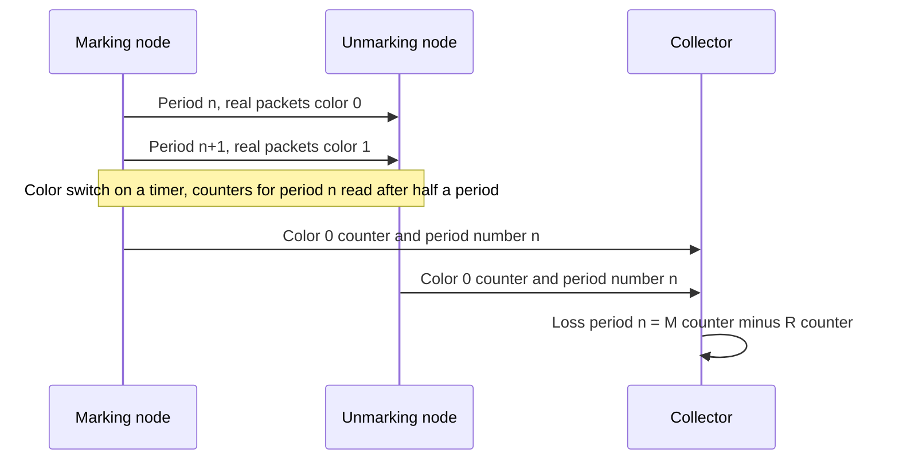
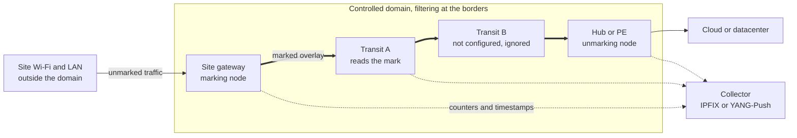
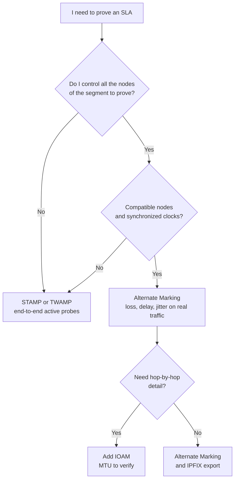

## The report is green, the field sees red

Picture the operations director of a chain of two hundred hotels. He opens the monthly report from his network provider: everything is green. His teams, meanwhile, have spent the week restarting frozen video calls and dealing with payment terminals that timed out at the register. Who do you believe, the dashboard or the field?

Anyone who runs hundreds of sites knows this scene, whether in hospitality, retail, student housing or corporate campuses. The contract promises an SLA (Service Level Agreement, the numerical commitment on service quality), with ceilings on loss, latency and jitter. But the proof most often rests on probes, those small test packets sent at regular intervals. They faithfully measure... the probes. Not the customer's traffic.

Yet since December 2022 there has been a method standardized by the IETF (the body that writes the standards of the Internet) for counting real packets directly: Alternate Marking. On October 30, 2026, a working group of that same IETF published a draft describing how to deploy it in production. That is good news, with a catch that nobody should sign off on without understanding it. This measurement is only valid on the stretch of network that you mark and control end to end. The public Internet is not part of it. Neither is the Wi-Fi air interface.

## Two colors are enough

To grasp the idea, forget routers and think of a logistics platform. The classic way to check that a carrier is not losing anything is to ship test parcels and watch for their arrival. It is the mystery shopper. It works, but it says nothing about the real parcels, and every test parcel takes up room in the truck.

Alternate Marking turns the problem around. You stick a blue sticker on every real parcel shipped between 10:00 and 10:05, an orange one between 10:05 and 10:10, then blue again. On arrival, you count the blue ones for that slot. If some are missing, you know exactly how many. No sampling, no extrapolation: an exhaustive count of the real goods, block by block.

*Real traffic cut into blocks of alternating colors: each node counts the packets of each color, and the difference between ingress and egress gives the loss.*

Applied to packets, this is the subject of RFC 9341 (RFCs, or Requests for Comments, are the documents published by the IETF), released in December 2022 with Proposed Standard status. One or two bits in the header serve as the sticker, and the ingress node switches color every period, on a simple timer. Each node keeps one counter per color, per flow and per interface. A useful subtlety: the counter for a color is only read half a period after the switch, giving stragglers time to get through.

Loss is then read by subtraction. Delay is obtained by timestamping the first packet of each block when only one bit is available (single-marking), or the packets designated by a second bit (double-marking). Jitter, in turn, is derived from one-way delay.

The price to pay comes down to one word: clocks. The RFC requires synchronized nodes and cites NTP and PTP (Precision Time Protocol, the IEEE 1588 standard) as examples. It even supplies the formula for the safety margin around each switch: clock accuracy, plus average delay, plus three standard deviations of the delay. That margin must stay under half the period. If the clocks drift too far, the stickers get mixed up.

One last point of vocabulary, which will matter in front of a lawyer: *probe-free* does not mean *passive*. RFC 7799 (May 2016) distinguishes active measurement (a dedicated flow is injected), passive measurement (you observe without modifying) and hybrid measurement (the real flow is modified). Alternate Marking changes bits of the customer's traffic at the edges of the domain: it is Type-I hybrid, even though RFC 9341 describes itself as passive or hybrid depending on the application. Nothing is injected, but the packets are touched.

## The October 30 draft: a user manual, not a standard

What the text published at the end of October changes is not the method. It is the user manual. RFCs 9341, 9342 and 9343 say how to mark and count. They do not say who marks, where to filter, how to configure hundreds of nodes, or where the counters go. The document draft-ietf-bpm-alt-mark-deployment-00 tackles that gap.

It still has to be read for what it is: a -00 version, dated October 30, 2026, expiring on May 3, 2027, whose header targets Informational status rather than Standards Track. Like any IETF draft, it presents itself as a "work in progress," and that is how it should be cited. Writing that the IETF is standardizing the deployment of Alternate Marking would be wrong.

The text does have a history, though. It replaces a draft from the IPPM group (historically in charge of IP performance measurement), which came out of an individual contribution in July 2023, was adopted by the group in January 2024 and reached version -10 on October 22, 2026. On October 21, its shepherd, Marcus Ihlar, confirmed consensus with no objection. He also flagged an unclear passage on the computation of the period number (section 7) and three typos.

My reading, without a line-by-line comparison: the -00 of the bpm group (Benchmarking & Performance Measurements), the declared successor to BMWG and IPPM, appears to be nothing more than a re-hosting of that -10. Its page shows no IESG state (the body that approves publications) and no assigned responsible person. Nothing therefore allows us to announce an imminent RFC. The -00 defines the period number as a division rounded down to the integer, which is in line with the shepherd's remark, but without a diff I cannot say whether the IPPM -10 had already fixed it.

Who holds the pen? G. Fioccola, K. Zhu and T. Zhou (Huawei), T. Graf (Swisscom) and L. Zhang (China Mobile). Three authors out of five at the same equipment vendor, two at telecom operators, no enterprise end user. Giuseppe Fioccola also co-chairs the bpm group, with Marcus Ihlar and Thomas Graf. This is an observation, not an indictment. It simply shapes how to read the text: it reasons in terms of an operator network, from the core to the edge.

On substance, the draft distinguishes three roles. The marking node encapsulates the traffic and takes the first counters and timestamps. Transit nodes read the mark. The unmarking node reads it, then removes it. One bit is enough for loss and single-marking; two open the door to double-marking. As for the measured flow identifier (FlowMonID), the text advises assigning it from a central controller: drawn at random, its uniqueness is not guaranteed.

For export, results go to monitoring via IPFIX (the standard flow export format) or YANG-Push (telemetry pushed on subscription), with RFC 9951 (April 2026) in particular for the delay fields. The text warns that this volume "could overwhelm a router processor," and suggests publishing from network processors.

That leaves aligning the counters. Each node computes a period number (PN, Period Number): its local time divided by the period length, rounded down to the integer. If synchronization is lost, the rule is clear: the measurement is skipped on the affected intervals, until it is restored. A configuration or export failure takes the node concerned out of the measurement. And if it is the marking node that fails, nobody measures anything anymore.

*One measurement period: both ends report to the collector the counter for the same color, tagged with the same period number. Loss is read by difference.*

The most telling thing is still what the text does not contain. No default value, neither for the period length nor for a threshold. No deployment figures. No mention of the other standardized methods, IOAM or STAMP, which I come back to below. And not a single occurrence of the words Wi-Fi, SD-WAN or SLA. Turning it into a tool for contractual proof is our projection as operators, not its stated intent.

## Where the domain ends, the proof ends

Back to the stickers. They have value only inside your own warehouses. At a subcontractor that does not read them, the parcel drops out of the count. Worse, some subcontractors refuse parcels carrying an unknown label.

The draft sets out the rule in its section 2: the method "MUST be deployed in a controlled domain," for security and compatibility reasons. Marked packets entering or leaving the controlled domain must be filtered. The text suggests a simple rule: only insert the mark if the destination belongs to the domain. The textbook case is an overlay (a network of tunnels layered on top of the physical network), encapsulated at one border and decapsulated at the other.

So who marks? The text names the CPE (Customer Premises Equipment, the equipment installed at the customer's site) or the PE (Provider Edge, the operator's edge router) as the most likely ingress and egress points. The user's device could mark if it were fully managed, but "in practice, this is not common." And the CPE only enters the domain if it is managed by the service provider, with additional protections.

To cross a third-party network, the draft recommends rebuilding a single controlled domain, via IPsec or another VPN providing full confidentiality and integrity. You do not measure your neighbor's network. You measure your own tunnel across it.

*The controlled domain: the mark is born at the site gateway and disappears at the hub. The site's Wi-Fi and LAN stay outside the measurement.*

A transit router unable to read the mark is not a disaster: according to the draft, it is simply excluded from the measurement. Counting between ingress and egress remains possible, but loss localization stops at the compatible nodes. Knowing that packets are being lost between A and B, when four silent routers sit between them, is information. Not yet a diagnosis.

In IPv6, RFC 9343 (December 2022, also on the standards track) places the mark in a 48-bit option: a 20-bit FlowMonID and two flags, L for loss, D for delay. This option travels either in the Hop-by-Hop header, which every configured router examines, or in the Destination Options header, which only the source and destination read. The RFC reserves it for the controlled domain, typically an overlay. It points out two costs: processing sometimes relegated to the routers' slow path, and an MTU (maximum packet size) reduced by the same amount.

Why so much caution? Because the public Internet has never liked these extension headers. RFC 7872 (June 2016) sent TCP packets carrying an 8-byte Hop-by-Hop header to public web, mail and DNS servers, in August 2014 and then in June 2015. Depending on the dataset and the server type, 39 to 54% were lost along the way. With a Destination Options header, between 10.9 and 21.3%. These measurements are more than ten years old and do not describe the Internet of 2026. The RFC itself does not distinguish deliberate filtering from bugs. This historical order of magnitude is nonetheless enough, in my view, to understand the RFCs' caution.

*Filtering at the borders: no marked packet may enter or leave the controlled domain.*

## Stickers, logbook or mystery shopper (personal analysis)

The draft does not compare Alternate Marking with any other method. The grid that follows is therefore mine, built from the RFCs of each approach: it does not commit the IETF or the authors.

Let's stay on the logistics platform. If Alternate Marking sticks on stickers, IOAM (In-situ Operations, Administration and Maintenance, RFC 9197, May 2022) slips a logbook into the parcel that each warehouse fills in as it passes. You gain hop-by-hop detail, but the parcel grows. The RFC asks the operator to verify that the MTU of every link can absorb this extra weight, and it too restricts IOAM to limited domains.

STAMP (Simple Two-way Active Measurement Protocol, RFC 8762, March 2020), heir to TWAMP (RFC 5357, October 2008), is the mystery shopper. A sender transmits UDP test packets to a reflector, which sends them back. From them you derive loss, delay and delay variation, in one direction or both. The base packets are 44 bytes, 112 in authenticated mode. Above all, no intermediate router needs to cooperate.

| Criterion | Alternate Marking (RFC 9341, 9342, 9343) | IOAM (RFC 9197) | STAMP / TWAMP (RFC 8762, 5357) |
|---|---|---|---|
| Family (RFC 7799) | Type-I hybrid | Hybrid, data added to packets | Active |
| Traffic measured | Marked real traffic | Real traffic, per-hop telemetry | Dedicated test packets |
| Per-packet overhead | 1 to 2 bits, or 48-bit IPv6 option | Grows with hops and data | None on customer traffic, but probing load |
| Prerequisites | Compatible nodes, controlled domain, synchronized clocks | Compatible nodes, limited domain, MTU to verify | A sender and a reflector at the endpoints |
| Outside its domain | Only through its own tunnel | Same | Works as is, including over third-party links |

My position: STAMP remains the default tool whenever you do not control the transit. Alternate Marking takes the lead when you control the path and want to measure real traffic without probing load. IOAM comes on top when per-hop detail justifies the extra weight. They are not competitors. They are tiers.

*Two measurement philosophies: probes that make the round trip, or real traffic carrying marks that are counted along the way.*

## What I take from it for a multi-site estate (personal analysis)

The draft talks neither about Wi-Fi nor about contracts. The implications below are mine, seen from operating networks with several hundred sites.

**The perimeter.** A site's SLA often covers its WAN or Internet access, sometimes provided by a third-party operator whose routers you do not control. An overlay between the site gateway and a hub lets you mark at both ends: you then measure the tunnel, not every hop of the third party. As for the radio segment, nothing is marked there. Between the access point and a customer's smartphone, no managed device reads or removes a mark. That stretch is proven with Wi-Fi telemetry, not with Alternate Marking.

**The star.** For dozens of sites reporting to the same hub, RFC 9342 (Clustered Alternate Marking, December 2022) extends the method to multipoint flows, ECMP load balancing included (spreading over several equal-cost paths), with fewer counters. The trade-off: in a group of more than two nodes, loss is localized to the group, not to the link. In my view this is the most useful building block for a multi-site estate.

**The gaps.** Since the measurement is skipped when clocks drop out of sync, a report must distinguish *no measurement* from *no loss*. An unmeasured interval counted as compliant is a green report that lies by omission. It is a contractual audit point in its own right.

**The collisions.** RFC 9343 quantifies the risk of a randomly drawn 20-bit FlowMonID: a 50% probability of collision from 1,206 flows. Combined with source and destination addresses, you stay at 1% collision for 145 flows per host pair. With a central controller, you reach 1,048,576 simultaneous flows per host pair. At the scale of an estate, centralized assignment is a must.

**The volume.** If the draft worries about the processor of a single router, multiply by hundreds of sites and a short period. Collection becomes an infrastructure project to be budgeted, like any telemetry (a topic already covered on this blog at the end of October).

**The hardware.** I found no public evidence of Alternate Marking support on Wi-Fi access points or enterprise CPEs, and the text says nothing about it. It is a question to put to vendors, with the RFCs in hand. According to the draft, RFC 9343 also applies to SRv6 (segment routing over IPv6). RFC 9947 (March 2026) proposes a variant placed in the SRv6 routing header, but it is experimental, published through the independent stream without IETF consensus. It states itself that duplicating the information should be avoided if combined with 9343.

**The references.** An expired individual draft, signed in March 2024 by two Huawei authors, reports deployments at China Mobile, China Unicom (Beijing, 2022 Winter Games), MTN in South Africa, STC in Bahrain, on the Guangdong e-Government network and at the bank ICBC. No scale figures, no measured results, no IETF endorsement: a signal of interest, not proof of maturity.

*Decision tree proposed by the author, not by the draft: the choice of method follows first from the actual control you have over the path.*

## Measure what you control, and say so

Alternate Marking is, in my view, the right direction for proving an SLA on real traffic rather than on probes. This draft is the document that was missing between the RFC and operations: roles, filtering, configuration, export, what to do when the clock falters. It deserves to be followed closely.

Two mistakes are to be avoided, though. The first: presenting it as a standard, when it is a -00 with a targeted Informational status, a work in progress. The second: selling the measurement it frames as end-to-end proof. It stops dead at the border of the domain you mark.

The real question is therefore not "Alternate Marking or STAMP?" It is "which segment can I actually mark?" For a multi-site network, the honest answer comes down to one word: the overlay, between the site gateways and the core. Third-party transit is measured as a whole, through that tunnel. The Wi-Fi air interface is proven with other tools.

A defensible SLA is not a green curve. It is a clause, a named measurement method, a reference clock and a trusted third party for the data. The day our hotel director challenges the report, it is this quartet that will carry the weight.

_Personal views, not Wifirst's position._

## Sources

1. IETF Datatracker, draft-ietf-bpm-alt-mark-deployment (page du document -00, 30 octobre 2026) : https://datatracker.ietf.org/doc/draft-ietf-bpm-alt-mark-deployment/
2. Texte du draft-ietf-bpm-alt-mark-deployment-00, Alternate Marking Deployment Framework (30 octobre 2026) : https://www.ietf.org/archive/id/draft-ietf-bpm-alt-mark-deployment-00.txt
3. IETF Datatracker, historique de draft-ietf-ippm-alt-mark-deployment (2023-2026) : https://datatracker.ietf.org/doc/draft-ietf-ippm-alt-mark-deployment/history/
4. IETF, groupe de travail bpm (charte, coprésidents, jalons) : https://datatracker.ietf.org/wg/bpm/about/
5. RFC 9341, Alternate-Marking Method (décembre 2022) : https://www.rfc-editor.org/rfc/rfc9341.html
6. RFC 9342, Clustered Alternate-Marking Method (décembre 2022) : https://www.rfc-editor.org/rfc/rfc9342.html
7. RFC 9343, IPv6 Application of the Alternate-Marking Method (décembre 2022) : https://www.rfc-editor.org/rfc/rfc9343.html
8. RFC 9947, Alternate Marking dans le Segment Routing Header SRv6, Experimental (mars 2026) : https://www.rfc-editor.org/rfc/rfc9947.html
9. RFC 9951, éléments IPFIX de délai On-Path Telemetry (avril 2026) : https://www.rfc-editor.org/rfc/rfc9951.html
10. RFC 9197, Data Fields for In Situ OAM (mai 2022) : https://www.rfc-editor.org/rfc/rfc9197.html
11. RFC 8762, Simple Two-Way Active Measurement Protocol (mars 2020) : https://www.rfc-editor.org/rfc/rfc8762.html
12. RFC 5357, Two-Way Active Measurement Protocol (octobre 2008) : https://www.rfc-editor.org/rfc/rfc5357.html
13. RFC 7799, Active and Passive Metrics and Methods (mai 2016) : https://www.rfc-editor.org/rfc/rfc7799.html
14. RFC 7872, Observations on the Dropping of Packets with IPv6 Extension Headers in the Real World (juin 2016, mesures d'août 2014 et juin 2015) : https://www.rfc-editor.org/rfc/rfc7872.html
15. draft-zhou-srv6ops-am-deployment-status-00, draft individuel expiré, non endossé par l'IETF (4 mars 2024) : https://datatracker.ietf.org/doc/html/draft-zhou-srv6ops-am-deployment-status-00
