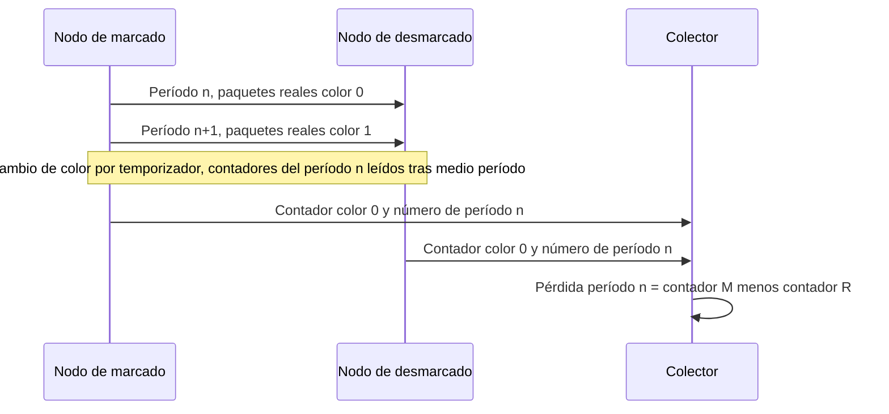
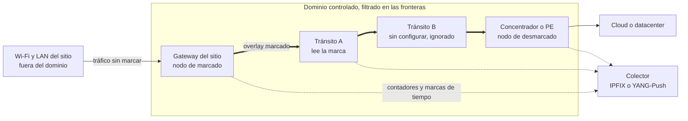
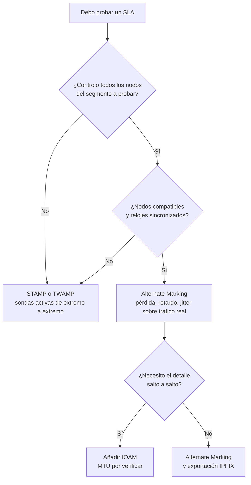

## El informe está en verde, pero sobre el terreno todo es rojo

Imagine al director de operaciones de una cadena de doscientos hoteles. Abre el informe mensual de su proveedor de red: todo está en verde. Sus equipos, en cambio, han pasado la semana relanzando videoconferencias congeladas y terminales de pago que caducaban en caja. ¿A quién creer, al panel de control o al terreno?

Quienes operan cientos de sitios conocen esta escena, ya sea en hotelería, retail, residencias de estudiantes o campus empresariales. El contrato promete un SLA (Service Level Agreement, el compromiso cifrado de nivel de servicio), con techos de pérdida, latencia y jitter. Pero la prueba descansa casi siempre en sondas, esos pequeños paquetes de prueba enviados a intervalos regulares. Miden fielmente... las sondas. No el tráfico del cliente.

Sin embargo, existe desde diciembre de 2022 un método normalizado por el IETF (el organismo que redacta los estándares de Internet) para contar directamente los paquetes reales: el Alternate Marking. El 30 de octubre de 2026, un grupo de trabajo de ese mismo IETF publicó un borrador que describe cómo desplegarlo en producción. Es una buena noticia, acompañada de un límite que nadie debería firmar sin haberlo entendido. Esta medición solo vale en el tramo de red que usted marca y controla de extremo a extremo. Internet público no forma parte de él. El aire del Wi-Fi tampoco.

## Dos colores bastan

Para captar la idea, olvide los routers y piense en una plataforma logística. La forma clásica de comprobar que un transportista no pierde nada consiste en enviar bultos testigo y esperar a que lleguen. Es el cliente misterioso. Funciona, pero no dice nada de los bultos reales, y cada bulto testigo ocupa sitio en el camión.

El Alternate Marking aborda el problema al revés. Se pega una pegatina azul en todos los bultos reales expedidos entre las 10:00 y las 10:05, una naranja entre las 10:05 y las 10:10, y luego otra vez azul. A la llegada, se cuentan los azules de la franja. Si falta alguno, se sabe exactamente cuántos. Sin muestreo, sin extrapolación: un recuento exhaustivo de la mercancía real, bloque a bloque.

*El tráfico real dividido en bloques de color alterno: cada nodo cuenta los paquetes de cada color, y la diferencia entre la entrada y la salida da la pérdida.*

Trasladado a los paquetes, este es el objeto de la RFC 9341 (las RFC, o Request for Comments, son los documentos publicados por el IETF), aparecida en diciembre de 2022 con el estatus de Proposed Standard. Uno o dos bits de la cabecera hacen de pegatina, y el nodo de entrada cambia de color en cada período, con un simple temporizador. Cada nodo mantiene un contador por color, por flujo y por interfaz. Un detalle útil: el contador de un color solo se lee media período después del cambio, el tiempo necesario para que pasen los rezagados.

La pérdida se lee entonces por resta. El retardo se obtiene marcando con una hora el primer paquete de cada bloque cuando solo se dispone de un bit (single-marking), o los paquetes designados por un segundo bit (double-marking). El jitter, por su parte, se deduce del retardo unidireccional.

El precio a pagar se resume en una palabra: los relojes. La RFC exige nodos sincronizados y cita NTP y PTP (Precision Time Protocol, la norma IEEE 1588) como ejemplos. Incluso proporciona la fórmula del margen de seguridad alrededor de cada cambio: precisión del reloj, más retardo medio, más tres desviaciones típicas del retardo. Este margen debe permanecer por debajo de la mitad del período. Si los relojes derivan demasiado, las pegatinas se mezclan.

Un último punto de vocabulario, que importará ante un jurista: *sin sondas* no significa *pasivo*. La RFC 7799 (mayo de 2016) distingue la medición activa (se inyecta un flujo dedicado), pasiva (se observa sin modificar) e híbrida (se modifica el flujo real). El Alternate Marking cambia bits del tráfico del cliente en los bordes del dominio: es híbrida de tipo I, aunque la RFC 9341 se describa como pasiva o híbrida según la aplicación. No se inyecta nada, pero se tocan los paquetes.

## El borrador del 30 de octubre: un manual de uso, no una norma

Lo que cambia con el texto publicado a finales de octubre no es el método. Es el manual de uso. Las RFC 9341, 9342 y 9343 explican cómo marcar y contar. No dicen quién marca, dónde se filtra, cómo configurar cientos de nodos ni adónde van los contadores. El documento draft-ietf-bpm-alt-mark-deployment-00 aborda ese vacío.

Aun así, hay que leerlo por lo que es: una versión -00, fechada el 30 de octubre de 2026, que expira el 3 de mayo de 2027 y cuya cabecera apunta al estatus Informational y no a Standards Track. Como todo borrador del IETF, se presenta como un «work in progress», y así hay que citarlo. Escribir que el IETF normaliza el despliegue del Alternate Marking sería falso.

El texto tiene, no obstante, un pasado. Sustituye a un borrador del grupo IPPM (históricamente encargado de la medición del rendimiento IP), procedente de una contribución individual de julio de 2023, adoptado por el grupo en enero de 2024 y llegado a su versión -10 el 22 de octubre de 2026. El 21 de octubre, su responsable de seguimiento, Marcus Ihlar, confirmó el consenso sin objeciones. También señaló un pasaje poco claro sobre el cálculo del número de período (sección 7) y tres erratas.

Mi lectura, sin comparación línea a línea: el -00 del grupo bpm (Benchmarking & Performance Measurements), sucesor declarado de BMWG y de IPPM, parece ser solo un realojamiento de ese -10. Su página no muestra ningún estado IESG (la instancia que aprueba las publicaciones) ni ningún responsable asignado. Nada permite, pues, anunciar una RFC inminente. El -00 define el número de período mediante una división redondeada al entero inferior, lo cual va en el sentido de la observación del responsable de seguimiento, pero sin un diff no puedo decir si el -10 de ippm ya lo había corregido.

¿Quién lleva la pluma? G. Fioccola, K. Zhu y T. Zhou (Huawei), T. Graf (Swisscom) y L. Zhang (China Mobile). Tres autores de cinco son del mismo fabricante de equipos, dos de operadores de telecomunicaciones, y ninguno es usuario final en una empresa. Giuseppe Fioccola copreside además el grupo bpm, junto con Marcus Ihlar y Thomas Graf. Es una constatación, no un proceso. Simplemente orienta la lectura: este texto razona en términos de red de operador, del núcleo hacia el borde.

En cuanto al fondo, el borrador distingue tres roles. El nodo de marcado encapsula el tráfico y toma los primeros contadores y marcas de tiempo. Los nodos de tránsito leen la marca. El nodo de desmarcado la lee y luego la retira. Un bit basta para la pérdida y el single-marking; dos abren la puerta al double-marking. En cuanto al identificador del flujo medido (FlowMonID), el texto aconseja asignarlo desde un controlador central: si se elige al azar, nada garantiza su unicidad.

Para la exportación, los resultados van hacia la supervisión mediante IPFIX (el formato estándar de exportación de flujos) o mediante YANG-Push (una telemetría enviada bajo suscripción), con la RFC 9951 (abril de 2026) en particular para los campos de retardo. El texto advierte de que este volumen «could overwhelm a router processor», y sugiere publicar desde los procesadores de red.

Falta alinear los contadores. Cada nodo calcula un número de período (PN, Period Number): su hora local dividida por la duración del período, redondeada al entero inferior. Si la sincronización se pierde, la regla es clara: la medición se omite en los intervalos afectados, hasta que se restablece. Un fallo de configuración o de exportación saca de la medición al nodo afectado. Y si es el nodo de marcado el que falla, ya nadie mide nada.

*Un período de medición: los dos extremos envían al colector el contador de un mismo color, etiquetado con el mismo número de período. La pérdida se lee por diferencia.*

Lo más revelador es lo que el texto no contiene. Ningún valor por defecto, ni para la duración del período ni para un umbral. Ninguna cifra de despliegue. Ninguna mención de los otros métodos normalizados, IOAM o STAMP, sobre los que vuelvo más abajo. Y ni una sola aparición de las palabras Wi-Fi, SD-WAN o SLA. Convertirlo en una herramienta de prueba contractual es nuestra proyección de operador, no su intención declarada.

## Donde termina el dominio, termina la prueba

Volvamos a las pegatinas. Solo tienen valor en sus propios almacenes. En un subcontratista que no las lee, el bulto sale del recuento. Peor aún, algunos subcontratistas rechazan los bultos con una etiqueta desconocida.

El borrador fija la regla desde su sección 2: el método «MUST be deployed in a controlled domain», por razones de seguridad y de compatibilidad. Los paquetes marcados que entran en el dominio controlado o salen de él deben filtrarse. El texto sugiere una regla sencilla: insertar la marca solo si el destino pertenece al dominio. El caso de manual es un overlay (una red de túneles superpuesta a la red física), encapsulado en una frontera y desencapsulado en la otra.

¿Quién marca, entonces? El texto designa al CPE (Customer Premises Equipment, el equipo instalado en casa del cliente) o al PE (Provider Edge, el router de borde del operador) como los puntos de entrada y de salida más probables. El terminal del usuario podría marcar si estuviera totalmente gestionado, pero «in practice, this is not common». Y el CPE solo entra en el dominio si lo gestiona el proveedor de servicio, con protecciones adicionales.

Para atravesar una red de terceros, el borrador recomienda reconstruir un único dominio controlado, mediante IPsec u otra VPN que asegure confidencialidad e integridad completas. No se mide la red del vecino. Se mide el propio túnel a través de ella.

*El dominio controlado: la marca nace en el gateway del sitio y desaparece en el concentrador. El Wi-Fi y la LAN del sitio quedan fuera de la medición.*

Un router de tránsito incapaz de leer la marca no es un drama: según el borrador, simplemente queda excluido de la medición. El recuento entre la entrada y la salida sigue siendo posible, pero la localización de la pérdida se detiene en los nodos compatibles. Saber que se pierden paquetes entre A y B, cuando los separan cuatro routers mudos, es una información. Todavía no es un diagnóstico.

En IPv6, la RFC 9343 (diciembre de 2022, también en vías de normalización) aloja la marca en una opción de 48 bits: un FlowMonID de 20 bits y dos indicadores, L para la pérdida y D para el retardo. Esta opción viaja bien en la cabecera Hop-by-Hop, que examina cada router configurado, bien en la cabecera Destination Options, que solo leen el origen y el destino. La RFC la reserva al dominio controlado, típicamente un overlay. Recuerda dos costes: un procesamiento relegado a veces a la ruta lenta de los routers, y una MTU (tamaño máximo de paquete) reducida en la misma medida.

¿Por qué tanta prudencia? Porque Internet público nunca ha querido estas cabeceras de extensión. La RFC 7872 (junio de 2016) envió, en agosto de 2014 y luego en junio de 2015, paquetes TCP con una cabecera Hop-by-Hop de 8 octetos hacia servidores web, de correo y DNS públicos. Según el conjunto de datos y el tipo de servidor, entre el 39 y el 54 % se perdían por el camino. Con una cabecera Destination Options, entre el 10,9 y el 21,3 %. Estas mediciones tienen más de diez años y no describen el Internet de 2026. La propia RFC no distingue entre filtrado deliberado y fallo. Con todo, este orden de magnitud histórico basta, a mi juicio, para entender la prudencia de las RFC.

*Filtrar en las fronteras: ningún paquete marcado debe entrar en el dominio controlado ni salir de él.*

## Pegatinas, cuaderno de bitácora o cliente misterioso (análisis personal)

El borrador no compara el Alternate Marking con ningún otro método. La parrilla que sigue es, por tanto, la mía, construida a partir de las RFC de cada enfoque: no compromete ni al IETF ni a los autores.

Sigamos con la plataforma logística. Si el Alternate Marking pega pegatinas, IOAM (In-situ Operations, Administration and Maintenance, RFC 9197, mayo de 2022) mete en el bulto un cuaderno de bitácora que cada almacén completa a su paso. Se gana el detalle salto a salto, pero el bulto engorda. La RFC pide al operador que verifique que la MTU de todos los enlaces absorbe ese sobrepeso, y también reserva IOAM a dominios limitados.

STAMP (Simple Two-way Active Measurement Protocol, RFC 8762, marzo de 2020), heredero de TWAMP (RFC 5357, octubre de 2008), es el cliente misterioso. Un emisor envía paquetes de prueba UDP a un reflector, que se los devuelve. De ahí se obtienen pérdida, retardo y variación del retardo, en un sentido o en ambos. Los paquetes básicos son de 44 octetos, 112 en modo autenticado. Sobre todo, ningún router intermedio necesita cooperar.

| Criterio | Alternate Marking (RFC 9341, 9342, 9343) | IOAM (RFC 9197) | STAMP / TWAMP (RFC 8762, 5357) |
|---|---|---|---|
| Familia (RFC 7799) | Híbrida de tipo I | Híbrida, datos añadidos a los paquetes | Activa |
| Tráfico medido | Tráfico real marcado | Tráfico real, telemetría por salto | Paquetes de prueba dedicados |
| Sobrecoste por paquete | 1 a 2 bits, u opción IPv6 de 48 bits | Crece con los saltos y los datos | Nulo sobre el tráfico del cliente, pero carga de sondeo |
| Requisitos previos | Nodos compatibles, dominio controlado, relojes sincronizados | Nodos compatibles, dominio limitado, MTU por verificar | Un emisor y un reflector en los extremos |
| Fuera de su dominio | Solo a través de su propio túnel | Ídem | Funciona tal cual, incluso en enlaces de terceros |

Mi posición: STAMP sigue siendo la herramienta por defecto en cuanto no se controla el tránsito. El Alternate Marking toma ventaja cuando se domina la ruta y se quiere medir el tráfico real sin carga de sondeo. IOAM se suma cuando el detalle por salto justifica el sobrepeso. No son competidores. Son peldaños.

*Dos filosofías de medición: sondas que hacen el viaje de ida y vuelta, o el tráfico real portador de marcas contadas al pasar.*

## Lo que saco de esto para un parque multisitio (análisis personal)

El borrador no habla ni de Wi-Fi ni de contrato. Las implicaciones que siguen son mías, vistas desde la operación de redes con varios cientos de sitios.

**El perímetro.** El SLA de un sitio suele referirse a su acceso WAN o a Internet, a veces suministrado por un operador tercero cuyos routers no se controlan. Un overlay entre el gateway del sitio y un concentrador permite marcar en ambos extremos: se mide entonces el túnel, no cada salto del tercero. En cuanto al segmento radio, ahí no se marca nada. Entre el punto de acceso y el smartphone de un cliente, ningún terminal gestionado lee ni retira marca alguna. Este tramo se prueba con la telemetría Wi-Fi, no con el Alternate Marking.

**La estrella.** Para decenas de sitios que convergen en un mismo hub, la RFC 9342 (Clustered Alternate Marking, diciembre de 2022) extiende el método a los flujos multipunto, incluido el reparto de carga ECMP (la distribución entre varias rutas de igual coste), con menos contadores. Contrapartida: en un grupo de más de dos nodos, la pérdida se localiza en el grupo, no en el enlace. A mi juicio, es el componente más útil para un parque multisitio.

**Los huecos.** Dado que la medición se omite cuando los relojes se desincronizan, un informe debe distinguir *sin medición* de *sin pérdida*. Un intervalo no medido contado como conforme es un informe verde que miente por omisión. Es un punto de auditoría contractual por derecho propio.

**Las colisiones.** La RFC 9343 cuantifica el riesgo de un FlowMonID de 20 bits elegido al azar: 50 % de probabilidad de colisión a partir de 1.206 flujos. Combinado con las direcciones de origen y destino, se queda en un 1 % de colisión para 145 flujos por pareja de hosts. Con un controlador central, se llega a 1.048.576 flujos simultáneos por pareja de hosts. A escala de un parque, la asignación centralizada se impone.

**El volumen.** Si el borrador se preocupa por el procesador de un solo router, multiplique por cientos de sitios y un período corto. La recogida se convierte en un proyecto de infraestructura que hay que presupuestar, como toda telemetría (tema ya abordado en este blog a finales de octubre).

**El hardware.** No he encontrado ninguna prueba pública de soporte del Alternate Marking en puntos de acceso Wi-Fi ni en CPE empresariales, y el texto no dice nada al respecto. Es una pregunta que hay que hacer a los proveedores, con las RFC en la mano. Según el borrador, la RFC 9343 se aplica también a SRv6 (el segment routing sobre IPv6). La RFC 9947 (marzo de 2026) propone una variante alojada en la cabecera de enrutamiento SRv6, pero experimental, publicada por la vía independiente sin consenso del IETF. Ella misma indica que hay que evitar la duplicación de la información si se combina con la 9343.

**Las referencias.** Un draft individual caducado, firmado en marzo de 2024 por dos autores de Huawei, declara despliegues en China Mobile, China Unicom (Pekín, Juegos de Invierno 2022), MTN en Sudáfrica, STC en Baréin, en la red e-Government de Guangdong y en el banco ICBC. Ni cifra de escala, ni resultado medido, ni respaldo del IETF: una señal de interés, no una prueba de madurez.

*Árbol de decisión propuesto por el autor, no por el borrador: la elección del método depende ante todo del control real que se tiene sobre la ruta.*

## Medir lo que se controla, y decirlo

El Alternate Marking es, en mi opinión, la dirección correcta para probar un SLA sobre el tráfico real en lugar de sobre sondas. Este borrador es el documento que faltaba entre la RFC y la operación: roles, filtrado, configuración, exportación, conducta a seguir cuando el reloj falla. Merece seguirse de cerca.

Hay, sin embargo, dos errores que evitar. El primero: presentarlo como una norma, cuando es un -00 con estatus buscado Informational, un trabajo en curso. El segundo: vender la medición que enmarca como una prueba de extremo a extremo. Se detiene en seco en la frontera del dominio que usted marca.

La verdadera pregunta no es, pues, «¿Alternate Marking o STAMP?». Es «¿qué segmento puedo marcar realmente?». Para una red multisitio, la respuesta honesta cabe en una palabra: el overlay, entre los gateways de sitio y el núcleo. El tránsito de terceros se mide en bloque a través de ese túnel. El aire del Wi-Fi se prueba con otras herramientas.

Un SLA defendible no es una curva verde. Es una cláusula, un método de medición con nombre, un reloj de referencia y un tercero de confianza para los datos. El día en que nuestro director de hotel impugne el informe, este cuarteto será el que haga fe.

_Opiniones personales, no la posición de Wifirst._

## Fuentes

1. IETF Datatracker, draft-ietf-bpm-alt-mark-deployment (page du document -00, 30 octobre 2026) : https://datatracker.ietf.org/doc/draft-ietf-bpm-alt-mark-deployment/
2. Texte du draft-ietf-bpm-alt-mark-deployment-00, Alternate Marking Deployment Framework (30 octobre 2026) : https://www.ietf.org/archive/id/draft-ietf-bpm-alt-mark-deployment-00.txt
3. IETF Datatracker, historique de draft-ietf-ippm-alt-mark-deployment (2023-2026) : https://datatracker.ietf.org/doc/draft-ietf-ippm-alt-mark-deployment/history/
4. IETF, groupe de travail bpm (charte, coprésidents, jalons) : https://datatracker.ietf.org/wg/bpm/about/
5. RFC 9341, Alternate-Marking Method (décembre 2022) : https://www.rfc-editor.org/rfc/rfc9341.html
6. RFC 9342, Clustered Alternate-Marking Method (décembre 2022) : https://www.rfc-editor.org/rfc/rfc9342.html
7. RFC 9343, IPv6 Application of the Alternate-Marking Method (décembre 2022) : https://www.rfc-editor.org/rfc/rfc9343.html
8. RFC 9947, Alternate Marking dans le Segment Routing Header SRv6, Experimental (mars 2026) : https://www.rfc-editor.org/rfc/rfc9947.html
9. RFC 9951, éléments IPFIX de délai On-Path Telemetry (avril 2026) : https://www.rfc-editor.org/rfc/rfc9951.html
10. RFC 9197, Data Fields for In Situ OAM (mai 2022) : https://www.rfc-editor.org/rfc/rfc9197.html
11. RFC 8762, Simple Two-Way Active Measurement Protocol (mars 2020) : https://www.rfc-editor.org/rfc/rfc8762.html
12. RFC 5357, Two-Way Active Measurement Protocol (octobre 2008) : https://www.rfc-editor.org/rfc/rfc5357.html
13. RFC 7799, Active and Passive Metrics and Methods (mai 2016) : https://www.rfc-editor.org/rfc/rfc7799.html
14. RFC 7872, Observations on the Dropping of Packets with IPv6 Extension Headers in the Real World (juin 2016, mesures d'août 2014 et juin 2015) : https://www.rfc-editor.org/rfc/rfc7872.html
15. draft-zhou-srv6ops-am-deployment-status-00, draft individuel expiré, non endossé par l'IETF (4 mars 2024) : https://datatracker.ietf.org/doc/html/draft-zhou-srv6ops-am-deployment-status-00
