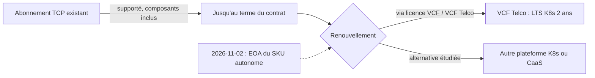

# Brief — Broadcom arrête la licence autonome VMware Telco Cloud Platform (EOA 2026-11-02) au profit de VCF Telco

Rédigé le 2026-11-04 — mode brief. Historique vérifié (list-articles.ts, 525 articles) : aucun article déjà publié sur VMware/Broadcom côté cloud télécom ni sur VCF. Pas de redondance. Genre : `archi-vendor` / `market-analyse`. Pas une CVE.

Convention : [V] = vérifié par fetch de la page. [S] = vu uniquement dans un résumé de recherche, non confirmé par fetch. Les extraits de pages passent par un outil de fetch qui résume : les citations marquées « mot pour mot » sont à re-contrôler sur la page avant publication.

## Thèse (1 phrase)
Avec la fin de disponibilité du SKU autonome Telco Cloud Platform, le verrou VMware se déplace de la technique vers le contrat : la question utile pour un CTO n'est plus « quel hyperviseur ? » mais « quelles clauses (périmètre, durée, prix de renouvellement, support après terme) signe-t-on avant le renouvellement ? ».

Statut : interprétation éditoriale, appuyée sur les faits ci-dessous. Elle ne doit pas être présentée comme un fait rapporté par les sources.

## Nuance obligatoire (cadrage)
- Seul le SKU de licence autonome Telco Cloud Platform passe en End of Availability (2026-11-02). [V, source 1]
- Les abonnements existants restent supportés, composants compris, pendant la transition. Au renouvellement, un représentant Broadcom aide à aligner les besoins sur VCF. Broadcom indique qu'aucune action immédiate n'est requise pour les clients existants. [V, source 1]
- Ne pas écrire « supprime », « interdit », « contraint » au sens fort. Formulations sûres : « met fin à la vente du SKU autonome », « au renouvellement, la route passe par VCF (Telco) », « ferme l'option autonome ».
- Aucune source ne publie de prix de VCF Telco. Aucun chiffre de hausse tarifaire ne peut être attribué à ce changement précis.

## Faits clés (périmètre exact, URL, date)

1. **EOA et périmètre.** Les SKU de licence autonomes VMware Telco Cloud Platform atteignent l'EOA le 2026-11-02 ; ensuite ils sont fournis via la licence et le SKU VCF. Broadcom dit que Telco Cloud Platform n'est plus développé comme plateforme autonome. Auteurs du billet : Anupama Mahabhashyam et Odded Solomon. — [Broadcom/VMware blog, 2026-11-02](https://blogs.vmware.com/cloud-foundation/2026/11/02/introducing-vmware-cloud-foundation-telco/)
2. **LTS Kubernetes.** Le billet Broadcom annonce, mot pour mot : « flexible 2-year Long-Term Support (LTS) with every minor release of Kubernetes ». Périmètre : offre VCF Telco, déclaration vendor. Les conditions précises (ce qui est couvert, ce que « flexible » veut dire) ne sont pas détaillées dans le billet. — même source (2026-11-02)
3. **Référence amont.** Le projet Kubernetes supporte chaque version mineure environ 14 mois (12 mois de période standard + 2 mois de maintenance). Exemple listé sur la page : 1.37, maintenance à partir du 2027-08-28, EOL le 2027-10-28. Un LTS de 24 mois est donc environ 10 mois plus long que l'amont (calcul : 24 - 14), mais c'est un support vendor, pas un engagement de la communauté. — [kubernetes.io patch releases](https://kubernetes.io/releases/patch-releases/) (page consultée le 2026-11-04)
4. **Contenu de VCF Telco** (liste du vendor, non auditée) : fiabilité carrier-grade (HA, tolérance de panne, sauvegarde/restauration, PRA), gestion de flotte avec cycle de vie zero-touch et observabilité partagée via VCF Operations, Private AI Services y compris déploiement air-gapped, support VNF/CNF, isolation multi-tenant, NVMe memory tiering, clés de chiffrement contrôlées par le client, alignement NIST et UK Telecommunications Security Act, micro-segmentation vDefend en option. — Broadcom blog, 2026-11-02
5. **Couverture presse de l'EOA.** SDxCentral (Dan Meyer) rapporte la fin de vente de la licence autonome ; l'EOA est citée « end of availability » (citation courte) au 2 novembre ; les clients existants gardent le support sous leurs contrats d'origine et doivent passer à la nouvelle offre à la fin du terme. L'article ne mentionne pas le LTS et ne donne aucun prix. — [SDxCentral, 2026-11-03](https://www.sdxcentral.com/news/broadcom-kills-vmware-telco-cloud-platform-standalone-license-option/)
6. **Boost Mobile.** SDxCentral (2026-11-03) écrit que Boost Mobile a abandonné son usage de longue date de la plateforme, son CTO invoquant le « price gouging » (citation courte ; le CTO n'est pas nommé dans cet article). Précisions de périmètre : le remplacement porte sur la couche CaaS (containers-as-a-service) VMware, remplacée par Wind River Studio Operator ; l'annonce date de décembre 2024, donc ce n'est pas une réaction à l'EOA de 2026. ABI Research rapporte que le CTO d'EchoStar attribue le choix à la valeur technique de Wind River, et mentionne une rumeur de motif tarifaire : les motifs sont donc contestés. — [SDxCentral 2026-11-03](https://www.sdxcentral.com/news/broadcom-kills-vmware-telco-cloud-platform-standalone-license-option/) ; [SDxCentral/Wodecki 2026-03-02](https://www.sdxcentral.com/news/broadcom-bets-vmware-telco-clouds-future-on-ai-and-sovereign-services/) (Boost « once TCP's flagship customer », CaaS remplacé par Wind River) ; [ABI Research, 2024-12-23](https://www.abiresearch.com/market-research/insight/7785446-vmware-exodus-has-begun-creating-major-opp)
7. **Estimation ABI sur le coût.** ABI Research estime qu'un opérateur qui ne licenciait que la couche Telco Cloud CaaS pourrait voir ses coûts de licence multipliés par environ 10 à 100 en passant à VCF (mot pour mot : « the evolution to VCF may translate to a 10X or even 100X license cost increase »). Périmètre : estimation d'un analyste, décembre 2024, cas de la licence CaaS seule, pas mesurée sur VCF Telco. ABI avertit aussi que la plupart des telcos sont hors du « top 2 000 » clients de Broadcom et que Broadcom pourrait à terme réduire son développement logiciel télécom. — ABI Research, 2024-12-23 (même URL)
8. **AT&T.** Dans ses dépôts et témoignages en justice (New York State Supreme Court, 2024), AT&T cite environ 8 600 serveurs et 75 000 machines virtuelles VMware, et une hausse annuelle proposée de 1 050 % (« plus de dix fois »). Périmètre : allégations d'AT&T, litige sur le support de licences perpétuelles, pas sur Telco Cloud Platform. Broadcom conteste (selon TechTarget, il affirme qu'AT&T veut « rewind the clock » vers un modèle de licence abandonné). Le litige s'est réglé confidentiellement (selon The Register / SDxCentral, juillet 2026). — [CIO Dive, 2024-10-01](https://www.ciodive.com/news/att-broadcom-vmware-price-hikes-court-battle/728603/) ; [TechTarget, 2024-09-25](https://www.techtarget.com/it-infrastructure/news/366612033/Broadcom-ATT-is-trying-to-rewind-the-clock-on-VMware) ; [The Register, 2026-07-01](https://www.theregister.com/a/5264750)
9. **T-Mobile US.** Accord d'août 2023 : licences perpétuelles, 2 ans de support + 1 an en option. Broadcom a dit en 2024 qu'il ne renouvellerait pas ; un juge a ordonné le support au-delà d'août 2025 (T-Mobile a versé 5,28 M USD et déposé 500 000 USD de garantie). Le dépôt de Broadcom indique plus de 303 000 cœurs CPU. T-Mobile a proposé 20 M USD pour 2 ans de support ; Broadcom a ensuite proposé 24 M USD pour six produits. L'injonction expirait le 2026-08-03 ; l'affaire était en cours au 2026-07-01 ; je n'ai pas trouvé l'issue postérieure. Périmètre : allégations tirées de pièces de procédure, litige sur licences perpétuelles, pas Telco Cloud Platform. Citation (VP technologie, Kevin Luu, rapportée par The Register) : « to be able to complete T-Mobile's transition away from VMware at a more deliberate pace ». La migration hors VMware est « apparente » selon The Register, pas confirmée. — [SDxCentral, 2026-07-01](https://www.sdxcentral.com/news/t-mobile-us-also-has-broadcom-beef-over-vmware-changes-report/) ; [The Register, 2026-07-01](https://www.theregister.com/a/5264750)
10. **NTT DoCoMo.** Accord de 10 ans entre Broadcom et NTT DoCoMo (licences, maintenance, assistance technique pour des produits VMware, dont VCF), premier de ce type pour Broadcom Japon ; aucun montant publié. Périmètre : VCF et produits VMware en général, l'article ne mentionne pas Telco Cloud Platform. Date : article du 2026-10-20 (annonce vers le 19-20 octobre ; le communiqué investisseurs Broadcom n'a pas pu être lu, HTTP 403). — [SDxCentral, 2026-10-20](https://www.sdxcentral.com/news/broadcom-and-ntt-docomo-sign-decade-long-vmware-deal/)
11. **Telia (contre-point pro-VMware).** Élargissement du partenariat en novembre 2024 : Telco Cloud Platform et VMware Cloud Foundation, accord « multi-year » sans durée précise. — [Capacity, 2024-11-06](http://capacityglobal.com/article/telia-modernises-network-infrastructure-in-expanded-broadcom-vmware-deal)
12. **Positionnement TCP 9.** TCP 9, bâti sur VCF 9, présenté au MWC 2026. Chiffres vendor non vérifiés indépendamment : 40 % d'économies de TCO cumulées sur cinq ans vs architectures cloisonnées ; 38 % de réduction des coûts mémoire/serveur/stockage. Nokia a apporté une citation de soutien mais a déplacé son développement cloud principal vers Red Hat tout en validant ses fonctions réseau sur VMware. — [SDxCentral/Wodecki, 2026-03-02](https://www.sdxcentral.com/news/broadcom-bets-vmware-telco-clouds-future-on-ai-and-sovereign-services/)
13. **Historique de packaging.** En mars 2025, Omdia (Inderpreet Kaur) décrit déjà Broadcom qui « simplifie sa route to market » via un bundle unique VCF + Telco Cloud Automation sous la marque TCP : l'EOA 2026 prolonge une trajectoire de consolidation. — [Omdia, 2025-03-11/14](https://omdia.tech.informa.com/om128647/vmware-by-broadcom-moves-to-horizontal-cloud-approach-for-telcos-spanning-it-and-network-functions)

## Contre-exemple « Red Hat » (à utiliser avec prudence)
- HPE a publié un modèle de déploiement validé du cœur 5G dual-mode d'Ericsson sur Red Hat OpenShift (ProLiant Gen12, Juniper Apstra), officiellement publié dans HPE Telco Cloud Suite. Article SDxCentral de Jack Lee, 2026-11-02. [V] Le statut est « validé » : l'article ne cite aucun opérateur, ne dit pas si un déploiement est en production, ne donne aucune date de fin de validation et ne mentionne ni VMware ni Broadcom. Il n'a donc aucun lien causal démontré avec l'EOA. — [SDxCentral, 2026-11-02](https://www.sdxcentral.com/news/hpe-releases-ericsson-5g-core-model-for-telecom-evolution/)
- Le laboratoire conjoint HPE-Ericsson (annoncé le 2025-10-16, Suède) est connu par résultats de recherche seulement ; le communiqué HPE a renvoyé HTTP 503, donc [S].
- Ericsson avait aussi validé son cœur cloud-native sur VMware (avril 2022) puis sur OpenShift (juin 2022, SDxCentral) : le multi-plateforme côté éditeur de fonctions réseau n'est pas nouveau. — [SDxCentral, 2022-06-23](https://www.sdxcentral.com/news/ericsson-cloud-native-5g-core-rides-red-hat-openshift/)
- Formulation recommandée : « une alternative qui existe et se packagera », pas « les opérateurs quittent VMware pour Red Hat ».

## Sources retenues (13 lues, plus 1 en [S])
1. **Broadcom/VMware, Introducing VMware Cloud Foundation Telco** — blogs.vmware.com/cloud-foundation/2026/11/02/introducing-vmware-cloud-foundation-telco/ — primaire vendor — 2026-11-02
2. **SDxCentral (Meyer), Broadcom kills TCP standalone license** — presse spé — 2026-11-03
3. **SDxCentral (Wodecki), Broadcom bets TCP future on AI and sovereign** — presse spé — 2026-03-02
4. **ABI Research (Mavrakis), VMware exodus has begun** — analyste tiers — 2024-12-23
5. **Omdia (Kaur), horizontal cloud approach for telcos** — analyste tiers (paywall partiel) — 2025-03
6. **SDxCentral (Lee), T-Mobile US also has Broadcom beef** — presse spé — 2026-07-01
7. **The Register (Sharwood), T-Mobile vs Broadcom** — presse spé — 2026-07-01
8. **CIO Dive (Ashare), AT&T / Broadcom** — presse — 2024-10-01
9. **TechTarget (Laskowski), Broadcom répond à AT&T** — presse — 2024-09-25
10. **SDxCentral (Lee), Broadcom/NTT DoCoMo** — presse spé — 2026-10-20
11. **SDxCentral (Lee), HPE / Ericsson 5G Core** — presse spé — 2026-11-02
12. **Kubernetes.io, patch releases** — doc officielle du projet — consultée 2026-11-04
13. **Capacity, Telia / Broadcom** — presse — 2024-11-06
14. [S] **HPE newsroom, dual-mode 5G core** — communiqué — 2025-10-16 — non lisible (503)

Mix : 1 primaire vendor, 2 analystes tiers (ABI, Omdia), 1 doc de projet (Kubernetes), 6 presse spécialisée ou générale, aucun régulateur (non pertinent ici). Les URL 403 (SDxCentral Boost, SDxCentral AT&T cools, investisseurs Broadcom) n'ont pas été lues.

## Contradictions / zones grises
- **Durée DoCoMo.** Le fetch de l'article SDxCentral du 2026-11-03 indique que la durée de dix ans n'est dite que dans le titre du lien ; l'article SDxCentral du 2026-10-20 dit explicitement « 10-year ». Source à citer : celle du 10-20. Et cet accord concerne VCF en général, pas TCP.
- **Boost Mobile.** Motif tarifaire (CTO Boost, selon SDxCentral) contre motif technique (CTO EchoStar, selon ABI). Le remplacement concerne la couche CaaS, annoncé en 2024.
- **AT&T / T-Mobile.** Ces litiges portent sur le support de licences perpétuelles, pas sur Telco Cloud Platform ni sur l'EOA 2026. Les utiliser comme « précédents de comportement contractuel », jamais comme conséquences de l'EOA.
- **Attribution des chiffres AT&T.** SDxCentral 11-03 est ambigu sur l'origine ; CIO Dive les attribue aux dépôts et témoignages d'AT&T.
- **LTS.** Seul le billet Broadcom en parle ; aucune confirmation tierce ni conditions détaillées.
- **Premier résultat de recherche contradictoire.** Une recherche web faite avant les fetch ne trouvait aucune EOA pour TCP (ancienneté de l'index) : la source primaire datée du 2026-11-02 fait foi.

## Points NON vérifiés — à ne pas affirmer
1. Aucun prix, grille, ni % de hausse de VCF Telco vs ancien SKU TCP. Le 10x-100x d'ABI est une estimation 2024 sur la licence CaaS seule.
2. Les conditions réelles du LTS 2 ans (patches de sécurité seulement ? versions couvertes ? clause « flexible » ?).
3. L'idée que 2027 est l'année de renouvellement des opérateurs : aucune source ne donne de calendrier de renouvellements. Dire « au prochain renouvellement » ou poser « 2027 » comme hypothèse de l'auteur.
4. Le nom du CTO de Boost (Eben Albertyn) : vu uniquement dans un résumé de recherche [S] ; l'article du 11-03 ne le nomme pas. Ne pas le nommer sans re-contrôle. La citation mot pour mot « We felt we were not going to be price gouged » est aussi [S].
5. Que Boost ait quitté « toute » la plateforme à cause de l'EOA : faux chronologiquement (annonce décembre 2024) ; et le périmètre est la couche CaaS.
6. La durée de dix ans de DoCoMo liée à Telco Cloud Platform ou à VCF Telco : non, c'est VCF/produits VMware. Un lien de causalité avec l'EOA n'est pas établi.
7. L'issue du dossier T-Mobile après le 2026-08-03 et les termes du règlement AT&T (confidentiels).
8. « Plus de 150 déploiements TCP » (Analysys Mason) : vu dans une recherche [S], PDF illisible.
9. Les chiffres TCO 40 % / 38 % : revendications vendor, jamais vérifiées de façon indépendante.
10. Que HPE/Ericsson/OpenShift soit en production chez un opérateur, ou une réaction à l'EOA : non établi.
11. Que Broadcom « abandonne » le télécom : ABI le suggère comme hypothèse long terme, les faits (TCP 9 au MWC 2026, VCF Telco) disent le contraire à court terme.
12. Toute information sur l'usage réel de VMware/VCF par Wifirst : le brief n'a aucune donnée interne. Demander à David avant de rédiger toute phrase « chez Wifirst… ».
13. Que le passage d'un SKU autonome à VCF « augmente la facture » pour un opérateur donné : dépend du contrat, non démontré.

## Angle B2B opérateur / lien Wifirst (analyse, à baliser comme telle)
Balise suggérée dans l'article : « Lecture éditoriale, hors périmètre des sources ».
- Telco Cloud Platform vise les opérateurs télécom (cœur 4G/5G, VNF/CNF), pas les opérateurs Wi-Fi managés. Wifirst n'est pas le public cible du produit ; la pertinence est indirecte (même logique de dépendance à un empilement hyperviseur + orchestrateur Kubernetes + support éditeur).
- Transposition possible, formulée comme grille de questions et non comme constat : où le verrou se situe-t-il dans notre pile (hyperviseur, orchestrateur K8s, console, support) ? La sortie technique est-elle plus facile que la sortie contractuelle (terme, indexation, périmètre de bundle, support post-terme) ?
- Clauses à examiner avant tout renouvellement (liste de travail, issue de l'analyse) : périmètre exact du bundle et possibilité de dé-bundler ; plafond d'augmentation au renouvellement ; durée de support après terme et droit à une extension (cf. AT&T et T-Mobile, où le point litigieux était précisément l'extension de support) ; engagement écrit sur le LTS (versions, patches de sécurité, SLA) ; réversibilité et assistance à la migration ; droit d'audit et règles de comptage (cœurs).
- Arbitrage hyperviseur/orchestrateur : VCF Telco (stack intégrée, LTS 24 mois) vs plateforme Kubernetes ouverte type OpenShift (modèle HPE/Ericsson validé) vs CaaS spécialisé (Wind River chez Boost). Critère de décision à mettre en avant : coût de sortie total (technique + contractuel), pas le prix facial.

## Proposition de plan (≈ 900-1 100 mots)
Titres possibles : « VCF Telco : le verrou VMware change d'adresse, du hyperviseur au contrat » ; « Telco Cloud Platform : ce qui s'arrête le 2 novembre, ce qui se négocie ensuite ».
1. **Accroche + nuance** : EOA du SKU autonome au 2026-11-02, abonnements existants supportés jusqu'au renouvellement. Ce qui s'arrête / ce qui continue (tableau court).
2. **Ce que contient VCF Telco** : liste factuelle, LTS Kubernetes 2 ans vs 14 mois amont (mettre en regard, avec la réserve : conditions non publiées).
3. **Ce que disent les précédents** : Boost (CaaS, 2024, motifs contestés), AT&T et T-Mobile (litiges sur support de licences perpétuelles, pas sur TCP), DoCoMo (10 ans, VCF) et Telia : un faisceau de signaux sur le contrat, pas une preuve de contrainte.
4. **Le prix : ce qu'on ne sait pas** : aucun prix publié ; ABI 10x-100x comme borne d'alerte datée de 2024 ; TCO -40 % revendication vendor. Inviter à chiffrer en interne.
5. **Alternatives sans naïveté** : HPE/Ericsson/OpenShift (validé, pas de preuve de production), Wind River chez Boost.
6. **Checklist CTO avant renouvellement** (clauses listées plus haut) + transposition balisée « lecture éditoriale » vers un opérateur Wi-Fi managé B2B.
7. **Conclusion** : le lock-in est un sujet de contrat autant que d'architecture ; la décision à prendre avant le prochain renouvellement.

## Schémas Mermaid (idées)
1. **Cycle de vie d'un abonnement TCP** (flowchart), brouillon :

2. **Où est le verrou ?** (matrice ou flowchart TB) : couches Matériel / Hyperviseur / Orchestrateur K8s / Console-automation / Contrat-support ; deux flèches « coût de sortie technique » (en baisse avec l'ouverture K8s) et « coût de sortie contractuel » (terme, bundle, support post-terme). Illustre la thèse.
3. **Frise support** (timeline ou gantt) : fenêtre amont Kubernetes ~14 mois vs LTS vendor 24 mois, avec 1.37 (EOL amont 2027-10-28 selon kubernetes.io). Utiliser un exemple unique, daté, et signaler que les conditions du LTS ne sont pas publiées.
4. **Arbre de décision avant renouvellement** (flowchart) : bundle dé-bundlable ? plafond de hausse écrit ? support post-terme garanti ? LTS contractualisé ? → renouveler / renégocier / lancer une étude de sortie.

## Images (style cohérent : flat vector éditorial, palette bleu nuit + turquoise + accent ambre, fond clair/sombre sobre, aucune lettre ni logo ni chiffre dans l'image)
Cover — « Isometric flat-vector editorial illustration of a large telecom data-center rack stack on a platform, with one modular block being slid out of a bundled monolithic cube; navy, teal and amber palette, clean geometric shapes, soft shadows, no text, no logos, no letters or numbers. »

Inline 1 — « Flat-vector editorial illustration of a long contract scroll wound around a server tower like a chain, with a small padlock made of geometric shapes, navy, teal and amber palette, minimal background, no text, no logos, no letters or numbers. »

Inline 2 — « Flat-vector editorial illustration of three platform pillars of different shapes (a block, a hexagon grid, a cylinder) supporting the same cloud layer, with a figure choosing a path at a fork, navy, teal and amber palette, no text, no logos, no letters or numbers. »

Inline 3 — « Flat-vector editorial illustration of a calendar-like timeline strip with two bars of different lengths representing support windows, a magnifying glass inspecting the longer one, navy, teal and amber palette, clean geometric style, no text, no logos, no letters or numbers. »

(Ne pas demander de calendrier avec chiffres : le modèle d'image écrirait du texte parasite ; garder des formes abstraites.)
