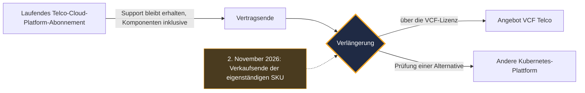
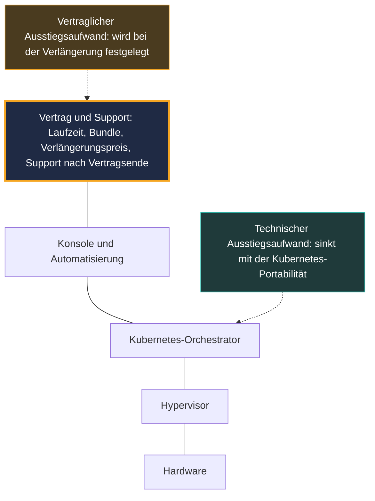

## Eine Zeile im Katalog und ein ganzes Kräfteverhältnis

Am 2. November 2026 ist ein Produkt aus dem Katalog von Broadcom verschwunden. Keine kritische Sicherheitslücke, kein weltweiter Ausfall, keine große Bühnenshow. Nur ein Angebot, das nicht mehr verkauft wird: die eigenständige Lizenz für VMware Telco Cloud Platform, das Software-Fundament, auf dem Mobilfunkbetreiber einen Teil ihres 4G- und 5G-Kernnetzes betreiben.

Für die betroffenen Kunden ändert sich morgen früh nichts. Laufende Abonnements bleiben bis zu ihrem Ablauf unterstützt, und Broadcom betont, dass keine sofortige Maßnahme erforderlich ist. Bei der Verlängerung entscheidet sich alles: Dann führt der Weg über VMware Cloud Foundation (VCF), die integrierte Suite des Herstellers, angeboten in einem neuen Paket namens VCF Telco.

Man könnte die Sache unter „Anpassung des Packagings“ abheften. Das wäre ein Fehler. Seit VMware zu Broadcom gehört, haben AT&T und T-Mobile US ihre Streitigkeiten mit dem Hersteller vor Gericht getragen. Dabei ging es um unbefristete Lizenzen, nicht um dieses Produkt. Der Reibungspunkt war aber nie technischer Natur: Es ging um den Support, seine Dauer, seinen Preis.

Meine Lesart: Der VMware-Lock-in hat die Adresse gewechselt. Er sitzt nicht mehr nur im Hypervisor, er sitzt im Vertrag. Die nützliche Frage für einen CTO lautet nicht mehr „Welche Plattform?“, sondern „Welche Klauseln unterschreiben wir vor dem nächsten Stichtag?“.

## Was am 2. November endet, was weiterläuft

Beginnen wir mit den Fakten, denn das Gerücht ist immer schneller als der Katalog.

In einem [Blogbeitrag vom 2. November 2026](https://blogs.vmware.com/cloud-foundation/2026/11/02/introducing-vmware-cloud-foundation-telco/), verfasst von Anupama Mahabhashyam und Odded Solomon, kündigt Broadcom das Ende der Verfügbarkeit (EOA, für *End of Availability*) der eigenständigen Lizenzreferenzen von Telco Cloud Platform an, im Katalogjargon die SKUs. Die Plattform wird künftig über die VCF-Lizenz und -Referenz geliefert. Broadcom fügt hinzu, dass sie nicht mehr als eigenständiges Produkt weiterentwickelt wird.

Was weiterläuft, zählt ebenso. Bestehende Abonnements bleiben während des Übergangs unterstützt, einschließlich der Komponenten. Bei der Verlängerung begleitet ein Broadcom-Vertreter den Kunden dabei, seinen Bedarf auf VCF abzubilden. [SDxCentral](https://www.sdxcentral.com/news/broadcom-kills-vmware-telco-cloud-platform-standalone-license-option/), das am 3. November über die Ankündigung berichtet hat, beschreibt denselben Mechanismus: Support bleibt unter den ursprünglichen Verträgen erhalten, der Wechsel zum neuen Angebot erfolgt am Ende der Laufzeit. Der Artikel nennt keinen Preis.

Klartext: Broadcom schließt die eigenständige Option, es dreht nicht den Strom ab. Solange Ihr Vertrag läuft, lebt Ihre Plattform. Der Tag der Verlängerung wird zum Moment der Wahrheit.

*Der Lebenszyklus eines Abonnements nach der Ankündigung: Bis zum Vertragsende ändert sich nichts, bei der Verlängerung wird alles entschieden.*

Die Entwicklung kommt nicht aus dem Nichts. Schon im März 2025 beschrieb das Analystenhaus [Omdia](https://omdia.tech.informa.com/om128647/vmware-by-broadcom-moves-to-horizontal-cloud-approach-for-telcos-spanning-it-and-network-functions) einen Broadcom, der seinen Weg zum Markt vereinfacht, indem er VCF und Telco Cloud Automation, sein Orchestrierungswerkzeug für Netzfunktionen, in einem einzigen Bundle unter der Marke Telco Cloud Platform bündelt. Das EOA vom November 2026 setzt diese Linie fort. Weniger Referenzen, größere Pakete, ein einziger Einstiegspunkt.

## VCF Telco: Man mietet nicht mehr den Raum, sondern die ganze Etage

Stellen Sie sich einen Büroeigentümer vor, der keine einzelnen Räume mehr vermietet. Die bestehenden Mieter behalten ihren Mietvertrag bis zum Ablauf. Danach besteht das einzige Angebot im Katalog aus der ganzen Etage: Besprechungsraum, Cafeteria und Sicherheitsdienst inklusive. Die Etage ist vielleicht besser ausgestattet. Vielleicht rechnet sie sich im Betrieb sogar besser. Aber man verhandelt nicht mehr über dasselbe, und die Miete steht nirgends angeschrieben.

So ähnlich sieht die Lage eines Betreibers gegenüber VCF Telco aus. Laut der von Broadcom veröffentlichten Liste, die noch kein Dritter geprüft hat, umfasst das Angebot:

- eine sogenannte *Carrier-Grade*-Zuverlässigkeit: Hochverfügbarkeit, Fehlertoleranz, Sicherung und Wiederherstellung, Notfallwiederherstellungsplan;
- Flottenmanagement mit *Zero-Touch*-Lebenszyklus und gemeinsamer Observability über VCF Operations;
- Private-AI-Dienste (Private AI Services), auch im vollständig vom Internet isolierten Betrieb (*air-gapped*);
- Unterstützung für virtualisierte und containerisierte Netzfunktionen (VNF und CNF) mit Isolation zwischen Kunden (Multi-Tenant);
- NVMe Memory Tiering, das den Arbeitsspeicher auf schnelle Datenträger erweitert, sowie vom Kunden kontrollierte Verschlüsselungsschlüssel;
- eine beanspruchte Ausrichtung an den Rahmenwerken des amerikanischen NIST und am UK Telecommunications Security Act;
- optional die Mikrosegmentierung vDefend.

Ein Punkt verdient besondere Aufmerksamkeit: der Langzeit-Support für Kubernetes (LTS, für *Long-Term Support*). Broadcom kündigt zwei Jahre LTS für jede Minor-Version von Kubernetes an, einen Support, den es als *flexibel* bezeichnet.

Um einzuordnen, was das bedeutet, muss man es mit dem Upstream vergleichen. Das Kubernetes-Projekt unterstützt jede Minor-Version etwa 14 Monate: 12 Monate Standardphase, dann 2 Monate Wartung. Die [offizielle Seite zu den Versionen](https://kubernetes.io/releases/patch-releases/), abgerufen am 4. November 2026, liefert ein Beispiel: Version 1.37 geht am 28. August 2027 in die Wartung und erreicht am 28. Oktober 2027 ihr Lebensende. Vierundzwanzig Monate gegen vierzehn: rund zehn Monate zusätzlicher Aufschub.

Für einen Betreiber sind zehn Monate viel. Ein Mobilfunk-Kernnetz auf eine neue Version zu heben bedeutet ein Wartungsfenster, Regressionstests mit jedem Hersteller von Netzfunktionen, ein direktes Risiko für den Dienst. Weniger erzwungene Versionssprünge heißen weniger Gelegenheiten, die Produktion zu beschädigen.

Zwei Vorbehalte gibt es allerdings. Erstens ist es eine Zusage des Herstellers, nicht der Community: Jenseits des Upstream-Fensters stammen die Korrekturen von Broadcom, in dessen Tempo. Zweitens nennt der Beitrag die Bedingungen nicht. Nur Sicherheitspatches oder auch funktionale Korrekturen? Welche Versionen genau? Was verbirgt sich hinter dem Adjektiv *flexibel*? Solange diese Antworten nicht in einem Vertrag stehen, bleibt dieses LTS ein Versprechen und keine Garantie.

*Je integrierter der Stack, desto mehr Gewicht hat der Vertrag, der ihn umschließt, in der Entscheidung.*

## Der Preis, die leere Zelle im Dossier

Jetzt wird es unbequem: Öffentlich weiß niemand, was VCF Telco kostet. Weder der Beitrag von Broadcom noch die Fachpresse veröffentlichen eine Preisliste. Keine prozentuale Erhöhung lässt sich dieser konkreten Änderung zuordnen.

Was wir haben, sind Warnmarken. Alle datiert, alle mit Vorsicht zu genießen.

Auf Analystenseite schätzte [ABI Research](https://www.abiresearch.com/market-research/insight/7785446-vmware-exodus-has-begun-creating-major-opp) im Dezember 2024, dass ein Betreiber, der nur die Container-Schicht von Telco Cloud lizenziert (das CaaS, für *containers-as-a-service*), beim Wechsel zu VCF mit dem 10- bis 100-fachen an Lizenzkosten rechnen müsste. Der Geltungsbereich ist eng. Eine fast zwei Jahre alte Analystenschätzung, allein für den Fall der CaaS-Lizenz, nie an VCF Telco gemessen. Das ist keine Rechnungsprognose, sondern die Größenordnung dessen, was eine Änderung des Lizenzumfangs kosten kann, wenn man nur einen Baustein genutzt hat.

ABI fügte hinzu, dass die meisten Telekommunikationsbetreiber nicht zu den Top 2.000 der Broadcom-Kunden gehören und dass der Hersteller seine Software-Entwicklung für Telko langfristig zurückfahren könnte. Das ist eine Hypothese eines Analysten. Kurzfristig sprechen die Fakten eher für das Gegenteil: eine neue Hauptversion 2026, dann ein eigenes Angebot im November.

Auf Herstellerseite klingt es entgegengesetzt. Auf dem Mobile World Congress 2026 stellte Broadcom Telco Cloud Platform 9 vor, aufgebaut auf VCF 9. Die von [SDxCentral](https://www.sdxcentral.com/news/broadcom-bets-vmware-telco-clouds-future-on-ai-and-sovereign-services/) am 2. März 2026 berichteten Zahlen sind schmeichelhaft: 40 % kumulierte Einsparungen über fünf Jahre bei den Gesamtbetriebskosten (TCO) gegenüber abgeschotteten Architekturen und 38 % niedrigere Kosten für Arbeitsspeicher, Server und Storage. Das sind Behauptungen des Herstellers, nie unabhängig überprüft.

Zwischen einem Analysten, der einen Faktor 10 bis 100 nennt, und einem Hersteller, der 40 % Einsparung verspricht, hängt die Wahrheit an einer einzigen Variable: Ihrem aktuellen Vertrag. Wenn Sie bereits den Großteil des Stacks genutzt haben, ändert das Bundle womöglich nichts oder vereinfacht sogar. Wenn Sie nur einen Baustein genutzt haben, kann die Rechnung ganz anders aussehen. Diese Rechnung wird Ihnen niemand abnehmen, schon gar nicht der Vertreter, der Sie bei der Verlängerung begleitet.

## Die Präzedenzfälle: ein Bündel von Signalen, kein Beweis

Bevor Sie unterschreiben, schauen Sie, wie die Verhandlungen der anderen verlaufen sind. Mit einer strengen Regel: Keiner der folgenden Fälle ist eine Folge der Ankündigung vom 2. November. Es sind Präzedenzfälle für vertragliches Verhalten, nicht mehr.

**Boost Mobile, der frühere Vorzeigekunde.** SDxCentral erinnerte im März 2026 daran, dass Boost der Leitkunde von Telco Cloud Platform gewesen war. Der Betreiber hat seine VMware-CaaS-Schicht durch Wind River Studio Operator ersetzt. Laut [SDxCentral](https://www.sdxcentral.com/news/broadcom-kills-vmware-telco-cloud-platform-standalone-license-option/) (3. November 2026) begründete sein CTO den Abschied mit Preispraktiken, die er für missbräuchlich hielt. ABI Research berichtet eine andere Version: Der CTO von EchoStar führt die Entscheidung auf den technischen Wert von Wind River zurück und erwähnt zugleich ein Gerücht über ein Preismotiv. Zwei Präzisierungen zählen. Der Austausch betrifft nur die CaaS-Schicht. Und er wurde im Dezember 2024 angekündigt: Es ist keine Reaktion auf das EOA von 2026.

**AT&T, die Dimension des Problems.** In seinen Schriftsätzen und Aussagen vor dem Supreme Court des Bundesstaats New York im Jahr 2024 nannte AT&T rund 8.600 Server und 75.000 virtuelle VMware-Maschinen sowie eine vorgeschlagene jährliche Erhöhung von 1.050 %, also mehr als das Zehnfache der Rechnung, laut [CIO Dive](https://www.ciodive.com/news/att-broadcom-vmware-price-hikes-court-battle/728603/). Das sind Behauptungen einer Partei. Broadcom bestritt sie und warf AT&T laut [TechTarget](https://www.techtarget.com/it-infrastructure/news/366612033/Broadcom-ATT-is-trying-to-rewind-the-clock-on-VMware) vor, zu einem aufgegebenen Lizenzmodell zurückkehren zu wollen. Der Streit drehte sich um den Support unbefristeter Lizenzen. Er wurde vertraulich beigelegt, laut The Register und SDxCentral im Juli 2026.

**T-Mobile US, die Support-Saga.** Eine Vereinbarung vom August 2023 sah unbefristete Lizenzen, zwei Jahre Support und ein optionales Jahr vor. 2024 ließ Broadcom wissen, dass es nicht verlängern werde. Ein Richter ordnete die Fortführung des Supports über August 2025 hinaus an, wobei T-Mobile 5,28 Mio. USD zahlte und 500.000 USD als Sicherheit hinterlegte. Laut den Prozessunterlagen, über die [SDxCentral](https://www.sdxcentral.com/news/t-mobile-us-also-has-broadcom-beef-over-vmware-changes-report/) und [The Register](https://www.theregister.com/a/5264750) am 1. Juli 2026 berichteten, verzeichnet die Eingabe von Broadcom mehr als 303.000 CPU-Kerne. T-Mobile bot 20 Mio. USD für zwei Jahre Support; Broadcom nannte anschließend 24 Mio. USD für sechs Produkte. Laut The Register erklärte der VP Technology des Betreibers, er wolle seinen Ausstieg aus VMware in einem maßvolleren Tempo abschließen. Das Medium sieht darin eine erkennbare, aber nicht bestätigte Migration. Die einstweilige Verfügung lief am 3. August 2026 ab; ein öffentliches Ergebnis habe ich seither nicht gefunden. Auch hier: unbefristete Lizenzen, nicht Telco Cloud Platform.

**DoCoMo und Telia, die andere Seite.** Nicht alle gehen. Laut [SDxCentral](https://www.sdxcentral.com/news/broadcom-and-ntt-docomo-sign-decade-long-vmware-deal/) (20. Oktober 2026) hat NTT DoCoMo mit Broadcom eine zehnjährige Vereinbarung über Lizenzen, Wartung und technischen Support für VMware-Produkte, darunter VCF, unterzeichnet. Für Broadcom ist es das erste Mal in Japan, ein Betrag wurde nicht veröffentlicht. Achtung beim Geltungsbereich: VCF und VMware-Produkte allgemein, nicht Telco Cloud Platform. Im November 2024 erweiterte Telia seinerseits die Partnerschaft zu Telco Cloud Platform und VCF, durch eine mehrjährige Vereinbarung ohne genannte Laufzeit ([Capacity](http://capacityglobal.com/article/telia-modernises-network-infrastructure-in-expanded-broadcom-vmware-deal)).

Aneinandergelegt ergeben diese Fälle ein Muster. Der Reibungspunkt ist nie die Qualität des Hypervisors. Es sind die Dauer des Supports, sein Preis, der Umfang dessen, was man kauft, und was am Tag geschieht, an dem der Vertrag endet. Wer bleibt, unterschreibt lang. Wer geht, kämpft um Zeit.

## Der Lock-in hat die Adresse gewechselt

*Redaktionelle Einordnung, außerhalb des Umfangs der Quellen.*

Lange Zeit war der VMware-Lock-in technischer Natur. Er lag in den Formaten der virtuellen Maschinen, in den Administrationswerkzeugen, im Know-how der Teams, im Ökosystem zertifizierter Hersteller. Auszusteigen hieß, alles neu zu schreiben, alles neu zu zertifizieren, alles neu zu lernen.

Dieser Lock-in erodiert. Der Umstieg auf containerisierte Netzfunktionen hat einen guten Teil der Portabilität zu Kubernetes verlagert. Auf Herstellerseite ist Multi-Plattform übrigens nicht neu: Schon 2022 validierte Ericsson sein Cloud-native-Kernnetz im April auf VMware, im Juni dann auf Red Hat OpenShift ([SDxCentral](https://www.sdxcentral.com/news/ericsson-cloud-native-5g-core-rides-red-hat-openshift/)). Nokia zeigt laut SDxCentral im März 2026 dieselbe Ambivalenz. Der Ausrüster steuerte ein unterstützendes Zitat zum Launch von Telco Cloud Platform 9 bei, verlagerte aber seine wichtigste Cloud-Entwicklung zu Red Hat und validiert seine Netzfunktionen weiterhin auf VMware.

Was nicht erodiert, ist der vertragliche Lock-in: die Laufzeit, die Regel zur Zählung der Kerne, der Umfang des Bundles, der Verlängerungspreis, die Dauer des Supports nach Vertragsende. Das Schloss ist geschmeidiger geworden. Den Preis des Ausstiegs legt nun der Mietvertrag fest.

*Wo der Lock-in sitzt: Die Kubernetes-Portabilität erleichtert den technischen Ausstieg, der Vertrag bündelt nun die Ausstiegskosten.*

Die Folge ist kontraintuitiv. Je offener Ihre Architektur wird, desto mehr wird der Vertrag zum eigentlichen Hebel, für Sie wie für den Hersteller. Die Ankündigung vom 2. November ändert dieses Kräfteverhältnis in der Sache nicht. Sie macht es nur sichtbar, indem sie die gesamte Entscheidung auf ein einziges Datum konzentriert: das der Verlängerung.

## Alternativen gibt es, ohne Märchen

Zu gehen ist nie gratis, und nicht alle Alternativen sind gleich ausgereift. Zwei konkrete Anhaltspunkte.

Der erste kommt von HPE. Am 2. November 2026, dem Tag des EOA selbst, berichtete [SDxCentral](https://www.sdxcentral.com/news/hpe-releases-ericsson-5g-core-model-for-telecom-evolution/) über die Veröffentlichung eines validierten Deployment-Modells des Dual-Mode-5G-Kernnetzes von Ericsson (das einen 4G-EPC-Core und einen 5G-Core kombiniert und sowohl 4G als auch 5G bedient, in NSA und SA) auf Red Hat OpenShift. Das Ganze beruht auf ProLiant-Gen12-Servern, mit Juniper Apstra auf der Netzwerkseite, und wird Teil des Katalogs HPE Telco Cloud Suite. Die zeitliche Koinzidenz ist verlockend. Sie beweist nichts: Der Artikel nennt keinen Betreiber, sagt nicht, ob das Modell in Produktion läuft, und erwähnt weder VMware noch Broadcom. Es ist eine Alternative, die existiert und paketiert wird, kein Beweis für einen Exodus.

Der zweite ist der Weg von Boost: ein auf Telko spezialisiertes CaaS, Wind River Studio Operator, anstelle der Container-Schicht von VMware. Er zeigt, dass ein Austausch Schicht für Schicht erfolgen kann statt im Big Bang.

Drei Wege zeichnen sich also ab:

- **der integrierte Stack VCF Telco**, mit seinem angekündigten 24-Monats-LTS und einem einzigen Ansprechpartner;
- **eine offene Kubernetes-Plattform** vom Typ OpenShift, nach dem von HPE und Ericsson validierten Modell;
- **ein spezialisiertes CaaS**, nach Art von Wind River bei Boost.

*Drei verschiedene Fundamente für dieselbe Cloud-Schicht: Die Wahl entscheidet sich an den Ausstiegskosten, nicht am Einstiegspreis.*

Das Auswahlkriterium sollte nicht der Listenpreis sein. Es sind die gesamten Ausstiegskosten, technisch und vertraglich, über die Lebensdauer der Plattform. Ein günstigeres Angebot, das Sie langfristig ohne Verlängerungsdeckel bindet, kann am Ende mehr kosten als ein teureres, das Sie sauber verlassen können.

## Sechs Klauseln, die Sie vor der Verlängerung prüfen sollten

*Redaktionelle Einordnung, außerhalb des Umfangs der Quellen.* Hier ist die Arbeitsliste, die ich vor jeder Unterschrift auf den Tisch legen würde, ob der Stack nun VCF Telco heißt oder anders.

1. **Der genaue Umfang des Bundles.** Was kauft man tatsächlich, und kann man entbündeln, was man nicht nutzt? Genau hier entscheidet sich der Abstand zwischen dem Szenario von ABI und dem des Herstellers.
2. **Die Obergrenze für Preiserhöhungen bei der Verlängerung.** Ein maximaler Prozentsatz, schwarz auf weiß, für die nächste und die folgende Laufzeit. Ohne Deckel beginnt jeder Stichtag bei null.
3. **Der Support nach Vertragsende.** Dauer, Preis, Recht auf Verlängerung. Genau dieser Punkt ist bei AT&T und T-Mobile vor Gericht gelandet.
4. **Die schriftliche Zusage zum LTS.** Abgedeckte Versionen, Art der Korrekturen, Veröffentlichungsfristen, vertragliches Service-Level (SLA). Ein Blog-Versprechen ist keine Klausel.
5. **Die Reversibilität.** Migrationsunterstützung, Export der Konfigurationen, Überlappungszeitraum zwischen alter und neuer Plattform.
6. **Audit und Zählung.** Wer zählt die Kerne, nach welcher Regel, wie oft. Wenn ein Gerichtsverfahren einen Bestand von mehr als 303.000 Kernen beschreibt, ist die Zählregel alles andere als ein Detail.

*Vierundzwanzig Monate Support angekündigt: Die Dauer ist nur so viel wert wie die im Vertrag festgehaltenen Bedingungen.*

Und was ist mit denen, die kein 5G-Kernnetz betreiben? Telco Cloud Platform zielt auf Telekommunikationsbetreiber. Betreiber von Managed Services, WLAN oder Unternehmensnetzen sind nicht die Zielgruppe des Produkts. Aber der Mechanismus findet sich überall dort, wo man einen Hypervisor, einen Kubernetes-Orchestrator und Herstellersupport aufeinanderstapelt. Die Fragen sind dieselben. Wo sitzt der Lock-in in unserem Stack: Hypervisor, Orchestrator, Konsole, Support? Ist der technische Ausstieg einfacher als der vertragliche? Wenn ja, muss man zuerst am Vertrag arbeiten, nicht an der Architektur.

## Meine Position: den Ausstieg beziffern, bevor man den Einstieg beziffert

Die Ankündigung vom 2. November ist weder ein Gewaltakt noch ein Nicht-Ereignis. Sie ist die logische Fortsetzung einer Konsolidierung, die schon 2025 sichtbar war, und sie ändert für einen Kunden nichts, solange sein Vertrag läuft.

Aber sie macht die Verlängerung zum einzigen Moment, in dem der Betreiber wirklich das Heft in der Hand hat. Vor diesem Datum kann er beziffern, vergleichen, eine Alternative im Labor testen, Klauseln verhandeln. Danach hat er für eine Laufzeit unterschrieben.

Mein Rat passt in einen Satz: Beziffern Sie Ihre Ausstiegskosten, bevor Sie Ihre Einstiegskosten beziffern. Das ist kein Aufruf, VMware zu verlassen. DoCoMo hat für zehn Jahre unterschrieben, Telia hat seine Vereinbarung erweitert: Bleiben kann eine ausgezeichnete Wahl sein, sofern es eine verhandelte Wahl ist. Das wahre Risiko ist, ohne glaubwürdige Alternative zur Verlängerung zu erscheinen, ohne Klauselraster, mit einem LTS, dessen Bedingungen niemand gelesen hat.

Kubernetes hat seinen Teil der Arbeit getan: Netzfunktionen waren nie so portabel. Der Rest entscheidet sich in einem Dokument, das Ingenieure selten lesen. Es ist Zeit, dass sie es lesen.

_Persönliche Ansichten, keine Position von Wifirst._

## Quellen

1. Broadcom / VMware (Anupama Mahabhashyam, Odded Solomon), „Introducing VMware Cloud Foundation Telco“, 2026-11-02 — https://blogs.vmware.com/cloud-foundation/2026/11/02/introducing-vmware-cloud-foundation-telco/
2. SDxCentral (Dan Meyer), Ende der eigenständigen Lizenz für VMware Telco Cloud Platform, 2026-11-03 — https://www.sdxcentral.com/news/broadcom-kills-vmware-telco-cloud-platform-standalone-license-option/
3. SDxCentral (Wodecki), Broadcom setzt die Zukunft der VMware-Telko-Clouds auf KI und souveräne Dienste, 2026-03-02 — https://www.sdxcentral.com/news/broadcom-bets-vmware-telco-clouds-future-on-ai-and-sovereign-services/
4. ABI Research (Mavrakis), „VMware exodus has begun“, 2024-12-23 — https://www.abiresearch.com/market-research/insight/7785446-vmware-exodus-has-begun-creating-major-opp
5. Omdia (Inderpreet Kaur), horizontaler Cloud-Ansatz von VMware by Broadcom für Telekommunikationsbetreiber, März 2025 — https://omdia.tech.informa.com/om128647/vmware-by-broadcom-moves-to-horizontal-cloud-approach-for-telcos-spanning-it-and-network-functions
6. SDxCentral (Jack Lee), Streit T-Mobile US / Broadcom, 2026-07-01 — https://www.sdxcentral.com/news/t-mobile-us-also-has-broadcom-beef-over-vmware-changes-report/
7. The Register (Sharwood), T-Mobile gegen Broadcom, 2026-07-01 — https://www.theregister.com/a/5264750
8. CIO Dive (Ashare), AT&T gegen Broadcom wegen der VMware-Preiserhöhungen, 2024-10-01 — https://www.ciodive.com/news/att-broadcom-vmware-price-hikes-court-battle/728603/
9. TechTarget (Laskowski), die Antwort von Broadcom an AT&T, 2024-09-25 — https://www.techtarget.com/it-infrastructure/news/366612033/Broadcom-ATT-is-trying-to-rewind-the-clock-on-VMware
10. SDxCentral (Jack Lee), zehnjährige Vereinbarung Broadcom / NTT DoCoMo, 2026-10-20 — https://www.sdxcentral.com/news/broadcom-and-ntt-docomo-sign-decade-long-vmware-deal/
11. SDxCentral (Jack Lee), HPE veröffentlicht ein Modell für das Ericsson-5G-Kernnetz, 2026-11-02 — https://www.sdxcentral.com/news/hpe-releases-ericsson-5g-core-model-for-telecom-evolution/
12. Kubernetes.io, Patch Releases (Seite abgerufen am 2026-11-04) — https://kubernetes.io/releases/patch-releases/
13. Capacity, Telia erweitert seine Vereinbarung mit Broadcom VMware, 2024-11-06 — http://capacityglobal.com/article/telia-modernises-network-infrastructure-in-expanded-broadcom-vmware-deal
14. SDxCentral, das Cloud-native 5G-Kernnetz von Ericsson auf Red Hat OpenShift, 2022-06-23 — https://www.sdxcentral.com/news/ericsson-cloud-native-5g-core-rides-red-hat-openshift/
