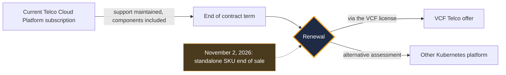
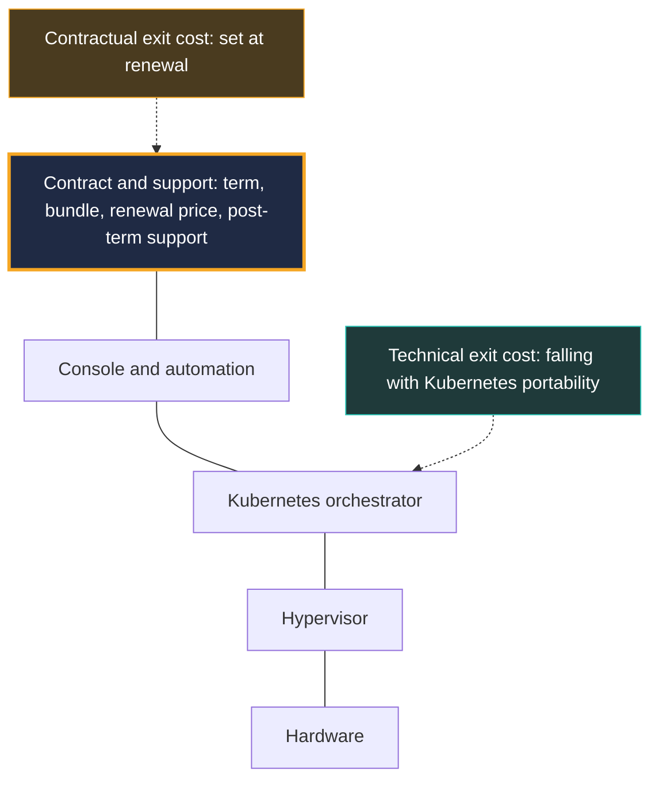

## One catalog line, and a whole balance of power

On November 2, 2026, a SKU left Broadcom's catalog. No critical vulnerability, no global outage, no keynote on a big stage. Just an offer that will no longer be sold: the standalone license for VMware Telco Cloud Platform, the software foundation on which mobile operators run part of their 4G and 5G core networks.

For the customers concerned, nothing changes tomorrow morning. Existing subscriptions remain supported through their term, and Broadcom states that no immediate action is required. Everything plays out at renewal: the road then goes through VMware Cloud Foundation (VCF), the vendor's integrated suite, delivered in a new offer called VCF Telco.

You could file this under "packaging adjustment." That would miss the point. Since VMware went under the Broadcom flag, AT&T and T-Mobile US have taken their disputes with the vendor to court. Those disputes concerned perpetual licenses, not this product. But their friction point was never technical: it was support, its duration, its price.

My read: the VMware lock-in has changed address. It no longer lives only in the hypervisor, it lives in the contract. The useful question for a CTO is no longer "which platform?" but "which clauses are we signing before the next deadline?"

## What stops on November 2, what carries on

Let's start with the facts, because rumor always travels faster than the catalog.

In a [post published on November 2, 2026](https://blogs.vmware.com/cloud-foundation/2026/11/02/introducing-vmware-cloud-foundation-telco/) and signed by Anupama Mahabhashyam and Odded Solomon, Broadcom announces the end of availability (EOA) of the standalone Telco Cloud Platform license SKUs, as catalog jargon calls them. The platform is now delivered through the VCF license and SKU. Broadcom adds that it is no longer developed as a standalone product.

What carries on matters just as much. Existing subscriptions remain supported, components included, during the transition. At renewal, a Broadcom representative helps the customer align their needs with VCF. [SDxCentral](https://www.sdxcentral.com/news/broadcom-kills-vmware-telco-cloud-platform-standalone-license-option/), which covered the announcement on November 3, describes the same mechanism: support maintained under the original contracts, move to the new offer at the end of the term. The article gives no price.

Plainly put: Broadcom is closing the standalone option, not cutting the power. As long as your contract runs, your platform lives. Renewal day becomes the moment of truth.

*The lifecycle of a subscription after the announcement: nothing changes before the term ends, everything is decided at renewal.*

The move doesn't come out of nowhere. As early as March 2025, the research firm [Omdia](https://omdia.tech.informa.com/om128647/vmware-by-broadcom-moves-to-horizontal-cloud-approach-for-telcos-spanning-it-and-network-functions) described a Broadcom simplifying its go-to-market by combining VCF and Telco Cloud Automation, its network function orchestration tool, into a single bundle sold under the Telco Cloud Platform brand. The November 2026 EOA extends that trajectory. Fewer SKUs, bigger packages, a single front door.

## VCF Telco: you no longer rent the room, you rent the floor

Picture an office landlord who stops renting rooms individually. Existing tenants keep their lease until the term ends. After that, the only offer in the catalog is the entire floor: meeting room, cafeteria and security guard included. The floor may be better equipped. It may even be more cost-effective in use. But you are no longer negotiating the same thing at all, and the rent is posted nowhere.

That is, more or less, an operator's situation facing VCF Telco. According to the list published by Broadcom, which no third party has yet audited, the offer bundles:

- so-called *carrier-grade* reliability: high availability, fault tolerance, backup and restore, disaster recovery;
- fleet management with *zero-touch* lifecycle and shared observability through VCF Operations;
- private AI services (Private AI Services), including fully internet-isolated (*air-gapped*) deployment;
- support for virtualized and containerized network functions (VNF and CNF), with isolation between customers (multi-tenant);
- NVMe memory tiering, which extends RAM onto fast disks, and customer-controlled encryption keys;
- claimed alignment with US NIST frameworks and the UK Telecommunications Security Act;
- optionally, vDefend micro-segmentation.

One point deserves a closer look: long-term support for Kubernetes (LTS). Broadcom announces two years of LTS for each Kubernetes minor version, support it describes as *flexible*.

To gauge what that represents, you have to compare it with upstream. The Kubernetes project supports each minor version for about 14 months: 12 months of standard period, then 2 months of maintenance. The [official releases page](https://kubernetes.io/releases/patch-releases/), checked on November 4, 2026, gives an example: 1.37 enters maintenance on August 28, 2027 and reaches end of life on October 28, 2027. Twenty-four months versus fourteen: about ten extra months of breathing room.

For an operator, ten months is a lot. Upgrading a mobile core network means a maintenance window, regression testing with every network function vendor, and a direct risk to service. Fewer forced upgrades means fewer chances to break production.

Two caveats, however. First, this is a vendor commitment, not a community one: beyond the upstream window, the fixes are produced by Broadcom, at its own pace. Second, the post doesn't detail the conditions. Security patches only, or functional fixes too? Which versions exactly? What does the word *flexible* cover? Until those answers appear in a contract, this LTS remains a promise, not a guarantee.

*The more integrated the stack, the more weight the contract wrapped around it carries in the decision.*

## Price, the empty box in the file

Here is the uncomfortable part: nobody publicly knows what VCF Telco costs. Neither Broadcom's post nor the trade press publishes a price list. No percentage increase can be attributed to this specific change.

What we do have are warning markers. All dated, all to be handled with tongs.

On the analyst side, [ABI Research](https://www.abiresearch.com/market-research/insight/7785446-vmware-exodus-has-begun-creating-major-opp) estimated in December 2024 that an operator licensing only the container layer of Telco Cloud (CaaS, for *containers-as-a-service*) could see its license costs multiplied by 10, or even 100, when moving to VCF. The scope is narrow. An analyst estimate nearly two years old, covering only the CaaS license case, never measured on VCF Telco. It is not a bill forecast: it is the order of magnitude of what a change of scope can cost when you were only using one building block.

ABI added that most telecom operators sit outside Broadcom's top 2,000 customers, and that the vendor could eventually scale back its telecom software development. That is an analyst hypothesis. In the short term, the facts point rather the other way: a new major version in 2026, then a dedicated offer in November.

On the vendor side, the message is the opposite. At Mobile World Congress 2026, Broadcom presented Telco Cloud Platform 9, built on VCF 9. The figures reported by [SDxCentral](https://www.sdxcentral.com/news/broadcom-bets-vmware-telco-clouds-future-on-ai-and-sovereign-services/) on March 2, 2026 are flattering: 40% cumulative savings over five years in total cost of ownership (TCO) compared with siloed architectures, and a 38% reduction in memory, server and storage costs. These are vendor claims, never independently verified.

Between an analyst citing a factor of 10 to 100 and a vendor announcing 40% savings, the truth depends on a single variable: your current contract. If you were already using most of the stack, the bundle may change nothing, or even simplify things. If you were using only one building block, the equation may be entirely different. Nobody will run that calculation for you, least of all the representative who will accompany you at renewal.

## Precedents: a cluster of signals, not proof

Before signing, look at how other people's negotiations played out. With one strict rule: none of the cases that follow is a consequence of the November 2 announcement. They are precedents of contractual behavior, nothing more.

**Boost Mobile, the former showcase customer.** SDxCentral recalled in March 2026 that Boost had been the flagship customer of Telco Cloud Platform. The operator replaced its VMware CaaS layer with Wind River Studio Operator. According to [SDxCentral](https://www.sdxcentral.com/news/broadcom-kills-vmware-telco-cloud-platform-standalone-license-option/) (November 3, 2026), its CTO justified the departure by pricing practices he considered abusive. ABI Research reports a different version: EchoStar's CTO attributes the choice to the technical value of Wind River, while mentioning a rumor of a pricing motive. Two clarifications matter. The replacement covers only the CaaS layer. And it was announced in December 2024: it is not a reaction to the 2026 EOA.

**AT&T, the scale of the problem.** In its filings and testimony before the New York State Supreme Court in 2024, AT&T cited about 8,600 servers and 75,000 VMware virtual machines, and a proposed annual increase of 1,050%, more than ten times the bill, according to [CIO Dive](https://www.ciodive.com/news/att-broadcom-vmware-price-hikes-court-battle/728603/). These are one party's allegations. Broadcom contested them and accused AT&T, according to [TechTarget](https://www.techtarget.com/it-infrastructure/news/366612033/Broadcom-ATT-is-trying-to-rewind-the-clock-on-VMware), of trying to return to a license model that had been abandoned. The dispute concerned support for perpetual licenses. It was settled confidentially, according to The Register and SDxCentral in July 2026.

**T-Mobile US, the support saga.** An August 2023 agreement provided for perpetual licenses, two years of support and an optional year. In 2024, Broadcom let it be known that it would not renew. A judge ordered support to be maintained beyond August 2025, with T-Mobile paying 5.28 M USD and posting a 500,000 USD bond. According to court filings reported on July 1, 2026 by [SDxCentral](https://www.sdxcentral.com/news/t-mobile-us-also-has-broadcom-beef-over-vmware-changes-report/) and [The Register](https://www.theregister.com/a/5264750), Broadcom's filing counts more than 303,000 CPU cores. T-Mobile offered 20 M USD for two years of support; Broadcom then put forward 24 M USD for six products. According to The Register, the operator's technology VP explained that he wanted to complete its transition away from VMware at a more measured pace. The outlet judges this migration to be apparent, without it being confirmed. The injunction expired on August 3, 2026; I have found no public outcome since. Again: perpetual licenses, not Telco Cloud Platform.

**DoCoMo and Telia, the other side.** Not everyone leaves. According to [SDxCentral](https://www.sdxcentral.com/news/broadcom-and-ntt-docomo-sign-decade-long-vmware-deal/) (October 20, 2026), NTT DoCoMo signed a ten-year agreement with Broadcom covering licenses, maintenance and technical support for VMware products, including VCF. It is a first for Broadcom in Japan, and no amount was published. Mind the scope: VCF and VMware products in general, not Telco Cloud Platform. In November 2024, Telia for its part expanded its partnership on Telco Cloud Platform and VCF, through a multi-year agreement with no stated duration ([Capacity](http://capacityglobal.com/article/telia-modernises-network-infrastructure-in-expanded-broadcom-vmware-deal)).

Put end to end, these cases draw a pattern. The friction point is never the quality of the hypervisor. It is the duration of support, its price, the scope of what you buy, and what happens the day the contract reaches its term. Those who stay sign long. Those who leave fight to buy time.

## The lock-in has changed address

*Editorial take, outside the scope of the sources.*

For a long time, the VMware lock-in was technical. It came from virtual machine formats, administration tooling, team skills, the ecosystem of certified vendors. Leaving meant rewriting everything, recertifying everything, relearning everything.

That lock-in is eroding. The shift to containerized network functions has moved a good share of portability to Kubernetes. On the vendor side, multi-platform is not new anyway: as early as 2022, Ericsson validated its cloud-native core network on VMware in April, then on Red Hat OpenShift in June ([SDxCentral](https://www.sdxcentral.com/news/ericsson-cloud-native-5g-core-rides-red-hat-openshift/)). Nokia illustrates the same ambivalence, according to SDxCentral in March 2026. The equipment maker contributed a supporting quote to the Telco Cloud Platform 9 launch, while shifting its main cloud development to Red Hat and continuing to validate its network functions on VMware.

What doesn't erode is the contractual lock-in: the term, the core-counting rule, the scope of the bundle, the renewal price, the duration of support after term. The lock has loosened. Now it's the lease that sets the price of leaving.

*Where the lock-in lives: Kubernetes portability lightens the technical exit, while the contract now concentrates the exit cost.*

The consequence is counterintuitive. The more open your architecture becomes, the more the contract becomes the real point of leverage, for you as much as for the vendor. The November 2 announcement doesn't change this balance of power in substance. It simply makes it visible, by concentrating the whole decision on a single date: renewal.

## Alternatives exist, without the fairy tale

Leaving is never free, and not all alternatives are at the same stage of maturity. Two concrete markers.

The first comes from HPE. On November 2, 2026, the very day of the EOA, [SDxCentral](https://www.sdxcentral.com/news/hpe-releases-ericsson-5g-core-model-for-telecom-evolution/) reported the release of a validated deployment model for Ericsson's dual-mode 5G core (which combines a 4G EPC core and a 5G core, and serves 4G as well as 5G, in NSA and SA) on Red Hat OpenShift. It all runs on ProLiant Gen12 servers, with Juniper Apstra on the network side, and joins the HPE Telco Cloud Suite catalog. The coincidence of dates is tempting. It proves nothing: the article names no operator, doesn't say whether the model runs in production, and mentions neither VMware nor Broadcom. It is an alternative that exists and will be packaged, not proof of an exodus.

The second is the path Boost took: a telecom-specialized CaaS, Wind River Studio Operator, in place of VMware's container layer. It shows that a replacement can be done layer by layer, rather than as a big bang.

Three routes thus emerge:

- **the integrated VCF Telco stack**, with its announced 24-month LTS and a single point of contact;
- **an open Kubernetes platform** of the OpenShift type, on the model validated by HPE and Ericsson;
- **a specialized CaaS**, in the manner of Wind River at Boost.

*Three different foundations for the same cloud layer: the choice is decided on exit cost, not on entry price.*

The selection criterion shouldn't be the sticker price. It is the total exit cost, technical and contractual, over the platform's lifetime. A cheaper offer that ties you in for the long term with no renewal cap may, in the end, cost more than a pricier offer you can leave cleanly.

## Six clauses to reread before renewal

*Editorial take, outside the scope of the sources.* Here is the working list I would put on the table before any signature, whether the stack is called VCF Telco or something else.

1. **The exact scope of the bundle.** What are you actually buying, and can you unbundle what you don't use? This is where the gap between ABI's scenario and the vendor's is decided.
2. **The renewal increase cap.** A maximum percentage written in black and white, for the next term and the one after. Without a cap, every deadline starts from zero.
3. **Post-term support.** Duration, price, right to an extension. This is precisely the point that ended up in front of the judges at AT&T and T-Mobile.
4. **The written LTS commitment.** Covered versions, nature of the fixes, release timelines, contractual service level (SLA). A blog promise is not a clause.
5. **Reversibility.** Migration assistance, configuration export, an overlap period between the old and the new platform.
6. **Audit and counting.** Who counts the cores, under which rule, how often. When a court proceeding describes an estate of more than 303,000 cores, the counting rule is anything but a detail.

*Twenty-four months of support announced: the duration is worth only the conditions written into the contract.*

And for those who don't run a 5G core? Telco Cloud Platform targets telecom operators. Managed services operators, Wi-Fi or enterprise networks, are not the product's target. But the mechanism shows up as soon as you stack a hypervisor, a Kubernetes orchestrator and vendor support. The questions are the same. Where does the lock-in sit in our stack: hypervisor, orchestrator, console, support? Is the technical exit simpler than the contractual exit? If so, it is the contract you must work on first, not the architecture.

## My position: price the exit before the entry

The November 2 announcement is neither a power play nor a non-event. It is the logical continuation of a consolidation already visible in 2025, and it changes nothing for a customer as long as their contract runs.

But it makes renewal the only moment when the operator truly holds the cards. Before that date, they can price, compare, test an alternative in the lab, negotiate clauses. After it, they have signed for a term.

My advice fits in one sentence: price your exit cost before you price your entry cost. This is not a call to leave VMware. DoCoMo signed for ten years, Telia expanded its agreement: staying can be an excellent choice, provided it is a negotiated choice. The real risk is arriving at renewal with no credible alternative, no clause grid, and an LTS whose conditions nobody has read.

Kubernetes has done its part of the work: network functions have never been more portable. The rest is decided in a document engineers rarely read. It is time they read it.

_Personal views, not Wifirst's position._

## Sources

1. Broadcom / VMware (Anupama Mahabhashyam, Odded Solomon), "Introducing VMware Cloud Foundation Telco", 2026-11-02 — https://blogs.vmware.com/cloud-foundation/2026/11/02/introducing-vmware-cloud-foundation-telco/
2. SDxCentral (Dan Meyer), end of the VMware Telco Cloud Platform standalone license, 2026-11-03 — https://www.sdxcentral.com/news/broadcom-kills-vmware-telco-cloud-platform-standalone-license-option/
3. SDxCentral (Wodecki), Broadcom bets the future of VMware telco cloud on AI and sovereign services, 2026-03-02 — https://www.sdxcentral.com/news/broadcom-bets-vmware-telco-clouds-future-on-ai-and-sovereign-services/
4. ABI Research (Mavrakis), "VMware exodus has begun", 2024-12-23 — https://www.abiresearch.com/market-research/insight/7785446-vmware-exodus-has-begun-creating-major-opp
5. Omdia (Inderpreet Kaur), VMware by Broadcom's horizontal cloud approach for telcos, March 2025 — https://omdia.tech.informa.com/om128647/vmware-by-broadcom-moves-to-horizontal-cloud-approach-for-telcos-spanning-it-and-network-functions
6. SDxCentral (Jack Lee), T-Mobile US / Broadcom dispute, 2026-07-01 — https://www.sdxcentral.com/news/t-mobile-us-also-has-broadcom-beef-over-vmware-changes-report/
7. The Register (Sharwood), T-Mobile vs Broadcom, 2026-07-01 — https://www.theregister.com/a/5264750
8. CIO Dive (Ashare), AT&T vs Broadcom over VMware price hikes, 2024-10-01 — https://www.ciodive.com/news/att-broadcom-vmware-price-hikes-court-battle/728603/
9. TechTarget (Laskowski), Broadcom's response to AT&T, 2024-09-25 — https://www.techtarget.com/it-infrastructure/news/366612033/Broadcom-ATT-is-trying-to-rewind-the-clock-on-VMware
10. SDxCentral (Jack Lee), ten-year Broadcom / NTT DoCoMo deal, 2026-10-20 — https://www.sdxcentral.com/news/broadcom-and-ntt-docomo-sign-decade-long-vmware-deal/
11. SDxCentral (Jack Lee), HPE releases an Ericsson 5G core model, 2026-11-02 — https://www.sdxcentral.com/news/hpe-releases-ericsson-5g-core-model-for-telecom-evolution/
12. Kubernetes.io, Patch Releases (page accessed 2026-11-04) — https://kubernetes.io/releases/patch-releases/
13. Capacity, Telia expands its Broadcom VMware deal, 2024-11-06 — http://capacityglobal.com/article/telia-modernises-network-infrastructure-in-expanded-broadcom-vmware-deal
14. SDxCentral, Ericsson's cloud-native 5G core on Red Hat OpenShift, 2022-06-23 — https://www.sdxcentral.com/news/ericsson-cloud-native-5g-core-rides-red-hat-openshift/
