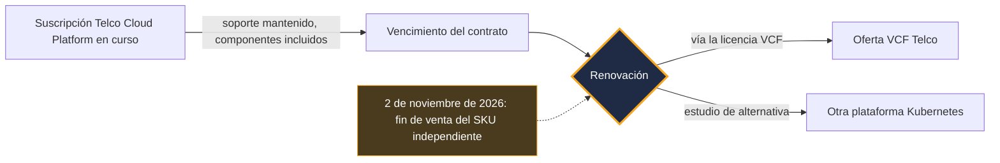
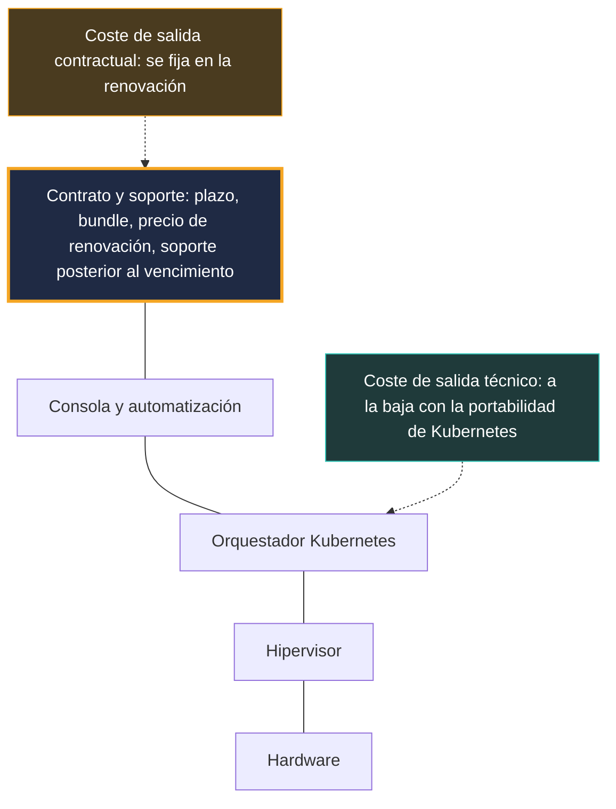

## Una línea de catálogo, y toda una relación de fuerzas

El 2 de noviembre de 2026, una referencia salió del catálogo de Broadcom. Sin vulnerabilidad crítica, sin caída mundial, sin gran misa sobre un escenario. Simplemente una oferta que dejará de venderse: la licencia independiente de VMware Telco Cloud Platform, la base de software sobre la que operadores móviles ejecutan parte del núcleo de su red 4G y 5G.

Para los clientes afectados, nada cambia mañana por la mañana. Las suscripciones en curso siguen con soporte hasta su vencimiento, y Broadcom precisa que no se requiere ninguna acción inmediata. Todo se decide en la renovación: el camino pasa entonces por VMware Cloud Foundation (VCF), la suite integrada del proveedor, que se decanta en una nueva oferta llamada VCF Telco.

Se podría archivar el asunto en el cajón de los «ajustes de empaquetado». Sería no entender nada. Desde que VMware pasó a manos de Broadcom, AT&T y T-Mobile US han llevado sus diferencias con el proveedor ante los tribunales. Esos litigios se referían a licencias perpetuas, no a este producto. Pero su punto de fricción nunca fue técnico: era el soporte, su duración, su precio.

Mi lectura: el candado de VMware ha cambiado de dirección. Ya no reside solo en el hipervisor, reside en el contrato. La pregunta útil para un CTO ya no es «¿qué plataforma?», sino «¿qué cláusulas firmamos antes del próximo vencimiento?».

## Lo que termina el 2 de noviembre, lo que continúa

Empecemos por los hechos, porque el rumor siempre corre más que el catálogo.

En una [entrada publicada el 2 de noviembre de 2026](https://blogs.vmware.com/cloud-foundation/2026/11/02/introducing-vmware-cloud-foundation-telco/) y firmada por Anupama Mahabhashyam y Odded Solomon, Broadcom anuncia el fin de comercialización (EOA, por *End of Availability*) de las referencias de licencia independientes de Telco Cloud Platform, los SKU en la jerga de los catálogos. La plataforma se entrega ahora a través de la licencia y la referencia VCF. Broadcom añade que ya no se desarrolla como producto independiente.

Lo que continúa cuenta tanto como lo que termina. Las suscripciones existentes mantienen el soporte, componentes incluidos, durante la transición. En la renovación, un representante de Broadcom acompaña al cliente para alinear sus necesidades con VCF. [SDxCentral](https://www.sdxcentral.com/news/broadcom-kills-vmware-telco-cloud-platform-standalone-license-option/), que cubrió el anuncio el 3 de noviembre, describe la misma mecánica: soporte mantenido bajo los contratos originales, paso a la nueva oferta al final del plazo. El artículo no da ningún precio.

En claro: Broadcom cierra la opción independiente, no corta la luz. Mientras su contrato siga vigente, su plataforma sigue viva. El día de la renovación se convierte en el momento de la verdad.

*El ciclo de vida de una suscripción tras el anuncio: nada cambia antes del vencimiento, todo se decide en la renovación.*

El movimiento no surge de la nada. Ya en marzo de 2025, la consultora [Omdia](https://omdia.tech.informa.com/om128647/vmware-by-broadcom-moves-to-horizontal-cloud-approach-for-telcos-spanning-it-and-network-functions) describía a un Broadcom que simplificaba su ruta al mercado agrupando VCF y Telco Cloud Automation, su herramienta de orquestación de funciones de red, en un único bundle vendido bajo la marca Telco Cloud Platform. El EOA de noviembre de 2026 prolonga esa trayectoria. Menos referencias, paquetes más grandes, una sola puerta de entrada.

## VCF Telco: ya no se alquila la sala, se alquila la planta

Imagine un propietario de oficinas que deja de alquilar espacios sueltos. Los inquilinos actuales conservan su contrato hasta el vencimiento. Después, la única oferta del catálogo es la planta entera: sala de reuniones, cafetería y vigilancia incluidas. Quizá la planta esté mejor equipada. Quizá incluso resulte más rentable en el uso. Pero lo que se negocia ya no es en absoluto lo mismo, y el alquiler no figura en ninguna parte.

Esa es, más o menos, la situación de un operador ante VCF Telco. Según la lista publicada por Broadcom, que ningún tercero ha auditado todavía, la oferta agrupa:

- una fiabilidad denominada *carrier-grade*: alta disponibilidad, tolerancia a fallos, copia de seguridad y restauración, plan de recuperación ante desastres;
- una gestión de flota con ciclo de vida *zero-touch* y una observabilidad compartida a través de VCF Operations;
- servicios de IA privada (Private AI Services), incluso en despliegue totalmente aislado de internet (*air-gapped*);
- el soporte de funciones de red virtualizadas y contenerizadas (VNF y CNF), con aislamiento entre clientes (multi-tenant);
- el NVMe memory tiering, que extiende la memoria RAM sobre discos rápidos, y claves de cifrado controladas por el cliente;
- una alineación declarada con los marcos del NIST estadounidense y con el UK Telecommunications Security Act;
- como opción, la microsegmentación vDefend.

Un punto merece que nos detengamos: el soporte a largo plazo de Kubernetes (LTS, por *Long-Term Support*). Broadcom anuncia dos años de LTS para cada versión menor de Kubernetes, un soporte que califica de *flexible*.

Para medir lo que eso representa, hay que compararlo con el upstream. El proyecto Kubernetes da soporte a cada versión menor durante unos 14 meses: 12 meses de período estándar, y luego 2 meses de mantenimiento. La [página oficial de versiones](https://kubernetes.io/releases/patch-releases/), consultada el 4 de noviembre de 2026, ofrece un ejemplo: la 1.37 entra en mantenimiento el 28 de agosto de 2027 y llega al fin de vida el 28 de octubre de 2027. Veinticuatro meses frente a catorce: unos diez meses de margen adicional.

Para un operador, diez meses son mucho. Subir de versión el núcleo de una red móvil implica una ventana de mantenimiento, pruebas de no regresión con cada proveedor de funciones de red, un riesgo directo para el servicio. Menos actualizaciones forzadas son menos ocasiones de romper producción.

Dos reservas, no obstante. Primero, es un compromiso del proveedor, no de la comunidad: más allá de la ventana upstream, los parches los produce Broadcom, a su ritmo. Segundo, la entrada no detalla las condiciones. ¿Solo parches de seguridad, o también funcionales? ¿Qué versiones exactamente? ¿Qué abarca el adjetivo *flexible*? Mientras esas respuestas no figuren en un contrato, este LTS sigue siendo una promesa, no una garantía.

*Cuanto más integrada está la pila, más pesa en la decisión el contrato que la envuelve.*

## El precio, la casilla en blanco del expediente

Va la parte incómoda: nadie sabe públicamente cuánto cuesta VCF Telco. Ni la entrada de Broadcom ni la prensa especializada publican una tarifa. No se puede atribuir ningún porcentaje de subida a este cambio concreto.

Lo que tenemos son umbrales de alerta. Todos con fecha, todos para tomar con pinzas.

Del lado de los analistas, [ABI Research](https://www.abiresearch.com/market-research/insight/7785446-vmware-exodus-has-begun-creating-major-opp) estimaba en diciembre de 2024 que un operador que solo licenciara la capa de contenedores de Telco Cloud (el CaaS, por *containers-as-a-service*) podría ver multiplicados sus costes de licencia por 10, incluso por 100, al pasar a VCF. El perímetro es estrecho. Una estimación de analista de casi dos años de antigüedad, sobre el único caso de la licencia CaaS, nunca medida sobre VCF Telco. No es una previsión de factura: es el orden de magnitud de lo que puede costar un cambio de perímetro cuando solo se utilizaba una pieza.

ABI añadía que la mayoría de los operadores de telecomunicaciones quedan fuera del top 2.000 de clientes de Broadcom, y que el proveedor podría a la larga reducir su desarrollo de software para telecomunicaciones. Es una hipótesis de analista. A corto plazo, los hechos dicen más bien lo contrario: una nueva versión mayor en 2026 y, después, una oferta dedicada en noviembre.

Del lado del proveedor, el discurso es el opuesto. En el Mobile World Congress 2026, Broadcom presentó Telco Cloud Platform 9, construida sobre VCF 9. Las cifras que recogió [SDxCentral](https://www.sdxcentral.com/news/broadcom-bets-vmware-telco-clouds-future-on-ai-and-sovereign-services/) el 2 de marzo de 2026 son halagüeñas: un 40 % de ahorro acumulado a cinco años en coste total de propiedad (TCO) frente a arquitecturas compartimentadas, y un 38 % de reducción de los costes de memoria, servidores y almacenamiento. Son afirmaciones del proveedor, nunca verificadas de forma independiente.

Entre un analista que habla de un factor de 10 a 100 y un proveedor que anuncia un 40 % de ahorro, la verdad depende de una sola variable: su contrato actual. Si ya utilizaba la mayor parte de la pila, el bundle puede no cambiar nada, o incluso simplificar. Si solo utilizaba una pieza, la ecuación puede ser muy distinta. Nadie hará ese cálculo por usted, y menos que nadie el representante que lo acompañará en la renovación.

## Los precedentes: un haz de señales, no una prueba

Antes de firmar, mire cómo transcurrieron las negociaciones de los demás. Con una regla estricta: ninguno de los casos que siguen es consecuencia del anuncio del 2 de noviembre. Son precedentes de comportamiento contractual, nada más.

**Boost Mobile, el ex cliente escaparate.** SDxCentral recordaba en marzo de 2026 que Boost había sido el cliente estrella de Telco Cloud Platform. El operador sustituyó su capa CaaS de VMware por Wind River Studio Operator. Según [SDxCentral](https://www.sdxcentral.com/news/broadcom-kills-vmware-telco-cloud-platform-standalone-license-option/) (3 de noviembre de 2026), su CTO justificó esa salida por prácticas de precios que consideraba abusivas. ABI Research recoge otra versión: el CTO de EchoStar atribuye la decisión al valor técnico de Wind River, aunque menciona un rumor de motivo tarifario. Dos precisiones importan. La sustitución afecta solo a la capa CaaS. Y se anunció en diciembre de 2024: no es una reacción al EOA de 2026.

**AT&T, la escala del problema.** En sus escritos y testimonios ante el Tribunal Supremo del Estado de Nueva York en 2024, AT&T mencionaba unos 8.600 servidores y 75.000 máquinas virtuales VMware, y una subida anual propuesta del 1.050 %, es decir, más de diez veces la factura, según [CIO Dive](https://www.ciodive.com/news/att-broadcom-vmware-price-hikes-court-battle/728603/). Son alegaciones de una parte. Broadcom las impugnaba y reprochaba a AT&T, según [TechTarget](https://www.techtarget.com/it-infrastructure/news/366612033/Broadcom-ATT-is-trying-to-rewind-the-clock-on-VMware), querer volver a un modelo de licencias abandonado. El litigio versaba sobre el soporte de licencias perpetuas. Se resolvió de forma confidencial, según The Register y SDxCentral en julio de 2026.

**T-Mobile US, el folletín del soporte.** Un acuerdo de agosto de 2023 preveía licencias perpetuas, dos años de soporte y un año opcional. En 2024, Broadcom hizo saber que no renovaría. Un juez ordenó mantener el soporte más allá de agosto de 2025, con T-Mobile abonando 5,28 M USD y depositando 500.000 USD de garantía. Según los documentos procesales recogidos el 1 de julio de 2026 por [SDxCentral](https://www.sdxcentral.com/news/t-mobile-us-also-has-broadcom-beef-over-vmware-changes-report/) y [The Register](https://www.theregister.com/a/5264750), el escrito de Broadcom contabiliza más de 303.000 núcleos de CPU. T-Mobile proponía 20 M USD por dos años de soporte; Broadcom planteó después 24 M USD por seis productos. Según The Register, el VP de tecnología del operador explicaba que quería completar su transición fuera de VMware a un ritmo más pausado. El medio considera aparente esa migración, sin que esté confirmada. La medida cautelar expiraba el 3 de agosto de 2026; no he encontrado desenlace público desde entonces. Una vez más: licencias perpetuas, no Telco Cloud Platform.

**DoCoMo y Telia, la otra cara.** No todo el mundo se va. Según [SDxCentral](https://www.sdxcentral.com/news/broadcom-and-ntt-docomo-sign-decade-long-vmware-deal/) (20 de octubre de 2026), NTT DoCoMo firmó con Broadcom un acuerdo de diez años que cubre licencias, mantenimiento y asistencia técnica para productos VMware, entre ellos VCF. Es una primicia para Broadcom en Japón, y no se ha publicado ningún importe. Cuidado con el perímetro: VCF y productos VMware en general, no Telco Cloud Platform. En noviembre de 2024, Telia ampliaba por su parte su asociación en Telco Cloud Platform y VCF, mediante un acuerdo plurianual sin duración precisada ([Capacity](http://capacityglobal.com/article/telia-modernises-network-infrastructure-in-expanded-broadcom-vmware-deal)).

Puestos uno tras otro, estos casos dibujan un patrón. El punto de fricción nunca es la calidad del hipervisor. Es la duración del soporte, su precio, el perímetro de lo que se compra y lo que ocurre el día en que el contrato vence. Quienes se quedan firman a largo plazo. Quienes se van pelean por ganar tiempo.

## El candado ha cambiado de dirección

*Lectura editorial, fuera del perímetro de las fuentes.*

Durante mucho tiempo, el candado de VMware fue técnico. Dependía de los formatos de máquinas virtuales, de las herramientas de administración, de las competencias de los equipos, del ecosistema de proveedores certificados. Salir era reescribirlo todo, recertificarlo todo, reaprenderlo todo.

Ese candado se está erosionando. El paso a las funciones de red contenerizadas ha trasladado buena parte de la portabilidad a Kubernetes. Del lado de los proveedores, lo multiplataforma tampoco es nuevo: ya en 2022, Ericsson validaba su núcleo de red cloud-native sobre VMware en abril y después sobre Red Hat OpenShift en junio ([SDxCentral](https://www.sdxcentral.com/news/ericsson-cloud-native-5g-core-rides-red-hat-openshift/)). Nokia ilustra la misma ambivalencia, según SDxCentral en marzo de 2026. El fabricante aportó una cita de apoyo en el lanzamiento de Telco Cloud Platform 9, a la vez que desplazaba su desarrollo cloud principal hacia Red Hat y seguía validando sus funciones de red sobre VMware.

Lo que no se erosiona es el candado contractual: el plazo, la regla de recuento de núcleos, el perímetro del bundle, el precio de renovación, la duración del soporte tras el vencimiento. La cerradura se ha aflojado. Ahora es el contrato de alquiler el que fija el precio de la salida.

*Dónde reside el candado: la portabilidad de Kubernetes alivia la salida técnica, el contrato concentra ahora el coste de salida.*

La consecuencia es contraintuitiva. Cuanto más se abre su arquitectura, más se convierte el contrato en la verdadera palanca, tanto para usted como para el proveedor. El anuncio del 2 de noviembre no cambia en el fondo esta relación de fuerzas. Simplemente la hace visible, concentrando toda la decisión en una sola fecha: la de la renovación.

## Las alternativas existen, sin cuentos de hadas

Irse nunca es gratis, y no todas las alternativas están en el mismo grado de madurez. Dos referencias concretas.

La primera viene de HPE. El 2 de noviembre de 2026, el mismo día del EOA, [SDxCentral](https://www.sdxcentral.com/news/hpe-releases-ericsson-5g-core-model-for-telecom-evolution/) informaba de la publicación de un modelo de despliegue validado del núcleo 5G dual-mode de Ericsson (que combina un núcleo 4G EPC y un núcleo 5G, y sirve tanto 4G como 5G, en NSA y en SA) sobre Red Hat OpenShift. Todo ello descansa sobre servidores ProLiant Gen12, con Juniper Apstra del lado de la red, y entra en el catálogo HPE Telco Cloud Suite. La coincidencia de fechas es tentadora. No prueba nada: el artículo no cita a ningún operador, no dice si el modelo funciona en producción y no menciona ni a VMware ni a Broadcom. Es una alternativa que existe y que se empaquetará, no la prueba de un éxodo.

La segunda es el camino que tomó Boost: un CaaS especializado en telecomunicaciones, Wind River Studio Operator, en lugar de la capa de contenedores de VMware. Muestra que una sustitución puede hacerse capa por capa, en vez de en big-bang.

Se dibujan, pues, tres vías:

- **la pila integrada VCF Telco**, con su LTS de 24 meses anunciado y un interlocutor único;
- **una plataforma Kubernetes abierta** de tipo OpenShift, según el modelo validado por HPE y Ericsson;
- **un CaaS especializado**, a la manera de Wind River en Boost.

*Tres bases distintas para la misma capa cloud: la elección se juega en el coste de salida, no en el precio de entrada.*

El criterio de elección no debería ser el precio de lista. Es el coste de salida total, técnico y contractual, durante la vida útil de la plataforma. Una oferta más barata que lo ata a largo plazo sin tope de renovación puede acabar costando más que una oferta más cara de la que se puede salir limpiamente.

## Seis cláusulas que revisar antes de la renovación

*Lectura editorial, fuera del perímetro de las fuentes.* Esta es la lista de trabajo que pondría sobre la mesa antes de cualquier firma, se llame la pila VCF Telco o de otra manera.

1. **El perímetro exacto del bundle.** ¿Qué se compra realmente, y se puede desagrupar lo que no se utiliza? Ahí se juega la distancia entre el escenario de ABI y el del proveedor.
2. **El tope de subida en la renovación.** Un porcentaje máximo escrito negro sobre blanco, para el próximo plazo y el siguiente. Sin tope, cada vencimiento vuelve a partir de cero.
3. **El soporte posterior al vencimiento.** Duración, precio, derecho a una prórroga. Es precisamente este punto el que acabó ante los jueces en los casos de AT&T y T-Mobile.
4. **El compromiso escrito sobre el LTS.** Versiones cubiertas, naturaleza de los parches, plazos de publicación, nivel de servicio contractual (SLA). Una promesa de blog no es una cláusula.
5. **La reversibilidad.** Asistencia a la migración, exportación de las configuraciones, período de solapamiento entre la plataforma antigua y la nueva.
6. **La auditoría y el recuento.** Quién cuenta los núcleos, según qué regla, con qué frecuencia. Cuando un procedimiento judicial describe un parque de más de 303.000 núcleos, la regla de recuento no tiene nada de detalle.

*Veinticuatro meses de soporte anunciados: la duración solo vale por las condiciones escritas en el contrato.*

¿Y quienes no operan un núcleo 5G? Telco Cloud Platform apunta a los operadores de telecomunicaciones. Los operadores de servicios gestionados, Wi-Fi o redes empresariales, no son el objetivo del producto. Pero la mecánica se repite en cuanto se apilan un hipervisor, un orquestador Kubernetes y un soporte de proveedor. Las preguntas son las mismas. ¿Dónde está el candado en nuestra pila: hipervisor, orquestador, consola, soporte? ¿Es la salida técnica más sencilla que la salida contractual? Si es así, es el contrato lo que hay que trabajar en prioridad, no la arquitectura.

## Mi postura: calcular la salida antes que la entrada

El anuncio del 2 de noviembre no es ni un golpe de fuerza ni un no-acontecimiento. Es la continuación lógica de una consolidación ya visible en 2025, y no cambia nada para un cliente mientras su contrato siga vigente.

Pero convierte la renovación en el único momento en que el operador tiene realmente la mano. Antes de esa fecha, puede calcular, comparar, probar una alternativa en laboratorio, negociar cláusulas. Después, ha firmado por un plazo.

Mi consejo cabe en una frase: calcule su coste de salida antes de calcular su coste de entrada. No es una llamada a abandonar VMware. DoCoMo firmó por diez años, Telia amplió su acuerdo: quedarse puede ser una excelente elección, a condición de que sea una elección negociada. El verdadero riesgo es llegar a la renovación sin una alternativa creíble, sin una rejilla de cláusulas, con un LTS cuyas condiciones nadie ha leído.

Kubernetes ha hecho su parte del trabajo: las funciones de red nunca habían sido tan portables. El resto se juega en un documento que los ingenieros rara vez leen. Es hora de que lo lean.

_Opiniones personales, no la postura de Wifirst._

## Fuentes

1. Broadcom / VMware (Anupama Mahabhashyam, Odded Solomon), « Introducing VMware Cloud Foundation Telco », 2026-11-02 — https://blogs.vmware.com/cloud-foundation/2026/11/02/introducing-vmware-cloud-foundation-telco/
2. SDxCentral (Dan Meyer), fin de la licencia independiente de VMware Telco Cloud Platform, 2026-11-03 — https://www.sdxcentral.com/news/broadcom-kills-vmware-telco-cloud-platform-standalone-license-option/
3. SDxCentral (Wodecki), Broadcom apuesta el futuro del cloud de telecomunicaciones de VMware por la IA y los servicios soberanos, 2026-03-02 — https://www.sdxcentral.com/news/broadcom-bets-vmware-telco-clouds-future-on-ai-and-sovereign-services/
4. ABI Research (Mavrakis), « VMware exodus has begun », 2024-12-23 — https://www.abiresearch.com/market-research/insight/7785446-vmware-exodus-has-begun-creating-major-opp
5. Omdia (Inderpreet Kaur), enfoque cloud horizontal de VMware by Broadcom para los operadores de telecomunicaciones, marzo de 2025 — https://omdia.tech.informa.com/om128647/vmware-by-broadcom-moves-to-horizontal-cloud-approach-for-telcos-spanning-it-and-network-functions
6. SDxCentral (Jack Lee), litigio T-Mobile US / Broadcom, 2026-07-01 — https://www.sdxcentral.com/news/t-mobile-us-also-has-broadcom-beef-over-vmware-changes-report/
7. The Register (Sharwood), T-Mobile contra Broadcom, 2026-07-01 — https://www.theregister.com/a/5264750
8. CIO Dive (Ashare), AT&T contra Broadcom por las subidas de VMware, 2024-10-01 — https://www.ciodive.com/news/att-broadcom-vmware-price-hikes-court-battle/728603/
9. TechTarget (Laskowski), la respuesta de Broadcom a AT&T, 2024-09-25 — https://www.techtarget.com/it-infrastructure/news/366612033/Broadcom-ATT-is-trying-to-rewind-the-clock-on-VMware
10. SDxCentral (Jack Lee), acuerdo de diez años Broadcom / NTT DoCoMo, 2026-10-20 — https://www.sdxcentral.com/news/broadcom-and-ntt-docomo-sign-decade-long-vmware-deal/
11. SDxCentral (Jack Lee), HPE publica un modelo de núcleo 5G de Ericsson, 2026-11-02 — https://www.sdxcentral.com/news/hpe-releases-ericsson-5g-core-model-for-telecom-evolution/
12. Kubernetes.io, Patch Releases (página consultada el 2026-11-04) — https://kubernetes.io/releases/patch-releases/
13. Capacity, Telia amplía su acuerdo con Broadcom VMware, 2024-11-06 — http://capacityglobal.com/article/telia-modernises-network-infrastructure-in-expanded-broadcom-vmware-deal
14. SDxCentral, el núcleo 5G cloud-native de Ericsson sobre Red Hat OpenShift, 2022-06-23 — https://www.sdxcentral.com/news/ericsson-cloud-native-5g-core-rides-red-hat-openshift/
