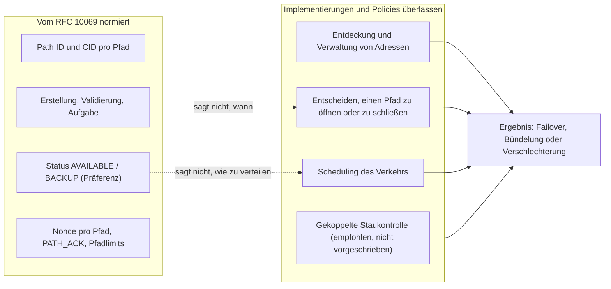
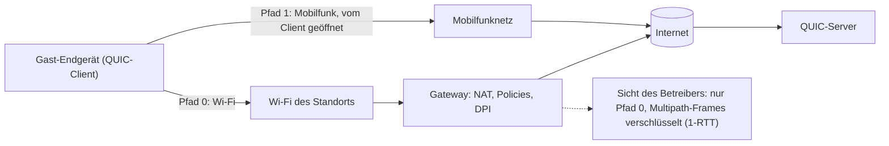

## Die Hotellobby, das schwarze Loch der Videokonferenz

Ein Gast verlässt mitten in einer Videokonferenz sein Hotelzimmer, durchquert die Lobby und schiebt die Drehtür an. Irgendwo zwischen Empfang und Bürgersteig verliert sein Smartphone das Wi-Fi und weicht auf das Mobilfunknetz aus. Das Bild friert ein. Der Ton zerhackt. Manchmal bricht der Anruf ab. Für ihn ist das „das schlechte Wi-Fi im Hotel“. Für uns ist es ein Support-Ticket.

Jeder, der Wi-Fi in Hotels, Studentenwohnheimen oder auf Campus betreibt, kennt diesen Moment. Und jeder weiß, dass ein guter Teil des Problems außerhalb der eigenen Reichweite liegt: Das Endgerät entscheidet, wann es die Route wechselt, und die Anwendung überlebt den Wechsel, oder eben nicht.

Am 7. November 2026 hat die IETF (die Organisation, die die Standards des Internets schreibt) den RFC 10069 mit dem Titel „Managing Multiple Paths for a QUIC Connection“ veröffentlicht [1][2]. Er erlaubt einer QUIC-Verbindung, dem Transportprotokoll, auf dem HTTP/3 aufsetzt, mehrere Netzwerkpfade gleichzeitig zu nutzen. Vom ersten Draft der Arbeitsgruppe bis zur Veröffentlichung vergingen vier Jahre und neun Monate [3].

Die Prospekte der Anbieter werden das schnell mit „Wi-Fi und 5G gebündelt“ übersetzen. Der Text verspricht nichts dergleichen. Die englischen Begriffe *throughput* (Durchsatz) und *jitter* (Jitter) kommen darin kein einziges Mal vor. Genau das macht diesen RFC interessant, und genau deshalb muss man ihn genau lesen, bevor man etwas von ihm erwartet.

## Ausgeschilderte Straßen, kein GPS

Stellen Sie sich ein Straßennetz vor. Der RFC 10069 liefert die Auffahrten, die Beschilderung und die Straßenverkehrsordnung: wie man eine neue Spur öffnet, wie man prüft, dass sie tatsächlich ans Ziel führt, wie man sie sauber schließt. Er liefert nicht das GPS, das in jeder Sekunde entscheidet, welche Spur genommen wird. Dieses GPS, im Fachjargon der *Scheduler*, bleibt Sache jeder einzelnen Implementierung.

Das Dokument ist ein vollwertiger Standard: Kategorie Standards Track, laut dem Online-Tracking der IETF „Proposed Standard“. Am 18. März 2026 genehmigt, wartete er anschließend rund siebeneinhalb Monate in der Veröffentlichungswarteschlange [3]. Seine sechs Autoren kommen von Alibaba, Ericsson, Harvey AI, Private Octopus, der Université de Mons und der UCLouvain. Das ist es, was sie konkret normiert haben.

**Eine Verhandlung nach dem Alles-oder-nichts-Prinzip.** Beim Handshake teilt jeder Peer über den Transportparameter `initial_max_path_id` (Code 0x3e) mit, wie viele Pfade er akzeptiert. Kündigt einer der beiden ihn nicht an, ist die Regel knapp: Beide „MUST NOT use any frame or mechanism defined in this document“. Kein einseitig zusammengebasteltes Multipath.

**Ein Pfad ist eine Nummer.** Die Grundeinheit ist die *Path ID*, eine Pfadkennung. Der initiale Pfad trägt die Nummer 0; die folgenden zählen aufwärts und werden nie wiederverwendet. Jeder Pfad hat seine eigenen Verbindungskennungen (*connection IDs*, kurz CIDs) und seinen eigenen Raum an Paketnummern. Selbst die Verschlüsselung passt sich an: Der einmalige Wert, der zum Verschlüsseln jedes Pakets nötig ist (die *Nonce*), kombiniert die Path ID mit der Paketnummer.

Ein Detail, das zählt: Ein Pfad ist kein Adresspaar. Der RFC erlaubt mehrere Path IDs auf demselben 4-Tupel, also denselben Adressen und denselben Ports, bei Quelle wie Ziel. Ein Beispiel aus dem Text: unterschiedliche DiffServ-Markierungen für die Dienstgüte (QoS) zu tragen.

**Der Client öffnet, der Server validiert.** Der Text ist eindeutig: „this extension only enables clients to open a new path“. Der Server prüft, ob die neue Adresse tatsächlich antwortet, und zwar per PATH_CHALLENGE / PATH_RESPONSE auf dem Pfad selbst, und ob dieser Pfad Pakete von 1.200 Byte akzeptiert. Er bleibt den Anti-Amplification-Limits unterworfen. Scheitert die Validierung, ist die Path ID verbraucht, und der Pfad muss explizit geschlossen werden.

**Ein Status, kein Befehl.** Ein Peer kann einen Pfad als AVAILABLE (nutzbar) oder BACKUP (Reserve) kennzeichnen. Eine entscheidende Nuance: Jeder gibt diese Hinweise für sich selbst ab, und der andere „might not follow“. Ein BACKUP-Pfad sollte keinen Verkehr erhalten, solange ein anderer Pfad verfügbar und nutzbar ist. Und wenn alle auf BACKUP stehen? „No guidance is provided.“ Das ist ein Präferenzsignal, kein Scheduler.

**Ein verpflichtender Abschluss.** Inaktivität, Verluste, Ressourcenmangel: Ganz gleich aus welchem Grund, die Aufgabe eines Pfads läuft über einen PATH_ABANDON-Frame, und der Peer antwortet mit seinem eigenen. Der RFC sieht sogar einen Fehlercode PATH_UNSTABLE_OR_POOR vor, illustriert durch „frequent handover events during high-speed mobility“ oder ein „weak wireless signal“. Hier erscheint Funk als Grund für die Aufgabe eines Pfads, nicht als Versprechen.

| Frame | Code | Rolle |
|---|---|---|
| PATH_ACK | 0x3e-0x3f | Pakete eines bestimmten Pfads bestätigen |
| PATH_ABANDON | 0x3e75 | Einen Pfad explizit schließen |
| PATH_STATUS_BACKUP | 0x3e76 | Einen Pfad als Reserve kennzeichnen |
| PATH_STATUS_AVAILABLE | 0x3e77 | Einen Pfad als nutzbar kennzeichnen |
| PATH_NEW_CONNECTION_ID, PATH_RETIRE_CONNECTION_ID | 0x3e78, 0x3e79 | CIDs für einen Pfad bereitstellen oder zurückziehen |
| MAX_PATH_ID, PATHS_BLOCKED, PATH_CIDS_BLOCKED | 0x3e7a, 0x3e7b, 0x3e7c | Pfadlimit anheben, Blockierung signalisieren |

Alle diese Frames laufen ausschließlich in sogenannten 1-RTT-Paketen, die auf den Handshake folgen und deren Inhalt verschlüsselt ist. Merken Sie sich diesen Punkt: Er kehrt wieder, wenn es darum geht, was das Netz sieht.

*Eine Kennung pro Pfad, Zähler pro Pfad, explizites Schließen: Der RFC 10069 normiert den Lebenszyklus der Pfade, nicht ihre Nutzung.*

## Was der Text ausdrücklich draußen lässt

Die Zusammenfassung des RFC steckt den Rahmen gleich in den ersten Zeilen ab: „This document does not specify address discovery or management, nor how applications using QUIC schedule traffic over multiple paths.“ Abschnitt 3 setzt nach: Das Dokument sagt nicht, „when a client decides to initiate or close a path or how multiple open paths are used for sending“.

Drei Entscheidungen bleiben also außerhalb der Norm. Verfügbare Adressen entdecken. Entscheiden, einen Pfad zu öffnen oder zu schließen. Den Verkehr auf die offenen Pfade verteilen. Beim letzten Punkt ist der Text selten offen: „There are currently no IETF specifications that define scheduling algorithms for simultaneously (i.e., concurrently) using multiple paths.“ Das Scheduling wird dort beschrieben als „a local decision based on the preferences of the application and the implementation“.

Das ist kein Versehen. Dem Bericht des *Shepherd* (das Mitglied der Arbeitsgruppe, das das Dokument bis zur Genehmigung begleitet) zufolge wurden seit der Annahme des Drafts im Jahr 2022 rund 300 Issues und 326 Pull Requests bearbeitet [4]. Die härtesten Debatten betrafen die Basismechanik: ein einziger Raum an Paketnummern oder einer pro Pfad, die Verbindung zwischen Connection IDs und Path IDs. Der Rest wurde bewusst ausgeklammert: „research topics were kept out of scope“.

Der Anwendungsfall, den der RFC in den Vordergrund stellt, ist der Wechsel zwischen Wi-Fi und Mobilfunknetz. Und er achtet darauf, dessen Reichweite zu begrenzen:

> „while failover between Wi-Fi and mobile networks is a well-known multipath use case, it only temporarily uses two paths at the same time to avoid transmission pauses. Simultaneous path usage generally, however, needs more consideration than specified in this document to avoid negative performance impacts, e.g., when stream data is distributed over multiple paths with different delays.“

Das Szenario der Hotellobby: ja. Die dauerhafte Bündelung zweier Links: nicht ohne „more consideration“.

Woher die Vorsicht? Stellen Sie sich einen Umzug vor, der auf zwei Lastwagen verteilt ist, der eine auf der Autobahn, der andere auf der Landstraße. Müssen die Möbel in der richtigen Reihenfolge aufgebaut werden, warten Sie auf den langsameren Lkw, bevor Sie das erste Regalbrett festschrauben. Genau das sagt der RFC: Wird ein und derselbe Stream auf mehrere Pfade verteilt, erlebt die Zustellung „the maximum delay of all used paths due to in-order delivery“. Zwei Straßen ergeben keinen kürzeren Weg.

Der Text erwähnt durchaus ein Spektrum möglicher Scheduling-Strategien, das „from support for failover to simultaneous use of the aggregated capacity across all open paths“ reicht. Aber das ist eine Bandbreite dessen, was eine Implementierung tun könnte, keine von der Norm gelieferte Fähigkeit. Die Zählung im Rohtext ist eindeutig: „jitter“, „throughput“, „cellular“ und „5G“ kommen nie vor. „Wi-Fi“ und der Wortstamm „aggregat-“ tauchen jeweils nur ein einziges Mal auf, in den beiden obigen Zitaten.

*Die Rollenverteilung: Der RFC normiert den Lebenszyklus der Pfade, die Implementierungen entscheiden über alles, was die Performance ausmacht.*

Dieselbe Logik gilt für die Staukontrolle (*congestion control*). Jeder Pfad hat seinen eigenen Zustand, aber zwei Pfade können denselben Engpass teilen. Der RFC warnt, dass eine Standard-Staukontrolle „could result in an unfair distribution of the bandwidth“ führen könnte, weil die Multipath-Verbindung gegenüber klassischen Verbindungen mehr als ihren Anteil an sich reißt. Er merkt an, dass der gekoppelte Algorithmus von Multipath TCP (LIA, RFC 6356) „can immediately be adapted“ werden kann [12], und verweist auf die einschlägigen Empfehlungen der IETF (BCP 133, RFC 9743). Vorgeschrieben wird nichts.

Selbst die Messung der Round-Trip-Time (RTT) wird heikel, denn eine Bestätigung kann über einen anderen Pfad zurückkommen als die Daten. Das Zahlenbeispiel des RFC spricht für sich: eine terrestrische Verbindung mit 50 ms pro Richtung, eine geostationäre Satellitenverbindung mit 300 ms pro Richtung. Je nach Kombination beträgt die gemessene RTT 100, 350 oder 600 ms. Viel Spaß dem naiven Scheduler.

*Der Anwendungsfall, den der RFC 10069 in den Vordergrund stellt: der Wechsel zwischen Wi-Fi und Mobilfunknetz, bei dem zwei Pfade nur so lange koexistieren, wie nötig ist, um eine Unterbrechung zu vermeiden.*

## Die einzigen veröffentlichten Zahlen stammen von Alibaba

Wenn die Norm nichts verspricht, woher kommen dann die Versprechen? Im Wesentlichen aus einem auf der SIGCOMM 2021, der großen akademischen Netzwerkkonferenz, vorgestellten Paper [7]. Es beschreibt XLINK, ein System von Alibaba, dessen Autoren Y. Ma und Y. Liu auch den RFC 10069 mitunterzeichnen.

Auf dem Papier sind die Ergebnisse solide. Gemessen an mehr als 3 Millionen Videowiedergaben in der Taobao-App unter Android, im Vergleich zu QUIC mit nur einem Pfad, zeigen sie im 99. Perzentil eine Verbesserung der Abschlusszeit von Anfragen für Videosegmente um 19 bis 50 % und der Latenz bis zum ersten Bild um 32 %. Die Rate des *Rebuffering* (der Ladepausen) verbessert sich um 23 bis 67 %. Und das alles bei 2,1 % redundantem Verkehr.

Drei Vorbehalte sind angebracht. Erstens stammen diese Gewinne aus einem Scheduler und einer Re-Injection-Logik, die auf die Qualität des Videoerlebnisses ausgerichtet und spezifisch für XLINK sind. Nicht aus dem RFC 10069, den es damals noch nicht gab. Zweitens stammt der Kontext von einem einzigen Anbieter, bei Wi-Fi/LTE-Mobilität. Drittens beschreibt der Shepherd-Bericht den Einsatz bei Alibaba vorsichtig als „primarily a self-interop deployment“ [4]: Alibaba spricht dort vor allem mit Alibaba.

Das Gegenbeispiel ist noch aufschlussreicher. In einem im Dezember 2021 im Blog von APNIC (dem Internet-Registry für den asiatisch-pazifischen Raum) veröffentlichten Beitrag beschreibt dasselbe Team seinen A/B-Test: 100.000 Teilnehmer, mehr als 3 Millionen Wiedergaben, zwei Wochen [8]. Es berichtet darin, dass ein Standard-Scheduler, der den Pfad mit der minimalen RTT bevorzugt, im 99. Perzentil um 28 % langsamer sein konnte als Single-Path auf dem besten Pfad. Der Beitrag nennt die Bedingungen dieser Messung nicht im Detail.

Dieselbe Protokollfamilie, zwei Scheduler, zwei Ergebnisse mit entgegengesetztem Vorzeichen. Das ist die ganze These dieses Artikels: Die Norm öffnet die Tür, die Policy entscheidet, was man dahinter findet. Und ich habe weder eine unabhängige Messung noch eine Analystenstudie zum Thema gefunden. Die einzigen Zahlen, die ich lesen konnte, stammen von einem Akteur, der die Norm mitgeschrieben hat.

## MPTCP setzte auf eine andere Karte

Der naheliegende Reflex ist der Vergleich mit Multipath TCP (MPTCP), dessen Version 1 seit März 2020 im RFC 8684 normiert ist [5] und vom Linux-Kernel unterstützt wird, mit einem Path Manager im Kernel oder im User Space [9]. Eine Klarstellung der Ehrlichkeit halber: Dieser Vergleich stammt von mir. Der RFC 10069 positioniert sich nicht gegenüber MPTCP, das er nur im Vorbeigehen bei der Staukontrolle streift.

| Dimension | MPTCP v1 (RFC 8684) | Multipath QUIC (RFC 10069) |
|---|---|---|
| Was ein Pfad ist | Ein TCP-Subflow, definiert durch ein 4-Tupel | Eine Path ID, mehrere auf demselben 4-Tupel möglich |
| Wo die Signalisierung lebt | TCP-Optionen, so konzipiert, dass sie für Anwendungen transparent bleiben | Verschlüsselte Frames; QUIC läuft im User Space, die Entscheidung liegt weitgehend bei der Anwendung |
| Adressankündigung | In der Norm (ADD_ADDR, REMOVE_ADDR) | Nicht Teil der Norm, separate Arbeit läuft |
| Wer einen Pfad öffnet | Jeder der beiden Hosts kann einen Subflow initiieren | Nur der Client |
| Reserve und Priorität | Backup-Flag, Option MP_PRIO | PATH_STATUS_BACKUP / AVAILABLE, von jedem Peer gesendet |
| Nicht kompatibler Peer | Fallback auf einfaches TCP von der Norm vorgesehen | Kein Mechanismus des RFC wird genutzt; ein Fallback von QUIC auf TCP bleibt Sache der Anwendung |
| Scheduler | Kein eigener Abschnitt (das Wort „scheduler“ fehlt) | Ausdrücklich der Implementierung überlassen |

Meine Lesart: MPTCP trägt die Adressankündigung in der Norm, Multipath QUIC entscheidet sich, sie zu delegieren. Die Adressentdeckung ist Gegenstand einer separaten Arbeit, draft-ietf-quic-address-discovery, deren letzte Revision (-01, die einen OBSERVED_ADDRESS-Frame definiert) vom 15. August 2026 stammt [11]. Es ist bis heute ein Draft. In beiden Fällen liegt die Policy (wann öffnen, wann bevorzugen, wie verteilen) bei der Implementierung. Ich schließe daraus nicht, dass das eine besser ist als das andere: Nichts von dem, was ich gelesen habe, belegt das.

*Zwei Architekturwetten: MPTCP verankert die Adressankündigung im Protokoll, Multipath QUIC delegiert sie und verschlüsselt seine Pfadsignalisierung.*

## Von der Decke eines Hotelflurs aus gesehen

Wechseln wir die Perspektive. Was folgt, ist meine Analyse als Wi-Fi-Betreiber, abgeleitet aus dem RFC 10069 und dem RFC 9312, dem informativen IETF-Dokument zum operativen Management von QUIC [6]. Das sind Lesarten des Autors, keine Aussagen der Norm.

**Wir sind kein Endpoint.** Multipath wird Ende zu Ende ausgehandelt, zwischen dem Endgerät des Gasts und dem Server. Das Endgerät öffnet als QUIC-Client den zweiten Pfad, typischerweise über seine Mobilfunkschnittstelle. Das Wi-Fi-Netz sieht bestenfalls einen der Pfade. Bei uns gibt es nichts zu „aktivieren“.

**Unsere Policies decken nur eine Hälfte ab.** Kontingente, QoS, Captive Portal, Logging: Alles, was pro Client oder pro Flow greift, gilt nur für den Wi-Fi-Pfad. Der Verkehr auf dem Mobilfunkpfad entzieht sich dem. Das ist an sich weder gut noch schlecht. Es ist eine Governance-Frage, die sich jede IT-Leitung eines Hotels oder Campus stellen muss, falls die Endgeräte diesen Mechanismus massenhaft übernehmen.

**Unser einziger echter Hebel: den Flow nicht kaputtmachen.** Der RFC 9312 empfiehlt, UDP nicht Paket für Paket zu drosseln, sondern Flow für Flow. Er warnt zudem, dass eine auf einem Hash des 5-Tupels beruhende Blockierung „increases the risk of black-holing an active connection when the address changes“. Der RFC 10069 seinerseits erinnert daran, dass Timeouts von NAT und anderen Zwischengeräten einen stumm gewordenen Pfad töten können, rät aber standardmäßig von Keep-alives pro Pfad ab. Übersetzt: ausgehendes UDP offen, vernünftige NAT-Timeouts, keine Regel, die voraussetzt, dass eine Verbindung ihre Adressen behält.

**Unsere Sichtbarkeit schwindet weiter.** Die Multipath-Frames reisen nur in 1-RTT-Paketen, also verschlüsselt. Der Transportparameter des Clients bleibt im ersten Handshake-Paket (dem *Initial*-Paket) lesbar. Aber laut RFC 9312 gilt: „the reply from the server cannot be observed, so observers on the network cannot know which parameters are actually in use“. Ein Gerät für Deep Packet Inspection (DPI) kann also nicht zuverlässig wissen, ob Multipath aktiv ist. Der RFC 10069 präzisiert sogar, dass gleichzeitige Schlüsselwechsel die Aktivität verschiedener Pfade nicht „linkable by an observer“ machen sollten.

*Lesart des Autors: Das Endgerät öffnet den zweiten Pfad außerhalb des Wi-Fi-Netzes; das Gateway sieht nur eine Hälfte der Verbindung und nicht, was darin ausgehandelt wird.*

**Das 5G-Backup-WAN ist kein Multipath.** Wenn das Gateway eines Standorts auf eine 4G/5G-Backup-Leitung umschaltet, sieht der Server lediglich, dass sich die öffentliche Adresse eines Endgeräts ändert, das nur eine Schnittstelle hat. Für QUIC ist das ein *Rebinding* oder eine Migration, die die Path ID nicht ändert. Der RFC 10069 ersetzt also kein Backup-WAN. Das Gateway beträfe er nur, wenn es selbst zu einem QUIC-Endpoint über zwei getrennte Pfade würde, eine Hypothese, die der RFC nicht behandelt.

**Auf der Serverseite zwei Reflexe.** Da jeder Pfad seine eigenen CIDs hat, muss ein Load Balancer, der nach CID routet, alle CIDs einer Verbindung auf demselben Backend halten (Schlussfolgerung von mir: Der RFC spricht nicht von Load Balancern). Und wer QUIC-Server betreibt, wendet Abschnitt 7 an: „keep the maximum number of paths small“, Validierungen takten, Ressourcen erst nach der Validierung zuweisen. Der RFC räumt ehrlich ein, dass ein Angreifer denselben Amplification-Effekt erzielen würde, indem er mehrere klassische Verbindungen öffnet.

## Die Fragen, die man stellen sollte, bevor man daran glaubt

Das Ökosystem muss sich erst noch beweisen. Das Wiki der Arbeitsgruppe führt aioquic (Ericsson), quiche über einen Fork auf dem Stand von Draft 12, XQUIC von Alibaba (Drafts 09 und 10), picoquic und Rask, eine interne Entwicklung von Ericsson [10]. Aber dieses Wiki ist veraltet: Seine letzte datierte Angabe stammt vom Oktober 2024.

Vor allem sind seine Parametercodes die der Drafts, etwa 0x0f739bbc1b666d0c für Draft 12, während der RFC 0x3e veröffentlicht. Meine Analyse: Diese Stacks werden auf die endgültigen Codes migrieren müssen, um mit einer konformen Implementierung zu interoperieren. Und ich konnte nicht überprüfen, dass ein gängiges Betriebssystem, ein Browser oder ein Webserver den RFC 10069 heute implementiert.

Das würde ich einen Anbieter von Servern, CDN oder Anwendungs-SDKs fragen, der Multipath für sich reklamiert:

- **Welche Version?** Der finale RFC mit `initial_max_path_id` unter Code 0x3e, oder ein Draft?
- **Welcher Scheduler?** Nur Failover oder gleichzeitige Nutzung, wo gemessen, verglichen womit?
- **Welche Staukontrolle?** Gekoppelt oder nicht, und welche?
- **Welche Limits?** Maximale Anzahl von Pfaden, Takt der Validierungen.
- **Welches Verhalten, wenn alle Pfade auf BACKUP stehen?** Genau dort, wo der RFC „no guidance“ gibt.

Und das würde ich bei uns prüfen: ausgehendes UDP/443 offen, keine UDP-Drosselung Paket für Paket, im Licht dieser Nutzung überprüfte UDP-NAT-Timeouts, keine Sicherheits- oder QoS-Regel, die auf eine Änderung des 5-Tupels empfindlich reagiert.

## Ein ehrlicher Standard, ein Markt unter Beobachtung

Meine Position ist einfach: Der RFC 10069 ist genau deshalb ein guter Standard, weil er sich weigert, etwas zu versprechen. Er normiert, was normiert werden muss, damit zwei Implementierungen einander verstehen (Kennungen, Lebenszyklus der Pfade, Verschlüsselung, Präferenzsignale), und überlässt den Rest denen, die die Daten haben, um es gut zu machen. Er ist eine Control Plane für Pfade. Kein Performance-Motor.

Die Konsequenz ist für das Marketing unangenehm. Der Wert wird nicht von der Norm kommen, sondern von den Betriebssystemen, Anwendungen und Servern, die sie implementieren, und von den Policies, für die sie sich entscheiden. XLINK zeigt, dass ein gut konzipierter Scheduler viel gewinnen kann. Derselbe Erfahrungsbericht zeigt, dass ein Standard-Scheduler verlieren lassen kann. An dem Tag, an dem man Ihnen „Wi-Fi und 5G gebündelt dank RFC 10069“ verkauft, fragen Sie nach: welcher Scheduler, wo gemessen, gegen was.

Für einen Wi-Fi-Betreiber besteht die Aufgabe nicht darin, Multipath zu aktivieren: Das können wir nicht. Sie besteht darin, es nicht kaputtzumachen und zu akzeptieren, dass ein Teil des Verkehrs unserer Gäste eine Route nehmen kann, die wir nicht sehen. Drei Signale, die in den kommenden Monaten zu beobachten sind: der Fortschritt des Drafts zur Adressentdeckung, die Migration der Stacks auf die endgültigen Codes und das, was das 3GPP (die Organisation, die die Mobilfunknetze normiert) tun wird. Der Shepherd berichtet von einem „strong interest“ des 3GPP, aber ich konnte auf dessen Seite keinen normativen Inhalt überprüfen. Eine Spur, kein Fakt.

Die Hotellobby bleibt ein schwarzes Loch. Der RFC 10069 gibt Endgeräten und Servern eine gemeinsame Grammatik, um sie zu durchqueren. Bleibt die Frage, wer sie nutzen wird und was er damit sagen will.

---

_Persönliche Ansichten, keine Position von Wifirst._

## Quellen

1. RFC 10069, « Managing Multiple Paths for a QUIC Connection », IETF, Standards Track, November 2026 — https://www.rfc-editor.org/rfc/rfc10069.html (Klartext: https://www.rfc-editor.org/rfc/rfc10069.txt)
2. Datatracker IETF, Seite des RFC 10069 (Veröffentlichung am 7. November 2026) — https://datatracker.ietf.org/doc/rfc10069/
3. Datatracker IETF, Verlauf von draft-ietf-quic-multipath — https://datatracker.ietf.org/doc/draft-ietf-quic-multipath/history/
4. Shepherd write-up zu draft-ietf-quic-multipath — https://datatracker.ietf.org/doc/draft-ietf-quic-multipath/shepherdwriteup/
5. RFC 8684, « TCP Extensions for Multipath Operation with Multiple Addresses » (MPTCP v1), März 2020 — https://www.rfc-editor.org/rfc/rfc8684.html
6. RFC 9312, « Manageability of the QUIC Transport Protocol », September 2022 — https://www.rfc-editor.org/rfc/rfc9312.html
7. XLINK, SIGCOMM 2021 (Alibaba) — https://conferences.sigcomm.org/sigcomm/2021/files/papers/3452296.3472893.pdf
8. Blog APNIC, Beitrag des Alibaba-Teams zu Multipath QUIC für Video, 8. Dezember 2021 — https://blog.apnic.net/2021/12/08/efficient-multipath-transport-with-quic-video-services/
9. Dokumentation des Linux-Kernels, MPTCP — https://docs.kernel.org/networking/mptcp.html
10. Wiki quicwg/multipath, Implementierungen mit Multipath-Unterstützung — https://github.com/quicwg/multipath/wiki/QUIC-Implementations-with-multipath-support
11. Datatracker IETF, Verlauf von draft-ietf-quic-address-discovery — https://datatracker.ietf.org/doc/draft-ietf-quic-address-discovery/history/
12. RFC 6356, « Coupled Congestion Control for Multipath Transport Protocols », Oktober 2011 — https://www.rfc-editor.org/rfc/rfc6356.html
