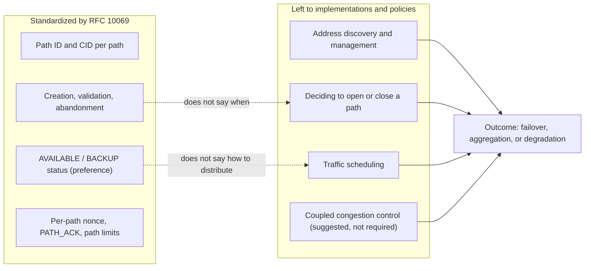
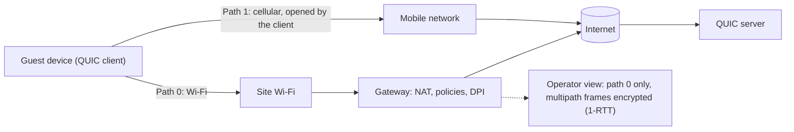

## The hotel lobby, the black hole of video calls

A guest walks out of their hotel room in the middle of a video call, crosses the lobby and pushes through the revolving door. Somewhere between the front desk and the sidewalk, their phone drops the Wi-Fi and falls back to the mobile network. The picture freezes. The audio chops. Sometimes the call drops. To them, it's "the hotel Wi-Fi acting up." For us, it's a support ticket.

Anyone who runs Wi-Fi in hospitality, student housing or on a campus knows this moment. They also know that a good part of the problem is out of their hands: the device decides when to switch routes, and the application either survives the switch or doesn't.

On November 7, 2026, the IETF (the body that writes Internet standards) published RFC 10069, titled "Managing Multiple Paths for a QUIC Connection" [1][2]. It lets a QUIC connection, the transport protocol HTTP/3 runs on, use several network paths at the same time. It took four years and nine months from the working group's first draft to publication [3].

Marketing brochures will quickly translate this into "Wi-Fi and 5G bonded together." The text promises nothing of the sort. The words *throughput* and *jitter* do not appear in it even once. That is precisely what makes this RFC interesting, and why you need to read it closely before expecting anything from it.

## Marked roads, no GPS

Think of a road network. RFC 10069 delivers the on-ramps, the signage and the highway code: how to open a new lane, how to check that it really leads to the destination, how to close it cleanly. It does not deliver the GPS that decides, every second, which lane to take. That GPS, which the jargon calls the *scheduler*, is left to each implementation.

The document is a full-fledged standard: Standards Track, "Proposed Standard" according to the IETF's online tracker. Approved on March 18, 2026, it then waited about seven and a half months in the publication queue [3]. Its six authors come from Alibaba, Ericsson, Harvey AI, Private Octopus, the Université de Mons and UCLouvain. Here, concretely, is what they standardized.

**An all-or-nothing negotiation.** During the handshake, each peer announces how many paths it accepts, using the transport parameter `initial_max_path_id` (code 0x3e). If either side fails to announce it, the rule is blunt: both "MUST NOT use any frame or mechanism defined in this document." No jury-rigged multipath on one side only.

**A path is a number.** The basic unit is the *path ID*. The initial path gets number 0; the following ones increase and are never reused. Each path has its own connection IDs (CIDs) and its own packet number space. Even encryption adapts: the unique value required to encrypt each packet (the *nonce*) combines the path ID and the packet number.

One detail matters: a path is not an address pair. The RFC allows several path IDs on the same 4-tuple, that is, the same addresses and ports at both source and destination. The text's example: carrying different DiffServ quality-of-service markings.

**The client opens, the server validates.** The text is explicit: "this extension only enables clients to open a new path". The server, for its part, checks that the new address really responds, through a PATH_CHALLENGE / PATH_RESPONSE exchange on the path itself, and that the path accepts 1,200-byte packets. It remains subject to anti-amplification limits. If validation fails, the path ID is consumed and the path must be explicitly closed.

**A status, not an order.** A peer can declare a path AVAILABLE (usable) or BACKUP (standby). A crucial nuance: each side issues these indications for itself, and the other "might not follow." A BACKUP path should receive no traffic if another path is available and usable. And if all paths are BACKUP? "No guidance is provided." It is a preference signal, not a scheduler.

**A mandatory closing.** Inactivity, losses, lack of resources: whatever the reason, abandoning a path goes through a PATH_ABANDON frame, and the peer answers with its own. The RFC even provides an error code, PATH_UNSTABLE_OR_POOR, illustrated with "frequent handover events during high-speed mobility" or a "weak wireless signal." Here, wireless shows up as a cause of abandonment, not as a promise.

| Frame | Code | Role |
|---|---|---|
| PATH_ACK | 0x3e-0x3f | Acknowledge the packets of a given path |
| PATH_ABANDON | 0x3e75 | Explicitly close a path |
| PATH_STATUS_BACKUP | 0x3e76 | Declare a standby path |
| PATH_STATUS_AVAILABLE | 0x3e77 | Declare a usable path |
| PATH_NEW_CONNECTION_ID, PATH_RETIRE_CONNECTION_ID | 0x3e78, 0x3e79 | Provide or retire CIDs for a path |
| MAX_PATH_ID, PATHS_BLOCKED, PATH_CIDS_BLOCKED | 0x3e7a, 0x3e7b, 0x3e7c | Raise the path limit, signal a blockage |

All of these frames travel only in so-called 1-RTT packets, the ones that follow the handshake and whose content is encrypted. Keep that in mind: it will come back when we talk about what the network sees.

*One identifier per path, counters per path, explicit closing: RFC 10069 standardizes the lifecycle of paths, not how they are used.*

## What the text leaves out, in black and white

The RFC's abstract sets the scope in its first lines: "This document does not specify address discovery or management, nor how applications using QUIC schedule traffic over multiple paths." Section 3 hammers the point home: the document does not say "when a client decides to initiate or close a path or how multiple open paths are used for sending".

Three decisions therefore remain outside the standard. Discovering the available addresses. Deciding to open or close a path. Distributing traffic across open paths. On that last point, the text is unusually frank: "There are currently no IETF specifications that define scheduling algorithms for simultaneously (i.e., concurrently) using multiple paths." Scheduling is described there as "a local decision based on the preferences of the application and the implementation".

This is not an oversight. According to the *shepherd* write-up (the working group member who guides the document through to approval), about 300 issues and 326 pull requests were handled since the draft was adopted in 2022 [4]. The hardest debates were about plumbing: a single packet number space or one per path, the link between connection IDs and path IDs. The rest was deliberately set aside: "research topics were kept out of scope".

The use case the RFC puts forward is switching between Wi-Fi and mobile networks. And it takes care to bound its scope:

> "while failover between Wi-Fi and mobile networks is a well-known multipath use case, it only temporarily uses two paths at the same time to avoid transmission pauses. Simultaneous path usage generally, however, needs more consideration than specified in this document to avoid negative performance impacts, e.g., when stream data is distributed over multiple paths with different delays."

The hotel lobby scenario, yes. Permanent aggregation of two links, not without "more consideration."

Why so much caution? Picture a house move split between two trucks, one on the highway, the other on the back road. If the furniture has to be assembled in order, you wait for the slower truck before screwing in the first shelf. The RFC says exactly that: when a single stream is spread across several paths, "data delivery will experience the maximum delay of all used paths due to in-order delivery". Two roads don't make a shorter trip.

The text does mention a range of possible schedulers, running "from support for failover to simultaneous use of the aggregated capacity across all open paths". But that is a range of what an implementation could do, not a capability delivered by the standard. A count in the raw text is conclusive: "jitter", "throughput", "cellular" and "5G" never appear. "Wi-Fi" and the stem "aggregat-" appear only once each, in the two quotations above.

*Division of roles: the RFC standardizes the lifecycle of paths; implementations decide everything that drives performance.*

The same logic applies to congestion control. Each path has its own state, but two paths can share the same bottleneck. The RFC warns that standard control "could result in an unfair distribution of the bandwidth", with the multipath connection grabbing more than its share against regular connections. It notes that Multipath TCP's coupled algorithm (LIA, RFC 6356) "can immediately be adapted" [12] and points to the IETF's guidance on the subject (BCP 133, RFC 9743). It imposes nothing.

Even measuring round-trip time (RTT) becomes tricky, because an acknowledgment can come back over a different path than the data. The RFC's worked example speaks for itself: a terrestrial link at 50 ms each way, a geostationary satellite link at 300 ms each way. Depending on the combination, the measured RTT is 100, 350 or 600 ms. Good luck to the naive scheduler.

*The use case RFC 10069 puts forward: switching between Wi-Fi and the mobile network, where two paths coexist only long enough to avoid a drop.*

## The only published numbers come from Alibaba

If the standard promises nothing, where do the promises come from? Mostly from a paper presented at SIGCOMM 2021, the major academic networking conference [7]. It describes XLINK, an Alibaba system whose authors include Y. Ma and Y. Liu, who also sign RFC 10069.

On paper, the results are solid. Measured over more than 3 million video plays in the Taobao app on Android, against single-path QUIC, they show at the 99th percentile a 19 to 50% improvement in video segment request completion time, and a 32% improvement in first-frame latency. The *rebuffering* rate (loading pauses) improves by 23 to 67%. All for 2.1% redundant traffic.

Three caveats apply. First, these gains come from a scheduler and a re-injection logic driven by video quality of experience, specific to XLINK. Not from RFC 10069, which did not exist yet. Second, the context is that of a single vendor, in Wi-Fi/LTE mobility. Finally, the shepherd write-up describes Alibaba's deployment, carefully, as "primarily a self-interop deployment" [4]: Alibaba is mostly talking to Alibaba.

The counter-example is even more instructive. In a post published in December 2021 on the APNIC blog (APNIC is the Internet registry for the Asia-Pacific region), the same team describes its A/B test: 100,000 participants, more than 3 million plays, two weeks [8]. It reports that a default scheduler, the one that favors the path with the minimum RTT, could be 28% slower at the 99th percentile than single-path on the best path. The post does not detail the conditions of that measurement.

Same protocol family, two schedulers, two results of opposite sign. That is the whole thesis of this article: the standard opens the door, the policy decides what you find behind it. And I found neither independent measurements nor analyst studies on the subject. The only numbers I could read come from a player that co-wrote the standard.

## MPTCP made a different bet

The natural reflex is to compare with Multipath TCP (MPTCP), whose version 1 has been standardized by RFC 8684 since March 2020 [5] and is supported by the Linux kernel, with a kernel or userspace path manager [9]. A note in the interest of honesty: this comparison is mine. RFC 10069 does not position itself against MPTCP, which it only brushes against in the congestion control discussion.

| Dimension | MPTCP v1 (RFC 8684) | Multipath QUIC (RFC 10069) |
|---|---|---|
| What a path is | A TCP subflow, defined by a 4-tuple | A path ID, several possible on the same 4-tuple |
| Where signaling lives | TCP options, designed to stay transparent to applications | Encrypted frames; QUIC runs in userspace, the decision is largely up to the application |
| Address advertisement | In the standard (ADD_ADDR, REMOVE_ADDR) | Outside the standard, separate work in progress |
| Who opens a path | Either host can initiate a subflow | The client only |
| Backup and priority | Backup flag, MP_PRIO option | PATH_STATUS_BACKUP / AVAILABLE, issued by each peer |
| Incompatible peer | Fallback to plain TCP provided by the standard | No mechanism of the RFC used; falling back from QUIC to TCP remains an application matter |
| Scheduler | No dedicated section (the word "scheduler" is absent) | Explicitly left to the implementation |

My reading: MPTCP builds address advertisement into the standard, Multipath QUIC chooses to delegate it. Address discovery is the subject of separate work, draft-ietf-quic-address-discovery, whose latest revision (-01, which defines an OBSERVED_ADDRESS frame) dates from August 15, 2026 [11]. It is still a draft as of today. In both cases, policy (when to open, when to prefer, how to distribute) falls to the implementation. I am not concluding that one does better than the other: nothing I have read demonstrates it.

*Two architectural bets: MPTCP builds address advertisement into the protocol, Multipath QUIC delegates it and encrypts its path signaling.*

## Seen from the ceiling of a hotel corridor

Let's change our point of view. What follows is my analysis as a Wi-Fi operator, deduced from RFC 10069 and from RFC 9312, the IETF's informational document on the operational management of QUIC [6]. These are an author's readings, not claims made by the standard.

**We are not an endpoint.** Multipath is negotiated end to end, between the guest's device and the server. It is the device, as a QUIC client, that opens the second path, typically over its cellular interface. The Wi-Fi network sees, at best, one of the paths. There is nothing to "enable" on our side.

**Our policies cover only half.** Quotas, QoS, captive portal, logging: everything applied per client or per flow holds only for the Wi-Fi path. Traffic on the cellular path escapes it. This is neither good nor bad in itself. It is a governance question that every hotel or campus IT department will have to ask itself if devices adopt this mechanism en masse.

**Our only real lever: don't break the flow.** RFC 9312 recommends not throttling UDP packet by packet, but rather flow by flow. It also warns that blocking based on a 5-tuple hash "increases the risk of black-holing an active connection when the address changes". For its part, RFC 10069 points out that NAT timeouts and other middlebox timers can kill a path that has gone silent, while advising against per-path keep-alives by default. Translation: outbound UDP open, reasonable NAT timeouts, no rule that assumes a connection keeps its addresses.

**Our visibility shrinks further.** Multipath frames travel only in 1-RTT packets, hence encrypted. The client's transport parameter remains readable in the first packet of the handshake (the *Initial* packet). But according to RFC 9312, "the reply from the server cannot be observed, so observers on the network cannot know which parameters are actually in use". A deep packet inspection (DPI) device therefore cannot reliably know whether multipath is active. RFC 10069 even specifies that simultaneous key changes should not make the activity of different paths "linkable by an observer".

*Author's reading: the device opens the second path outside the Wi-Fi network; the gateway sees only half of the connection, and not what is negotiated in it.*

**A backup 5G WAN is not multipath.** When a site's gateway fails over to a backup 4G/5G link, the server simply sees a device with a single interface change its public address. For QUIC, that is a *rebinding* or a migration, which does not change the path ID. RFC 10069 therefore does not replace a backup WAN. It would concern the gateway only if the gateway itself became a QUIC endpoint on two distinct paths, a hypothesis the RFC does not address.

**On the server side, two reflexes.** Since each path has its own CIDs, a load balancer that routes by CID will have to keep all those of a connection on the same backend (my inference: the RFC does not discuss load balancers). And if you operate QUIC servers, apply section 7: "keep the maximum number of paths small", pace validations, allocate resources only after validation. The RFC honestly notes that an attacker would get the same amplification effect by opening several regular connections.

## The questions to ask before believing it

The ecosystem, for its part, remains to be proven. The working group's wiki lists aioquic (Ericsson), quiche via a fork at draft 12 level, Alibaba's XQUIC (drafts 09 and 10), picoquic and Rask, an internal Ericsson development [10]. But that wiki is dated: its latest dated information goes back to October 2024.

Above all, its parameter codes are those of the drafts, such as 0x0f739bbc1b666d0c for draft 12, whereas the RFC publishes 0x3e. My analysis: these stacks will have to migrate to the final codes to interoperate with a conforming implementation. And I could not verify that any mainstream operating system, browser or web server implements RFC 10069 today.

What I would ask a server, CDN or application SDK vendor that claims multipath:

- **Which version?** The final RFC, with `initial_max_path_id` at code 0x3e, or a draft?
- **Which scheduler?** Failover only or simultaneous use, measured where, compared to what?
- **Which congestion control?** Coupled or not, and which one?
- **Which limits?** Maximum number of paths, pace of validations.
- **What behavior when all paths are BACKUP?** Precisely where the RFC gives "no guidance."

And what I would check on our side: outbound UDP/443 open, no per-packet UDP throttling, UDP NAT timeouts reviewed in light of these uses, no security or QoS rule sensitive to a change of 5-tuple.

## An honest standard, a market to watch

My position is simple: RFC 10069 is a good standard precisely because it refuses to promise. It standardizes what must be standardized so that two implementations understand each other (identifiers, path lifecycle, encryption, preference signals) and leaves the rest to those who will have the data to do it right. It is a path control plane. Not a performance engine.

The consequence is unpleasant for marketing. The value will not come from the standard, but from the operating systems, applications and servers that implement it, and from the policies they choose. XLINK shows that a well-designed scheduler can deliver big gains. The same field experience shows that a default scheduler can lose. The day someone sells you "Wi-Fi and 5G aggregated thanks to RFC 10069," ask which scheduler, measured where, against what.

For a Wi-Fi operator, the job is not to enable multipath: we can't. It is to not break it, and to accept that part of our guests' traffic may take a route we do not see. Three signals to follow in the coming months: progress of the address discovery draft, the migration of stacks to the final codes, and what 3GPP (the body that standardizes mobile networks) will do. The shepherd reports a "strong interest" from 3GPP, but I could not verify any normative content on its side. A lead, not a fact.

The hotel lobby remains a black hole. RFC 10069 gives devices and servers a common grammar to cross it. What remains to be seen is who will use it, and to say what.

---

_Personal views, not Wifirst's position._

## Sources

1. RFC 10069, "Managing Multiple Paths for a QUIC Connection", IETF, Standards Track, November 2026 — https://www.rfc-editor.org/rfc/rfc10069.html (plain text: https://www.rfc-editor.org/rfc/rfc10069.txt)
2. IETF Datatracker, RFC 10069 page (published November 7, 2026) — https://datatracker.ietf.org/doc/rfc10069/
3. IETF Datatracker, history of draft-ietf-quic-multipath — https://datatracker.ietf.org/doc/draft-ietf-quic-multipath/history/
4. Shepherd write-up for draft-ietf-quic-multipath — https://datatracker.ietf.org/doc/draft-ietf-quic-multipath/shepherdwriteup/
5. RFC 8684, "TCP Extensions for Multipath Operation with Multiple Addresses" (MPTCP v1), March 2020 — https://www.rfc-editor.org/rfc/rfc8684.html
6. RFC 9312, "Manageability of the QUIC Transport Protocol", September 2022 — https://www.rfc-editor.org/rfc/rfc9312.html
7. XLINK, SIGCOMM 2021 (Alibaba) — https://conferences.sigcomm.org/sigcomm/2021/files/papers/3452296.3472893.pdf
8. APNIC blog, post by the Alibaba team on multipath QUIC for video, December 8, 2021 — https://blog.apnic.net/2021/12/08/efficient-multipath-transport-with-quic-video-services/
9. Linux kernel documentation, MPTCP — https://docs.kernel.org/networking/mptcp.html
10. quicwg/multipath wiki, implementations with multipath support — https://github.com/quicwg/multipath/wiki/QUIC-Implementations-with-multipath-support
11. IETF Datatracker, history of draft-ietf-quic-address-discovery — https://datatracker.ietf.org/doc/draft-ietf-quic-address-discovery/history/
12. RFC 6356, "Coupled Congestion Control for Multipath Transport Protocols", October 2011 — https://www.rfc-editor.org/rfc/rfc6356.html
