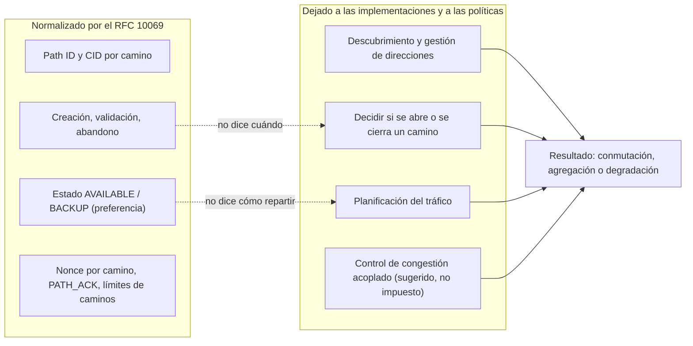
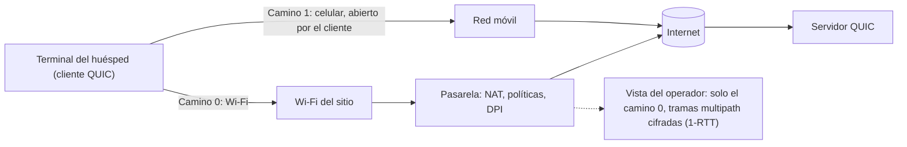

## El vestíbulo del hotel, ese agujero negro de la videollamada

Un cliente sale de su habitación de hotel en plena videoconferencia, cruza el vestíbulo y empuja la puerta giratoria. En algún punto entre el mostrador y la acera, su teléfono pierde el Wi-Fi y se pasa a la red móvil. La imagen se congela. El audio se entrecorta. A veces, la llamada se cae. Para él, es «el Wi-Fi del hotel que funciona mal». Para nosotros, es un ticket de soporte.

Todos los que operan Wi-Fi en hoteles, residencias de estudiantes o campus conocen ese momento. Saben también que buena parte del problema se les escapa: es el terminal quien decide cuándo cambiar de ruta, y es la aplicación la que sobrevive, o no, al cambio.

El 7 de noviembre de 2026, el IETF (el organismo que escribe los estándares de Internet) publicó el RFC 10069, titulado «Managing Multiple Paths for a QUIC Connection» [1][2]. Permite que una conexión QUIC, el protocolo de transporte sobre el que se apoya HTTP/3, use varios caminos de red a la vez. Han hecho falta cuatro años y nueve meses entre el primer borrador del grupo de trabajo y la publicación [3].

Los folletos comerciales no tardarán en traducirlo como «Wi-Fi y 5G agregados». El texto no promete nada de eso. Las palabras inglesas *throughput* (caudal) y *jitter* (variación del retardo) no aparecen ni una sola vez. Es precisamente lo que hace interesante este RFC, y lo que obliga a leerlo de cerca antes de esperar nada de él.

## Carreteras señalizadas, sin GPS

Piense en una red de carreteras. El RFC 10069 entrega los accesos, la señalización y el código de circulación: cómo abrir un nuevo carril, cómo comprobar que lleva realmente a destino, cómo cerrarlo correctamente. No entrega el GPS que decide, a cada segundo, qué carril tomar. Ese GPS, que la jerga llama planificador (*scheduler*), sigue siendo asunto de cada implementación.

El documento es una norma en toda regla: categoría Standards Track, «Proposed Standard» según el seguimiento en línea del IETF. Aprobado el 18 de marzo de 2026, esperó después unos siete meses y medio en la cola de publicación [3]. Sus seis autores proceden de Alibaba, Ericsson, Harvey AI, Private Octopus, la Universidad de Mons y la UCLouvain. Esto es, en concreto, lo que han normalizado.

**Una negociación de todo o nada.** En el momento del handshake, cada extremo anuncia cuántos caminos acepta, mediante el parámetro de transporte `initial_max_path_id` (código 0x3e). Si uno de los dos no lo anuncia, la regla es tajante: ambos «MUST NOT use any frame or mechanism defined in this document». Nada de multipath improvisado por un solo lado.

**Un camino es un número.** La unidad básica es el *path ID*, un identificador de camino. El camino inicial lleva el número 0; los siguientes van creciendo y nunca se reutilizan. Cada camino dispone de sus propios identificadores de conexión (*connection IDs*, o CID) y de su propio espacio de números de paquete. Incluso el cifrado se adapta: el valor único exigido para cifrar cada paquete (el *nonce*) combina el path ID y el número de paquete.

Un detalle que importa: un camino no es un par de direcciones. El RFC autoriza varios path IDs sobre un mismo 4-tuple, es decir, las mismas direcciones y los mismos puertos, tanto en origen como en destino. Ejemplo citado por el texto: transportar marcas de calidad de servicio DiffServ distintas.

**El cliente abre, el servidor valida.** El texto es explícito: «this extension only enables clients to open a new path». El servidor, por su parte, verifica que la nueva dirección responde de verdad, mediante un intercambio PATH_CHALLENGE / PATH_RESPONSE sobre el propio camino, y que ese camino acepta paquetes de 1.200 bytes. Sigue sujeto a los límites anti-amplificación. Si la validación falla, el path ID queda consumido y el camino debe cerrarse de forma explícita.

**Un estado, no una orden.** Un extremo puede declarar un camino AVAILABLE (utilizable) o BACKUP (de reserva). Matiz capital: cada uno emite estas indicaciones por su cuenta, y el otro «might not follow». Un camino BACKUP no debería recibir ningún tráfico si hay otro camino disponible y utilizable. ¿Y si todos están en BACKUP? «No guidance is provided.» Es una señal de preferencia, no un planificador.

**Un cierre obligatorio.** Inactividad, pérdidas, falta de recursos: sea cual sea el motivo, el abandono de un camino pasa por una trama PATH_ABANDON, y el otro extremo responde con la suya. El RFC prevé incluso un código de error PATH_UNSTABLE_OR_POOR, ilustrado con «frequent handover events during high-speed mobility» o una «weak wireless signal». Aquí, lo inalámbrico aparece como causa de abandono, no como promesa.

| Trama | Código | Función |
|---|---|---|
| PATH_ACK | 0x3e-0x3f | Confirmar los paquetes de un camino concreto |
| PATH_ABANDON | 0x3e75 | Cerrar explícitamente un camino |
| PATH_STATUS_BACKUP | 0x3e76 | Declarar un camino de reserva |
| PATH_STATUS_AVAILABLE | 0x3e77 | Declarar un camino utilizable |
| PATH_NEW_CONNECTION_ID, PATH_RETIRE_CONNECTION_ID | 0x3e78, 0x3e79 | Proporcionar o retirar CID para un camino |
| MAX_PATH_ID, PATHS_BLOCKED, PATH_CIDS_BLOCKED | 0x3e7a, 0x3e7b, 0x3e7c | Subir el límite de caminos, señalar un bloqueo |

Todas estas tramas solo circulan en los llamados paquetes 1-RTT, los que siguen al handshake y cuyo contenido está cifrado. Retenga este punto: volverá cuando hablemos de lo que ve la red.

*Un identificador por camino, contadores por camino, un cierre explícito: el RFC 10069 normaliza el ciclo de vida de los caminos, no su uso.*

## Lo que el texto deja fuera, negro sobre blanco

El resumen del RFC fija el alcance desde sus primeras líneas: «This document does not specify address discovery or management, nor how applications using QUIC schedule traffic over multiple paths.» La sección 3 remacha: el documento no dice «when a client decides to initiate or close a path or how multiple open paths are used for sending».

Tres decisiones quedan, pues, fuera de la norma. Descubrir las direcciones disponibles. Decidir si se abre o se cierra un camino. Repartir el tráfico entre los caminos abiertos. Sobre este último punto, el texto es de una franqueza poco común: «There are currently no IETF specifications that define scheduling algorithms for simultaneously (i.e., concurrently) using multiple paths.» La planificación se describe allí como «a local decision based on the preferences of the application and the implementation».

No es un descuido. Según el informe del *shepherd* (el miembro del grupo de trabajo que acompaña el documento hasta su aprobación), se han tratado unas 300 issues y 326 pull requests desde la adopción del draft en 2022 [4]. Los debates más duros giraron en torno a la fontanería: un único espacio de números de paquete o uno por camino, el vínculo entre identificadores de conexión y path IDs. El resto se descartó deliberadamente: «research topics were kept out of scope».

El caso de uso que el RFC pone en primer plano es la transición entre Wi-Fi y red móvil. Y se cuida de acotar su alcance:

> «while failover between Wi-Fi and mobile networks is a well-known multipath use case, it only temporarily uses two paths at the same time to avoid transmission pauses. Simultaneous path usage generally, however, needs more consideration than specified in this document to avoid negative performance impacts, e.g., when stream data is distributed over multiple paths with different delays. »

El escenario del vestíbulo del hotel, sí. La agregación permanente de dos enlaces, no sin «more consideration».

¿Por qué tanta cautela? Imagine una mudanza repartida entre dos camiones, uno por la autopista y otro por la carretera nacional. Si los muebles deben montarse en orden, usted espera al camión más lento antes de atornillar la primera estantería. El RFC dice exactamente eso: cuando un mismo flujo se reparte entre varios caminos, «data delivery will experience the maximum delay of all used paths due to in-order delivery». Dos rutas no hacen un trayecto más corto.

El texto menciona, es cierto, un abanico de planificaciones posibles, que van «from support for failover to simultaneous use of the aggregated capacity across all open paths». Pero es un rango de lo que una implementación podría hacer, no una capacidad entregada por la norma. El recuento en el texto plano es inapelable: «jitter», «throughput», «cellular» y «5G» no figuran nunca. «Wi-Fi» y la raíz «aggregat-» aparecen una sola vez cada uno, en las dos citas anteriores.

*El reparto de papeles: el RFC normaliza el ciclo de vida de los caminos; las implementaciones deciden todo lo que determina el rendimiento.*

Misma lógica para el control de congestión. Cada camino tiene su propio estado, pero dos caminos pueden compartir el mismo cuello de botella. El RFC advierte de que un control estándar «could result in an unfair distribution of the bandwidth», con la conexión multipath acaparando más de lo que le corresponde frente a las conexiones clásicas. Señala que el algoritmo acoplado de Multipath TCP (LIA, RFC 6356) «can immediately be adapted» [12] y remite a las recomendaciones del IETF en la materia (BCP 133, RFC 9743). No impone nada.

Incluso la medición del tiempo de ida y vuelta (RTT) se vuelve traicionera, porque un acuse de recibo puede volver por un camino distinto al de los datos. El ejemplo numérico del RFC habla por sí solo: un enlace terrestre a 50 ms por sentido, un enlace satelital geoestacionario a 300 ms por sentido. Según las combinaciones, el RTT medido vale 100, 350 o 600 ms. Mucha suerte al planificador ingenuo.

*El caso de uso que destaca el RFC 10069: la transición entre Wi-Fi y red móvil, donde dos caminos solo coexisten el tiempo necesario para evitar un corte.*

## Las únicas cifras publicadas vienen de Alibaba

Si la norma no promete nada, ¿de dónde vienen las promesas? En lo esencial, de un artículo presentado en SIGCOMM 2021, la gran conferencia académica de redes [7]. Describe XLINK, un sistema de Alibaba cuyos autores incluyen a dos personas, Y. Ma e Y. Liu, que también firman el RFC 10069.

Sobre el papel, los resultados son sólidos. Medidos sobre más de 3 millones de reproducciones de vídeo en la aplicación Taobao en Android, frente a QUIC de un solo camino, muestran en el percentil 99 una mejora del 19 al 50 % en el tiempo de finalización de las peticiones de segmentos de vídeo, y del 32 % en la latencia del primer fotograma. La tasa de *rebuffering* (las pausas de carga) mejora entre un 23 y un 67 %. Todo ello con un 2,1 % de tráfico redundante.

Se imponen tres precauciones. Primero, esas ganancias provienen de un planificador y de una lógica de reinyección guiados por la calidad de experiencia del vídeo, propios de XLINK. No del RFC 10069, que aún no existía. Segundo, el contexto es el de un único editor, en movilidad Wi-Fi/LTE. Por último, el informe del shepherd describe el despliegue de Alibaba, con prudencia, como «primarily a self-interop deployment» [4]: Alibaba habla sobre todo con Alibaba.

El contraejemplo es aún más instructivo. En una entrada publicada en diciembre de 2021 en el blog de APNIC (el registro de Internet de la región Asia-Pacífico), el mismo equipo describe su test A/B: 100.000 participantes, más de 3 millones de reproducciones, dos semanas [8]. Allí informa de que un planificador por defecto, el que privilegia el camino con el RTT mínimo, podía resultar un 28 % más lento en el percentil 99 que el camino único en el mejor camino. La entrada no detalla las condiciones de esa medición.

Misma familia de protocolo, dos planificadores, dos resultados de signo opuesto. Es toda la tesis de este artículo: la norma abre la puerta, la política decide lo que se encuentra detrás. Y no he encontrado ni una medición independiente ni un estudio de analistas sobre el tema. Las únicas cifras que he podido leer provienen de un actor que ha coescrito la norma.

## MPTCP apostó por otra cosa

El reflejo natural consiste en comparar con Multipath TCP (MPTCP), cuya versión 1 está normalizada por el RFC 8684 desde marzo de 2020 [5] y es compatible con el kernel de Linux, con un gestor de caminos en el kernel o en espacio de usuario [9]. Una precisión de honestidad: esta comparación es mía. El RFC 10069 no se posiciona frente a MPTCP, con el que solo se cruza de pasada al hablar del control de congestión.

| Dimensión | MPTCP v1 (RFC 8684) | Multipath QUIC (RFC 10069) |
|---|---|---|
| Qué es un camino | Un subflujo TCP, definido por un 4-tuple | Un path ID, varios posibles sobre un mismo 4-tuple |
| Dónde vive la señalización | Opciones TCP, diseñadas para ser transparentes a las aplicaciones | Tramas cifradas; QUIC corre en espacio de usuario, la decisión es en gran parte de la aplicación |
| Anuncio de direcciones | En la norma (ADD_ADDR, REMOVE_ADDR) | Fuera de la norma, trabajo separado en curso |
| Quién abre un camino | Cada uno de los dos hosts puede iniciar un subflujo | Solo el cliente |
| Reserva y prioridad | Indicador backup, opción MP_PRIO | PATH_STATUS_BACKUP / AVAILABLE, emitidos por cada extremo |
| Extremo no compatible | Repliegue a TCP simple previsto por la norma | Ningún mecanismo del RFC utilizado; un repliegue de QUIC a TCP sigue siendo asunto de la aplicación |
| Planificador | Sin sección dedicada (la palabra «scheduler» está ausente) | Explícitamente dejado a la implementación |

Mi lectura: MPTCP incorpora el anuncio de direcciones en la norma; Multipath QUIC opta por delegarlo. El descubrimiento de direcciones es objeto de un trabajo separado, draft-ietf-quic-address-discovery, cuya última revisión (-01, que define una trama OBSERVED_ADDRESS) data del 15 de agosto de 2026 [11]. Sigue siendo un borrador a día de hoy. En ambos casos, la política (cuándo abrir, cuándo preferir, cómo repartir) corresponde a la implementación. No concluyo que uno lo haga mejor que el otro: nada de lo que he leído lo demuestra.

*Dos apuestas de arquitectura: MPTCP inscribe el anuncio de direcciones en el protocolo; Multipath QUIC lo delega y cifra su señalización de caminos.*

## Visto desde el techo de un pasillo de hotel

Cambiemos de punto de vista. Lo que sigue es mi análisis como operador de Wi-Fi, deducido del RFC 10069 y del RFC 9312, el documento informativo del IETF sobre la gestión operativa de QUIC [6]. Son lecturas del autor, no afirmaciones de la norma.

**No somos un endpoint.** El multipath se negocia de extremo a extremo, entre el terminal del huésped y el servidor. Es el terminal, como cliente QUIC, quien abre el segundo camino, típicamente por su interfaz celular. La red Wi-Fi solo ve, como mucho, uno de los caminos. No hay nada que «activar» de nuestro lado.

**Nuestras políticas solo cubren una mitad.** Cuotas, QoS, portal cautivo, registro: todo lo que se aplica por cliente o por flujo solo vale para el camino Wi-Fi. El tráfico del camino celular se les escapa. No es ni bueno ni malo en sí. Es una cuestión de gobernanza que cada departamento de TI de hotel o de campus tendrá que plantearse si los terminales adoptan este mecanismo de forma masiva.

**Nuestra única palanca real: no romper el flujo.** El RFC 9312 recomienda no limitar el UDP paquete a paquete, sino flujo a flujo. Advierte también de que un bloqueo basado en un hash del 5-tuple «increases the risk of black-holing an active connection when the address changes». Por su parte, el RFC 10069 recuerda que los tiempos de expiración de los NAT y otros equipos intermedios pueden matar un camino que se ha quedado mudo, aunque desaconseja por defecto los keep-alives por camino. Traducción: UDP saliente abierto, timeouts de NAT razonables, ninguna regla que presuponga que una conexión conserva sus direcciones.

**Nuestra visibilidad retrocede aún más.** Las tramas multipath solo viajan en paquetes 1-RTT, y por tanto cifrados. El parámetro de transporte del cliente sigue siendo legible en el primer paquete del handshake (el paquete *Initial*). Pero según el RFC 9312, «the reply from the server cannot be observed, so observers on the network cannot know which parameters are actually in use». Un equipo de inspección profunda (DPI) no puede, por tanto, saber de forma fiable si el multipath está activo. El RFC 10069 precisa incluso que los cambios de claves simultáneos no deberían hacer que la actividad de caminos distintos sea «linkable by an observer».

*Lectura del autor: el terminal abre el segundo camino fuera de la red Wi-Fi; la pasarela solo ve una mitad de la conexión, y no lo que se negocia en ella.*

**El WAN 5G de respaldo no es multipath.** Cuando la pasarela de un sitio conmuta a un enlace 4G/5G de respaldo, el servidor simplemente ve cambiar la dirección pública de un terminal que solo tiene una interfaz. Para QUIC, es un *rebinding* o una migración, que no cambia el path ID. El RFC 10069 no sustituye, pues, a un WAN de respaldo. Solo afectaría a la pasarela si esta se convirtiera ella misma en un endpoint QUIC sobre dos caminos distintos, hipótesis que el RFC no trata.

**Del lado de los servidores, dos reflejos.** Como cada camino tiene sus propios CID, un balanceador de carga que enrute por CID deberá mantener todos los de una conexión en el mismo backend (inferencia mía: el RFC no habla de load balancers). Y si usted opera servidores QUIC, aplique la sección 7: «keep the maximum number of paths small», dosificar las validaciones, asignar recursos solo tras la validación. El RFC señala con honestidad que un atacante obtendría el mismo efecto de amplificación abriendo varias conexiones clásicas.

## Las preguntas que hay que hacer antes de creérselo

El ecosistema, por su parte, está por demostrar. El wiki del grupo de trabajo recoge aioquic (Ericsson), quiche mediante un fork al nivel del draft 12, XQUIC de Alibaba (drafts 09 y 10), picoquic y Rask, un desarrollo interno de Ericsson [10]. Pero ese wiki es antiguo: su última información fechada se remonta a octubre de 2024.

Sobre todo, sus códigos de parámetros son los de los drafts, como 0x0f739bbc1b666d0c para el draft 12, mientras que el RFC publica 0x3e. Mi análisis: esas pilas tendrán que migrar a los códigos definitivos para interoperar con una implementación conforme. Y no he podido verificar que un sistema operativo, un navegador o un servidor web de uso masivo implemente el RFC 10069 a día de hoy.

Lo que preguntaría a un proveedor de servidores, de CDN o de SDK de aplicación que afirme ofrecer multipath:

- **¿Qué versión?** ¿El RFC final, con `initial_max_path_id` en el código 0x3e, o un draft?
- **¿Qué planificador?** ¿Solo conmutación o uso simultáneo, medido dónde, comparado con qué?
- **¿Qué control de congestión?** ¿Acoplado o no, y cuál?
- **¿Qué límites?** Número máximo de caminos, ritmo de las validaciones.
- **¿Qué comportamiento cuando todos los caminos están en BACKUP?** Precisamente donde el RFC no da «no guidance».

Y lo que yo verificaría en nuestra casa: UDP/443 saliente abierto, ninguna limitación de UDP paquete a paquete, timeouts de NAT UDP revisados a la luz de estos usos, ninguna regla de seguridad o de QoS sensible a un cambio de 5-tuple.

## Una norma honesta, un mercado que vigilar

Mi posición es sencilla: el RFC 10069 es una buena norma precisamente porque se niega a prometer. Normaliza lo que debe normalizarse para que dos implementaciones se entiendan (identificadores, ciclo de vida de los caminos, cifrado, señales de preferencia) y deja el resto a quienes tendrán los datos para hacerlo bien. Es un plano de control de caminos. No un motor de rendimiento.

La consecuencia es desagradable para el marketing. El valor no vendrá de la norma, sino de los sistemas operativos, las aplicaciones y los servidores que la implementen, y de las políticas que elijan. XLINK demuestra que un planificador bien diseñado puede hacer ganar mucho. La misma experiencia demuestra que un planificador por defecto puede hacer perder. El día que le vendan «el Wi-Fi y el 5G agregados gracias al RFC 10069», pregunte qué planificador, medido dónde, contra qué.

Para un operador de Wi-Fi, el trabajo no es activar el multipath: no podemos. Es no romperlo, y aceptar que una parte del tráfico de nuestros huéspedes pueda tomar una ruta que no vemos. Tres señales que seguir en los próximos meses: el avance del draft sobre descubrimiento de direcciones, la migración de las pilas a los códigos definitivos, y lo que haga el 3GPP (el organismo que normaliza las redes móviles). El shepherd menciona un «strong interest» del 3GPP, pero no he podido verificar contenido normativo por su parte. Una pista, no un hecho.

El vestíbulo del hotel sigue siendo un agujero negro. El RFC 10069 da a los terminales y a los servidores una gramática común para atravesarlo. Queda por saber quién la usará, y para decir qué.

---

_Opiniones personales, no la posición de Wifirst._

## Fuentes

1. RFC 10069, « Managing Multiple Paths for a QUIC Connection », IETF, Standards Track, novembre 2026 — https://www.rfc-editor.org/rfc/rfc10069.html (texte brut : https://www.rfc-editor.org/rfc/rfc10069.txt)
2. Datatracker IETF, fiche du RFC 10069 (publication le 7 novembre 2026) — https://datatracker.ietf.org/doc/rfc10069/
3. Datatracker IETF, historique de draft-ietf-quic-multipath — https://datatracker.ietf.org/doc/draft-ietf-quic-multipath/history/
4. Shepherd write-up de draft-ietf-quic-multipath — https://datatracker.ietf.org/doc/draft-ietf-quic-multipath/shepherdwriteup/
5. RFC 8684, « TCP Extensions for Multipath Operation with Multiple Addresses » (MPTCP v1), mars 2020 — https://www.rfc-editor.org/rfc/rfc8684.html
6. RFC 9312, « Manageability of the QUIC Transport Protocol », septembre 2022 — https://www.rfc-editor.org/rfc/rfc9312.html
7. XLINK, SIGCOMM 2021 (Alibaba) — https://conferences.sigcomm.org/sigcomm/2021/files/papers/3452296.3472893.pdf
8. Blog APNIC, billet de l'équipe Alibaba sur le multipath QUIC pour la vidéo, 8 décembre 2021 — https://blog.apnic.net/2021/12/08/efficient-multipath-transport-with-quic-video-services/
9. Documentation du noyau Linux, MPTCP — https://docs.kernel.org/networking/mptcp.html
10. Wiki quicwg/multipath, implémentations avec support multipath — https://github.com/quicwg/multipath/wiki/QUIC-Implementations-with-multipath-support
11. Datatracker IETF, historique de draft-ietf-quic-address-discovery — https://datatracker.ietf.org/doc/draft-ietf-quic-address-discovery/history/
12. RFC 6356, « Coupled Congestion Control for Multipath Transport Protocols », octobre 2011 — https://www.rfc-editor.org/rfc/rfc6356.html
