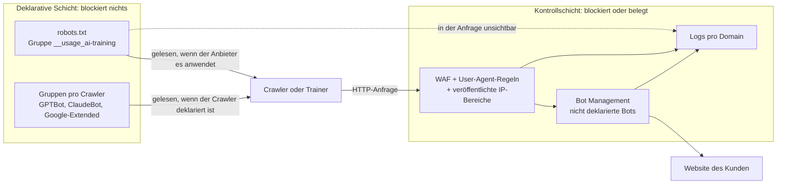
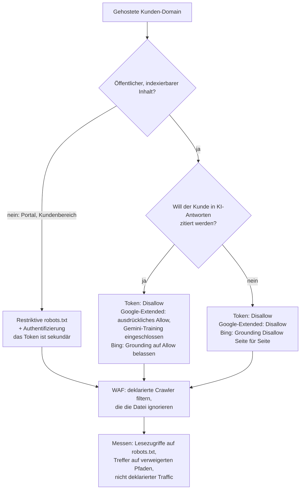

## Die Frage, die in der Geschäftsleitung fällt

Stellen Sie sich die Geschäftsleitungsrunde einer Hotelgruppe vor, die mehrere Dutzend Häuser betreibt. Zwischen zwei Punkten zur Auslastung stellt die Geschäftsführerin eine Frage, die sie am Morgen in der Presse gelesen hat: Haben wir künstlichen Intelligenzen untersagt, von unseren Websites zu lernen? Zimmerbeschreibungen, Fotos, Stadtteilführer: Jahre an Marketingarbeit.

Die Frage stellt sich jetzt aus einem konkreten Grund. Am 30. Oktober 2026 wurde bei der IETF, der Organisation, die die Protokolle des Internets standardisiert, ein neuer Mechanismus vorgeschlagen: ein Schlüsselwort für die robots.txt, jene kleine Textdatei, die jede Website veröffentlicht, um die Roboter zu lenken, die sie durchforsten. Am selben Tag kündigten Google, Microsoft und Anthropic an, es zu unterstützen, jeder in seinem eigenen Tempo. Die Fachpresse berichtete von einer vergleichbaren Ankündigung von OpenAI.

Die ehrliche Antwort ist unbequem. Man kann es *sagen*, in zwei Zeilen Text. Man kann es nicht *durchsetzen*.

Das Thema betrifft alle, die Websites im Auftrag anderer betreiben: Hotels, Studentenwohnheime, Handelsketten und den Betreiber, der ihr Netzwerk verwaltet, mitunter auch ihre Webseiten. Meine Position ist klar. Dieses Schlüsselwort ist ein Schild an der Tür, kein Schloss. Man sollte es überall und schnell veröffentlichen, weil es fast nichts kostet. Man muss aber auch weiter filtern und messen, was tatsächlich an die Server klopft, denn das Schlüsselwort filtert nichts.

## Das Schild an der Türklinke

Jeder kennt das Schild *Bitte nicht stören* an der Klinke eines Hotelzimmers. Das Personal respektiert es, aus Höflichkeit und weil die Dienstanweisung es vorsieht. Verriegelt wird dadurch nichts. Das Schloss ist die Zimmerkarte, und wer es eilig hat oder Böses im Sinn hat, kann den Anhänger problemlos ignorieren.

Das Token `__usage_ai-training` funktioniert genau so. Es wird in die robots.txt geschrieben, und das Beispiel seines Autors umfasst drei Zeilen:

```
User-Agent: __usage_ai-training
Disallow: /
Allow: /press-kit/
```

Übersetzt: Ich möchte nicht, dass meine Inhalte zum Training generativer KI-Modelle dienen, mit Ausnahme meines Pressekits. Das `Disallow` verbietet hier keinen Besuch. Es drückt eine Präferenz gegen das Training aus, das `Allow` eine Präferenz dafür.

### Eine minimale Grammatik, vier Fallstricke

Der Text mit dem Titel *Machine-Readable Training Preference Signal* ist ein Internet-Draft, also ein Arbeitsdokument, das bei der IETF eingereicht wird. Er erfindet keine neue Syntax. Er greift den Begriff *product token* aus RFC 9309 auf, dem Standard, der robots.txt seit September 2022 regelt, und das Token wird ohne Beachtung der Groß- und Kleinschreibung verglichen. Der Rest verlangt mehr Aufmerksamkeit.

- **Der Platzhalter deckt das Token nicht ab.** Ein `User-Agent: *` gefolgt von `Disallow: /` drückt keine Trainingspräferenz aus. Der Draft schließt das ausdrücklich aus (MUST NOT).
- **Schweigen ist keine Zustimmung.** Ohne eine eigene Gruppe für das Token wurde keine Präferenz geäußert, weder dafür noch dagegen.
- **Nichts wirkt rückwirkend.** Maßgeblich ist allein die Datei, die zum Zeitpunkt des Abrufs des Inhalts galt. Was 2024 abgesaugt wurde, bleibt abgesaugt.
- **Der Vertrag geht der Datei vor.** „Private agreements MAY override preferences expressed via this mechanism.“ Eine mit einem KI-Anbieter unterzeichnete Lizenzvereinbarung hat also Vorrang vor der robots.txt. Und eine spezifische Regel sollte die allgemeine übertrumpfen: Anthropic stellt klar, dass Regeln, die `ClaudeBot` namentlich nennen, Vorrang vor dem Signal haben.

Der Geltungsbereich schließlich ist dem Vokabular der IETF-Arbeitsgruppe AIPREF (AI Preferences) entlehnt: Es geht darum, die gelernten Parameter eines generativen KI-Modells zu verändern. Das Training eines rein nicht generativen Modells liegt außerhalb des Rahmens.


*Das Token fügt der Datei eine Zeile hinzu: eine maschinenlesbare Erklärung, die keine Tür verschließt.*

## Ein Autor, vier Zeitpläne

Schlagzeilen stellten die Episode als einhellige Unterstützung durch vier Giganten für denselben Mechanismus dar. Das Dokument erzählt eine bescheidenere Geschichte.

Der Draft `draft-kelley-aipref-training-preference-signal-00` hat einen einzigen Autor: Kevin Kelley von Anthropic. Es handelt sich um eine individuelle Einreichung, die von der IETF nicht getragen wird. Im Datatracker, dem Tracking-Werkzeug der IETF für Dokumente, ist er keiner Arbeitsgruppe zugeordnet, und sein Status beschränkt sich auf I-D Exists, den Standardstatus eines veröffentlichten Drafts. Ohne Verlängerung läuft er am 3. Mai 2027 ab.

Google, Microsoft und OpenAI tauchen nur in den Danksagungen auf. Ich habe dort 46 Namen gezählt: vier von Google, vier von Microsoft, zwei von OpenAI, einer von Anthropic zusätzlich zum Autor. Außerdem finden sich dort Cloudflare, Meta, Common Crawl, die BBC, die Financial Times oder Creative Commons. Der Text hält fest, dass die Zugehörigkeiten nur zur Identifikation genannt werden. Jemandem zu danken, heißt nicht, seine Unterschrift zu haben.

Der 30. Oktober brachte vor allem einseitige Terminankündigungen, veröffentlicht am Tag des Drafts selbst. Auf der Mailingliste der Gruppe AIPREF haben mehrere Teilnehmer die Stirn gerunzelt. Nate Hake, Gründer der Website Travel Lemming, schrieb am 3. November: „Then a draft was proposed to this list, and almost immediately four tech companies simultaneously announced public support for it.“ Laurent Le Meur von EDRLab sieht darin vollendete Tatsachen. Alissa Cooper vom Knight-Georgetown Institute bemerkt das Fehlen eines Registers für weitere Token und wundert sich über eine Lücke: „I do wonder why a policy token was not defined for the search category“. Das sind individuelle Positionen, nicht die der Gruppe. Sie zielen mehr auf die Methode als auf das Prinzip.

Was tatsächlich zugesagt ist, mit dem Niveau der jeweiligen Quelle:

| Anbieter | Was angekündigt ist | Frist | Quellenniveau |
|---|---|---|---|
| Anthropic | Unterstützung begonnen, schrittweise auf alle Dienste ausgeweitet; Regeln, die ClaudeBot nennen, haben Vorrang vor dem allgemeinen Signal | Kein Datum | Primär: Nachricht von Kevin Kelley an die IETF-Liste, ClaudeBot-Hilfeseite |
| Google | Unterstützung angestrebt; eine Ablehnung über das Token, ohne Erwähnung von Google-Extended, wird als Ablehnung von Google-Extended gelesen | Anfang 2027 | Primär: Search-Central-Blog, Crawler-Dokumentation |
| Microsoft | Trainingspräferenz über dasselbe Token; separate Grounding-Präferenz (Zitat in den Antworten), Seite für Seite | 15.12.2026: Übergangspräferenzen in den Bing Webmaster Tools; 01.02.2027: Präferenzen werden im Zuge des Crawls berücksichtigt; 30.09.2027: Ende der temporären Präferenzen | Primär: Bing-Blog |
| OpenAI | Unterstützung in den kommenden Monaten, ohne die Steuerungen für GPTBot und OAI-SearchBot zu ersetzen | Kein Datum | Ausschließlich sekundär: offizielle Seite mit unseren Werkzeugen nicht abrufbar |

Kevin Kelley warnt selbst: „It'll take us some time to add support across our services“. Bei Google legt sich John Mueller auf das Jahr fest, ohne einen Tag zu nennen: „We aim to support this new control along with other AI providers in 2027, and will provide updates on our progress.“ Die am selben Tag aktualisierte Crawler-Dokumentation präzisiert: Anfang 2027.

Microsoft ist am genauesten und am klarsten, was die Natur des Instruments angeht: „These settings govern use of content, not crawl access.“ Bing behandelt außerdem das *Grounding* gesondert, den Moment, in dem ein Assistent Seiten abruft, um seine Antwort zu untermauern und zu zitieren. Und das nur Seite für Seite: „There is no site-wide robots.txt grounding preference.“ Ab dem 1. März 2027 gelten die Tags NoArchive und NoCache bei Microsoft nicht mehr als Präferenz.

Bei OpenAI ist Vorsicht geboten. Alles, was wir über die Ankündigung wissen, stammt aus der Fachpresse. Eine einzige Quelle nennt einen auf das Training von Foundation-Modellen beschränkten Umfang, also enger als die IETF-Definition: am Originaltext zu prüfen.

Bilanz zum 5. November: Weder bei Google noch bei Microsoft ist etwas in Betrieb, und Anthropic sagt, begonnen zu haben, ohne Abschlussdatum. Zahlen zur Verbreitung gibt es keine. Das Token ist sechs Tage alt.

## Präferenz ist keine Kontrolle

Ein Roboter, der die Datei ignorieren will, muss nichts umgehen. Es genügt, sie nicht zu lesen.

Das ist keine Schwachstelle, sondern das ursprüngliche Design. RFC 9309 legt es gleich in der Einleitung fest: „These rules are not a form of access authorization.“ Kelleys Draft geht weiter: „This policy token is not a directive for crawling behavior.“ Das Token spricht von der Nutzung des Inhalts, nicht vom Besuch. Ein Anbieter kann darauf verzichten, herunterzuladen, was er nicht verwenden darf, aber nichts zwingt ihn dazu. Um das Einsammeln selbst zu begrenzen, muss man jeden Roboter bei seinem Namen ansprechen. Und die Charta der Gruppe AIPREF zählt die technische Durchsetzung der Präferenzen laut ihrer Übersichtsseite nicht zu ihrem Aufgabenbereich.

Die Umgehung ist alles andere als theoretisch. Im August 2025 dokumentierte Cloudflare den Fall Perplexity: 20 bis 25 Millionen Anfragen pro Tag über den deklarierten Roboter und 3 bis 6 Millionen über einen nicht deklarierten Roboter, der sich als gewöhnlicher Browser ausgab, auf Zehntausenden Domains. Cloudflare nahm ihn aus seiner Liste verifizierter Roboter. Das ist ein Beispiel, keine allgemeine Statistik. Es genügt, um zu zeigen, dass sich eine Präferenz umgehen lässt, indem man den Namen wechselt.

Der zweite blinde Fleck ist subtiler. Das Token taucht in keiner HTTP-Anfrage auf: Kein Roboter meldet sich als `__usage_ai-training`. Auch Google-Extended, Googles bestehende Steuerung für Gemini, hat keinen eigenen User-Agent, also keinen Namen, der mit jeder Anfrage mitgeschickt wird. Google sammelt mit seinen üblichen Robotern. Ergebnis: In Ihren Logs sehen Sie, wer zu Besuch kommt. Was er danach mit dem Inhalt macht, sehen Sie nie.

Der Einsatz ist dagegen enorm. Laut Cloudflare machte das Training im Juli 2025 etwa 79 % des in seinem Netzwerk beobachteten Traffics von KI-Robotern aus, gegenüber 72 % ein Jahr zuvor. Die Zahl ist mehr als ein Jahr alt, aber die Größenordnung spricht für sich: Das Signal zielt auf die Hauptnutzung des Einsammelns, ohne darauf den geringsten Einfluss zu haben.


*Das Token lebt in der oberen Schicht. Nur die untere Schicht kann eine Anfrage ablehnen oder eine verwertbare Spur hinterlassen.*

## Ein Standard, der noch im Bau ist

Selbst als bloße Präferenz ruht das Token auf Fundamenten, die sich noch bewegen.

Seine Definition von Training stammt aus dem Vokabular der Gruppe, `draft-ietf-aipref-vocab-08`, veröffentlicht Mitte September 2026. Dieser Text trägt einen unmissverständlichen Warnhinweis: „Its contents DO NOT REFLECT CONSENSUS of the Working Group either in whole or part.“ Der Abschnitt, der das Training definiert, ist selbst als konsenslos gekennzeichnet. Die Charta sah dennoch vor, dieses Vokabular und seine Anbindungsmethode vor dem 31. August 2026 an die IESG zu übergeben, das Gremium, das die Standards der IETF freigibt. Zum 5. November deutet nichts darauf hin, dass das geschehen ist, und eine offizielle Verschiebung habe ich nicht gefunden.

Zwei Syntaxen konkurrieren außerdem um die robots.txt. Der Anbindungs-Draft (`draft-ietf-aipref-attach-05`, August 2026), unterzeichnet von Ingenieuren von Google und Mozilla, setzt auf einen HTTP-Header der Form `Content-Usage: train-ai=n` oder auf eine Regel `Content-Usage: /ai-ok/ train-ai=y`. Kelley schafft stattdessen eine eigene User-Agent-Gruppe, und die Namen weichen voneinander ab: `train-ai` auf der einen Seite, `__usage_ai-training` auf der anderen. Er präsentiert seinen Text übrigens als Beitrag zu den Arbeiten an der Anbindung. Zusammenführung, Ersetzung, Aufgabe: Alles bleibt möglich. Cloudflare veröffentlicht sogar seit September 2025 eine eigene `Content-Signal`-Zeile in der verwalteten robots.txt, die es seinen Kunden anbietet: eine dritte Grammatik, ohne Bezug zum IETF-Token.

Der nächste Termin: die beiden AIPREF-Sitzungen des IETF-Treffens 127 am 16. und 19. November 2026 (UTC). Für alle, die Hunderte von Domains verwalten, ist die Konsequenz unmittelbar. Man bearbeitet die robots.txt nie von Hand, Website für Website. Man erzeugt sie aus einer zentralen Vorlage, um die Syntax an einem Tag wechseln zu können, sobald die Gruppe entschieden hat.

Bleibt das Recht. Der europäische Verhaltenskodex für KI-Modelle mit allgemeinem Verwendungszweck (GPAI, General-Purpose AI), veröffentlicht am 10. Juli 2025, verpflichtet seine Unterzeichner, Roboter einzusetzen, die der robots.txt gemäß RFC 9309 folgen, „and any subsequent version of this Protocol for which the IETF demonstrates that it is technically feasible and implementable“. Ein individueller Draft in Version -00 ist nicht diese Version. Google hält sein Vorgehen für mit dem Kodex vereinbar. Alissa Cooper bestreitet in einem Gastbeitrag für Tech Policy Press, dass es dort bereits abgedeckt ist. Ich habe weder eine Gerichtsentscheidung noch eine des europäischen AI Office zum Wert des Tokens als Rechtevorbehalt im Sinne von Artikel 4(3) der Richtlinie 2019/790 gefunden, die das Text- und Data-Mining regelt. Eine offene Frage also. Niemand sollte sie einem Kunden als geklärt darstellen.


*Zwei Schichten, die sich nicht berühren: oben die Schilder der Präferenz, darunter die Schranken der Kontrolle.*

## Deklarieren, filtern, erkennen, belegen

Was folgt, ist meine Analyse als Betreiber, keine Lektüre der Texte.

Zuerst der Geltungsbereich. Meine Hypothese, kundenweise zu validieren: Ein Captive Portal, jene WLAN-Startseite, auf der man die Nutzungsbedingungen akzeptiert, ist normalerweise kein indexierter Inhalt. Die Exposition liegt anderswo. Sie betrifft die öffentlichen Websites der Kunden, die der Betreiber hostet oder betreibt (Hotels, Wohnheime, Handelsketten), die Kundenbereiche, die Registrierungsseiten und die Hilfecenter.

Für diesen Bereich denke ich in vier Schichten. Die erste spricht. Die drei anderen handeln oder hinterlassen eine Spur.

**1. Deklarieren.** Die Gruppe `__usage_ai-training` hinzufügen und die bestehenden Gruppen (`GPTBot`, `ClaudeBot`, `Google-Extended`) beibehalten. Google und Anthropic schreiben, dass ihre aktuellen Steuerungen gültig bleiben, OpenAI laut Presse ebenfalls, und Anthropic lässt Regeln, die `ClaudeBot` nennen, Vorrang haben. Eine Datei pro Origin vorsehen: RFC 9309 bindet die robots.txt an das Tripel aus Schema, Host und Port, also hat jede Subdomain und jedes Portal ihre eigene. Mit Code 200 und als reinen Text ausliefern, denn ein 5xx-Code wird als vollständiges Verbot gelesen und ein 4xx-Code als vollständige Erlaubnis. Mit bis zu 24 Stunden Cache rechnen. Schließlich eine automatische Syntaxprüfung in die Deployment-Kette einbauen: `__usage_ai_training`, mit Unterstrich statt Bindestrich, bleibt ein gültiger Name und wird daher stillschweigend ignoriert. Ein Teilnehmer der IETF-Liste hat ihn übrigens in seiner eigenen Nachricht so geschrieben.

**2. Filtern.** Das ist die Schicht, die verhindert. Eine Web Application Firewall (WAF) wendet Regeln pro deklariertem User-Agent an, gekoppelt mit den von den Anbietern veröffentlichten IP-Bereichen: die Datei `gptbot.json` von OpenAI oder die Liste, die Anthropic auf seiner Hilfeseite angibt. Ohne diese Kopplung borgt sich jeder den Namen eines Roboters. Hinzu kommen Rate Limiting und eine Authentifizierung für alles, was nicht für die Öffentlichkeit bestimmt ist. Die umgekehrte Falle: Roboter, die die robots.txt lesen sollen, nicht per IP blockieren, wovon Anthropic ausdrücklich abrät.

**3. Erkennen.** Gegen Roboter, die sich als Browser tarnen, braucht es einen Score zur Verhaltenserkennung, das *Bot Management*. Die kryptografische Überprüfung der Identität von Agenten ist eine andere Baustelle, die in unserem Artikel über Web Bot Auth behandelt wird.

**4. Belegen.** Für jede Roboteranfrage aufbewahren: User-Agent, IP-Adresse, ASN (die Nummer des Herkunftsnetzes), Verifizierungsmethode, Pfad, Antwortcode, Domain und betroffenen Kunden.


*Entscheidungsbaum pro Kunden-Domain: Die Präferenz wird von Fall zu Fall gewählt, das Filtern gilt in jedem Fall.*

### Gelernt werden oder zitiert werden

Die erste Abwägung, und die heikelste. Bei Google gilt eine über das Token geäußerte Ablehnung als Ablehnung von Google-Extended, das sowohl das Training künftiger Gemini-Modelle als auch das Grounding in den Gemini-Anwendungen abdeckt. Google stellt klar, dass Websites, die Google-Extended ausdrücklich erlauben, in diesen Antworten erscheinen können. Meine Lesart, die Blog und Dokumentation kombiniert, ohne auf einem einzelnen Satz zu beruhen: Bei Google ist es heute schwierig, zitiert zu werden, ohne das Training zu speisen.

Bei Microsoft lassen sich beide getrennt regeln: das Training über robots.txt, seitenweise anpassbar, das Grounding ausschließlich Seite für Seite. Bing warnt übrigens: „Neither choice guarantees inclusion, traffic, or payment.“ Ein Hotel, das in den Antworten der Assistenten auftauchen will, muss also Anbieter für Anbieter und in Kenntnis der Sachlage entscheiden.

Zweite Frage: Wer entscheidet? Das Token drückt die Präferenz dessen aus, der den Dienst veröffentlicht. Bei einer vom Betreiber gehosteten Website muss die Standardwahl vertraglich festgelegt und dokumentiert sein, und jede Änderung wird protokolliert. Der Betreiber entscheidet nicht stillschweigend anstelle seines Kunden.

Dritte Einschränkung: die Zeit. Microsoft entdeckt eine Präferenz erst, wenn es die Seite erneut besucht. IndexNow, das Protokoll, das Suchmaschinen Aktualisierungen meldet, beschleunigt, ohne etwas zu garantieren. Um vom ersten Tag an gelesen zu werden, veröffentlicht man besser vor dem 1. Februar 2027.

### Was sich messen lässt, was man nie sehen wird

Vier Kennzahlen sind im Log erreichbar. Erstens die Häufigkeit und die Antwortcodes der Lesezugriffe auf `/robots.txt`, Roboter für Roboter: Ein Roboter, der die Datei nie liest, kann ihr nicht folgen. Zweitens die Anfragen eines deklarierten Roboters auf Pfade, die ihm seine eigene Gruppe verweigert, also ein beobachtbarer Verstoß. Drittens der Anteil des deklarierten KI-Traffics, Domain für Domain. Viertens der browserartige Traffic aus Rechenzentrumsnetzen, ein guter Indikator für Umgehung.

Drei Dinge bleiben unsichtbar. Die tatsächliche Nutzung des Inhalts für das Training. Die Daten, die vor der Veröffentlichung der Datei gesammelt wurden. Und die Wirkung auf ein bereits trainiertes Modell, da die Präferenz nicht rückwirkend gilt.


*Was die Logs zeigen: wer die robots.txt liest, wer auf verweigerte Pfade klopft, wer sich als Browser tarnt.*

## Heute Abend veröffentlichen, nichts versprechen

In der Sache ist das Token gut gebaut: minimal, ohne neue Grammatik, von einem Praktikanten lesbar. In der Form haben die Kritiker auf der Liste recht, die Stirn zu runzeln. Ein Standard, der aus gleichzeitigen Ankündigungen von Anbietern entsteht, gleicht eher einer Branchenabsprache als einem Konsens. Beide Feststellungen schließen sich nicht aus.

Meine Linie für einen Betreiber, der Kundenwebsites hostet, besteht aus vier Handgriffen. Jetzt veröffentlichen, auf jeder Origin, aus einer zentralen Vorlage: Die Kosten sind nahezu null. Das Wort „geschützt“ nie in einem Bericht oder Kundenvertrag verwenden. Die Richtlinie Kunde für Kunde formulieren und dabei Training und Sichtbarkeit in KI-Antworten trennen, Anbieter für Anbieter. Das Ganze nach den IETF-Sitzungen vom 16. und 19. November überprüfen, dann Anfang 2027, wenn Google und Microsoft die Umstellung planen.

Und das Hotelschild im Hinterkopf behalten. Es schützt die Ruhe der Gäste, weil das Personal mitspielt, nicht weil es robust ist. An dem Tag, an dem jemand nicht mitspielt, zählt das Schloss.

Das Token bittet höflich. Die WAF dagegen bittet um gar nichts.

_Persönliche Ansichten, keine Position von Wifirst._

## Quellen

1. [Kevin Kelley, draft-kelley-aipref-training-preference-signal-00, Machine-Readable Training Preference Signal, IETF, 30.10.2026](https://www.ietf.org/archive/id/draft-kelley-aipref-training-preference-signal-00.txt)
2. [IETF Datatracker, Seite zum Kelley-Draft](https://datatracker.ietf.org/doc/draft-kelley-aipref-training-preference-signal/)
3. [IETF Datatracker, Dokumente der Arbeitsgruppe AIPREF](https://datatracker.ietf.org/wg/aipref/documents/)
4. [draft-ietf-aipref-vocab-08, September 2026](https://datatracker.ietf.org/doc/html/draft-ietf-aipref-vocab) (Klartext: [vocab-08](https://www.ietf.org/archive/id/draft-ietf-aipref-vocab-08.txt))
5. [draft-ietf-aipref-attach-05, August 2026](https://datatracker.ietf.org/doc/html/draft-ietf-aipref-attach)
6. [Charta und Meilensteine der Gruppe AIPREF](https://datatracker.ietf.org/group/aipref/about/)
7. [RFC 9309, Robots Exclusion Protocol, September 2022](https://www.rfc-editor.org/rfc/rfc9309)
8. Mailingliste ai-control: [Archiv](https://mailarchive.ietf.org/arch/browse/ai-control/) ; [Kevin Kelley, 30.10.2026](https://mailarchive.ietf.org/arch/msg/ai-control/mddjatOxSR0h6GmLRBWlc839c7w/) ; [Nate Hake, 03.11.2026](https://mailarchive.ietf.org/arch/msg/ai-control/A2LWviXagqaze8qg4rPvM_v5Akk/) ; [Alissa Cooper, 04.11.2026](https://mailarchive.ietf.org/arch/msg/ai-control/qhIHBiSQsFOKcKS8Yq56Dl2nhZU/)
9. [Google Search Central Blog, John Mueller, Supporting a shared AI training control for websites, 30.10.2026](https://developers.google.com/search/blog/2026/10/ai-training-control)
10. [Google, Dokumentation der gängigen Crawler und von Google-Extended, aktualisiert am 30.10.2026](https://developers.google.com/search/docs/crawling-indexing/google-common-crawlers)
11. [Bing Blog, Krishna Madhavan, Your content, your choice…, 30.10.2026](https://blogs.bing.com/search/2026/10/your-content-your-choice-clearer-preferences-for-training-and-grounding/)
12. [Anthropic, ClaudeBot-Hilfeseite](https://support.claude.com/en/articles/8896518-claudebot)
13. [OpenAI, Making it easier for websites to express AI training preferences (nicht direkt abgerufen)](https://openai.com/index/helping-websites-express-ai-training-preferences/)
14. [OpenAI, Dokumentation der Bots](https://developers.openai.com/api/docs/bots)
15. [Alissa Cooper, Tech Policy Press, 04.11.2026](https://www.techpolicy.press/what-the-new-ai-training-optout-really-means/)
16. [PPC Land, Google, Microsoft, OpenAI and Anthropic back one AI training opt-out, 31.10.2026](https://ppc.land/google-microsoft-openai-and-anthropic-back-one-ai-training-opt-out/)
17. [Search Engine Roundtable, 30.10.2026](https://www.seroundtable.com/google-ai-training-control-42430.html)
18. [Cloudflare, Content Signals Policy, 24.09.2025](https://blog.cloudflare.com/content-signals-policy/)
19. [Cloudflare, Daten zum Crawl-to-Click-Verhältnis von KI-Robotern, 29.08.2025](https://blog.cloudflare.com/crawlers-click-ai-bots-training/)
20. [Cloudflare, Perplexity und nicht deklarierte Crawler, 04.08.2025](https://blog.cloudflare.com/perplexity-is-using-stealth-undeclared-crawlers-to-evade-website-no-crawl-directives/)
21. [Europäische Kommission, GPAI-Verhaltenskodex, Kapitel Urheberrecht, Maßnahme 1.3, 10.07.2025](https://ec.europa.eu/newsroom/dae/redirection/document/118115) ; [Übersichtsseite des Kodex](https://digital-strategy.ec.europa.eu/en/policies/contents-code-gpai)
22. [IETF 127, AIPREF-Sitzungen](https://datatracker.ietf.org/meeting/127/session/aipref)
