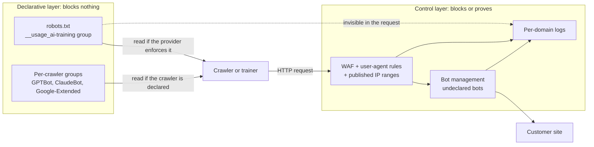
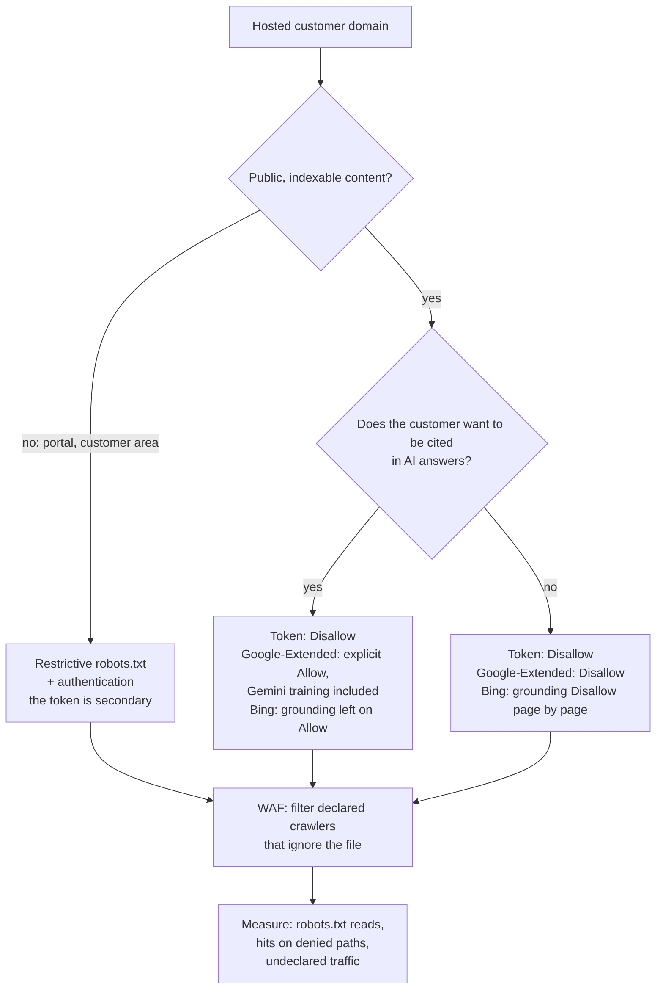

## The Question That Lands in the Boardroom

Picture the executive committee of a hotel group that runs several dozen properties. Between two updates on occupancy rates, the CEO asks a question she read in the press that very morning: have we forbidden artificial intelligence from learning on our sites? Room descriptions, photos, neighborhood guides: years of marketing work.

The question is landing now for a specific reason. On October 30, 2026, a new mechanism was proposed to the IETF, the body that standardizes Internet protocols: a keyword to drop into robots.txt, the small text file that every site publishes to guide the robots crawling it. The same day, Google, Microsoft and Anthropic announced they would support it, each at its own pace. The trade press reported a comparable announcement from OpenAI.

The honest answer is uncomfortable. You can *say* it, in two lines of text. You cannot *enforce* it.

The topic concerns everyone who exposes sites on behalf of others: hotels, student residences, retail chains, and the operator that runs their network and sometimes their web pages. My position is clear-cut. This keyword is a sign on the door, not a lock. You should publish it everywhere and quickly, because it costs almost nothing. You should also keep filtering and measuring what actually hits your servers, because the keyword filters nothing.

## The Sign on the Door Handle

Everyone knows the *Do Not Disturb* sign hanging on a hotel room door handle. Staff respect it, out of courtesy and because procedure says so. But it locks nothing. The lock is the key card, and someone in a hurry or with bad intentions can perfectly well ignore the piece of cardboard.

The `__usage_ai-training` token works exactly this way. It is written in robots.txt, and the example given by its author fits in three lines:

```
User-Agent: __usage_ai-training
Disallow: /
Allow: /press-kit/
```

Translation: I would rather my content not be used to train generative AI models, except my press kit. Here the `Disallow` forbids no visit at all. It expresses a preference against training, and the `Allow` a preference in favor.

### A Minimal Grammar, Four Traps

The text, titled *Machine-Readable Training Preference Signal*, is an Internet-Draft, that is, a working document submitted to the IETF. It invents no new syntax. It reuses the *product token* notion from RFC 9309, the standard that has governed robots.txt since September 2022, and the token is compared case-insensitively. The rest demands more attention.

- **The wildcard does not cover the token.** A `User-Agent: *` followed by `Disallow: /` expresses no training preference. The draft rules it out in so many words (MUST NOT).
- **Silence is not consent.** Without a group dedicated to the token, no preference has been expressed, either for or against.
- **Nothing is retroactive.** Only the file in force at the moment the content was retrieved counts. What was scraped in 2024 stays scraped.
- **Contract comes before the file.** "Private agreements MAY override preferences expressed via this mechanism." A license agreement signed with an AI provider therefore beats robots.txt. And a specific rule should take precedence over the general one: Anthropic states that rules naming `ClaudeBot` override the signal.

Finally, the scope is borrowed from the vocabulary of the IETF's AIPREF (AI Preferences) working group: it covers modifying the learned parameters of a generative AI model. Training a purely non-generative model remains out of scope.


*The token adds one line to the file: a machine-readable declaration that closes no door.*

## One Author, Four Timelines

Headlines presented the episode as unanimous backing from four giants for a single mechanism. The document tells a more modest story.

The draft `draft-kelley-aipref-training-preference-signal-00` has a single author: Kevin Kelley, of Anthropic. It is an individual submission, not endorsed by the IETF. On the datatracker, the IETF's document tracking tool, it is attached to no working group and its state is limited to I-D Exists, the default status of a published draft. If not renewed, it expires on May 3, 2027.

Google, Microsoft and OpenAI appear only in the acknowledgments. I counted 46 names there: four from Google, four from Microsoft, two from OpenAI, and one from Anthropic besides the author. You also find Cloudflare, Meta, Common Crawl, the BBC, the Financial Times and Creative Commons. The text specifies that affiliations are mentioned for identification purposes only. Thanking someone is not the same as getting their signature.

What October 30 mostly produced was unilateral timeline announcements, published the same day as the draft. On the AIPREF working group's mailing list, several participants balked. Nate Hake, founder of the site Travel Lemming, wrote on November 3: "Then a draft was proposed to this list, and almost immediately four tech companies simultaneously announced public support for it." Laurent Le Meur, of EDRLab, sees a fait accompli. Alissa Cooper, of the Knight-Georgetown Institute, notes the absence of a registry for other tokens and is surprised by a gap: "I do wonder why a policy token was not defined for the search category". These are individual positions, not the group's. They target the method more than the principle.

What is actually promised, with the level of each source:

| Provider | What is announced | Deadline | Source level |
|---|---|---|---|
| Anthropic | Support started, extended progressively to all services; rules naming ClaudeBot take precedence over the general signal | No date | Primary: Kevin Kelley's message to the IETF list, ClaudeBot help page |
| Google | Support targeted; an opt-out via the token, with no mention of Google-Extended, will be read as a Google-Extended opt-out | Early 2027 | Primary: Search Central blog, crawler documentation |
| Microsoft | Training preference via the same token; separate grounding preference (citation in answers), page by page | Dec 15, 2026: transition preferences in Bing Webmaster Tools; Feb 1, 2027: preferences honored as crawling proceeds; Sep 30, 2027: end of temporary preferences | Primary: Bing blog |
| OpenAI | Support in the coming months, without replacing the GPTBot and OAI-SearchBot controls | No date | Secondary only: official page not accessible to our tools |

Kevin Kelley himself warns: "It'll take us some time to add support across our services". On Google's side, John Mueller commits to the year without setting a day: "We aim to support this new control along with other AI providers in 2027, and will provide updates on our progress." The crawler documentation, updated the same day, says early 2027.

Microsoft is the most precise, and the clearest about the nature of the mechanism: "These settings govern use of content, not crawl access." Bing also handles *grounding* separately, the moment when an assistant fetches pages to back up and cite its answer. And only page by page: "There is no site-wide robots.txt grounding preference." Starting March 1, 2027, the NoArchive and NoCache tags will no longer count as a preference at Microsoft.

On OpenAI's side, caution. Everything we know about the announcement comes from the trade press. A single source puts forward a scope limited to foundation model training, hence narrower than the IETF definition: to be confirmed against the original text.

Status as of November 5: nothing is live at Google or Microsoft, and Anthropic says it has started with no completion date. No adoption figure exists. The token is six days old.

## Preference Is Not Control

A robot that wants to ignore the file has nothing to circumvent. It just doesn't read it.

This is not a flaw, it is the original design. RFC 9309 states it right in its introduction: "These rules are not a form of access authorization." Kelley's draft goes further: "This policy token is not a directive for crawling behavior." The token speaks about the use of content, not the visit. A provider can refrain from downloading what it won't be able to use, but nothing obliges it to. To limit collection itself, you have to target each robot by name. As for the AIPREF group's charter, it places the technical enforcement of preferences outside its scope, according to its overview page.

Circumvention is not theoretical. In August 2025, Cloudflare documented the Perplexity case: 20 to 25 million daily requests through its declared robot, and 3 to 6 million through an undeclared robot that presented itself as an ordinary browser, across tens of thousands of domains. Cloudflare removed it from its list of verified bots. This is an illustration, not a general statistic. It is enough to show that a preference can be bypassed by changing names.

The second blind spot is subtler. The token appears in no HTTP request: no robot announces itself as `__usage_ai-training`. Google-Extended, Google's existing control for Gemini, doesn't have its own user-agent either, that is, a name sent with every request. Google collects with its usual robots. Result: in your logs, you see who visits. You will never see what they do with the content afterward.

The stakes, for their part, are massive. According to Cloudflare, training accounted for about 79% of AI robot traffic observed on its network in July 2025, up from 72% a year earlier. The data is more than a year old, but the order of magnitude speaks: the signal targets the main use of the collection, without any grip on the collection itself.


*The token lives in the top layer. Only the bottom layer can refuse a request or leave a usable trace.*

## A Standard Still Under Construction

Even as a mere preference, the token rests on foundations that are still shifting.

Its definition of training comes from the group's vocabulary, `draft-ietf-aipref-vocab-08`, published in mid-September 2026. This text carries an unambiguous warning: "Its contents DO NOT REFLECT CONSENSUS of the Working Group either in whole or part." The section that defines training is itself flagged as lacking consensus. The charter nonetheless planned to send this vocabulary and its attachment method to the IESG, the committee that approves IETF standards, before August 31, 2026. As of November 5, nothing indicates that this has happened, and I found no trace of an official postponement.

Two syntaxes then compete for robots.txt. The attachment draft (`draft-ietf-aipref-attach-05`, August 2026), signed by Google and Mozilla engineers, goes through an HTTP header such as `Content-Usage: train-ai=n` or a rule like `Content-Usage: /ai-ok/ train-ai=y`. Kelley instead creates a dedicated User-Agent group, and the names diverge: `train-ai` on one side, `__usage_ai-training` on the other. He does present his text as a contribution to the attachment work. Merger, replacement, abandonment: everything remains possible. Cloudflare has even published, since September 2025, its own `Content-Signal` line in the managed robots.txt it offers its customers: a third grammar, unrelated to the IETF token.

Next appointment: the two AIPREF sessions at IETF 127, on November 16 and 19, 2026 (UTC). For anyone managing hundreds of domains, the consequence is immediate. You never edit robots.txt by hand, site by site. You generate it from a central template, so you can switch syntax in a day when the group finally decides.

That leaves the law. The European code of practice for general-purpose AI models (GPAI, General-Purpose AI), published on July 10, 2025, commits its signatories to using robots that follow robots.txt per RFC 9309, "and any subsequent version of this Protocol for which the IETF demonstrates that it is technically feasible and implementable". An individual draft at version -00 is not that version. Google considers its approach compatible with the code. Alissa Cooper, in an op-ed for Tech Policy Press, disputes that it is already covered. I found no court decision, nor any from the European AI Office, on the value of the token as a rights reservation within the meaning of Article 4(3) of Directive 2019/790, which governs text and data mining. An open question, then. Nobody should present it to a customer as settled.


*Two layers that do not touch: the signs of preference above, the barriers of control below.*

## Declare, Filter, Detect, Prove

What follows is my analysis as an operator, not a reading of the texts.

First, the scope. My hypothesis, to be validated customer by customer: a captive portal, that Wi-Fi welcome page where you accept the terms of use, is normally not indexed content. The exposure lies elsewhere. It concerns the public sites of customers that the operator hosts or runs (hotels, residences, retail chains), customer areas, sign-up pages and help centers.

On this scope, I think in four layers. The first one speaks. The other three act or leave a trace.

**1. Declare.** Add the `__usage_ai-training` group and keep the existing groups (`GPTBot`, `ClaudeBot`, `Google-Extended`). Google and Anthropic write that their current controls remain valid, OpenAI too according to the press, and Anthropic gives precedence to rules naming `ClaudeBot`. Plan one file per origin: RFC 9309 ties robots.txt to the scheme, host and port triplet, so every subdomain and every portal has its own. Serve it with a 200 status code as plain text, because a 5xx code is read as a total prohibition and a 4xx code as total permission. Allow for up to 24 hours of caching. Finally, add an automatic syntax check to the deployment pipeline: `__usage_ai_training`, with an underscore in place of the hyphen, is still a valid name, and so is silently ignored. A contributor on the IETF list even spelled it that way in his own message.

**2. Filter.** This is the layer that prevents. A web application firewall (WAF) applies rules per declared user-agent, paired with the IP ranges published by providers: OpenAI's `gptbot.json` file, or the list Anthropic gives on its help page. Without this pairing, anyone can borrow a robot's name. Add rate limiting, and authentication for anything not meant to be public. The reverse trap: don't block by IP the robots you want to read robots.txt, which Anthropic explicitly advises against.

**3. Detect.** Against robots disguised as browsers, you need a behavioral detection score, *bot management*. Cryptographic verification of agent identity is another project, covered in our article on Web Bot Auth.

**4. Prove.** Keep, for every robot request: user-agent, IP address, ASN (the number of the originating network), verification method, path, response code, domain and customer concerned.


*Decision tree per customer domain: the preference is chosen case by case, filtering applies in every case.*

### Being Learned From or Being Cited

First trade-off, and the most delicate. At Google, an opt-out expressed through the token will count as a Google-Extended opt-out, which covers both the training of future Gemini models and grounding in the Gemini apps. Google specifies that sites that explicitly allow Google-Extended are eligible to appear in those answers. My reading, which combines the blog and the documentation without resting on a single sentence: at Google, being cited without feeding training is hard to achieve today.

At Microsoft, the two are set separately: training through robots.txt, adjustable page by page, grounding only page by page. Bing also warns: "Neither choice guarantees inclusion, traffic, or payment." A hotel that wants to appear in assistants' answers must therefore decide, provider by provider, with full knowledge of the facts.

Second question: who decides? The token expresses the preference of whoever publishes the service. For a site hosted by the operator, the default choice must be contractual, documented, and every change logged. The operator does not decide silently in place of its customer.

Third constraint: time. Microsoft only discovers a preference when it recrawls the page. IndexNow, the protocol that signals updates to search engines, speeds things up without guaranteeing anything. To be read from day one, better to publish before February 1, 2027.

### What You Can Measure, What You Will Never See

Four indicators are within reach of the logs. First, the frequency and response codes of `/robots.txt` reads, robot by robot: a robot that never reads the file cannot follow it. Next, requests from a declared robot to paths that its own group denies it, an observable violation. Then the share of declared AI traffic, domain by domain. Finally, browser-type traffic coming from data center networks, a good indicator of evasion.

Three things will remain invisible. The actual use of the content for training. Data collected before the file was published. And the effect on an already trained model, since the preference is not retroactive.


*What the logs show: who reads robots.txt, who hits the denied paths, who disguises itself as a browser.*

## Publish Tonight, Promise Nothing

On substance, the token is well designed: minimal, no new grammar, simple enough for an intern to read. On form, the critics on the list are right to balk. A standard born from simultaneous vendor announcements looks more like an industry agreement than a consensus. The two observations are not mutually exclusive.

My line, for an operator that hosts customer sites, comes down to four moves. Publish now, on every origin, from a central template: the cost is nearly zero. Never use the word "protected" in a customer report or contract. Write the policy customer by customer, separating training from visibility in AI answers, provider by provider. Review everything after the IETF sessions of November 16 and 19, then in early 2027, when Google and Microsoft plan to flip the switch.

And keep the hotel sign in mind. It protects guests' peace and quiet because the staff play along, not because it is sturdy. The day someone doesn't play along, the lock is what counts.

The token asks politely. The WAF asks nothing.

_Personal views, not Wifirst's position._

## Sources

1. [Kevin Kelley, draft-kelley-aipref-training-preference-signal-00, Machine-Readable Training Preference Signal, IETF, 30/10/2026](https://www.ietf.org/archive/id/draft-kelley-aipref-training-preference-signal-00.txt)
2. [Datatracker IETF, fiche du draft Kelley](https://datatracker.ietf.org/doc/draft-kelley-aipref-training-preference-signal/)
3. [Datatracker IETF, documents du groupe de travail AIPREF](https://datatracker.ietf.org/wg/aipref/documents/)
4. [draft-ietf-aipref-vocab-08, septembre 2026](https://datatracker.ietf.org/doc/html/draft-ietf-aipref-vocab) (texte brut : [vocab-08](https://www.ietf.org/archive/id/draft-ietf-aipref-vocab-08.txt))
5. [draft-ietf-aipref-attach-05, août 2026](https://datatracker.ietf.org/doc/html/draft-ietf-aipref-attach)
6. [Charte et jalons du groupe AIPREF](https://datatracker.ietf.org/group/aipref/about/)
7. [RFC 9309, Robots Exclusion Protocol, septembre 2022](https://www.rfc-editor.org/rfc/rfc9309)
8. Liste de diffusion ai-control : [archives](https://mailarchive.ietf.org/arch/browse/ai-control/) ; [Kevin Kelley, 30/10/2026](https://mailarchive.ietf.org/arch/msg/ai-control/mddjatOxSR0h6GmLRBWlc839c7w/) ; [Nate Hake, 3/11/2026](https://mailarchive.ietf.org/arch/msg/ai-control/A2LWviXagqaze8qg4rPvM_v5Akk/) ; [Alissa Cooper, 4/11/2026](https://mailarchive.ietf.org/arch/msg/ai-control/qhIHBiSQsFOKcKS8Yq56Dl2nhZU/)
9. [Google Search Central Blog, John Mueller, Supporting a shared AI training control for websites, 30/10/2026](https://developers.google.com/search/blog/2026/10/ai-training-control)
10. [Google, documentation des crawlers courants et de Google-Extended, mise à jour du 30/10/2026](https://developers.google.com/search/docs/crawling-indexing/google-common-crawlers)
11. [Bing Blog, Krishna Madhavan, Your content, your choice…, 30/10/2026](https://blogs.bing.com/search/2026/10/your-content-your-choice-clearer-preferences-for-training-and-grounding/)
12. [Anthropic, page d'aide ClaudeBot](https://support.claude.com/en/articles/8896518-claudebot)
13. [OpenAI, Making it easier for websites to express AI training preferences (non consultée directement)](https://openai.com/index/helping-websites-express-ai-training-preferences/)
14. [OpenAI, documentation des bots](https://developers.openai.com/api/docs/bots)
15. [Alissa Cooper, Tech Policy Press, 4/11/2026](https://www.techpolicy.press/what-the-new-ai-training-optout-really-means/)
16. [PPC Land, Google, Microsoft, OpenAI and Anthropic back one AI training opt-out, 31/10/2026](https://ppc.land/google-microsoft-openai-and-anthropic-back-one-ai-training-opt-out/)
17. [Search Engine Roundtable, 30/10/2026](https://www.seroundtable.com/google-ai-training-control-42430.html)
18. [Cloudflare, Content Signals Policy, 24/09/2025](https://blog.cloudflare.com/content-signals-policy/)
19. [Cloudflare, données sur l'écart crawl-to-click des robots d'IA, 29/08/2025](https://blog.cloudflare.com/crawlers-click-ai-bots-training/)
20. [Cloudflare, Perplexity et crawlers non déclarés, 4/08/2025](https://blog.cloudflare.com/perplexity-is-using-stealth-undeclared-crawlers-to-evade-website-no-crawl-directives/)
21. [Commission européenne, Code de bonnes pratiques GPAI, chapitre droit d'auteur, mesure 1.3, 10/07/2025](https://ec.europa.eu/newsroom/dae/redirection/document/118115) ; [page de présentation du Code](https://digital-strategy.ec.europa.eu/en/policies/contents-code-gpai)
22. [IETF 127, séances AIPREF](https://datatracker.ietf.org/meeting/127/session/aipref)
