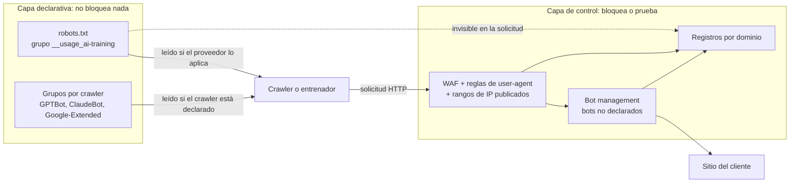
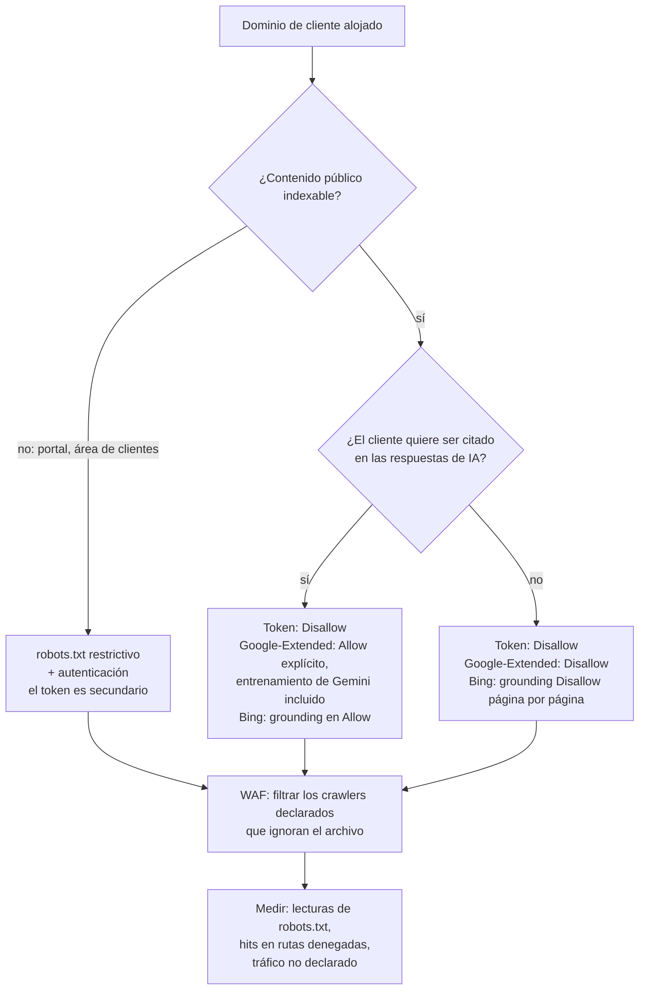

## La pregunta que llega al comité de dirección

Imagine el comité de dirección de un grupo hotelero que explota varias decenas de establecimientos. Entre dos puntos sobre la tasa de ocupación, la directora general plantea una pregunta que ha leído esa misma mañana en la prensa: ¿hemos prohibido a las inteligencias artificiales aprender de nuestros sitios? Descripciones de habitaciones, fotos, guías de barrio: años de trabajo de marketing.

La pregunta llega ahora por una razón concreta. El 30 de octubre de 2026 se propuso a la IETF, el organismo que normaliza los protocolos de Internet, un nuevo mecanismo: una palabra clave que se añade a robots.txt, ese pequeño archivo de texto que cada sitio publica para guiar a los robots que lo recorren. Ese mismo día, Google, Microsoft y Anthropic anunciaron que lo admitirían, cada uno a su ritmo. La prensa especializada informó de un anuncio similar de OpenAI.

La respuesta honesta es incómoda. Se puede *decir*, en dos líneas de texto. No se puede *imponer*.

El tema afecta a todos los que exponen sitios por cuenta de otros: hoteles, residencias de estudiantes, cadenas comerciales, y el operador que gestiona su red y, a veces, sus páginas web. Mi postura es clara. Esta palabra clave es una etiqueta en la puerta, no un cerrojo. Hay que publicarla en todas partes y cuanto antes, porque casi no cuesta nada. Y hay que seguir filtrando y midiendo lo que realmente llama a los servidores, porque ella no filtra nada.

## El cartel en el pomo de la puerta

Todo el mundo conoce el cartel de *No molestar* colgado del pomo de la habitación de un hotel. El personal lo respeta, por cortesía y porque el procedimiento lo prevé. Pero no cierra nada con llave. El cerrojo es la tarjeta magnética, y alguien con prisa o con malas intenciones puede ignorar perfectamente el cartón.

El token `__usage_ai-training` funciona exactamente así. Se escribe en robots.txt, y el ejemplo que da su autor cabe en tres líneas:

```
User-Agent: __usage_ai-training
Disallow: /
Allow: /press-kit/
```

Traducción: prefiero que mi contenido no sirva para entrenar modelos de IA generativa, salvo mi kit de prensa. Aquí el `Disallow` no prohíbe ninguna visita. Expresa una preferencia contra el entrenamiento, y el `Allow`, una preferencia a favor.

### Una gramática mínima, cuatro trampas

El texto, titulado *Machine-Readable Training Preference Signal*, es un Internet-Draft, es decir, un documento de trabajo presentado a la IETF. No inventa ninguna sintaxis. Reutiliza la noción de *product token* de la RFC 9309, la norma que regula robots.txt desde septiembre de 2022, y el token se compara sin distinguir mayúsculas de minúsculas. Lo demás exige más atención.

- **El comodín no cubre el token.** Un `User-Agent: *` seguido de `Disallow: /` no expresa ninguna preferencia de entrenamiento. El draft lo excluye expresamente (MUST NOT).
- **El silencio no equivale a consentimiento.** Sin un grupo dedicado al token, no se ha expresado ninguna preferencia, ni a favor ni en contra.
- **Nada es retroactivo.** Solo cuenta el archivo vigente en el momento en que se recuperó el contenido. Lo que se aspiró en 2024 sigue aspirado.
- **El contrato prevalece sobre el archivo.** « Private agreements MAY override preferences expressed via this mechanism. » Un acuerdo de licencia firmado con un proveedor de IA se impone, por tanto, a robots.txt. Y una regla específica debería primar sobre la regla general: Anthropic precisa que las reglas que nombran a `ClaudeBot` prevalecen sobre la señal.

El alcance, por último, está tomado del vocabulario del grupo de trabajo AIPREF (AI Preferences) de la IETF: se trata de modificar los parámetros aprendidos de un modelo de IA generativa. El entrenamiento de un modelo puramente no generativo queda fuera de ámbito.


*El token añade una línea al archivo: una declaración legible por máquinas que no cierra ninguna puerta.*

## Un autor, cuatro calendarios

Los titulares de prensa presentaron el episodio como el respaldo unánime de cuatro gigantes a un mismo mecanismo. El documento cuenta una historia más modesta.

El draft `draft-kelley-aipref-training-preference-signal-00` tiene un único autor: Kevin Kelley, de Anthropic. Es una propuesta individual, no respaldada por la IETF. En el datatracker, la herramienta de seguimiento de documentos de la IETF, no está vinculado a ningún grupo de trabajo y su estado se limita a I-D Exists, el estatus por defecto de un draft publicado. Si no se renueva, caduca el 3 de mayo de 2027.

Google, Microsoft y OpenAI solo figuran en los agradecimientos. Conté 46 nombres: cuatro de Google, cuatro de Microsoft, dos de OpenAI y uno de Anthropic además del autor. También aparecen Cloudflare, Meta, Common Crawl, la BBC, el Financial Times o Creative Commons. El texto aclara que las afiliaciones se mencionan solo a efectos de identificación. Agradecer a alguien no equivale a obtener su firma.

El 30 de octubre produjo sobre todo anuncios unilaterales de calendario, publicados el mismo día que el draft. En la lista de correo del grupo AIPREF, varios participantes torcieron el gesto. Nate Hake, fundador del sitio Travel Lemming, lo escribió el 3 de noviembre: « Then a draft was proposed to this list, and almost immediately four tech companies simultaneously announced public support for it. » Laurent Le Meur, de EDRLab, ve en ello un hecho consumado. Alissa Cooper, del Knight-Georgetown Institute, señala la ausencia de un registro para otros tokens y se extraña de una carencia: « I do wonder why a policy token was not defined for the search category ». Son posturas individuales, no las del grupo. Apuntan más al método que al principio.

Lo que realmente se promete, con el nivel de cada fuente:

| Proveedor | Lo que se anuncia | Plazo | Nivel de la fuente |
|---|---|---|---|
| Anthropic | Soporte iniciado, ampliado progresivamente a todos los servicios; las reglas que nombran a ClaudeBot prevalecen sobre la señal general | Sin fecha | Primaria: mensaje de Kevin Kelley a la lista de la IETF, página de ayuda de ClaudeBot |
| Google | Soporte previsto; un rechazo mediante el token, sin mención de Google-Extended, se leerá como un rechazo de Google-Extended | Principios de 2027 | Primaria: blog de Search Central, documentación de los crawlers |
| Microsoft | Preferencia de entrenamiento mediante el mismo token; preferencia de grounding (citación en las respuestas) separada, página por página | 15/12/2026: preferencias de transición en Bing Webmaster Tools; 1/02/2027: preferencias respetadas a medida que avanza el rastreo; 30/09/2027: fin de las preferencias temporales | Primaria: blog de Bing |
| OpenAI | Soporte en los próximos meses, sin sustituir los controles GPTBot y OAI-SearchBot | Sin fecha | Solo secundaria: página oficial no consultable con nuestras herramientas |

Kevin Kelley advierte él mismo: « It'll take us some time to add support across our services ». Por parte de Google, John Mueller se compromete con el año sin fijar un día: « We aim to support this new control along with other AI providers in 2027, and will provide updates on our progress. » La documentación de los crawlers, actualizada el mismo día, precisa principios de 2027.

Microsoft es el más preciso, y el más claro sobre la naturaleza del dispositivo: « These settings govern use of content, not crawl access. » Bing trata además aparte el *grounding*, ese momento en que un asistente va a buscar páginas para respaldar y citar su respuesta. Y solo página por página: « There is no site-wide robots.txt grounding preference. » A partir del 1 de marzo de 2027, las etiquetas NoArchive y NoCache dejarán de valer como preferencia en Microsoft.

En cuanto a OpenAI, prudencia. Todo lo que sabemos del anuncio procede de la prensa especializada. Una sola fuente plantea un alcance limitado al entrenamiento de modelos de fundación, y por tanto más estrecho que la definición de la IETF: queda por confirmar en el texto original.

Balance a 5 de noviembre: nada está en servicio en Google ni en Microsoft, y Anthropic dice haber empezado sin fecha de finalización. No existe ninguna cifra de adopción. El token tiene seis días.

## Preferencia no es control

Un robot que quiera ignorar el archivo no tiene nada que eludir. Le basta con no leerlo.

No es un fallo, es el diseño original. La RFC 9309 lo establece desde su introducción: « These rules are not a form of access authorization. » El draft de Kelley va más lejos: « This policy token is not a directive for crawling behavior. » El token habla del uso del contenido, no de la visita. Un proveedor puede abstenerse de descargar lo que no podrá utilizar, pero nada le obliga a ello. Para limitar la propia recolección, hay que apuntar a cada robot por su nombre. En cuanto a la carta del grupo AIPREF, deja la aplicación técnica de las preferencias fuera de su ámbito, según su página de presentación.

La elusión no tiene nada de teórico. En agosto de 2025, Cloudflare documentó el caso de Perplexity: de 20 a 25 millones de solicitudes diarias a través de su robot declarado, y de 3 a 6 millones a través de un robot no declarado que se hacía pasar por un navegador corriente, en decenas de miles de dominios. Cloudflare lo retiró de su lista de robots verificados. Es una ilustración, no una estadística general. Basta para mostrar que una preferencia se elude cambiando de nombre.

El segundo punto ciego es más sutil. El token no aparece en ninguna solicitud HTTP: ningún robot se anuncia como `__usage_ai-training`. Google-Extended, el control existente de Google para Gemini, tampoco tiene un user-agent propio, es decir, un nombre enviado con cada solicitud. Google recolecta con sus robots habituales. Resultado: en sus registros ve quién visita. Nunca verá lo que hace después con el contenido.

La magnitud del asunto, por su parte, es enorme. Según Cloudflare, el entrenamiento representaba aproximadamente el 79 % del tráfico de robots de IA observado en su red en julio de 2025, frente al 72 % un año antes. El dato tiene más de un año, pero el orden de magnitud habla por sí solo: la señal apunta al uso principal de la recolección, sin tener la menor influencia sobre ella.


*El token vive en la capa superior. Solo la capa inferior puede rechazar una solicitud o dejar un rastro aprovechable.*

## Una norma todavía en obras

Incluso como simple preferencia, el token se apoya en cimientos que aún se mueven.

Su definición de entrenamiento proviene del vocabulario del grupo, `draft-ietf-aipref-vocab-08`, publicado a mediados de septiembre de 2026. Este texto lleva una advertencia inequívoca: « Its contents DO NOT REFLECT CONSENSUS of the Working Group either in whole or part. » La sección que define el entrenamiento está señalada, a su vez, como sin consenso. La carta preveía, sin embargo, transmitir este vocabulario y su método de vinculación a la IESG, el comité que valida las normas de la IETF, antes del 31 de agosto de 2026. A 5 de noviembre, nada indica que se haya hecho, y no he encontrado rastro de un aplazamiento oficial.

Después, dos sintaxis se disputan robots.txt. El draft de vinculación (`draft-ietf-aipref-attach-05`, agosto de 2026), firmado por ingenieros de Google y de Mozilla, pasa por una cabecera HTTP del tipo `Content-Usage: train-ai=n` o por una regla `Content-Usage: /ai-ok/ train-ai=y`. Kelley crea en su lugar un grupo User-Agent dedicado, y los nombres divergen: `train-ai` por un lado, `__usage_ai-training` por el otro. Presenta, por cierto, su texto como una contribución a los trabajos sobre la vinculación. Fusión, sustitución, abandono: todo sigue siendo posible. Cloudflare publica incluso, desde septiembre de 2025, su propia línea `Content-Signal` en el robots.txt gestionado que ofrece a sus clientes: una tercera gramática, sin relación con el token de la IETF.

Próxima cita: las dos sesiones de AIPREF de la reunión IETF 127, el 16 y el 19 de noviembre de 2026 (UTC). Para quien gestiona cientos de dominios, la consecuencia es inmediata. Nunca se edita robots.txt a mano, sitio por sitio. Se genera desde una plantilla central, para poder cambiar de sintaxis en un día cuando el grupo decida.

Queda el derecho. El código de buenas prácticas europeo para los modelos de IA de uso general (GPAI, General-Purpose AI), publicado el 10 de julio de 2025, compromete a sus signatarios a emplear robots que sigan robots.txt según la RFC 9309, « and any subsequent version of this Protocol for which the IETF demonstrates that it is technically feasible and implementable ». Un draft individual en versión -00 no es esa versión. Google considera su planteamiento compatible con el código. Alissa Cooper, en una tribuna para Tech Policy Press, discute que ya esté cubierto. No he encontrado ninguna decisión judicial ni de la AI Office europea sobre el valor del token como reserva de derechos en el sentido del artículo 4(3) de la directiva 2019/790, que regula la minería de textos y datos. Cuestión abierta, pues. Nadie debería presentarla a un cliente como resuelta.


*Dos capas que no se tocan: los paneles de la preferencia arriba, las barreras del control abajo.*

## Declarar, filtrar, detectar, probar

Lo que sigue es análisis mío como operador, no una lectura de los textos.

Primero, el perímetro. Mi hipótesis, que hay que validar cliente por cliente: un portal cautivo, esa página de inicio Wi-Fi donde se aceptan las condiciones de uso, normalmente no es un contenido indexado. La exposición está en otra parte. Afecta a los sitios públicos de los clientes que el operador aloja o explota (hoteles, residencias, cadenas), las áreas de clientes, las páginas de registro y los centros de ayuda.

Sobre ese perímetro razono en cuatro capas. La primera habla. Las otras tres actúan o dejan un rastro.

**1. Declarar.** Añadir el grupo `__usage_ai-training` y conservar los grupos existentes (`GPTBot`, `ClaudeBot`, `Google-Extended`). Google y Anthropic escriben que sus controles actuales siguen siendo válidos, OpenAI también según la prensa, y Anthropic hace prevalecer las reglas que nombran a `ClaudeBot`. Prever un archivo por origen: la RFC 9309 vincula robots.txt a la tripleta esquema, host y puerto, de modo que cada subdominio y cada portal tiene el suyo. Servirlo con código 200 y en texto plano, porque un código 5xx se lee como una prohibición total y un código 4xx como un permiso total. Contar con hasta 24 horas de caché. Por último, añadir un control de sintaxis automático en la cadena de despliegue: `__usage_ai_training`, con un guion bajo en lugar del guion, sigue siendo un nombre válido, y por tanto se ignora en silencio. Un colaborador de la lista de la IETF, por cierto, lo escribió así en su propio mensaje.

**2. Filtrar.** Es la capa que impide. Un cortafuegos de aplicaciones web (WAF, Web Application Firewall) aplica reglas por user-agent declarado, combinadas con los rangos de IP publicados por los proveedores: el archivo `gptbot.json` de OpenAI, o la lista que da Anthropic en su página de ayuda. Sin esta combinación, cualquiera puede tomar prestado el nombre de un robot. Se añade limitación de tasa, y autenticación para todo lo que no esté destinado a ser público. Trampa inversa: no bloquear por IP a los robots que queremos que lean robots.txt, algo que Anthropic desaconseja explícitamente.

**3. Detectar.** Contra los robots que se disfrazan de navegador hace falta una puntuación de detección de comportamiento, el *bot management*. La verificación criptográfica de la identidad de los agentes es otro frente, tratado en nuestro artículo sobre Web Bot Auth.

**4. Probar.** Conservar, para cada solicitud de robot: user-agent, dirección IP, ASN (el número de la red de origen), método de verificación, ruta, código de respuesta, dominio y cliente afectado.


*Árbol de decisión por dominio de cliente: la preferencia se elige caso por caso, el filtrado se aplica en todos los casos.*

### Ser aprendido o ser citado

Primer arbitraje, y el más delicado. En Google, un rechazo expresado mediante el token equivaldrá a un rechazo de Google-Extended, que cubre a la vez el entrenamiento de los futuros Gemini y el grounding en las aplicaciones de Gemini. Google precisa que los sitios que autorizan explícitamente Google-Extended son elegibles para aparecer en esas respuestas. Mi lectura, que combina el blog y la documentación sin apoyarse en una frase única: en Google, ser citado sin alimentar el entrenamiento es hoy difícil de conseguir.

En Microsoft, ambos se regulan por separado: el entrenamiento mediante robots.txt, ajustable página por página, y el grounding únicamente página por página. Bing advierte, por cierto: « Neither choice guarantees inclusion, traffic, or payment. » Un hotel que quiera figurar en las respuestas de los asistentes debe, pues, decidir proveedor por proveedor, con conocimiento de causa.

Segunda pregunta: ¿quién decide? El token expresa la preferencia de quien publica el servicio. En un sitio alojado por el operador, la opción por defecto debe ser contractual, estar documentada, y cada cambio debe quedar registrado. El operador no decide en silencio en lugar de su cliente.

Tercera restricción: el tiempo. Microsoft solo descubre una preferencia cuando vuelve a pasar por la página. IndexNow, el protocolo que avisa a los motores de las actualizaciones, acelera sin garantizar nada. Para ser leído desde el primer día, más vale publicar antes del 1 de febrero de 2027.

### Lo que se puede medir y lo que nunca se verá

Hay cuatro indicadores al alcance del registro. Primero, la frecuencia y los códigos de respuesta de las lecturas de `/robots.txt`, robot por robot: un robot que nunca lee el archivo no puede seguirlo. Después, las solicitudes de un robot declarado a rutas que su propio grupo le deniega, es decir, una infracción observable. Luego, la parte del tráfico de IA declarado, dominio por dominio. Por último, el tráfico de tipo navegador procedente de redes de centros de datos, un buen indicador de evasión.

Tres cosas seguirán siendo invisibles. El uso real del contenido para el entrenamiento. Los datos recolectados antes de la publicación del archivo. Y el efecto sobre un modelo ya entrenado, puesto que la preferencia no es retroactiva.


*Lo que muestran los registros: quién lee robots.txt, quién golpea las rutas denegadas, quién se disfraza de navegador.*

## Publicar esta noche, no prometer nada

En el fondo, el token está bien diseñado: mínimo, sin gramática nueva, legible por un becario. En la forma, las críticas de la lista hacen bien en torcer el gesto. Un estándar que nace de anuncios simultáneos de proveedores se parece más a un acuerdo sectorial que a un consenso. Ambas constataciones no se excluyen.

Mi línea, para un operador que aloja sitios de clientes, se resume en cuatro gestos. Publicar ahora, en cada origen, desde una plantilla central: el coste es casi nulo. No emplear nunca la palabra protegido en un informe o en un contrato con un cliente. Escribir la política cliente por cliente, separando entrenamiento y visibilidad en las respuestas de IA, proveedor por proveedor. Revisarlo todo después de las sesiones de la IETF del 16 y el 19 de noviembre, y de nuevo a principios de 2027, cuando Google y Microsoft han previsto el cambio.

Y tener presente el cartel del hotel. Protege la tranquilidad de los clientes porque el personal juega limpio, no porque sea sólido. El día en que alguien no juega limpio, lo que cuenta es la cerradura.

El token pide con educación. El WAF, en cambio, no pide nada.

_Opiniones personales, no posición de Wifirst._

## Fuentes

1. [Kevin Kelley, draft-kelley-aipref-training-preference-signal-00, Machine-Readable Training Preference Signal, IETF, 30/10/2026](https://www.ietf.org/archive/id/draft-kelley-aipref-training-preference-signal-00.txt)
2. [Datatracker de la IETF, ficha del draft de Kelley](https://datatracker.ietf.org/doc/draft-kelley-aipref-training-preference-signal/)
3. [Datatracker de la IETF, documentos del grupo de trabajo AIPREF](https://datatracker.ietf.org/wg/aipref/documents/)
4. [draft-ietf-aipref-vocab-08, septiembre de 2026](https://datatracker.ietf.org/doc/html/draft-ietf-aipref-vocab) (texto plano: [vocab-08](https://www.ietf.org/archive/id/draft-ietf-aipref-vocab-08.txt))
5. [draft-ietf-aipref-attach-05, agosto de 2026](https://datatracker.ietf.org/doc/html/draft-ietf-aipref-attach)
6. [Carta e hitos del grupo AIPREF](https://datatracker.ietf.org/group/aipref/about/)
7. [RFC 9309, Robots Exclusion Protocol, septiembre de 2022](https://www.rfc-editor.org/rfc/rfc9309)
8. Lista de correo ai-control: [archivos](https://mailarchive.ietf.org/arch/browse/ai-control/) ; [Kevin Kelley, 30/10/2026](https://mailarchive.ietf.org/arch/msg/ai-control/mddjatOxSR0h6GmLRBWlc839c7w/) ; [Nate Hake, 3/11/2026](https://mailarchive.ietf.org/arch/msg/ai-control/A2LWviXagqaze8qg4rPvM_v5Akk/) ; [Alissa Cooper, 4/11/2026](https://mailarchive.ietf.org/arch/msg/ai-control/qhIHBiSQsFOKcKS8Yq56Dl2nhZU/)
9. [Google Search Central Blog, John Mueller, Supporting a shared AI training control for websites, 30/10/2026](https://developers.google.com/search/blog/2026/10/ai-training-control)
10. [Google, documentación de los crawlers comunes y de Google-Extended, actualizada el 30/10/2026](https://developers.google.com/search/docs/crawling-indexing/google-common-crawlers)
11. [Bing Blog, Krishna Madhavan, Your content, your choice…, 30/10/2026](https://blogs.bing.com/search/2026/10/your-content-your-choice-clearer-preferences-for-training-and-grounding/)
12. [Anthropic, página de ayuda de ClaudeBot](https://support.claude.com/en/articles/8896518-claudebot)
13. [OpenAI, Making it easier for websites to express AI training preferences (no consultada directamente)](https://openai.com/index/helping-websites-express-ai-training-preferences/)
14. [OpenAI, documentación de los bots](https://developers.openai.com/api/docs/bots)
15. [Alissa Cooper, Tech Policy Press, 4/11/2026](https://www.techpolicy.press/what-the-new-ai-training-optout-really-means/)
16. [PPC Land, Google, Microsoft, OpenAI and Anthropic back one AI training opt-out, 31/10/2026](https://ppc.land/google-microsoft-openai-and-anthropic-back-one-ai-training-opt-out/)
17. [Search Engine Roundtable, 30/10/2026](https://www.seroundtable.com/google-ai-training-control-42430.html)
18. [Cloudflare, Content Signals Policy, 24/09/2025](https://blog.cloudflare.com/content-signals-policy/)
19. [Cloudflare, datos sobre la brecha crawl-to-click de los robots de IA, 29/08/2025](https://blog.cloudflare.com/crawlers-click-ai-bots-training/)
20. [Cloudflare, Perplexity y crawlers no declarados, 4/08/2025](https://blog.cloudflare.com/perplexity-is-using-stealth-undeclared-crawlers-to-evade-website-no-crawl-directives/)
21. [Comisión Europea, Código de buenas prácticas GPAI, capítulo de derechos de autor, medida 1.3, 10/07/2025](https://ec.europa.eu/newsroom/dae/redirection/document/118115) ; [página de presentación del Código](https://digital-strategy.ec.europa.eu/en/policies/contents-code-gpai)
22. [IETF 127, sesiones de AIPREF](https://datatracker.ietf.org/meeting/127/session/aipref)
