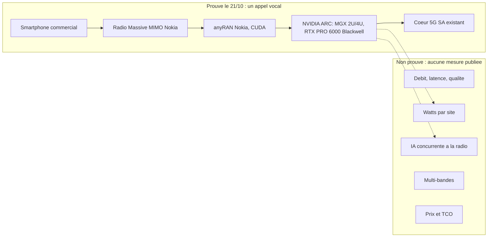
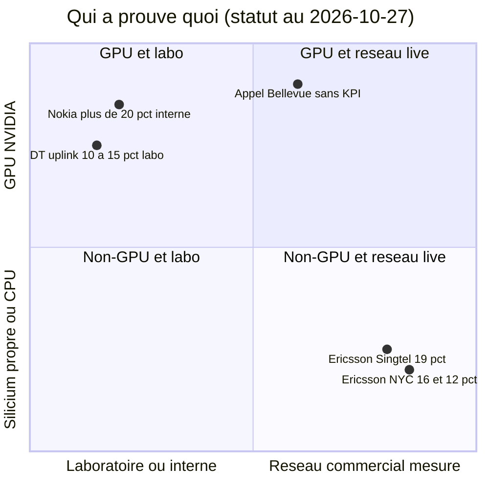

# Brief — Premier appel AI-RAN sur réseau commercial (T-Mobile / Nokia / NVIDIA, Bellevue) : un appel vocal, zéro mesure

Date du brief : 2026-10-27 | Mode : brief | Type : Réseaux (angle B2B opérateur / achats)

Légende de vérification (appliquée à chaque chiffre)
- [V] vérifié : lu directement dans au moins une source accessible ET recoupé par une seconde source indépendante du communiqué d'origine.
- [V1] vu directement dans une seule source accessible (souvent vendor ou presse qui reprend le vendor). À citer avec attribution.
- [NV] non vérifié par accès direct : relevé uniquement via un résumé de recherche (page source en 403) ou conflit entre sources. À ne pas affirmer sans nuance.
- [X] écarté : à ne pas utiliser comme fait.

Limite d'accès à signaler : le billet Nokia (source primaire), Fierce Network et DCD en direct ont renvoyé HTTP 403. Le contenu du billet Nokia est reconstitué via le communiqué NVIDIA (lu en direct), Light Reading, SDxCentral/DCD (republication lue en direct), Telco Magazine et TeckNexus. Le writer ne doit pas citer de formulation exacte du billet Nokia.

---

## Thèse (1 phrase)
Un appel vocal sur un site de Bellevue prouve que la pile GPU (Nokia anyRAN sur NVIDIA ARC) tient en production, pas qu'elle rapporte : sans débit, sans watts ni prix publiés, le GPU mutualisé en bord de réseau n'est pas encore un argument d'achat pour la 5G privée de campus ou le Wi-Fi managé, c'est une option à tarifer face au risque CUDA.

## Angle proposé (2-3 phrases)
Distinguer trois choses que le communiqué mélange : (1) un jalon d'intégration (un appel, un site, un smartphone, aucun KPI), (2) des gains mesurés mais obtenus sans GPU (Ericsson à New York : +16 % débit DL, +12 % efficacité spectrale), (3) une feuille de route spectrale (50 % en 2027, plus de 100 % en 2028) qui reste une promesse vendor. Pour un acheteur de connectivité de site (hôtel, résidence étudiante, retail), la question utile n'est pas « GPU ou pas » mais « quelle preuve exiger avant de payer le GPU », avec une grille de clauses (mesures, watts, portabilité du code, sortie).

## Positionnement vs articles déjà publiés (anti-recoupement)
- 2026-10-26 « Nokia vend, Ericsson dissout : la 5G privée de campus perd ses parrains » (slug `5g-privee-campus-nokia-ericsson-delloro`) : traite la vente d'Enterprise Campus Edge à Aurelius, la dissolution d'Enterprise Wireless chez Ericsson et les prévisions Dell'Oro RAN privé. À NE PAS répéter (pas de chiffres Dell'Oro RAN privé, pas d'Aurelius). Un seul renvoi en une phrase suffit.
- 2026-08-05 « Séoul a testé quatre équipementiers d'AI-RAN. Le GPU n'a pas gagné. » (slug `seoul-ai-ran-bake-off-gpu-perd-ericsson-silicium`) : même fil GPU vs silicium. Le corps n'a pas pu être relu (script de lecture Firestore cassé dans cet environnement). Le writer doit le relire avant rédaction et se différencier : l'article d'août est un banc d'essai comparatif, celui-ci porte sur le jalon production + grille d'achat. Renvoi croisé recommandé.
- 2026-08-13 « L'Open RAN a gagné les interfaces et perdu les fournisseurs » : renvoi possible pour le lock-in.
- 2026-10-23 « Extreme Exchange zones : la capacité idle d'une borne Wi-Fi n'existe pas » : angle voisin (capacité idle partagée pour de l'inférence). Réutiliser l'argument en miroir (le « GPU qui se rentabilise avec des charges IA » suppose de la capacité idle) sans le redévelopper.
- 2026-10-23 « DSX POD » et 2026-10-21 « Nemotron 3.5 : la licence est libre, le GPU ne l'est pas » : même fil NVIDIA. Éviter la redite sur la dépendance GPU générique.
- Brouillon ancien `drafts/ai-ran-alliance-gpu-reseau-5g-6g.md` (MWC 2026, présentation générale AI-RAN) : ne pas recopier la définition ASIC vs GPU, juste la rappeler brièvement.

---

## Faits clés (sourcés, avec statut de vérification)

### A. Ce qui s'est passé
1. [V] T-Mobile, Nokia et NVIDIA annoncent le « premier appel AI-RAN » sur un réseau commercial, depuis un site de Bellevue (Washington, siège de T-Mobile). Stack : radio Massive MIMO Nokia, logiciel Nokia 5G anyRAN accéléré CUDA, serveurs NVIDIA Aerial RAN Computer (ARC), cœur 5G SA existant, smartphone commercial. — NVIDIA [1], Light Reading [2], SDxCentral/DCD [3], Telco Magazine [4]
2. [V] Annonce le 2026-10-21 (mercredi), pendant NVIDIA GTC Berlin. — [1] [2] [4]
3. [V] Il s'agit d'un appel vocal. Aucune métrique publiée : ni qualité d'appel, ni latence, ni débit, ni bande de fréquence, ni durée. — SDxCentral/DCD [3] ; NVIDIA [1] (« Performance or power figures: none »)
4. [V] Prochaine phase annoncée : nouveaux algorithmes AI-for-RAN, inférence IA à côté des fonctions radio sur plateforme partagée, bandes de fréquences supplémentaires. — [3], PR relayé par recherche
5. [V1] Premiers produits AI-RAN commerciaux de Nokia attendus en 2027 ; pilotes fin 2026. — SDxCentral/DCD [3] ; TelecomTV (15 juil.) [6]

### B. Date de l'appel : conflit à signaler
6. [NV] Fierce Network situe l'appel au samedi 17 octobre 2026 (le 17/10/2026 est bien un samedi). Je n'ai pas pu ouvrir l'article Fierce (403) : la date vient d'un résumé de recherche. Le communiqué NVIDIA dit seulement « recently » et ne donne aucune date. Light Reading n'en donne pas non plus. Formulation recommandée : « annoncé le 21 octobre ; Fierce Network situe l'appel au 17 octobre ; ni NVIDIA ni Nokia ne datent l'appel dans leur communiqué ». Ne pas affirmer « le 17 » comme un fait.

### C. Le périmètre du « premier » : à nuancer
7. [V1] « Premier » est une revendication des trois partenaires, sans vérification indépendante. NVIDIA est aussi investisseur dans Nokia (1 Md USD, octobre 2025). — SDxCentral/DCD [3] ; TelecomTV [6] ; Futuriom (résultat de recherche) 
8. [V1] Au MWC 2026 (mars), T-Mobile avait déjà fait tourner des charges RAN + IA sur Massive MIMO Nokia 3,7 GHz et NVIDIA Grace Hopper 200, mais dans le cadre du AI-RAN Innovation Center, pas du réseau de production. Le « premier » d'octobre est donc le premier appel sur serveurs ARC commerciaux connectés à un cœur commercial. — Mobile World Live (1er mars) [7]
9. [V] Ce que l'appel ne prouve pas (liste TeckNexus + SDxCentral) : multi-bandes, inférence IA concurrente avec la radio, orchestration qui protège la performance radio, consommation, TCO. — TeckNexus [8], SDxCentral/DCD [3]

### D. Gains chiffrés : qui a mesuré quoi (ne pas confondre)
10. [V] Ericsson / T-Mobile, New York (5G-Advanced, sites ciblés, nombre de sites non divulgué), heures de pointe : +16 % débit utilisateur DL, +12 % efficacité spectrale, +10 % volume de données DL, +50 % de beamforming avancé via SRS plein bande. Modèle supervisé entraîné sur données T-Mobile, tournant sur le calcul et le silicium Ericsson (donc sans GPU NVIDIA). Chiffres publiés par l'opérateur/vendor, pas audités. — Light Reading [2] ; Fierce/LetsDataScience/TeckNexus (via recherche) [8] ; T-Mobile newsroom (403, cité en recherche)
11. [V] Ne pas confondre avec un autre essai Ericsson/T-Mobile : ordonnanceur AI-natif avec link adaptation, ~10 % d'efficacité spectrale et jusqu'à 15 % de débit DL vs méthodes à règles. — Light Reading [2] ; DCD (via recherche)
12. [V1] Ericsson / Singtel : +19 % de débit sur réseau live (communiqué Ericsson). Pas de conditions de référence. — Telco Magazine [4] ; Ericsson PR (résultat de recherche)
13. [V1] Ericsson / SoftBank (20 août 2026) : jusqu'à ~25 % d'efficacité spectrale et ~50 % de débit DL utilisateur en maximum, mais ~10 % en moyenne sur tous les emplacements. ABI Research : ne pas traiter le maximum comme un gain universel. — ABI Research [9]
14. [V1] Nokia : « plus de 20 % » d'efficacité spectrale déjà démontrés, issus de tests internes en conditions contrôlées, innovations non précisées. — TelecomTV [6], Telco Magazine [4]
15. [V1] Deutsche Telekom : +10 à 15 % de débit montant en mesures de laboratoire (Bonn, Oulu), pas de réseau live. Essais terrain en 2027. — Telco Magazine [4], TeckNexus [8]
16. Conclusion factuelle à poser dans l'article : à ce jour, les seuls gains mesurés sur réseau commercial viennent d'approches sans GPU NVIDIA (Ericsson), et les gains du camp GPU sont des chiffres internes ou de laboratoire. Attention à l'équité : les périmètres diffèrent (fonctions IA différentes, sites différents), ce n'est pas un duel à armes égales.

### E. Objectifs 50 % (2027) / plus de 100 % (2028) : verdict
17. [V1 vendor, confirmé par 3 relais] Roadmap Nokia annoncée le 15 juillet 2026 : plus de 20 % déjà, jusqu'à 50 % en 2027, plus de 100 % en 2028 (« doubler la capacité du spectre existant »). Reprise par TelecomTV [6], ComSoc/IEEE TechBlog [10], Telco Magazine [4] (« on track »). C'est une feuille de route vendor, pas un résultat. À citer comme « Nokia vise », jamais comme acquis.
18. [NV] Les chiffres 50 %/100 % ne figurent PAS dans l'article Light Reading du 21 octobre ni dans le communiqué NVIDIA du 21 octobre. Ils ne sont donc pas liés à l'appel de Bellevue. Le billet Nokia du 21 octobre n'a pas pu être lu. Ne pas écrire que l'appel « valide » la trajectoire.
19. Nuance de formulation : SDxCentral/DCD cite Pallavi Mahajan (Nokia) parlant de « on a path to » deux fois l'efficacité spectrale, sans calendrier [3]. La trajectoire « 50 % puis 100 % » avec dates vient de la roadmap de juillet. Les deux formulations coexistent, la seconde est plus précise.

### F. Économie, énergie, verrouillage
20. [V] ARC : deux configurations MGX 2U et 4U, GPU RTX PRO 6000 Blackwell Server Edition, CPU x86 ou NVIDIA Vera, fournisseurs de serveurs Dell, QCT, Supermicro. Cible : sites RAN centralisés (« typically at centralized RAN sites »), pas des boîtiers de campus. — NVIDIA [1]
21. [V1] Nokia propose trois formes : plug-in GPU de capacité pour AirScale, nœud AI-RAN autonome, serveurs COTS GPU via partenaires ; offre en abonnement logiciel ; coût matériel « globalement aligné » avec AirScale/COTS (non chiffré). Le matériel Nokia actuel repose sur du silicium Marvell sur mesure ; la roadmap s'appuie sur le silicium programmable « merchant » de NVIDIA. — ComSoc [10], TelecomTV [6]
22. [V1] Énergie : Nokia affirme une enveloppe de puissance « globalement similaire » aux systèmes existants et un meilleur coût énergétique par bit, aucune mesure publiée. TeckNexus : aucune donnée de consommation, refroidissement ou espace en site. — TelecomTV [6], TeckNexus [8], NVIDIA [1] (aucun chiffre)
23. [V1] Dell'Oro (19 mars 2026) : prospects GPU RAN en amélioration mais limités ; inquiétudes sur l'écart de performance par watt GPU vs silicium sur mesure et sur la faisabilité de charges non télécoms en D-RAN/C-RAN ; scénario de base : le non-GPU domine l'AI RAN sur la période. — Dell'Oro [11]
24. [V1] Dell'Oro (30 juin 2026) : 35 Md USD de revenus AI RAN cumulés 2026-2030 ; GPU RAN révisé à la hausse mais « 1 Md USD+ » seulement en fin de période ; l'AI RAN ne devrait pas agrandir le marché RAN ; les fournisseurs historiques bien placés via l'AI-for-RAN sur matériel existant. — Dell'Oro [12]
25. [V1] Lock-in : des dirigeants Ericsson jugent qu'écrire pour CUDA expose Nokia à un « vendor lock-in » ; Ericsson dit que son logiciel vRAN tourne sur des CPU d'autres fondeurs avec peu d'adaptation ; Nokia répond que le matériel Ericsson ne tiendra pas « jusqu'à la 6G » (propos concurrentiels, non indépendants). — ComSoc (reprise de Light Reading) [10], Light Reading [2] (cadre : divergence stratégique GPU/silicium propre)
26. [V1] Portabilité : SoftBank prévoit de faire tourner anyRAN Nokia sur sa plateforme AITRAS (essai sous trafic live en 2027) : un indice de possible découplage infra/orchestration/applications. — TeckNexus [8], Telco Magazine [4]
27. [V1] Analystes : Gabriel Brown (Omdia) qualifie les résultats Ericsson/T-Mobile de « wow moment », note que des modèles IA dans la station de base apportent des gains mesurables par mise à jour logicielle, et reconnaît « we don't really know » combien de modèles peuvent coexister ni quel gain cumulé. Ian Fogg (CCS Insight) : les essais 2027 seront « make-or-break », Nokia/NVIDIA devant prouver leur avance. — Light Reading [2], Telco Magazine [4]
28. [V1] Périmètre déploiement : NVIDIA parle de « presque 20 opérateurs » annonçant des collaborations AI-RAN avec anyRAN + ARC (dont 9-10 en EMEA). SDxCentral/DCD en liste 15 nommés (« working with », pas forcément en essai). Prudence : « collaborations annoncées » ≠ déploiements. — NVIDIA [1], SDxCentral/DCD [3], Mobile World Live
29. [V1] Calendrier opérateurs GTC Berlin : BT (essai live Birmingham, 2027), Deutsche Telekom (labo Bonn/Oulu, terrain 2027), Elisa (Helsinki : voix + données + analytique vidéo simultanés sur ARC en 5G sur le terrain ; services commerciaux visés 2027), Orange (test logiciel Nokia sur ARC, efficacité spectrale et edge), SoftBank (2027). — NVIDIA [1], Telco Magazine [4], TeckNexus [8]. Toutes les échéances commerciales sont 2027 : rien n'est facturé aujourd'hui.

### G. Standards
30. [V1] 3GPP : la Release 17 a conclu que les algorithmes et modèles IA sont « implementation-specific » et non destinés à être normalisés ; seuls cadre, collecte de données et signalisation sont standardisés (Rel-18 : CSI, beam management, positionnement ; Rel-19 : cycle de vie des modèles). Conséquence B2B : le gain AI-RAN d'un fournisseur n'est pas portable ni comparable par construction. — NVIDIA Developer Blog (juil. 2024) [13]. Source datée de 2024 ; à confirmer sur le site 3GPP si le writer veut citer un numéro de spec.
31. [NV] 3GPP Rel-20 : étude 6G en cours, volet AI/ML en deux étapes (Q4'25-Q1'26 puis Q2'26-Q2'27) selon un document RAN4 de février 2026 ; première norme 6G en Rel-21. Les dates Rel-21 circulant sur LinkedIn se contredisent : ne pas les citer. — 3GPP RAN4 R4-2602149 (via recherche, non ouvert)
32. [V1] AI-RAN Alliance : produit des blueprints et des benchmarks, pas des normes (trois familles : AI-and-RAN, AI-on-RAN, AI-for-RAN). O-RAN Alliance : RIC (xApps/rApps) et nGRG pour l'AI-natif ; principe de validation des modèles avant déploiement. — NVIDIA Developer Blog [13]. Aucune annonce 2026 de l'O-RAN Alliance ou de l'AI-RAN Alliance n'a été trouvée dans mes recherches : ne pas en inventer.
33. [X] Écarté : « 100 % d'efficacité spectrale en 2028 » présenté comme objectif associé à l'appel de Bellevue ; « Nokia Q3 2026 : AI/cloud +123 % » (titre MWL espagnol vu en recherche, non ouvert, sans rapport direct) ; dates Rel-21 LinkedIn.

---

## Sources retenues (numérotées)
1. **NVIDIA Newsroom** — https://nvidianews.nvidia.com/news/nvidia-nokia-and-leading-telecom-operators-turn-networks-into-distributed-intelligence-platforms — communiqué vendor (primaire, côté NVIDIA) — 2026-10-21 — lu en direct
2. **Light Reading (M. Donegan)** — https://lightreading.com/ai-machine-learning/t-mobile-makes-first-ai-ran-call-with-nokia-and-nvidia — presse spé + citation Omdia — 2026-10-21 — lu en direct
3. **SDxCentral / DCD** — https://www.sdxcentral.com/news/t-mobile-claims-world-first-ai-ran-call-with-nokia-and-nvidia/ (original DCD : https://datacenterdynamics.com/en/news/t-mobile-claims-world-first-ai-ran-call-with-nokia-and-nvidia, 403) — presse spé, ton critique — 2026-10-22 — lu en direct (SDx)
4. **Telco Magazine (S. Fenwick)** — https://telcomagazine.com/news/what-progress-have-nokia-and-nvidia-made-on-ai-ran — presse, synthèse opérateurs + roadmap + CCS Insight — 2026-10-22 — lu en direct
5. **Nokia (source primaire déclarée)** — https://www.nokia.com/blog/from-the-lab-to-the-live-network-nokia-t-mobile-and-nvidia-complete-worlds-first-ai-ran-call/ — vendor — 2026-10-21 — NON LISIBLE (403). Citer seulement comme lien d'annonce.
6. **TelecomTV (R. Le Maistre)** — https://www.telecomtv.com/content/nokia/nokia-spruces-up-its-ai-ran-pitch-with-spectral-efficiency-claims-55888/ — analyse de la roadmap Nokia, scepticisme énergie/économie — 2026-07-15 — lu en direct
7. **Mobile World Live (M. Robuck)** — https://www.mobileworldlive.com/ai-cloud/nokia-accelerates-ai%E2%80%91ran-momentum-with-nvidia/ — presse, essais MWC26 — 2026-03-01 — lu en direct
8. **TeckNexus (H. Kadia)** — https://tecknexus.com/ai-ran-live-network-nokia-nvidia-operators/ — analyse « prouvé vs non prouvé » — 2026-10-22 — lu en direct
9. **ABI Research (S. Bowling)** — https://www.abiresearch.com/market-research/insight/7788465-ai-moves-into-commercial-ran-with-spectrum — analyste tiers — 2026-09-09 — lu en direct
10. **IEEE ComSoc Tech Blog** — https://techblog.comsoc.org/2026/07/15/analysis-nokias-new-ai-ran-platform-and-standalone-ai-ran-node-with-nvidia-gpus/ — analyse (reprend communiqué + Light Reading), lock-in CUDA — 2026-07-15 — lu en direct
11. **Dell'Oro (S. Pongratz), « All roads lead to AI RAN »** — https://www.delloro.com/all-roads-lead-to-ai-ran/ — analyste — 2026-03-19 — lu en direct
12. **Dell'Oro, communiqué AI RAN 35 Md USD** — https://www.delloro.com/news/ai-ran-to-reach-35-b-over-next-five-years/ — analyste — 2026-06-30 — lu en direct
13. **NVIDIA Developer Blog, « Boosting AI-driven innovation in 6G with the AI-RAN Alliance, 3GPP and O-RAN »** — https://developer.nvidia.com/blog/boosting-ai-driven-innovation-in-6g-with-the-ai-ran-alliance-3gpp-and-o-ran/ — standards (vu côté vendor) — 2024-07-19 — lu en direct. Source standards de seconde main : à renforcer par le site 3GPP si possible.
14. **Fierce Network** — https://www.fierce-network.com/wireless/t-mobile-hosts-first-ai-ran-call-network-bellevue — presse, seule source de la date « samedi 17 octobre » — 2026-10 — 403, vu en résumé de recherche uniquement
15. **Fierce Network (Ericsson NYC)** — https://www.fierce-network.com/wireless/t-mobile-cites-ai-ran-gains-ericsson-nyc — 403, vu en recherche
16. **Ericsson (communiqué Singtel)** — https://www.ericsson.com/en/press-releases/2/2026/singtel-and-ericsson-deepen-partnership-to-scale-5g-innovation-and-build-ai-native-networks-for-consumers-and-enterprises-in-singapore — vendor — 2026 — vu en résultat de recherche, non ouvert
17. **3GPP RAN4 #118 R4-2602149** — https://www.3gpp.org/ftp/Meetings_3GPP_Sync/RAN4/Inbox/Chair_Notes/Main_Session_Notes/2.TUE/1.R4-2602149.docx — standards primaire — 2026-02 — non ouvert, à ouvrir avant citation

Décompte : 17 références listées ; 12 lues en direct (nos 1, 2, 3, 4, 6, 7, 8, 9, 10, 11, 12, 13), 5 non lues (5, 14, 15, 16, 17) dont 3 en 403. Mix : 1 primaire vendor (NVIDIA) + 1 primaire vendor illisible (Nokia), 4 presse spé (LR, DCD/SDx, Telco Magazine, MWL), 2 analyses (TeckNexus, ComSoc), 3 analystes (ABI, Dell'Oro x2) + Omdia via Light Reading, 1-2 standards (NVIDIA dev blog sur 3GPP/O-RAN/AI-RAN Alliance ; 3GPP RAN4 à ouvrir). Manque : aucune source de standards primaire lue en direct, aucune donnée Omdia/Dell'Oro spécifique à l'appel de Bellevue.

## Contradictions / zones grises
1. Date de l'appel : 17/10 (Fierce, non lu en direct) vs annonce du 21/10 sans date de l'appel (NVIDIA, Light Reading). Non réconciliable avec les sources accessibles.
2. « Commercial » : le réseau est de production selon les communiqués, mais le site est près du siège de T-Mobile (Light Reading) et lié à l'AI-RAN Innovation Center de Bellevue. Combien de cellules, quelle bande, combien d'utilisateurs : inconnu.
3. Nombre d'opérateurs : « presque 20 » (NVIDIA) vs 15 nommés (DCD/SDx) vs « collaborations » ≠ essais.
4. 50 %/100 % : roadmap Nokia de juillet, pas un résultat de l'appel ; DCD cite « deux fois » sans date. Trois relais concordent sur la roadmap, mais tous reprennent Nokia.
5. Comparaison Ericsson / Nokia : gains Ericsson sur réseau live et sans GPU, gains Nokia internes/labo ; fonctions et périmètres différents, aucune comparaison directe possible. Les résumés de recherche et Light Reading diffèrent légèrement sur le contexte (beamforming SRS vs link adaptation) : bien séparer les deux essais.
6. Ericsson : le chiffre « +19 % Singtel » et « +16 % New York » ne sont pas additifs ni comparables (fonctions et réseaux différents).
7. Énergie : affirmation Nokia « enveloppe similaire », mais Dell'Oro (mars) cite précisément l'écart perf/W comme préoccupation. Aucune mesure indépendante.
8. Un article sur la roadmap évoque Blackwell optimisé pour les contraintes thermiques télécoms (CTO Nokia, mars) : non vérifié indépendamment (TelecomTV le dit explicitement).

## Angle B2B opérateur : de la 5G privée au Wi-Fi managé
- Ce que le GPU apporte potentiellement (hypothèse, pas un fait) : mutualiser sur un même serveur la radio, l'inférence IA locale et peut-être l'orchestration. L'argument économique de TeckNexus : la plateforme n'est rentable que si elle porte des charges IA payantes en plus de la radio, donc il faut de la demande IA locale et de la capacité idle.
- Réalité de taille : ARC MGX 2U/4U avec RTX PRO 6000 Blackwell vise des sites RAN centralisés d'opérateur mobile. Rien dans les sources n'indique une offre de campus à cette échelle. Pour un hôtel ou une résidence, la bonne unité reste la borne ou le petit contrôleur ; le GPU mutualisé arriverait par l'opérateur hôte (neutral host), pas par l'achat direct. (Raisonnement de l'analyste, à marquer comme tel.)
- Critère d'achat « GPU » vs « silicium propriétaire » : (1) preuve de gain mesurée sur réseau live, (2) watts par site et par Gbit/s, (3) portabilité du logiciel (CUDA vs CPU/ASIC multi-fondeurs ; indice SoftBank AITRAS), (4) sortie de contrat et licence logicielle par abonnement, (5) cadence de mise à jour logicielle (l'argument fort des modèles IA : gains par mise à jour, selon Omdia), (6) support de la 4G/5G existante (plug-in AirScale).
- Lock-in : le risque se déplace du silicium vers l'environnement logiciel (CUDA), pas seulement vers le fournisseur radio. Le silicium propriétaire (Ericsson, Marvell chez Nokia aujourd'hui) a son propre lock-in. Position suggérée : aucun des deux n'est neutre, exiger la réversibilité contractuelle.
- Pour Wifirst : transposer en questions aux fournisseurs Wi-Fi managé / cellulaire (accès aux KPI avant/après, indicateurs de consommation, calendrier d'abonnement IA, droit d'audit). Renvoi : l'analogie avec les clauses « fully certified » du Wi-Fi 8 (article 2026-10-19).

## Plan suggéré (≈ 1 400 à 1 800 mots)
1. Accroche : un appel, un site, un smartphone, zéro KPI. Ce qui est annoncé le 21/10 (date de l'appel contestée : 17/10 selon Fierce).
2. Ce que l'appel prouve et ce qu'il ne prouve pas (tableau : preuve / absence de preuve, d'après TeckNexus et DCD).
3. Les seuls gains mesurés en réseau commercial sont sans GPU NVIDIA (Ericsson NYC, Singtel, SoftBank, avec rappel max vs moyenne) ; les gains du camp GPU sont internes ou de labo (Nokia > 20 %, DT 10-15 % labo).
4. Les objectifs 50 % / 100 % : une roadmap de juillet, pas un résultat de Bellevue.
5. GPU ou silicium propriétaire : énergie, TCO, Dell'Oro (non-GPU dominant, GPU RAN ≈ 1 Md USD en fin de période), lock-in CUDA et contre-argument Ericsson (CPU multi-fondeurs).
6. Standards : 3GPP n'a pas normalisé les modèles (Rel-17) ; l'AI-RAN Alliance fait des blueprints. Donc pas de comparabilité native, d'où la nécessité de contrats de mesure.
7. Ce que ça change pour un site hôtel / résidence / retail : GPU en bord de réseau = argument d'achat ou lock-in ? Grille en 5 clauses.
8. Ce qu'on surveille en 2027 : essais BT, DT, Elisa, SoftBank ; critères pour dire « prouvé ».
9. Sources.

## Schémas Mermaid suggérés (2 minimum)
1. Pile et périmètre de la preuve (flowchart) : montrer ce qui est testé à Bellevue vs ce qui reste à prouver.

2. Échelle de preuve des gains (graph ou quadrant) : lab vs live, GPU vs non-GPU.

(positions indicatives, à dire dans la légende ; Bellevue placé au milieu de l'axe x car « live » mais sans mesure)
3. Roadmap promesse vs preuve (timeline) : mars 2026 MWC test innovation center ; juil. 2026 roadmap Nokia >20 %/50 %/100 % ; 21 oct. appel Bellevue ; fin 2026 pilotes ; 2027 essais BT/DT/Elisa/SoftBank, produits commerciaux Nokia ; 2028 « >100 % » visé.
4. Arbre de décision achat (flowchart) : « mon fournisseur propose du GPU en bord de réseau » → KPI live fournis ? → watts/site ? → code portable (CPU/ASIC) ? → clause de sortie ? → oui à 4 : pilote ; sinon : attendre 2027.

## Métadonnées suggérées
- **Titre** : Premier appel AI-RAN en production : un appel vocal, zéro mesure (variantes : « T-Mobile passe le premier appel AI-RAN : la preuve avant la promesse » / « AI-RAN à Bellevue : un appel prouve l'intégration, pas le gain »)
- **Slug** : `ai-ran-t-mobile-nokia-nvidia-premier-appel-preuve-avant-promesse`
- **Excerpt** (≈ 155 car.) : Un appel vocal sur GPU NVIDIA à Bellevue prouve l'intégration, pas le gain. Les gains mesurés viennent d'Ericsson, sans GPU. Ce qu'un acheteur doit exiger.
- **Category** : Réseaux
- **Tags** : AI-RAN, T-Mobile, Nokia, NVIDIA, Ericsson, GPU, Silicium propriétaire, Lock-in, 5G privée, Wi-Fi managé, Achats réseau
- **Genre éditorial** (taxonomie sourcing) : `edge-iot-b2b` / `market-analyse` (hybride ; archi-vendor secondaire)
- Titre alternatif court si besoin de 60 car. : « AI-RAN : un appel vocal, zéro mesure »

## Cover image — prompt anglais pour nano-banana-pro
Wide technical illustration of a rooftop 5G massive MIMO antenna panel at dusk linked by a glowing fiber line to a compact GPU server rack, clean isometric style, deep blue and teal palette, no text, no logos.

## Inline images — 3 prompts anglais pour nano-banana-pro
1. Split-screen diagram style image: left side a single phone call waveform with a question mark over empty measurement dials (throughput, power, latency), right side a full dashboard of gauges; flat vector, muted blue and orange, no text, no logos.
2. Two engineering workbenches side by side under a city skyline: one holding a large GPU server card with a heat-sink, the other a custom radio chip board with neural accelerator blocks, balanced power-meter needles above each; clean editorial illustration, no text, no logos.
3. A bridge made of server blades crossing a gap between a cell tower and a hotel building at night, with a padlock-shaped shadow on one pillar and an open exit gate on the other, symbolizing vendor lock-in and exit clauses; semi-realistic, cool tones, no text, no logos.

## Pièges pour le writer
- Ne pas écrire « le 17 octobre » comme un fait ; ne pas affirmer que Bellevue valide 50 %/100 %.
- Ne pas mélanger Ericsson NYC (beamforming SRS : +16 / +12 / +10 / +50) et Ericsson link adaptation (~10 % / jusqu'à 15 %).
- Ne pas présenter NVIDIA ARC comme adapté au campus : cible = sites RAN centralisés.
- Chaque chiffre doit porter son attribution (« selon T-Mobile », « Nokia vise ») ; mentionner que NVIDIA a investi 1 Md USD dans Nokia.
- Ne pas reprendre les chiffres Dell'Oro RAN privé ni Aurelius (article du 26/10).
- Relire l'article du 5 août (Séoul) avant rédaction : éviter de redire la même conclusion « le GPU n'a pas gagné ».
