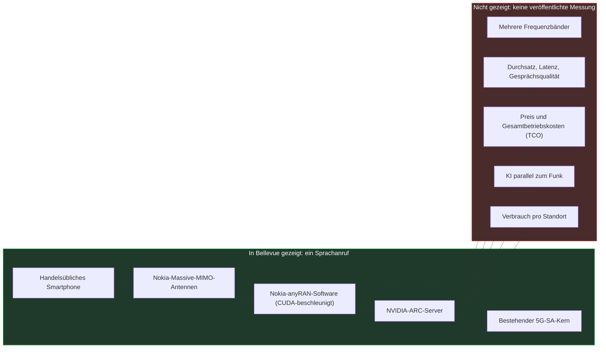
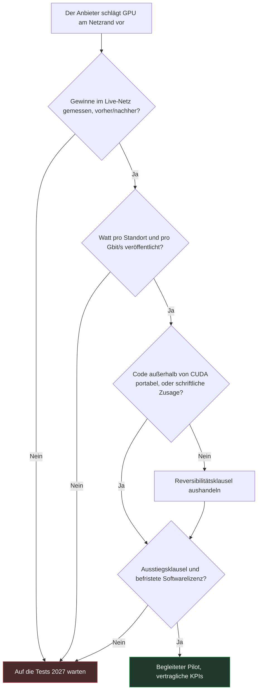

## Ein Anruf in Bellevue

Ein handelsübliches Smartphone, ein Funkstandort vor den Toren Seattles, ein Sprachanruf. Banaler geht es in der Telekommunikation nicht. Nur lief dieser Anruf, angekündigt am 21. Oktober auf der NVIDIA GTC Berlin, über eine Basisstation neuer Art. Ihr Gehirn ist kein dedizierter Telekom-Chip mehr, sondern ein Grafikprozessor (GPU) von NVIDIA, ein Verwandter jener Chips, auf denen generative KI läuft. T-Mobile, Nokia und NVIDIA präsentieren ihn als ersten „AI-RAN“-Anruf in einem kommerziellen Netz. Hinter dem Kürzel steckt eine einfache Idee: ein Funkzugangsnetz (Radio Access Network), also Antennen und Basisstationen, beschleunigt und optimiert durch künstliche Intelligenz.

Warum sollte das interessieren, wenn man kein nationales Mobilfunknetz betreibt? Weil dieser Meilenstein bis 2027 die Verkaufsargumente der Ausrüster speisen wird. Die Mobilfunkbetreiber werden sie als Erste hören. Danach kommen diejenigen, die Standortkonnektivität einkaufen: Hotels, Studentenwohnheime, Handelsketten, IT-Leiter mit mehreren Standorten, die zwischen Private 5G und Wi-Fi abwägen.

Das Problem: Die Ankündigung enthält keine einzige Zahl. Kein Durchsatz, keine Latenz, keine Watt, kein Preis. Ein Anruf kam zustande, Punkt. Das ist ein Integrationsnachweis, kein Wirtschaftlichkeitsnachweis. Und die einzig nützliche Frage für einen Käufer lautet nicht „GPU oder nicht GPU“, sondern: Welchen Nachweis sollte man verlangen, bevor man für die GPU zahlt?

## Der Motor läuft, aber niemand hat die Stoppuhr gezückt

Um diesen Meilenstein einzuordnen, stellen Sie sich einen Rennmotor vor, der zum ersten Mal auf dem Prüfstand gestartet wird. Er läuft. Er geht nicht aus. Die Ingenieure fallen sich in die Arme, und das zu Recht: Jahre Arbeit stecken in diesem ersten Aufheulen. Doch noch hat niemand auf die Tankanzeige geschaut, auf der Rennstrecke die Stoppuhr gezückt oder geprüft, ob die Mechanik drei Stunden in praller Sonne durchhält. Bellevue ist der Prüfstand.

Die getestete Kette beginnt mit Massive-MIMO-Antennen von Nokia, jenen Panels mit vielen Elementen, die das Signal gezielt auf jedes Endgerät ausrichten. Dahinter läuft die Funksoftware Nokia 5G anyRAN, beschleunigt mit CUDA, der proprietären Programmierumgebung der NVIDIA-GPUs.

Diese Software läuft auf NVIDIA Aerial RAN Computer-Servern, kurz ARC, die ihrerseits an den 5G-SA-Kern (Standalone, ohne Anlehnung an 4G) angebunden sind, der bei T-Mobile bereits im Einsatz ist. Am Ende der Kette steht ein handelsübliches Smartphone [1][2][3].

Was die Pressemitteilungen verschweigen, ist länger als das, was sie sagen. Es wird keine einzige Metrik veröffentlicht: weder Gesprächsqualität noch Latenz, Durchsatz, Frequenzband oder Dauer [3]. Die NVIDIA-Mitteilung nennt keine Leistungs- oder Verbrauchszahl [1]. Selbst das Datum des Anrufs bleibt unscharf: Die Ankündigung stammt vom 21. Oktober, NVIDIA spricht von einem „kürzlich“ geführten Anruf, Light Reading sagt nicht mehr [1][2], und Fierce Network verortet ihn auf Samstag, den 17. Oktober, ohne dass NVIDIA oder Nokia das bestätigen.

Vor allem wurde der Kern des Versprechens nicht gezeigt. Das Argument für die GPU lautet: Funk und KI-Workloads laufen auf demselben Server, ohne dass das eine das andere beeinträchtigt. Wie TeckNexus und SDxCentral anmerken, deckt die Demonstration jedoch weder KI-Inferenz parallel zum Funk ab noch die Orchestrierung, die die Funkleistung schützt, noch den Betrieb über mehrere Bänder [3][8]. Auch Verbrauch und Gesamtbetriebskosten (TCO) sind nicht dokumentiert. Die Partner räumen das ein: Ihre nächste Phase gilt genau der KI-Inferenz neben dem Funk, einer gemeinsam genutzten Plattform und zusätzlichen Bändern [3].

Bleibt das Wort „erster“. Das ist eine Behauptung der drei Partner, ohne unabhängige Überprüfung [3]. Auf dem MWC im März ließ T-Mobile bereits Funk und KI auf Nokia-Massive-MIMO im 3,7-GHz-Band und NVIDIA-Grace-Hopper-200-Chips laufen, allerdings im AI-RAN Innovation Center, außerhalb des Produktivnetzes [7]. Die Neuheit vom Oktober ist enger gefasst: ein Anruf auf kommerziellen ARC-Servern, angebunden an einen kommerziellen Kern. Der Standort, nahe der T-Mobile-Zentrale, bleibt undurchsichtig: Zahl der Zellen, genutztes Band, Zahl der Nutzer, nichts davon wird genannt [2].

Noch ein letzter Kontextpunkt: NVIDIA hat im Oktober 2025 1 Mrd. USD in Nokia investiert [3][6]. Die Beteiligten sind keine neutralen Beobachter ihres eigenen Meilensteins.

*Schema 1 — Was der Anruf in Bellevue belegt (grün) und alles, wofür es weiterhin keinen einzigen veröffentlichten Messwert gibt (rot).*

Nichts davon macht den Meilenstein unbedeutend. Einen Funk-Stack auf GPU zu portieren und an einen Produktivkern anzuschließen ist echte Ingenieursarbeit. Aber einen Integrationsmeilenstein kann man nicht in Rechnung stellen. Einen Gewinn schon.

*Ein Anruf kommt durch, die Anzeigen bleiben leer: Bellevue belegt die Integration, nicht die Performance.*

## Im Live-Netz gemessene Gewinne kommen ohne GPU aus

Während das GPU-Lager einen Anruf feierte, veröffentlichte T-Mobile Prozentwerte. Mit einem anderen Lieferanten.

In New York haben Ericsson und T-Mobile an ausgewählten Standorten, deren Zahl nicht genannt wird, ein überwachtes KI-Modell (Supervised Learning) eingesetzt, das auf den Daten des Betreibers trainiert wurde. Es verfeinert das Beamforming, also die Art, wie die Antenne ihre Energie auf jedes Telefon bündelt. Gemeldetes Ergebnis zu Spitzenzeiten: +16 % Downlink-Durchsatz pro Nutzer, +12 % Spektraleffizienz (die Zahl der pro Frequenzeinheit übertragenen Bits) und +10 % Datenvolumen [2][8].

Alles läuft auf Ericsson-Rechenleistung und Ericsson-Silizium. Keine einzige NVIDIA-GPU in der Schleife. Die Zahlen stammen vom Betreiber und seinem Lieferanten, ohne unabhängiges Audit, wurden aber in einem Netz gemessen, das zahlende Kunden bedient.

Ein zweiter Ericsson-Test bei T-Mobile, nicht zu verwechseln mit dem ersten, zielt auf den Scheduler: den Dirigenten, der Millisekunde für Millisekunde entscheidet, welches Endgerät senden darf und mit welcher Datenrate. Seine KI-native Version soll gegenüber regelbasierten Verfahren rund 10 % Spektraleffizienz und bis zu 15 % Downlink-Durchsatz gewinnen [2]. Gabriel Brown, Analyst bei Omdia, nennt die Ericsson-Ergebnisse bei T-Mobile einen „wow moment“: In der Basisstation untergebrachte KI-Modelle liefern messbare Gewinne per einfachem Software-Update. Mit seltener Offenheit räumt er auch ein, „we don't really know“, wie viele Modelle nebeneinander laufen können und welcher kumulierte Gewinn dabei herauskommt [2].

Anderswo reklamiert Ericsson bei Singtel +19 % Durchsatz im Live-Netz, ohne veröffentlichte Referenzbedingungen [4][14]. Bei SoftBank ist die Lücke zwischen Schaufenster und Durchschnitt dokumentiert: im besten Fall bis zu rund 25 % Spektraleffizienz und 50 % Downlink-Durchsatz, im Mittel etwa 10 %. ABI Research warnt davor, das Maximum für einen allgemeingültigen Gewinn zu halten [9].

Auf der GPU-Seite ist die Bilanz dünner. Nokia reklamiert mehr als 20 % Spektraleffizienz, in internen Tests und unter kontrollierten Bedingungen [4][6]. Die Deutsche Telekom misst +10 bis 15 % Uplink-Durchsatz, aber im Labor, in Bonn und Oulu; der Feldtest ist für 2027 vorgesehen [4][8].

| Wer | Lager | Umfeld | Angekündigter Gewinn | Zu beachten |
|---|---|---|---|---|
| Ericsson / T-Mobile | Ohne NVIDIA-GPU | New York, Live-Netz | +16 % Durchsatz, +12 % Spektraleffizienz | Betreiberzahlen, nicht auditiert |
| Ericsson / T-Mobile | Ohne NVIDIA-GPU | Test KI-Scheduler | Ca. 10 % Effizienz, bis zu 15 % Durchsatz | Verglichen mit regelbasierten Verfahren |
| Ericsson / Singtel | Ohne NVIDIA-GPU | Singapur, Live-Netz | +19 % Durchsatz | Keine Referenz veröffentlicht |
| Ericsson / SoftBank | Ohne NVIDIA-GPU | Japan, SoftBank-Netz | Bis zu 25 % und 50 %, ca. 10 % im Mittel | Das Maximum ist nicht die Regel |
| Nokia | NVIDIA-GPU | Interne Tests | Mehr als 20 % Spektraleffizienz | Kontrollierte Bedingungen |
| Deutsche Telekom | NVIDIA-GPU | Labor Bonn und Oulu | +10 bis 15 % Uplink-Durchsatz | Feldtest 2027 |
| T-Mobile / Nokia / NVIDIA | NVIDIA-GPU | Bellevue, Live-Netz | Keiner | Ein Sprachanruf |

Das ist kein Duell mit gleichen Waffen, und das muss man sagen. KI-Funktionen, Netze und Bedingungen unterscheiden sich: Keine dieser Zahlen ist mit einer anderen vergleichbar, und sie addieren sich nicht. Der Befund lässt sich dennoch in einem Satz festhalten. Ende Oktober 2026 stammen die einzigen in einem kommerziellen Netz gemessenen Gewinne aus Ansätzen ohne NVIDIA-GPU; auf der GPU-Seite gibt es Laborzahlen und einen Anruf. Im August sind wir auf den Vergleichstest in Seoul eingegangen. Die Frage ist hier eine andere: nicht, wer auf dem Prüfstand gewinnt, sondern was der Schritt in den Produktivbetrieb einen Käufer zu glauben berechtigt.

### 50 % im Jahr 2027, 100 % im Jahr 2028: ein Versprechen vom Juli

Die Ziele, die seit der Ankündigung kursieren, erfordern eine chronologische Erinnerung. Am 15. Juli stellte Nokia seine Roadmap vor: mehr als 20 % Spektraleffizienz, heute reklamiert, danach ein Ziel von bis zu 50 % im Jahr 2027 und von mehr als 100 % im Jahr 2028, also eine Verdopplung der Kapazität des bestehenden Spektrums [6][10]. TelecomTV, IEEE ComSoc und Telco Magazine haben sie aufgegriffen, zitieren aber alle Nokia [4][6][10]. In den ausgewerteten Quellen sind diese Ziele nicht mit dem Anruf in Bellevue verknüpft: Sie tauchen weder in der NVIDIA-Mitteilung noch im Light-Reading-Artikel vom 21. Oktober auf [1][2]. Laut SDxCentral spricht Pallavi Mahajan von Nokia von einem Weg zur Verdopplung der Spektraleffizienz, ohne Zeitplan [3].

Die Spektraleffizienz zu verdoppeln heißt, das Äquivalent einer zweiten Frequenzlizenz zu erhalten, ohne erneut in eine Auktion zu müssen. Man versteht, dass diese Zahl die Augen der Finanzvorstände zum Leuchten bringt. Genau deshalb sollte man sie auf Abstand halten: Nokia zielt, gemessen ist noch nichts, und der Anruf in Bellevue bestätigt den eingeschlagenen Kurs nicht. Ian Fogg von CCS Insight fasst den Einsatz zusammen: Die Tests 2027 würden „make-or-break“, und Nokia wie NVIDIA müssten dort ihren Vorsprung beweisen [4].

## GPU oder hauseigenes Silizium: zwei verschiedene Vorhängeschlösser

Beim Energiebedarf bleibt es bei Behauptungen. Nokia kündigt eine Leistungsaufnahme an, die „insgesamt ähnlich“ der heutiger Systeme sei, und geringere Energiekosten pro Bit, ohne eine Messung zu veröffentlichen [6]. TeckNexus bemängelt das Fehlen jeglicher Daten zu Verbrauch, Kühlung oder Platzbedarf am Standort [8]. Dabei wird jedes zusätzliche Watt an einem Funkstandort über die gesamte Lebensdauer bezahlt.

Genau diesen Punkt beobachten die Analysten. Im März sorgte sich Dell'Oro um die Lücke bei der Performance pro Watt zwischen GPU und maßgeschneidertem Silizium sowie um die Machbarkeit nicht telekombezogener Workloads an Funkstandorten. Das Basisszenario: Lösungen ohne GPU dominieren den AI-RAN im betrachteten Zeitraum [11]. Im Juni bezifferte das Analysehaus den AI-RAN auf 35 Mrd. USD kumulierten Umsatz zwischen 2026 und 2030, wobei der GPU-Anteil nach oben korrigiert wurde, am Ende des Zeitraums aber kaum über einer Milliarde Dollar liegt [12]. Es fügte hinzu, der AI-RAN dürfte den Funkmarkt nicht vergrößern, und die etablierten Anbieter seien gut positioniert, wenn sie KI auf die vorhandene Hardware aufsetzen. Übersetzt: KI im Funk wird sich verkaufen, aber vor allem als Software auf dem installierten Bestand.

Nokia hat das verstanden und bietet seine Lösung in drei Formen an: eine GPU-Kapazitätskarte, die in die AirScale-Basisstationen gesteckt wird, einen eigenständigen AI-RAN-Knoten oder handelsübliche Standardserver mit GPU über Partner. Die Software wird im Abonnement verkauft, und die Hardwarekosten sollen „insgesamt auf dem Niveau“ des Bestands liegen, ohne Zahl, die das belegt [6][10]. Ein oft vergessener Punkt: Die aktuelle Nokia-Hardware basiert auf maßgeschneidertem Marvell-Silizium. Der Wechsel zur NVIDIA-GPU ist eine Roadmap, nicht der Zustand der installierten Basis.

### Das Schloss wandert

Bleibt die unbequeme Frage. Ericsson-Manager meinen, wer für CUDA schreibe, setze Nokia einem „vendor lock-in“ aus. Ericsson versichert, die eigene vRAN-Software (der virtualisierte Funk, der auf Servern läuft) laufe mit wenig Anpassung auf Prozessoren anderer Chiphersteller. Nokia entgegnet, die Ericsson-Hardware halte nicht „bis zu 6G“ durch [2][10]. Das sind Aussagen von Wettbewerbern und entsprechend zu lesen.

Meine Meinung: Jeder hat mit seiner Kritik am anderen recht. Die GPU beseitigt das Schloss nicht, sie verlagert es vom Silizium in die Softwareumgebung, denn Ihr Funk wird zu einer CUDA-Anwendung. Proprietäres Silizium, bei Ericsson wie bei Nokia mit Marvell heute, hat sein eigenes Vorhängeschloss, nur ein älteres und vertrauteres. Wir haben es im August geschrieben: Open RAN hat die Schnittstellen gewonnen und die Lieferanten verloren. Eine offene Schnittstelle garantiert noch keine Freiheit für den Käufer.

Ein Hinweis geht in die richtige Richtung. SoftBank plant, anyRAN auf der eigenen Plattform AITRAS laufen zu lassen, mit einem Test unter realem Verkehr 2027 [4][8]. Wenn der Test trägt, beginnen sich Infrastruktur, Orchestrierung und Anwendungen zu entkoppeln. Das ist derzeit der einzige konkrete Ansatz zur Portabilität in diesem Dossier.

### Keine Norm, kein Vergleich

Das 3GPP, die Organisation, die die Mobilfunknormen schreibt, hat bereits mit Release 17 entschieden: KI-Algorithmen und -Modelle gehören zur Implementierung des jeweiligen Anbieters und sollen nicht standardisiert werden. Nur der Rahmen, die Datenerfassung und die Signalisierung sind genormt: Rückmeldung des Kanalzustands, Beam Management und Positionierung in Release 18, Lebenszyklus der Modelle in Release 19 [13]. Die AI-RAN Alliance wiederum veröffentlicht Blueprints und Benchmarks, keine Normen [13].

Die Folge ist zwangsläufig. Der KI-Gewinn eines Anbieters ist konstruktionsbedingt weder übertragbar noch vergleichbar. Niemand wird Ihnen „+12 % zertifiziert“ liefern. Wer vergleichen will, muss es in den Vertrag schreiben.

*Universal-GPU gegen dediziertes Silizium: Solange niemand die Watt veröffentlicht, bleibt das Duell eine Frage des Vertrauens.*

## Am Kundenstandort kommt die GPU über den Host-Betreiber

Steigen wir wieder auf die Ebene eines Gebäudes hinab. Der ARC-Server, das sind Rack-Chassis mit 2U oder 4U, bestückt mit GPUs vom Typ RTX PRO 6000 Blackwell, geliefert von Dell, QCT oder Supermicro [1]. NVIDIA sieht ihn typischerweise für zentralisierte RAN-Standorte vor, an denen ein Mobilfunkbetreiber die Verarbeitung vieler Funkstandorte bündelt. Das ist keine Box für einen Campus.

Meine Einschätzung, die nur mich bindet: Für ein Hotel, ein Studentenwohnheim oder ein Geschäft bleiben der Access Point und der kleine Controller die relevante Einheit. Falls die gemeinsam genutzte GPU eines Tages in diese Gebäude einzieht, dann über den neutralen Host-Betreiber (Neutral Host), der die Funkinfrastruktur eines Standorts auf mehrere Mobilfunkbetreiber aufteilt. Nicht über die Bestellung des Endkunden.

Auch das ökonomische Argument verdient einen offenen Blick. Laut TeckNexus rechnet sich die GPU am Netzrand nur, wenn sie zusätzlich zum Funk zahlende KI-Workloads trägt [8]. Das ist die Logik des Umzugswagens, der fürs Brotholen gekauft wird und sich rechnen soll, weil man ihn am Wochenende vermietet. Das funktioniert, wenn es Wochenendkunden gibt und der Wagen an diesem Tag wirklich frei ist. Wir haben am 23. Oktober gezeigt, dass die Idle-Kapazität eines Wi-Fi-Access-Points, jene Kapazität, die man für ungenutzt hält, nicht existiert; ein auf die Spitzenstunde dimensionierter Funkserver wirft genau dieselbe Frage auf.

Konkret, bevor man für GPU zahlt, sei es bei Campus-Private-5G oder bei einer zellularen Schicht auf einer Wi-Fi-Installation, sind das die fünf Klauseln, die ich verlangen würde:

1. **Messungen im Live-Netz, vorher und nachher.** Durchsatz und Spektraleffizienz im Durchschnitt über alle Standorte, nicht nur im besten Fall. Die SoftBank-Lehre gilt für alle.
2. **Watt.** Verbrauch pro Standort und pro geliefertem Gbit/s, einschließlich Kühlung und Platzbedarf. Ohne diese Zahl hält keine TCO-Rechnung.
3. **Portabilität des Codes.** Auf welchen Plattformen die Funksoftware und die Modelle außerhalb von CUDA laufen, mit schriftlicher Zusage für den Fall eines Plattformwechsels.
4. **Eine Ausstiegstür.** Laufzeit des Software-Abonnements, Bedingungen der Reversibilität, Verbleib der Modelle und der Trainingsdaten bei Vertragsende.
5. **Taktung und Audit.** Ein Zeitplan für Software-Updates, denn dort schafft die Funk-KI laut Omdia ihren Wert, Zugriff auf Leistungsindikatoren vor und nach jeder Version sowie Kompatibilität mit der vorhandenen 4G/5G-Installation.

*Schema 2 — Das Entscheidungsraster vor jedem Kauf von GPU am Netzrand: Ohne Live-Messung und ohne veröffentlichte Watt lautet die Standardantwort, auf 2027 zu warten.*

Keine dieser Anforderungen ist GPU-spezifisch. Sie gelten für Ericsson wie für Nokia, in derselben Logik wie die „fully certified“-Klauseln bei Wi-Fi 8, die am 19. Oktober zur Sprache kamen: Man zahlt für einen Nachweis, nicht für ein Etikett. Der Unterschied besteht heute darin, dass nur eines der beiden Lager die erste bereits erfüllen kann.

*Zwischen Antenne und Gebäude auf der einen Seite das Vorhängeschloss, auf der anderen die Ausstiegstür: Die Reversibilitätsklausel wiegt schwerer als der Chip.*

## 2027, das Jahr, in dem die Zahlen fallen müssen

Der Fahrplan ist klar, und er liegt vollständig in der Zukunft. Nokia erwartet seine ersten kommerziellen AI-RAN-Produkte 2027, nach Piloten Ende 2026 [3][6]. NVIDIA spricht von knapp 20 Betreibern, die Kooperationen rund um anyRAN und ARC angekündigt haben; SDxCentral nennt 15, die mit den Partnern „zusammenarbeiten“, ohne dass dies einen laufenden Test bedeutet [1][3]. Eine angekündigte Kooperation ist kein Rollout.

Die Termine sind bekannt. BT bereitet für 2027 einen Live-Test in Birmingham vor. Die Deutsche Telekom geht im selben Jahr vom Labor ins Feld. Elisa gibt an, in Helsinki im Feld gleichzeitig Sprache, Daten und Videoanalytik auf ARC zu betreiben, und strebt kommerzielle Dienste für 2027 an. Das ist der interessanteste Test der Liste, weil er endlich die gemeinsame Nutzung berührt. Orange testet die Nokia-Software auf ARC für Spektraleffizienz und Edge, und auch SoftBank zielt auf 2027 [1][4][8]. Nichts davon wird heute in Rechnung gestellt.

Damit ich AI-RAN auf GPU für bewiesen halte, brauche ich vier veröffentlichte Elemente. Gewinne in einem kommerziellen Netz, im Durchschnitt und nicht in der Spitze. Einen Verbrauch pro Standort. Eine zahlenmäßig belegte Demonstration paralleler KI-Workloads ohne Beeinträchtigung des Funks. Und einen Preis. An dem Tag, an dem ein Betreiber alle vier veröffentlicht, ändert die Diskussion ihren Charakter.

Bis dahin ist meine Position einfach. Bellevue ist ein echter Engineering-Meilenstein, und ihn mit einer Handbewegung abzutun, wäre unredlich. Aber ein Käufer zahlt keinen Meilenstein, er zahlt einen Gewinn. Heute findet sich der gemessene Gewinn bei denen ohne GPU und das Versprechen bei denen mit GPU. In einem Markt, in dem die historischen Förderer der Campus-Private-5G auf Distanz gehen, wie wir am 26. Oktober berichtet haben, hat vertragliche Vorsicht nichts Zaghaftes.

Zahlen Sie nicht für die GPU, bevor gemessen wurde. Und unterschreiben Sie weder GPU noch hauseigenes Silizium ohne Ausstiegsklausel: Das teuerste Vorhängeschloss ist nicht in den Chip geätzt, sondern jenes, das man im Vertrag zu schreiben vergessen hat.

_Persönliche Ansichten, keine Position von Wifirst._

## Quellen

1. NVIDIA Newsroom, communiqué NVIDIA, Nokia et opérateurs télécoms sur l'AI-RAN (21 octobre 2026) : https://nvidianews.nvidia.com/news/nvidia-nokia-and-leading-telecom-operators-turn-networks-into-distributed-intelligence-platforms
2. Light Reading (M. Donegan), premier appel AI-RAN de T-Mobile avec Nokia et NVIDIA (21 octobre 2026) : https://lightreading.com/ai-machine-learning/t-mobile-makes-first-ai-ran-call-with-nokia-and-nvidia
3. SDxCentral / DCD, T-Mobile revendique le premier appel AI-RAN mondial (22 octobre 2026) : https://www.sdxcentral.com/news/t-mobile-claims-world-first-ai-ran-call-with-nokia-and-nvidia/ (original DCD : https://datacenterdynamics.com/en/news/t-mobile-claims-world-first-ai-ran-call-with-nokia-and-nvidia)
4. Telco Magazine (S. Fenwick), où en sont Nokia et NVIDIA sur l'AI-RAN (22 octobre 2026) : https://telcomagazine.com/news/what-progress-have-nokia-and-nvidia-made-on-ai-ran
5. Nokia, billet d'annonce de l'appel AI-RAN avec T-Mobile et NVIDIA (21 octobre 2026) : https://www.nokia.com/blog/from-the-lab-to-the-live-network-nokia-t-mobile-and-nvidia-complete-worlds-first-ai-ran-call/
6. TelecomTV (R. Le Maistre), la feuille de route AI-RAN de Nokia et ses promesses d'efficacité spectrale (15 juillet 2026) : https://www.telecomtv.com/content/nokia/nokia-spruces-up-its-ai-ran-pitch-with-spectral-efficiency-claims-55888/
7. Mobile World Live (M. Robuck), Nokia et NVIDIA accélèrent sur l'AI-RAN au MWC 2026 (1er mars 2026) : https://www.mobileworldlive.com/ai-cloud/nokia-accelerates-ai%E2%80%91ran-momentum-with-nvidia/
8. TeckNexus (H. Kadia), l'AI-RAN sur réseau live, ce qui est prouvé et ce qui ne l'est pas (22 octobre 2026) : https://tecknexus.com/ai-ran-live-network-nokia-nvidia-operators/
9. ABI Research (S. Bowling), l'IA entre dans le RAN commercial (9 septembre 2026) : https://www.abiresearch.com/market-research/insight/7788465-ai-moves-into-commercial-ran-with-spectrum
10. IEEE ComSoc Tech Blog, analyse de la plateforme AI-RAN de Nokia et du nœud autonome sur GPU NVIDIA (15 juillet 2026) : https://techblog.comsoc.org/2026/07/15/analysis-nokias-new-ai-ran-platform-and-standalone-ai-ran-node-with-nvidia-gpus/
11. Dell'Oro Group (S. Pongratz), « All roads lead to AI RAN » (19 mars 2026) : https://www.delloro.com/all-roads-lead-to-ai-ran/
12. Dell'Oro Group, prévisions AI RAN à cinq ans, 35 Md USD (30 juin 2026) : https://www.delloro.com/news/ai-ran-to-reach-35-b-over-next-five-years/
13. NVIDIA Developer Blog, l'IA dans la 6G avec l'AI-RAN Alliance, le 3GPP et l'O-RAN (19 juillet 2024) : https://developer.nvidia.com/blog/boosting-ai-driven-innovation-in-6g-with-the-ai-ran-alliance-3gpp-and-o-ran/
14. Ericsson, communiqué Singtel et Ericsson sur la 5G et les réseaux natifs IA à Singapour (2026) : https://www.ericsson.com/en/press-releases/2/2026/singtel-and-ericsson-deepen-partnership-to-scale-5g-innovation-and-build-ai-native-networks-for-consumers-and-enterprises-in-singapore
