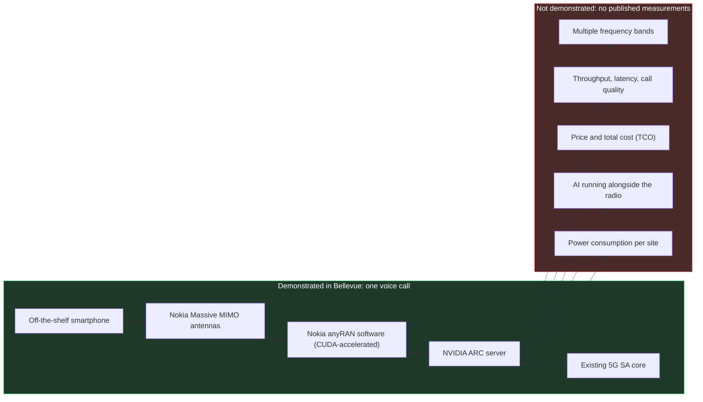
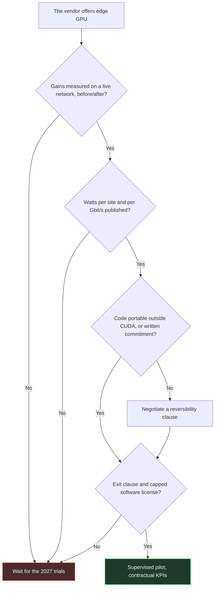

## A Phone Call in Bellevue

An off-the-shelf smartphone, a radio site on the outskirts of Seattle, a voice call. It's the most mundane act in telecoms. Except that this call, announced on October 21 during the NVIDIA GTC Berlin conference, went through a base station of a new kind. Its brain is no longer a dedicated telecom chip but an NVIDIA graphics processing unit (GPU), a cousin of the chips that run generative AI. T-Mobile, Nokia and NVIDIA present it as the first "AI-RAN" call on a commercial network. Behind the acronym lies a simple idea: a radio access network, meaning the antennas and base stations, accelerated and optimized by artificial intelligence.

Why care if you don't run a national mobile network? Because this milestone will feed equipment vendors' sales pitches through 2027. Mobile operators will hear it first. Next in line will be those who buy site connectivity: hotels, student residences, retail chains, multi-site IT departments weighing private 5G against Wi-Fi.

The problem is that the announcement contains no numbers. No throughput, no latency, no watts, no price. A call went through, period. That is proof of integration, not proof of profitability. And the only useful question for a buyer isn't "GPU or no GPU" but this one: what proof should you demand before paying for the GPU?

## The Engine Has Started, Nobody Has Pulled Out the Stopwatch

To put this milestone in perspective, picture a race engine being fired up for the first time on a test bench. It runs. It doesn't stall. The engineers congratulate each other, and they are right to: years of work live in that first roar. But nobody has looked at the fuel gauge yet, nobody has timed a lap on the track, nobody has checked that the machinery holds up for three hours in full sun. Bellevue is the test bench.

The chain that was tested starts with Nokia Massive MIMO antennas, those multi-element panels that steer the signal toward each device. Behind them, Nokia's 5G anyRAN radio software, accelerated by CUDA, the proprietary programming environment for NVIDIA GPUs.

That software runs on NVIDIA Aerial RAN Computer servers, known as ARC, themselves connected to the 5G SA (standalone, with no reliance on 4G) core already in service at T-Mobile. At the end of the chain, an off-the-shelf smartphone [1][2][3].

What the press releases leave out is longer than what they say. No metric is published: no call quality, no latency, no throughput, no frequency band, no duration [3]. The NVIDIA release gives no performance or power consumption figure [1]. Even the date of the call is fuzzy: the announcement is dated October 21, NVIDIA refers to a call made "recently," Light Reading says nothing more [1][2], and Fierce Network places it on Saturday, October 17, without NVIDIA or Nokia confirming it.

Above all, the core of the promise has not been shown. The GPU argument is to run radio and AI workloads on the same server, without one degrading the other. Yet, as TeckNexus and SDxCentral point out, the demonstration covers neither AI inference running in parallel with the radio, nor the orchestration that protects radio performance, nor operation across multiple bands [3][8]. Power consumption and total cost of ownership (TCO) are not documented either. The partners own up to it: their next phase is precisely about AI inference alongside the radio, on a shared platform, and on additional bands [3].

That leaves the word "first." It is a claim made by the three partners, with no independent verification [3]. At MWC in March, T-Mobile was already running radio and AI on Nokia Massive MIMO at 3.7 GHz with NVIDIA Grace Hopper 200 chips, but in its AI-RAN Innovation Center, outside the production network [7]. What's new in October is narrower: a call on commercial ARC servers connected to a commercial core. The site, close to T-Mobile's headquarters, remains opaque: number of cells, band used, number of users, nothing is said [2].

One last piece of context: NVIDIA invested 1 billion USD in Nokia in October 2025 [3][6]. The signatories are not neutral observers of their own milestone.

*Diagram 1 — What the Bellevue call demonstrates (in green) and everything that remains without a single published measurement (in red).*

None of this makes the milestone negligible. Porting a radio stack to GPU and plugging it into a production core is real engineering work. But an integration milestone can't be invoiced. A gain can.

*A call goes through, the dials stay empty: Bellevue demonstrates integration, not performance.*

## Gains Measured on Live Networks Don't Need a GPU

While the GPU camp was celebrating a call, T-Mobile was publishing percentages. With a different vendor.

In New York, Ericsson and T-Mobile deployed a supervised AI model, trained on the operator's own data, at targeted sites whose number has not been disclosed. It refines beamforming, meaning the way the antenna concentrates its energy toward each phone. The results reported at peak hours: +16% downlink throughput per user, +12% spectral efficiency (the number of bits carried per unit of frequency) and +10% data volume [2][8].

All of it runs on Ericsson compute and silicon. Not an NVIDIA GPU in the loop. The figures are published by the operator and its vendor, with no independent audit, but they were measured on a network serving paying customers.

A second Ericsson trial at T-Mobile, not to be confused with the first, targets the scheduler: the conductor that decides, millisecond after millisecond, which device talks and at what rate. Its AI-native version would gain around 10% spectral efficiency and up to 15% downlink throughput compared with rule-based methods [2]. Gabriel Brown, an analyst at Omdia, calls the Ericsson results at T-Mobile a "wow moment": AI models living in the base station deliver measurable gains through a simple software update. He also admits, with rare candor, "we don't really know" how many models can coexist, or what cumulative gain will come out of it [2].

Elsewhere, Ericsson claims +19% throughput at Singtel on a live network, with no published baseline conditions [4][14]. At SoftBank, the gap between showcase and average is documented: up to around 25% spectral efficiency and 50% downlink throughput in the best case, around 10% on average. ABI Research warns against the temptation to mistake the maximum for a universal gain [9].

On the GPU side, the picture is thinner. Nokia claims more than 20% spectral efficiency, in internal tests under controlled conditions [4][6]. Deutsche Telekom measures +10 to 15% uplink throughput, but in the lab, in Bonn and Oulu, with field trials planned for 2027 [4][8].

| Who | Camp | Environment | Claimed gain | Takeaway |
|---|---|---|---|---|
| Ericsson / T-Mobile | No NVIDIA GPU | New York, live network | +16% throughput, +12% spectral efficiency | Operator figures, unaudited |
| Ericsson / T-Mobile | No NVIDIA GPU | AI scheduler trial | Approx. 10% efficiency, up to 15% throughput | Compared with rule-based methods |
| Ericsson / Singtel | No NVIDIA GPU | Singapore, live network | +19% throughput | No baseline published |
| Ericsson / SoftBank | No NVIDIA GPU | Japan, SoftBank network | Up to 25% and 50%, approx. 10% on average | The maximum is not the rule |
| Nokia | NVIDIA GPU | Internal tests | More than 20% spectral efficiency | Controlled conditions |
| Deutsche Telekom | NVIDIA GPU | Lab in Bonn and Oulu | +10 to 15% uplink throughput | Field trials in 2027 |
| T-Mobile / Nokia / NVIDIA | NVIDIA GPU | Bellevue, live network | None | One voice call |

This is not a duel on equal terms, and it's worth saying so. AI functions, networks and conditions differ: none of these figures is comparable to another, and they don't add up. The factual finding still fits in one sentence. As of late October 2026, the only gains measured on a commercial network come from approaches without an NVIDIA GPU; on the GPU side, what we have is lab figures and one call. In August, we revisited the comparative test bench in Seoul. The question here is different: not who wins on the bench, but what a move into production entitles a buyer to believe.

### 50% in 2027, 100% in 2028: A Promise from July

The targets circulating since the announcement call for a reminder of the timeline. On July 15, Nokia presented its roadmap: more than 20% spectral efficiency claimed today, then a target of up to 50% in 2027 and more than 100% in 2028, in other words a doubling of the capacity of existing spectrum [6][10]. TelecomTV, IEEE ComSoc and Telco Magazine relayed it, but all of them cite Nokia [4][6][10]. In the sources consulted, these targets are not tied to the Bellevue call: they appear neither in the NVIDIA release nor in Light Reading's October 21 article [1][2]. According to SDxCentral, Pallavi Mahajan of Nokia talks about a path toward doubling spectral efficiency, with no timeline [3].

Doubling spectral efficiency is the equivalent of getting a second spectrum license without going back to the auctions. No wonder the number makes finance departments' eyes light up. That is precisely why it should be kept at arm's length: Nokia is aiming, nothing is measured yet, and the Bellevue call does not validate the trajectory. Ian Fogg of CCS Insight sums up the stakes: the 2027 trials will be "make-or-break," and both Nokia and NVIDIA will have to prove their lead there [4].

## GPU or In-House Silicon: Two Different Padlocks

On energy, we're still at the stage of claims. Nokia announces a power envelope "broadly similar" to current systems and a better energy cost per bit, without publishing a measurement [6]. TeckNexus notes the absence of any data on power consumption, cooling or on-site footprint [8]. Yet every watt added to a radio site is paid for over its entire lifetime.

This is exactly the point analysts are watching. In March, Dell'Oro worried about the performance-per-watt gap between GPUs and custom silicon, and about the feasibility of non-telecom workloads at radio sites. Its base case: non-GPU solutions dominate AI-RAN over the period [11]. In June, the firm valued AI-RAN at 35 billion USD in cumulative revenue between 2026 and 2030, with GPU revised upward but barely above the billion-dollar mark at the end of the period [12]. It added that AI-RAN should not grow the radio market, and that incumbent vendors are well placed by grafting AI onto existing hardware. Translation: AI in the radio will sell, but mostly as software layered on the installed base.

Nokia has understood this and offers it in three forms: a GPU capacity card that plugs into its AirScale base stations, a standalone AI-RAN node, or standard off-the-shelf servers equipped with GPUs via partners. The software is sold by subscription, and the hardware cost is said to be "broadly in line" with the existing base, with no figure to back it up [6][10]. A point often forgotten: Nokia's current hardware relies on custom Marvell silicon. The shift to NVIDIA GPUs is a roadmap, not the state of the installed base.

### The Lock Moves

Now for the awkward question. Ericsson executives argue that writing for CUDA exposes Nokia to "vendor lock-in." Ericsson says its own vRAN software (virtualized radio, running on servers) runs on other chipmakers' processors with little adaptation. Nokia retorts that Ericsson's hardware won't last "through to 6G" [2][10]. These are competitors' statements, to be read as such.

My view: each is right about the other. The GPU doesn't remove the lock, it moves it from the silicon to the software environment, since your radio becomes a CUDA application. Proprietary silicon, at Ericsson as at Nokia with Marvell today, has its own padlock, just an older and more familiar one. We wrote it in August: Open RAN won the interfaces and lost the vendors. An open interface does not guarantee the buyer's freedom.

One sign points in the right direction. SoftBank plans to run anyRAN on its own AITRAS platform, with a trial under live traffic in 2027 [4][8]. If the trial holds up, infrastructure, orchestration and applications will begin to decouple. At this stage, it is the only concrete portability lead in the file.

### No Standard, No Comparison

3GPP, the body that writes mobile standards, settled the matter as early as Release 17: AI algorithms and models are a matter of each vendor's implementation and are not meant to be standardized. Only the framework, data collection and signaling are: channel state feedback, beam management and positioning in Release 18, model lifecycle in Release 19 [13]. The AI-RAN Alliance, for its part, publishes blueprints and benchmarks, not standards [13].

The consequence is mechanical. One vendor's AI gain is neither portable nor comparable, by construction. Nobody will hand you a "certified +12%." If you want to compare, you will have to write it into the contract.

*General-purpose GPU versus dedicated silicon: as long as nobody publishes the watts, the match is played on trust.*

## At a Customer Site, the GPU Will Come Through the Host Operator

Let's come back down to the scale of a building. The ARC server is a 2U or 4U rack chassis fitted with RTX PRO 6000 Blackwell GPUs, supplied by Dell, QCT or Supermicro [1]. NVIDIA typically targets it at centralized RAN sites, where a mobile operator pools the processing of many radio sites. This is not a campus box.

My analysis, which commits only me: for a hotel, a student residence or a store, the relevant unit remains the access point and the small controller. If a pooled GPU ever enters these buildings, it will be through the neutral host operator, the one that shares a site's radio infrastructure among several mobile operators. Not through the end customer's purchase order.

The economic argument also deserves a straight look. According to TeckNexus, an edge GPU only pays off if it carries paying AI workloads on top of the radio [8]. It's the logic of buying a moving truck to go pick up bread, to be paid off by renting it out on weekends. It works if there are weekend customers, and if the truck is really free that day. On October 23, we showed that the idle capacity of a Wi-Fi access point, the capacity you think is unused, doesn't exist; a radio server sized for the peak hour raises exactly the same question.

In concrete terms, before paying for GPU, whether in campus private 5G or for a cellular layer added to a Wi-Fi estate, here are the five clauses I would demand:

1. **Live-network measurements, before and after.** Throughput and spectral efficiency averaged across all locations, not just the best case. The SoftBank lesson applies to everyone.
2. **Watts.** Power consumption per site and per Gbit/s delivered, cooling and footprint included. Without this figure, no TCO calculation holds up.
3. **Code portability.** On which platforms the radio software and models run outside CUDA, with a written commitment if the platform changes.
4. **An exit door.** Length of the software subscription, reversibility terms, fate of the models and training data at the end of the contract.
5. **Cadence and audit.** A schedule of software updates, since that is where radio AI creates its value according to Omdia, access to performance indicators before and after each release, and compatibility with the existing 4G/5G estate.

*Diagram 2 — The decision grid before any edge GPU purchase: with no live measurements and no published watts, the default answer is to wait for 2027.*

None of these requirements is specific to GPUs. They apply to Ericsson as much as to Nokia, in the same spirit as the "fully certified" Wi-Fi 8 clauses discussed on October 19: you pay for proof, not for a label. The difference today is that only one of the two camps can already meet the first one.

*Between the antenna and the building, the padlock on one side, the exit door on the other: the reversibility clause weighs more than the chip.*

## 2027, the Year the Numbers Will Have to Land

The timeline is clear, and it is entirely in the future. Nokia expects its first commercial AI-RAN products in 2027, after pilots in late 2026 [3][6]. NVIDIA cites nearly 20 operators that have announced collaborations around anyRAN and ARC; SDxCentral names 15 that are "working with" the partners, which doesn't mean a trial is under way [1][3]. An announced collaboration is not a deployment.

The milestones are known. BT is preparing a live trial in Birmingham for 2027. Deutsche Telekom will move from lab to field the same year. Elisa says it is running voice, data and video analytics simultaneously on ARC, in the field in Helsinki, and is aiming for commercial services in 2027. This is the most interesting test on the list, because it finally touches on pooling. Orange is testing Nokia software on ARC for spectral efficiency and the edge, and SoftBank is also targeting 2027 [1][4][8]. None of this is being billed today.

For me to consider AI-RAN on GPU proven, I will need four published elements. Gains on a commercial network, as averages and not peaks. Power consumption per site. A quantified demonstration of concurrent AI workloads, with no degradation of the radio. And a price. The day an operator publishes all four, the discussion changes in nature.

Until then, my position is simple. Bellevue is a real engineering milestone, and brushing it aside would be dishonest. But a buyer doesn't pay for a milestone, they pay for a gain. Today, the measured gain is found among those without a GPU, and the promise among those with one. In a market where the historical backers of campus private 5G are distancing themselves, as we reported on October 26, contractual caution is anything but timid.

Don't pay for the GPU before the measurement. And don't sign for GPU or in-house silicon without an exit clause: the most expensive padlock isn't engraved on the chip, it's the one you forgot to write into the contract.

_Personal views, not Wifirst's position._

## Sources

1. NVIDIA Newsroom, communiqué NVIDIA, Nokia et opérateurs télécoms sur l'AI-RAN (21 octobre 2026) : https://nvidianews.nvidia.com/news/nvidia-nokia-and-leading-telecom-operators-turn-networks-into-distributed-intelligence-platforms
2. Light Reading (M. Donegan), premier appel AI-RAN de T-Mobile avec Nokia et NVIDIA (21 octobre 2026) : https://lightreading.com/ai-machine-learning/t-mobile-makes-first-ai-ran-call-with-nokia-and-nvidia
3. SDxCentral / DCD, T-Mobile revendique le premier appel AI-RAN mondial (22 octobre 2026) : https://www.sdxcentral.com/news/t-mobile-claims-world-first-ai-ran-call-with-nokia-and-nvidia/ (original DCD : https://datacenterdynamics.com/en/news/t-mobile-claims-world-first-ai-ran-call-with-nokia-and-nvidia)
4. Telco Magazine (S. Fenwick), où en sont Nokia et NVIDIA sur l'AI-RAN (22 octobre 2026) : https://telcomagazine.com/news/what-progress-have-nokia-and-nvidia-made-on-ai-ran
5. Nokia, billet d'annonce de l'appel AI-RAN avec T-Mobile et NVIDIA (21 octobre 2026) : https://www.nokia.com/blog/from-the-lab-to-the-live-network-nokia-t-mobile-and-nvidia-complete-worlds-first-ai-ran-call/
6. TelecomTV (R. Le Maistre), la feuille de route AI-RAN de Nokia et ses promesses d'efficacité spectrale (15 juillet 2026) : https://www.telecomtv.com/content/nokia/nokia-spruces-up-its-ai-ran-pitch-with-spectral-efficiency-claims-55888/
7. Mobile World Live (M. Robuck), Nokia et NVIDIA accélèrent sur l'AI-RAN au MWC 2026 (1er mars 2026) : https://www.mobileworldlive.com/ai-cloud/nokia-accelerates-ai%E2%80%91ran-momentum-with-nvidia/
8. TeckNexus (H. Kadia), l'AI-RAN sur réseau live, ce qui est prouvé et ce qui ne l'est pas (22 octobre 2026) : https://tecknexus.com/ai-ran-live-network-nokia-nvidia-operators/
9. ABI Research (S. Bowling), l'IA entre dans le RAN commercial (9 septembre 2026) : https://www.abiresearch.com/market-research/insight/7788465-ai-moves-into-commercial-ran-with-spectrum
10. IEEE ComSoc Tech Blog, analyse de la plateforme AI-RAN de Nokia et du nœud autonome sur GPU NVIDIA (15 juillet 2026) : https://techblog.comsoc.org/2026/07/15/analysis-nokias-new-ai-ran-platform-and-standalone-ai-ran-node-with-nvidia-gpus/
11. Dell'Oro Group (S. Pongratz), « All roads lead to AI RAN » (19 mars 2026) : https://www.delloro.com/all-roads-lead-to-ai-ran/
12. Dell'Oro Group, prévisions AI RAN à cinq ans, 35 Md USD (30 juin 2026) : https://www.delloro.com/news/ai-ran-to-reach-35-b-over-next-five-years/
13. NVIDIA Developer Blog, l'IA dans la 6G avec l'AI-RAN Alliance, le 3GPP et l'O-RAN (19 juillet 2024) : https://developer.nvidia.com/blog/boosting-ai-driven-innovation-in-6g-with-the-ai-ran-alliance-3gpp-and-o-ran/
14. Ericsson, communiqué Singtel et Ericsson sur la 5G et les réseaux natifs IA à Singapour (2026) : https://www.ericsson.com/en/press-releases/2/2026/singtel-and-ericsson-deepen-partnership-to-scale-5g-innovation-and-build-ai-native-networks-for-consumers-and-enterprises-in-singapore
