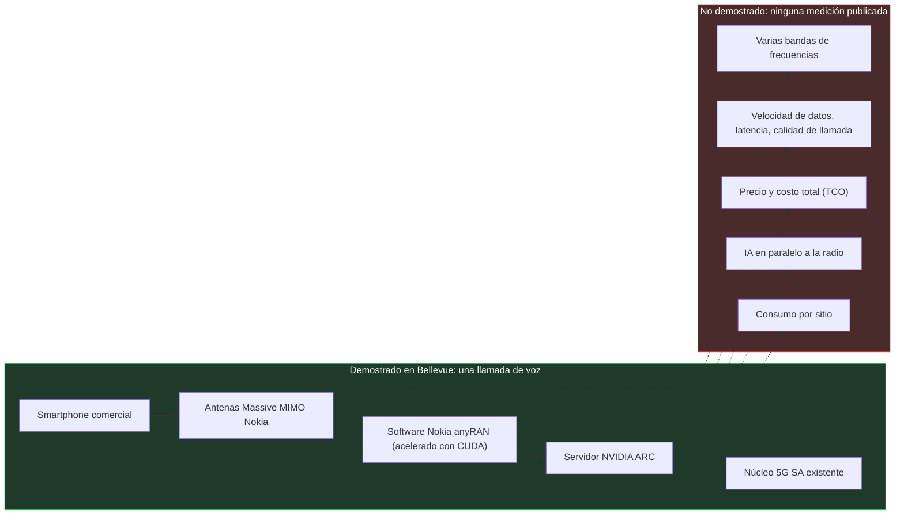
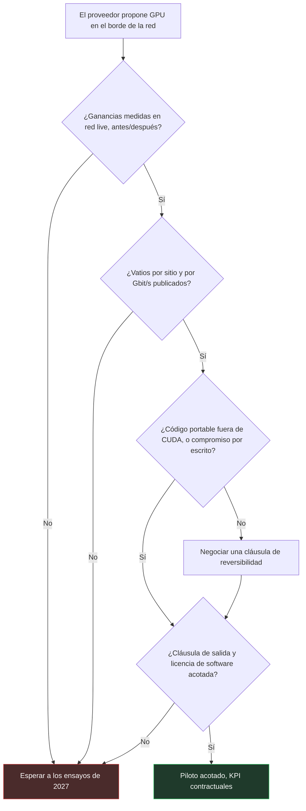

## Una llamada en Bellevue

Un smartphone de los que se compran en cualquier tienda, un emplazamiento radio a las puertas de Seattle, una llamada de voz. Es el gesto más corriente de las telecomunicaciones. Salvo que esa llamada, anunciada el 21 de octubre durante la conferencia NVIDIA GTC Berlin, atravesó una estación base de un tipo nuevo. Su cerebro ya no es un chip de telecomunicaciones dedicado, sino un procesador gráfico (GPU) de NVIDIA, primo de los que hacen funcionar las IA generativas. T-Mobile, Nokia y NVIDIA la presentan como la primera llamada « AI-RAN » en una red comercial. Detrás de la sigla hay una idea sencilla: una red de acceso radio, es decir, las antenas y las estaciones base, acelerada y optimizada por la inteligencia artificial.

¿Por qué interesarse por esto si uno no explota una red móvil nacional? Porque este hito va a alimentar, de aquí a 2027, los argumentarios de los fabricantes de equipos. Los operadores móviles serán los primeros en oírlos. Después vendrán quienes compran conectividad de sitio: hoteles, residencias de estudiantes, cadenas de retail, direcciones de TI multisitio que arbitran entre 5G privada y Wi-Fi.

El problema es que el anuncio no contiene ni una cifra. Ni velocidad de datos, ni latencia, ni vatios, ni precio. Una llamada se completó, y punto. Es una prueba de integración, no una prueba de rentabilidad. Y la única pregunta útil para un comprador no es « GPU o no GPU », sino esta: ¿qué prueba exigir antes de pagar la GPU?

## El motor arrancó, nadie sacó el cronómetro

Para situar este hito, imaginemos un motor de carreras que se enciende por primera vez en el banco de pruebas. Gira. No se cala. Los ingenieros se felicitan, y con razón: años de trabajo caben en ese primer rugido. Pero nadie ha mirado todavía el indicador de combustible, ni ha cronometrado una vuelta al circuito, ni ha comprobado que la mecánica aguanta tres horas a pleno sol. Bellevue es el banco de pruebas.

La cadena probada parte de antenas Massive MIMO de Nokia, esos paneles de múltiples elementos que orientan la señal hacia cada terminal. Detrás, el software radio Nokia 5G anyRAN, acelerado con CUDA, el entorno de programación propietario de las GPU de NVIDIA.

Ese software se ejecuta en servidores NVIDIA Aerial RAN Computer, conocidos como ARC, conectados a su vez al núcleo de red 5G SA (standalone, sin apoyo en la 4G) que T-Mobile ya tiene en servicio. Al final de la cadena, un smartphone comercial [1][2][3].

Lo que los comunicados callan es más largo que lo que dicen. No se publica ninguna métrica: ni calidad de llamada, ni latencia, ni velocidad de datos, ni banda de frecuencias, ni duración [3]. El comunicado de NVIDIA no ofrece ninguna cifra de rendimiento ni de consumo [1]. Incluso la fecha de la llamada sigue siendo difusa: el anuncio es del 21 de octubre, NVIDIA habla de una llamada hecha « recientemente », Light Reading no dice más [1][2], y Fierce Network la sitúa en el sábado 17 de octubre, sin que ni NVIDIA ni Nokia lo confirmen.

Sobre todo, el corazón de la promesa no se ha mostrado. El argumento de la GPU es ejecutar en el mismo servidor la radio y cargas de IA, sin que una degrade a la otra. Ahora bien, como señalan TeckNexus y SDxCentral, la demostración no cubre ni la inferencia de IA en paralelo a la radio, ni la orquestación que protege el rendimiento radio, ni el funcionamiento en varias bandas [3][8]. Tampoco están documentados el consumo ni el costo total de propiedad (TCO). Los socios lo asumen: su próxima fase se centra precisamente en la inferencia de IA junto a la radio, sobre una plataforma compartida, y en bandas adicionales [3].

Queda la palabra « primera ». Es una afirmación de los tres socios, sin verificación independiente [3]. En el MWC de marzo, T-Mobile ya hacía funcionar radio e IA sobre Massive MIMO de Nokia en 3,7 GHz y chips NVIDIA Grace Hopper 200, pero en su AI-RAN Innovation Center, fuera de la red de producción [7]. La novedad de octubre es más acotada: una llamada sobre servidores ARC comerciales, conectados a un núcleo comercial. El emplazamiento, cercano a la sede de T-Mobile, sigue siendo opaco: número de celdas, banda utilizada, número de usuarios, nada se dice [2].

Un último elemento de contexto: NVIDIA invirtió 1.000 millones de USD en Nokia en octubre de 2025 [3][6]. Los firmantes no son observadores neutrales de su propio hito.

*Diagrama 1 — Lo que demuestra la llamada de Bellevue (en verde) y todo lo que sigue sin una sola medición publicada (en rojo).*

Nada de esto vuelve el hito despreciable. Portar una pila radio a GPU y conectarla a un núcleo de producción es trabajo de ingeniería de verdad. Pero un hito de integración no se factura. Una ganancia, sí.

*Una llamada que se completa, esferas que siguen vacías: Bellevue demuestra la integración, no el rendimiento.*

## Las ganancias medidas en red live prescinden de la GPU

Mientras el bando de la GPU celebraba una llamada, T-Mobile publicaba porcentajes. Con otro proveedor.

En Nueva York, Ericsson y T-Mobile desplegaron en sitios seleccionados, cuyo número no se ha comunicado, un modelo de IA supervisado entrenado con los datos del operador. Afina el beamforming, es decir, la manera en que la antena concentra su energía hacia cada teléfono. Resultado anunciado en horas punta: +16 % de velocidad de bajada por usuario, +12 % de eficiencia espectral (el número de bits transportados por unidad de frecuencia) y +10 % de volumen de datos [2][8].

Todo corre sobre el cómputo y el silicio de Ericsson. Ni una GPU de NVIDIA en el circuito. Las cifras las publican el operador y su proveedor, sin auditoría independiente, pero están medidas en una red que atiende a clientes de pago.

Un segundo ensayo de Ericsson con T-Mobile, que no debe confundirse con el primero, apunta al planificador (scheduler): el director de orquesta que decide, milisegundo tras milisegundo, qué terminal habla y a qué velocidad. Su versión nativa de IA ganaría alrededor de un 10 % de eficiencia espectral y hasta un 15 % de velocidad de bajada frente a los métodos basados en reglas [2]. Gabriel Brown, analista de Omdia, califica los resultados de Ericsson en T-Mobile de « wow moment »: modelos de IA alojados en la estación base ofrecen ganancias medibles con una simple actualización de software. También admite, con una franqueza poco habitual, « we don't really know » cuántos modelos podrán convivir, ni qué ganancia acumulada saldrá de ahí [2].

En otros lugares, Ericsson reivindica +19 % de velocidad de datos en Singtel, en red live, sin condiciones de referencia publicadas [4][14]. En SoftBank, la brecha entre el escaparate y el promedio está documentada: hasta aproximadamente un 25 % de eficiencia espectral y un 50 % de velocidad de bajada en el mejor de los casos, en torno al 10 % de media. ABI Research advierte contra la tentación de tomar el máximo por una ganancia universal [9].

Del lado de la GPU, el cuadro es más escaso. Nokia reivindica más de un 20 % de eficiencia espectral, en pruebas internas y en condiciones controladas [4][6]. Deutsche Telekom mide +10 a 15 % de velocidad de subida, pero en laboratorio, en Bonn y en Oulu, con el terreno previsto para 2027 [4][8].

| Quién | Bando | Terreno | Ganancia anunciada | A tener en cuenta |
|---|---|---|---|---|
| Ericsson / T-Mobile | Sin GPU NVIDIA | Nueva York, red live | +16 % velocidad, +12 % eficiencia espectral | Cifras del operador, sin auditar |
| Ericsson / T-Mobile | Sin GPU NVIDIA | Ensayo de scheduler con IA | Aprox. 10 % eficiencia, hasta 15 % velocidad | Comparado con métodos basados en reglas |
| Ericsson / Singtel | Sin GPU NVIDIA | Singapur, red live | +19 % velocidad | Sin referencia publicada |
| Ericsson / SoftBank | Sin GPU NVIDIA | Japón, red SoftBank | Hasta 25 % y 50 %, aprox. 10 % de media | El máximo no es la regla |
| Nokia | GPU NVIDIA | Pruebas internas | Más de 20 % eficiencia espectral | Condiciones controladas |
| Deutsche Telekom | GPU NVIDIA | Laboratorio Bonn y Oulu | +10 a 15 % velocidad de subida | Terreno en 2027 |
| T-Mobile / Nokia / NVIDIA | GPU NVIDIA | Bellevue, red live | Ninguna | Una llamada de voz |

No es un duelo en igualdad de condiciones, y hay que decirlo. Las funciones de IA, las redes y las condiciones difieren: ninguna de estas cifras es comparable con otra, y no se suman. Aun así, la constatación factual cabe en una frase. A finales de octubre de 2026, las únicas ganancias medidas en una red comercial provienen de enfoques sin GPU de NVIDIA; del lado de la GPU, hay cifras de laboratorio y una llamada. En agosto volvíamos sobre el banco de pruebas comparativo de Seúl. La pregunta aquí es distinta: no quién gana en el banco, sino qué autoriza a creer a un comprador el paso a producción.

### 50 % en 2027, 100 % en 2028: una promesa de julio

Los objetivos que circulan desde el anuncio piden un repaso de la cronología. El 15 de julio, Nokia presentó su hoja de ruta: más de un 20 % de eficiencia espectral reivindicado hoy, luego un objetivo de hasta el 50 % en 2027 y de más del 100 % en 2028, es decir, una duplicación de la capacidad del espectro existente [6][10]. TelecomTV, IEEE ComSoc y Telco Magazine la difundieron, pero todos citan a Nokia [4][6][10]. En las fuentes consultadas, esos objetivos no se vinculan con la llamada de Bellevue: no aparecen ni en el comunicado de NVIDIA ni en el artículo de Light Reading del 21 de octubre [1][2]. Según SDxCentral, Pallavi Mahajan, de Nokia, habla de un camino hacia la duplicación de la eficiencia espectral, sin calendario [3].

Duplicar la eficiencia espectral equivale a obtener una segunda licencia de frecuencias sin volver a pasar por las subastas. Se entiende que la cifra haga brillar los ojos a las direcciones financieras. Precisamente por eso conviene mantenerla a distancia: Nokia apunta, nada está medido todavía, y la llamada de Bellevue no valida la trayectoria. Ian Fogg, de CCS Insight, resume lo que está en juego: los ensayos de 2027 serán « make-or-break », y tanto Nokia como NVIDIA tendrán que demostrar en ellos su ventaja [4].

## GPU o silicio propio: dos candados distintos

En cuanto a la energía, seguimos en el terreno de las afirmaciones. Nokia anuncia una envolvente de potencia « globalmente similar » a la de los sistemas actuales y un mejor costo energético por bit, sin publicar ninguna medición [6]. TeckNexus señala la ausencia de cualquier dato sobre consumo, refrigeración o espacio ocupado en el sitio [8]. Pues bien, cada vatio añadido en un emplazamiento radio se paga durante toda su vida útil.

Es exactamente el punto que vigilan los analistas. En marzo, Dell'Oro se preocupaba por la brecha de rendimiento por vatio entre la GPU y el silicio a medida, y por la viabilidad de cargas no telecom en los emplazamientos radio. Su escenario base: las soluciones sin GPU dominan el AI-RAN en el período [11]. En junio, la firma estimaba el AI-RAN en 35.000 millones de USD de ingresos acumulados entre 2026 y 2030, con una GPU revisada al alza pero apenas por encima de los mil millones de dólares al final del período [12]. Añadía que el AI-RAN no debería agrandar el mercado radio, y que los proveedores históricos están bien posicionados al injertar la IA en el hardware existente. Traducción: la IA en la radio se va a vender, pero sobre todo como software instalado sobre el parque existente.

Nokia lo ha entendido y declina su oferta en tres formas: una tarjeta GPU de capacidad que se enchufa en sus estaciones base AirScale, un nodo AI-RAN autónomo, o servidores estándar del mercado equipados con GPU a través de socios. El software se vende por suscripción, y el costo del hardware estaría « globalmente alineado » con el existente, sin ninguna cifra que lo respalde [6][10]. Un punto que se olvida a menudo: el hardware actual de Nokia se apoya en silicio Marvell a medida. El salto a la GPU de NVIDIA es una hoja de ruta, no el estado del parque.

### El cerrojo cambia de lugar

Queda la pregunta incómoda. Directivos de Ericsson consideran que escribir para CUDA expone a Nokia a un « vendor lock-in ». Ericsson asegura que su propio software vRAN (la radio virtualizada, ejecutada en servidores) corre en procesadores de otros fabricantes con poca adaptación. Nokia replica que el hardware de Ericsson no aguantará « hasta la 6G » [2][10]. Son palabras de competidores, y hay que leerlas como tales.

Mi opinión: cada uno tiene razón sobre el otro. La GPU no elimina el cerrojo, lo desplaza del silicio al entorno de software, porque su radio se convierte en una aplicación CUDA. El silicio propietario, tanto en Ericsson como en Nokia con Marvell hoy, tiene su propio candado, simplemente más antiguo y más familiar. Lo escribíamos en agosto: Open RAN ganó las interfaces y perdió a los proveedores. Una interfaz abierta no garantiza la libertad del comprador.

Hay un indicio que va en la buena dirección. SoftBank prevé ejecutar anyRAN en su propia plataforma AITRAS, con un ensayo bajo tráfico real en 2027 [4][8]. Si el ensayo se sostiene, infraestructura, orquestación y aplicaciones empezarán a desacoplarse. Es, a día de hoy, la única vía concreta de portabilidad del expediente.

### Sin norma, no hay comparación

El 3GPP, el organismo que escribe las normas móviles, lo zanjó ya en su Release 17: los algoritmos y modelos de IA son cuestión de implementación de cada proveedor y no están destinados a normalizarse. Solo se normalizan el marco, la recopilación de datos y la señalización: reporte del estado del canal, gestión de haces y posicionamiento en la Release 18, ciclo de vida de los modelos en la Release 19 [13]. La AI-RAN Alliance, por su parte, publica blueprints y benchmarks, no normas [13].

La consecuencia es mecánica. La ganancia de IA de un proveedor no es ni portable ni comparable, por construcción. Nadie le entregará un « +12 % certificado ». Si quiere comparar, tendrá que escribirlo en el contrato.

*GPU generalista contra silicio dedicado: mientras nadie publique los vatios, el duelo se juega a base de promesas.*

## En un sitio cliente, la GPU llegará de la mano del operador anfitrión

Bajemos a la escala de un edificio. El servidor ARC son chasis rack de 2U o 4U equipados con GPU RTX PRO 6000 Blackwell, suministrados por Dell, QCT o Supermicro [1]. NVIDIA lo destina típicamente a los sitios RAN centralizados, allí donde un operador móvil agrupa el procesamiento de numerosos emplazamientos radio. No es una caja para un campus.

Mi análisis, que solo me compromete a mí: para un hotel, una residencia de estudiantes o una tienda, la unidad pertinente sigue siendo el punto de acceso y el pequeño controlador. Si la GPU compartida llega algún día a esos edificios, será a través del operador anfitrión neutro (neutral host), aquel que comparte la infraestructura radio de un sitio entre varios operadores móviles. No por la orden de compra del cliente final.

El argumento económico también merece mirarse de frente. Según TeckNexus, la GPU en el borde de la red solo es rentable si soporta cargas de IA de pago además de la radio [8]. Es el razonamiento del camión de mudanzas comprado para ir a comprar el pan, que se rentabilizará alquilándolo el fin de semana. Funciona si hay clientes para el fin de semana, y si el camión está realmente libre ese día. El 23 de octubre mostrábamos que la capacidad idle de un punto de acceso Wi-Fi, la que se cree inutilizada, no existe; un servidor radio dimensionado para la hora punta plantea exactamente la misma pregunta.

Concretamente, antes de pagar GPU, ya sea en 5G privada de campus o para una capa celular añadida a un parque Wi-Fi, estas son las cinco cláusulas que yo exigiría:

1. **Mediciones en red live, antes y después.** Velocidad de datos y eficiencia espectral en promedio sobre todas las ubicaciones, no solo el mejor caso. La lección de SoftBank vale para todos.
2. **Vatios.** Consumo por sitio y por Gbit/s entregado, refrigeración y espacio ocupado incluidos. Sin esta cifra, ningún cálculo de TCO se sostiene.
3. **La portabilidad del código.** En qué plataformas corren el software radio y los modelos fuera de CUDA, con un compromiso por escrito si la plataforma cambia.
4. **Una puerta de salida.** Duración de la suscripción de software, condiciones de reversibilidad, destino de los modelos y de los datos de entrenamiento al final del contrato.
5. **La cadencia y la auditoría.** Un calendario de actualizaciones de software, puesto que ahí es donde la IA radio crea su valor según Omdia, acceso a los indicadores de rendimiento antes y después de cada versión, y compatibilidad con el parque 4G/5G existente.

*Diagrama 2 — La matriz de decisión antes de cualquier compra de GPU en el borde de la red: sin medición live ni vatios publicados, la respuesta por defecto es esperar a 2027.*

Ninguna de estas exigencias es exclusiva de la GPU. Valen tanto para Ericsson como para Nokia, en la misma lógica que las cláusulas « fully certified » del Wi-Fi 8 que mencionamos el 19 de octubre: se paga una prueba, no una etiqueta. La diferencia, hoy, es que solo uno de los dos bandos puede cumplir ya la primera.

*Entre la antena y el edificio, el candado de un lado, la puerta de salida del otro: la cláusula de reversibilidad pesa más que el chip.*

## 2027, el año en que las cifras tendrán que caer

El calendario es claro, y está enteramente en futuro. Nokia espera sus primeros productos AI-RAN comerciales en 2027, tras pilotos a finales de 2026 [3][6]. NVIDIA habla de cerca de 20 operadores que han anunciado colaboraciones en torno a anyRAN y ARC; SDxCentral nombra a 15 que « trabajan con » los socios, sin que eso signifique un ensayo en curso [1][3]. Una colaboración anunciada no es un despliegue.

Las citas son conocidas. BT prepara un ensayo live en Birmingham para 2027. Deutsche Telekom pasará del laboratorio al terreno ese mismo año. Elisa afirma hacer funcionar simultáneamente voz, datos y analítica de vídeo en ARC, sobre el terreno en Helsinki, y apunta a servicios comerciales en 2027. Es la prueba más interesante de la lista, porque por fin toca la compartición de recursos. Orange prueba el software de Nokia en ARC para la eficiencia espectral y el edge, y SoftBank también apunta a 2027 [1][4][8]. Nada de esto se factura hoy.

Para que yo dé el AI-RAN sobre GPU por probado, necesito cuatro elementos publicados. Ganancias en red comercial, en promedio y no en el pico. Un consumo por sitio. Una demostración cifrada de cargas de IA concurrentes, sin degradación de la radio. Y un precio. El día en que un operador publique los cuatro, la discusión cambiará de naturaleza.

Hasta entonces, mi posición es sencilla. Bellevue es un hito de ingeniería real, y despacharlo con un gesto displicente sería deshonesto. Pero un comprador no paga un hito, paga una ganancia. Hoy, la ganancia medida está del lado de quienes no tienen GPU, y la promesa del lado de quienes la tienen. En un mercado donde los padrinos históricos de la 5G privada de campus toman distancia, como contábamos el 26 de octubre, la prudencia contractual no tiene nada de timorata.

No pague la GPU antes de la medición. Y no firme ni GPU ni silicio propio sin una cláusula de salida: el candado más costoso no está grabado en el chip, es el que se olvidó de escribir en el contrato.

_Opiniones personales, no la posición de Wifirst._

## Fuentes

1. NVIDIA Newsroom, communiqué NVIDIA, Nokia et opérateurs télécoms sur l'AI-RAN (21 octobre 2026) : https://nvidianews.nvidia.com/news/nvidia-nokia-and-leading-telecom-operators-turn-networks-into-distributed-intelligence-platforms
2. Light Reading (M. Donegan), premier appel AI-RAN de T-Mobile avec Nokia et NVIDIA (21 octobre 2026) : https://lightreading.com/ai-machine-learning/t-mobile-makes-first-ai-ran-call-with-nokia-and-nvidia
3. SDxCentral / DCD, T-Mobile revendique le premier appel AI-RAN mondial (22 octobre 2026) : https://www.sdxcentral.com/news/t-mobile-claims-world-first-ai-ran-call-with-nokia-and-nvidia/ (original DCD : https://datacenterdynamics.com/en/news/t-mobile-claims-world-first-ai-ran-call-with-nokia-and-nvidia)
4. Telco Magazine (S. Fenwick), où en sont Nokia et NVIDIA sur l'AI-RAN (22 octobre 2026) : https://telcomagazine.com/news/what-progress-have-nokia-and-nvidia-made-on-ai-ran
5. Nokia, billet d'annonce de l'appel AI-RAN avec T-Mobile et NVIDIA (21 octobre 2026) : https://www.nokia.com/blog/from-the-lab-to-the-live-network-nokia-t-mobile-and-nvidia-complete-worlds-first-ai-ran-call/
6. TelecomTV (R. Le Maistre), la feuille de route AI-RAN de Nokia et ses promesses d'efficacité spectrale (15 juillet 2026) : https://www.telecomtv.com/content/nokia/nokia-spruces-up-its-ai-ran-pitch-with-spectral-efficiency-claims-55888/
7. Mobile World Live (M. Robuck), Nokia et NVIDIA accélèrent sur l'AI-RAN au MWC 2026 (1er mars 2026) : https://www.mobileworldlive.com/ai-cloud/nokia-accelerates-ai%E2%80%91ran-momentum-with-nvidia/
8. TeckNexus (H. Kadia), l'AI-RAN sur réseau live, ce qui est prouvé et ce qui ne l'est pas (22 octobre 2026) : https://tecknexus.com/ai-ran-live-network-nokia-nvidia-operators/
9. ABI Research (S. Bowling), l'IA entre dans le RAN commercial (9 septembre 2026) : https://www.abiresearch.com/market-research/insight/7788465-ai-moves-into-commercial-ran-with-spectrum
10. IEEE ComSoc Tech Blog, analyse de la plateforme AI-RAN de Nokia et du nœud autonome sur GPU NVIDIA (15 juillet 2026) : https://techblog.comsoc.org/2026/07/15/analysis-nokias-new-ai-ran-platform-and-standalone-ai-ran-node-with-nvidia-gpus/
11. Dell'Oro Group (S. Pongratz), « All roads lead to AI RAN » (19 mars 2026) : https://www.delloro.com/all-roads-lead-to-ai-ran/
12. Dell'Oro Group, prévisions AI RAN à cinq ans, 35 Md USD (30 juin 2026) : https://www.delloro.com/news/ai-ran-to-reach-35-b-over-next-five-years/
13. NVIDIA Developer Blog, l'IA dans la 6G avec l'AI-RAN Alliance, le 3GPP et l'O-RAN (19 juillet 2024) : https://developer.nvidia.com/blog/boosting-ai-driven-innovation-in-6g-with-the-ai-ran-alliance-3gpp-and-o-ran/
14. Ericsson, communiqué Singtel et Ericsson sur la 5G et les réseaux natifs IA à Singapour (2026) : https://www.ericsson.com/en/press-releases/2/2026/singtel-and-ericsson-deepen-partnership-to-scale-5g-innovation-and-build-ai-native-networks-for-consumers-and-enterprises-in-singapore
