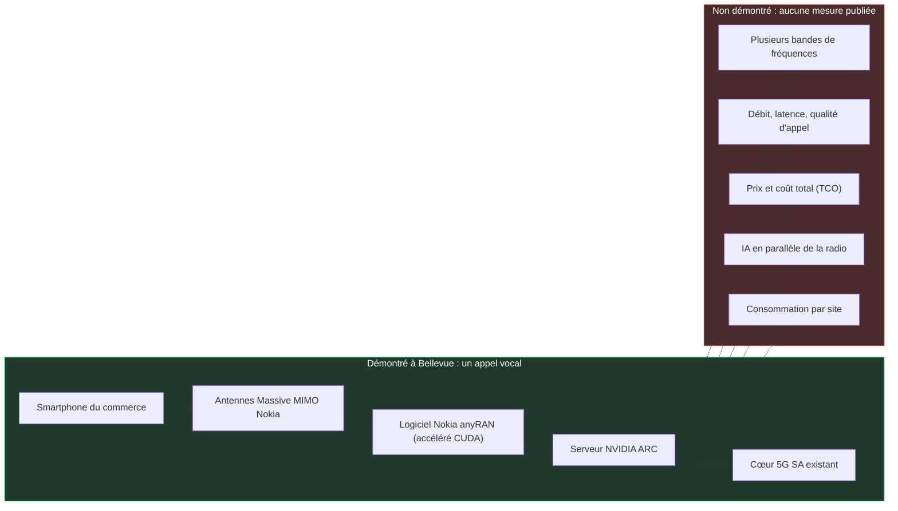
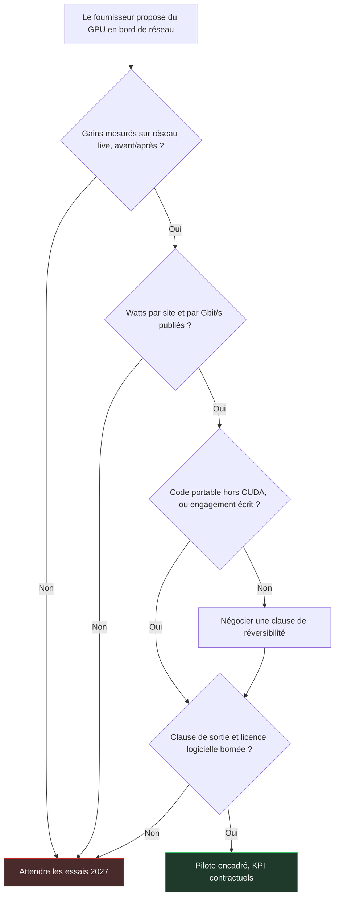

## Un coup de fil à Bellevue

Un smartphone du commerce, un site radio aux portes de Seattle, un appel vocal. C'est le geste le plus banal des télécoms. Sauf que cet appel-là, annoncé le 21 octobre pendant la conférence NVIDIA GTC Berlin, a traversé une station de base d'un genre nouveau. Son cerveau n'est plus une puce télécom dédiée, mais un processeur graphique (GPU) NVIDIA, cousin de ceux qui font tourner les IA génératives. T-Mobile, Nokia et NVIDIA le présentent comme le premier appel « AI-RAN » sur un réseau commercial. Derrière le sigle, une idée simple : un réseau d'accès radio, c'est-à-dire les antennes et les stations de base, accéléré et optimisé par l'intelligence artificielle.

Pourquoi s'y intéresser quand on n'exploite pas un réseau mobile national ? Parce que ce jalon va nourrir, d'ici 2027, les argumentaires des équipementiers. Les opérateurs mobiles l'entendront en premier. Viendront ensuite ceux qui achètent de la connectivité de site : hôtels, résidences étudiantes, enseignes de retail, DSI multisites qui arbitrent entre 5G privée et Wi-Fi.

Le problème, c'est que l'annonce ne contient aucun chiffre. Pas de débit, pas de latence, pas de watts, pas de prix. Un appel a abouti, point. C'est une preuve d'intégration, pas une preuve de rentabilité. Et la seule question utile pour un acheteur n'est pas « GPU ou pas GPU », mais celle-ci : quelle preuve exiger avant de payer le GPU ?

## Le moteur a démarré, personne n'a sorti le chronomètre

Pour situer ce jalon, imaginez un moteur de course qu'on démarre pour la première fois au banc d'essai. Il tourne. Il ne cale pas. Les ingénieurs se congratulent, et ils ont raison : des années de travail tiennent dans ce premier vrombissement. Mais personne n'a encore regardé la jauge de carburant, ni sorti le chronomètre sur circuit, ni vérifié que la mécanique tient trois heures en plein soleil. Bellevue, c'est le banc d'essai.

La chaîne testée part d'antennes Massive MIMO de Nokia, ces panneaux à éléments multiples qui orientent le signal vers chaque terminal. Derrière, le logiciel radio Nokia 5G anyRAN, accéléré par CUDA, l'environnement de programmation propriétaire des GPU NVIDIA.

Ce logiciel s'exécute sur des serveurs NVIDIA Aerial RAN Computer, dits ARC, eux-mêmes raccordés au cœur de réseau 5G SA (standalone, sans appui sur la 4G) déjà en service chez T-Mobile. Au bout de la chaîne, un smartphone du commerce [1][2][3].

Ce que les communiqués taisent est plus long que ce qu'ils disent. Aucune métrique n'est publiée : ni qualité d'appel, ni latence, ni débit, ni bande de fréquences, ni durée [3]. Le communiqué NVIDIA ne livre aucun chiffre de performance ou de consommation [1]. Même la date de l'appel reste floue : l'annonce est du 21 octobre, NVIDIA évoque un appel passé « récemment », Light Reading n'en dit pas plus [1][2], et Fierce Network le situe au samedi 17 octobre, sans que ni NVIDIA ni Nokia ne le confirment.

Surtout, le cœur de la promesse n'a pas été montré. L'argument du GPU, c'est de faire tourner sur le même serveur la radio et des charges d'IA, sans que l'une dégrade l'autre. Or, comme le relèvent TeckNexus et SDxCentral, la démonstration ne couvre ni l'inférence IA en parallèle de la radio, ni l'orchestration qui protège la performance radio, ni le fonctionnement sur plusieurs bandes [3][8]. La consommation et le coût total de possession (TCO) ne sont pas documentés non plus. Les partenaires l'assument : leur prochaine phase porte justement sur l'inférence IA aux côtés de la radio, sur une plateforme partagée, et sur des bandes supplémentaires [3].

Reste le mot « premier ». C'est une revendication des trois partenaires, sans vérification indépendante [3]. Au MWC de mars, T-Mobile faisait déjà tourner radio et IA sur du Massive MIMO Nokia en 3,7 GHz et des puces NVIDIA Grace Hopper 200, mais dans son AI-RAN Innovation Center, hors réseau de production [7]. La nouveauté d'octobre est plus étroite : un appel sur des serveurs ARC commerciaux, raccordés à un cœur commercial. Le site, proche du siège de T-Mobile, reste opaque : nombre de cellules, bande utilisée, nombre d'utilisateurs, rien n'est dit [2].

Dernier élément de contexte : NVIDIA a investi 1 Md USD dans Nokia en octobre 2025 [3][6]. Les signataires ne sont pas des observateurs neutres de leur propre jalon.

*Schéma 1 — Ce que l'appel de Bellevue démontre (en vert) et tout ce qui reste sans la moindre mesure publiée (en rouge).*

Rien de tout cela ne rend le jalon négligeable. Porter une pile radio sur GPU et la brancher sur un cœur de production, c'est du vrai travail d'ingénierie. Mais un jalon d'intégration ne se facture pas. Un gain, si.

*Un appel qui passe, des cadrans qui restent vides : Bellevue démontre l'intégration, pas la performance.*

## Les gains mesurés en réseau live se passent du GPU

Pendant que le camp GPU célébrait un appel, T-Mobile publiait des pourcentages. Avec un autre fournisseur.

À New York, Ericsson et T-Mobile ont déployé sur des sites ciblés, dont le nombre n'est pas communiqué, un modèle IA supervisé entraîné sur les données de l'opérateur. Il affine le beamforming, c'est-à-dire la façon dont l'antenne concentre son énergie vers chaque téléphone. Résultat annoncé aux heures de pointe : +16 % de débit descendant par utilisateur, +12 % d'efficacité spectrale (le nombre de bits transportés par unité de fréquence) et +10 % de volume de données [2][8].

Le tout tourne sur le calcul et le silicium Ericsson. Pas un GPU NVIDIA dans la boucle. Les chiffres sont publiés par l'opérateur et son fournisseur, sans audit indépendant, mais ils sont mesurés sur un réseau qui sert des clients payants.

Un second essai Ericsson chez T-Mobile, à ne pas confondre avec le premier, cible l'ordonnanceur : le chef d'orchestre qui décide, milliseconde après milliseconde, quel terminal parle et à quel débit. Sa version native IA gagnerait environ 10 % d'efficacité spectrale et jusqu'à 15 % de débit descendant face aux méthodes à base de règles [2]. Gabriel Brown, analyste chez Omdia, qualifie les résultats Ericsson chez T-Mobile de « wow moment » : des modèles IA logés dans la station de base livrent des gains mesurables par simple mise à jour logicielle. Il admet aussi, avec une franchise rare, « we don't really know » combien de modèles pourront cohabiter, ni quel gain cumulé en sortira [2].

Ailleurs, Ericsson revendique +19 % de débit chez Singtel sur réseau live, sans conditions de référence publiées [4][14]. Chez SoftBank, l'écart entre la vitrine et la moyenne est documenté : jusqu'à environ 25 % d'efficacité spectrale et 50 % de débit descendant dans le meilleur des cas, autour de 10 % en moyenne. ABI Research met en garde contre la tentation de prendre le maximum pour un gain universel [9].

Côté GPU, le tableau est plus mince. Nokia revendique plus de 20 % d'efficacité spectrale, en tests internes et en conditions contrôlées [4][6]. Deutsche Telekom mesure +10 à 15 % de débit montant, mais en laboratoire, à Bonn et à Oulu, le terrain étant prévu pour 2027 [4][8].

| Qui | Camp | Terrain | Gain annoncé | À retenir |
|---|---|---|---|---|
| Ericsson / T-Mobile | Sans GPU NVIDIA | New York, réseau live | +16 % débit, +12 % efficacité spectrale | Chiffres opérateur, non audités |
| Ericsson / T-Mobile | Sans GPU NVIDIA | Essai ordonnanceur IA | Env. 10 % efficacité, jusqu'à 15 % débit | Comparé aux méthodes à règles |
| Ericsson / Singtel | Sans GPU NVIDIA | Singapour, réseau live | +19 % débit | Aucune référence publiée |
| Ericsson / SoftBank | Sans GPU NVIDIA | Japon, réseau SoftBank | Jusqu'à 25 % et 50 %, env. 10 % en moyenne | Le maximum n'est pas la règle |
| Nokia | GPU NVIDIA | Tests internes | Plus de 20 % efficacité spectrale | Conditions contrôlées |
| Deutsche Telekom | GPU NVIDIA | Labo Bonn et Oulu | +10 à 15 % débit montant | Terrain en 2027 |
| T-Mobile / Nokia / NVIDIA | GPU NVIDIA | Bellevue, réseau live | Aucun | Un appel vocal |

Ce n'est pas un duel à armes égales, et il faut le dire. Fonctions IA, réseaux et conditions diffèrent : aucun de ces chiffres n'est comparable à un autre, et ils ne s'additionnent pas. Le constat factuel tient pourtant en une phrase. Fin octobre 2026, les seuls gains mesurés sur réseau commercial viennent d'approches sans GPU NVIDIA ; côté GPU, on dispose de chiffres de laboratoire et d'un appel. En août, nous revenions sur le banc d'essai comparatif de Séoul. La question est ici différente : non pas qui gagne au banc, mais ce qu'un passage en production autorise un acheteur à croire.

### 50 % en 2027, 100 % en 2028 : une promesse de juillet

Les objectifs qui circulent depuis l'annonce appellent un rappel de chronologie. Le 15 juillet, Nokia a présenté sa feuille de route : plus de 20 % d'efficacité spectrale revendiqués aujourd'hui, puis un objectif pouvant aller jusqu'à 50 % en 2027 et de plus de 100 % en 2028, soit un doublement de la capacité du spectre existant [6][10]. TelecomTV, l'IEEE ComSoc et Telco Magazine l'ont relayée, mais tous citent Nokia [4][6][10]. Dans les sources consultées, ces objectifs ne sont pas rattachés à l'appel de Bellevue : ils n'apparaissent ni dans le communiqué NVIDIA ni dans l'article de Light Reading du 21 octobre [1][2]. Selon SDxCentral, Pallavi Mahajan, chez Nokia, évoque un chemin vers le doublement de l'efficacité spectrale, sans calendrier [3].

Doubler l'efficacité spectrale, c'est obtenir l'équivalent d'une seconde licence de fréquences sans repasser par les enchères. On comprend que le chiffre fasse briller les yeux des directions financières. C'est précisément pour ça qu'il faut le tenir à distance : Nokia vise, rien n'est encore mesuré, et l'appel de Bellevue ne valide pas la trajectoire. Ian Fogg, de CCS Insight, résume l'enjeu : les essais de 2027 seront « make-or-break », et Nokia comme NVIDIA devront y prouver leur avance [4].

## GPU ou silicium maison : deux cadenas différents

Sur l'énergie, on en reste aux affirmations. Nokia annonce une enveloppe de puissance « globalement similaire » à celle des systèmes actuels et un meilleur coût énergétique par bit, sans publier de mesure [6]. TeckNexus relève l'absence de toute donnée sur la consommation, le refroidissement ou l'encombrement en site [8]. Or chaque watt ajouté sur un site radio se paie pendant toute sa durée de vie.

C'est exactement le point que surveillent les analystes. En mars, Dell'Oro s'inquiétait de l'écart de performance par watt entre GPU et silicium sur mesure, et de la faisabilité de charges non télécoms sur les sites radio. Son scénario de base : les solutions sans GPU dominent l'AI-RAN sur la période [11]. En juin, le cabinet évaluait l'AI-RAN à 35 Md USD de revenus cumulés entre 2026 et 2030, avec un GPU révisé à la hausse mais à peine au-dessus du milliard de dollars en fin de période [12]. Il ajoutait que l'AI-RAN ne devrait pas agrandir le marché radio, et que les fournisseurs historiques sont bien placés en greffant l'IA sur le matériel existant. Traduction : l'IA dans la radio va se vendre, mais surtout comme du logiciel posé sur le parc installé.

Nokia l'a compris et décline son offre en trois formes : une carte GPU de capacité qui s'enfiche dans ses stations de base AirScale, un nœud AI-RAN autonome, ou des serveurs standards du marché équipés de GPU via des partenaires. Le logiciel est vendu en abonnement, et le coût matériel serait « globalement aligné » sur l'existant, sans chiffre à l'appui [6][10]. Point souvent oublié : le matériel Nokia actuel repose sur du silicium Marvell sur mesure. La bascule vers le GPU NVIDIA est une feuille de route, pas l'état du parc.

### Le verrou change de place

Reste la question qui fâche. Des dirigeants d'Ericsson estiment qu'écrire pour CUDA expose Nokia à un « vendor lock-in ». Ericsson assure que son propre logiciel vRAN (la radio virtualisée, exécutée sur des serveurs) tourne sur des processeurs d'autres fondeurs avec peu d'adaptation. Nokia rétorque que le matériel Ericsson ne tiendra pas « jusqu'à la 6G » [2][10]. Ce sont des propos de concurrents, à lire comme tels.

Mon avis : chacun a raison sur l'autre. Le GPU ne supprime pas le verrou, il le déplace du silicium vers l'environnement logiciel, puisque votre radio devient une application CUDA. Le silicium propriétaire, chez Ericsson comme chez Nokia avec Marvell aujourd'hui, a son propre cadenas, simplement plus ancien et plus familier. Nous l'écrivions en août : l'Open RAN a gagné les interfaces et perdu les fournisseurs. Une interface ouverte ne garantit pas la liberté de l'acheteur.

Un indice va dans le bon sens. SoftBank prévoit de faire tourner anyRAN sur sa propre plateforme AITRAS, avec un essai sous trafic réel en 2027 [4][8]. Si l'essai tient, infrastructure, orchestration et applications commenceront à se découpler. C'est, à ce stade, la seule piste concrète de portabilité du dossier.

### Pas de norme, pas de comparaison

Le 3GPP, l'organisme qui écrit les normes mobiles, a tranché dès sa Release 17 : les algorithmes et modèles IA relèvent de l'implémentation de chaque fournisseur et n'ont pas vocation à être normalisés. Seuls le cadre, la collecte de données et la signalisation le sont : remontée d'état du canal, gestion des faisceaux et positionnement en Release 18, cycle de vie des modèles en Release 19 [13]. L'AI-RAN Alliance, elle, publie des blueprints et des benchmarks, pas des normes [13].

La conséquence est mécanique. Le gain IA d'un fournisseur n'est ni portable ni comparable, par construction. Personne ne vous livrera un « +12 % certifié ». Si vous voulez comparer, il faudra l'écrire dans le contrat.

*GPU généraliste contre silicium dédié : tant que personne ne publie les watts, le match se joue sur parole.*

## Sur un site client, le GPU viendra par l'opérateur hôte

Redescendons à l'échelle d'un bâtiment. Le serveur ARC, ce sont des châssis rack de 2U ou 4U équipés de GPU RTX PRO 6000 Blackwell, fournis par Dell, QCT ou Supermicro [1]. NVIDIA le destine typiquement aux sites RAN centralisés, là où un opérateur mobile regroupe le traitement de nombreux sites radio. Ce n'est pas une boîte de campus.

Mon analyse, qui n'engage que moi : pour un hôtel, une résidence étudiante ou un magasin, l'unité pertinente reste la borne et le petit contrôleur. Si le GPU mutualisé entre un jour dans ces bâtiments, ce sera par l'opérateur hôte neutre (neutral host), celui qui partage l'infrastructure radio d'un site entre plusieurs opérateurs mobiles. Pas par le bon de commande du client final.

L'argument économique mérite aussi d'être regardé en face. Selon TeckNexus, le GPU en bord de réseau n'est rentable que s'il porte des charges IA payantes en plus de la radio [8]. C'est le raisonnement du camion de déménagement acheté pour aller chercher le pain, qu'on rentabilisera en le louant le week-end. Ça marche s'il existe des clients pour le week-end, et si le camion est vraiment libre ce jour-là. Nous montrions le 23 octobre que la capacité idle d'une borne Wi-Fi, celle qu'on croit inutilisée, n'existe pas ; un serveur radio dimensionné pour l'heure de pointe pose exactement la même question.

Concrètement, avant de payer du GPU, en 5G privée de campus comme pour une couche cellulaire ajoutée à un parc Wi-Fi, voici les cinq clauses que j'exigerais :

1. **Des mesures sur réseau live, avant et après.** Débit et efficacité spectrale en moyenne sur tous les emplacements, pas seulement le meilleur cas. La leçon SoftBank vaut pour tout le monde.
2. **Des watts.** Consommation par site et par Gbit/s délivré, refroidissement et encombrement compris. Sans ce chiffre, aucun calcul de TCO ne tient.
3. **La portabilité du code.** Sur quelles plateformes le logiciel radio et les modèles tournent hors CUDA, avec un engagement écrit si la plateforme change.
4. **Une porte de sortie.** Durée de l'abonnement logiciel, conditions de réversibilité, sort des modèles et des données d'entraînement en fin de contrat.
5. **La cadence et l'audit.** Un calendrier de mises à jour logicielles, puisque c'est là que l'IA radio crée sa valeur selon Omdia, un accès aux indicateurs de performance avant et après chaque version, et la compatibilité avec le parc 4G/5G existant.

*Schéma 2 — La grille de décision avant tout achat de GPU en bord de réseau : sans mesure live ni watts publiés, la réponse par défaut est d'attendre 2027.*

Aucune de ces exigences n'est propre au GPU. Elles valent pour Ericsson comme pour Nokia, dans la même logique que les clauses « fully certified » du Wi-Fi 8 évoquées le 19 octobre : on paie une preuve, pas une étiquette. La différence, aujourd'hui, c'est que seul l'un des deux camps peut déjà remplir la première.

*Entre l'antenne et le bâtiment, le cadenas d'un côté, la porte de sortie de l'autre : la clause de réversibilité pèse plus lourd que la puce.*

## 2027, l'année où les chiffres devront tomber

Le calendrier est clair, et il est entièrement au futur. Nokia attend ses premiers produits AI-RAN commerciaux en 2027, après des pilotes fin 2026 [3][6]. NVIDIA parle de près de 20 opérateurs ayant annoncé des collaborations autour d'anyRAN et d'ARC ; SDxCentral en nomme 15 qui « travaillent avec » les partenaires, sans que cela signifie un essai en cours [1][3]. Une collaboration annoncée n'est pas un déploiement.

Les rendez-vous sont connus. BT prépare un essai live à Birmingham pour 2027. Deutsche Telekom passera du labo au terrain la même année. Elisa affirme faire tourner simultanément voix, données et analytique vidéo sur ARC, sur le terrain à Helsinki, et vise des services commerciaux en 2027. C'est le test le plus intéressant de la liste, parce qu'il touche enfin à la mutualisation. Orange teste le logiciel Nokia sur ARC pour l'efficacité spectrale et l'edge, et SoftBank vise lui aussi 2027 [1][4][8]. Rien de tout cela n'est facturé aujourd'hui.

Pour que je tienne l'AI-RAN sur GPU pour prouvé, il me faudra quatre éléments publiés. Des gains sur réseau commercial, en moyenne et non en pointe. Une consommation par site. Une démonstration chiffrée de charges IA concurrentes, sans dégradation de la radio. Et un prix. Le jour où un opérateur publie les quatre, la discussion change de nature.

D'ici là, ma position est simple. Bellevue est un vrai jalon d'ingénierie, et le balayer d'un revers de main serait malhonnête. Mais un acheteur ne paie pas un jalon, il paie un gain. Aujourd'hui, le gain mesuré se trouve chez ceux qui n'ont pas de GPU, et la promesse chez ceux qui en ont. Dans un marché où les parrains historiques de la 5G privée de campus prennent leurs distances, comme nous le racontions le 26 octobre, la prudence contractuelle n'a rien de frileux.

Ne payez pas le GPU avant la mesure. Et ne signez ni GPU ni silicium maison sans clause de sortie : le cadenas le plus coûteux n'est pas gravé sur la puce, c'est celui qu'on a oublié d'écrire dans le contrat.

_Vues personnelles, pas position Wifirst._

## Sources

1. NVIDIA Newsroom, communiqué NVIDIA, Nokia et opérateurs télécoms sur l'AI-RAN (21 octobre 2026) : https://nvidianews.nvidia.com/news/nvidia-nokia-and-leading-telecom-operators-turn-networks-into-distributed-intelligence-platforms
2. Light Reading (M. Donegan), premier appel AI-RAN de T-Mobile avec Nokia et NVIDIA (21 octobre 2026) : https://lightreading.com/ai-machine-learning/t-mobile-makes-first-ai-ran-call-with-nokia-and-nvidia
3. SDxCentral / DCD, T-Mobile revendique le premier appel AI-RAN mondial (22 octobre 2026) : https://www.sdxcentral.com/news/t-mobile-claims-world-first-ai-ran-call-with-nokia-and-nvidia/ (original DCD : https://datacenterdynamics.com/en/news/t-mobile-claims-world-first-ai-ran-call-with-nokia-and-nvidia)
4. Telco Magazine (S. Fenwick), où en sont Nokia et NVIDIA sur l'AI-RAN (22 octobre 2026) : https://telcomagazine.com/news/what-progress-have-nokia-and-nvidia-made-on-ai-ran
5. Nokia, billet d'annonce de l'appel AI-RAN avec T-Mobile et NVIDIA (21 octobre 2026) : https://www.nokia.com/blog/from-the-lab-to-the-live-network-nokia-t-mobile-and-nvidia-complete-worlds-first-ai-ran-call/
6. TelecomTV (R. Le Maistre), la feuille de route AI-RAN de Nokia et ses promesses d'efficacité spectrale (15 juillet 2026) : https://www.telecomtv.com/content/nokia/nokia-spruces-up-its-ai-ran-pitch-with-spectral-efficiency-claims-55888/
7. Mobile World Live (M. Robuck), Nokia et NVIDIA accélèrent sur l'AI-RAN au MWC 2026 (1er mars 2026) : https://www.mobileworldlive.com/ai-cloud/nokia-accelerates-ai%E2%80%91ran-momentum-with-nvidia/
8. TeckNexus (H. Kadia), l'AI-RAN sur réseau live, ce qui est prouvé et ce qui ne l'est pas (22 octobre 2026) : https://tecknexus.com/ai-ran-live-network-nokia-nvidia-operators/
9. ABI Research (S. Bowling), l'IA entre dans le RAN commercial (9 septembre 2026) : https://www.abiresearch.com/market-research/insight/7788465-ai-moves-into-commercial-ran-with-spectrum
10. IEEE ComSoc Tech Blog, analyse de la plateforme AI-RAN de Nokia et du nœud autonome sur GPU NVIDIA (15 juillet 2026) : https://techblog.comsoc.org/2026/07/15/analysis-nokias-new-ai-ran-platform-and-standalone-ai-ran-node-with-nvidia-gpus/
11. Dell'Oro Group (S. Pongratz), « All roads lead to AI RAN » (19 mars 2026) : https://www.delloro.com/all-roads-lead-to-ai-ran/
12. Dell'Oro Group, prévisions AI RAN à cinq ans, 35 Md USD (30 juin 2026) : https://www.delloro.com/news/ai-ran-to-reach-35-b-over-next-five-years/
13. NVIDIA Developer Blog, l'IA dans la 6G avec l'AI-RAN Alliance, le 3GPP et l'O-RAN (19 juillet 2024) : https://developer.nvidia.com/blog/boosting-ai-driven-innovation-in-6g-with-the-ai-ran-alliance-3gpp-and-o-ran/
14. Ericsson, communiqué Singtel et Ericsson sur la 5G et les réseaux natifs IA à Singapour (2026) : https://www.ericsson.com/en/press-releases/2/2026/singtel-and-ericsson-deepen-partnership-to-scale-5g-innovation-and-build-ai-native-networks-for-consumers-and-enterprises-in-singapore
