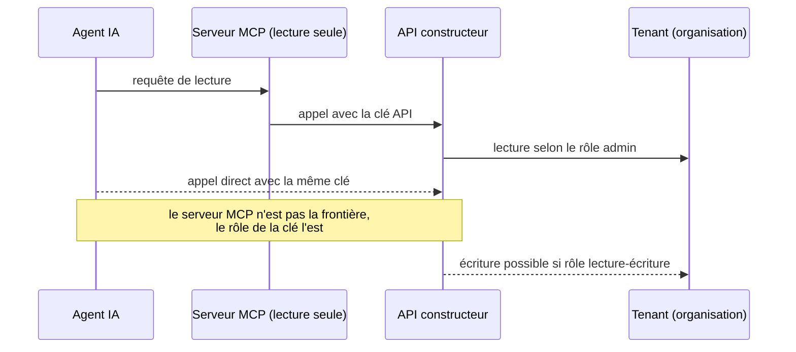

# Brief — Cisco Networking MCP servers et Agentic Actions : qui détient les clés d'un parc managé multi-tenant ?

Date du brief : 2026-10-28 | Mode : brief | Sujet retenu : annonces Cisco Partner Summit (Vancouver, 26-28 oct. 2026)
Convention : **[FAIT]** = sourcé et vérifié par fetch ; **[ANALYSE]** = lecture d'auteur, non sourcée, à assumer comme telle dans l'article.

## Thèse (1 phrase)
Quand le serveur MCP d'un constructeur donne à un agent la lecture puis l'action sur un parc managé, la clé ne se trouve ni dans le protocole ni dans l'annonce : elle se trouve dans le rôle admin et la clé API du tenant, et tant que Cisco ne documente ni périmètre multi-tenant, ni droits d'écriture, ni journal exportable pour Agentic Actions (controlled availability), l'opérateur doit garder pour lui la clé d'écriture et une copie du journal.

## Angle (différenciation vs articles déjà publiés)
- Pas de NOC, de disjoncteur ni d'anti-cascade (ia-agentique-noc-disjoncteur-anti-cascade, 09-26).
- Pas de lock-in modèle/orchestration (agents-ia-modele-remplacable-orchestration-verrou, 10-14).
- Pas de superviseur indépendant du fournisseur de modèle (microsoft-garde-fou-agents-independance-superviseur, 10-20).
- Ce brief traite : **identité et délégation** (à qui appartient la clé), **périmètre tenant**, **frontière lecture/écriture**, **où vit le journal d'audit**, et **le statut réel des annonces** (controlled availability vs GA vs annoncé sans date).
- Renvois internes possibles, sans reprise de contenu : `hpe-aruba-central-mist-deux-consoles-un-cerveau` (multi-tenant), `nvidia-sentry-openshell-garde-fou-agent-hors-hote` (garde-fou hors hôte), `personal-agent-protocol-spec-publique-sans-arbitre` (identité d'agent/OAuth).
- Le script scripts/get-article-content.ts est codé en dur pour un chemin macOS et un autre slug ; je n'ai donc pas pu relire le corps des 3 articles exclus. Contrôle d'anti-redondance fait sur titres et tags uniquement.

## Ce que l'annonce dit réellement (statut, périmètre exact)

### Faits clés datés
1. **Networking MCP servers : annoncés, sans date ni statut de disponibilité.** Le billet de Joe Vaccaro (SVP/GM Network Platform & Assurance, Cisco, 2026-10-26) les décrit comme « a standardized, supported integration layer that connects AI agents directly to live network data », pour troubleshooting, reporting et compliance, en complément de Cisco AI Assistant et AI Canvas. Aucun prix, licence ni date de GA. Le billet ne parle ni de permissions, ni de journal d'audit, ni de rollback. — [S1]
2. Network World (2026-10-27) écrit que Cisco « plans to add » des serveurs MCP à ses plateformes réseau, pour troubleshooting, reporting et gestion d'infrastructure. Channel Insider (2026-10-27) parle de « MCP connectivity » et Converge Digest (2026-10-26) de « MCP servers for networking platforms », sans produit nommé ni date. — [S4] [S5] [S2]
3. **Agentic Actions : « Now in controlled availability », sans date de GA.** Le billet décrit visibilité sur le raisonnement de l'agent, actions recommandées, suivi de résolution, et une montée en autonomie « from approving individual changes to autonomous execution within defined policies and guardrails, with human oversight ». Inscription bêta réservée aux clients existants. — [S1]
4. Le terme « Agentic Actions » n'apparaît ni chez Network World, ni Converge Digest, ni StorageReview, ni Channel Insider : le statut « controlled availability » d'Agentic Actions repose sur **une seule source** (le billet Cisco). Les autres médias parlent d'« AgenticOps tooling » ajouté à Cisco Cloud Control. — [S1] [S2] [S3] [S4] [S5]
5. Dans les médias, « controlled availability » désigne **Model Foundry** (service Cloud Control pour découvrir, évaluer, affiner et exécuter les modèles Cisco sur les données du client) : « Controlled Availability begins with Cisco partners », sans date de GA. À ne pas confondre avec Agentic Actions. — [S3] [S4] [S5]
6. Le billet ne nomme pas Meraki dans son texte : Meraki n'apparaît que dans les deux URL d'inscription bêta (Experience Metrics et Agentic Actions). Rattacher Agentic Actions à Meraki est donc une inférence. — [S1]
7. **Seul MCP server explicitement disponible dans l'annonce : Cisco IQ MCP Server**, pour les partenaires, avec accès API élargi, au moment de la GA de Cisco IQ for Partners (2026-10-26). Cisco IQ est la plateforme support/services, pas le plan de contrôle des équipements. — [S3] [S4]
8. **Délégation tenant → partenaire, côté Cisco IQ : un RBAC permet au client d'accorder au partenaire une visibilité directe et sécurisée sur son parc installé** (Network World) ; StorageReview parle d'un RBAC permettant au client de donner au partenaire une visibilité sur son parc installé. C'est la seule mécanique de délégation client → partenaire décrite dans l'annonce, et elle porte sur la visibilité du parc installé. — [S3] [S4]
9. **Privileged Infrastructure Access (avec Teleport) : en développement** (« remains under development », Converge Digest) ; selon Network World, la façon de l'offrir aux clients n'est pas claire. Channel Insider décrit un accès à tâche limitée pour équipes réseau et agents IA, par certificats courts liés à l'identité, avec sessions enregistrées et privilèges expirant à la fin de la session. — [S2] [S4] [S5]
10. Teleport (2026-08-25) : Cisco devient son plus gros investisseur ; premier cas d'usage = accès privilégié pour administrateurs réseau/infra ; principe énoncé pour les agents : « only the privilege required for the task, with every action attributable ». Aucune plateforme Cisco ni calendrier précisés. — [S10] [S11]

### Ce qui existe déjà côté MCP Cisco (docs développeur, non daté)
11. **Meraki MCP (hébergé, bêta)** : `https://mcp.meraki.com/mcp`, clé API Dashboard en bearer, **OAuth pas encore supporté**, « supports only read operations », outils `semantic_search` et `execute_api` (capacités en lecture seule), sessions multi-organisations supportées avec limite de débit par organisation, service hébergé limité à Meraki.com (ni fédéral/GovCloud ni environnements localisés), bêta avec schémas susceptibles de changer de façon non rétrocompatible. — [S6]
12. **Même page, avertissement central** : utiliser une clé API d'un admin en lecture seule, car un agent détenant une clé Dashboard peut appeler l'API Dashboard directement, hors du serveur MCP ; une clé en lecture-écriture pourrait modifier le réseau. « Use an API key associated with read-only Dashboard access to ensure the agent cannot make changes. » — [S6]
13. **Clé API Meraki = identité de l'admin propriétaire** : mêmes permissions que son rôle dans chaque organisation ; une identité peut être admin dans plusieurs organisations avec des droits différents ; 2 clés valides maximum par identité, toutes organisations confondues. — [S14]
14. **Catalyst Center MCP (open source, DevNet)** : identifiant/mot de passe en variables d'environnement ; la page indique que le serveur « does not add an authorization layer or enforce read-only access » ; le catalogue peut contenir des opérations modifiant la configuration ; recommande un compte de service dédié au moindre privilège et un endpoint MCP privé (127.0.0.1) ; une seule valeur `CATALYST_CENTER_HOST` par instance. — [S7]
15. **Journal d'audit côté Meraki** : `getOrganizationApiRequests` liste les requêtes API d'une organisation avec `adminId` (null pour les requêtes OAuth), méthode, chemin, user-agent, IP source, code réponse, type de client (`api_key` ou `oauth`) ; fenêtre maximale de 31 jours par requête ; la page ne précise pas la rétention. — [S15]

### Protocole MCP : ce que la spec impose, et ce qu'elle laisse
16. L'autorisation est **OPTIONNELLE** dans MCP ; pour le transport HTTP elle « SHOULD » suivre la spec, et pour STDIO elle « SHOULD NOT » (les identifiants viennent de l'environnement). Spec version 2026-07-28. — [S8]
17. Quand elle est mise en œuvre : le serveur MCP est un serveur de ressources OAuth 2.1 ; le client DOIT envoyer le paramètre `resource` (RFC 8707) ; le serveur DOIT valider que le jeton lui est destiné (audience) et « MUST NOT accept or transit any other tokens ». — [S8]
18. Le « token passthrough » est interdit. Parmi les risques cités par la spec : contournement des contrôles de sécurité, et **piste d'audit brouillée** (les logs de l'API aval montrent une autre identité que celle du serveur MCP). — [S9]
19. Minimisation des scopes : démarrer avec des scopes de découverte/lecture, élever via des challenges `WWW-Authenticate` ciblés, **journaliser les événements d'élévation** (scope demandé, sous-ensemble accordé) avec des identifiants de corrélation. Scopes `*`/`admin:*` cités comme erreurs courantes. — [S9]
20. La spec ne définit aucune notion de tenant ni de journal d'audit normalisé : ces notions relèvent de l'implémentation du serveur et de l'autorisation serveur. **[ANALYSE]** — le protocole offre les briques (audience, scopes, élévation), pas la réponse à « quel tenant ».

### Chiffres, avec périmètre exact
- **51 %** : répondants qui exécutent déjà de l'IA agentique qui **agit** en production. **84 %** : s'attendent à un modèle d'exploitation piloté par l'IA d'ici 12 mois. **82 %** : à l'aise pour laisser l'IA faire certains changements de production sans approbation humaine préalable. **24 %** : à l'aise avec une IA sans aucune supervision humaine. **69 %** : exigent une explicabilité détaillée des actions d'agents. **36 %** : placent l'observabilité complète (traçage détaillé, justification, audits post-action) comme minimum acceptable. Périmètre : étude indépendante Omdia, commandée et publiée par Cisco, 1 000 décideurs IT/NetOps, entreprises de 500 salariés et plus, Amérique du Nord, Europe de l'Ouest, Asie-Pacifique, publiée le 2026-09-23 ; dates de terrain, marge d'erreur et ventilations non communiquées. — [S12]
- Le billet de Vaccaro du 2026-09-23 liste ce que les dirigeants veulent : portes d'approbation pour les actions à risque, limites par politique, **pistes d'audit, arrêt d'urgence, accès par rôle**. L'annonce du 2026-10-26 ne détaille aucun de ces mécanismes. — [S13] [S1]
- Cisco IQ : 16 000+ clients ; 19 millions d'appareils (StorageReview) ou « nearly 20 million » (Converge Digest) depuis avril 2026. Périmètre : plateforme Cisco IQ, pas le parc MCP. Chiffre secondaire, à n'utiliser qu'avec ce périmètre ou pas du tout. — [S2] [S3]
- Écart à signaler : Cisco cite « more than 30,000 partners » (écosystème) — chiffre marketing du billet, sans lien avec l'adoption des MCP servers. — [S1]

## Contradictions / zones grises (à traiter dans l'article, pas à lisser)
1. **« Networking MCP servers » = quelles plateformes ?** Aucune source ne les nomme. Meraki (hébergé, bêta) et Catalyst Center (open source) ont des MCP servers documentés, mais rien ne prouve que ce soient « les » Networking MCP servers de l'annonce. **[ANALYSE]** à formuler comme hypothèse.
2. **Écriture** : les MCP servers documentés (Meraki) sont en lecture seule et en bêta ; Agentic Actions prévoit l'exécution autonome. Aucune source ne dit par quel canal technique (MCP, API directe, Cloud Control) l'écriture passera. Le billet n'en dit rien.
3. **Statut** : Agentic Actions = controlled availability (billet Cisco uniquement) ; Model Foundry = controlled availability (médias) ; Cisco IQ for Partners et Cisco IQ MCP Server = disponibles ; Networking MCP servers = « plans to add », sans statut ; Privileged Infrastructure Access = en développement. Ces cinq statuts distincts sont l'un des enseignements de l'article.
4. **Multi-tenant** : aucune source ne décrit le modèle multi-tenant d'Agentic Actions ni des Networking MCP servers (isolation par organisation, droits d'un MSP, séparation des journaux). Seuls faits : multi-org dans le Meraki MCP bêta (limite par organisation) et RBAC partenaire dans Cisco IQ.
5. **Journal d'audit hors hôte** : aucun journal d'audit Agentic Actions décrit. Côté Meraki, le journal des requêtes API est dans le cloud du constructeur, 31 jours par interrogation, rétention non documentée : le journal reste chez le fournisseur sauf export. **[ANALYSE]** pour la conclusion « export à organiser ».
6. **Agents et Privileged Infrastructure Access** : Channel Insider décrit sessions enregistrées et certificats courts pour agents ; Teleport écrit que les agents « should » recevoir un privilège limité (principe, pas fonction livrée) ; Network World dit que l'offre n'est pas claire. Ne pas présenter comme livré.
7. **Termes écartés (non confirmés ou hors sujet)** : « Quantum-Safe » (les sources parlent de « quantum-resilient », périmètre Wi-Fi 7 hors sujet ici) et « MCP natif sur équipement » (aucune source : les serveurs sont décrits pour des « plateformes » réseau, contrôleurs/cloud). À ne pas reprendre.
8. SiliconANGLE (cité par Gemini) : 404, ignoré. La page `newsroom.cisco.com/.../cisco-partner-summit-2026.html` devinée : 404. `developer.cisco.com/meraki/mcp/` : 404. community.cisco.com (fil Meraki MCP) : 403. Aucun fait issu de ces URL.

## Analyse d'auteur (à marquer comme telle dans l'article)
- **Trois clés différentes, trois détenteurs** : (a) la clé d'accès au serveur MCP (jeton ou clé API), (b) le rôle admin derrière cette clé, qui fixe réellement ce que l'agent peut faire (fait 12-13), (c) le journal qui prouve ce qui a été fait. L'annonce parle de garde-fous, pas de ces trois objets.
- **Le garde-fou « read-only » est dans la clé, pas dans le serveur** (fait 12) : un serveur MCP en lecture seule n'empêche pas un agent doté d'une clé admin d'écrire par un autre chemin. Corollaire pour un opérateur multi-tenant : une clé par tenant et par niveau de droit, jamais une clé « super-admin » partagée.
- **L'échelle d'autonomie d'Agentic Actions (approuver → exécuter dans des politiques) est une décision contractuelle avant d'être technique** : qui définit la politique (opérateur ou client final), qui peut la desserrer, qui est responsable si l'agent exécute dans la politique mais contre l'intention d'un tenant.
- **Multi-tenant hôtellerie/résidences étudiantes/retail** : un opérateur gère des organisations de clients distincts ; l'agent du constructeur voit-il une organisation à la fois (cohérent avec la limite de débit par organisation) ou un parc transversal ? Question à poser, pas à supposer.
- **Audit** : exiger l'export continu (pas une fenêtre de 31 jours) vers un SIEM/stockage maîtrisé par l'opérateur, avec identité agent distincte de l'identité humaine (adminId vs client type), idéalement corrélée aux événements d'élévation que la spec MCP recommande de journaliser.
- **Checklist à poser à Cisco / au constructeur avant d'autoriser une écriture** : (1) quelle identité pour l'agent (clé admin, OAuth, jeton court) ; (2) périmètre : organisation, réseau, site ; (3) droits d'écriture par classe d'action ; (4) journal exportable, rétention, format ; (5) arrêt d'urgence/rollback ; (6) statut contractuel (controlled availability = pas de SLA présumé) ; (7) sort des clés à la sortie d'un client.
- **Limite honnête** : l'article doit dire que le billet Cisco ne répond à aucune de ces questions ; ce n'est pas une preuve d'absence de mécanisme, seulement d'absence de documentation publique à la date du 2026-10-28.

## Sources retenues (16 consultées avec succès par fetch, dont 15 mobilisées dans les faits ; S16 = contexte)
Note : les extraits entre guillemets proviennent de l'extraction automatique du fetch (modèle de résumé). Le rédacteur doit rouvrir la page avant toute citation mot pour mot ; sinon paraphraser.
| # | Nom court | URL | Type | Date |
|---|---|---|---|---|
| S1 | Cisco Blogs, J. Vaccaro, « Powering Partner Potential in a World of Agentic AI » | https://blogs.cisco.com/partner/powering-partner-potential-in-a-world-of-agentic-ai (même billet : https://blogs.cisco.com/news/powering-partner-potential-in-a-world-of-agentic-ai) | Primaire vendor | 2026-10-26 |
| S2 | Converge Digest | https://convergedigest.com/cisco-agentic-network-operations-model-foundry-mcp/ | Presse spécialisée | 2026-10-26 |
| S3 | StorageReview | https://www.storagereview.com/news/cisco-iq-general-availability-partners-model-foundry-live-protect-wifi-7 | Presse spécialisée | 2026-10-26 |
| S4 | Network World (M. Cooney) | https://www.networkworld.com/article/4240556/cisco-taps-ai-partners-to-modernize-it-operations-and-fortify-network-security.html | Presse spécialisée | 2026-10-27 |
| S5 | Channel Insider (J. Smith) | https://www.channelinsider.com/infrastructure/cisco-ai-operations-quantum-safe-networking/ | Presse canal | 2026-10-27 |
| S6 | Cisco DevNet Code Exchange, Cisco Meraki MCP Server | https://developer.cisco.com/codeexchange/github/repo/CiscoDevNet/cisco-meraki-mcp-official/ | Doc vendor | non daté (bêta) |
| S7 | Cisco DevNet Code Exchange, Catalyst Center MCP Server (OSS) | https://developer.cisco.com/codeexchange/github/repo/cisco-en-programmability/catc-mcp-oss/ | Doc vendor | non daté |
| S8 | MCP spec, Authorization | https://modelcontextprotocol.io/specification/2026-07-28/basic/authorization | Spécification | version 2026-07-28 |
| S9 | MCP spec, Security Best Practices | https://modelcontextprotocol.io/specification/2026-07-28/basic/security_best_practices | Spécification | version 2026-07-28 |
| S10 | Teleport Blog, Cisco and Teleport partnership | https://goteleport.com/blog/cisco-teleport-partnership/ | Vendor (partenaire) | 2026-08-25 |
| S11 | Compare the Cloud | https://www.comparethecloud.net/news/cisco-becomes-teleports-largest-investor-in-push-to-retire-static-credentials-from-enterprise-infras | Presse | 2026-08-25 |
| S12 | Cisco Newsroom, étude Cisco/Omdia AgenticOps | https://newsroom.cisco.com/c/r/newsroom/en/us/a/y2026/m09/cisco-ai-research-agenticops-scaling-quickly-in-the-enterprise.html | Primaire vendor (étude commandée) | 2026-09-23 |
| S13 | Cisco Blogs, J. Vaccaro, « NetOps Is Already Deploying Agentic Autonomy » | https://blogs.cisco.com/news/netops-is-already-deploying-autonomy-trust-will-decide-how-far-it-goes | Vendor | 2026-09-23 |
| S14 | Cisco DevNet, Meraki API v1 Authorization | https://developer.cisco.com/meraki/api-v1/authorization/ | Doc vendor | non daté |
| S15 | Cisco DevNet, Meraki getOrganizationApiRequests | https://developer.cisco.com/meraki/api-v1/get-organization-api-requests/ | Doc vendor | non daté |
| S16 | Cisco Blogs, Cisco Live 2026 Las Vegas | https://blogs.cisco.com/networking/cisco-live-2026-las-vegas-explore-ai-and-automation-across-the-network | Vendor (contexte) | 2026-05-21 |

Mix : 1 source primaire d'annonce (S1) ; 4 vendor/doc techniques (S6, S7, S14, S15) ; 2 spécifications (S8, S9) ; 5 presse (S2-S5, S11) ; 2 vendor étude/blog (S12, S13) ; 1 partenaire (S10) ; 1 contexte (S16, uniquement titres de sessions Cisco Live : aucune affirmation sur la lecture seule, utilisable comme simple repère de calendrier).
Manque : aucun analyste tiers (Dell'Oro, Gartner, IDC) sur ces annonces ; aucun régulateur (non pertinent ici). Les chiffres d'adoption viennent d'une étude commandée par le constructeur : à signaler dans l'article.

## Schémas Mermaid suggérés
**1. Chaîne des clés (sequenceDiagram)** : Agent IA, Serveur MCP du constructeur, API du constructeur (clé = rôle admin), Organisation (tenant). Montrer deux flèches : agent → MCP (lecture), agent → API directe avec la même clé (écriture possible, hors MCP), annotées « c'est le rôle de la clé qui décide ». Base factuelle : faits 12-13.

**2. Statut réel des annonces (flowchart LR)** : cinq cases colorées : Disponible (Cisco IQ for Partners, Cisco IQ MCP Server) / Controlled availability (Agentic Actions, Model Foundry) / « Plans to add » sans date (Networking MCP servers) / En développement (Privileged Infrastructure Access) / Bêta documentée (Meraki MCP, lecture seule). Base : faits 1-9, 11.

**3. Qui détient quoi, par tenant (flowchart TB)** : Constructeur (cloud, serveur MCP, journal API 31 jours) ; Opérateur (clés par tenant, politique d'écriture, export du journal vers stockage propre) ; Client final (propriétaire de l'organisation, accorde le RBAC au partenaire). Flèche en pointillé « export continu du journal » vers l'opérateur. Base : faits 8, 13, 15 ; la flèche d'export est une recommandation **[ANALYSE]**.

**4. (optionnel) Échelle d'autonomie (flowchart LR)** : Lire → Recommander → Approuver chaque changement → Exécuter dans une politique, avec, à chaque marche, la clé requise (lecture / lecture + proposition / écriture avec approbation / écriture autonome). Base : fait 3 pour l'échelle ; les clés par marche sont **[ANALYSE]**. Ne pas reprendre le schéma disjoncteur du 09-26.

## Proposition éditoriale
- **Titre** : « Cisco ouvre le MCP à vos agents : qui garde la clé d'écriture ? »
- **Alternatives** : « Agentic Actions en controlled availability : la clé d'écriture n'est pas dans le serveur MCP » / « Serveur MCP en lecture seule, clé admin en lecture-écriture : la frontière est ailleurs ».
- **Slug** : `cisco-mcp-agentic-actions-qui-detient-cle-ecriture-multi-tenant`
- **Catégorie** : IA (alternative : Réseaux, car la plupart des articles Cisco/Meraki récents y sont classés ; recommandation IA puisque l'angle est l'identité d'agent).
- **Tags** : Cisco, MCP, Agentic Actions, AgenticOps, Agents IA, Multi-tenant, Meraki, Identité d'agent, Audit, Gouvernance IA, Wi-Fi managé, Hôtellerie
- **Genre (taxonomie sourcing)** : agent-protocol (variante enterprise-adoption).
- **Plan suggéré** : (1) ce que Cisco a annoncé, statut par statut ; (2) la clé n'est pas dans le serveur MCP (Meraki, Catalyst Center) ; (3) ce que la spec MCP règle et ne règle pas (audience, passthrough, scopes) ; (4) multi-tenant : délégation et RBAC ; (5) audit : le journal du constructeur n'est pas le vôtre ; (6) checklist avant d'autoriser l'écriture ; (7) ce qu'on ne sait pas encore.

## Cover image — prompt anglais pour nano-banana-pro
Isometric technical illustration of a ring of translucent glass keys hovering above a multi-tenant Wi-Fi network map with separate colored zones, one key slotted into a read-only gate and another outside it, deep blue palette, clean vector style, no text, no logos.

## Inline images — 3 prompts anglais pour nano-banana-pro
1. Minimal diagram-style illustration of an AI agent silhouette holding a single key that fits two doors, a narrow "reading window" door and a wide "control room" door beside it, flat design, navy and teal, no text, no logos.
2. Cutaway illustration of a hotel and student residence building split into separate glowing tenant compartments, each with its own padlock and key bundle, access points on ceilings, soft light, technical editorial style, no text, no logos.
3. Wide shot of an audit ledger scroll flowing from a cloud into a locked vault owned by the operator, with a thin timeline cut-off marker at the cloud side, calm monochrome blue and amber accent, vector style, no text, no logos.
