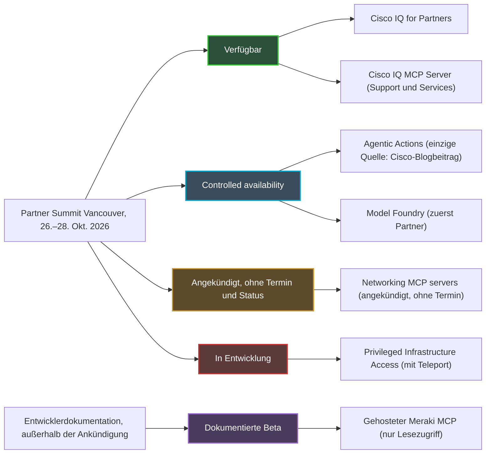
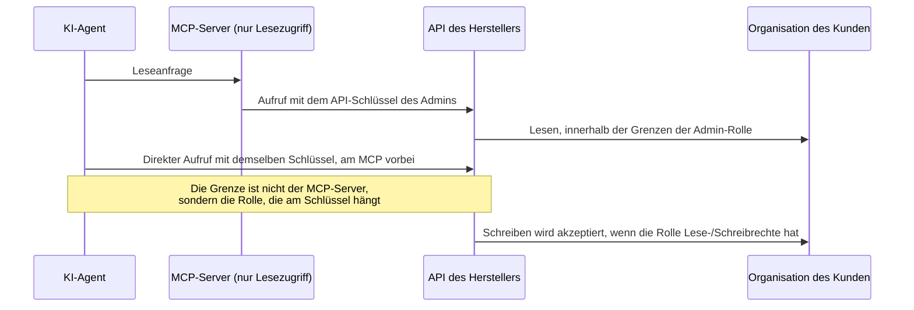
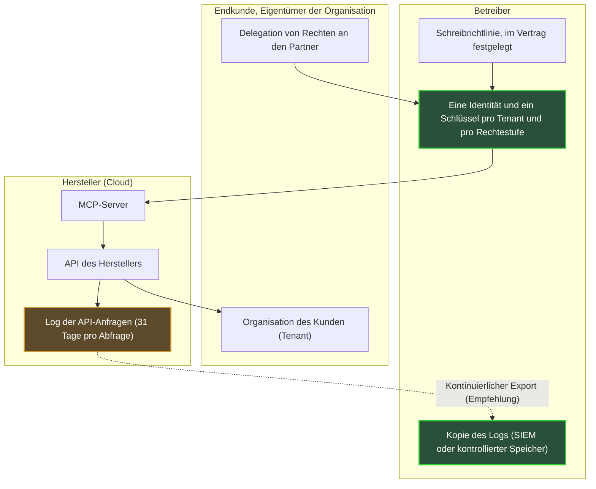

## Eine KI, die handelt, und eine Frage der Schlüssel

Die Hälfte (51 %) der 1.000 von Omdia befragten IT- und Netzwerkverantwortlichen gibt an, bereits heute eine KI im Produktivbetrieb laufen zu haben, die handelt. Keine KI, die beobachtet oder Vorschläge macht: eine KI, die verändert. Die Studie wurde von Omdia durchgeführt und von Cisco veröffentlicht, also ist Vorsicht geboten, doch der Trend ist eindeutig. Einen Monat später hat der Hersteller auf dem Partner Summit in Vancouver (26.–28. Oktober 2026) nachgelegt. Auf der einen Seite Konnektoren, die Agenten an Netzwerkdaten in Echtzeit anbinden, ohne Termin. Auf der anderen Seite ein Service für agentengesteuerte Aktionen, der nur kontrolliert zugänglich ist.

Für einen Betreiber, der das WLAN von Hunderten Hotels, Studentenwohnheimen oder Ladengeschäften betreibt, ist die entscheidende Frage nicht die Intelligenz des Agenten. Sie ist profaner. Wer übergibt ihm die Schlüssel? Für welche Türen? Und wer führt Buch darüber, was er öffnet, wenn jeder Kunde ein „Tenant“ ist, also eine eigene Organisation auf derselben Plattform?

Das Protokoll im Zentrum dieser Geschichte heißt MCP (Model Context Protocol): der Standard, über den sich ein KI-Agent an die Tools eines Drittanbieters anbinden lässt. Meine These ist einfach. Die Grenze zwischen Lesen und Schreiben liegt weder in diesem Protokoll noch in der Ankündigung von Cisco. Sie liegt in der Administratorrolle, die an einem API-Schlüssel hängt. Solange der Hersteller weder seinen Multi-Tenant-Umfang noch seine Schreibrechte noch sein Audit-Log dokumentiert, behält der Betreiber den Schreibschlüssel und eine Kopie des Logs bei sich.

## Fünf Ankündigungen, fünf Reifegrade

Bevor wir über Schlüssel sprechen, muss klar sein, welche Türen es tatsächlich gibt. Das ist die erste Lehre aus Vancouver: Unter ein und derselben „agentischen“ Erzählung hat Cisco Produkte versammelt, die längst nicht auf demselben Stand sind. Wer sie verwechselt, unterschreibt einen Vertrag über eine Roadmap.

Zuerst die **Networking MCP servers**. In seinem Blogbeitrag vom 26. Oktober beschreibt Joe Vaccaro, Senior Vice President für Networking-Plattform und Assurance bei Cisco, sie als standardisierte, unterstützte Integrationsschicht, die Agenten mit den Live-Daten des Netzwerks verbindet [1]. Vorgesehene Einsatzfelder: Troubleshooting, Reporting, Compliance. Kein Preis, keine Lizenz, kein Termin für die allgemeine Verfügbarkeit (GA, für General Availability). Network World schreibt, Cisco wolle sie seinen Netzwerkplattformen hinzufügen [4], doch keine Quelle nennt diese Plattformen. Zu Berechtigungen, Audit-Log oder Rollback verliert der Beitrag kein Wort.

**Agentic Actions** befindet sich laut demselben Beitrag in *controlled availability*: eingeschränkter Zugang, kein GA-Termin, die Beta-Anmeldung ist bestehenden Kunden vorbehalten [1]. Der Service verspricht, die Überlegungen des Agenten sichtbar zu machen, Aktionen zu empfehlen und deren Abwicklung zu verfolgen. Vor allem beschreibt er eine wachsende Autonomie, von der Freigabe Änderung für Änderung bis zur autonomen Ausführung innerhalb definierter Richtlinien und Leitplanken, unter menschlicher Aufsicht.

Zwei Vorbehalte. Unter den ausgewerteten Quellen taucht der Begriff nur bei Cisco selbst auf; die Presse spricht eher von AgenticOps-Tooling, das Cisco Cloud Control hinzugefügt wird [2][3][4][5]. Und Meraki wird nur in den URLs der Beta-Anmeldung genannt: Agentic Actions mit Meraki in Verbindung zu bringen, bleibt eine Schlussfolgerung, keine Tatsache.

Der Rest ist schnell eingeordnet. **Model Foundry**, ein Cloud-Control-Service, um Cisco-Modelle auf den Daten des Kunden zu evaluieren, zu verfeinern und auszuführen, befindet sich ebenfalls in controlled availability und steht zunächst Partnern offen [3][4][5]. **Cisco IQ for Partners** ist seit dem 26. Oktober verfügbar, zusammen mit dem **Cisco IQ MCP Server**, dem einzigen MCP-Server, der in der Ankündigung ausdrücklich als verfügbar genannt wird [3][4]. Cisco IQ ist jedoch die Support- und Serviceplattform, nicht die Steuerungsebene der Geräte. Schließlich ist **Privileged Infrastructure Access**, gemeinsam mit Teleport entwickelt, noch in Entwicklung, und Network World hält unklar, wie es Kunden angeboten werden soll [2][4].

*Hinter derselben agentischen Erzählung stehen fünf sehr unterschiedliche Reifegrade (öffentlicher Stand am 28. Oktober 2026).*

**Einschätzung des Autors.** In der Ankündigung berührt der einzige verfügbare MCP-Server die Geräte nicht. Der einzige Service, der Änderungen ausführen kann, bleibt dem eingeschränkten Zugang vorbehalten. Und controlled availability bedeutet nicht SLA (Service Level Agreement, vertragliche Zusage zum Service-Level): Ich unterstelle keines, solange es nicht in einem Vertrag steht.

## Der Generalschlüssel und die Rezeption

Stellen Sie sich ein Hotel vor. Sie vertrauen dem neuen Nachtportier den Generalschlüssel des Hauses an, mit einer Anweisung: den Zustand der Zimmer nur an der Rezeption abzufragen. Die Anweisung ist vernünftig. Der Generalschlüssel dagegen öffnet alle Türen auf dem Flur, ob der Portier nun über die Rezeption geht oder nicht.

Im Kern ist das die Warnung der Dokumentation des Meraki-MCP-Servers [6]. Er wird von Cisco gehostet, befindet sich in der Beta, und seine Schemas können sich noch ohne Abwärtskompatibilität ändern. Er unterstützt ausschließlich Leseoperationen. Der Agent authentifiziert sich dort mit einem API-Schlüssel des Meraki Dashboard, der Cloud-Konsole der Produktfamilie. OAuth, das Standardprotokoll zur Delegation von Autorisierung, wird noch nicht unterstützt.

Dieselbe Seite warnt dann: Ein Agent, der einen Dashboard-Schlüssel besitzt, kann die API direkt aufrufen, am MCP-Server vorbei. Mit einem Schlüssel mit Lese-/Schreibrechten könnte er das Netzwerk verändern. Cisco empfiehlt deshalb, den Schlüssel eines Administrators mit reinem Lesezugriff zu verwenden, damit der Agent nichts ändern kann. Der Server ist die Rezeption. Der Schlüssel ist der Generalschlüssel.

Die Dokumentation der Meraki-API legt nach [14]. Ein Schlüssel trägt die Identität des Administrators, der ihn erstellt hat, mit exakt den Rechten seiner Rolle in jeder Organisation. Dieselbe Identität kann Administrator mehrerer Organisationen sein, mit jeweils unterschiedlichen Rechten. Und sie kann nur zwei gültige Schlüssel besitzen, über alle Organisationen hinweg.

Beim Catalyst Center, der Management-Konsole für Unternehmensnetzwerke von Cisco, ist der auf DevNet als Open Source veröffentlichte MCP-Server noch deutlicher [7]. Er liest Benutzername und Passwort aus Umgebungsvariablen. Seine Seite stellt klar, dass er keine Autorisierungsschicht hinzufügt und keinen reinen Lesezugriff erzwingt. Sein Katalog kann Operationen enthalten, die die Konfiguration verändern. Cisco empfiehlt dort ein dediziertes Servicekonto mit minimalen Rechten und einen privaten MCP-Endpunkt, beschränkt auf die lokale Maschine (127.0.0.1).

*Der MCP-Server filtert Tools, nicht Rechte: Mit demselben Schlüssel kann der Agent den Server umgehen und die API direkt aufrufen.*

**Einschätzung des Autors: drei Schlüssel, drei Inhaber.** In jedem Agenten-Rollout auf einem Netzwerkpark unterscheide ich drei Objekte. Erstens den Zugangsschlüssel zum MCP-Server, Token oder API-Schlüssel. Zweitens die Administratorrolle hinter diesem Schlüssel, die tatsächlich festlegt, was der Agent tun kann. Drittens das Log, das belegt, was getan wurde. Die Ankündigung von Vancouver spricht von Leitplanken. Über keines dieser drei Objekte sagt sie etwas.

*Ein Server mit reinem Lesezugriff macht noch keinen Schlüssel mit reinem Lesezugriff: Die Rolle, die am Schlüssel hängt, entscheidet, welche Türen offen sind.*

## Was die MCP-Spezifikation regelt und was sie offenlässt

Man könnte hoffen, das Protokoll erledige die Arbeit anstelle des Herstellers. Einen Teil leistet es, vorausgesetzt, man nutzt es.

In ihrer Version 2026-07-28 macht die MCP-Spezifikation die Autorisierung optional [8]. Sie empfiehlt sie für einen HTTP-Transport. Von einem lokalen Transport (STDIO, die Standard-Ein-/Ausgabe eines Prozesses) rät sie ab, da die Zugangsdaten dort aus der Umgebung stammen, genau wie im Catalyst-Center-Server.

Wird die Autorisierung umgesetzt, werden die Regeln klar. Der MCP-Server ist dann ein OAuth-2.1-Resource-Server. Der Client muss über den in RFC 8707 definierten Parameter `resource` angeben, für welchen Server das Token bestimmt ist. Der Server muss prüfen, dass er tatsächlich der Empfänger des Tokens ist, und darf keine anderen Tokens akzeptieren oder weiterreichen [8].

Die Spezifikation verbietet übrigens ausdrücklich das Token-Passthrough, bei dem das vom Client erhaltene Token unverändert an die nachgelagerte API weitergegeben wird [9]. Zu den Risiken, die sie nennt: die Umgehung von Sicherheitskontrollen und ein verwischter Audit-Trail, da die Logs der nachgelagerten API dann eine andere Identität zeigen als die des MCP-Servers.

Schließlich empfiehlt sie, Berechtigungen zu minimieren, die berühmten „Scopes“. Man beginnt mit Discovery und Lesezugriff. Man erweitert von Fall zu Fall, über gezielte `WWW-Authenticate`-Challenges, und protokolliert jede Erweiterung mit einer Korrelations-ID. Pauschale Scopes wie `*` oder `admin:*` gehören zu den typischen Fehlern.

**Einschätzung des Autors.** Die Spezifikation liefert die Bausteine: Audience des Tokens, Scopes, protokollierte Rechteerweiterung. Sie definiert weder einen Tenant-Begriff noch ein Format für das Audit-Log. Die Frage „Welchen Kunden darf dieser Agent anfassen?“ ist Sache der Implementierung des Servers und seines Autorisierungsservers. Der Meraki-MCP-Server stützt sich heute jedoch auf einen API-Schlüssel, ohne OAuth. Nach meiner Lesart greift die Mechanik aus Audience und Scopes dort also noch nicht: Der Schlüssel bringt die gesamte Rolle seines Inhabers mit.

## Vierzig Hotels, vierzig Eigentümer

Nehmen Sie einen Administrator eines Betreibers, der in vierzig Kundenorganisationen eingetragen ist: Hotels, Studentenwohnheime, eine Handelskette. Laut Meraki-Dokumentation trägt sein API-Schlüssel auf einen Schlag seine Rechte in allen vierzig [14]. Geben Sie diesen Schlüssel einem Agenten, und jeder Aufruf kann jeden dieser Kunden treffen, mit den Rechten der menschlichen Rolle in jedem einzelnen.

Hier hört Multi-Tenancy auf, ein architektonisches Detail zu sein. Dabei ist die öffentliche Dokumentation dünn. Der Meraki-MCP-Server akzeptiert Sitzungen über mehrere Organisationen hinweg, mit einem Ratenlimit pro Organisation [6]. Bei Cisco IQ erlaubt eine rollenbasierte Zugriffskontrolle (RBAC, Role-Based Access Control) dem Kunden, seinem Partner direkte und sichere Einsicht in seine installierte Basis zu geben [3][4]. Das ist der einzige in der Ankündigung beschriebene Delegationsmechanismus vom Kunden zum Partner. Er betrifft die Sichtbarkeit, nicht das Schreiben.

Für Agentic Actions wie für die Networking MCP servers beschreibt keine Quelle ein Multi-Tenant-Modell: weder Isolation pro Organisation noch partnerspezifische Rechte noch getrennte Logs.

**Einschätzung des Autors.** Die Folgerung liegt auf der Hand: ein Schlüssel pro Tenant und pro Rechtestufe, niemals ein zwischen Kunden geteilter „Super-Admin“-Schlüssel. Bei höchstens zwei Schlüsseln pro Identität setzt das dedizierte Service-Identitäten voraus, eine pro Kunde und pro Anwendungsfall. Das ist aufwendiger zu verwalten. Es ist aber auch die einzige Möglichkeit sicherzustellen, dass der Agent, der ein Hotel in Lyon entstört, nicht bei einem Anweisungsfehler oder einer Kompromittierung ein Wohnheim in Lille umkonfigurieren kann. Bleibt eine Frage, die man dem Hersteller stellen sollte, statt sie zu unterstellen: Sieht sein Agent jeweils eine Organisation, wie das Ratenlimit pro Organisation nahelegt, oder einen organisationsübergreifenden Park?

*Eine Organisation pro Kunde, ein Schlüsselbund pro Organisation: niemals ein Generalschlüssel für den ganzen Park.*

Dann kommt die Autonomieleiter von Agentic Actions. Von *Ich genehmige jede Änderung* zu *Der Agent führt innerhalb einer Richtlinie aus* zu wechseln, ist aus meiner Sicht zuerst eine vertragliche und erst dann eine technische Entscheidung. Wer schreibt die Richtlinie, der Betreiber oder der Endkunde? Wer darf sie lockern? Und wer haftet, wenn der Agent im Rahmen der Richtlinie handelt, aber gegen die Absicht eines Tenants? Diese drei Fragen gehören nicht in eine Konsole. Sie gehören in einen Vertrag.

## Das Log des Herstellers ist nicht Ihr Log

An einem Samstagabend verhält sich das Netzwerk eines Studentenwohnheims plötzlich anders. Am Montag fragt der Kunde, wer was geändert hat und warum. Wenn die einzige Antwort in der Cloud des Herstellers liegt, unter einer Identität, die sich Mensch und Agent teilen, hat der Betreiber keine Antwort. Er hat eine Vermutung.

Bei Meraki gibt es ein Log. Der Aufruf `getOrganizationApiRequests` listet die API-Anfragen einer Organisation auf: Administrator-ID, Methode, Pfad, User-Agent, Quell-IP-Adresse, Antwortcode, Clientart (API-Schlüssel oder OAuth) [15]. Bei OAuth-Anfragen ist die Administrator-ID leer. Jede Abfrage deckt höchstens 31 Tage ab, und die Seite nennt keine Aufbewahrungsdauer.

*Das Log des Herstellers lässt sich in 31-Tage-Fenstern abfragen. Das lange Gedächtnis muss der Betreiber selbst aufbauen.*

Für Agentic Actions ist öffentlich kein Audit-Log beschrieben. Das fällt umso mehr auf, als die Kunden es einfordern. In der Omdia-Studie verlangen 69 % der Befragten eine detaillierte Erklärbarkeit der Agentenaktionen, und 36 % nennen vollständige Observability (detailliertes Tracing, Begründung, Audits nach der Aktion) als akzeptables Minimum [12]. Der aufschlussreichste Kontrast liegt woanders: 82 % fühlen sich wohl dabei, die KI bestimmte Produktivänderungen ohne vorherige menschliche Freigabe vornehmen zu lassen, aber nur 24 % fühlen sich wohl mit einer KI ohne jegliche Aufsicht. Vertrauen ist da, unter der Bedingung, dass man nachlesen kann.

Zur Einordnung des Umfangs: IT- und NetOps-Verantwortliche (Netzwerkbetrieb) in Unternehmen mit mindestens 500 Beschäftigten, in Nordamerika, Westeuropa und Asien-Pazifik, ohne veröffentlichte Feldzeiträume oder Fehlermarge. Am 23. September listete Joe Vaccaro selbst die Erwartungen der Führungskräfte auf: Freigabe-Gates für riskante Aktionen, Limits pro Richtlinie, Audit-Trails, Notausschalter, rollenbasierter Zugriff [13]. Der Beitrag vom 26. Oktober erläutert keinen dieser Mechanismen.

**Einschätzung des Autors.** Vor jedem Schreibzugriff verlange ich drei Dinge. Erstens einen kontinuierlichen Export des Logs in ein SIEM (Security Information and Event Management, die Plattform zur Erfassung von Sicherheitslogs) oder in einen vom Betreiber kontrollierten Speicher, statt eines 31-Tage-Fensters, das man im Nachhinein abfragt. Zweitens eine eigene Agentenidentität: Nutzt der Agent den Schlüssel eines Administrators, verschwimmen seine Aktionen im Log mit denen dieses Menschen. Und schließlich, idealerweise, eine Korrelation mit den Rechteerweiterungen, deren Protokollierung die MCP-Spezifikation empfiehlt. Ohne Export bleibt das Log beim Anbieter.

*Wer was hält, Tenant für Tenant. Der Pfeil des kontinuierlichen Exports ist eine Empfehlung des Autors, keine von Cisco dokumentierte Funktion.*

## Sieben Fragen, bevor Sie das Schreiben freischalten

Die richtige Richtung ist bekannt. Im August wurde Cisco zum größten Investor von Teleport, einem Spezialisten für privilegierten Zugriff, dessen Prinzip für Agenten sich in einer Zeile fassen lässt: nur das Privileg, das die Aufgabe erfordert, und jede Aktion zurechenbar [10][11]. Channel Insider beschreibt den künftigen Privileged Infrastructure Access in diesem Sinne: auf eine Aufgabe begrenzter Zugriff, kurzlebige, an eine Identität gebundene Zertifikate, aufgezeichnete Sitzungen, Privilegien, die am Sitzungsende verfallen [5]. Aber es ist ein Produkt in Entwicklung, ohne näher bestimmte Cisco-Plattform und ohne Zeitplan.

Bis dahin sind hier die sieben Fragen, die ich dem Hersteller stellen würde, bevor ich auch nur einen einzigen Schreibzugriff auf einen Tenant erlaube:

1. **Identität**: Unter welcher Identität handelt der Agent? Administratorschlüssel, OAuth, kurzlebiges Token?
2. **Umfang**: Wo endet sein Zugriff, bei der Organisation, beim Netzwerk oder beim Standort?
3. **Schreibrechte**: Sind sie nach Aktionsklassen aufgeteilt oder werden sie pauschal vergeben?
4. **Log**: Ist es exportierbar, mit welcher Aufbewahrung und in welchem Format?
5. **Notausschalter**: Gibt es einen Stopp-Knopf und ein dokumentiertes Rollback?
6. **Vertraglicher Status**: Was deckt eine controlled availability tatsächlich ab?
7. **Reversibilität**: Was geschieht mit Schlüsseln und Delegationen, wenn ein Kunde den Betreiber verlässt?

Eine ehrliche Einschränkung der Vollständigkeit halber. Der Cisco-Beitrag beantwortet keine dieser Fragen. Das beweist nicht, dass die Mechanismen nicht existieren: Es ist das Fehlen öffentlicher Dokumentation am 28. Oktober 2026. Die Nuance zählt, und ein schriftlicher Austausch mit dem Hersteller genügt, um sie auszuräumen.

## Jetzt lesen, später schreiben

Meine Position ist eindeutig. Lesen, ja, ab sofort, auf freiwilligen Tenants, mit einer Service-Identität mit reinem Lesezugriff pro Kunde. Dort bringt der Agent schon heute Nutzen: Troubleshooting, Reporting, Compliance, genau die Einsatzfelder, die Cisco hervorhebt. Das Risiko ist gering, und die Teams lernen, mit dem Tool zu arbeiten.

Schreiben erst, wenn schriftliche Antworten auf die sieben Fragen vorliegen. Und selbst dann beginnend auf der ersten Sprosse der Leiter: Freigabe Änderung für Änderung, auf einem eng begrenzten Umfang. Die autonome Ausführung kommt, wenn die Richtlinie vertraglich festgelegt, das Log exportiert und die Identität des Agenten von der der Menschen getrennt ist.

Das ist keine Ängstlichkeit. Ein Betreiber, der den Schreibschlüssel dem Agenten eines Herstellers anvertraut, ohne das Log zu behalten, delegiert nicht eine Aufgabe. Er delegiert seine Fähigkeit, zu belegen, was bei seinen Kunden passiert ist, und bleibt ihnen gegenüber trotzdem verantwortlich. Die Agenten werden auf unseren Netzwerken ankommen, und für die Betriebsteams ist das eine gute Nachricht. Aber die Frage von Vancouver lautet nicht „Welcher Agent?“. Sie lautet „Welcher Schlüssel?“.

Das Protokoll ist neutral. Der Schlüssel ist es nicht.

---

_Persönliche Ansichten, keine Position von Wifirst._

## Quellen

1. Cisco Blogs, Joe Vaccaro, « Powering Partner Potential in a World of Agentic AI », 26 octobre 2026 : https://blogs.cisco.com/partner/powering-partner-potential-in-a-world-of-agentic-ai
2. Converge Digest, annonces Cisco AgenticOps, Model Foundry et MCP, 26 octobre 2026 : https://convergedigest.com/cisco-agentic-network-operations-model-foundry-mcp/
3. StorageReview, Cisco IQ en disponibilité générale pour les partenaires, 26 octobre 2026 : https://www.storagereview.com/news/cisco-iq-general-availability-partners-model-foundry-live-protect-wifi-7
4. Network World (M. Cooney), Cisco et ses partenaires sur l'exploitation IT par l'IA, 27 octobre 2026 : https://www.networkworld.com/article/4240556/cisco-taps-ai-partners-to-modernize-it-operations-and-fortify-network-security.html
5. Channel Insider (J. Smith), annonces Cisco sur les opérations IA, 27 octobre 2026 : https://www.channelinsider.com/infrastructure/cisco-ai-operations-quantum-safe-networking/
6. Cisco DevNet Code Exchange, Cisco Meraki MCP Server (bêta) : https://developer.cisco.com/codeexchange/github/repo/CiscoDevNet/cisco-meraki-mcp-official/
7. Cisco DevNet Code Exchange, Catalyst Center MCP Server (open source) : https://developer.cisco.com/codeexchange/github/repo/cisco-en-programmability/catc-mcp-oss/
8. Model Context Protocol, spécification 2026-07-28, Authorization : https://modelcontextprotocol.io/specification/2026-07-28/basic/authorization
9. Model Context Protocol, spécification 2026-07-28, Security Best Practices : https://modelcontextprotocol.io/specification/2026-07-28/basic/security_best_practices
10. Teleport Blog, partenariat Cisco et Teleport, 25 août 2026 : https://goteleport.com/blog/cisco-teleport-partnership/
11. Compare the Cloud, Cisco premier investisseur de Teleport, 25 août 2026 : https://www.comparethecloud.net/news/cisco-becomes-teleports-largest-investor-in-push-to-retire-static-credentials-from-enterprise-infras
12. Cisco Newsroom, étude Cisco et Omdia sur l'AgenticOps, 23 septembre 2026 : https://newsroom.cisco.com/c/r/newsroom/en/us/a/y2026/m09/cisco-ai-research-agenticops-scaling-quickly-in-the-enterprise.html
13. Cisco Blogs, Joe Vaccaro, « NetOps Is Already Deploying Agentic Autonomy », 23 septembre 2026 : https://blogs.cisco.com/news/netops-is-already-deploying-autonomy-trust-will-decide-how-far-it-goes
14. Cisco DevNet, Meraki API v1, Authorization : https://developer.cisco.com/meraki/api-v1/authorization/
15. Cisco DevNet, Meraki API v1, getOrganizationApiRequests : https://developer.cisco.com/meraki/api-v1/get-organization-api-requests/
