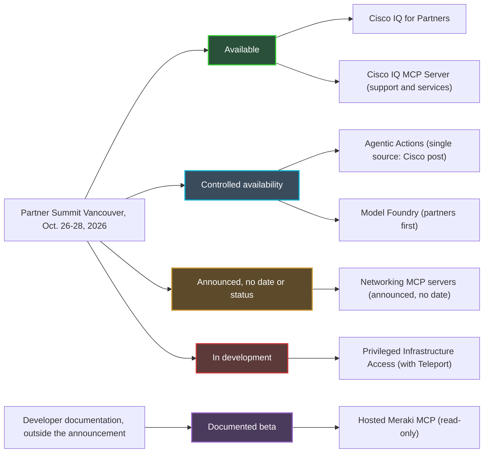
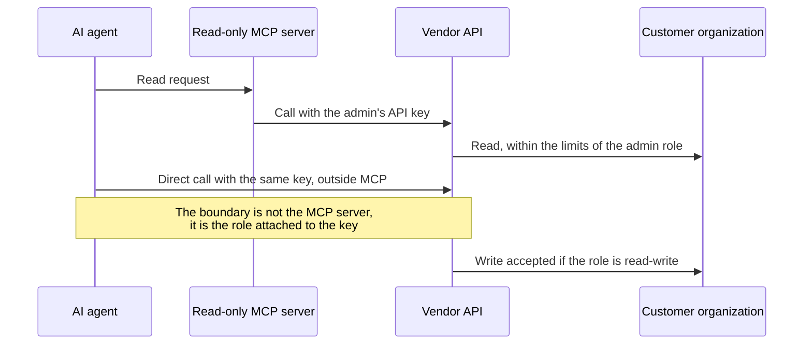
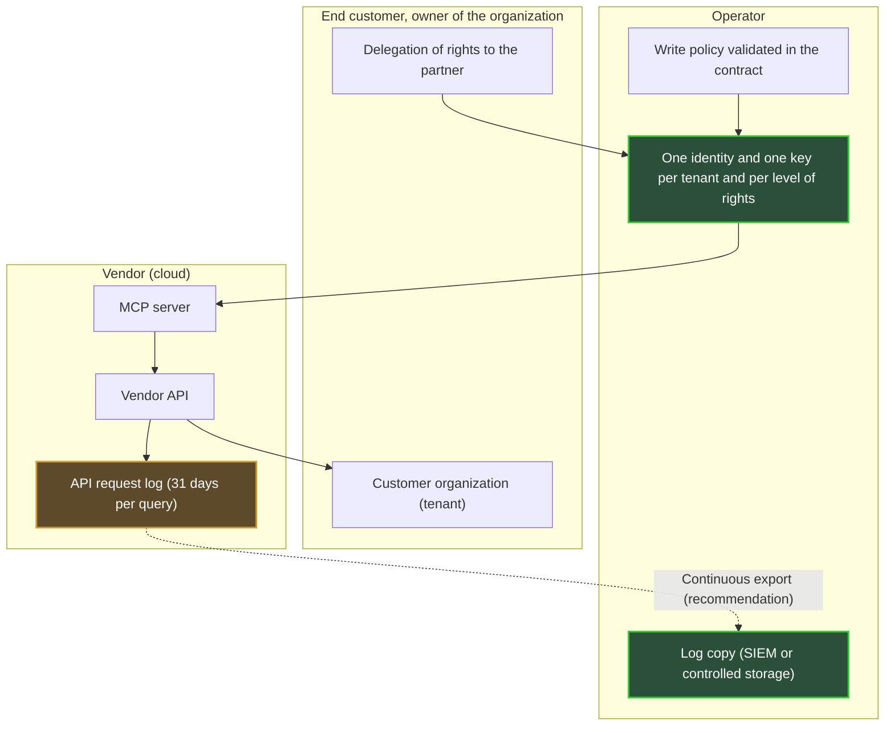

## An AI that acts, and a question of keys

Half (51%) of the 1,000 IT and network decision-makers surveyed by Omdia say they already run an AI that acts in production. Not an AI that observes or suggests: an AI that changes things. The study, conducted by Omdia, was published by Cisco, so a grain of salt is in order, but the trend is clear. A month later, at the Partner Summit in Vancouver (October 26-28, 2026), the vendor announced what comes next. On one side, connectors to plug agents into real-time network data, with no date. On the other, an agent-driven actions service, opened under controlled access.

For an operator running Wi-Fi in hundreds of hotels, student residences or stores, the real question is not how smart the agent is. It is more down to earth. Who hands it the keys? For which doors? And who keeps the record of what it opens, when every customer is a "tenant", a separate organization hosted on the same platform?

The protocol at the heart of the story is called MCP (Model Context Protocol): the standard that lets an AI agent plug into a third-party vendor's tools. My thesis is simple. The line between read and write lives neither in this protocol nor in Cisco's announcement. It lives in the admin role attached to an API key. Until the vendor documents its multi-tenant scope, its write permissions and its audit log, the operator keeps the write key for itself, along with a copy of the log.

## Five announcements, five stages of maturity

Before talking about keys, we need to know which doors actually exist. That is the first lesson from Vancouver: under a single "agentic" narrative, Cisco bundled products that are nowhere near the same stage. Confusing them means signing a contract on a roadmap.

First, the **Networking MCP servers**. In his October 26 post, Joe Vaccaro, senior vice president for network platform and assurance at Cisco, describes them as a standardized, supported integration layer that connects agents to live network data [1]. Targeted uses: troubleshooting, reporting, compliance. No price, no license, no general availability date (GA). Network World writes that Cisco plans to add them to its networking platforms [4], but no source names those platforms. The post says not a word about permissions, the audit log or rollback.

**Agentic Actions** is, according to the same post, in *controlled availability*: restricted access, no GA date, with beta sign-up reserved for existing customers [1]. The service promises to show the agent's reasoning, recommend actions and track their resolution. Above all, it describes a ramp-up in autonomy, from change-by-change approval to autonomous execution within defined policies and guardrails, under human supervision.

Two caveats. Among the sources I reviewed, the term appears only at Cisco, while the press talks instead about AgenticOps tooling added to Cisco Cloud Control [2][3][4][5]. And Meraki is mentioned only in the beta sign-up URLs: tying Agentic Actions to Meraki remains an inference, not a fact.

The rest is quickly sorted. **Model Foundry**, a Cloud Control service to evaluate, fine-tune and run Cisco models on the customer's data, is also in controlled availability, open to partners first [3][4][5]. **Cisco IQ for Partners** has been available since October 26, along with the **Cisco IQ MCP Server**, the only MCP server explicitly available in the announcement [3][4]. But Cisco IQ is the support and services platform, not the control plane for the equipment. Finally, **Privileged Infrastructure Access**, built with Teleport, is still in development, and Network World finds it unclear how it will be offered to customers [2][4].

*Behind a single agentic narrative, five very different stages of maturity (public status as of October 28, 2026).*

**Author's take.** In the announcement, the only MCP server that is available does not touch the equipment. The only service able to execute changes remains in restricted access. And controlled availability does not mean an SLA (Service Level Agreement): I assume none until it is written into a contract.

## The master key and the front desk

Picture a hotel. You hand the new night porter the building's master key, with one instruction: only check room status at the front desk. The instruction is reasonable. The master key, for its part, opens every door in the hallway, whether the porter goes through the front desk or not.

That is, in essence, the warning given by the documentation for Meraki's MCP server [6]. Hosted by Cisco, it is in beta, and its schemas may still change without backward compatibility. It supports read operations only. The agent authenticates to it with a Meraki Dashboard API key, Dashboard being the product line's cloud console. OAuth, the standard authorization delegation protocol, is not yet supported.

The same page then warns: an agent holding a Dashboard key can call the API directly, without going through the MCP server. With a read-write key, it could modify the network. Cisco therefore recommends using the key of a read-only administrator, so the agent cannot change anything. The server is the front desk. The key is the master key.

The Meraki API documentation drives the point home [14]. A key carries the identity of the administrator who created it, with exactly the rights of that administrator's role in each organization. A single identity can be an administrator of several organizations, with different rights in each. And it can hold only two valid keys, across all organizations combined.

On the Catalyst Center side, Cisco's management console for enterprise networks, the MCP server published as open source on DevNet is even more blunt [7]. It reads the username and password from environment variables. Its page states that it adds no authorization layer and does not enforce read-only. Its catalog may contain operations that modify the configuration. Cisco recommends a dedicated service account there, with least privilege, and a private MCP endpoint limited to the local machine (127.0.0.1).

*The MCP server filters tools, not rights: with the same key, the agent can bypass the server and call the API directly.*

**Author's take: three keys, three holders.** In any agent deployment on a network estate, I distinguish three objects. First, the access key to the MCP server, a token or an API key. Second, the admin role behind that key, which really sets what the agent can do. Third, the log, which proves what was done. The Vancouver announcement talks about guardrails. It mentions none of these three objects.

*A read-only server does not make a read-only key: it is the role attached to the key that decides which doors are open.*

## What the MCP specification settles, and what it leaves open

One might hope the protocol would do the vendor's job for it. It does part of it, provided you use it.

In its 2026-07-28 version, the MCP specification makes authorization optional [8]. It recommends it for an HTTP transport. It discourages it for a local transport (STDIO, a process's standard input and output), where credentials come from the environment, exactly as in the Catalyst Center server.

When authorization is implemented, the rules become clear. The MCP server is then an OAuth 2.1 resource server. The client must indicate which server the token is intended for, via the `resource` parameter defined by RFC 8707. The server must verify that it is indeed the token's intended recipient, and must neither accept nor relay any other [8].

The spec in fact explicitly forbids token passthrough, which consists of forwarding the token received from the client as is to the downstream API [9]. Among the risks it cites: circumvention of security controls, and a muddied audit trail, since the downstream API's logs then show a different identity from that of the MCP server.

Finally, it recommends minimizing permissions, the famous "scopes". You start with discovery and read. You elevate case by case, via targeted `WWW-Authenticate` challenges, and you log each elevation with a correlation ID. Catch-all scopes, such as `*` or `admin:*`, are among the common mistakes.

**Author's take.** The spec provides the building blocks: token audience, scopes, logged elevation. It defines neither a notion of tenant nor an audit log format. The question "which customer is this agent allowed to touch?" comes down to the implementation of the server and its authorization server. Yet Meraki's MCP server relies today on an API key, without OAuth. As I read it, the audience and scope mechanics therefore do not yet come into play: the key carries the full role of its owner with it.

## Forty hotels, forty owners

Take an operator administrator registered on forty customer organizations: hotels, student residences, a retail chain. According to the Meraki documentation, their API key carries their rights on all forty at once [14]. Hand that key to an agent, and every call can target any one of those customers, with the human role's rights in each.

This is where multi-tenancy stops being an architecture detail. Yet the public documentation is thin. Meraki's MCP server accepts multi-organization sessions, with a rate limit per organization [6]. On the Cisco IQ side, role-based access control (RBAC) lets the customer give its partner direct, secure visibility into its installed base [3][4]. It is the only customer-to-partner delegation mechanism described in the announcement. It covers visibility, not writing.

For Agentic Actions as for the Networking MCP servers, no source describes a multi-tenant model: no per-organization isolation, no partner-specific rights, no log separation.

**Author's take.** The corollary is immediate: one key per tenant and per level of rights, never a "super-admin" key shared across customers. With two keys at most per identity, this means dedicated service identities, one per customer and per use. It is heavier to administer. It is also the only way to guarantee that the agent troubleshooting a hotel in Lyon cannot, through a bad instruction or a compromise, reconfigure a residence in Lille. One question remains, to put to the vendor rather than assume: does its agent see one organization at a time, as the per-organization rate limit suggests, or a cross-estate view?

*One organization per customer, one key ring per organization: never a master key for the whole estate.*

Next comes the autonomy ladder of Agentic Actions. Moving from *I approve every change* to *the agent executes within a policy* is, in my view, a contractual decision before it is a technical one. Who writes the policy, the operator or the end customer? Who has the right to loosen it? And who is accountable if the agent acts within the policy but against a tenant's intent? These three questions do not belong in a console. They belong in a contract.

## The vendor's log is not yours

On a Saturday night, the network of a student residence starts behaving differently. On Monday, the customer asks who changed what, and why. If the only answer lives in the vendor's cloud, under an identity shared between a human and an agent, the operator has no answer. It has a hypothesis.

On the Meraki side, a log exists. The `getOrganizationApiRequests` call lists an organization's API requests: administrator ID, method, path, user agent, source IP address, response code, client type (API key or OAuth) [15]. For OAuth requests, the administrator ID is empty. Each query covers 31 days at most, and the page does not specify the retention period.

*The vendor's log is queried in 31-day windows. Long-term memory is something the operator has to build.*

For Agentic Actions, no audit log is publicly described. That is all the more striking because customers are demanding one. In the Omdia study, 69% of respondents require detailed explainability of agent actions, and 36% set full observability (detailed tracing, justification, post-action audits) as the acceptable minimum [12]. The most telling contrast is elsewhere: 82% say they are comfortable letting AI make certain production changes without prior human approval, but only 24% say they are comfortable with AI under no supervision at all. Trust exists, provided you can review.

A reminder of scope: IT and NetOps (network operations) decision-makers at companies with at least 500 employees, in North America, Western Europe and Asia-Pacific, with no fieldwork dates or margin of error published. On September 23, Joe Vaccaro himself listed executives' expectations: approval gates for risky actions, per-policy limits, audit trails, an emergency stop, role-based access [13]. The October 26 post details none of these mechanisms.

**Author's take.** Before any write, I demand three things. First, a continuous export of the log to a SIEM (Security Information and Event Management, the platform that collects security logs) or to storage controlled by the operator, rather than a 31-day window queried after the fact. Second, a distinct agent identity: if the agent uses an administrator's key, its actions merge in the log with that human's. Finally, ideally, correlation with the privilege elevations that the MCP spec recommends logging. Without export, the log stays with the vendor.

*Who holds what, tenant by tenant. The continuous export arrow is an author recommendation, not a function documented by Cisco.*

## Seven questions before opening up write access

The right direction is known. In August, Cisco became the largest investor in Teleport, the privileged access specialist, whose principle for agents fits on one line: only the privilege the task needs, and every action attributable [10][11]. Channel Insider describes the future Privileged Infrastructure Access in that spirit: task-limited access, short-lived certificates tied to an identity, recorded sessions, privileges that expire at the end of the session [5]. But it is a product in development, with no Cisco platform or timeline specified.

In the meantime, here are the seven questions I would put to the vendor before authorizing a single write on a tenant:

1. **Identity**: under what identity does the agent act? Administrator key, OAuth, short-lived token?
2. **Scope**: where does its access end, at the organization, the network or the site?
3. **Write rights**: are they split by action class, or granted in bulk?
4. **Log**: is it exportable, with what retention and in what format?
5. **Emergency stop**: is there a stop button, and a documented rollback?
6. **Contractual status**: what does controlled availability actually cover?
7. **Reversibility**: what happens to the keys and delegations when a customer leaves the operator?

An honest limit, for completeness. Cisco's post answers none of these questions. That is not proof that the mechanisms do not exist: it is the absence of public documentation as of October 28, 2026. The nuance matters, and a written exchange with the vendor is enough to settle it.

## Read now, write later

My position is clear-cut. Read, yes, starting now, on volunteer tenants, with one read-only service identity per customer. That is where the agent already adds value: troubleshooting, reporting, compliance, precisely the uses Cisco puts forward. The risk there is low, and teams learn to work with the tool.

Write, not before written answers to the seven questions. And even then, starting on the first rung of the ladder: change-by-change approval, on a restricted scope. Autonomous execution will come when the policy is contractual, the log exported and the agent's identity distinct from that of humans.

This is not timidity. An operator who hands its write key to a vendor's agent without keeping the log is not delegating a task. It is delegating its ability to prove what happened at its customers, while remaining accountable to them. Agents are coming to our estates, and that is good news for operations teams. But the question from Vancouver is not "which agent?". It is "which key?".

The protocol is neutral. The key is not.

---

_Personal views, not Wifirst's position._

## Sources

1. Cisco Blogs, Joe Vaccaro, « Powering Partner Potential in a World of Agentic AI », 26 octobre 2026 : https://blogs.cisco.com/partner/powering-partner-potential-in-a-world-of-agentic-ai
2. Converge Digest, annonces Cisco AgenticOps, Model Foundry et MCP, 26 octobre 2026 : https://convergedigest.com/cisco-agentic-network-operations-model-foundry-mcp/
3. StorageReview, Cisco IQ en disponibilité générale pour les partenaires, 26 octobre 2026 : https://www.storagereview.com/news/cisco-iq-general-availability-partners-model-foundry-live-protect-wifi-7
4. Network World (M. Cooney), Cisco et ses partenaires sur l'exploitation IT par l'IA, 27 octobre 2026 : https://www.networkworld.com/article/4240556/cisco-taps-ai-partners-to-modernize-it-operations-and-fortify-network-security.html
5. Channel Insider (J. Smith), annonces Cisco sur les opérations IA, 27 octobre 2026 : https://www.channelinsider.com/infrastructure/cisco-ai-operations-quantum-safe-networking/
6. Cisco DevNet Code Exchange, Cisco Meraki MCP Server (bêta) : https://developer.cisco.com/codeexchange/github/repo/CiscoDevNet/cisco-meraki-mcp-official/
7. Cisco DevNet Code Exchange, Catalyst Center MCP Server (open source) : https://developer.cisco.com/codeexchange/github/repo/cisco-en-programmability/catc-mcp-oss/
8. Model Context Protocol, spécification 2026-07-28, Authorization : https://modelcontextprotocol.io/specification/2026-07-28/basic/authorization
9. Model Context Protocol, spécification 2026-07-28, Security Best Practices : https://modelcontextprotocol.io/specification/2026-07-28/basic/security_best_practices
10. Teleport Blog, partenariat Cisco et Teleport, 25 août 2026 : https://goteleport.com/blog/cisco-teleport-partnership/
11. Compare the Cloud, Cisco premier investisseur de Teleport, 25 août 2026 : https://www.comparethecloud.net/news/cisco-becomes-teleports-largest-investor-in-push-to-retire-static-credentials-from-enterprise-infras
12. Cisco Newsroom, étude Cisco et Omdia sur l'AgenticOps, 23 septembre 2026 : https://newsroom.cisco.com/c/r/newsroom/en/us/a/y2026/m09/cisco-ai-research-agenticops-scaling-quickly-in-the-enterprise.html
13. Cisco Blogs, Joe Vaccaro, « NetOps Is Already Deploying Agentic Autonomy », 23 septembre 2026 : https://blogs.cisco.com/news/netops-is-already-deploying-autonomy-trust-will-decide-how-far-it-goes
14. Cisco DevNet, Meraki API v1, Authorization : https://developer.cisco.com/meraki/api-v1/authorization/
15. Cisco DevNet, Meraki API v1, getOrganizationApiRequests : https://developer.cisco.com/meraki/api-v1/get-organization-api-requests/
