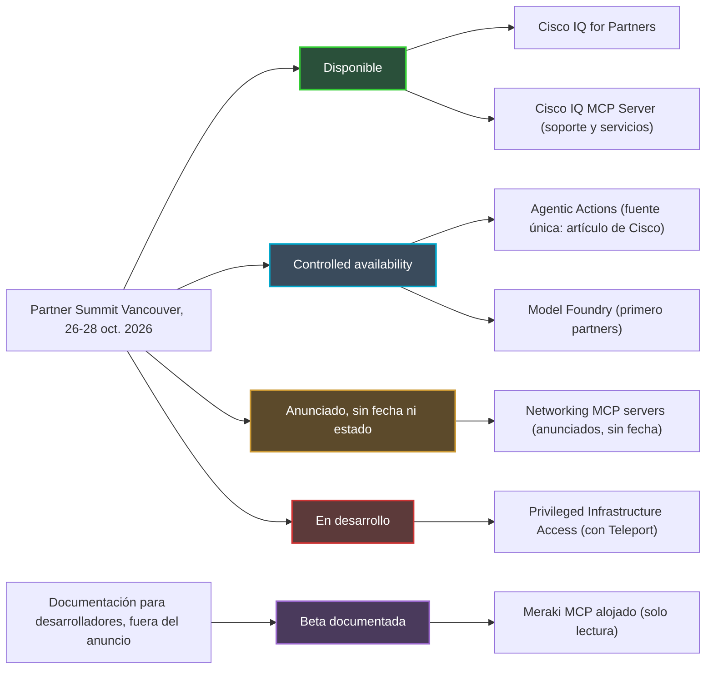
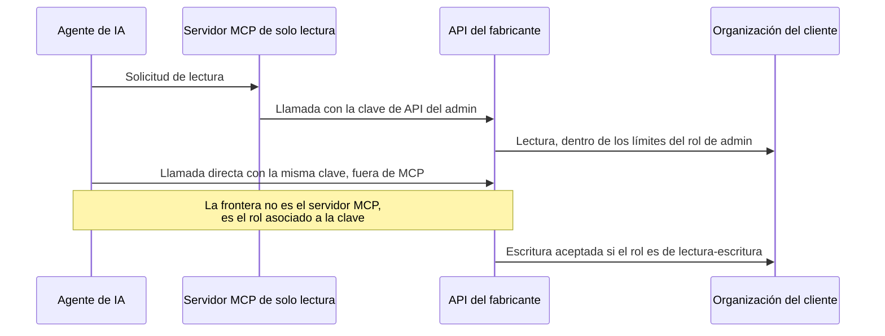
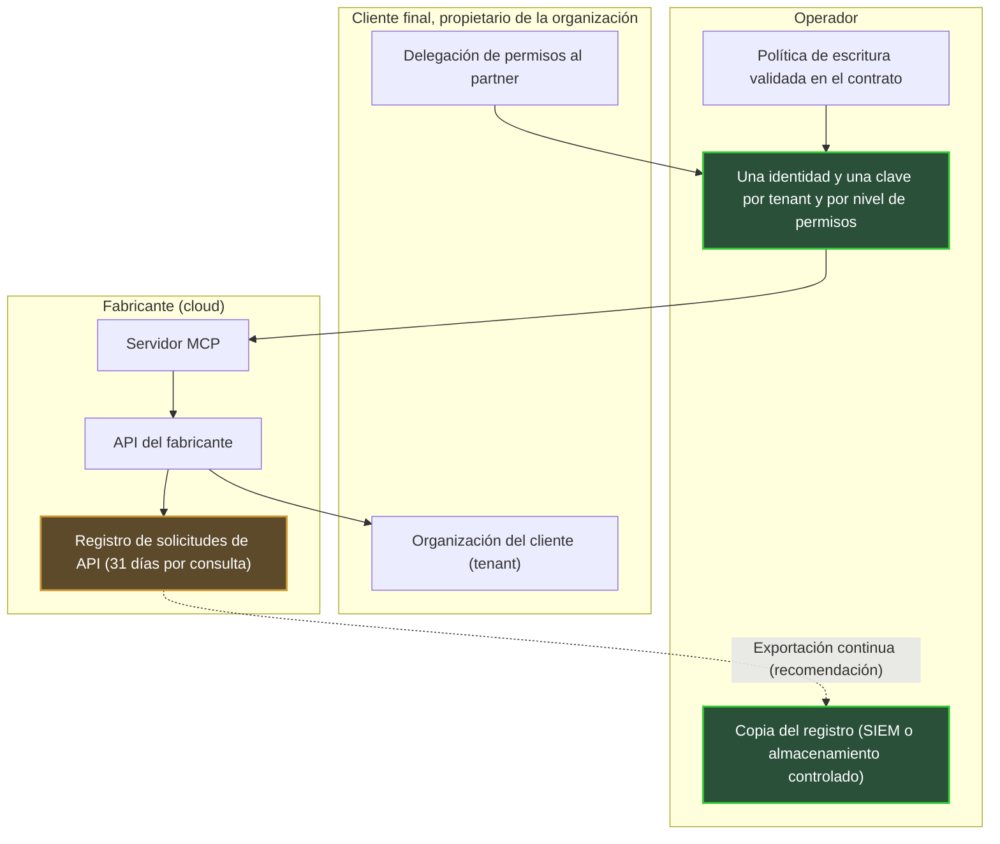

## Una IA que actúa, y una cuestión de claves

La mitad (51 %) de los 1.000 responsables de TI y de redes encuestados por Omdia afirma que ya tiene en producción una IA que actúa. No una IA que observa o que sugiere: una IA que modifica. El estudio, realizado por Omdia, fue publicado por Cisco, así que conviene la cautela, pero la tendencia es clara. Un mes después, en el Partner Summit de Vancouver (26-28 de octubre de 2026), el fabricante anunció lo siguiente. Por un lado, conectores para enchufar agentes a los datos de red en tiempo real, sin fecha. Por otro, un servicio de acciones ejecutadas por agentes, abierto en acceso controlado.

Para un operador que gestiona el Wi-Fi de cientos de hoteles, residencias de estudiantes o tiendas, la verdadera cuestión no es la inteligencia del agente. Es más prosaica. ¿Quién le entrega las llaves? ¿Para qué puertas? ¿Y quién conserva el rastro de lo que abre, cuando cada cliente es un «tenant», una organización distinta alojada en la misma plataforma?

El protocolo en el centro de esta historia se llama MCP (Model Context Protocol): el estándar que permite a un agente de IA conectarse a las herramientas de un proveedor externo. Mi tesis es simple. La frontera entre leer y escribir no está ni en este protocolo ni en el anuncio de Cisco. Está en el rol de administrador asociado a una clave de API. Mientras el fabricante no documente ni su alcance multi-tenant, ni sus permisos de escritura, ni su registro de auditoría, el operador se queda con la clave de escritura y con una copia del registro.

## Cinco anuncios, cinco niveles de madurez

Antes de hablar de claves, hay que saber qué puertas existen de verdad. Es la primera lección de Vancouver: bajo un mismo relato «agéntico», Cisco ha agrupado productos que no están en absoluto en la misma fase. Confundirlos es firmar un contrato sobre una hoja de ruta.

En primer lugar, los **Networking MCP servers**. En su artículo del 26 de octubre, Joe Vaccaro, vicepresidente senior de plataforma de red y assurance en Cisco, los describe como una capa de integración estandarizada y con soporte que conecta los agentes con los datos de la red en directo [1]. Usos previstos: resolución de incidencias, reporting, cumplimiento normativo. Ni precio, ni licencia, ni fecha de disponibilidad general (GA, por General Availability). Network World escribe que Cisco prevé añadirlos a sus plataformas de red [4], pero ninguna fuente nombra esas plataformas. El artículo no dice una palabra sobre permisos, registro de auditoría ni marcha atrás.

**Agentic Actions** está, según el mismo artículo, en *controlled availability*: un acceso restringido, sin fecha de GA, cuya inscripción a la beta está reservada a los clientes existentes [1]. El servicio promete mostrar el razonamiento del agente, recomendar acciones y seguir su resolución. Describe sobre todo una escalada de autonomía, desde la aprobación cambio por cambio hasta la ejecución autónoma dentro de políticas y límites definidos, bajo supervisión humana.

Dos precauciones. Entre las fuentes consultadas, el término solo aparece en Cisco, mientras que la prensa habla más bien de herramientas AgenticOps añadidas a Cisco Cloud Control [2][3][4][5]. Y Meraki solo se menciona en las URL de inscripción a la beta: vincular Agentic Actions a Meraki sigue siendo una inferencia, no un hecho.

El resto se despacha rápido. **Model Foundry**, servicio de Cloud Control para evaluar, afinar y ejecutar los modelos de Cisco sobre los datos del cliente, también está en controlled availability, abierto primero a los partners [3][4][5]. **Cisco IQ for Partners** está disponible desde el 26 de octubre, junto con el **Cisco IQ MCP Server**, el único servidor MCP explícitamente disponible en el anuncio [3][4]. Pero Cisco IQ es la plataforma de soporte y servicios, no el plano de control de los equipos. Por último, **Privileged Infrastructure Access**, concebido con Teleport, sigue en desarrollo, y Network World considera poco claro cómo se ofrecerá a los clientes [2][4].

*Tras un mismo relato agéntico, cinco niveles de madurez muy distintos (estado público al 28 de octubre de 2026).*

**Lectura del autor.** En el anuncio, el único servidor MCP disponible no toca los equipos. El único servicio capaz de ejecutar cambios sigue en acceso restringido. Y controlled availability no significa SLA (Service Level Agreement, acuerdo de nivel de servicio): no presupongo ninguno mientras no esté escrito en un contrato.

## La llave maestra y la recepción

Imagine un hotel. Le confía al nuevo vigilante nocturno la llave maestra del establecimiento, con una consigna: consultar el estado de las habitaciones únicamente desde el mostrador de recepción. La consigna es razonable. La llave maestra, en cambio, abre todas las puertas del pasillo, pase el vigilante por recepción o no.

Es, en esencia, la advertencia que da la documentación del servidor MCP de Meraki [6]. Alojado por Cisco, está en beta, y sus esquemas aún pueden cambiar sin retrocompatibilidad. Solo admite operaciones de lectura. El agente se autentica con una clave de API del Dashboard de Meraki, la consola cloud de la gama. OAuth, el protocolo estándar de delegación de autorización, todavía no está soportado.

La misma página advierte a continuación: un agente que posee una clave del Dashboard puede llamar a la API directamente, sin pasar por el servidor MCP. Con una clave de lectura-escritura, podría modificar la red. Cisco recomienda por tanto usar la clave de un administrador de solo lectura, para que el agente no pueda cambiar nada. El servidor es la recepción. La clave es la llave maestra.

La documentación de la API de Meraki lo remacha [14]. Una clave lleva la identidad del administrador que la creó, con exactamente los permisos de su rol en cada organización. Una misma identidad puede ser administradora de varias organizaciones, con permisos distintos en cada una. Y solo puede tener dos claves válidas, sumando todas las organizaciones.

En el lado de Catalyst Center, la consola de gestión de redes empresariales de Cisco, el servidor MCP publicado como código abierto en DevNet es aún más franco [7]. Lee el usuario y la contraseña de variables de entorno. Su página precisa que no añade ninguna capa de autorización y que no impone la solo lectura. Su catálogo puede contener operaciones que modifican la configuración. Cisco recomienda allí una cuenta de servicio dedicada, con el mínimo privilegio, y un punto de acceso MCP privado, limitado a la máquina local (127.0.0.1).

*El servidor MCP filtra las herramientas, no los permisos: con la misma clave, el agente puede saltarse el servidor y llamar a la API directamente.*

**Lectura del autor: tres claves, tres titulares.** En cualquier despliegue de un agente sobre un parque de red, distingo tres objetos. Primero, la clave de acceso al servidor MCP, token o clave de API. Después, el rol de administrador detrás de esa clave, que es lo que fija realmente lo que el agente puede hacer. Por último, el registro, que prueba lo que se ha hecho. El anuncio de Vancouver habla de salvaguardas. No habla de ninguno de estos tres objetos.

*Un servidor de solo lectura no hace una clave de solo lectura: es el rol asociado a la clave el que decide qué puertas se abren.*

## Lo que resuelve la especificación MCP, y lo que deja abierto

Cabría esperar que el protocolo hiciera el trabajo en lugar del fabricante. Hace una parte, siempre que se use.

En su versión 2026-07-28, la especificación MCP hace la autorización opcional [8]. La recomienda para un transporte HTTP. La desaconseja para un transporte local (STDIO, la entrada-salida estándar de un proceso), donde las credenciales proceden del entorno, exactamente como en el servidor de Catalyst Center.

Cuando la autorización se implementa, las reglas se vuelven nítidas. El servidor MCP pasa a ser un servidor de recursos OAuth 2.1. El cliente debe indicar a qué servidor va destinado el token, mediante el parámetro `resource` definido por la RFC 8707. El servidor debe verificar que es efectivamente el destinatario del token, y no aceptar ni retransmitir ningún otro [8].

La especificación prohíbe además explícitamente el relevo de tokens (token passthrough), que consiste en transmitir tal cual a la API posterior el token recibido del cliente [9]. Entre los riesgos que cita: la elusión de los controles de seguridad y una pista de auditoría enturbiada, ya que los registros de la API posterior muestran entonces una identidad distinta de la del servidor MCP.

Recomienda, por último, minimizar los permisos, los famosos «scopes». Se empieza en descubrimiento y lectura. Se eleva caso por caso, mediante desafíos `WWW-Authenticate` específicos, y se registra cada elevación con un identificador de correlación. Los scopes comodín, del tipo `*` o `admin:*`, figuran entre los errores habituales.

**Lectura del autor.** La especificación aporta las piezas: audiencia del token, scopes, elevación registrada. No define ni la noción de tenant ni un formato de registro de auditoría. La pregunta «¿a qué cliente tiene derecho a tocar este agente?» depende de la implementación del servidor y de su servidor de autorización. Ahora bien, el servidor MCP de Meraki se apoya hoy en una clave de API, sin OAuth. A mi entender, la mecánica de audiencia y de scopes aún no entra en juego: la clave arrastra consigo la totalidad del rol de su propietario.

## Cuarenta hoteles, cuarenta propietarios

Tome un administrador de operador declarado en cuarenta organizaciones cliente: hoteles, residencias de estudiantes, una cadena de retail. Según la documentación de Meraki, su clave de API lleva de golpe sus permisos sobre las cuarenta [14]. Entregue esa clave a un agente, y cada llamada puede apuntar a cualquiera de esos clientes, con los permisos del rol humano en cada uno.

Ahí es donde el multi-tenant deja de ser un detalle de arquitectura. Y la documentación pública es escasa. El servidor MCP de Meraki acepta sesiones multiorganización, con un límite de tasa por organización [6]. En el lado de Cisco IQ, un control de acceso basado en roles (RBAC, Role-Based Access Control) permite al cliente conceder a su partner una visibilidad directa y segura sobre su parque instalado [3][4]. Es el único mecanismo de delegación de cliente a partner descrito en el anuncio. Afecta a la visibilidad, no a la escritura.

Tanto para Agentic Actions como para los Networking MCP servers, ninguna fuente describe un modelo multi-tenant: ni aislamiento por organización, ni permisos propios de un partner, ni separación de registros.

**Lectura del autor.** El corolario es inmediato: una clave por tenant y por nivel de permisos, nunca una clave «super-admin» compartida entre clientes. Con un máximo de dos claves por identidad, eso exige identidades de servicio dedicadas, una por cliente y por uso. Es más pesado de administrar. Es también la única forma de garantizar que el agente que resuelve una incidencia en un hotel de Lyon no pueda, por un error de instrucción o una intrusión, reconfigurar una residencia en Lille. Queda una pregunta que hacerle al fabricante en lugar de suponerla: ¿su agente ve una organización cada vez, como sugiere el límite de tasa por organización, o un parque transversal?

*Una organización por cliente, un llavero por organización: nunca una llave maestra para todo el parque.*

Viene después la escala de autonomía de Agentic Actions. Pasar de *apruebo cada cambio* a *el agente ejecuta dentro de una política* es, a mi juicio, una decisión contractual antes que técnica. ¿Quién escribe la política, el operador o el cliente final? ¿Quién tiene derecho a relajarla? ¿Y quién responde si el agente actúa dentro de los límites de la política, pero contra la intención de un tenant? Estas tres preguntas no caben en una consola. Caben en un contrato.

## El registro del fabricante no es el suyo

Un sábado por la noche, la red de una residencia de estudiantes cambia de comportamiento. El lunes, el cliente pregunta quién modificó qué, y por qué. Si la única respuesta está en el cloud del fabricante, bajo una identidad compartida entre un humano y un agente, el operador no tiene respuesta. Tiene una hipótesis.

En Meraki existe un registro. La llamada `getOrganizationApiRequests` lista las solicitudes de API de una organización: identificador del administrador, método, ruta, user-agent, dirección IP de origen, código de respuesta, tipo de cliente (clave de API u OAuth) [15]. En las solicitudes OAuth, el identificador de administrador está vacío. Cada consulta cubre como máximo 31 días, y la página no precisa el período de retención.

*El registro del fabricante se consulta por ventanas de 31 días. La memoria larga le toca construirla al operador.*

Para Agentic Actions, no se describe públicamente ningún registro de auditoría. Es aún más llamativo porque los clientes lo reclaman. En el estudio de Omdia, el 69 % de los encuestados exige una explicabilidad detallada de las acciones de los agentes, y el 36 % considera la observabilidad completa (trazabilidad detallada, justificación, auditorías posteriores a la acción) como el mínimo aceptable [12]. El contraste más elocuente está en otra parte: el 82 % se siente cómodo dejando que la IA haga ciertos cambios en producción sin aprobación humana previa, pero solo el 24 % se siente cómodo con una IA sin ninguna supervisión. La confianza existe, a condición de poder revisar.

Recordatorio del alcance: responsables de TI y de NetOps (operaciones de red) de empresas de al menos 500 empleados, en Norteamérica, Europa Occidental y Asia-Pacífico, sin fechas de trabajo de campo ni margen de error publicados. El 23 de septiembre, Joe Vaccaro enumeraba él mismo las expectativas de los directivos: puertas de aprobación para las acciones de riesgo, límites por política, pistas de auditoría, parada de emergencia, acceso por rol [13]. El artículo del 26 de octubre no detalla ninguno de estos mecanismos.

**Lectura del autor.** Antes de cualquier escritura, exijo tres cosas. Primero, una exportación continua del registro hacia un SIEM (Security Information and Event Management, la plataforma de recopilación de registros de seguridad) o un almacenamiento controlado por el operador, en lugar de una ventana de 31 días consultada a posteriori. Segundo, una identidad de agente distinta: si el agente usa la clave de un administrador, sus acciones se confunden en el registro con las de ese humano. Y por último, idealmente, una correlación con las elevaciones de permisos que la especificación MCP recomienda registrar. Sin exportación, el registro se queda en casa del proveedor.

*Quién tiene qué, tenant por tenant. La flecha de exportación continua es una recomendación del autor, no una función documentada por Cisco.*

## Siete preguntas antes de abrir la escritura

La buena dirección se conoce. En agosto, Cisco se convirtió en el mayor inversor de Teleport, especialista en acceso privilegiado, cuyo principio para los agentes cabe en una línea: el único privilegio necesario para la tarea, y cada acción atribuible [10][11]. Channel Insider describe el futuro Privileged Infrastructure Access en ese espíritu: acceso limitado a una tarea, certificados de corta duración ligados a una identidad, sesiones grabadas, privilegios que caducan al final de la sesión [5]. Pero es un producto en desarrollo, sin plataforma Cisco ni calendario precisados.

Mientras tanto, estas son las siete preguntas que le haría al fabricante antes de autorizar una sola escritura sobre un tenant:

1. **Identidad**: ¿bajo qué identidad actúa el agente? ¿Clave de administrador, OAuth, token de corta duración?
2. **Alcance**: ¿dónde termina su acceso, en la organización, en la red o en el sitio?
3. **Permisos de escritura**: ¿están divididos por clase de acción, o se conceden en bloque?
4. **Registro**: ¿es exportable, con qué retención y en qué formato?
5. **Parada de emergencia**: ¿existe un botón de stop, y una marcha atrás documentada?
6. **Estatus contractual**: ¿qué cubre realmente una controlled availability?
7. **Reversibilidad**: ¿qué pasa con las claves y las delegaciones cuando un cliente deja al operador?

Una limitación honesta, para ser completo. El artículo de Cisco no responde a ninguna de estas preguntas. Eso no prueba que los mecanismos no existan: es la ausencia de documentación pública al 28 de octubre de 2026. El matiz importa, y un intercambio por escrito con el fabricante basta para despejarlo.

## Leer ahora, escribir después

Mi posición es tajante. La lectura, sí, desde ya, en tenants voluntarios, con una identidad de servicio de solo lectura por cliente. Ahí es donde el agente ya aporta valor: resolución de incidencias, reporting, cumplimiento normativo, precisamente los usos que Cisco destaca. El riesgo es bajo, y los equipos aprenden a trabajar con la herramienta.

La escritura, no antes de tener respuestas por escrito a las siete preguntas. E incluso entonces, empezando por el primer peldaño de la escala: la aprobación cambio por cambio, sobre un perímetro restringido. La ejecución autónoma llegará cuando la política sea contractual, el registro esté exportado y la identidad del agente sea distinta de la de los humanos.

No es pusilanimidad. Un operador que entrega su clave de escritura al agente de un fabricante sin quedarse con el registro no delega una tarea. Delega su capacidad de probar lo que ha pasado en casa de sus clientes, y sigue siendo responsable ante ellos. Los agentes van a llegar a nuestros parques, y es una buena noticia para los equipos de operaciones. Pero la pregunta de Vancouver no es «¿qué agente?». Es «¿qué clave?».

El protocolo es neutral. La clave no lo es.

---

_Opiniones personales, no la posición de Wifirst._

## Fuentes

1. Cisco Blogs, Joe Vaccaro, « Powering Partner Potential in a World of Agentic AI », 26 octobre 2026 : https://blogs.cisco.com/partner/powering-partner-potential-in-a-world-of-agentic-ai
2. Converge Digest, annonces Cisco AgenticOps, Model Foundry et MCP, 26 octobre 2026 : https://convergedigest.com/cisco-agentic-network-operations-model-foundry-mcp/
3. StorageReview, Cisco IQ en disponibilité générale pour les partenaires, 26 octobre 2026 : https://www.storagereview.com/news/cisco-iq-general-availability-partners-model-foundry-live-protect-wifi-7
4. Network World (M. Cooney), Cisco et ses partenaires sur l'exploitation IT par l'IA, 27 octobre 2026 : https://www.networkworld.com/article/4240556/cisco-taps-ai-partners-to-modernize-it-operations-and-fortify-network-security.html
5. Channel Insider (J. Smith), annonces Cisco sur les opérations IA, 27 octobre 2026 : https://www.channelinsider.com/infrastructure/cisco-ai-operations-quantum-safe-networking/
6. Cisco DevNet Code Exchange, Cisco Meraki MCP Server (bêta) : https://developer.cisco.com/codeexchange/github/repo/CiscoDevNet/cisco-meraki-mcp-official/
7. Cisco DevNet Code Exchange, Catalyst Center MCP Server (open source) : https://developer.cisco.com/codeexchange/github/repo/cisco-en-programmability/catc-mcp-oss/
8. Model Context Protocol, spécification 2026-07-28, Authorization : https://modelcontextprotocol.io/specification/2026-07-28/basic/authorization
9. Model Context Protocol, spécification 2026-07-28, Security Best Practices : https://modelcontextprotocol.io/specification/2026-07-28/basic/security_best_practices
10. Teleport Blog, partenariat Cisco et Teleport, 25 août 2026 : https://goteleport.com/blog/cisco-teleport-partnership/
11. Compare the Cloud, Cisco premier investisseur de Teleport, 25 août 2026 : https://www.comparethecloud.net/news/cisco-becomes-teleports-largest-investor-in-push-to-retire-static-credentials-from-enterprise-infras
12. Cisco Newsroom, étude Cisco et Omdia sur l'AgenticOps, 23 septembre 2026 : https://newsroom.cisco.com/c/r/newsroom/en/us/a/y2026/m09/cisco-ai-research-agenticops-scaling-quickly-in-the-enterprise.html
13. Cisco Blogs, Joe Vaccaro, « NetOps Is Already Deploying Agentic Autonomy », 23 septembre 2026 : https://blogs.cisco.com/news/netops-is-already-deploying-autonomy-trust-will-decide-how-far-it-goes
14. Cisco DevNet, Meraki API v1, Authorization : https://developer.cisco.com/meraki/api-v1/authorization/
15. Cisco DevNet, Meraki API v1, getOrganizationApiRequests : https://developer.cisco.com/meraki/api-v1/get-organization-api-requests/
