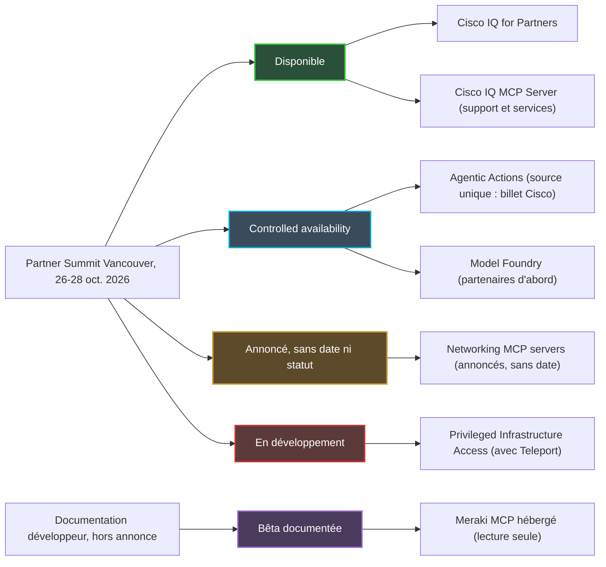
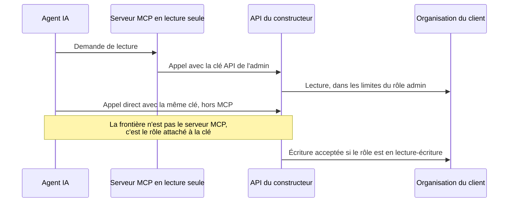
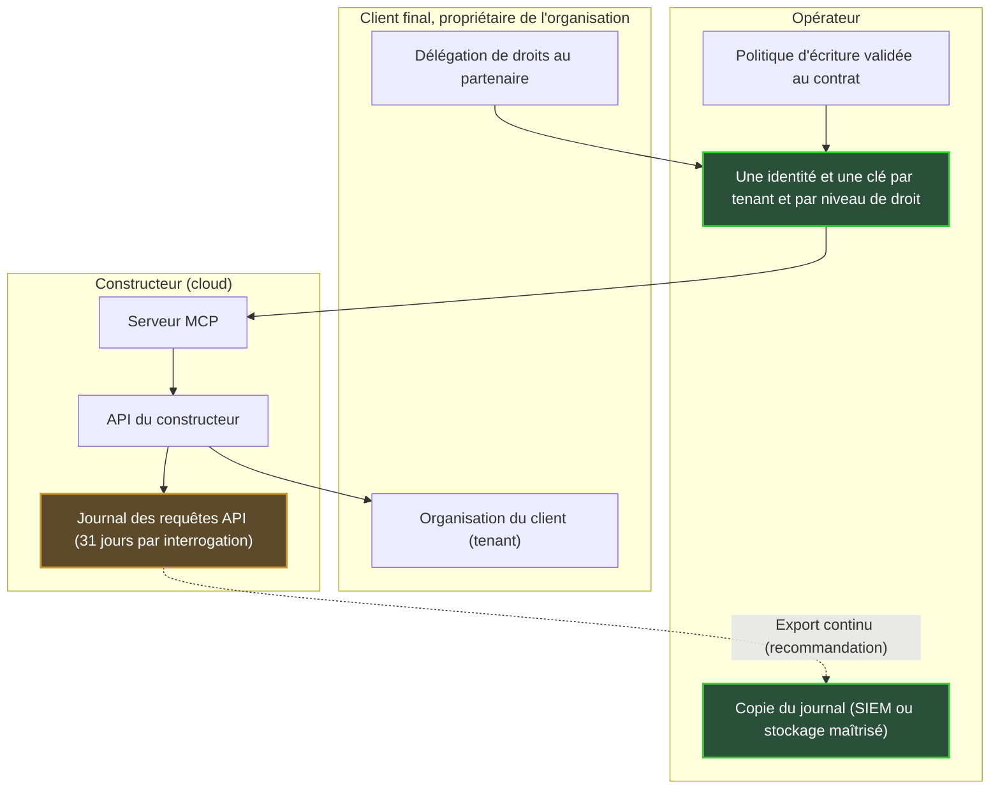

## Une IA qui agit, et une question de clés

La moitié (51 %) des 1 000 décideurs IT et réseau interrogés par Omdia affirment déjà faire tourner, en production, une IA qui agit. Pas une IA qui observe ou qui suggère : une IA qui modifie. L'étude, menée par Omdia, a été publiée par Cisco, donc prudence, mais la tendance est nette. Un mois plus tard, au Partner Summit de Vancouver (26-28 octobre 2026), le constructeur a annoncé la suite. D'un côté, des connecteurs pour brancher des agents sur les données réseau en temps réel, sans date. De l'autre, un service d'actions pilotées par agent, ouvert en accès contrôlé.

Pour un opérateur qui exploite le Wi-Fi de centaines d'hôtels, de résidences étudiantes ou de magasins, la vraie question n'est pas l'intelligence de l'agent. Elle est plus terre à terre. Qui lui remet les clés ? Pour quelles portes ? Et qui garde la trace de ce qu'il ouvre, quand chaque client est un « tenant », une organisation distincte hébergée sur la même plateforme ?

Le protocole au cœur de l'histoire s'appelle MCP (Model Context Protocol) : le standard qui permet à un agent IA de se brancher sur les outils d'un éditeur tiers. Ma thèse est simple. La frontière entre lire et écrire ne se trouve ni dans ce protocole, ni dans l'annonce de Cisco. Elle se trouve dans le rôle administrateur attaché à une clé d'API. Tant que le constructeur ne documente ni son périmètre multi-tenant, ni ses droits d'écriture, ni son journal d'audit, l'opérateur garde pour lui la clé d'écriture et une copie du journal.

## Cinq annonces, cinq stades de maturité

Avant de parler de clés, il faut savoir quelles portes existent vraiment. C'est le premier enseignement de Vancouver : sous un même récit « agentique », Cisco a rangé des produits qui n'en sont pas du tout au même stade. Les confondre, c'est signer un contrat sur une feuille de route.

D'abord, les **Networking MCP servers**. Dans son billet du 26 octobre, Joe Vaccaro, vice-président senior chargé de la plateforme réseau et de l'assurance chez Cisco, les décrit comme une couche d'intégration standardisée et supportée, qui relie les agents aux données du réseau en direct [1]. Usages visés : dépannage, reporting, conformité. Aucun prix, aucune licence, aucune date de disponibilité générale (GA, pour General Availability). Network World écrit que Cisco prévoit de les ajouter à ses plateformes réseau [4], mais aucune source ne nomme ces plateformes. Le billet ne dit pas un mot des permissions, du journal d'audit ou du retour arrière.

**Agentic Actions** est, selon le même billet, en *controlled availability* : un accès restreint, sans date de GA, dont l'inscription bêta est réservée aux clients existants [1]. Le service promet de montrer le raisonnement de l'agent, de recommander des actions et d'en suivre la résolution. Il décrit surtout une montée en autonomie, de l'approbation changement par changement jusqu'à l'exécution autonome dans des politiques et des garde-fous définis, sous supervision humaine.

Deux précautions. Parmi les sources consultées, le terme n'apparaît que chez Cisco, la presse parlant plutôt d'outillage AgenticOps ajouté à Cisco Cloud Control [2][3][4][5]. Et Meraki n'est cité que dans les URL d'inscription à la bêta : rattacher Agentic Actions à Meraki reste une inférence, pas un fait.

Le reste se range vite. **Model Foundry**, service de Cloud Control pour évaluer, affiner et exécuter les modèles Cisco sur les données du client, est lui aussi en controlled availability, ouvert d'abord aux partenaires [3][4][5]. **Cisco IQ for Partners** est disponible depuis le 26 octobre, avec le **Cisco IQ MCP Server**, seul serveur MCP explicitement disponible dans l'annonce [3][4]. Mais Cisco IQ est la plateforme de support et de services, pas le plan de contrôle des équipements. Enfin, **Privileged Infrastructure Access**, conçu avec Teleport, est encore en développement, et Network World juge floue la manière dont il sera proposé aux clients [2][4].

*Derrière un même récit agentique, cinq stades de maturité très différents (état public au 28 octobre 2026).*

**Lecture d'auteur.** Dans l'annonce, le seul serveur MCP disponible ne touche pas aux équipements. Le seul service capable d'exécuter des changements reste en accès restreint. Et controlled availability ne veut pas dire SLA (Service Level Agreement, engagement de niveau de service) : je n'en présume aucun tant qu'il n'est pas écrit dans un contrat.

## Le passe-partout et la réception

Imaginez un hôtel. Vous confiez au nouveau veilleur de nuit le passe-partout de l'établissement, avec une consigne : ne consulter l'état des chambres qu'au comptoir de la réception. La consigne est raisonnable. Le passe-partout, lui, ouvre toutes les portes du couloir, que le veilleur passe par la réception ou non.

C'est, en substance, l'avertissement que donne la documentation du serveur MCP de Meraki [6]. Hébergé par Cisco, il est en bêta, et ses schémas peuvent encore changer sans rétrocompatibilité. Il ne supporte que des opérations de lecture. L'agent s'y authentifie avec une clé d'API du Dashboard Meraki, la console cloud de la gamme. OAuth, le protocole standard de délégation d'autorisation, n'est pas encore supporté.

La même page prévient ensuite : un agent qui détient une clé Dashboard peut appeler l'API directement, sans passer par le serveur MCP. Avec une clé en lecture-écriture, il pourrait modifier le réseau. Cisco recommande donc d'utiliser la clé d'un administrateur en lecture seule, pour que l'agent ne puisse rien changer. Le serveur est la réception. La clé est le passe-partout.

La documentation de l'API Meraki enfonce le clou [14]. Une clé porte l'identité de l'administrateur qui l'a créée, avec exactement les droits de son rôle dans chaque organisation. Une même identité peut être administrateur de plusieurs organisations, avec des droits différents dans chacune. Et elle ne peut détenir que deux clés valides, toutes organisations confondues.

Côté Catalyst Center, la console de gestion des réseaux d'entreprise de Cisco, le serveur MCP publié en open source sur DevNet est encore plus franc [7]. Il lit l'identifiant et le mot de passe dans des variables d'environnement. Sa page précise qu'il n'ajoute aucune couche d'autorisation et n'impose pas la lecture seule. Son catalogue peut contenir des opérations qui modifient la configuration. Cisco y recommande un compte de service dédié, au moindre privilège, et un point d'accès MCP privé, limité à la machine locale (127.0.0.1).

*Le serveur MCP filtre les outils, pas les droits : avec la même clé, l'agent peut contourner le serveur et appeler l'API directement.*

**Lecture d'auteur : trois clés, trois détenteurs.** Dans tout déploiement d'agent sur un parc réseau, je distingue trois objets. D'abord la clé d'accès au serveur MCP, jeton ou clé d'API. Ensuite le rôle administrateur derrière cette clé, qui fixe réellement ce que l'agent peut faire. Enfin le journal, qui prouve ce qui a été fait. L'annonce de Vancouver parle de garde-fous. Elle ne parle d'aucun de ces trois objets.

*Un serveur en lecture seule ne fait pas une clé en lecture seule : c'est le rôle attaché à la clé qui décide des portes ouvertes.*

## Ce que la spécification MCP règle, et ce qu'elle laisse ouvert

On pourrait espérer que le protocole fasse le travail à la place du constructeur. Il en fait une partie, à condition qu'on s'en serve.

Dans sa version 2026-07-28, la spécification MCP rend l'autorisation optionnelle [8]. Elle la recommande pour un transport HTTP. Elle la déconseille pour un transport local (STDIO, l'entrée-sortie standard d'un processus), où les identifiants viennent de l'environnement, exactement comme dans le serveur Catalyst Center.

Quand l'autorisation est mise en œuvre, les règles deviennent nettes. Le serveur MCP est alors un serveur de ressources OAuth 2.1. Le client doit indiquer à quel serveur le jeton est destiné, via le paramètre `resource` défini par la RFC 8707. Le serveur doit vérifier qu'il est bien le destinataire du jeton, et n'en accepter ni n'en relayer aucun autre [8].

La spec interdit d'ailleurs explicitement le relais de jetons (token passthrough), qui consiste à transmettre tel quel à l'API aval le jeton reçu du client [9]. Parmi les risques qu'elle cite : le contournement des contrôles de sécurité, et une piste d'audit brouillée, puisque les journaux de l'API aval affichent alors une autre identité que celle du serveur MCP.

Elle recommande enfin de minimiser les permissions, les fameux « scopes ». On démarre en découverte et en lecture. On élève au cas par cas, via des challenges `WWW-Authenticate` ciblés, et on journalise chaque élévation avec un identifiant de corrélation. Les scopes fourre-tout, du type `*` ou `admin:*`, figurent parmi les erreurs courantes.

**Lecture d'auteur.** La spec fournit les briques : audience du jeton, scopes, élévation journalisée. Elle ne définit ni notion de tenant, ni format de journal d'audit. La question « quel client cet agent a-t-il le droit de toucher ? » relève de l'implémentation du serveur et de son serveur d'autorisation. Or le serveur MCP de Meraki repose aujourd'hui sur une clé d'API, sans OAuth. À ma lecture, la mécanique d'audience et de scopes n'y joue donc pas encore : la clé emporte avec elle l'intégralité du rôle de son propriétaire.

## Quarante hôtels, quarante propriétaires

Prenez un administrateur d'opérateur déclaré sur quarante organisations clientes : des hôtels, des résidences étudiantes, une enseigne de retail. D'après la documentation Meraki, sa clé d'API porte d'un seul coup ses droits sur les quarante [14]. Confiez cette clé à un agent, et chaque appel peut viser n'importe lequel de ces clients, avec les droits du rôle humain dans chacun.

C'est là que le multi-tenant cesse d'être un détail d'architecture. Or la documentation publique est mince. Le serveur MCP de Meraki accepte des sessions multi-organisations, avec une limite de débit par organisation [6]. Côté Cisco IQ, un contrôle d'accès par rôle (RBAC, Role-Based Access Control) permet au client d'accorder à son partenaire une visibilité directe et sécurisée sur son parc installé [3][4]. C'est la seule mécanique de délégation client vers partenaire décrite dans l'annonce. Elle porte sur la visibilité, pas sur l'écriture.

Pour Agentic Actions comme pour les Networking MCP servers, aucune source ne décrit de modèle multi-tenant : ni isolation par organisation, ni droits propres à un partenaire, ni séparation des journaux.

**Lecture d'auteur.** Le corollaire est immédiat : une clé par tenant et par niveau de droit, jamais une clé « super-admin » partagée entre clients. Avec deux clés au maximum par identité, cela suppose des identités de service dédiées, une par client et par usage. C'est plus lourd à administrer. C'est aussi la seule façon de garantir que l'agent qui dépanne un hôtel à Lyon ne puisse pas, sur une erreur d'instruction ou une compromission, reconfigurer une résidence à Lille. Reste une question à poser au constructeur plutôt qu'à supposer : son agent voit-il une organisation à la fois, comme le suggère la limite de débit par organisation, ou un parc transversal ?

*Une organisation par client, un trousseau par organisation : jamais un passe-partout pour tout le parc.*

Vient ensuite l'échelle d'autonomie d'Agentic Actions. Passer de *j'approuve chaque changement* à *l'agent exécute dans une politique* est, à mes yeux, une décision contractuelle avant d'être technique. Qui écrit la politique, l'opérateur ou le client final ? Qui a le droit de la desserrer ? Et qui répond si l'agent agit dans les clous de la politique, mais contre l'intention d'un tenant ? Ces trois questions n'ont pas leur place dans une console. Elles ont leur place dans un contrat.

## Le journal du constructeur n'est pas le vôtre

Un samedi soir, le réseau d'une résidence étudiante change de comportement. Le lundi, le client demande qui a modifié quoi, et pourquoi. Si la seule réponse se trouve dans le cloud du constructeur, sous une identité partagée entre un humain et un agent, l'opérateur n'a pas de réponse. Il a une hypothèse.

Côté Meraki, un journal existe. L'appel `getOrganizationApiRequests` liste les requêtes API d'une organisation : identifiant de l'administrateur, méthode, chemin, user-agent, adresse IP source, code de réponse, type de client (clé d'API ou OAuth) [15]. Pour les requêtes OAuth, l'identifiant d'administrateur est vide. Chaque interrogation couvre au maximum 31 jours, et la page ne précise pas la durée de rétention.

*Le journal du constructeur s'interroge par fenêtres de 31 jours. La mémoire longue, c'est à l'opérateur de la construire.*

Pour Agentic Actions, aucun journal d'audit n'est décrit publiquement. C'est d'autant plus frappant que les clients le réclament. Dans l'étude Omdia, 69 % des répondants exigent une explicabilité détaillée des actions d'agents, et 36 % placent l'observabilité complète (traçage détaillé, justification, audits après action) comme minimum acceptable [12]. Le contraste le plus parlant est ailleurs : 82 % se disent à l'aise pour laisser l'IA faire certains changements de production sans approbation humaine préalable, mais 24 % seulement se disent à l'aise avec une IA sans aucune supervision. La confiance existe, à condition de pouvoir relire.

Rappel de périmètre : décideurs IT et NetOps (exploitation réseau) d'entreprises d'au moins 500 salariés, en Amérique du Nord, Europe de l'Ouest et Asie-Pacifique, sans dates de terrain ni marge d'erreur publiées. Le 23 septembre, Joe Vaccaro listait lui-même les attentes des dirigeants : portes d'approbation pour les actions risquées, limites par politique, pistes d'audit, arrêt d'urgence, accès par rôle [13]. Le billet du 26 octobre ne détaille aucun de ces mécanismes.

**Lecture d'auteur.** Avant toute écriture, j'exige trois choses. D'abord un export continu du journal vers un SIEM (Security Information and Event Management, la plateforme de collecte des journaux de sécurité) ou un stockage maîtrisé par l'opérateur, plutôt qu'une fenêtre de 31 jours interrogée après coup. Ensuite une identité d'agent distincte : si l'agent utilise la clé d'un administrateur, ses actions se confondent dans le journal avec celles de cet humain. Enfin, idéalement, une corrélation avec les élévations de droits que la spec MCP recommande de journaliser. Sans export, le journal reste chez le fournisseur.

*Qui détient quoi, tenant par tenant. La flèche d'export continu est une recommandation d'auteur, pas une fonction documentée par Cisco.*

## Sept questions avant d'ouvrir l'écriture

La bonne direction est connue. En août, Cisco est devenu le plus gros investisseur de Teleport, spécialiste de l'accès privilégié, dont le principe pour les agents tient en une ligne : le seul privilège nécessaire à la tâche, et chaque action attribuable [10][11]. Channel Insider décrit le futur Privileged Infrastructure Access dans cet esprit : accès limité à une tâche, certificats courts liés à une identité, sessions enregistrées, privilèges qui expirent en fin de session [5]. Mais c'est un produit en développement, sans plateforme Cisco ni calendrier précisés.

En attendant, voici les sept questions que je poserais au constructeur avant d'autoriser une seule écriture sur un tenant :

1. **Identité** : sous quelle identité l'agent agit-il ? Clé d'administrateur, OAuth, jeton de courte durée ?
2. **Périmètre** : où s'arrête son accès, à l'organisation, au réseau ou au site ?
3. **Droits d'écriture** : sont-ils découpés par classe d'action, ou accordés en bloc ?
4. **Journal** : est-il exportable, avec quelle rétention et dans quel format ?
5. **Arrêt d'urgence** : existe-t-il un bouton stop, et un retour arrière documenté ?
6. **Statut contractuel** : que couvre réellement une controlled availability ?
7. **Réversibilité** : que deviennent les clés et les délégations quand un client quitte l'opérateur ?

Une limite honnête, pour être complet. Le billet de Cisco ne répond à aucune de ces questions. Ce n'est pas la preuve que les mécanismes n'existent pas : c'est l'absence de documentation publique au 28 octobre 2026. La nuance compte, et un échange écrit avec le constructeur suffit à la lever.

## Lire maintenant, écrire plus tard

Ma position est tranchée. La lecture, oui, dès maintenant, sur des tenants volontaires, avec une identité de service en lecture seule par client. C'est là que l'agent apporte déjà de la valeur : dépannage, reporting, conformité, précisément les usages que Cisco met en avant. Le risque y est faible, et les équipes apprennent à travailler avec l'outil.

L'écriture, pas avant des réponses écrites aux sept questions. Et même alors, en commençant au premier barreau de l'échelle : l'approbation changement par changement, sur un périmètre restreint. L'exécution autonome viendra quand la politique sera contractuelle, le journal exporté et l'identité de l'agent distincte de celle des humains.

Ce n'est pas de la frilosité. Un opérateur qui confie sa clé d'écriture à l'agent d'un constructeur sans garder le journal ne délègue pas une tâche. Il délègue sa capacité à prouver ce qui s'est passé chez ses clients, tout en restant responsable devant eux. Les agents vont arriver sur nos parcs, et c'est une bonne nouvelle pour les équipes d'exploitation. Mais la question de Vancouver n'est pas « quel agent ? ». C'est « quelle clé ? ».

Le protocole est neutre. La clé ne l'est pas.

---

_Vues personnelles, pas position Wifirst._

## Sources

1. Cisco Blogs, Joe Vaccaro, « Powering Partner Potential in a World of Agentic AI », 26 octobre 2026 : https://blogs.cisco.com/partner/powering-partner-potential-in-a-world-of-agentic-ai
2. Converge Digest, annonces Cisco AgenticOps, Model Foundry et MCP, 26 octobre 2026 : https://convergedigest.com/cisco-agentic-network-operations-model-foundry-mcp/
3. StorageReview, Cisco IQ en disponibilité générale pour les partenaires, 26 octobre 2026 : https://www.storagereview.com/news/cisco-iq-general-availability-partners-model-foundry-live-protect-wifi-7
4. Network World (M. Cooney), Cisco et ses partenaires sur l'exploitation IT par l'IA, 27 octobre 2026 : https://www.networkworld.com/article/4240556/cisco-taps-ai-partners-to-modernize-it-operations-and-fortify-network-security.html
5. Channel Insider (J. Smith), annonces Cisco sur les opérations IA, 27 octobre 2026 : https://www.channelinsider.com/infrastructure/cisco-ai-operations-quantum-safe-networking/
6. Cisco DevNet Code Exchange, Cisco Meraki MCP Server (bêta) : https://developer.cisco.com/codeexchange/github/repo/CiscoDevNet/cisco-meraki-mcp-official/
7. Cisco DevNet Code Exchange, Catalyst Center MCP Server (open source) : https://developer.cisco.com/codeexchange/github/repo/cisco-en-programmability/catc-mcp-oss/
8. Model Context Protocol, spécification 2026-07-28, Authorization : https://modelcontextprotocol.io/specification/2026-07-28/basic/authorization
9. Model Context Protocol, spécification 2026-07-28, Security Best Practices : https://modelcontextprotocol.io/specification/2026-07-28/basic/security_best_practices
10. Teleport Blog, partenariat Cisco et Teleport, 25 août 2026 : https://goteleport.com/blog/cisco-teleport-partnership/
11. Compare the Cloud, Cisco premier investisseur de Teleport, 25 août 2026 : https://www.comparethecloud.net/news/cisco-becomes-teleports-largest-investor-in-push-to-retire-static-credentials-from-enterprise-infras
12. Cisco Newsroom, étude Cisco et Omdia sur l'AgenticOps, 23 septembre 2026 : https://newsroom.cisco.com/c/r/newsroom/en/us/a/y2026/m09/cisco-ai-research-agenticops-scaling-quickly-in-the-enterprise.html
13. Cisco Blogs, Joe Vaccaro, « NetOps Is Already Deploying Agentic Autonomy », 23 septembre 2026 : https://blogs.cisco.com/news/netops-is-already-deploying-autonomy-trust-will-decide-how-far-it-goes
14. Cisco DevNet, Meraki API v1, Authorization : https://developer.cisco.com/meraki/api-v1/authorization/
15. Cisco DevNet, Meraki API v1, getOrganizationApiRequests : https://developer.cisco.com/meraki/api-v1/get-organization-api-requests/
