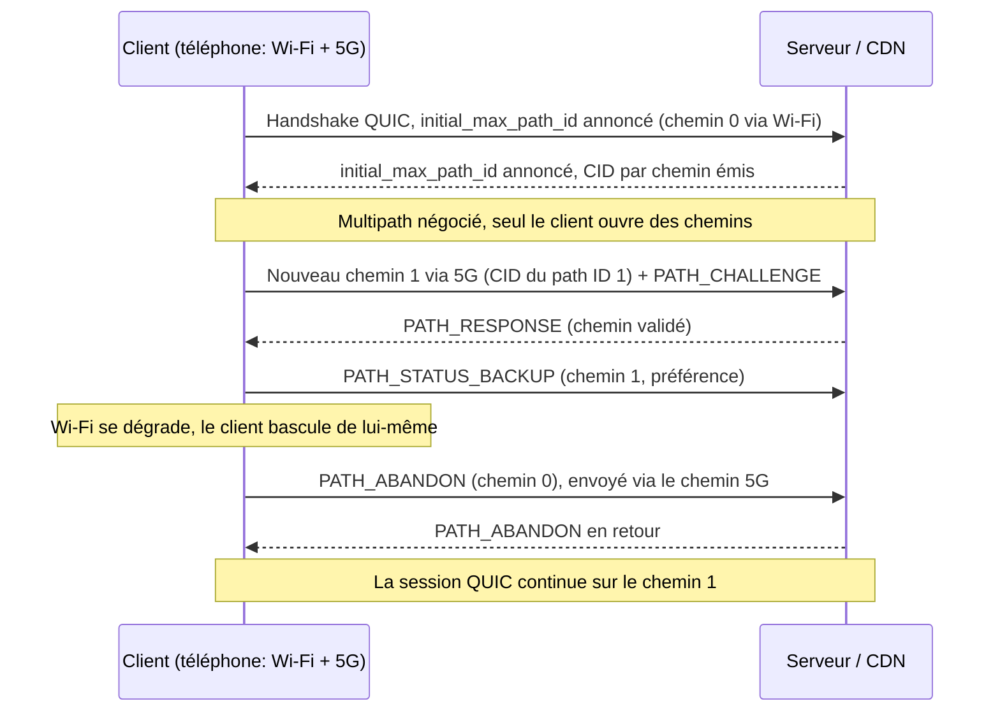
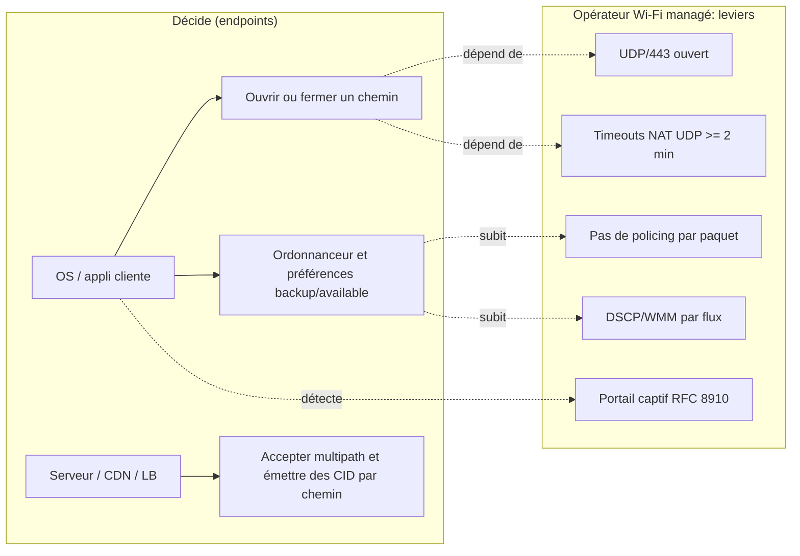

# Brief — RFC 10069 « Managing Multiple Paths for a QUIC Connection » (Multipath QUIC) : ce que ça change, et surtout ne change pas, pour un opérateur Wi-Fi managé

Date du brief : 2026-11-13 | Mode : brief | Type : tech (standard-rfc / wifi-mobilité)

Légende de fiabilité : [RFC-brut] = lu dans le texte brut de la RFC (vérifié) ; [page] = lu via WebFetch (résumé automatique, à re-vérifier avant citation mot pour mot) ; [recherche] = vu seulement dans un résultat de recherche (non rouvert). ANALYSE = opinion d'auteur, non sourcée.

## Vérification préalable du sujet
- RFC 10069 existe bien : texte brut rfc-editor.org/rfc/rfc10069.txt lu (en-tête "Request for Comments: 10069", "Category: Standards Track", "November 2026", 33 pages) ; API datatracker confirme `std_level: ps` (Proposed Standard), `rfc_number: 10069`, doc horodaté 2026-11-07. [RFC-brut + API]
- Historique datatracker : publiée le 2026-11-07 ; approbation IESG le 2026-03-18 ; draft-ietf-quic-multipath-21 ; WGLC 2025-04 puis 2025-09 ; premier draft WG 2022-02-02. [page]
- Attention : une recherche web a d'abord affirmé "toujours Internet-Draft" (index périmé). Contredit par le texte brut. Ne pas en tenir compte.

## Thèse (1 phrase)
Multipath QUIC est désormais un standard, mais c'est le client (OS/application) qui décide d'agréger Wi-Fi et 5G : pour un opérateur Wi-Fi managé, la RFC 10069 ne crée pas un service à vendre, elle change le contrat de qualité, car la session ne dépendra plus du Wi-Fi, qui sera jugé sur sa performance relative et sa transparence UDP/QUIC plutôt que sur sa capacité à retenir l'utilisateur.

## Angle proposé (la thèse, développée)
La RFC définit la plomberie (chemins explicites, un espace de numéros de paquets par chemin, signalisation de préférence "backup/available", fermeture explicite), mais laisse hors périmètre la découverte d'adresses et l'ordonnancement du trafic (texte de la RFC). Seuls les endpoints créent des chemins (le client ouvre, le serveur valide). L'opérateur Wi-Fi n'a donc aucun levier de protocole pour "déclencher" l'agrégation. Ses leviers restent l'hygiène réseau (UDP/443 ouvert, timeouts NAT, pas de policing par paquet, DSCP cohérent). Le gain réel est la continuité de session lors de dégradations Wi-Fi, pas la somme des débits (la RFC elle-même est réservée sur l'usage simultané). Corollaire opérateur : moins de lock-in par la session, plus de pression sur la qualité du Wi-Fi.

## Faits clés sourcés (distingués de l'analyse)

### A. Ce que dit la RFC [RFC-brut, texte rfc10069.txt]
1. Statut et auteurs : Standards Track (Proposed Standard), novembre 2026 ; auteurs Y. Liu (Ed., Alibaba), Y. Ma (Harvey AI), Q. De Coninck (Ed., UMONS), O. Bonaventure (UCLouvain et WELRI), C. Huitema (Private Octopus), M. Kühlewind (Ed., Ericsson). Note : Y. Ma est affilié à Harvey AI dans la RFC, pas à Alibaba.
2. Périmètre : extension de QUIC v1 (RFC 9000) pour l'usage simultané de plusieurs chemins, avec mêmes ou différents 4-tuples ; "does not specify address discovery or management, nor how applications using QUIC schedule traffic over multiple paths". Section 1.
3. Négociation : paramètre de transport `initial_max_path_id` (ID 0x3e) ; si l'un des deux endpoints ne l'annonce pas, aucun mécanisme multipath n'est utilisé (déploiement incrémental). Connection IDs de longueur non nulle obligatoires. Section 2.1. Valeur ≤ 2^32−1.
4. Modèle de chemin : un chemin = un path ID (0 = chemin initial, croissant, jamais réutilisé) ; plusieurs chemins peuvent partager le même 4-tuple ; un espace de numéros de paquets par chemin (départ à 0) ; le CID lie le paquet à un path ID. Section 1.
5. Crypto : le nonce AEAD des paquets 1-RTT inclut les 32 bits du path ID ; handshake TLS inchangé ; les limites de l'Annexe B de QUIC-TLS s'appliquent au total des paquets tous chemins confondus. Sections 2.4 et 7.3.
6. Création de chemin : seul le client ouvre un chemin ; le serveur "has to validate a new path created by a client" ; validation selon RFC 9000 §8.2 (PATH_CHALLENGE/RESPONSE), anti-amplification par chemin, MTU min 1200 octets. Sections 1 et 3.1.
7. Frames : PATH_ACK (types 0x3e-0x3f), PATH_ABANDON (0x3e75), PATH_STATUS_BACKUP (0x3e76), PATH_STATUS_AVAILABLE (0x3e77), PATH_NEW_CONNECTION_ID (0x3e78), PATH_RETIRE_CONNECTION_ID (0x3e79), MAX_PATH_ID (0x3e7a), PATHS_BLOCKED (0x3e7b), PATH_CIDS_BLOCKED (0x3e7c). Section 6 (IANA). Le nom "ACK_MP" n'apparaît pas dans la RFC (0 occurrence).
8. Backup / disponibilité : PATH_STATUS_BACKUP = "no traffic should be sent on that path if another path is available and usable" ; chaque pair exprime sa préférence indépendamment ; ce sont des préférences, un endpoint peut ne pas les suivre. Section 3.3.
9. Fermeture : PATH_ABANDON explicite obligatoire, peut être envoyé sur un autre chemin que celui fermé (recommandé si le chemin est cassé) ; état conservé 3 PTO. Section 3.4.
10. Cas d'usage et limites : "failover between Wi-Fi and mobile networks is a well-known multipath use case, it only temporarily uses two paths at the same time to avoid transmission pauses. Simultaneous path usage generally, however, needs more consideration than specified in this document to avoid negative performance impacts, e.g., when stream data is distributed over multiple paths with different delays." ; "There are currently no IETF specifications that define scheduling algorithms for simultaneously using multiple paths". Section 1. Aussi §5.5 : un flux réparti sur plusieurs chemins subit le délai maximal des chemins utilisés.
11. Congestion : état de congestion séparé par chemin ; chemins non forcément disjoints ; risque d'iniquité si goulot partagé ; LIA (RFC 6356) adaptable (cité par la RFC). Section 5.3.
12. Multi-chemins sur même 4-tuple : exemple explicite de chemins avec marquages DiffServ différents, laissé à l'application. Section 5.2.
13. Keep-alive : pas de timeout idle par chemin ; la RFC ne recommande pas d'envoyer des keep-alive sur les chemins inactifs ; un chemin inactif peut devenir inutilisable à cause des timeouts de middleboxes ; il peut être sondé avant bascule. Section 5.9.
14. Sécurité : risque d'amplification DoS via ouverture simultanée de plusieurs chemins ; recommandation de garder le nombre max de chemins petit et d'espacer les validations ; allocation des ressources de chemin seulement après validation ; limites d'amplification inchangées par chemin. Section 7.
15. Manageabilité : la RFC renvoie à RFC 9312 ("also apply") et note la complexité d'un mélange de chemins monitorés et non monitorés, déjà présente avec la migration. Section 1. Migration/NAT rebinding : traités par chemin, sans changement de path ID. Section 5.1 ; la RFC juge préférable de créer un nouveau chemin puis d'abandonner l'ancien plutôt que de migrer un chemin unique.

### B. Processus et écosystème
16. Chronologie (datatracker) : draft individuel 2021-10-25, draft WG -00 2022-02-02, approbation IESG 2026-03-18, file RFC Editor dès 2026-03-19, publication 2026-11-07. [page]
17. Shepherd write-up : controverses principales = "single vs. multiple packet spaces and the relationship between connection IDs and path IDs" ; "regular interoperability tests (e.g., during hackathon events)" ; "I am aware of Alibaba's production deployment of the document. I believe this is primarily a self-interop deployment." [page]
18. Wiki WG des implémentations multipath (non daté sur la page ; draft-era) : Ericsson/aioquic (Python), quiche (Rust, draft-12, "work-in-progress as a PR, fork available"), xquic (Alibaba, C, drafts -09/-10, "MPQUIC is in the main branch"), picoquic (C), Rask (Ericsson interne, Rust, draft-11 à la date 2024-10-23), AppleQUIC ("currently testing MPQUIC client", pas de serveur public, paramètre de transport 0xbabf). Les valeurs de paramètres de transport de ces entrées sont des codepoints de drafts, différents du 0x3e final : donc pas de compatibilité sur le fil sans mise à jour. [page]
19. README tquic (Tencent) : "TQUIC supports Multipath to enable the simultaneous usage of multiple paths for a single connection" (sans version de draft). README xquic : Multipath QUIC listé sous "Not Yet Standardized Features" (liens draft-04/05/06). README picoquic : "Planned developments include support for the standard version of multipath". [page]
20. quic-go : issue #3343 "Feature: Multipath Extension for QUIC" ouverte le 2022-03-10, toujours ouverte ; le mainteneur (2022) : "Implementing that draft would be a massive undertaking" ; dernier commentaire daté 2025-12-09 par un contributeur externe. Aucun PR d'implémentation trouvé. [page]
21. quiche (Cloudflare) : pas d'implémentation upstream multipath trouvée (issue #278 ancienne ; entrée wiki = PR/fork WIP draft-12). [recherche + page wiki]
22. Hackathon IETF 117 (juillet 2023) : interop multipath réussie entre cinq implémentations, tests surtout "simples" selon les slides. [recherche, non rouvert]

### C. Déploiements réels connus
23. Alibaba (XLINK) : article APNIC (Y. Ma, 2021-12-08) : test A/B sur Taobao mobile, 100k participants, plus de 3 millions de lectures vidéo sur deux semaines ; amélioration du temps de complétion de requête vs single-path : médiane >2,3 %, p95 >9,4 %, p99 >19 % ; l'ordonnanceur min-RTT par défaut peut être "28 % plus lent au p99" que le meilleur chemin seul ; les interfaces agrégées sont surtout Wi-Fi et cellulaire (LTE/5G) ; le surcoût du trafic dupliqué est mentionné (ordre de grandeur cité : ~0,10 $ par Go de vidéo, à reconfirmer avant publication). Papier SIGCOMM 2021 : DOI 10.1145/3452296.3472893. XLINK est une pile utilisateur (XQUIC) : déploiement par release applicative. [page, chiffres du papier non relus dans le PDF]
24. Des sources secondaires donnent « 19 à 50 % » p99 de temps de complétion et « 32 % » sur la première image (agrégateur Bohrium) : métriques différentes, à ne pas mélanger avec les chiffres APNIC. [recherche]
25. Alibaba affirme que XQUIC est utilisé pour Taobao live, DingTalk, Youku, Lazada (source secondaire besthub.dev, non officielle). [recherche, faible]
26. Apple : (a) MPTCP : documenté dans l'API Network (`NWParameters.multipathServiceType`, iOS 12+/macOS 10.14+) ; l'API décrit "An option to allow connections to use multipath protocols" sans mentionner QUIC. [page Apple] ; modes handover / interactive / aggregate selon la doc et un thread DTS (non rouverts). [recherche] (b) MPQUIC : seule trace vérifiée = ligne du wiki WG ("AppleQUIC ... currently testing MPQUIC client"). Aucune doc Apple confirmant MPQUIC en production. Un blog affirmant "Apple Network.framework supports MPQUIC for iCloud Private Relay" n'est pas sourcé et cite à tort "RFC 9443" comme RFC multipath : REJETÉ.
27. 3GPP : Rel-18 a introduit le steering MPQUIC (UDP) pour ATSSS ; Rel-19 étend à IP (via connect-ip, RFC 9484) et Ethernet ; TS 24.193 V19.6.0 (2026-09) mentionne la fonctionnalité MPQUIC. [recherche : Nokia Bell Labs, 3GPP TS 24.193, CR Samsung TS 23.501 ; non rouvert]. Utile pour montrer que les opérateurs mobiles poussent aussi le multipath (Wi-Fi = accès non-3GPP).

### D. MPTCP (comparaison)
28. RFC 8684 (mars 2020, Standards Track, auteurs dont C. Paasch d'Apple et O. Bonaventure) : un sous-flux TCP par chemin ; MP_CAPABLE / MP_JOIN (HMAC-SHA256) ; ADD_ADDR / REMOVE_ADDR ; DSS (numéro de séquence de données 64 bits) ; repli en TCP simple si les options sont retirées ou altérées ; checksum optionnel contre les modifications par middlebox. [page]
29. APNIC 2022 (mesures) : Apple est la seule organisation à supporter activement MPTCPv1 fin 2021 ; Linux supporte MPTCPv1 depuis le noyau 5.6 ; iOS utilise MPTCP pour Siri, Music, Maps ; de nombreux middleboxes retirent, font écho ou filtrent les options TCP. [page]
30. Apple MPTCP depuis iOS 7 (2013) pour Siri : sources secondaires (Wikipedia, RFC 8041, IETF Journal) ; extension à d'autres services : source secondaire. [recherche, non rouvert]

### E. Visibilité réseau (RFC 9312, Manageability of the QUIC Transport Protocol) [page]
31. §3.1 : pas de méthode générale pour distinguer QUIC d'un autre UDP non classé. §3.4 : SNI visible seulement via dérivation du secret Initial (spécifique à la version). §4.1 : "No passive measurement of loss is possible with the present wire image". §3.8.2 : spin bit utilisable seulement si les deux endpoints l'activent, désactivé aléatoirement sur au moins 1/8 des connexions.
32. §4.2 : timeout d'état NAT/firewall d'au moins 2 minutes recommandé pour QUIC ; ne pas utiliser le CID comme clé de flux. §4.5 : admettre quelques paquets puis bloquer coûte cher en timeouts, repli TCP encouragé. §4.6 : pour limiter, bloquer le flux entier plutôt que du policing par paquet. §4.8 : QoS/DSCP attendue par flux, et la migration (changement de 5-tuple) peut entraîner un traitement différent.
33. RFC 9312 ne traite pas le multipath QUIC explicitement (publiée avant). Les contraintes ci-dessus s'appliquent par chemin ; la RFC 10069 y renvoie sans les étendre.
34. Pare-feux d'entreprise : la doc best practice de Palo Alto recommande de bloquer UDP/80 et UDP/443 (QUIC) pour forcer le repli TLS et permettre le déchiffrement ; Zscaler décrit le même repli. [recherche]
35. Portail captif : RFC 8910 (sept. 2020) = option DHCPv4 114, DHCPv6 103, RA type 37, pointant vers l'API RFC 8908. [page] Rien dans RFC 10069 sur les portails captifs (la RFC ne les mentionne pas à ma lecture ; recherche exhaustive non faite).

## Analyse d'auteur (non sourcée, à assumer comme opinion dans l'article)
- A1. Qui décide : l'agrégation ne se "commande" pas depuis le réseau. Les PATH_STATUS_* sont émis par les endpoints ; l'AP ou le contrôleur Wi-Fi ne peut ni créer ni fermer un chemin. Conséquence : pas de produit "multipath managé" côté opérateur Wi-Fi sans agent/proxy client. Piste à ne pas survendre : un proxy multipath (type MASQUE/connect-ip, cf. 3GPP) est un autre sujet.
- A2. Ce qui change pour Wifirst : (i) la session survit à la perte du Wi-Fi (chambre d'hôtel en bord de couverture, saturation d'une résidence étudiante le soir), donc moins de tickets "ça coupe en visio" quand le client est multipath ; (ii) mais le Wi-Fi n'est plus la seule voie de sortie : le trafic migre vers la 5G du client plus facilement (hors du périmètre de supervision et de facturation de l'opérateur), ce qui rend la qualité relative du Wi-Fi mesurable par l'usage des clients ; (iii) les métriques côté opérateur (sessions, volumes par client) seront davantage "partielles".
- A3. Ce qui ne change pas : DPI/SNI/classification : l'opérateur voit des flux UDP chiffrés, un par chemin, avec des CID différents par chemin et, sur le Wi-Fi, un 4-tuple différent de celui du chemin 5G : corréler les deux côtés est pratiquement impossible depuis un seul réseau. Pas de visibilité sur le chemin 5G depuis le Wi-Fi. QoS par chemin : DSCP/WMM par flux comme aujourd'hui, avec la nuance de la RFC 10069 §5.2 (plusieurs chemins sur le même 4-tuple avec marquages différents, géré par l'application).
- A4. NAT / timeouts : les chemins de secours inactifs dépendent des timeouts NAT/firewall (RFC 10069 §5.9 : pas de keep-alive recommandé) ; un NAT résidentiel ou CGNAT agressif tue le chemin de secours Wi-Fi avant qu'il serve. Levier concret : timeouts UDP/443 ≥ 2 min (RFC 9312 §4.2), pas de policing par paquet.
- A5. Portails captifs : le portail gère l'autorisation du chemin Wi-Fi ; avec multipath, un chemin Wi-Fi non authentifié échouera à la validation ou sera simplement non utilisé tandis que la 5G porte la session. Risque : des clients "déjà en ligne via 5G" ignorent le portail plus longtemps (impact CGU/traçabilité légale hôtellerie, à vérifier côté juridique). Rappeler RFC 8910/8908 pour que l'OS sache qu'un portail est présent. Aucune source ne traite ce cas : hypothèse.
- A6. Backup 5G/FWA : deux niveaux à ne pas confondre. Backup WAN côté opérateur (routeur du site bascule vers la 5G/FWA, la session QUIC voit un changement d'IP source : migration/rebinding, RFC 9000, pas multipath) ; backup côté client (multipath réel, deux interfaces du terminal). La RFC 10069 ne change que le second ; le premier reste une migration de chemin par NAT rebinding, traitée par chemin (§5.1).
- A7. Adoption : dépend de la chaîne client OS/app + serveur/CDN/LB, pas de l'opérateur. État vérifié : implémentations de référence côté Alibaba/Tencent/Ericsson/picoquic ; Apple "teste un client" ; quic-go non implémenté ; quiche en PR/fork. Les codepoints finaux (0x3e, 0x3e75…) diffèrent des drafts : tout le monde doit migrer. Horizon réaliste pour les navigateurs/OS/CDN grand public : pas de date sourcée ; ne pas en inventer.
- A8. MPTCP vs MPQUIC : MPTCP existe depuis 2013 côté Apple (secondaire) et a été normalisé en 2020 (RFC 8684) sans percée large côté serveurs (APNIC 2022) à cause des middleboxes et de l'absence de déploiement serveur. MPQUIC part avec trois avantages structurels (analyse) : négociation et frames dans des paquets chiffrés et authentifiés par TLS (pas de retrait d'options par les middleboxes comme pour TCP, mais le trafic UDP peut être bloqué), déploiement en espace utilisateur (release applicative, cf. XLINK), plusieurs chemins sur un même 4-tuple. Et deux handicaps : pas d'ordonnanceur standard (RFC 10069 elle-même) et un parc de pare-feux d'entreprise qui bloquent UDP/443 (Palo Alto).
- A9. Piège éditorial : ne pas écrire "la 5G + Wi-Fi s'additionnent". La RFC elle-même dit que l'usage simultané demande plus de travail ; l'étude Alibaba montre qu'un ordonnanceur min-RTT naïf peut être 28 % plus lent au p99 que le meilleur chemin seul.
- A10. Wi-Fi 7 MLO (couche 2, même BSS/même SSID) est un mécanisme distinct de multipath QUIC (couche transport, multi-réseaux) : à mentionner en une phrase comme précision, non sourcé dans ce brief.

## Plan suggéré (≈ 1 400-1 800 mots)
1. Accroche : 7 novembre 2026, la RFC 10069 sort ; la bonne question n'est pas "qu'est-ce que c'est" mais "qui décide et qui y gagne".
2. Ce que la RFC standardise (et ce qu'elle laisse volontairement ouvert) : path IDs, espaces de numéros, nonce, frames, client-initiated, pas de découverte d'adresse ni d'ordonnanceur. Schéma 1.
3. Failover vs agrégation : ce que dit la RFC elle-même ; leçon XLINK (gains p99, ordonnanceur min-RTT 28 % plus lent).
4. Ce qui change pour un opérateur Wi-Fi managé : session qui survit, Wi-Fi jugé sur la qualité relative, chemin 5G hors de notre vue.
5. Ce qui ne change pas : visibilité (RFC 9312), DPI, QoS par flux, NAT timeouts, portails captifs, backup WAN vs backup client. Schéma 2 (leviers).
6. Adoption : qui implémente quoi (wiki WG, quic-go, quiche, Apple "teste"), codepoints de draft vs finaux, pas de calendrier.
7. MPTCP en miroir : 2013 → 2020 → 2022 (APNIC), pourquoi QUIC pourrait différer, et ce qui reste identique (middleboxes/UDP blocage).
8. Check-list opérateur (5 points actionnables) + conclusion tranchée.

## Check-list opérateur candidate (analyse, à valider par l'ingénierie Wifirst)
- Laisser passer UDP/443 et UDP en général sur les VLAN invités et résidents ; ne pas "forcer le repli TCP" sans raison (RFC 9312 §4.5).
- Timeouts d'état NAT/firewall UDP ≥ 2 min (RFC 9312 §4.2).
- Pas de policing par paquet ; limiter par flux (RFC 9312 §4.6).
- Marquage DSCP/WMM cohérent par flux, sans supposer qu'une session = un 4-tuple.
- Déployer RFC 8910 (option DHCP 114) pour le portail captif afin que l'OS détecte l'état du Wi-Fi.
- Mesurer côté AP le taux de clients qui "décrochent" en Wi-Fi mais restent en ligne (indicateur de qualité relative) : idée d'indicateur, non sourcée.

## Sources retenues (numérotées) : 17 retenues + 1 rejetée
1. **RFC 10069** (texte brut) — https://www.rfc-editor.org/rfc/rfc10069.txt (HTML : https://www.rfc-editor.org/rfc/rfc10069.html) — primaire, standard — 2026-11 — [RFC-brut]
2. **Datatracker RFC 10069 (métadonnées JSON)** — https://datatracker.ietf.org/api/v1/doc/document/rfc10069/ et https://datatracker.ietf.org/doc/rfc10069/ — primaire, métadonnées — 2026-11-07 — [RFC-brut / page]
3. **Historique draft-ietf-quic-multipath** — https://datatracker.ietf.org/doc/draft-ietf-quic-multipath/history/ — primaire, processus IETF — jusqu'à 2026-11-07 — [page]
4. **Shepherd write-up** — https://datatracker.ietf.org/doc/draft-ietf-quic-multipath/shepherdwriteup/ — primaire, processus IETF (consensus, interop, déploiement Alibaba) — [page]
5. **Wiki WG : QUIC Implementations with multipath support** — https://github.com/quicwg/multipath/wiki/QUIC-Implementations-with-multipath-support — WG, état des implémentations (non daté) — [page + raw]
6. **RFC 9312 Manageability of the QUIC Transport Protocol** — https://www.rfc-editor.org/rfc/rfc9312.html — standard/info, visibilité réseau — [page]
7. **RFC 8684 MPTCP v1** — https://www.rfc-editor.org/rfc/rfc8684.html — standard — 2020-03 — [page, début du document]
8. **APNIC, Analyzing MPTCP adoption in the Internet** — https://blog.apnic.net/2022/08/23/analyzing-mptcp-adoption-in-the-internet/ — analyse/mesures — 2022-08-23 — [page]
9. **APNIC, Efficient multipath transport with QUIC in large-scale video services (Y. Ma, Alibaba)** — https://blog.apnic.net/2021/12/08/efficient-multipath-transport-with-quic-video-services/ — vendor/analyse technique — 2021-12-08 — [page]
10. **XLINK, SIGCOMM 2021** — https://conferences.sigcomm.org/sigcomm/2021/files/papers/3452296.3472893.pdf — paper — 2021 — [recherche, PDF non relu]
11. **Apple Developer, NWParameters.multipathServiceType** — https://developer.apple.com/documentation/network/nwparameters/multipathservicetype-swift.property.md — vendor doc — [page]
12. **READMEs GitHub xquic / picoquic / tquic** — https://github.com/alibaba/xquic ; https://github.com/private-octopus/picoquic ; https://github.com/Tencent/tquic — implémentations — [page]
13. **quic-go issue #3343** — https://github.com/quic-go/quic-go/issues/3343 — projet open source — [page]
14. **3GPP / Nokia Bell Labs ATSSS MPQUIC** — https://www.3gpp.org/ftp/specs/PDF/2026-09/Rel-19/24_series/24193-j60.pdf ; https://nokia.com/bell-labs/publications-and-media/publications/multipath-quic-for-access-traffic-steering-switching-and-splitting-in-5g-advanced — régulateur/standards, analyste vendor — [recherche, non rouvert]
15. **RFC 8910 Captive-Portal Identification in DHCP and RAs** — https://www.rfc-editor.org/rfc/rfc8910.html — standard — 2020-09 — [page]
16. **Palo Alto Networks best practices (bloquer QUIC)** — https://docs.paloaltonetworks.com/best-practices/internet-gateway-best-practices/best-practice-internet-gateway-security-policy/define-the-initial-internet-gateway-security-policy/step-3-create-the-application-block-rules — vendor doc — [recherche]
17. **IETF 117 slides multipath + hackathon** — https://datatracker.ietf.org/meeting/117/materials/slides-117-quic-multipath-quic-00 — WG — 2023-07 — [recherche]
- Secondaire pour Apple MPTCP : https://en.wikipedia.org/wiki/Multipath_TCP ; https://www.rfc-editor.org/rfc/rfc8041 — [recherche]
- REJETÉ : blog mohakchugh.is-a.dev (cite "RFC 9443" à tort, claims Apple/Cloudflare non sourcés).

Lacunes de mix : aucune presse spécialisée (The Register, Light Reading, Network World...) ni analyste tiers (Dell'Oro, IDC, Gartner) trouvée couvrant la RFC 10069 à ce jour ; aucun CERT/régulateur pertinent (pas une CVE). Le writer doit le dire (ou refaire une recherche presse dans quelques jours) et ne pas inventer de validation externe.

## Contradictions / zones grises
- Statut : un résultat de recherche indiquait "draft" ; contredit par le texte brut et l'API datatracker (RFC 10069, 2026-11-07). Résolu.
- Apple MPQUIC : revendiqué en production par un blog non sourcé ; seule preuve = "testing MPQUIC client" sur le wiki WG ; MPTCP Apple est, lui, documenté. À écrire comme "testé, non confirmé en production".
- Wiki d'implémentations non daté et basé sur des drafts -09 à -12 ; aucune implémentation vérifiée comme conforme à la version finale. Les valeurs de paramètres de transport diffèrent du 0x3e final.
- Chiffres XLINK : APNIC (p99 >19 %) vs agrégateur (19-50 %, 32 %) : métriques différentes ; privilégier APNIC/papier. Le chiffre de coût (~0,10 $/Go) est à reconfirmer.
- Alibaba "production" : le shepherd précise "primarily a self-interop deployment" (client et serveur Alibaba).
- Noms de frames : "ACK_MP", "PATH_AVAILABLE/BACKUP" (noms de la question) ne sont pas ceux de la RFC : utiliser PATH_ACK, PATH_STATUS_AVAILABLE, PATH_STATUS_BACKUP.
- Agrégation Wi-Fi + 5G : la RFC présente le failover comme cas d'usage établi et l'usage simultané comme nécessitant plus de travail ; ne pas écrire que le débit s'additionne.
- Portails captifs, DPI multipath, QoS par chemin côté opérateur : la RFC n'en parle pas ; tout ce qui s'y rapporte ici est de l'analyse.
- Les chiffres/phrases marqués [page] ont été lus via un résumé automatique de WebFetch : revérifier avant toute citation littérale.

## Schémas Mermaid suggérés

### Schéma 1 : cycle de vie d'un chemin (séquence, côté client = décideur)

### Schéma 2 : qui décide quoi (flowchart, leviers opérateur)

## Cover image — prompt anglais pour nano-banana-pro
Isometric flat vector illustration, deep navy background with teal and warm orange accents: a smartphone at the center emitting two glowing light streams, one Wi-Fi arcs, one 5G tower, merging into a single data stream toward a distant server. No text, no logos.

## Inline images — 3 prompts anglais pour nano-banana-pro
1. Isometric flat vector illustration, same navy, teal and orange palette: one continuous stream splitting into two parallel lanes, one lane shown breaking and fading while the other lane carries the stream onward, conveying seamless failover. No text, no logos.
2. Isometric flat vector illustration, same palette: a hotel and student residence building with Wi-Fi access points, seen as semi-transparent glass with encrypted data packets as sealed translucent capsules passing through, an observer with a magnifying glass unable to see inside. No text, no logos.
3. Isometric flat vector illustration, same palette: an old narrow single-lane road next to a modern multi-lane highway whose lanes diverge and rejoin, with a small barrier partly closed across the old road, evoking protocol evolution. No text, no logos, no road signs.
