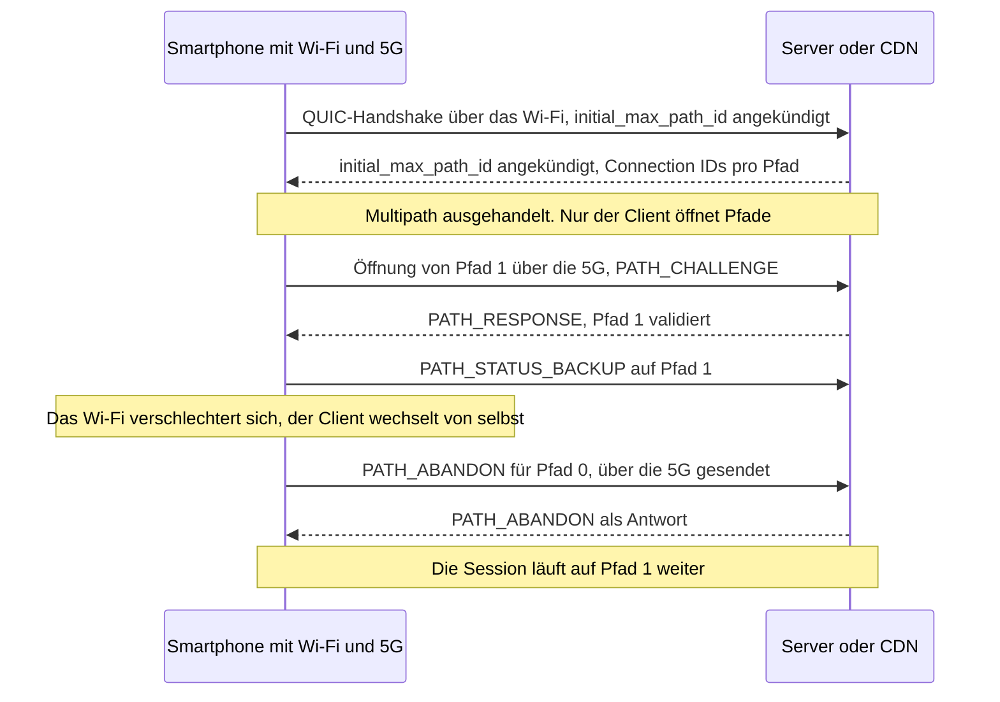
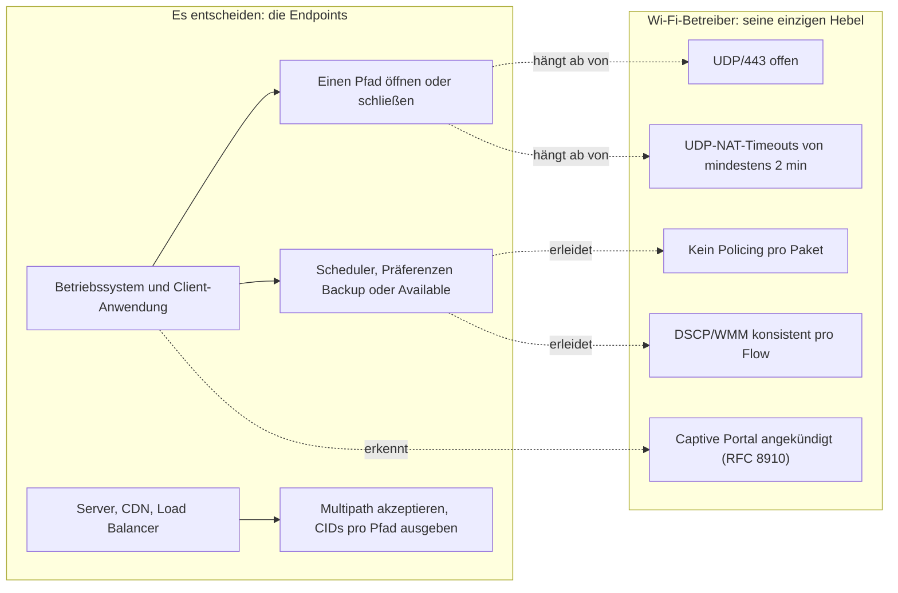

## Eine Videokonferenz, die am Ende des Flurs abbricht

Eine Hotelgästin startet in ihrem Zimmer eine Videokonferenz, ganz am Ende des Flurs, dort, wo das Signal schwächer wird. Das Bild friert ein, der Anruf bricht ab, sie startet ihn neu, diesmal über ihren Mobilfunktarif. Am nächsten Tag geht beim Support ein Ticket ein: *Das Wi-Fi bricht ab*. Wer das Wi-Fi in Hunderten von Hotels, Studentenwohnheimen oder Geschäften betreibt, für den ist diese Szene alles andere als eine Anekdote. Sie drückt auf die Gästebewertungen, auf die Last im Support und auf die Beziehung zum Betreiber des Standorts, der für eine Konnektivität bezahlt, die man ihm zum Vorwurf macht.

Am 7. November 2026 hat die Organisation, die die Protokolle des Internets standardisiert, einen Text veröffentlicht, der einen Teil dieser Tickets verschwinden lassen könnte. Die RFC 10069 (RFCs sind die Dokumente, die die Regeln des Internets festlegen) macht Multipath QUIC zum Standard. Zur Einordnung: QUIC ist das verschlüsselte Transportprotokoll, auf dem HTTP/3 aufsetzt, die neueste Version des Web-Protokolls. Seine Multipath-Variante erlaubt es einer einzigen Verbindung, gleichzeitig das Wi-Fi und die 5G-Verbindung des Smartphones zu nutzen und den Ausfall eines der beiden Wege zu überleben.

Die Versuchung auf Betreiberseite ist, darin ein Produkt zu sehen: gebündeltes Wi-Fi und 5G, eine weitere Zeile im Katalog. Das ist die falsche Lesart. Die eigentliche Frage lautet, wer entscheidet und wer davon profitiert. Meine Antwort, die ich herleiten werde, indem ich trenne, was die RFC sagt und was ich davon halte: Das Smartphone entscheidet. Das Wi-Fi wird beurteilt.

## Zwei Wege, ein Fahrer

Um die Mechanik zu begreifen, stellen Sie sich einen Lieferfahrer vor, der jeden Tag dasselbe Lager ansteuert. Er hat zwei Strecken: die Landstraße vor seiner Haustür (das Wi-Fi des Standorts) und die Autobahn (die 5G seines Tarifs). Das ursprüngliche QUIC, definiert in der RFC 9000, erlaubte ihm bereits, mitten auf der Fahrt die Strecke zu wechseln, aber immer nur eine auf einmal. Multipath QUIC hält ihm beide gleichzeitig offen, mit je einem eigenen Fahrtenbuch. Eines ändert sich nicht: Er hält das Steuer in der Hand. Der Betreiber der Landstraße kann ihm weder eine Auffahrt öffnen noch ihn zum Bleiben zwingen.

Der Text umfasst 33 Seiten und betritt den Standardisierungsweg der IETF (Internet Engineering Task Force) im Rang eines Proposed Standard [1][2]. Er hat sich Zeit gelassen: erster Draft der Arbeitsgruppe im Februar 2022, Freigabe durch die IESG, die Instanz, die die IETF-Standards absegnet, am 18. März 2026, Veröffentlichung am 7. November [3]. Drei Editoren tragen ihn, Y. Liu (Alibaba), Q. De Coninck (UMONS) und M. Kühlewind (Ericsson), zusammen mit Y. Ma (Harvey AI), O. Bonaventure (UCLouvain und WELRI) und C. Huitema (Private Octopus) [1].

Alles beginnt mit einer Aushandlung. Jeder Endpunkt kündigt beim Handshake einen Transportparameter namens `initial_max_path_id` an. Kündigt ihn einer der beiden nicht an, wird kein Multipath-Mechanismus aktiviert, und die Verbindung bleibt ein klassisches QUIC. Das ist inkrementelles Deployment. Einen Stichtag muss niemand organisieren.

Jeder Pfad erhält anschließend eine Nummer, die Path ID: 0 für den ursprünglichen Pfad, danach aufsteigende Werte, die nie wiederverwendet werden. Jeder Pfad führt seine eigene Paketnummerierung, die bei null beginnt, und seine eigenen Empfangsbestätigungen (PATH_ACK-Frame). Die Connection IDs (CID), die zwingend nicht leer sein müssen, ordnen jedes Paket seinem Pfad zu. Ein Detail, das später noch zählt: Mehrere Pfade können denselben 4-Tuple teilen, also dieselben Quell- und Zieladressen und -ports.

Beim Thema Verschlüsselung bleibt der TLS-Handshake unverändert: Die Path ID wird lediglich in den Nonce eingemischt (den Einmalwert, der für jedes verschlüsselte Paket erforderlich ist). Die Entscheidung für eine Nummerierung pro Pfad war laut Shepherd Write-up, dem Bericht, der das Dokument bis zu seiner Freigabe begleitet, einer der wichtigsten Streitpunkte der Arbeitsgruppe [4].

Dann kommt die strukturierendste Regel: Nur der Client öffnet einen neuen Pfad. Der Server muss ihn über den von QUIC bereits vorgesehenen Austausch PATH_CHALLENGE / PATH_RESPONSE validieren, mit einem eigenen Anti-Amplification-Limit pro Pfad. Die RFC rät außerdem, die maximale Anzahl an Pfaden klein zu halten, um das Risiko von Denial-of-Service-Angriffen zu begrenzen.

Die Nutzungspräferenz läuft über zwei Frames. PATH_STATUS_AVAILABLE meldet einen nutzbaren Pfad. PATH_STATUS_BACKUP zeigt an, dass über diesen Pfad kein Verkehr laufen sollte, solange ein anderer Pfad verfügbar ist. Das sind Präferenzen, keine Befehle: Jeder Peer äußert seine eigenen, die Gegenseite muss ihnen nicht folgen. Das Schließen dagegen ist explizit, über einen PATH_ABANDON-Frame, der auch über einen anderen Pfad als den zu schließenden laufen kann. Das wird sogar empfohlen, wenn Letzterer defekt ist.

Bleibt, was die RFC nicht leistet, und das schreibt sie gleich in ihrem Abschnitt 1. Sie spezifiziert weder die Erkennung und Verwaltung von Adressen noch die Art, wie Anwendungen ihren Verkehr auf mehrere Pfade verteilen [1]. Sie liefert Gleise und Weichen. Nicht den Fahrplan.

*Lebenszyklus eines Pfads nach RFC 10069: Alles spielt sich zwischen Endgerät und Server ab.*

Schauen Sie, wer in diesem Diagramm spricht: der Client und der Server. Sonst niemand. Das Wi-Fi-Netz kommt darin nur als Rohr vor.

## Zuerst Failover, nie versprochene Addition

Sobald Wi-Fi und 5G im selben Satz fallen, folgert irgendjemand im Meeting, dass sich die Datenraten addieren. Die RFC 10069 dämpft das selbst. Ihr Abschnitt 1 stellt den Wechsel zwischen Wi-Fi und Mobilfunknetz als den bekannten Multipath-Anwendungsfall dar, der zwei Pfade nur vorübergehend gleichzeitig nutzt, um Übertragungspausen zu vermeiden. Die gleichzeitige Nutzung, so der Text weiter, erfordere mehr Arbeit, als das Dokument spezifiziert. Und die RFC sagt es unumwunden: „There are currently no IETF specifications that define scheduling algorithms for simultaneously using multiple paths“ [1].

Abschnitt 5.5 erklärt, warum. Ein auf mehrere Pfade verteilter Datenstrom erleidet die Verzögerung des langsamsten von ihnen. Stellen Sie sich eine Akte vor, deren eine Hälfte der Seiten ein Rollerkurier und deren andere Hälfte ein Bote zu Fuß transportiert: Vollständig ist die Akte erst, wenn der Fußgänger ankommt. Zwei Verbindungen mit unterschiedlichen Latenzen zu bündeln, ist genau das. Hinzu kommt, dass jeder Pfad seine eigene Congestion Control hat, und die RFC warnt: Zwei Pfade sind nicht zwingend disjunkt, und ein gemeinsamer Engpass kann Unfairness erzeugen.

Der einzige öffentliche Erfahrungsbericht im großen Maßstab stammt von Alibaba. Sein System XLINK, gebaut auf dem hauseigenen Stack XQUIC, wurde in der Mobile-App Taobao im A/B-Test erprobt: 100.000 Teilnehmer und über 3 Millionen Videowiedergaben in zwei Wochen. Die kombinierten Schnittstellen waren überwiegend Wi-Fi und Mobilfunknetz. Diese Zahlen stammen aus einem von Y. Ma gezeichneten Artikel im Blog der APNIC (der regionalen Internetregistrierungsstelle für den asiatisch-pazifischen Raum) vom Dezember 2021, der ein im selben Jahr auf der Konferenz SIGCOMM vorgestelltes Paper zusammenfasst [9][10].

Die Gewinne sind real, aber sie stecken dort, wo man sie nicht erwartet. Bei der Abschlusszeit von Requests liegt die Verbesserung gegenüber dem Single-Path im Median bei über 2,3 %, im 95. Perzentil bei 9,4 % und im 99. Perzentil bei 19 %. Übersetzt: fast nichts für den durchschnittlichen Nutzer, sehr viel für den, der die schlechteste Erfahrung machte.

Dieselbe Arbeit zeigt auch die Kehrseite. Der Standard-Scheduler, der den Pfad mit der geringsten Round-Trip-Time bevorzugt (min-RTT), kann im 99. Perzentil 28 % langsamer sein als der beste Pfad allein. Schlecht gesteuert, verschlechtert Multipath. Alibaba weist außerdem auf den Mehraufwand durch duplizierten Verkehr hin, den am Ende immer jemand bezahlt.

Zwei Präzisierungen, um einen kühlen Kopf zu bewahren. XLINK stammt aus dem Jahr 2021 und beruht auf Draft-Versionen, nicht auf dem finalen Text. Und das Shepherd Write-up beschreibt den Produktiveinsatz bei Alibaba als überwiegend eine Frage der Selbst-Interoperabilität: Alibaba-Client auf der einen Seite, Alibaba-Server auf der anderen [4].

Meine Analyse: Der Wert von Multipath QUIC liegt in der Session-Kontinuität und im Tail der Verteilung, nicht in der Datenrate. Wer auf Basis dieser RFC eine Bündelung von Wi-Fi und 5G verkauft, verkauft, was die RFC selbst nicht verspricht.

*Der Anwendungsfall, zu dem die RFC 10069 steht: Der eine Weg versagt, der andere übernimmt, die Session läuft weiter.*

## Das Wi-Fi ist nicht mehr der einzige Ausweg

Kehren wir zur Gästin vom Ende des Flurs zurück. Nehmen wir an, ihr Smartphone und ihr Videodienst sprechen beide Multipath QUIC. Das Endgerät öffnet einen 5G-Pfad als Reserve. Das Wi-Fi verschlechtert sich, die Session gleitet auf die 5G hinüber, der Anruf bricht nicht ab, und niemand eröffnet ein Ticket. Dasselbe Szenario in einem Studentenwohnheim, das abends überlastet ist, wenn das ganze Gebäude gleichzeitig Videos schaut.

Für den Wi-Fi-Betreiber ist das zunächst eine gute Nachricht: weniger Tickets wegen Abbrüchen, zumindest bei ausgestatteten Kunden. Aber schauen Sie, wohin der Verkehr gewandert ist. Auf die 5G des Kunden, außerhalb unseres Monitorings, außerhalb unserer Abrechnung, außerhalb unserer Dashboards. Das Wi-Fi ist nicht mehr der Pflichtdurchgang. Es wird zu einer Option, die das Endgerät fortwährend mit einer anderen vergleicht, und unsere Metriken zu Sessions und Volumen pro Kunde erzählen nur noch einen Teil der Geschichte. Das steht nicht in der RFC; es ist meine Analyse, aber sie ergibt sich unmittelbar aus ihrer Mechanik.

Daher der harte Punkt: Der Wi-Fi-Betreiber hat keinerlei Protokollhebel auf diese Entscheidung. Die Frames PATH_STATUS_AVAILABLE und PATH_STATUS_BACKUP werden von den Endpunkten gesendet. Ein Access Point oder ein Wi-Fi-Controller kann weder einen Pfad erzeugen noch einen schließen noch verlangen, dass er bevorzugt wird. Ohne auf dem Client installierten Agenten oder Proxy gibt es kein *Managed Multipath*, das sich vom Wi-Fi aus verkaufen ließe.

Die Proxy-Spur existiert, aber sie kommt aus der Mobilfunkwelt. Laut der TS 24.193 des 3GPP (der Organisation, die die Mobilfunknetze standardisiert) und zugehörigen Beiträgen steuert ATSSS, der Mechanismus, der den Verkehr zwischen dem Mobilfunkzugang und den sogenannten Non-3GPP-Zugängen, darunter das Wi-Fi, aufteilt, den Verkehr seit Release 18 für UDP über Multipath QUIC. Release 19 ergänzt die IP- und Ethernet-Varianten [14]. Das ist ein anderes Thema, getragen von den Mobilfunkbetreibern und ihrem Kernnetz. Nicht vom Wi-Fi eines Hotels.

Meine Position, zu der ich stehe: Diese Entwicklung ist gesund. Jahrelang beruhte ein Teil des wahrgenommenen Werts von Wi-Fi darauf, dass es während der Session keine Alternative gab. Multipath QUIC löst diese Sperre auf. Was bleibt, ist die relative Qualität: Ein Wi-Fi, das besser ist als die 5G, wird bevorzugt, ein mittelmäßiges Wi-Fi wird stillschweigend umgangen. Für einen Betreiber, der in Funk und Dimensionierung investiert, sind das bessere Spielregeln als die Gefangenschaft.

Eine Anmerkung am Rande, denn die Verwechslung kommt häufig vor. Das MLO von Wi-Fi 7 (Multi-Link Operation) kombiniert mehrere Funkbänder innerhalb desselben Wi-Fi-Netzes, unter demselben Netzwerknamen, auf Ebene 2. Multipath QUIC arbeitet auf der Transportebene, zwischen verschiedenen Netzen. Beides überlagert sich, keines ersetzt das andere.

## Was sich nicht ändert: Sichtbarkeit, NAT, Captive Portals

Ein IT-Leiter, der sich von dieser RFC einen besseren Einblick in den Verkehr seiner Kunden erhofft hat, wird enttäuscht sein. Bei der Sichtbarkeit verbessert sich nichts. Es wird eher komplizierter.

Die RFC 9312, die die Verwaltbarkeit von QUIC für Netzwerkteams dokumentiert, zog bereits ein strenges Fazit [6]. Es gibt keine allgemeine Methode, QUIC von anderem UDP-Verkehr zu unterscheiden. Der Name der angesteuerten Site (SNI, Server Name Indication) ist nur lesbar, wenn man das Secret des Initial-Pakets ableitet, das für jede Version spezifisch ist. Eine passive Verlustmessung ist mit dem aktuellen Paketabbild auf der Leitung nicht möglich. Selbst das Spin Bit, das zur Latenzmessung vorgesehen ist, ist nur aktiv, wenn beide Endpunkte es wollen.

Multipath fügt eine weitere Schicht Undurchsichtigkeit hinzu, und das ist meine Analyse. Jeder Pfad ist ein eigener UDP-Flow, mit eigenen Connection IDs und, im Wi-Fi, einem anderen 4-Tuple als der 5G-Pfad. Aus unserem Netz sehen wir ein Fragment einer Session, deren anderer Teil über einen Mobilfunkbetreiber läuft. Beides aus einem einzigen Netz zu korrelieren, ist praktisch unmöglich. Die RFC 10069 verweist übrigens auf die RFC 9312, die ebenfalls gilt, und räumt die Komplexität einer Mischung aus überwachten und nicht überwachten Pfaden ein [1].

Der konkreteste Punkt betrifft das NAT, die Adressübersetzung, die einen ganzen Standort über einige wenige öffentliche Adressen ins Netz bringt. Die RFC 10069 empfiehlt nicht, auf inaktiven Pfaden Keep-alives (diese Erhaltungspakete) zu senden. Sie räumt ein, dass ein ruhender Pfad wegen der Timeouts von Zwischengeräten unbrauchbar werden kann und dass er vor einem Wechsel sondiert werden kann.

Operative Übersetzung, wiederum nach meiner Einschätzung: Ein NAT oder CGNAT (großflächig geteiltes NAT), das zu eilig vergisst, tötet den Reservepfad, bevor er gedient hat. Die RFC 9312 empfiehlt für QUIC einen NAT- und Firewall-Zustands-Timeout von mindestens zwei Minuten [6].

Dieselbe Logik gilt für die Ratenbegrenzung: Die RFC 9312 rät dazu, einen ganzen Flow zu blockieren, statt Policing Paket für Paket zu betreiben. Und wenn man QUIC blockieren muss, dann besser unmissverständlich, damit der Client schnell auf TCP zurückfällt, statt auf Timeouts zu warten.

Bei der Quality of Service erwartet die RFC 9312 eine konsistente DSCP-Markierung (das Prioritätsfeld der IP-Pakete) pro Flow. Sie warnt, dass eine Änderung des 5-Tuples, etwa bei einer Migration, zu einer anderen Behandlung führen kann. Die RFC 10069 ergänzt in Abschnitt 5.2 eine Nuance: Mehrere Pfade können denselben 4-Tuple mit unterschiedlichen DiffServ-Markierungen teilen, in der Hand der Anwendung. Praktische Schlussfolgerung: Eine Session ist kein 4-Tuple mehr.

In manchen Unternehmensnetzen stellt sich die Frage gar nicht erst. Die Best-Practice-Dokumentation von Palo Alto Networks empfiehlt, UDP/80 und UDP/443 zu blockieren, also QUIC, um den Rückfall auf klassisches TLS zu erzwingen und die Entschlüsselung zu ermöglichen [16]. Zscaler hat lange denselben Rückfall empfohlen, auch wenn es inzwischen eine native QUIC-Inspektion anbietet. Hinter einer Firewall, die so konfiguriert ist, dass sie QUIC blockiert, wird es Multipath QUIC schlicht nicht geben.

*Verschlüsselte Flows, ein Pfad pro Netz: Aus dem Wi-Fi eines Hotels sieht man nur ein Fragment der Session.*

Bleibt das Thema, das die RFC 10069 nach meiner Lesart nicht erwähnt und das ich nirgends behandelt gesehen habe: das Captive Portal. Was folgt, ist eine Hypothese. Heute knüpft das Portal die Nutzung des Wi-Fi-Pfads an Bedingungen. Mit Multipath QUIC wird ein nicht authentifizierter Wi-Fi-Pfad bei der Validierung scheitern oder schlicht nicht genutzt werden, während die 5G die Session trägt. Das Risiko: Clients, die bereits über 5G online sind, ignorieren das Portal länger. In der Hotellerie betrifft das die Akzeptanz der Nutzungsbedingungen und die rechtliche Nachvollziehbarkeit, ein Punkt, den die Juristen prüfen müssen.

Das Hilfsmittel gibt es seit 2020. Die RFC 8910 erlaubt es, die Präsenz eines Portals per DHCP anzukündigen (Option 114 in DHCPv4, 103 in DHCPv6, Typ 37 in den Router Advertisements) und dabei auf die in der RFC 8908 definierte API zu verweisen [15]. Das Betriebssystem weiß dann, dass ein Portal auf es wartet, statt es zu erraten.

Eine letzte Verwechslung gilt es zu vermeiden, die zwischen zwei Reserven. Die erste ist das WAN-Backup auf Betreiberseite: Der Router des Standorts schaltet auf eine 5G- oder FWA-Verbindung (Fixed Wireless Access, Festnetzzugang per Funk) um, wenn die Glasfaser ausfällt. Die QUIC-Session sieht dann ihre Quelladresse wechseln. Das ist eine Migration oder ein NAT Rebinding, von QUIC Version 1 bereits abgedeckt und von der RFC 10069 pfadweise behandelt, ohne die Path ID zu ändern. Die zweite ist das Client-Backup: Das Endgerät nutzt tatsächlich seine beiden Schnittstellen. Nur diesen zweiten Fall ändert die RFC 10069.

## MPTCP im Spiegel: Ein Standard macht noch keine Verbreitung

Multipath ist nichts Neues. Apple nutzt Multipath TCP (MPTCP) für Siri seit iOS 7, im Jahr 2013, laut RFC 8041 (informational, 2017) und der damaligen Presse [18]. Das Protokoll wurde im März 2020 in der RFC 8684 standardisiert, mitverfasst unter anderem von C. Paasch von Apple und von O. Bonaventure, den man auch bei der RFC 10069 wiederfindet [7]. Apple dokumentiert im Übrigen seit iOS 12 eine Option, die Verbindungen die Nutzung von Multipath-Protokollen erlaubt, ohne dort QUIC zu erwähnen [11].

Und doch blieb die Verbreitung schmal. Von der APNIC 2022 veröffentlichte Messungen zeigen, dass Apple Ende 2021 die einzige Organisation war, die MPTCP v1 aktiv unterstützte, obwohl Linux es seit Kernel 5.6 unterstützt und iOS es für Siri, Musik, Karten (Maps) und Wi-Fi Assist nutzt [8]. Die Hauptursache liegt bei den Zwischengeräten (Middleboxes). MPTCP transportiert seine Signalisierung in TCP-Optionen, die viele dieser Geräte entfernen, zurückspiegeln oder filtern. Die RFC 8684 sieht übrigens einen Rückfall auf einfaches TCP vor, wenn diese Optionen verschwinden oder verändert werden.

Meine Analyse: Multipath QUIC startet mit drei strukturellen Vorteilen. Seine Aushandlung und seine Frames reisen in Paketen, die per TLS verschlüsselt und authentifiziert sind und die kein Gerät heimlich beschneiden kann; es kann nur UDP pauschal blockieren. Es lässt sich im User Space ausrollen, per einfachem Anwendungsupdate, wie XLINK gezeigt hat. Und es kann mehrere Pfade auf demselben 4-Tuple leben lassen. Dem stehen zwei Handicaps gegenüber: das Fehlen eines Standard-Schedulers, was die RFC selbst einräumt, und ein Bestand an Unternehmens-Firewalls, die UDP/443 blockieren.

Bei den Implementierungen ist die Bestandsaufnahme bescheidener als die Ankündigung. Das Wiki der Arbeitsgruppe, undatiert und auf den Drafts -09 bis -12 beruhend, verzeichnet unter anderem [5]:

- **xquic** (Alibaba, in C), mit Multipath im Hauptzweig;
- **aioquic** (Python) in einer Ericsson-Version und **Rask**, ein interner Ericsson-Stack in Rust;
- **picoquic** (C), das Projekt von Private Octopus;
- **quiche** (Cloudflare), nur als Pull Request auf einem Fork;
- **AppleQUIC**, das einen Multipath-QUIC-Client testet, ohne dass ein öffentlicher Server angekündigt wäre.

Tencent beansprucht Multipath für tquic, ohne eine Version zu nennen; picoquic kündigt die Unterstützung der Standardversion als geplante Entwicklung an [12]. In Go ist die Implementierungsanfrage in quic-go seit März 2022 offen. Ihr Maintainer hielt das Vorhaben von Anfang an für gewaltig, und ich habe keinen Implementierungs-Pull-Request gefunden [13].

Das ärgerliche Detail liegt woanders. Die von diesen Stacks verwendeten Werte für Transportparameter sind Draft-Codes, etwa 0xbabf bei Apple, und nicht der Wert 0x3e der finalen Version. Ohne Update verstehen sie sich auf der Leitung nicht mit einer RFC-konformen Implementierung. Alle müssen migrieren, die Pioniere eingeschlossen. Die Interoperabilität wurde durchaus erprobt: Laut der Präsentation der Ergebnisse des IETF-117-Hackathons (Juli 2023) wurden Tests mit fünf Implementierungen durchgeführt. Die Unterlagen der Arbeitsgruppe halten diese Tests jedoch überwiegend für auf einfache Fälle beschränkt, und die Minutes der Session beschreiben eine noch in der Konsolidierung befindliche Interoperabilität [17].

Wann werden Browser, Betriebssysteme und CDNs (Content Delivery Networks) für die breite Masse es aktivieren? Ich weiß es nicht, und ich habe kein glaubwürdiges veröffentlichtes Datum gefunden. Ich werde keines erfinden. Ich habe auch bis heute keine Analyse der Fachpresse oder eines Analystenhauses zur RFC 10069 gefunden. Das Thema bleibt Ingenieurssache.

*Von MPTCP zu Multipath QUIC: Die breite Straße ist gebaut, offen bleibt, wer sie nehmen wird und wann.*

## Meine Position: Ein Wi-Fi, das man nicht verlassen möchte

Was ich ab sofort tun würde. Das ist eine Checkliste des Autors, von den Engineering-Teams zu validieren, keine Vorgabe der RFC:

1. **UDP/443 durchlassen**, und UDP im Allgemeinen, in den Gast- und Bewohner-VLANs. Den TCP-Rückfall nicht ohne ernsthaften Grund erzwingen (RFC 9312, §4.5).
2. **UDP-Timeouts für NAT und Firewall auf mindestens zwei Minuten setzen** (RFC 9312, §4.2), CGNAT eingeschlossen. Das ist das Überleben der Reservepfade.
3. **Pro Flow begrenzen, nie pro Paket** (RFC 9312, §4.6).
4. **DSCP und WMM (die Verkehrspriorisierung auf der Wi-Fi-Seite) konsistent pro Flow markieren**, ohne anzunehmen, dass eine Session einem 4-Tuple entspricht.
5. **Das Captive Portal über die RFC 8910 ankündigen** (DHCP-Option 114), damit das Endgerät weiß, wo es steht.
6. **Einen Indikator für relative Qualität aufbauen**: Endgeräte verfolgen, die mit dem Access Point assoziiert bleiben, deren Verkehr aber mitten in der Session einbricht. Das ist eine Indikatoridee, keine erprobte Methode. Sie verdient einen Feldtest.

*Wer was entscheidet: Die Endpunkte steuern, der Wi-Fi-Betreiber setzt die Rahmenbedingungen.*

Die RFC 10069 gibt uns nichts zu verkaufen. Sie nimmt uns etwas: die Gefangenschaft der Session. Solange das Endgerät nur einen Pfad hatte, behielt ein durchschnittliches Wi-Fi seine Nutzer von selbst. Morgen, im Tempo, in dem Systeme, Anwendungen und CDNs den Standard übernehmen, wird es sie durch Verdienst behalten oder stillschweigend verlieren.

Das ist eine gute Nachricht für den, der in Funk, Dimensionierung und Netzhygiene investiert. Es ist eine schlechte Nachricht für den, der auf das Fehlen einer Alternative gesetzt hat. Das Wi-Fi, das gewinnen wird, ist nicht das, das man nicht verlassen kann. Es ist das, das man nicht verlassen möchte.

_Persönliche Ansichten, keine Position von Wifirst._

## Quellen

1. RFC 10069, Managing Multiple Paths for a QUIC Connection (texte brut) — https://www.rfc-editor.org/rfc/rfc10069.txt (HTML : https://www.rfc-editor.org/rfc/rfc10069.html)
2. Datatracker IETF, RFC 10069 (métadonnées) — https://datatracker.ietf.org/api/v1/doc/document/rfc10069/ et https://datatracker.ietf.org/doc/rfc10069/
3. Datatracker IETF, historique de draft-ietf-quic-multipath — https://datatracker.ietf.org/doc/draft-ietf-quic-multipath/history/
4. Datatracker IETF, shepherd write-up de draft-ietf-quic-multipath — https://datatracker.ietf.org/doc/draft-ietf-quic-multipath/shepherdwriteup/
5. QUIC WG, wiki QUIC Implementations with multipath support — https://github.com/quicwg/multipath/wiki/QUIC-Implementations-with-multipath-support
6. RFC 9312, Manageability of the QUIC Transport Protocol — https://www.rfc-editor.org/rfc/rfc9312.html
7. RFC 8684, TCP Extensions for Multipath Operation with Multiple Addresses (MPTCP v1) — https://www.rfc-editor.org/rfc/rfc8684.html
8. APNIC, Analyzing MPTCP adoption in the Internet (2022) — https://blog.apnic.net/2022/08/23/analyzing-mptcp-adoption-in-the-internet/
9. APNIC, Efficient multipath transport with QUIC in large-scale video services (Y. Ma, 2021) — https://blog.apnic.net/2021/12/08/efficient-multipath-transport-with-quic-video-services/
10. XLINK, SIGCOMM 2021 (DOI 10.1145/3452296.3472893) — https://conferences.sigcomm.org/sigcomm/2021/files/papers/3452296.3472893.pdf
11. Apple Developer, NWParameters.multipathServiceType — https://developer.apple.com/documentation/network/nwparameters/multipathservicetype-swift.property.md
12. READMEs GitHub xquic, picoquic, tquic — https://github.com/alibaba/xquic ; https://github.com/private-octopus/picoquic ; https://github.com/Tencent/tquic
13. quic-go, issue #3343 Feature: Multipath Extension for QUIC — https://github.com/quic-go/quic-go/issues/3343
14. 3GPP TS 24.193 V19.6.0 et Nokia Bell Labs, Multipath QUIC pour ATSSS — https://www.3gpp.org/ftp/specs/PDF/2026-09/Rel-19/24_series/24193-j60.pdf ; https://nokia.com/bell-labs/publications-and-media/publications/multipath-quic-for-access-traffic-steering-switching-and-splitting-in-5g-advanced
15. RFC 8910, Captive-Portal Identification in DHCP and Router Advertisements — https://www.rfc-editor.org/rfc/rfc8910.html
16. Palo Alto Networks, Internet Gateway Best Practices (règles de blocage applicatif) — https://docs.paloaltonetworks.com/best-practices/internet-gateway-best-practices/best-practice-internet-gateway-security-policy/define-the-initial-internet-gateway-security-policy/step-3-create-the-application-block-rules ; Zscaler, Managing QUIC Protocol — https://help.zscaler.com/zia/managing-quic-protocol
17. IETF 117, slides Multipath QUIC et hackathon — https://datatracker.ietf.org/meeting/117/materials/slides-117-quic-multipath-quic-00 ; https://ekr.github.io/auto-minutes/minutes/ietf117/hackathon-results-presentations.txt ; https://datatracker.ietf.org/meeting/117/materials/minutes-117-quic-00
18. Sources secondaires sur MPTCP chez Apple — https://en.wikipedia.org/wiki/Multipath_TCP ; https://www.rfc-editor.org/rfc/rfc8041
