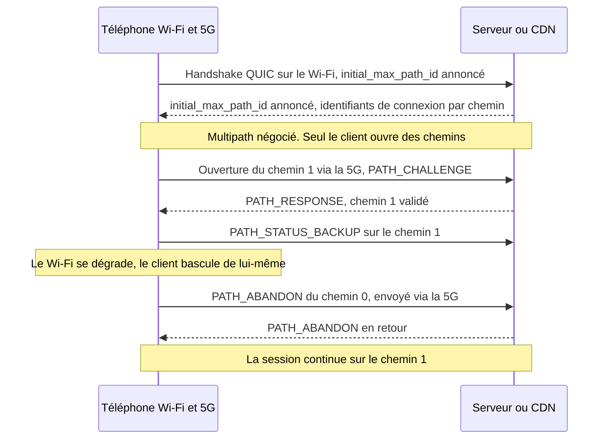
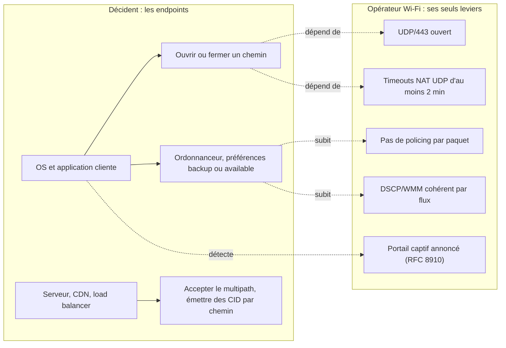

## Une visio qui tombe au bout du couloir

Une cliente d'hôtel lance une visio depuis sa chambre, tout au bout du couloir, là où le signal faiblit. L'image gèle, l'appel tombe, elle le relance sur son forfait mobile. Le lendemain, un ticket arrive au support : *le Wi-Fi coupe*. Pour qui exploite le Wi-Fi de centaines d'hôtels, de résidences étudiantes ou de magasins, la scène n'a rien d'anecdotique. Elle pèse sur les avis clients, sur la charge du support et sur la relation avec l'exploitant du site, qui paie pour une connectivité qu'on lui reproche.

Le 7 novembre 2026, l'organisme qui normalise les protocoles d'Internet a publié un texte qui pourrait effacer une partie de ces tickets. La RFC 10069 (les RFC sont les documents qui fixent les règles d'Internet) fait de Multipath QUIC un standard. QUIC, pour situer, est le protocole de transport chiffré sur lequel repose HTTP/3, la dernière version du protocole du web. Sa variante multipath permet à une seule connexion d'emprunter à la fois le Wi-Fi et la 5G du téléphone, et de survivre à la disparition de l'un des deux.

La tentation, côté opérateur, est d'y voir un produit : Wi-Fi et 5G agrégés, une ligne de plus au catalogue. C'est la mauvaise lecture. La vraie question est de savoir qui décide, et qui y gagne. Ma réponse, que je vais argumenter en séparant ce que dit la RFC de ce que j'en pense : c'est le téléphone qui décide. Le Wi-Fi, lui, sera jugé.

## Deux routes, un seul conducteur

Pour saisir la mécanique, prenez un livreur qui rejoint chaque jour le même entrepôt. Il a deux routes : la départementale qui passe devant chez lui (le Wi-Fi du site) et l'autoroute (la 5G de son forfait). Le QUIC d'origine, défini dans la RFC 9000, l'autorisait déjà à changer de route en cours de trajet, mais une seule à la fois. Multipath QUIC lui laisse les deux ouvertes simultanément, avec un carnet de bord distinct pour chacune. Une chose ne change pas : c'est lui qui tient le volant. Le gestionnaire de la départementale ne peut ni lui ouvrir une bretelle, ni l'obliger à rester.

Le texte fait 33 pages et entre sur la voie des standards de l'IETF (Internet Engineering Task Force) au rang de Proposed Standard [1][2]. Il a pris son temps : premier brouillon (draft) du groupe de travail en février 2022, approbation par l'IESG, l'instance qui valide les standards de l'IETF, le 18 mars 2026, publication le 7 novembre [3]. Trois éditeurs le portent, Y. Liu (Alibaba), Q. De Coninck (UMONS) et M. Kühlewind (Ericsson), avec Y. Ma (Harvey AI), O. Bonaventure (UCLouvain et WELRI) et C. Huitema (Private Octopus) [1].

Tout commence par une négociation. Chaque extrémité annonce, pendant la poignée de main, un paramètre de transport nommé `initial_max_path_id`. Si l'une des deux ne l'annonce pas, aucun mécanisme multipath ne s'active et la connexion reste un QUIC classique. C'est un déploiement incrémental. Pas de jour J à organiser.

Chaque chemin reçoit ensuite un numéro, le path ID : 0 pour le chemin initial, puis des valeurs croissantes, jamais réutilisées. Chaque chemin tient sa propre numérotation de paquets, qui repart de zéro, et ses propres accusés de réception (trame PATH_ACK). Les identifiants de connexion (CID, pour Connection IDs), obligatoirement non vides, rattachent chaque paquet à son chemin. Détail qui comptera plus loin : plusieurs chemins peuvent partager le même 4-tuple, c'est-à-dire les mêmes adresses et ports source et destination.

Côté chiffrement, la poignée de main TLS ne bouge pas : le path ID est simplement injecté dans le nonce (la valeur unique exigée pour chaque paquet chiffré). Ce choix d'une numérotation par chemin a été l'un des principaux points de controverse du groupe de travail, selon le shepherd write-up, le rapport qui accompagne le document jusqu'à son approbation [4].

Vient la règle la plus structurante : seul le client ouvre un nouveau chemin. Le serveur doit le valider par l'échange PATH_CHALLENGE / PATH_RESPONSE déjà prévu par QUIC, avec une limite anti-amplification propre à chaque chemin. La RFC conseille aussi de garder petit le nombre maximal de chemins, pour limiter les risques de déni de service.

La préférence d'usage passe par deux trames. PATH_STATUS_AVAILABLE signale un chemin utilisable. PATH_STATUS_BACKUP indique qu'aucun trafic ne devrait y passer tant qu'un autre chemin est disponible. Ce sont des préférences, pas des ordres : chaque pair exprime les siennes, l'autre peut ne pas les suivre. La fermeture, elle, est explicite, via une trame PATH_ABANDON qui peut voyager sur un autre chemin que celui qu'on ferme. C'est même recommandé quand ce dernier est cassé.

Reste ce que la RFC ne fait pas, et elle l'écrit dès sa section 1. Elle ne spécifie ni la découverte et la gestion des adresses, ni la manière dont les applications répartissent leur trafic sur plusieurs chemins [1]. Elle livre les voies et les aiguillages. Pas l'horaire des trains.

*Cycle de vie d'un chemin selon la RFC 10069 : tout se joue entre le terminal et le serveur.*

Regardez qui parle dans ce schéma : le client et le serveur. Personne d'autre. Le réseau Wi-Fi n'y figure que comme un tuyau.

## Failover d'abord, addition jamais promise

Dès qu'on écrit Wi-Fi et 5G dans la même phrase, quelqu'un, en réunion, conclut que les débits s'additionnent. La RFC 10069 calme elle-même le jeu. Sa section 1 présente la bascule entre Wi-Fi et réseau mobile comme le cas d'usage bien connu du multipath, qui n'utilise deux chemins à la fois que temporairement, pour éviter les pauses de transmission. L'usage simultané, poursuit le texte, demande davantage de travail que ce que le document spécifie. Et la RFC le dit sans détour : « There are currently no IETF specifications that define scheduling algorithms for simultaneously using multiple paths » [1].

La section 5.5 explique pourquoi. Un flux réparti sur plusieurs chemins subit le délai du plus lent d'entre eux. Imaginez un dossier dont on confie la moitié des pages à un coursier en scooter et l'autre moitié à un coursier à pied : le dossier n'est complet qu'à l'arrivée du piéton. Agréger deux liens aux latences différentes, c'est exactement ça. Ajoutez que chaque chemin a son propre contrôle de congestion, et que la RFC prévient : deux chemins ne sont pas forcément disjoints, et un goulot partagé peut créer de l'iniquité.

Le seul retour d'expérience public à grande échelle vient d'Alibaba. Son système XLINK, construit sur sa pile maison XQUIC, a été testé en A/B dans l'application mobile Taobao : 100 000 participants et plus de 3 millions de lectures vidéo sur deux semaines. Les interfaces combinées étaient surtout le Wi-Fi et le réseau mobile. Ces chiffres viennent d'un article signé Y. Ma sur le blog de l'APNIC (le registre Internet régional d'Asie-Pacifique) en décembre 2021, qui résume un papier présenté à la conférence SIGCOMM la même année [9][10].

Les gains sont réels, mais ils se logent là où on ne les attend pas. Sur le temps de complétion des requêtes, par rapport au mono-chemin, l'amélioration dépasse 2,3 % en médiane, 9,4 % au 95e centile et 19 % au 99e centile. Traduction : presque rien pour l'utilisateur moyen, beaucoup pour celui qui vivait la pire expérience.

Le même travail montre l'envers du décor. L'ordonnanceur par défaut, qui privilégie le chemin au plus faible temps aller-retour (min-RTT), peut être 28 % plus lent au 99e centile que le meilleur chemin utilisé seul. Mal piloté, le multipath dégrade. Alibaba signale aussi le surcoût du trafic dupliqué, que quelqu'un finit toujours par payer.

Deux précisions pour garder la tête froide. XLINK date de 2021 et repose sur des versions de draft, pas sur le texte final. Et le shepherd write-up décrit le déploiement d'Alibaba en production comme relevant surtout de l'auto-interopérabilité : client Alibaba d'un côté, serveur Alibaba de l'autre [4].

Mon analyse : la valeur de Multipath QUIC tient dans la continuité de session et dans la queue de distribution, pas dans le débit. Quiconque vend de l'agrégation Wi-Fi et 5G sur la foi de cette RFC vend ce que la RFC elle-même ne promet pas.

*Le cas d'usage que la RFC 10069 assume : une voie lâche, l'autre prend le relais, la session continue.*

## Le Wi-Fi n'est plus la seule porte de sortie

Revenons à la cliente du bout du couloir. Supposons que son téléphone et son service de visio parlent tous deux Multipath QUIC. Le terminal ouvre un chemin 5G en secours. Le Wi-Fi se dégrade, la session glisse sur la 5G, l'appel ne tombe pas, et personne n'ouvre de ticket. Même scénario dans une résidence étudiante saturée en soirée, quand tout le bâtiment regarde des vidéos en même temps.

Pour l'exploitant du Wi-Fi, c'est d'abord une bonne nouvelle : moins de tickets liés aux coupures, au moins chez les clients équipés. Mais regardez où est passé le trafic. Sur la 5G du client, hors de notre supervision, hors de notre facturation, hors de nos tableaux de bord. Le Wi-Fi cesse d'être le passage obligé. Il devient une option que le terminal compare en permanence à une autre, et nos métriques de sessions et de volumes par client ne raconteront plus qu'une partie de l'histoire. Ce n'est pas écrit dans la RFC ; c'est mon analyse, mais elle découle directement de sa mécanique.

D'où le point dur : l'opérateur Wi-Fi n'a aucun levier de protocole sur cette décision. Les trames PATH_STATUS_AVAILABLE et PATH_STATUS_BACKUP sont émises par les extrémités. Un point d'accès ou un contrôleur Wi-Fi ne peut ni créer un chemin, ni en fermer un, ni demander qu'on le préfère. Sans agent ou proxy installé côté client, il n'existe pas de *multipath managé* à vendre depuis le Wi-Fi.

La piste proxy existe, mais elle vient du monde mobile. Selon la TS 24.193 du 3GPP (l'organisme qui normalise les réseaux mobiles) et des contributions associées, ATSSS, le mécanisme qui répartit le trafic entre l'accès mobile et les accès dits non-3GPP dont le Wi-Fi, pilote le trafic via Multipath QUIC depuis la Release 18 pour l'UDP. La Release 19 y ajoute les variantes IP et Ethernet [14]. C'est un autre sujet, porté par les opérateurs mobiles et leur cœur de réseau. Pas par le Wi-Fi d'un hôtel.

Ma position, et je l'assume : cette évolution est saine. Pendant des années, une partie de la valeur perçue du Wi-Fi tenait à l'absence d'alternative pendant la session. Multipath QUIC dissout ce verrou. Ce qui reste, c'est la qualité relative : un Wi-Fi meilleur que la 5G sera préféré, un Wi-Fi médiocre sera contourné en silence. Pour un opérateur qui investit dans la radio et le dimensionnement, c'est une meilleure règle du jeu que la captivité.

Une précision au passage, car la confusion revient souvent. Le MLO de Wi-Fi 7 (Multi-Link Operation) combine plusieurs bandes radio au sein d'un même réseau Wi-Fi, sous un même nom de réseau, au niveau 2. Multipath QUIC travaille au niveau transport, entre réseaux différents. Les deux se superposent, ils ne se remplacent pas.

## Ce qui ne bouge pas : visibilité, NAT, portails captifs

Un DSI qui espérait mieux voir le trafic de ses clients grâce à cette RFC sera déçu. Côté visibilité, rien ne s'améliore. Ça se complique plutôt.

La RFC 9312, qui documente la gérabilité de QUIC pour les équipes réseau, dressait déjà un constat sévère [6]. Il n'existe pas de méthode générale pour distinguer QUIC d'un autre trafic UDP. Le nom du site visé (SNI, Server Name Indication) n'est lisible qu'en dérivant le secret du paquet initial, propre à chaque version. Aucune mesure passive des pertes n'est possible avec l'image actuelle des paquets sur le fil. Même le spin bit, prévu pour mesurer la latence, n'est actif que si les deux extrémités le veulent.

Le multipath ajoute une couche d'opacité, et c'est là mon analyse. Chaque chemin est un flux UDP distinct, avec ses propres identifiants de connexion et, sur le Wi-Fi, un 4-tuple différent de celui du chemin 5G. Depuis notre réseau, nous voyons un fragment d'une session dont l'autre partie transite chez un opérateur mobile. Corréler les deux depuis un seul réseau est, en pratique, impossible. La RFC 10069 renvoie d'ailleurs à la RFC 9312, qui s'applique aussi, et reconnaît la complexité d'un mélange de chemins supervisés et non supervisés [1].

Le point le plus concret concerne le NAT, la traduction d'adresses qui fait sortir tout un site par quelques adresses publiques. La RFC 10069 ne recommande pas d'envoyer de keep-alive (ces paquets d'entretien) sur les chemins inactifs. Elle reconnaît qu'un chemin au repos peut devenir inutilisable à cause des timeouts des équipements intermédiaires, et qu'il peut être sondé avant une bascule.

Traduction opérationnelle, toujours selon moi : un NAT ou un CGNAT (NAT mutualisé à grande échelle) trop pressé d'oublier tue le chemin de secours avant qu'il ait servi. La RFC 9312 recommande pour QUIC un timeout d'état NAT et pare-feu d'au moins deux minutes [6].

Même logique pour la limitation de débit : la RFC 9312 préconise de bloquer un flux entier plutôt que de faire du policing paquet par paquet. Et si l'on doit bloquer QUIC, mieux vaut le faire franchement, pour que le client se replie vite sur TCP au lieu d'attendre des timeouts.

Côté qualité de service, la RFC 9312 attend un marquage DSCP (le champ de priorité des paquets IP) cohérent par flux. Elle prévient qu'un changement de 5-tuple, comme lors d'une migration, peut entraîner un traitement différent. La RFC 10069 ajoute une nuance en section 5.2 : plusieurs chemins peuvent partager le même 4-tuple avec des marquages DiffServ différents, à la main de l'application. Conclusion pratique : une session n'est plus un 4-tuple.

Sur certains réseaux d'entreprise, la question ne se pose même pas. La documentation de bonnes pratiques de Palo Alto Networks recommande de bloquer UDP/80 et UDP/443, donc QUIC, pour forcer le repli sur TLS classique et permettre le déchiffrement [16]. Zscaler a longtemps recommandé le même repli, même s'il propose désormais une inspection native de QUIC. Derrière un pare-feu configuré pour bloquer QUIC, Multipath QUIC n'existera tout simplement pas.

*Des flux chiffrés, un chemin par réseau : depuis le Wi-Fi d'un hôtel, on ne voit qu'un fragment de la session.*

Reste le sujet que la RFC 10069 ne mentionne pas, à ma lecture, et que je n'ai vu traité nulle part : le portail captif. Ce qui suit est une hypothèse. Aujourd'hui, le portail conditionne l'usage du chemin Wi-Fi. Avec Multipath QUIC, un chemin Wi-Fi non authentifié échouera à la validation ou ne sera simplement pas utilisé, pendant que la 5G porte la session. Le risque : des clients déjà en ligne via la 5G ignorent le portail plus longtemps. Dans l'hôtellerie, cela touche l'acceptation des CGU (conditions générales d'utilisation) et la traçabilité légale, un point que les juristes devront examiner.

Le palliatif existe depuis 2020. La RFC 8910 permet d'annoncer la présence d'un portail via DHCP (option 114 en DHCPv4, 103 en DHCPv6, type 37 dans les annonces de routeur), en pointant vers l'API définie par la RFC 8908 [15]. Le système d'exploitation sait alors qu'un portail l'attend, au lieu de le deviner.

Dernière confusion à éviter, celle entre deux secours. Le premier est le backup WAN, côté opérateur : le routeur du site bascule sur une liaison 5G ou FWA (accès fixe par radio) quand la fibre tombe. La session QUIC voit alors changer son adresse source. C'est une migration ou un NAT rebinding, déjà gérés par QUIC version 1, et que la RFC 10069 traite chemin par chemin, sans changer de path ID. Le second est le backup client : le terminal utilise réellement ses deux interfaces. La RFC 10069 ne change que ce second cas.

## MPTCP en miroir : un standard ne fait pas une adoption

Le multipath n'a rien de neuf. Apple utilise Multipath TCP (MPTCP) pour Siri depuis iOS 7, en 2013, selon la RFC 8041 (informationnelle, 2017) et la presse de l'époque [18]. Le protocole a été normalisé en mars 2020 dans la RFC 8684, cosignée notamment par C. Paasch, d'Apple, et par O. Bonaventure, qu'on retrouve sur la RFC 10069 [7]. Apple documente d'ailleurs, depuis iOS 12, une option qui autorise les connexions à utiliser des protocoles multipath, sans y mentionner QUIC [11].

Et pourtant, l'adoption est restée étroite. Des mesures publiées par l'APNIC en 2022 montrent qu'Apple était, fin 2021, la seule organisation à supporter activement MPTCP v1, alors que Linux le supporte depuis le noyau 5.6 et qu'iOS l'utilise pour Siri, Musique, Plans (Maps) et Wi-Fi Assist [8]. La cause principale tient aux équipements intermédiaires (middleboxes). MPTCP transporte sa signalisation dans des options TCP, que beaucoup de ces boîtiers retirent, renvoient en écho ou filtrent. La RFC 8684 prévoit d'ailleurs un repli en TCP simple quand ces options disparaissent ou sont altérées.

Mon analyse : Multipath QUIC part avec trois avantages structurels. Sa négociation et ses trames voyagent dans des paquets chiffrés et authentifiés par TLS, qu'aucun boîtier ne peut amputer en douce ; il peut seulement bloquer l'UDP en bloc. Il se déploie en espace utilisateur, par simple mise à jour d'application, comme XLINK l'a montré. Et il sait faire vivre plusieurs chemins sur un même 4-tuple. En face, deux handicaps : l'absence d'ordonnanceur standard, que la RFC reconnaît elle-même, et un parc de pare-feux d'entreprise qui bloquent UDP/443.

Côté implémentations, l'inventaire est plus modeste que l'annonce. Le wiki du groupe de travail, non daté et fondé sur les drafts -09 à -12, recense notamment [5] :

- **xquic** (Alibaba, en C), avec le multipath dans la branche principale ;
- **aioquic** (Python) dans une version Ericsson, et **Rask**, une pile interne Ericsson en Rust ;
- **picoquic** (C), le projet de Private Octopus ;
- **quiche** (Cloudflare), uniquement sous forme de pull request sur un fork ;
- **AppleQUIC**, qui teste un client Multipath QUIC, sans serveur public annoncé.

Tencent revendique le multipath pour tquic, sans préciser de version ; picoquic annonce le support de la version standard comme un développement prévu [12]. Côté Go, la demande d'implémentation dans quic-go est ouverte depuis mars 2022. Son mainteneur jugeait d'emblée le chantier considérable, et je n'ai trouvé aucune pull request d'implémentation [13].

Le détail qui fâche est ailleurs. Les valeurs de paramètres de transport utilisées par ces piles sont des codes de drafts, comme 0xbabf chez Apple, et non le 0x3e de la version finale. Sans mise à jour, elles ne se comprennent pas sur le fil avec une implémentation conforme à la RFC. Tout le monde doit migrer, pionniers compris. L'interopérabilité a bien été éprouvée, avec, selon la présentation des résultats du hackathon de l'IETF 117 (juillet 2023), des tests menés sur cinq implémentations. Les supports du groupe de travail jugent toutefois ces tests surtout limités à des cas simples, et les minutes de la session décrivent une interopérabilité encore en consolidation [17].

Quand les navigateurs, les systèmes d'exploitation et les CDN (réseaux de diffusion de contenu) grand public l'activeront-ils ? Je n'en sais rien, et je n'ai trouvé aucune date crédible publiée. Je n'en inventerai pas. Je n'ai pas trouvé non plus, à ce jour, d'analyse de presse spécialisée ou de cabinet d'analystes sur la RFC 10069. Le sujet reste une affaire d'ingénieurs.

*De MPTCP à Multipath QUIC : la voie large est tracée, reste à savoir qui l'empruntera, et quand.*

## Ma position : un Wi-Fi qu'on n'a pas envie de quitter

Ce que je ferais dès maintenant. C'est une check-list d'auteur, à valider par les équipes d'ingénierie, pas une prescription de la RFC :

1. **Laisser passer UDP/443**, et l'UDP en général, sur les VLAN invités et résidents. Ne pas forcer le repli TCP sans raison sérieuse (RFC 9312, §4.5).
2. **Régler les timeouts NAT et pare-feu UDP à au moins deux minutes** (RFC 9312, §4.2), CGNAT compris. C'est la survie des chemins de secours.
3. **Limiter par flux, jamais par paquet** (RFC 9312, §4.6).
4. **Marquer DSCP et WMM (la priorisation de trafic côté Wi-Fi) de façon cohérente par flux**, sans supposer qu'une session égale un 4-tuple.
5. **Annoncer le portail captif via la RFC 8910** (option DHCP 114), pour que le terminal sache où il en est.
6. **Construire un indicateur de qualité relative** : suivre les terminaux qui restent associés au point d'accès mais dont le trafic s'effondre en pleine session. C'est une idée d'indicateur, pas une méthode éprouvée. Elle mérite un test terrain.

*Qui décide quoi : les extrémités pilotent, l'opérateur Wi-Fi conditionne.*

La RFC 10069 ne nous donne rien à vendre. Elle nous retire quelque chose : la captivité de la session. Tant que le terminal n'avait qu'un chemin, un Wi-Fi moyen gardait ses utilisateurs par défaut. Demain, au rythme où les systèmes, les applications et les CDN adopteront le standard, il les gardera par mérite, ou les perdra en silence.

C'est une bonne nouvelle pour qui investit dans la radio, le dimensionnement et l'hygiène réseau. C'est une mauvaise nouvelle pour qui comptait sur l'absence d'alternative. Le Wi-Fi qui gagnera ne sera pas celui qu'on ne peut pas quitter. Ce sera celui qu'on n'a pas envie de quitter.

_Vues personnelles, pas position Wifirst._

## Sources

1. RFC 10069, Managing Multiple Paths for a QUIC Connection (texte brut) — https://www.rfc-editor.org/rfc/rfc10069.txt (HTML : https://www.rfc-editor.org/rfc/rfc10069.html)
2. Datatracker IETF, RFC 10069 (métadonnées) — https://datatracker.ietf.org/api/v1/doc/document/rfc10069/ et https://datatracker.ietf.org/doc/rfc10069/
3. Datatracker IETF, historique de draft-ietf-quic-multipath — https://datatracker.ietf.org/doc/draft-ietf-quic-multipath/history/
4. Datatracker IETF, shepherd write-up de draft-ietf-quic-multipath — https://datatracker.ietf.org/doc/draft-ietf-quic-multipath/shepherdwriteup/
5. QUIC WG, wiki QUIC Implementations with multipath support — https://github.com/quicwg/multipath/wiki/QUIC-Implementations-with-multipath-support
6. RFC 9312, Manageability of the QUIC Transport Protocol — https://www.rfc-editor.org/rfc/rfc9312.html
7. RFC 8684, TCP Extensions for Multipath Operation with Multiple Addresses (MPTCP v1) — https://www.rfc-editor.org/rfc/rfc8684.html
8. APNIC, Analyzing MPTCP adoption in the Internet (2022) — https://blog.apnic.net/2022/08/23/analyzing-mptcp-adoption-in-the-internet/
9. APNIC, Efficient multipath transport with QUIC in large-scale video services (Y. Ma, 2021) — https://blog.apnic.net/2021/12/08/efficient-multipath-transport-with-quic-video-services/
10. XLINK, SIGCOMM 2021 (DOI 10.1145/3452296.3472893) — https://conferences.sigcomm.org/sigcomm/2021/files/papers/3452296.3472893.pdf
11. Apple Developer, NWParameters.multipathServiceType — https://developer.apple.com/documentation/network/nwparameters/multipathservicetype-swift.property.md
12. READMEs GitHub xquic, picoquic, tquic — https://github.com/alibaba/xquic ; https://github.com/private-octopus/picoquic ; https://github.com/Tencent/tquic
13. quic-go, issue #3343 Feature: Multipath Extension for QUIC — https://github.com/quic-go/quic-go/issues/3343
14. 3GPP TS 24.193 V19.6.0 et Nokia Bell Labs, Multipath QUIC pour ATSSS — https://www.3gpp.org/ftp/specs/PDF/2026-09/Rel-19/24_series/24193-j60.pdf ; https://nokia.com/bell-labs/publications-and-media/publications/multipath-quic-for-access-traffic-steering-switching-and-splitting-in-5g-advanced
15. RFC 8910, Captive-Portal Identification in DHCP and Router Advertisements — https://www.rfc-editor.org/rfc/rfc8910.html
16. Palo Alto Networks, Internet Gateway Best Practices (règles de blocage applicatif) — https://docs.paloaltonetworks.com/best-practices/internet-gateway-best-practices/best-practice-internet-gateway-security-policy/define-the-initial-internet-gateway-security-policy/step-3-create-the-application-block-rules ; Zscaler, Managing QUIC Protocol — https://help.zscaler.com/zia/managing-quic-protocol
17. IETF 117, slides Multipath QUIC et hackathon — https://datatracker.ietf.org/meeting/117/materials/slides-117-quic-multipath-quic-00 ; https://ekr.github.io/auto-minutes/minutes/ietf117/hackathon-results-presentations.txt ; https://datatracker.ietf.org/meeting/117/materials/minutes-117-quic-00
18. Sources secondaires sur MPTCP chez Apple — https://en.wikipedia.org/wiki/Multipath_TCP ; https://www.rfc-editor.org/rfc/rfc8041
