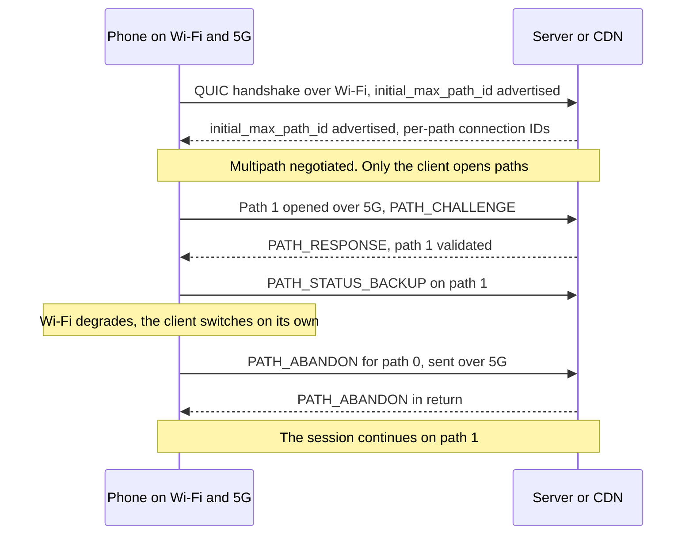
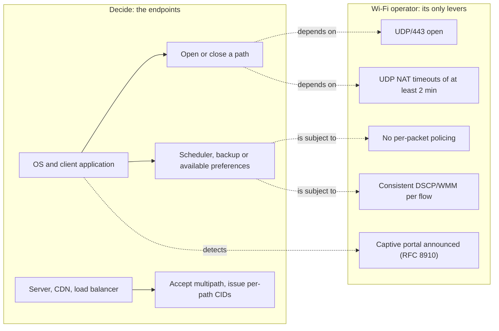

## A video call that drops at the end of the hallway

A hotel guest starts a video call from her room, all the way at the end of the hallway, where the signal fades. The picture freezes, the call drops, and she restarts it on her mobile plan. The next day, a ticket lands at support: *the Wi-Fi keeps cutting out*. For anyone running Wi-Fi across hundreds of hotels, student residences or stores, this is no anecdote. It weighs on customer reviews, on support load and on the relationship with the site owner, who pays for connectivity and gets blamed for it.

On November 7, 2026, the body that standardizes Internet protocols published a text that could wipe out a share of those tickets. RFC 10069 (RFCs are the documents that set the rules of the Internet) makes Multipath QUIC a standard. QUIC, for context, is the encrypted transport protocol underneath HTTP/3, the latest version of the web's protocol. Its multipath variant lets a single connection use both the phone's Wi-Fi and its 5G at the same time, and survive the loss of either one.

The temptation, on the operator side, is to see a product: Wi-Fi and 5G bonded together, one more line in the catalog. That is the wrong reading. The real question is who decides, and who benefits. My answer, which I will argue while keeping what the RFC says separate from what I think of it: the phone decides. Wi-Fi, meanwhile, will be judged.

## Two roads, one driver

To grasp the mechanics, picture a delivery driver who reaches the same warehouse every day. He has two roads: the county road that runs past his house (the site's Wi-Fi) and the highway (the 5G on his mobile plan). The original QUIC, defined in RFC 9000, already allowed him to switch roads mid-trip, but only one at a time. Multipath QUIC lets him keep both open simultaneously, with a separate logbook for each. One thing doesn't change: he is the one holding the wheel. The manager of the county road can neither open an on-ramp for him nor force him to stay.

The text runs 33 pages and enters the IETF (Internet Engineering Task Force) standards track as a Proposed Standard [1][2]. It took its time: first working group draft in February 2022, approval by the IESG, the body that signs off on IETF standards, on March 18, 2026, publication on November 7 [3]. Three editors carry it, Y. Liu (Alibaba), Q. De Coninck (UMONS) and M. Kühlewind (Ericsson), along with Y. Ma (Harvey AI), O. Bonaventure (UCLouvain and WELRI) and C. Huitema (Private Octopus) [1].

It all starts with a negotiation. During the handshake, each endpoint advertises a transport parameter named `initial_max_path_id`. If either side doesn't advertise it, no multipath mechanism is activated and the connection stays a classic QUIC connection. It's an incremental deployment. No flag day to organize.

Each path then receives a number, the path ID: 0 for the initial path, then increasing values, never reused. Each path keeps its own packet numbering, which starts again from zero, and its own acknowledgments (the PATH_ACK frame). Connection IDs (CIDs), which must be non-empty, tie each packet to its path. One detail that will matter later: several paths can share the same 4-tuple, meaning the same source and destination addresses and ports.

On the encryption side, the TLS handshake doesn't change: the path ID is simply injected into the nonce (the unique value required for every encrypted packet). This choice of per-path numbering was one of the working group's main points of controversy, according to the shepherd write-up, the report that accompanies the document up to its approval [4].

Now the most structuring rule: only the client opens a new path. The server must validate it through the PATH_CHALLENGE / PATH_RESPONSE exchange QUIC already provides, with an anti-amplification limit specific to each path. The RFC also advises keeping the maximum number of paths small, to limit denial-of-service risks.

Usage preference travels in two frames. PATH_STATUS_AVAILABLE signals a usable path. PATH_STATUS_BACKUP indicates that no traffic should flow over it as long as another path is available. These are preferences, not orders: each peer expresses its own, and the other may not follow them. Closing, for its part, is explicit, through a PATH_ABANDON frame that can travel on a different path from the one being closed. That is even recommended when the latter is broken.

What remains is what the RFC doesn't do, and it says so from its Section 1. It specifies neither address discovery and management, nor how applications spread their traffic across several paths [1]. It delivers the tracks and the switches. Not the train timetable.

*Lifecycle of a path according to RFC 10069: everything happens between the device and the server.*

Look at who speaks in this diagram: the client and the server. Nobody else. The Wi-Fi network only appears as a pipe.

## Failover first, aggregation never promised

As soon as you write Wi-Fi and 5G in the same sentence, someone in a meeting concludes that the throughputs add up. RFC 10069 tempers that itself. Its Section 1 presents switching between Wi-Fi and cellular as the well-known multipath use case, which uses two paths at once only temporarily, to avoid transmission pauses. Simultaneous use, the text goes on, requires more work than what the document specifies. And the RFC says it bluntly: "There are currently no IETF specifications that define scheduling algorithms for simultaneously using multiple paths" [1].

Section 5.5 explains why. A flow spread over several paths suffers the delay of the slowest one. Imagine a case file where half the pages go with a scooter courier and the other half with a courier on foot: the file is complete only when the pedestrian arrives. Aggregating two links with different latencies is exactly that. Add that each path has its own congestion control, and that the RFC warns: two paths are not necessarily disjoint, and a shared bottleneck can create unfairness.

The only large-scale public field report comes from Alibaba. Its XLINK system, built on its in-house XQUIC stack, was A/B tested in the Taobao mobile app: 100,000 participants and more than 3 million video plays over two weeks. The combined interfaces were mostly Wi-Fi and cellular. These figures come from an article by Y. Ma on the APNIC blog (the Asia-Pacific regional Internet registry) in December 2021, which summarizes a paper presented at the SIGCOMM conference the same year [9][10].

The gains are real, but they sit where you don't expect them. On request completion time, compared with single-path, the improvement exceeds 2.3% at the median, 9.4% at the 95th percentile and 19% at the 99th percentile. Translation: almost nothing for the average user, a lot for the one who was having the worst experience.

The same work shows the flip side. The default scheduler, which favors the path with the lowest round-trip time (min-RTT), can be 28% slower at the 99th percentile than the best path used alone. Badly driven, multipath degrades. Alibaba also flags the overhead of duplicated traffic, which someone always ends up paying for.

Two caveats to keep a cool head. XLINK dates from 2021 and relies on draft versions, not on the final text. And the shepherd write-up describes Alibaba's production deployment as mostly a matter of self-interoperability: Alibaba client on one side, Alibaba server on the other [4].

My analysis: the value of Multipath QUIC lies in session continuity and in the tail of the distribution, not in throughput. Anyone selling Wi-Fi and 5G aggregation on the strength of this RFC is selling what the RFC itself doesn't promise.

*The use case RFC 10069 stands behind: one lane gives out, the other takes over, the session continues.*

## Wi-Fi is no longer the only way out

Back to the guest at the end of the hallway. Suppose her phone and her video service both speak Multipath QUIC. The device opens a 5G path as a backup. Wi-Fi degrades, the session slides onto 5G, the call doesn't drop, and nobody opens a ticket. Same scenario in a student residence saturated in the evening, when the whole building is watching videos at once.

For the Wi-Fi operator, this is first of all good news: fewer tickets tied to dropouts, at least among equipped customers. But look at where the traffic went. Onto the customer's 5G, outside our monitoring, outside our billing, outside our dashboards. Wi-Fi stops being the mandatory passage. It becomes an option the device constantly compares with another one, and our session and per-customer volume metrics will tell only part of the story. This isn't written in the RFC; it's my analysis, but it follows directly from its mechanics.

Hence the hard point: the Wi-Fi operator has no protocol lever over this decision. The PATH_STATUS_AVAILABLE and PATH_STATUS_BACKUP frames are emitted by the endpoints. An access point or a Wi-Fi controller can neither create a path, nor close one, nor ask that one be preferred. Without an agent or proxy installed on the client side, there is no *managed multipath* to sell from the Wi-Fi.

The proxy route exists, but it comes from the mobile world. According to 3GPP TS 24.193 (3GPP is the body that standardizes mobile networks) and related contributions, ATSSS, the mechanism that splits traffic between mobile access and so-called non-3GPP accesses, Wi-Fi among them, steers traffic via Multipath QUIC since Release 18 for UDP. Release 19 adds the IP and Ethernet variants [14]. That is a different topic, driven by mobile operators and their core networks. Not by a hotel's Wi-Fi.

My position, and I own it: this evolution is healthy. For years, part of Wi-Fi's perceived value rested on the absence of an alternative during the session. Multipath QUIC dissolves that lock. What remains is relative quality: a Wi-Fi better than 5G will be preferred, a mediocre Wi-Fi will be silently bypassed. For an operator who invests in radio and capacity planning, that is a better set of rules than captivity.

A word in passing, because the confusion keeps coming back. Wi-Fi 7's MLO (Multi-Link Operation) combines several radio bands within a single Wi-Fi network, under a single network name, at layer 2. Multipath QUIC works at the transport layer, between different networks. The two stack on top of each other, they don't replace each other.

## What doesn't change: visibility, NAT, captive portals

A CIO who hoped to see customer traffic better thanks to this RFC will be disappointed. On visibility, nothing improves. It gets more complicated, if anything.

RFC 9312, which documents the manageability of QUIC for network teams, already drew a harsh picture [6]. There is no general method to tell QUIC apart from other UDP traffic. The name of the targeted site (SNI, Server Name Indication) can only be read by deriving the secret of the initial packet, which is specific to each version. No passive loss measurement is possible with the current wire image of packets. Even the spin bit, meant for measuring latency, is only active if both endpoints want it.

Multipath adds a layer of opacity, and that's my analysis. Each path is a distinct UDP flow, with its own connection IDs and, on Wi-Fi, a 4-tuple different from the 5G path's. From our network, we see a fragment of a session whose other part transits through a mobile operator. Correlating the two from a single network is, in practice, impossible. RFC 10069 does refer to RFC 9312, which also applies, and acknowledges the complexity of a mix of monitored and unmonitored paths [1].

The most concrete point concerns NAT, the address translation that sends an entire site out through a few public addresses. RFC 10069 does not recommend sending keep-alives (maintenance packets) on idle paths. It acknowledges that an idle path may become unusable because of timeouts in intermediate devices, and that it can be probed before a switchover.

Operational translation, still in my view: a NAT or CGNAT (large-scale shared NAT) too eager to forget kills the backup path before it has served. RFC 9312 recommends a NAT and firewall state timeout of at least two minutes for QUIC [6].

Same logic for rate limiting: RFC 9312 advises blocking an entire flow rather than policing packet by packet. And if you must block QUIC, better to do it outright, so the client falls back quickly to TCP instead of waiting on timeouts.

On quality of service, RFC 9312 expects consistent DSCP marking (the priority field of IP packets) per flow. It warns that a 5-tuple change, as during a migration, can lead to different treatment. RFC 10069 adds a nuance in Section 5.2: several paths can share the same 4-tuple with different DiffServ markings, at the application's discretion. Practical conclusion: a session is no longer a 4-tuple.

On some enterprise networks, the question doesn't even arise. Palo Alto Networks' best-practices documentation recommends blocking UDP/80 and UDP/443, hence QUIC, to force a fallback to classic TLS and allow decryption [16]. Zscaler long recommended the same fallback, even though it now offers native QUIC inspection. Behind a firewall configured to block QUIC, Multipath QUIC simply won't exist.

*Encrypted flows, one path per network: from a hotel's Wi-Fi, you only see a fragment of the session.*

That leaves the subject RFC 10069 doesn't mention, as I read it, and that I haven't seen covered anywhere: the captive portal. What follows is a hypothesis. Today, the portal gates use of the Wi-Fi path. With Multipath QUIC, an unauthenticated Wi-Fi path will fail validation or simply won't be used, while 5G carries the session. The risk: customers already online over 5G ignore the portal for longer. In hospitality, this touches acceptance of the terms of use and legal traceability, a point lawyers will have to examine.

The palliative has existed since 2020. RFC 8910 makes it possible to announce the presence of a portal via DHCP (option 114 in DHCPv4, 103 in DHCPv6, type 37 in router advertisements), pointing to the API defined by RFC 8908 [15]. The operating system then knows a portal is waiting for it, instead of guessing.

One last confusion to avoid, between two kinds of backup. The first is the WAN backup, on the operator side: the site's router fails over to a 5G or FWA (fixed wireless access) link when the fiber goes down. The QUIC session then sees its source address change. That is a migration or a NAT rebinding, already handled by QUIC version 1, and which RFC 10069 treats path by path, without changing the path ID. The second is the client backup: the device actually uses both its interfaces. RFC 10069 changes only this second case.

## MPTCP in the mirror: a standard is not adoption

Multipath is nothing new. Apple has used Multipath TCP (MPTCP) for Siri since iOS 7, in 2013, according to RFC 8041 (informational, 2017) and the press of the time [18]. The protocol was standardized in March 2020 in RFC 8684, co-authored notably by C. Paasch, of Apple, and by O. Bonaventure, who also appears on RFC 10069 [7]. Apple, for its part, has documented since iOS 12 an option that allows connections to use multipath protocols, without mentioning QUIC there [11].

And yet adoption has remained narrow. Measurements published by APNIC in 2022 show that Apple was, at the end of 2021, the only organization actively supporting MPTCP v1, even though Linux has supported it since kernel 5.6 and iOS uses it for Siri, Music, Maps and Wi-Fi Assist [8]. The main cause lies with middleboxes. MPTCP carries its signaling in TCP options, which many of these boxes strip, echo back or filter. RFC 8684 does provide for a fallback to plain TCP when those options disappear or are altered.

My analysis: Multipath QUIC starts with three structural advantages. Its negotiation and its frames travel in packets encrypted and authenticated by TLS, which no box can quietly trim; it can only block UDP wholesale. It deploys in user space, through a simple application update, as XLINK showed. And it can keep several paths alive on the same 4-tuple. Against that, two handicaps: the lack of a standard scheduler, which the RFC itself acknowledges, and a fleet of enterprise firewalls that block UDP/443.

On implementations, the inventory is more modest than the announcement. The working group's wiki, undated and based on drafts -09 to -12, lists notably [5]:

- **xquic** (Alibaba, in C), with multipath in the main branch;
- **aioquic** (Python) in an Ericsson version, and **Rask**, an Ericsson in-house stack in Rust;
- **picoquic** (C), the Private Octopus project;
- **quiche** (Cloudflare), only as a pull request on a fork;
- **AppleQUIC**, which tests a Multipath QUIC client, with no public server announced.

Tencent claims multipath for tquic, without specifying a version; picoquic announces support for the standard version as a planned development [12]. On the Go side, the implementation request in quic-go has been open since March 2022. Its maintainer judged from the start that the work would be considerable, and I found no implementation pull request [13].

The detail that stings is elsewhere. The transport parameter values used by these stacks are draft codes, like 0xbabf at Apple, and not the 0x3e of the final version. Without an update, they can't understand each other on the wire with an RFC-compliant implementation. Everyone has to migrate, pioneers included. Interoperability has been tested, with, according to the presentation of the IETF 117 hackathon results (July 2023), tests run on five implementations. The working group's materials nonetheless judge these tests mostly limited to simple cases, and the session minutes describe interoperability as still consolidating [17].

When will mainstream browsers, operating systems and CDNs (content delivery networks) turn it on? I don't know, and I found no credible published date. I won't invent one. I also haven't found, to date, any analysis of RFC 10069 from the specialized press or an analyst firm. The subject remains an engineers' affair.

*From MPTCP to Multipath QUIC: the wide road is laid out, the open questions are who will take it, and when.*

## My position: a Wi-Fi you don't want to leave

What I would do right now. This is an author's checklist, to be validated by engineering teams, not a prescription of the RFC:

1. **Let UDP/443 through**, and UDP in general, on guest and resident VLANs. Don't force the TCP fallback without a serious reason (RFC 9312, §4.5).
2. **Set UDP NAT and firewall timeouts to at least two minutes** (RFC 9312, §4.2), CGNAT included. That is what keeps backup paths alive.
3. **Rate-limit per flow, never per packet** (RFC 9312, §4.6).
4. **Mark DSCP and WMM (traffic prioritization on the Wi-Fi side) consistently per flow**, without assuming a session equals a 4-tuple.
5. **Announce the captive portal via RFC 8910** (DHCP option 114), so the device knows where it stands.
6. **Build a relative-quality indicator**: track devices that stay associated with the access point but whose traffic collapses mid-session. This is an indicator idea, not a proven method. It deserves a field test.

*Who decides what: the endpoints drive, the Wi-Fi operator sets the conditions.*

RFC 10069 gives us nothing to sell. It takes something away from us: session captivity. As long as the device had only one path, an average Wi-Fi kept its users by default. Tomorrow, at the pace at which systems, applications and CDNs adopt the standard, it will keep them on merit, or lose them silently.

That is good news for those who invest in radio, capacity planning and network hygiene. It is bad news for those who counted on the absence of an alternative. The Wi-Fi that wins won't be the one you can't leave. It will be the one you don't want to leave.

_Personal views, not Wifirst's position._

## Sources

1. RFC 10069, Managing Multiple Paths for a QUIC Connection (texte brut) — https://www.rfc-editor.org/rfc/rfc10069.txt (HTML : https://www.rfc-editor.org/rfc/rfc10069.html)
2. Datatracker IETF, RFC 10069 (métadonnées) — https://datatracker.ietf.org/api/v1/doc/document/rfc10069/ et https://datatracker.ietf.org/doc/rfc10069/
3. Datatracker IETF, historique de draft-ietf-quic-multipath — https://datatracker.ietf.org/doc/draft-ietf-quic-multipath/history/
4. Datatracker IETF, shepherd write-up de draft-ietf-quic-multipath — https://datatracker.ietf.org/doc/draft-ietf-quic-multipath/shepherdwriteup/
5. QUIC WG, wiki QUIC Implementations with multipath support — https://github.com/quicwg/multipath/wiki/QUIC-Implementations-with-multipath-support
6. RFC 9312, Manageability of the QUIC Transport Protocol — https://www.rfc-editor.org/rfc/rfc9312.html
7. RFC 8684, TCP Extensions for Multipath Operation with Multiple Addresses (MPTCP v1) — https://www.rfc-editor.org/rfc/rfc8684.html
8. APNIC, Analyzing MPTCP adoption in the Internet (2022) — https://blog.apnic.net/2022/08/23/analyzing-mptcp-adoption-in-the-internet/
9. APNIC, Efficient multipath transport with QUIC in large-scale video services (Y. Ma, 2021) — https://blog.apnic.net/2021/12/08/efficient-multipath-transport-with-quic-video-services/
10. XLINK, SIGCOMM 2021 (DOI 10.1145/3452296.3472893) — https://conferences.sigcomm.org/sigcomm/2021/files/papers/3452296.3472893.pdf
11. Apple Developer, NWParameters.multipathServiceType — https://developer.apple.com/documentation/network/nwparameters/multipathservicetype-swift.property.md
12. READMEs GitHub xquic, picoquic, tquic — https://github.com/alibaba/xquic ; https://github.com/private-octopus/picoquic ; https://github.com/Tencent/tquic
13. quic-go, issue #3343 Feature: Multipath Extension for QUIC — https://github.com/quic-go/quic-go/issues/3343
14. 3GPP TS 24.193 V19.6.0 et Nokia Bell Labs, Multipath QUIC pour ATSSS — https://www.3gpp.org/ftp/specs/PDF/2026-09/Rel-19/24_series/24193-j60.pdf ; https://nokia.com/bell-labs/publications-and-media/publications/multipath-quic-for-access-traffic-steering-switching-and-splitting-in-5g-advanced
15. RFC 8910, Captive-Portal Identification in DHCP and Router Advertisements — https://www.rfc-editor.org/rfc/rfc8910.html
16. Palo Alto Networks, Internet Gateway Best Practices (règles de blocage applicatif) — https://docs.paloaltonetworks.com/best-practices/internet-gateway-best-practices/best-practice-internet-gateway-security-policy/define-the-initial-internet-gateway-security-policy/step-3-create-the-application-block-rules ; Zscaler, Managing QUIC Protocol — https://help.zscaler.com/zia/managing-quic-protocol
17. IETF 117, slides Multipath QUIC et hackathon — https://datatracker.ietf.org/meeting/117/materials/slides-117-quic-multipath-quic-00 ; https://ekr.github.io/auto-minutes/minutes/ietf117/hackathon-results-presentations.txt ; https://datatracker.ietf.org/meeting/117/materials/minutes-117-quic-00
18. Sources secondaires sur MPTCP chez Apple — https://en.wikipedia.org/wiki/Multipath_TCP ; https://www.rfc-editor.org/rfc/rfc8041
