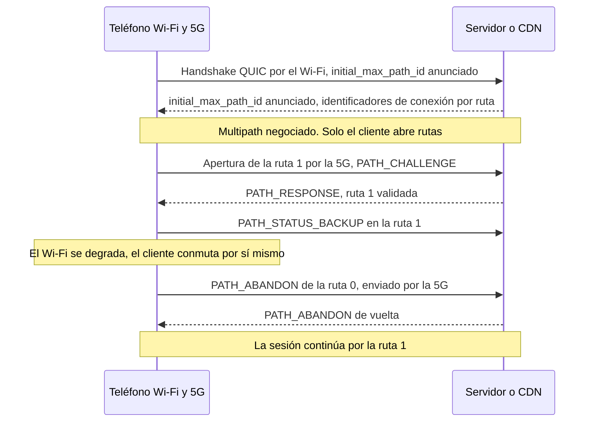
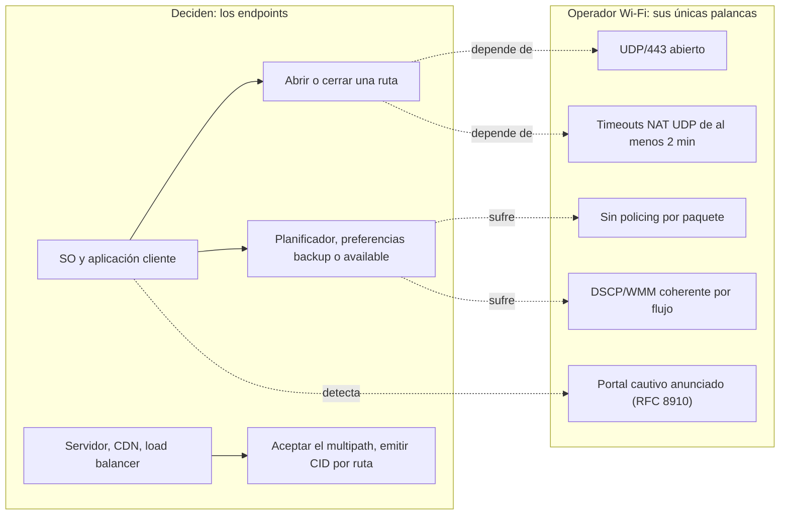

## Una videollamada que se corta al fondo del pasillo

Una clienta de un hotel inicia una videollamada desde su habitación, al fondo del pasillo, donde la señal flaquea. La imagen se congela, la llamada se corta y ella la retoma con los datos del móvil. Al día siguiente llega un ticket a soporte: *el Wi-Fi se corta*. Para quien opera el Wi-Fi de cientos de hoteles, residencias de estudiantes o tiendas, la escena no tiene nada de anecdótico. Pesa en las valoraciones de los clientes, en la carga de soporte y en la relación con el gestor del sitio, que paga por una conectividad que luego se le reprocha.

El 7 de noviembre de 2026, el organismo que normaliza los protocolos de Internet publicó un texto que podría eliminar parte de esos tickets. La RFC 10069 (las RFC son los documentos que fijan las reglas de Internet) convierte Multipath QUIC en estándar. QUIC, para situarlo, es el protocolo de transporte cifrado sobre el que se apoya HTTP/3, la última versión del protocolo de la web. Su variante multipath permite que una sola conexión use a la vez el Wi-Fi y la 5G del teléfono, y que sobreviva a la desaparición de uno de los dos.

La tentación, del lado del operador, es ver ahí un producto: Wi-Fi y 5G agregados, una línea más en el catálogo. Es la lectura equivocada. La verdadera pregunta es quién decide y quién gana. Mi respuesta, que voy a argumentar separando lo que dice la RFC de lo que pienso yo: decide el teléfono. El Wi-Fi, en cambio, será juzgado.

## Dos rutas, un solo conductor

Para entender la mecánica, imagina a un repartidor que llega cada día al mismo almacén. Tiene dos rutas: la carretera comarcal que pasa frente a su casa (el Wi-Fi del sitio) y la autopista (la 5G de su plan de datos). El QUIC original, definido en la RFC 9000, ya le permitía cambiar de ruta en pleno trayecto, pero solo de una en una. Multipath QUIC le deja las dos abiertas a la vez, con un cuaderno de ruta distinto para cada una. Hay algo que no cambia: es él quien lleva el volante. El gestor de la carretera comarcal no puede abrirle un desvío ni obligarlo a quedarse.

El texto tiene 33 páginas y entra en la vía de estándares del IETF (Internet Engineering Task Force) con el rango de Proposed Standard [1][2]. Se ha tomado su tiempo: primer borrador (draft) del grupo de trabajo en febrero de 2022, aprobación por el IESG, la instancia que valida los estándares del IETF, el 18 de marzo de 2026, publicación el 7 de noviembre [3]. Lo llevan tres editores, Y. Liu (Alibaba), Q. De Coninck (UMONS) y M. Kühlewind (Ericsson), junto con Y. Ma (Harvey AI), O. Bonaventure (UCLouvain y WELRI) y C. Huitema (Private Octopus) [1].

Todo empieza con una negociación. Cada extremo anuncia, durante el handshake, un parámetro de transporte llamado `initial_max_path_id`. Si uno de los dos no lo anuncia, no se activa ningún mecanismo multipath y la conexión sigue siendo un QUIC clásico. Es un despliegue incremental. Sin ningún día D que organizar.

Cada ruta recibe después un número, el path ID: 0 para la ruta inicial, luego valores crecientes, nunca reutilizados. Cada ruta lleva su propia numeración de paquetes, que arranca de cero, y sus propios acuses de recibo (trama PATH_ACK). Los identificadores de conexión (CID, por Connection IDs), obligatoriamente no vacíos, vinculan cada paquete con su ruta. Un detalle que importará más adelante: varias rutas pueden compartir el mismo 4-tuple, es decir, las mismas direcciones y puertos de origen y destino.

En cuanto al cifrado, el handshake TLS no cambia: el path ID simplemente se inyecta en el nonce (el valor único exigido para cada paquete cifrado). Esta elección de una numeración por ruta fue uno de los principales puntos de controversia del grupo de trabajo, según el shepherd write-up, el informe que acompaña al documento hasta su aprobación [4].

Llega la regla más estructurante: solo el cliente abre una ruta nueva. El servidor debe validarla mediante el intercambio PATH_CHALLENGE / PATH_RESPONSE que QUIC ya prevé, con un límite antiamplificación propio de cada ruta. La RFC aconseja además mantener pequeño el número máximo de rutas, para limitar los riesgos de denegación de servicio.

La preferencia de uso pasa por dos tramas. PATH_STATUS_AVAILABLE señala una ruta utilizable. PATH_STATUS_BACKUP indica que no debería circular tráfico por ella mientras haya otra ruta disponible. Son preferencias, no órdenes: cada par expresa las suyas y el otro puede no seguirlas. El cierre, por su parte, es explícito, mediante una trama PATH_ABANDON que puede viajar por una ruta distinta de la que se cierra. Incluso se recomienda cuando esta última está rota.

Queda lo que la RFC no hace, y lo escribe desde su sección 1. No especifica ni el descubrimiento y la gestión de direcciones, ni la manera en que las aplicaciones reparten su tráfico entre varias rutas [1]. Entrega las vías y los cambios de aguja. No el horario de los trenes.

*Ciclo de vida de una ruta según la RFC 10069: todo se juega entre el terminal y el servidor.*

Fíjate en quién habla en este esquema: el cliente y el servidor. Nadie más. La red Wi-Fi solo aparece como una tubería.

## Failover primero, suma nunca prometida

En cuanto se escriben Wi-Fi y 5G en la misma frase, alguien, en una reunión, concluye que las velocidades se suman. La propia RFC 10069 baja los humos. Su sección 1 presenta la conmutación entre Wi-Fi y red móvil como el caso de uso bien conocido del multipath, que solo usa dos rutas a la vez de forma temporal, para evitar pausas de transmisión. El uso simultáneo, continúa el texto, requiere más trabajo del que el documento especifica. Y la RFC lo dice sin rodeos: «There are currently no IETF specifications that define scheduling algorithms for simultaneously using multiple paths» [1].

La sección 5.5 explica por qué. Un flujo repartido entre varias rutas sufre el retardo de la más lenta. Imagina un expediente cuyas páginas se reparten, la mitad a un mensajero en moto y la otra mitad a otro que va a pie: el expediente no está completo hasta que llega el peatón. Agregar dos enlaces con latencias distintas es exactamente eso. Añade que cada ruta tiene su propio control de congestión y que la RFC advierte: dos rutas no son necesariamente disjuntas, y un cuello de botella compartido puede crear inequidad.

La única experiencia pública a gran escala viene de Alibaba. Su sistema XLINK, construido sobre su pila propia XQUIC, se probó en A/B en la aplicación móvil Taobao: 100.000 participantes y más de 3 millones de reproducciones de vídeo en dos semanas. Las interfaces combinadas eran sobre todo el Wi-Fi y la red móvil. Estas cifras proceden de un artículo firmado por Y. Ma en el blog de APNIC (el registro regional de Internet de Asia-Pacífico) en diciembre de 2021, que resume un paper presentado en la conferencia SIGCOMM ese mismo año [9][10].

Las ganancias son reales, pero aparecen donde no se esperan. En el tiempo de completado de las peticiones, frente a una sola ruta, la mejora supera el 2,3 % en la mediana, el 9,4 % en el percentil 95 y el 19 % en el percentil 99. Traducción: casi nada para el usuario medio, mucho para quien vivía la peor experiencia.

El mismo trabajo muestra la cara oculta. El planificador por defecto, que privilegia la ruta con menor tiempo de ida y vuelta (min-RTT), puede ser un 28 % más lento en el percentil 99 que la mejor ruta usada en solitario. Mal gobernado, el multipath degrada. Alibaba señala también el sobrecoste del tráfico duplicado, que alguien acaba pagando siempre.

Dos precisiones para mantener la cabeza fría. XLINK es de 2021 y se apoya en versiones de draft, no en el texto final. Y el shepherd write-up describe el despliegue de Alibaba en producción como una cuestión sobre todo de autointeroperabilidad: cliente Alibaba por un lado, servidor Alibaba por el otro [4].

Mi análisis: el valor de Multipath QUIC está en la continuidad de sesión y en la cola de la distribución, no en el caudal. Quien venda agregación de Wi-Fi y 5G apoyándose en esta RFC vende lo que la propia RFC no promete.

*El caso de uso que la RFC 10069 asume: una vía cede, la otra toma el relevo y la sesión continúa.*

## El Wi-Fi ya no es la única salida

Volvamos a la clienta del fondo del pasillo. Supongamos que su teléfono y su servicio de videollamada hablan ambos Multipath QUIC. El terminal abre una ruta 5G de reserva. El Wi-Fi se degrada, la sesión se desliza a la 5G, la llamada no se corta y nadie abre un ticket. Mismo escenario en una residencia de estudiantes saturada por la noche, cuando todo el edificio ve vídeos al mismo tiempo.

Para el operador del Wi-Fi, es ante todo una buena noticia: menos tickets por cortes, al menos entre los clientes equipados. Pero fíjate adónde ha ido el tráfico. A la 5G del cliente, fuera de nuestra supervisión, fuera de nuestra facturación, fuera de nuestros dashboards. El Wi-Fi deja de ser el paso obligado. Pasa a ser una opción que el terminal compara en todo momento con otra, y nuestras métricas de sesiones y de volúmenes por cliente solo contarán una parte de la historia. No está escrito en la RFC; es mi análisis, pero se deriva directamente de su mecánica.

De ahí el punto duro: el operador Wi-Fi no tiene ninguna palanca de protocolo sobre esta decisión. Las tramas PATH_STATUS_AVAILABLE y PATH_STATUS_BACKUP las emiten los extremos. Un punto de acceso o un controlador Wi-Fi no puede crear una ruta, ni cerrarla, ni pedir que se la prefiera. Sin un agente o proxy instalado en el cliente, no existe un *multipath gestionado* que vender desde el Wi-Fi.

La vía del proxy existe, pero viene del mundo móvil. Según la TS 24.193 del 3GPP (el organismo que normaliza las redes móviles) y contribuciones asociadas, ATSSS, el mecanismo que reparte el tráfico entre el acceso móvil y los llamados accesos non-3GPP, entre ellos el Wi-Fi, gobierna el tráfico mediante Multipath QUIC desde la Release 18 para UDP. La Release 19 añade las variantes IP y Ethernet [14]. Es otro tema, impulsado por los operadores móviles y su núcleo de red. No por el Wi-Fi de un hotel.

Mi posición, y la asumo: esta evolución es sana. Durante años, parte del valor percibido del Wi-Fi residía en la ausencia de alternativa durante la sesión. Multipath QUIC disuelve ese cerrojo. Lo que queda es la calidad relativa: un Wi-Fi mejor que la 5G será preferido, un Wi-Fi mediocre será esquivado en silencio. Para un operador que invierte en radio y en dimensionamiento, es una regla del juego mejor que el cautiverio.

Una precisión de paso, porque la confusión es frecuente. El MLO de Wi-Fi 7 (Multi-Link Operation) combina varias bandas de radio dentro de una misma red Wi-Fi, bajo un mismo nombre de red, en el nivel 2. Multipath QUIC trabaja en el nivel de transporte, entre redes distintas. Los dos se superponen, no se sustituyen.

## Lo que no cambia: visibilidad, NAT, portales cautivos

Un director de TI que esperaba ver mejor el tráfico de sus clientes gracias a esta RFC se llevará una decepción. En visibilidad, nada mejora. Más bien se complica.

La RFC 9312, que documenta la gestionabilidad de QUIC para los equipos de red, ya hacía un balance severo [6]. No existe un método general para distinguir QUIC de otro tráfico UDP. El nombre del sitio de destino (SNI, Server Name Indication) solo se puede leer derivando el secreto del paquete inicial, propio de cada versión. No es posible ninguna medición pasiva de pérdidas con la imagen actual de los paquetes en el cable. Incluso el spin bit, previsto para medir la latencia, solo está activo si los dos extremos lo quieren.

El multipath añade una capa de opacidad, y esto es análisis mío. Cada ruta es un flujo UDP distinto, con sus propios identificadores de conexión y, en el Wi-Fi, un 4-tuple diferente del de la ruta 5G. Desde nuestra red vemos un fragmento de una sesión cuya otra parte transita por un operador móvil. Correlacionar ambos desde una sola red es, en la práctica, imposible. La RFC 10069 remite además a la RFC 9312, que también se aplica, y reconoce la complejidad de una mezcla de rutas supervisadas y no supervisadas [1].

El punto más concreto afecta al NAT, la traducción de direcciones que hace salir a todo un sitio por unas pocas direcciones públicas. La RFC 10069 no recomienda enviar keep-alive (esos paquetes de mantenimiento) por las rutas inactivas. Reconoce que una ruta en reposo puede quedar inutilizable por los timeouts de los equipos intermedios, y que puede sondearse antes de una conmutación.

Traducción operativa, también según yo: un NAT o un CGNAT (NAT compartido a gran escala) con demasiada prisa por olvidar mata la ruta de reserva antes de que haya servido. La RFC 9312 recomienda para QUIC un timeout de estado de NAT y firewall de al menos dos minutos [6].

Misma lógica para la limitación de caudal: la RFC 9312 aconseja bloquear un flujo entero en lugar de hacer policing paquete a paquete. Y si hay que bloquear QUIC, mejor hacerlo sin rodeos, para que el cliente recurra rápido a TCP en lugar de esperar a los timeouts.

En calidad de servicio, la RFC 9312 espera un marcado DSCP (el campo de prioridad de los paquetes IP) coherente por flujo. Advierte de que un cambio de 5-tuple, como en una migración, puede provocar un tratamiento distinto. La RFC 10069 añade un matiz en la sección 5.2: varias rutas pueden compartir el mismo 4-tuple con marcados DiffServ diferentes, a criterio de la aplicación. Conclusión práctica: una sesión ya no es un 4-tuple.

En algunas redes corporativas, la cuestión ni siquiera se plantea. La documentación de buenas prácticas de Palo Alto Networks recomienda bloquear UDP/80 y UDP/443, es decir, QUIC, para forzar el retroceso a TLS clásico y permitir el descifrado [16]. Zscaler recomendó durante mucho tiempo el mismo retroceso, aunque ahora ofrece inspección nativa de QUIC. Tras un firewall configurado para bloquear QUIC, Multipath QUIC sencillamente no existirá.

*Flujos cifrados, una ruta por red: desde el Wi-Fi de un hotel, solo se ve un fragmento de la sesión.*

Queda el tema que la RFC 10069 no menciona, a mi lectura, y que no he visto tratado en ningún sitio: el portal cautivo. Lo que sigue es una hipótesis. Hoy, el portal condiciona el uso de la ruta Wi-Fi. Con Multipath QUIC, una ruta Wi-Fi no autenticada fallará en la validación o simplemente no se usará, mientras la 5G lleva la sesión. El riesgo: clientes que ya están en línea por la 5G ignoran el portal durante más tiempo. En la hostelería, esto afecta a la aceptación de las CGU (condiciones generales de uso) y a la trazabilidad legal, un punto que los juristas tendrán que examinar.

El paliativo existe desde 2020. La RFC 8910 permite anunciar la presencia de un portal mediante DHCP (opción 114 en DHCPv4, 103 en DHCPv6, tipo 37 en los anuncios de router), apuntando a la API definida por la RFC 8908 [15]. El sistema operativo sabe entonces que un portal le espera, en lugar de adivinarlo.

Última confusión que evitar, la que se da entre dos respaldos. El primero es el backup WAN, del lado del operador: el router del sitio conmuta a un enlace 5G o FWA (acceso fijo por radio) cuando cae la fibra. La sesión QUIC ve entonces cambiar su dirección de origen. Es una migración o un NAT rebinding, ya gestionados por QUIC versión 1, y que la RFC 10069 trata ruta por ruta, sin cambiar de path ID. El segundo es el backup del cliente: el terminal usa realmente sus dos interfaces. La RFC 10069 solo cambia este segundo caso.

## MPTCP en espejo: un estándar no hace una adopción

El multipath no tiene nada de nuevo. Apple usa Multipath TCP (MPTCP) para Siri desde iOS 7, en 2013, según la RFC 8041 (informativa, 2017) y la prensa de la época [18]. El protocolo se normalizó en marzo de 2020 en la RFC 8684, cofirmada en particular por C. Paasch, de Apple, y por O. Bonaventure, a quien reencontramos en la RFC 10069 [7]. Apple documenta además, desde iOS 12, una opción que autoriza a las conexiones a usar protocolos multipath, sin mencionar QUIC [11].

Y sin embargo, la adopción se ha quedado corta. Mediciones publicadas por APNIC en 2022 muestran que Apple era, a finales de 2021, la única organización que soportaba activamente MPTCP v1, mientras que Linux lo soporta desde el kernel 5.6 y iOS lo usa para Siri, Música, Mapas (Maps) y Wi-Fi Assist [8]. La causa principal está en los equipos intermedios (middleboxes). MPTCP transporta su señalización en opciones TCP, que muchos de esos equipos eliminan, devuelven en eco o filtran. La RFC 8684 prevé además un retroceso a TCP simple cuando esas opciones desaparecen o se alteran.

Mi análisis: Multipath QUIC parte con tres ventajas estructurales. Su negociación y sus tramas viajan en paquetes cifrados y autenticados por TLS, que ningún equipo puede mutilar a escondidas; solo puede bloquear el UDP en bloque. Se despliega en espacio de usuario, con una simple actualización de la aplicación, como demostró XLINK. Y sabe mantener varias rutas sobre un mismo 4-tuple. En frente, dos lastres: la ausencia de un planificador estándar, que la propia RFC reconoce, y un parque de firewalls corporativos que bloquean UDP/443.

En cuanto a implementaciones, el inventario es más modesto que el anuncio. La wiki del grupo de trabajo, sin fecha y basada en los drafts -09 a -12, recoge en particular [5]:

- **xquic** (Alibaba, en C), con el multipath en la rama principal;
- **aioquic** (Python) en una versión de Ericsson, y **Rask**, una pila interna de Ericsson en Rust;
- **picoquic** (C), el proyecto de Private Octopus;
- **quiche** (Cloudflare), únicamente en forma de pull request sobre un fork;
- **AppleQUIC**, que prueba un cliente Multipath QUIC, sin servidor público anunciado.

Tencent reivindica el multipath para tquic, sin precisar versión; picoquic anuncia el soporte de la versión estándar como un desarrollo previsto [12]. En el lado de Go, la solicitud de implementación en quic-go está abierta desde marzo de 2022. Su mantenedor juzgó desde el principio que la tarea era considerable, y no he encontrado ninguna pull request de implementación [13].

El detalle que molesta está en otra parte. Los valores de parámetros de transporte que usan estas pilas son códigos de drafts, como 0xbabf en Apple, y no el 0x3e de la versión final. Sin actualización, no se entienden en el cable con una implementación conforme a la RFC. Todos deben migrar, pioneros incluidos. La interoperabilidad se ha puesto a prueba: según la presentación de resultados del hackathon del IETF 117 (julio de 2023), se hicieron pruebas con cinco implementaciones. Sin embargo, los materiales del grupo de trabajo consideran que esas pruebas se limitaron sobre todo a casos simples, y las actas de la sesión describen una interoperabilidad todavía en consolidación [17].

¿Cuándo lo activarán los navegadores, los sistemas operativos y los CDN (redes de distribución de contenido) de consumo masivo? No lo sé, y no he encontrado ninguna fecha creíble publicada. No me voy a inventar una. Tampoco he encontrado, a día de hoy, ningún análisis de prensa especializada ni de consultoras de analistas sobre la RFC 10069. El tema sigue siendo cosa de ingenieros.

*De MPTCP a Multipath QUIC: la vía ancha está trazada, falta saber quién la tomará y cuándo.*

## Mi posición: un Wi-Fi que no apetezca abandonar

Lo que haría desde ya. Es una checklist de autor, que deben validar los equipos de ingeniería, no una prescripción de la RFC:

1. **Dejar pasar UDP/443**, y el UDP en general, en las VLAN de invitados y residentes. No forzar el retroceso a TCP sin una razón seria (RFC 9312, §4.5).
2. **Ajustar los timeouts de NAT y de firewall UDP a al menos dos minutos** (RFC 9312, §4.2), CGNAT incluido. De eso depende la supervivencia de las rutas de reserva.
3. **Limitar por flujo, nunca por paquete** (RFC 9312, §4.6).
4. **Marcar DSCP y WMM (la priorización de tráfico del lado Wi-Fi) de forma coherente por flujo**, sin suponer que una sesión equivale a un 4-tuple.
5. **Anunciar el portal cautivo mediante la RFC 8910** (opción DHCP 114), para que el terminal sepa en qué punto está.
6. **Construir un indicador de calidad relativa**: seguir los terminales que permanecen asociados al punto de acceso pero cuyo tráfico se desploma en plena sesión. Es una idea de indicador, no un método probado. Merece una prueba de campo.

*Quién decide qué: los extremos mandan, el operador Wi-Fi condiciona.*

La RFC 10069 no nos da nada que vender. Nos quita algo: el cautiverio de la sesión. Mientras el terminal solo tenía una ruta, un Wi-Fi mediocre retenía a sus usuarios por defecto. Mañana, al ritmo al que los sistemas, las aplicaciones y los CDN adopten el estándar, los retendrá por mérito, o los perderá en silencio.

Es una buena noticia para quien invierte en radio, dimensionamiento e higiene de red. Es una mala noticia para quien contaba con la falta de alternativa. El Wi-Fi que ganará no será el que no se puede abandonar. Será el que no apetece abandonar.

_Opiniones personales, no posición de Wifirst._

## Fuentes

1. RFC 10069, Managing Multiple Paths for a QUIC Connection (texte brut) — https://www.rfc-editor.org/rfc/rfc10069.txt (HTML : https://www.rfc-editor.org/rfc/rfc10069.html)
2. Datatracker IETF, RFC 10069 (métadonnées) — https://datatracker.ietf.org/api/v1/doc/document/rfc10069/ et https://datatracker.ietf.org/doc/rfc10069/
3. Datatracker IETF, historique de draft-ietf-quic-multipath — https://datatracker.ietf.org/doc/draft-ietf-quic-multipath/history/
4. Datatracker IETF, shepherd write-up de draft-ietf-quic-multipath — https://datatracker.ietf.org/doc/draft-ietf-quic-multipath/shepherdwriteup/
5. QUIC WG, wiki QUIC Implementations with multipath support — https://github.com/quicwg/multipath/wiki/QUIC-Implementations-with-multipath-support
6. RFC 9312, Manageability of the QUIC Transport Protocol — https://www.rfc-editor.org/rfc/rfc9312.html
7. RFC 8684, TCP Extensions for Multipath Operation with Multiple Addresses (MPTCP v1) — https://www.rfc-editor.org/rfc/rfc8684.html
8. APNIC, Analyzing MPTCP adoption in the Internet (2022) — https://blog.apnic.net/2022/08/23/analyzing-mptcp-adoption-in-the-internet/
9. APNIC, Efficient multipath transport with QUIC in large-scale video services (Y. Ma, 2021) — https://blog.apnic.net/2021/12/08/efficient-multipath-transport-with-quic-video-services/
10. XLINK, SIGCOMM 2021 (DOI 10.1145/3452296.3472893) — https://conferences.sigcomm.org/sigcomm/2021/files/papers/3452296.3472893.pdf
11. Apple Developer, NWParameters.multipathServiceType — https://developer.apple.com/documentation/network/nwparameters/multipathservicetype-swift.property.md
12. READMEs GitHub xquic, picoquic, tquic — https://github.com/alibaba/xquic ; https://github.com/private-octopus/picoquic ; https://github.com/Tencent/tquic
13. quic-go, issue #3343 Feature: Multipath Extension for QUIC — https://github.com/quic-go/quic-go/issues/3343
14. 3GPP TS 24.193 V19.6.0 et Nokia Bell Labs, Multipath QUIC pour ATSSS — https://www.3gpp.org/ftp/specs/PDF/2026-09/Rel-19/24_series/24193-j60.pdf ; https://nokia.com/bell-labs/publications-and-media/publications/multipath-quic-for-access-traffic-steering-switching-and-splitting-in-5g-advanced
15. RFC 8910, Captive-Portal Identification in DHCP and Router Advertisements — https://www.rfc-editor.org/rfc/rfc8910.html
16. Palo Alto Networks, Internet Gateway Best Practices (règles de blocage applicatif) — https://docs.paloaltonetworks.com/best-practices/internet-gateway-best-practices/best-practice-internet-gateway-security-policy/define-the-initial-internet-gateway-security-policy/step-3-create-the-application-block-rules ; Zscaler, Managing QUIC Protocol — https://help.zscaler.com/zia/managing-quic-protocol
17. IETF 117, slides Multipath QUIC et hackathon — https://datatracker.ietf.org/meeting/117/materials/slides-117-quic-multipath-quic-00 ; https://ekr.github.io/auto-minutes/minutes/ietf117/hackathon-results-presentations.txt ; https://datatracker.ietf.org/meeting/117/materials/minutes-117-quic-00
18. Sources secondaires sur MPTCP chez Apple — https://en.wikipedia.org/wiki/Multipath_TCP ; https://www.rfc-editor.org/rfc/rfc8041
