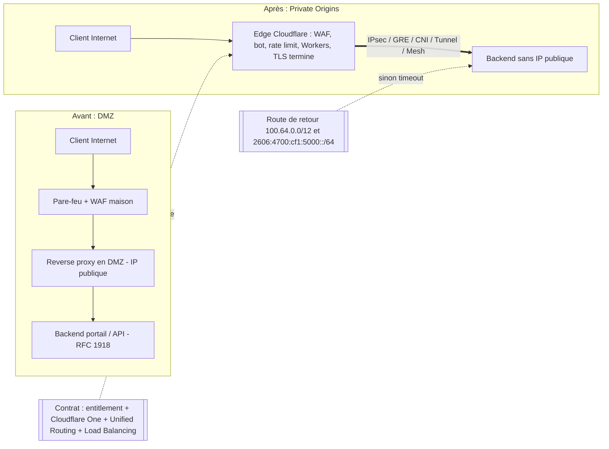
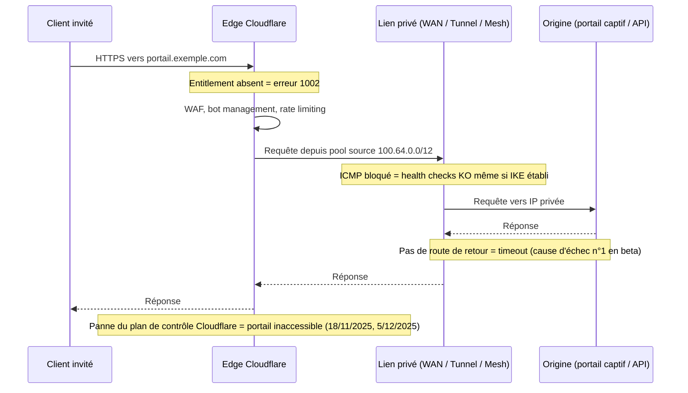

# Brief — Cloudflare Services for Private Origins (GA 2026-10-30) : « plus de DMZ », le périmètre devient le contrat

Date du brief : 2026-11-03 | Genre : `archi-vendor` | Catégorie : Réseaux / Cybersécurité
Statut de vérification : 20 sources. 17 lues en intégralité via fetch ; 3 confirmées uniquement par extrait de recherche (marquées [S]) car le fetch est revenu vide.

## Thèse (1 phrase)
Un backend sans IP publique derrière un edge programmable supprime la DMZ du plan réseau, mais déplace le périmètre de sécurité dans le contrat du fournisseur : ce qui protège l'origine n'est plus une règle de pare-feu que l'on possède, mais un entitlement, une route de retour et une disponibilité que l'on ne contrôle pas.

## Angle proposé
Ne pas faire un « what's new » : trancher. (1) Gain réel : surface d'attaque Internet de l'origine à zéro, WAF/bot/rate limiting/Workers appliqués sur un backend RFC 1918. (2) Coût réel : le « périmètre » devient quatre objets contractuels/opérationnels — entitlement activé par l'account team, Cloudflare One + Unified Routing, route de retour vers le pool d'IP source de Cloudflare, Load Balancing pour les health checks — plus la dépendance à un plan de contrôle unique (3 post-mortems Cloudflare en 12 mois). (3) Transposition opérateur Wi-Fi B2B : bon fit pour portails captifs HTTPS et API REST ; hors périmètre pour tout ce qui n'est pas HTTP(S) (RADIUS/RadSec, CAPWAP, flux contrôleur-AP) ; point dur multi-sites : adressage RFC 1918 qui se recouvre entre sites et réseau virtuel par défaut uniquement.

## Faits clés (datés, sourcés)
1. **GA le 2026-10-30** après closed beta annoncée le 2026-06-10 ; la beta ciblait « GA in Q4 2026 » (donc tenue). — [1] [2]
2. **Ce qui s'applique** à un enregistrement A/AAAA proxifié pointant vers une IP privée : WAF + règles managées, bot management, rate limiting, cache, transform/rewrite rules, Workers ; la terminaison TLS reste sur le réseau Cloudflare. — [1]
3. **Connectivité** : IPsec, GRE, CNI, Cloudflare Tunnel, Cloudflare Mesh, Cloudflare WAN. Avec WAN, aucun logiciel connecteur sur l'origine ; avec Mesh, un connecteur tourne dans le réseau privé. — [1]
4. **Routage privé automatique** (non désactivable, erreur API si on tente `private_routing: false`) pour 10.0.0.0/8, 172.16.0.0/12, 192.168.0.0/16 (RFC 1918), 100.64.0.0/10 (RFC 6598), fc00::/7 (RFC 4193). IP publique joignable seulement en privé : activation manuelle. — [1] [4]
5. **Périmètre = public vers privé uniquement** ; privé vers privé « engineering underway », closed beta visée « early 2027 ». — [1]
6. **Prérequis et entitlement** : entitlement « Private Origins » à faire activer par l'account team ; connectivité Cloudflare One ; Unified Routing requis sauf Tunnel. Sans l'entitlement, proxifier une IP privée renvoie l'**erreur 1002**. — [1] [6]
7. **Route de retour** : IPv4 100.64.0.0/12 et IPv6 2606:4700:cf1:5000::/64 (WAN/Mesh). La beta désignait la route de retour manquante comme cause d'échec la plus fréquente (timeouts). La doc WAN : si le « Cloudflare Source IP » est un range public, le réseau ne peut pas router le retour ; il faut un /12 privé (défaut 100.64.0.0/12 « ou un autre /12 privé choisi »). — [1] [2] [5] [6]
8. **Limites annoncées** : Argo Smart Routing non supporté ; Dedicated CDN Egress IPs non supportés ; health checks d'origine nécessitent Load Balancing. — [1]
9. **Limites docs** : trafic via le réseau virtuel par défaut uniquement (« Selecting a specific virtual network is not supported ») ; si plusieurs A/AAAA partagent un nom et qu'un seul a le routage privé, tous l'utilisent ; ICMP doit passer entre endpoints de tunnel sinon health checks en échec même avec IKE établi ; deux tunnels IPsec anycast, routes statiques priorité 100/101 ; abonnement Cloudflare WAN requis (entitlement distinct de l'accès DNS). — [4] [5] [6]
10. **Spectrum** (TCP/UDP) : en beta, seulement via Cloudflare Tunnel ; l'API rejette la config si l'IP ne correspond pas à une route du tunnel. Le billet GA ne détaille pas Spectrum (à ne pas affirmer pour le GA). — [2]
11. **Prix non publié** ; les docs développeur restent étiquetées « Private origins (beta) / Enterprise-only / closed beta » au 2026-11-03. — [1] [3] [9]
12. **Cloudflare Tunnel (historique)** : Argo Tunnel présenté le 2018-04-05 (« Only Cloudflare can see the server »), aujourd'hui `cloudflared`, connexions sortantes uniquement, inbound bloqué au pare-feu (doc mise à jour 2026-08-04). Private Origins généralise le modèle à IPsec/GRE/CNI/WAN sans agent. — [7] [8]
13. **Dépendance, 3 incidents** :
    - 2025-11-18 : ~5 h 46 (11:20 à 17:06 UTC), fichier de features Bot Management doublé (limite 200 features, usage normal ~60) après changement de permissions ClickHouse ; Access en échec jusqu'au rollback de 13:05 UTC, Turnstile et dashboard dégradés ; pas une attaque. — [10]
    - 2025-12-05 : ~25 min (08:47 à 09:12 UTC), ~28 % du trafic HTTP, changement de config global (killswitch WAF) déclenchant un bug Lua sur l'ancien proxy FL1 ; pas une attaque. — [11]
    - 2026-02-20 : ~1 100 préfixes BYOIP retirés (25 % des 4 306), requête API avec `pending_delete` vide interprétée comme « tous » ; Magic Transit, Spectrum, Dedicated Egress touchés ; remédiation complète à 23:03 UTC ; correctifs prévus : typage de l'API, snapshots, circuit breaker. — [12]
14. **Alternatives hyperscaler** (modèle « private link » vers l'origine) :
    - AWS CloudFront VPC origins, annoncé 2024-11-20 : ALB/NLB/EC2 en sous-réseau privé, « no additional cost », régions commerciales ; l'accès se fait par security group + managed prefix list ; non supporté : gRPC, triggers Lambda@Edge origin, NLB avec listener TLS. — [13] [14]
    - Azure Front Door Premium Private Link : approbation manuelle du private endpoint côté origine ; Premium uniquement ; pas de mTLS ; limite de 7 200 RPS par cluster régional et par profil (429 au-delà) ; pas de mélange origines publiques/privées dans un même groupe ; régions avec zones de disponibilité uniquement ; doc ms.date 2025-09-24, mise à jour 2026-05-26. — [15]
15. **Akamai** : le modèle d'origine exige une IP/hostname routable publiquement ; les plages privées RFC 1918 sont explicitement refusées (doc mise à jour 2026-03-01). Protection de l'origine = Site Shield (allowlist d'IP Akamai sur le pare-feu, maintenance continue, « pas un substitut à l'authentification »). Je n'ai pas trouvé d'équivalent Akamai « origine privée sans IP publique » : à formuler comme « pas trouvé dans la doc publique », pas comme « n'existe pas ». — [16] [17]
16. **Zscaler (ZPA)** : modèle différent (utilisateur vers application privée, pas client public anonyme vers origine) ; App Connector sortant uniquement, aucun port entrant requis (extrait du help portal, fetch vide). — [18]
17. **Analyse indépendante** (Groundy, 2026-06-23) : le flag « route » mais n'« authentifie » pas ; l'identité exige Cloudflare Access et validation côté origine ; l'auto-détection par plage peut mal classer du CGNAT utilisé à d'autres fins ; concentration DNS+TLS+transport+accès chez un seul fournisseur ; aucun prix. (Affirmation « la doc Cloudflare dit que l'edge peut être contourné » : relayée par Groundy, NON retrouvée dans le billet GA ni les docs lues.) — [9]
18. **Cadre réglementaire UE** : NIS2 (Directive 2022/2555, JO 27.12.2022), art. 21(2)(d) sécurité de la chaîne d'approvisionnement ; le règlement d'exécution C(2024)7151 détaille critères de sélection de fournisseurs et clauses contractuelles (notification d'incident, droits d'audit, sous-traitance). Pertinent si Wifirst ou ses clients hôteliers/retail sont entités essentielles/importantes — à qualifier par le juridique. — [20]
19. **Captive portal** : RFC 8908 (Captive Portal API, sept. 2020) = API HTTPS/JSON `application/captive+json` ; candidat naturel à un origin privé derrière edge, mais sa disponibilité conditionne l'accès réseau des clients. — [19]

## Chiffres vérifiés (récap)
- GA : 2026-10-30 (dernière modif page 2026-11-02) ; beta : 2026-06-10 ; privé-à-privé : closed beta « early 2027 ».
- Route de retour : 100.64.0.0/12 (IPv4), 2606:4700:cf1:5000::/64 (IPv6). Auto-routage destination : 100.64.0.0/10 + RFC 1918 + fc00::/7.
- Incidents : 5 h 46 / 25 min / 1 100 préfixes (25 % de 4 306). Azure : 7 200 RPS. Bot Management : 200 features max, ~60 en usage normal.
- Prix : non publié (confirmé par [1] et [9]).

## Clarification /10 vs /12 (analyse, pas un fait Cloudflare)
Pas d'incohérence formelle : le /10 (100.64.0.0 à 100.127.255.255) est la plage de **destination** (IP d'origine) qui déclenche le routage privé automatique ; le /12 (100.64.0.0 à 100.79.255.255) est le pool d'IP **source** que Cloudflare utilise vers l'origine, inclus dans ce /10. Conséquence à signaler comme hypothèse : un site dont le LAN, un CGNAT opérateur ou un overlay utilise déjà 100.64.0.0/10 peut entrer en collision avec le pool source ; la doc WAN autorise « un autre /12 privé », ce qui est le contournement, mais le billet GA ne le dit pas pour Mesh. À confirmer auprès de l'account team avant d'écrire une recommandation ferme.

## Transposition opérateur Wi-Fi / réseau B2B multi-sites (hôtellerie, résidences, retail)
Bon fit (HTTP/S, public vers privé) :
- Portails captifs et pages d'authentification invités : WAF + rate limiting + bot management devant un backend sans IP publique ; Workers pour logique de redirection/branding par site.
- API REST (intégration PMS hôtelier, facturation, back-office) : transform rules, rate limiting par client.
Hors périmètre ou à prouver :
- RADIUS/RadSec, CAPWAP, MQTT, flux contrôleur vers AP : non HTTP, non couverts par le billet GA ; Spectrum via Tunnel seulement (beta, [2]).
- Privé vers privé (contrôleur site vers cloud interne) : closed beta début 2027, donc pas planifiable en 2026.
Points durs multi-sites :
- Adressage : RFC 1918 qui se recouvre entre sites + « default virtual network only » [4] = impossible de désambiguïser deux sites avec le même 10.x via des réseaux virtuels distincts (inférence à valider). Plan d'adressage global ou NAT par site avant d'envisager l'approche.
- Connectivité : WAN (IPsec anycast x2, routes 100/101, ICMP ouvert) vs Tunnel/Mesh (connecteur à opérer sur chaque site) : coût d'exploitation par site à chiffrer.
- Failover : health checks = Load Balancing (surcoût non publié) ; pas d'Argo Smart Routing.
- IP d'egress dédiées non supportées : si un tiers (PMS, banque) filtre vos IP sources, ce n'est pas compatible.
- Qui détient la clé : TLS terminé chez Cloudflare ; données invités/portail en clair sur l'edge (angle RGPD/NIS2 à traiter sans extrapoler).
Questions à poser à l'account team (check-list contractuelle) : prix et unité de facturation ; SLA spécifique Private Origins ; comportement si l'entitlement expire (erreur 1002 ? inférence) ; engagement de préavis sur changement du pool source ; support de Spectrum/UDP au GA ; sortie de contrat (réversibilité vers IP publique + Site Shield-like).

## Sources retenues
1. **Cloudflare — GA « Cloudflare services for private origins »** — https://blog.cloudflare.com/private-origins-public-to-private/ — annonce primaire — 2026-10-30 (modif. 2026-11-02). (l'URL /services-for-private-origins/ est un 404)
2. **Cloudflare — « Route public traffic to private applications »** — https://blog.cloudflare.com/private-origins-dns-routing/ — annonce primaire (beta) — 2026-06-10 (modif. 2026-07-15)
3. **Cloudflare Docs — Private origins (beta)** — https://developers.cloudflare.com/dns/private-origins/ — doc vendor — étiquetée beta/Enterprise-only (date non affichée)
4. **Cloudflare Docs — Private network routing** — https://developers.cloudflare.com/dns/private-origins/private-network-routing/index.md — doc vendor — plages auto-routées, réseau virtuel par défaut
5. **Cloudflare Docs — Set up a private origin via Cloudflare WAN** — https://developers.cloudflare.com/dns/private-origins/set-up-via-cloudflare-wan/index.md (et https://developers.cloudflare.com/cloudflare-wan/private-origin-via-cloudflare-wan/, MAJ 2026-05-06) — doc vendor — prérequis WAN
6. **Cloudflare Docs — Troubleshooting private origins** — https://developers.cloudflare.com/dns/private-origins/troubleshooting/index.md — doc vendor — erreur 1002, timeouts
7. **Cloudflare Docs — Cloudflare Tunnel** — https://developers.cloudflare.com/cloudflare-one/networks/connectors/cloudflare-tunnel/ — doc vendor — MAJ 2026-08-04
8. **Cloudflare — Argo Tunnel: a private link to the public Internet** — https://blog.cloudflare.com/argo-tunnel/ — historique — 2018-04-05
9. **Groundy (Berry Mingus) — Cloudflare routes public traffic to private apps via DNS** — https://groundy.com/articles/cloudflare-now-routes-public-traffic-to-private-apps-via-dns-no-vpn/ — analyse tierce — 2026-06-23
10. **Cloudflare — Post-mortem 18 novembre 2025** — https://blog.cloudflare.com/18-november-2025-outage/ — post-mortem — 2025-11-18
11. **Cloudflare — Post-mortem 5 décembre 2025** — https://blog.cloudflare.com/5-december-2025-outage/ — post-mortem — 2025-12-05
12. **Cloudflare — Outage on February 20, 2026 (BYOIP)** — https://blog.cloudflare.com/cloudflare-outage-february-20-2026/ — post-mortem — 2026-02-21
13. **AWS — CloudFront VPC origins (What's New)** — https://aws.amazon.com/about-aws/whats-new/2024/11/amazon-cloudfront-vpc-origins — annonce vendor — 2024-11-20
14. **AWS Docs — Restrict access with VPC origins** — https://docs.aws.amazon.com/AmazonCloudFront/latest/DeveloperGuide/private-content-vpc-origins.md — doc vendor — non datée (régions, restrictions)
15. **Microsoft Learn — Azure Front Door Premium Private Link** — https://learn.microsoft.com/azure/frontdoor/private-link — doc vendor — ms.date 2025-09-24, MAJ 2026-05-26
16. **Akamai TechDocs — Custom origin prerequisites** — https://techdocs.akamai.com/property-mgr/docs/custom-origin-prerequisites — doc vendor — MAJ 2026-03-01
17. [S] **Akamai TechDocs — Site Shield** — https://techdocs.akamai.com/site-shield/docs/welcome-site-shield — doc vendor — date non vérifiée (extrait de recherche)
18. [S] **Zscaler Help — About App Connectors** — https://help.zscaler.com/zpa/about-connectors — doc vendor — date non vérifiée (extrait de recherche ; fetch vide)
19. **IETF — RFC 8908 Captive Portal API** — https://www.rfc-editor.org/rfc/rfc8908.html — standard — sept. 2020
20. [S] **EUR-Lex — NIS2, Directive (UE) 2022/2555, art. 21** — https://eur-lex.europa.eu/legal-content/EN/TXT/HTML/?uri=CELEX%3A32022L2555 — régulateur — 2022-12-27 (extrait de recherche ; fetch vide)
Mix : 1 primaire (1+2), vendor/docs (3-8, 13-18), analyses tierces (9), post-mortems (10-12), standard (19), régulateur (20). Manque : aucun analyste (Gartner/Dell'Oro) ni presse spé indépendante sur le GA ; couverture tierce du GA quasi absente à J+4, à dire dans l'article.

## Contradictions / zones grises
- **« Beta » vs « GA »** : le billet du 2026-10-30 dit GA ; les pages docs consultées (dont dns/private-origins) affichent encore « closed beta / Enterprise-only » (docs possiblement en retard, ou GA = « ouvert au-delà du groupe beta » + entitlement). Formuler : « GA annoncé, docs encore en beta ».
- **« Every customer with Cloudflare One connectivity »** (méta-description du billet GA) vs corps du billet (entitlement via account team, Unified Routing) vs docs (Enterprise-only, abonnement WAN pour la voie WAN). Le corps fait foi.
- **/10 vs /12** : voir clarification ; hypothèse de cohabitation, à confirmer.
- **IPv6 return route** : le billet GA donne 2606:4700:cf1:5000::/64 ; les pages docs WAN/troubleshooting lues ne mentionnent que le /12 IPv4.
- **Incident 2026-02-20** : le post-mortem annonce 6 h 07 ; les horodatages (17:56 à 23:03 UTC) donnent 5 h 07. Des médias parlent de « 90 minutes » (la fenêtre de retrait des préfixes, 17:56 à 18:46, est de 50 min) : citer le post-mortem et signaler l'écart ; ne pas reprendre les chiffres secondaires.
- **Incident 2026-02-20 et le sujet** : il touche BYOIP/Magic Transit/Spectrum/Dedicated Egress, pas directement Private Origins. Usage honnête : preuve de dépendance (plans de contrôle partagés), pas preuve de fragilité de ce produit.
- **Spectrum au GA** : confirmé seulement pour la beta (Tunnel). Non retrouvé dans le billet GA.
- **Akamai** : absence d'équivalent dans la doc publique consultée ≠ preuve d'absence.
- **Prix** : inconnu partout.

## Schémas Mermaid suggérés

### Schéma 1 — Avant / après : la DMZ devient un contrat

### Schéma 2 — Points de défaillance hors de votre pare-feu

(Option : un 3e schéma, matrice de décision « Private Origins vs CloudFront VPC origins vs Azure Front Door Private Link vs Tunnel/ZPA », si l'article a la place.)

## Cover image — prompt (nano-banana-pro)
Isometric technical illustration of a server rack with no external cables, sealed inside a glass cube, connected by a single thin glowing line to a large translucent cloud-shaped edge node; dark navy background, cyan and amber accents, clean vector style, no text, no logos.

## Inline images — 3 prompts
1. Split-screen diagram, left: a traditional network with firewall, DMZ zone and reverse proxy rendered as stacked grey layers; right: the same network collapsed into one thin encrypted tunnel to a cloud edge; flat vector style, blue and grey palette, no text, no logos.
2. Top-down technical schematic of a hotel building floor plan with captive portal access points, a small on-site gateway box, and dashed IPsec-style tunnels leaving the building toward a distant cloud edge; blueprint style, thin white lines on dark blue, no text, no logos.
3. Macro photo-realistic close-up of a network engineer's hands holding a printed contract page beside a patch panel with glowing fiber cables, shallow depth of field, cold lighting, suggesting that security now depends on paperwork as much as cabling; no readable text, no logos.

## Notes pour le writer
- Maillage interne possible : `tunnels-ipsec-quatre-ans-retard-post-quantique` (2026-09-07, IPsec vers l'edge), `tailscale-du-paquet-vers-la-session` (Zero Trust/overlay), `sase-2030-21-des-24-milliards-ne-sont-pas-du-reseau` (2026-08-15), `cloudflare-ca-merkle-tree-certificates-ari-rfc-9773` (2026-10-02). Aucun article antérieur sur Private Origins dans les 60 derniers jours.
- Ne pas affirmer de chiffres internes Wifirst (nombre de sites, etc.) : non fournis.
- Marquer clairement les inférences : /10 vs /12, collision d'adressage multi-sites, comportement à l'expiration de l'entitlement.
