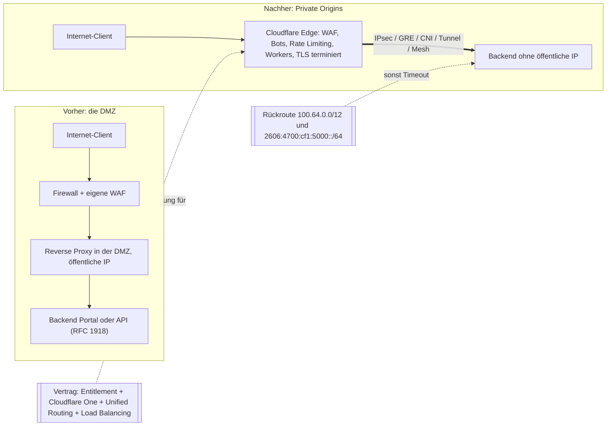
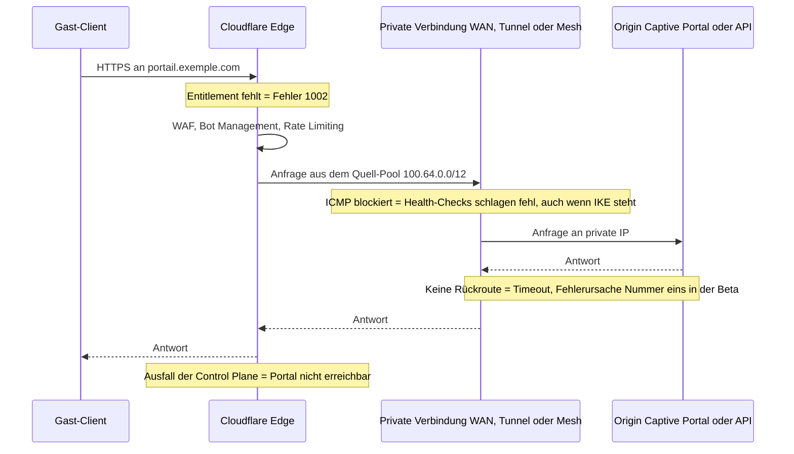

## Der Tag, an dem der Server das Internet verließ

Seit zwanzig Jahren folgt die Veröffentlichung eines Unternehmens-Webdienstes demselben Ritual. Man gibt ihm eine Adresse im Internet, versteckt ihn hinter einer Firewall, isoliert ihn in einer Pufferzone, die Architekten DMZ (demilitarisierte Zone) nennen, und hofft dann, dass niemand die falsche Filterregel eingeschleust hat. Die WLAN-Anmeldeseite eines Hotels, die API, die eine Handelskette mit ihrer Kassensoftware verbindet, das Portal, das die Bewohner eines Studierendenwohnheims authentifiziert: Alle leben mit dieser Tür, die einen Spalt weit zur Straße offen steht.

Am 30. Oktober 2026 hat Cloudflare die allgemeine Verfügbarkeit eines Dienstes angekündigt, der verspricht, sie wieder zu schließen. Das Prinzip passt in einen Satz: Ihr Server hat keine öffentliche Adresse mehr, und nur das Cloudflare-Netzwerk kann ihn erreichen, nachdem es jede Anfrage gefiltert und geprüft hat.

Für eine IT-Leitung, die Dutzende oder Hunderte von Standorten steuert, in der Hotellerie, im Retail oder in betriebenen Wohnanlagen, ist das ein starkes Versprechen. Es führt aber auch in die Irre, wenn man es zu schnell liest.

Meine These in wenigen Worten: Die DMZ verschwindet nicht, sie ändert ihre Natur. Gestern war es eine Firewall-Regel in Ihrem Besitz, die Ihren Server schützte. Morgen ist es eine Option, die Ihr Vertriebsansprechpartner freischaltet, eine Netzwerkroute, die man auf keinen Fall vergessen darf, und eine Control Plane, die Sie nicht steuern. Der Perimeter wird zum Vertrag.

## Vom Vorraum zur Straße zum Business-Center

Erst ein Bild, dann die Technik. Die klassische DMZ ist der Eingangsvorraum, den Sie im Erdgeschoss Ihres Gebäudes gebaut haben. Sie haben die Schlüssel, Sie wählen die Schlösser, aber er geht zur Straße hinaus, und jeder kann an der Klinke rütteln.

Private Origins heißt: Sie verlegen Ihren Empfang in ein Business-Center. Keine Tür mehr zur Straße. Die Sicherheit in der Lobby ist hervorragend, wahrscheinlich besser als Ihre eigene. Aber die Regeln macht der Betreiber, zu den Bedingungen seines Mietvertrags. Und an dem Tag, an dem die Lobby schließt, stehen Ihre Besucher auf dem Bürgersteig.

*Gestern: gestapelte Filterschichten zur Straße hin. Heute: ein einziger Tunnel zu einem Edge, der Ihnen nicht gehört.*

Technisch beginnt alles beim DNS. Sie legen einen ganz normalen A- oder AAAA-Eintrag an, über Cloudflare geproxyt, der auf eine private Adresse zeigt: eine 10.x, eine 192.168.x, eine Adresse, die im Internet nie routbar war. Das Cloudflare-Netzwerk nimmt die Anfrage entgegen, beendet die verschlüsselte TLS-Sitzung bei sich, wendet seine Schutzfunktionen an und leitet den Traffic dann über eine private Verbindung an Ihren Server weiter [1].

Diese Schutzfunktionen stammen aus dem gewohnten Katalog: die WAF (Web Application Firewall) mit ihren Managed Rules, die Bot-Erkennung, die Begrenzung der Anfragen pro Client. Dazu kommen Cache, Rewrite-Regeln und Workers, also kleine Programme, die direkt am Netzwerkrand laufen [1]. Ein Backend mit privater Adressierung erhält so denselben Schutz wie eine öffentliche Website, ohne je exponiert gewesen zu sein.

Für die private Verbindung gibt es sechs Optionen: IPsec, GRE (ein einfacher Kapselungstunnel), CNI (Cloudflare Network Interconnect, eine direkte physische Anbindung), Cloudflare Tunnel, Cloudflare Mesh und Cloudflare WAN [1]. Der Unterschied, der im Betrieb zählt: Bei WAN läuft auf dem Origin keinerlei Software. Bei Mesh läuft ein Connector in Ihrem privaten Netz, und den müssen Sie betreiben.

Nichts davon kommt aus dem Nichts. Im April 2018 stellte Cloudflare Argo Tunnel vor, mit einer Formel, die bis heute alles zusammenfasst: „Only Cloudflare can see the server“ [8]. Beim heutigen Cloudflare Tunnel öffnet der Agent `cloudflared` nur ausgehende Verbindungen, eingehend bleibt an der Firewall gesperrt [7]. Private Origins überträgt dieses Modell auf klassische Netzwerktunnel, ohne obligatorischen Agenten. Das ist weniger eine Erfindung als eine Industrialisierung. Und der Zeitplan wurde eingehalten: Die geschlossene Beta wurde am 10. Juni mit dem Ziel „GA in Q4 2026“ angekündigt, die allgemeine Verfügbarkeit (GA) kam am 30. Oktober [1] [2].

Zwei Grenzen sollten Sie kennen. Das private Routing ist für alle privaten Bereiche automatisch aktiv und nicht abschaltbar: die drei Blöcke der RFC 1918, der 100.64.0.0/10, den Netzbetreiber für Shared Address Space reserviert haben (RFC 6598), und fc00::/7 in IPv6 [1] [4]. Wer `private_routing: false` an die API schickt, bekommt einen Fehler zurück. Vor allem deckt der Dienst nur Traffic von öffentlich zu privat ab. Privat zu privat, also ein Standort, der über Cloudflare mit einem anderen spricht, ist noch in Entwicklung, mit einer geschlossenen Beta für „early 2027“ [1].

*Vorher war der Perimeter ein Stapel von Geräten, die Ihnen gehörten. Nachher hängt er an Vertragsobjekten und einer Rückroute.*

## Vier Schlüssel statt eines Schlosses

Nehmen Sie das häufigste Fehlerszenario der Beta. Der Tunnel steht, die WAF ist aktiv, der DNS-Name wird geproxyt. Ein Client öffnet das Portal. Die Anfrage durchquert den Edge, nimmt den Tunnel, erreicht den Server, der antwortet. Dann nichts mehr. Der Browser wartet und endet im Timeout.

Der Server hat schlicht an eine Adresse geantwortet, von der er nicht wusste, wohin er sie zurückschicken sollte. Cloudflare räumt das ein: Die fehlende Rückroute war während der Beta die häufigste Fehlerursache [2] [6]. Willkommen im neuen Perimeter. Er steckt nicht mehr in einer Firewall-Regel, sondern in vier Objekten, von denen zwei vertraglich sind.

**1. Das Entitlement.** Das Nutzungsrecht „Private Origins“ muss vom Account Team von Cloudflare aktiviert werden. Ohne es liefert das Proxying einer privaten IP den Fehler 1002 [1] [6]. Ihre Fähigkeit, Ihr Portal zu veröffentlichen, hängt also von einem Flag ab, das beim Anbieter gesetzt wird.

**2. Cloudflare One und Unified Routing.** Die Konnektivität muss über Cloudflare One laufen, die Netzwerk- und Zero-Trust-Plattform des Anbieters, und Unified Routing ist erforderlich, außer bei Tunnel [1]. Der WAN-Weg verlangt zusätzlich ein Cloudflare-WAN-Abonnement, ein Entitlement, das vom DNS-Zugang getrennt ist [5].

**3. Die Rückroute.** Cloudflare kontaktiert Ihren Origin aus einem Pool von Quelladressen: `100.64.0.0/12` in IPv4, `2606:4700:cf1:5000::/64` in IPv6 für WAN und Mesh [1]. Ihr Netz muss diese Pakete in den Tunnel zurückschicken können. Die WAN-Dokumentation stellt klar, dass dieser Pool ein privates /12 sein muss, das Standard-/12 oder „ein anderes privates /12“ Ihrer Wahl [5]. Bemerkenswertes Detail: Das IPv6-Präfix steht im GA-Beitrag, aber nicht in den eingesehenen Seiten der WAN- und Troubleshooting-Dokumentation.

**4. Das Load Balancing.** Die Origin-Health-Checks, also die Sonden, die prüfen, ob Ihr Server antwortet, setzen das Produkt Load Balancing voraus [1]. Ohne es gibt es keinen automatischen Failover auf einen zweiten Origin.

Um diese vier Schlüssel herum liegen weitere Einschränkungen. Argo Smart Routing, die Pfadoptimierung von Cloudflare, wird nicht unterstützt, ebenso wenig die dedizierten Egress-IPs des CDN [1]. Der Traffic nutzt ausschließlich das Standard-Virtual-Network: „Selecting a specific virtual network is not supported“ [4].

Bei WAN ist das Rezept streng: zwei Anycast-IPsec-Tunnel, statische Routen mit Priorität 100 und 101 und ICMP zwischen den Endpunkten erlaubt [5] [6]. Wer ICMP blockiert, bei dem scheitern die Health-Checks, obwohl der IKE-Schlüsselaustausch steht. Genau die Art Detail, die einen die Bereitschaftsnacht kostet.

Bleibt die Frage, die jeder Käufer zuerst stellt. Der Preis ist nicht veröffentlicht [1] [9]. Am 3. November zeigt die Dokumentation weiterhin „closed beta“ und „Enterprise-only“ an [3]. Meine Lesart: GA angekündigt, Doku noch in der Beta. Die Meta-Description des Beitrags verspricht den Dienst für „every customer with Cloudflare One connectivity“, doch der Haupttext beschreibt ein Entitlement, das man anfragen muss. Maßgeblich ist der Haupttext.

Unabhängige Berichterstattung gibt es vier Tage nach der Ankündigung so gut wie keine. Die einzige seriöse Analyse eines Dritten, die ich gefunden habe, stammt aus der Beta und benennt das Wesentliche: Das private Routing „routet“, es „authentifiziert“ nicht [9]. Die Identität läuft über Cloudflare Access und über eine Validierung auf Origin-Seite. Ein unsichtbarer Origin ist kein authentifizierter Origin.

*Jede Notiz ist ein Ausfallpunkt außerhalb Ihrer Firewall.*

## Drei Ausfälle, eine Control Plane

Am 18. November 2025 verdoppelte sich eine Konfigurationsdatei in der Größe. Nichts Böswilliges: Eine Berechtigungsänderung an einer ClickHouse-Datenbank hatte die Feature-Datei des Bot Management über ihr Limit von 200 Einträgen hinaus aufgebläht, während die normale Nutzung bei rund 60 liegt. Ergebnis: etwa 5 Std. 46 Min. Störung, von 11:20 bis 17:06 UTC. Cloudflare Access blieb bis zum Rollback um 13:05 im Fehlerzustand, Turnstile und das Dashboard waren beeinträchtigt [10].

Am 5. Dezember 2025 folgte ein kürzerer Alarm. Von 8:47 bis 9:12 UTC war rund 28 % des HTTP-Traffics betroffen, nach einer globalen Konfigurationsänderung (einem WAF-Killswitch), die einen Lua-Bug im alten FL1-Proxy weckte [11]. Auch das kein Angriff.

Am 20. Februar 2026 kam die dritte Episode. Eine API-Anfrage mit leerem Feld `pending_delete` wurde als „alle“ interpretiert. Rund 1.100 BYOIP-Präfixe (die Adressbereiche, die Kunden zu Cloudflare mitbringen) wurden entfernt, das sind 25 % der 4.306 Präfixe dieser Art. Mehrere Netzwerkprodukte waren betroffen (Magic Transit, Spectrum, dedizierte Egress-IPs), die vollständige Behebung erfolgte um 23:03 UTC [12]. Das Post-Mortem nennt 6 Std. 07 Min. Auswirkung, während seine eigenen Zeitstempel, von 17:56 bis 23:03, 5 Std. 07 Min. ergeben: Die Abweichung verdient einen Hinweis. Die geplanten Korrekturen gehen in die richtige Richtung: Typisierung der API, Snapshots, Circuit Breaker.

Seien wir ehrlich. Keiner dieser Vorfälle betrifft Private Origins: Alle liegen vor der Beta, und der vom Februar zielte auf andere Produkte. Sie beweisen nicht, dass dieser Dienst fragil ist. Sie beweisen, dass geteilte Control Planes, die aus global ausgerollten Konfigurationen gespeist werden, auf einen Schlag ausfallen können, und dass alle drei Ausfälle aus internen Fehlern entstanden sind.

Hier meine Analyse, und sie ist der Kern der Sache. Bei einem öffentlichen Origin gibt es, wenn der Edge ausfällt, eine unbequeme, aber reale Notausgangstür: den DNS wieder auf den Server zeigen lassen und ein paar Stunden ohne WAF überstehen. Bei einem privaten Origin gibt es diese Tür nicht mehr. Es gibt keine öffentliche Adresse, auf die man umschalten könnte. Rechnen Sie die Konzentration von DNS, TLS, Transport und Zugang bei einem einzigen Anbieter hinzu, die Groundy anmerkt [9], und Sie erhalten einen Single Point of Failure. Elegant, aber eben nur einer.

## Das Captive Portal, idealer Kandidat und Achillesferse

Für ein WLAN-Netz mit vielen Standorten liegt der beste Kandidat auf der Hand: das Captive Portal. Die RFC 8908 (September 2020) definiert seine API über HTTPS, im JSON-Format `application/captive+json` [19]. Reines HTTPS, von öffentlich zu privat: exakt der Geltungsbereich des Produkts. WAF, Rate Limiting und Bot-Erkennung vor einem Backend ohne öffentliche IP, dazu Workers für Weiterleitung oder standortspezifisches Branding, das passt sehr gut.

Dieselbe Logik gilt für REST-Integrations-APIs: das PMS (Property Management System, die Hotelverwaltungssoftware), die Abrechnung, das Back-Office.

Das Captive Portal hat aber eine Besonderheit, die eine Imagewebsite nicht hat. Seine Verfügbarkeit entscheidet über den Netzzugang. Ein ausgefallenes Portal ist keine nicht erreichbare Seite: Es ist ein ganzes Haus, dessen Gäste sich nicht mehr verbinden können.

Außerhalb des Geltungsbereichs liegt außerdem einiges, und die Liste ist lang. RADIUS und RadSec (die Authentifizierung der WLAN-Nutzer), CAPWAP (der Dialog zwischen Controller und Access Points) oder MQTT (das Messaging der vernetzten Geräte) sind kein HTTP, und der GA-Beitrag deckt sie nicht ab.

Spectrum, der TCP- und UDP-Proxy von Cloudflare, funktionierte in der Beta nur über Cloudflare Tunnel [2]. Der GA-Beitrag sagt dazu nichts: Ich unterstelle daher keine Unterstützung. Und privat zu privat, nützlich, um einen Standort-Controller mit einer internen Cloud zu verbinden, ist 2026 nicht planbar.

*An einem Hotelstandort eignet sich das Captive Portal für die Übung. RADIUS und der Dialog zwischen Controller und Access Points nicht.*

Es bleiben die harten Punkte bei Multi-Site-Betrieb. Manche sind dokumentiert. Andere sind Schlussfolgerungen von mir, als solche gekennzeichnet, die Sie vor jeder festen Empfehlung mit dem Account Team klären sollten.

**Überlappende Adressierung.** Viele Bestände nutzen von Standort zu Standort dasselbe 10.x. Nutzbar ist aber nur das Standard-Virtual-Network [4]. Meine Lesart: Zwei Standorte mit identischem Adressplan lassen sich über getrennte Virtual Networks nicht unterscheiden. Wahrscheinliche Voraussetzung: ein globaler Adressplan oder eine standortbezogene Adressumsetzung.

**Das Nebeneinander von /10 und /12.** Keine Inkonsistenz bei Cloudflare. Das /10 (100.64.0.0 bis 100.127.255.255) ist der Zielbereich, der das private Routing auslöst. Das /12 (100.64.0.0 bis 100.79.255.255) ist der Quell-Pool Richtung Origin, enthalten in diesem /10.

Meine Hypothese: Ein Standort, dessen LAN, das CGNAT eines Netzbetreibers (die gemeinsam genutzte Adressumsetzung) oder ein Overlay diesen Bereich bereits nutzt, kann mit dem Quell-Pool kollidieren. Die WAN-Doku erlaubt „ein anderes privates /12“; der GA-Beitrag sagt das für Mesh nicht [1] [5].

**Die Quell-IPs.** Keine dedizierten Egress-IPs [1]. Wenn ein Dritter, etwa ein PMS-Anbieter oder eine Bank, Ihre Quelladressen filtert, funktioniert das Schema nicht.

**Die TLS-Terminierung.** Sie erfolgt bei Cloudflare [1]. Die von den Gästen eingegebenen Daten sind am Edge also im Klartext sichtbar. Ein DSGVO-Thema, das Sie mit Ihrem Datenschutzbeauftragten klären sollten und das ich hier nicht entscheide.

**Die Kosten pro Standort.** Bei WAN: zwei Anycast-Tunnel, Routen 100 und 101, ICMP offen. Bei Tunnel oder Mesh: ein Connector, der an jedem Standort ausgerollt, aktualisiert und überwacht werden muss. Beides lässt sich beziffern, und das Load Balancing kommt auf eine Rechnung obendrauf, deren Tarif unbekannt bleibt.

## Einen Origin verstecken: drei Schulen

Cloudflare ist nicht der Einzige, der den Origin verschwinden lassen will, aber die Ansätze gehen auseinander.

AWS hat am 20. November 2024 CloudFront VPC origins gestartet: ein Load Balancer oder eine Instanz in einem privaten Subnetz, vom CDN ohne Aufpreis bedient („no additional cost“) [13]. Microsoft bietet Private Link bei Azure Front Door an, nur im Premium-Tier, mit manueller Freigabe auf Origin-Seite und einem Limit von 7.200 Anfragen pro Sekunde pro regionalem Cluster und Profil [15].

Akamai wiederum verlangt einen öffentlich routbaren Origin: RFC-1918-Bereiche werden ausdrücklich abgelehnt [16]. Der Schutz läuft über Site Shield, eine Liste von Akamai-IPs, die Sie an Ihrer Firewall freigeben müssen und die der Anbieter als „not a substitute for authentication“ darstellt [17]. Ein Äquivalent für „privaten Origin“ habe ich in der öffentlichen Doku nicht gefunden, was nicht beweist, dass es keines gibt. Zscaler ZPA spielt ein anderes Spiel: Es verbindet identifizierte Nutzer mit privaten Anwendungen, über einen ausschließlich ausgehenden Connector [18].

| Angebot | Wo der Origin lebt | Zugriffskontrolle | Wesentliche Einschränkungen |
|---|---|---|---|
| Cloudflare Private Origins | Ihre Standorte oder Rechenzentren, via IPsec, GRE, CNI, Tunnel, Mesh, WAN | Entitlement + Rückroute | Preis nicht veröffentlicht, kein dedizierter Egress, Spectrum bei GA nicht bestätigt |
| AWS CloudFront VPC origins | Privates AWS-Subnetz (ALB, NLB, EC2) | Security Group + Managed Prefix List | Kein gRPC, keine Lambda@Edge-Trigger auf Origin-Seite, kein NLB mit TLS-Listener |
| Azure Front Door Premium Private Link | Über Private Link exponierter Origin | Manuelle Freigabe des Private Endpoint | Nur Premium, kein mTLS, 7.200 RPS, kein Mix aus öffentlich und privat in einer Gruppe |
| Akamai mit Site Shield | Öffentliche IP zwingend, RFC 1918 abgelehnt | Allowlist der Akamai-IPs an Ihrer Firewall | Laufende Pflege, kein Ersatz für Authentifizierung |

Meine Analyse: Die Hyperscaler gehen davon aus, dass Ihr Origin in ihrer Cloud lebt. Cloudflare wettet auf das Gegenteil, einen Origin in Ihrem Rechenzentrum, an Ihrem Standort, in Ihrem Rack, über einen Tunnel angebunden. Für ein B2B-Netz mit vielen Standorten ist es das einzige der vier Modelle, das zur tatsächlichen Geografie der Server passt. Das macht das Angebot interessant. Es macht auch die Bindung tiefer.

## Unterschreiben, aber den Mietvertrag lesen

Ich lege mich fest. Für HTTPS-Portale und exponierte APIs gehe ich das an. Eine auf null gebrachte Internet-Angriffsfläche am Origin ist ein echter Gewinn, den weder eine Allowlist noch ein Reverse Proxy in der DMZ liefert. Aber ich behandle die Entscheidung wie einen Einkauf, nicht wie eine Netzwerkkonfiguration.

Das sind die Fragen, die ich dem Account Team vor der Unterschrift stellen würde:

- Welcher Preis, und welche Abrechnungseinheit, Load Balancing eingeschlossen?
- Welches SLA (Service Level Agreement) gilt spezifisch für Private Origins?
- Was passiert, wenn das Entitlement ausläuft? Meine Hypothese ist ein Fehler 1002 auf allen privaten Origins. Ich will die Antwort schriftlich.
- Welche Vorlaufzeit gilt bei einer Änderung des Quell-Pools?
- Werden Spectrum und UDP bei GA unterstützt?
- Welche Reversibilität, also welcher dokumentierte Weg zurück zu einer gefilterten öffentlichen IP?

Bei diesem letzten Punkt lohnt es sich zu verweilen. Der Notfallplan bei einem längeren Ausfall des Edge ist genau die DMZ, die Sie gerade abgeschafft haben. Mein Rat: Reißen Sie sie nicht ab, legen Sie sie schlafen. Ein öffentlicher Fallback-Pfad, dokumentiert, jedes Quartal getestet, aktivierbar in Stunden statt in Tagen. Für ein Captive Portal, von dem die Verbindung eines ganzen Hauses abhängt, ist das das Minimum.

*Die Sicherheit des Origin entscheidet sich heute ebenso im Vertrag wie im Patchfeld.*

Ein Wort zum regulatorischen Rahmen, rein sachlich. Die NIS2-Richtlinie (Richtlinie (EU) 2022/2555, am 27. Dezember 2022 im Amtsblatt veröffentlicht) behandelt in Artikel 21 Absatz 2 Buchstabe d die Sicherheit der Lieferkette [20]. Artikel 21 richtet sich an wesentliche und wichtige Einrichtungen im Sinne der Richtlinie. Die Durchführungsverordnung (EU) 2024/2690 (Dokument C(2024)7151) konkretisiert die Maßnahmen, darunter Kriterien für die Auswahl von Anbietern und Vertragsklauseln, gilt aber nur für bestimmte Kategorien digitaler Anbieter (DNS, TLD-Registries, Cloud, Rechenzentren, CDN, Managed Services usw.), nicht für alle NIS2-Einrichtungen [21]. Ob Ihre Organisation oder Ihre Kunden darunterfallen und was das für diese Art von Dienst bedeutet, ist eine Frage an Ihre Rechtsabteilung.

Die DMZ war eine Mauer, die Sie selbst gebaut haben. Private Origins ist ein Mietvertrag, den Sie unterschreiben. Die Mauer hat man Stein für Stein geprüft. Den Mietvertrag wird man Klausel für Klausel lesen müssen.

_Persönliche Ansichten, keine Position von Wifirst._

## Quellen

1. [Cloudflare — Cloudflare services for private origins (annonce GA, 30 octobre 2026)](https://blog.cloudflare.com/private-origins-public-to-private/)
2. [Cloudflare — Route public traffic to private applications (annonce beta, 10 juin 2026)](https://blog.cloudflare.com/private-origins-dns-routing/)
3. [Cloudflare Docs — Private origins (beta)](https://developers.cloudflare.com/dns/private-origins/)
4. [Cloudflare Docs — Private network routing](https://developers.cloudflare.com/dns/private-origins/private-network-routing/index.md)
5. [Cloudflare Docs — Set up a private origin via Cloudflare WAN](https://developers.cloudflare.com/dns/private-origins/set-up-via-cloudflare-wan/index.md) (voir aussi [Cloudflare WAN — Private origin](https://developers.cloudflare.com/cloudflare-wan/private-origin-via-cloudflare-wan/))
6. [Cloudflare Docs — Troubleshooting private origins](https://developers.cloudflare.com/dns/private-origins/troubleshooting/index.md)
7. [Cloudflare Docs — Cloudflare Tunnel](https://developers.cloudflare.com/cloudflare-one/networks/connectors/cloudflare-tunnel/)
8. [Cloudflare — Argo Tunnel: a private link to the public Internet (5 avril 2018)](https://blog.cloudflare.com/argo-tunnel/)
9. [Groundy — Cloudflare routes public traffic to private apps via DNS (23 juin 2026)](https://groundy.com/articles/cloudflare-now-routes-public-traffic-to-private-apps-via-dns-no-vpn/)
10. [Cloudflare — Post-mortem de l'incident du 18 novembre 2025](https://blog.cloudflare.com/18-november-2025-outage/)
11. [Cloudflare — Post-mortem de l'incident du 5 décembre 2025](https://blog.cloudflare.com/5-december-2025-outage/)
12. [Cloudflare — Outage on February 20, 2026 (BYOIP)](https://blog.cloudflare.com/cloudflare-outage-february-20-2026/)
13. [AWS — Amazon CloudFront VPC origins (20 novembre 2024)](https://aws.amazon.com/about-aws/whats-new/2024/11/amazon-cloudfront-vpc-origins)
14. [AWS Docs — Restrict access with VPC origins](https://docs.aws.amazon.com/AmazonCloudFront/latest/DeveloperGuide/private-content-vpc-origins.md)
15. [Microsoft Learn — Azure Front Door Premium Private Link](https://learn.microsoft.com/azure/frontdoor/private-link)
16. [Akamai TechDocs — Custom origin prerequisites](https://techdocs.akamai.com/property-mgr/docs/custom-origin-prerequisites)
17. [Akamai TechDocs — Site Shield](https://techdocs.akamai.com/site-shield/docs/welcome-site-shield)
18. [Zscaler Help — About App Connectors](https://help.zscaler.com/zpa/about-connectors)
19. [IETF — RFC 8908, Captive Portal API (septembre 2020)](https://www.rfc-editor.org/rfc/rfc8908.html)
20. [EUR-Lex — Directive (UE) 2022/2555 (NIS2), article 21](https://eur-lex.europa.eu/legal-content/EN/TXT/HTML/?uri=CELEX%3A32022L2555)
21. [EUR-Lex — Règlement d'exécution (UE) 2024/2690 (NIS2, fournisseurs numériques)](https://eur-lex.europa.eu/eli/reg_impl/2024/2690/oj)
