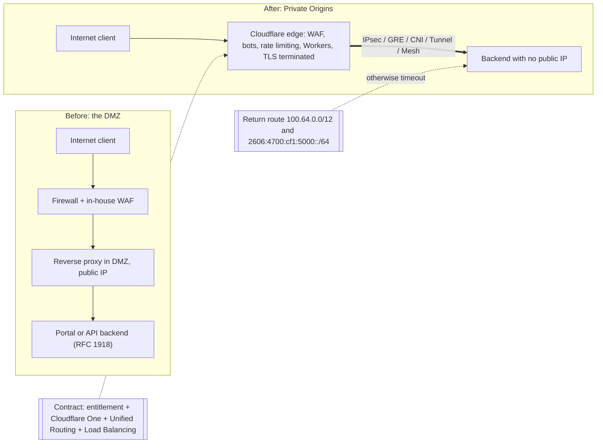
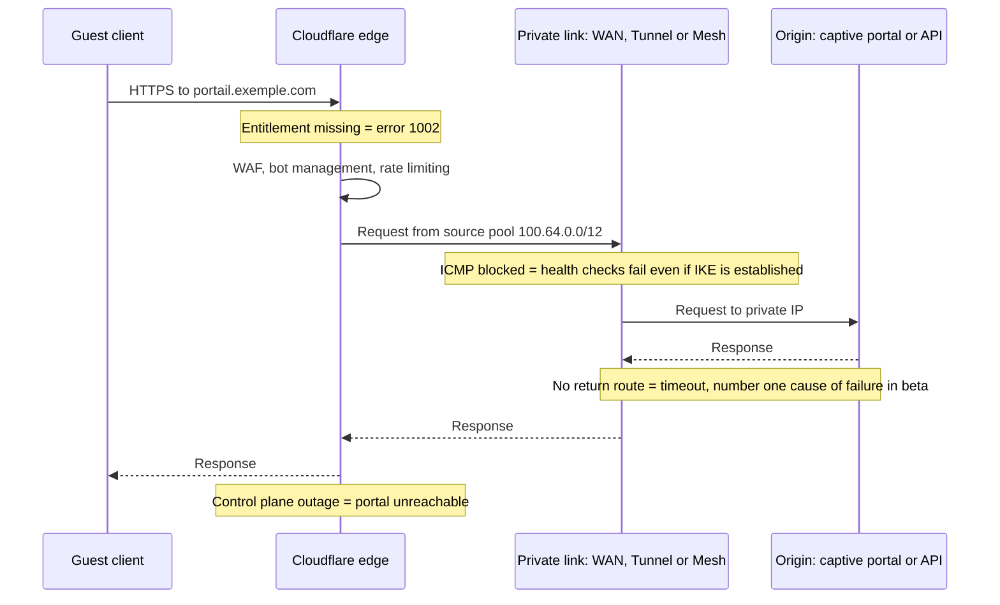

## The Day the Server Left the Internet

For twenty years, publishing an enterprise web service has followed the same ritual. You give it an address on the Internet, hide it behind a firewall, isolate it in a buffer zone that architects call the DMZ (demilitarized zone), and then hope nobody slipped in the wrong filtering rule. The Wi-Fi login page of a hotel, the API linking a retail chain to its point-of-sale software, the portal that authenticates the occupants of a student residence: all of them live with that door left ajar onto the street.

On October 30, 2026, Cloudflare announced the general availability of a service that offers to close it. The principle fits in one sentence: your server no longer has a public address, and only Cloudflare's network can reach it, after filtering and inspecting every request.

For an IT department running dozens or hundreds of sites, in hospitality, retail or managed residences, the promise is strong. It is also misleading if you read it too fast.

My thesis fits in a few words. The DMZ doesn't disappear, it changes nature. Yesterday, what protected your server was a firewall rule that you owned. Tomorrow, it will be an option switched on by your sales contact, a network route you must not forget, and a control plane you don't run. The perimeter becomes a contract.

## From Street-Level Airlock to Business Center

An image before the technology. The classic DMZ is the entrance airlock you built on the ground floor of your building. You hold the keys, you choose the locks, but it opens onto the street and anyone can come and rattle the handle.

Private Origins is moving your reception desk into a business center. No more doors onto the street. The security of the lobby is excellent, probably better than yours. But the operator sets the rules, on the terms of its lease. And the day the lobby closes, your visitors are left standing on the sidewalk.

*Yesterday, stacked layers of filtering facing the street. Today, a single tunnel to an edge you don't own.*

On the mechanics side, everything starts with DNS. You create a standard A or AAAA record, proxied by Cloudflare, that points to a private address: a 10.x, a 192.168.x, an address that has never been routable on the Internet. Cloudflare's network receives the request, terminates the TLS-encrypted session on its side, applies its protections, then forwards the traffic to your server over a private link [1].

These protections come from the usual catalog: the WAF (Web Application Firewall) with its managed rules, bot detection, per-client rate limiting. Add caching, rewrite rules and Workers, those small programs that run right at the network edge [1]. A backend on private addressing thus gets the same armor as a public site, without ever having been exposed.

For the private link, there are six options: IPsec, GRE (a simple encapsulation tunnel), CNI (Cloudflare Network Interconnect, a direct physical interconnection), Cloudflare Tunnel, Cloudflare Mesh and Cloudflare WAN [1]. The nuance that matters in operations: with WAN, no software runs on the origin. With Mesh, a connector runs inside your private network, and you have to operate it.

None of this comes out of nowhere. In April 2018, Cloudflare introduced Argo Tunnel with a line that still sums everything up: "Only Cloudflare can see the server" [8]. Now called Cloudflare Tunnel, its `cloudflared` agent opens outbound connections only, with inbound traffic left blocked at the firewall [7]. Private Origins extends this model to classic network tunnels, with no mandatory agent. It is less an invention than an industrialization. And the schedule was kept: closed beta announced on June 10 with a "GA in Q4 2026" target, general availability (GA) on October 30 [1] [2].

Two boundaries worth knowing. Private routing is automatic, and cannot be disabled, for all private ranges: the three RFC 1918 blocks, 100.64.0.0/10 reserved for carrier-grade address sharing (RFC 6598) and fc00::/7 in IPv6 [1] [4]. Sending `private_routing: false` to the API returns an error. Above all, the service only covers public-to-private traffic. Private-to-private, where one site would talk to another through Cloudflare, is still in development, with a closed beta targeted for "early 2027" [1].

*Before, the perimeter was a stack of equipment you owned. After, it depends on contractual objects and a return route.*

## Four Keys Instead of One Lock

Take the most frequent failure scenario of the beta. The tunnel is up, the WAF is active, the DNS name is proxied. A client opens the portal. The request crosses the edge, takes the tunnel, reaches the server, which answers. Then nothing. The browser waits and ends in a timeout.

The server simply replied to an address it didn't know how to send back to. Cloudflare acknowledges it: the missing return route was the number one cause of failure during the beta [2] [6]. Welcome to the new perimeter. It no longer fits in a firewall rule, but in four objects, two of which are contractual.

**1. The entitlement.** The "Private Origins" usage right must be activated by Cloudflare's account team. Without it, proxying a private IP returns error 1002 [1] [6]. Your ability to publish your portal therefore depends on a flag set at the vendor.

**2. Cloudflare One and Unified Routing.** Connectivity must go through Cloudflare One, the vendor's network and Zero Trust platform, and Unified Routing is required except with Tunnel [1]. The WAN path additionally requires a Cloudflare WAN subscription, an entitlement separate from DNS access [5].

**3. The return route.** Cloudflare contacts your origin from a pool of source addresses: `100.64.0.0/12` in IPv4, `2606:4700:cf1:5000::/64` in IPv6 for WAN and Mesh [1]. Your network must know how to send those packets back into the tunnel. The WAN documentation specifies that this pool must be a private /12, either the default one or "another private /12" of your choice [5]. A notable detail: the IPv6 prefix appears in the GA post, but not in the WAN and troubleshooting documentation pages I consulted.

**4. Load Balancing.** Origin health checks, the probes that verify your server is responding, require the Load Balancing product [1]. Without it, no automatic failover to a second origin.

Around these four keys hover a number of limits. Argo Smart Routing, Cloudflare's path optimization, is not supported, nor are the CDN's dedicated egress IPs [1]. Traffic only uses the default virtual network: "Selecting a specific virtual network is not supported" [4].

On the WAN side, the recipe is strict: two anycast IPsec tunnels, static routes at priority 100 and 101, and ICMP allowed between the endpoints [5] [6]. Block ICMP, and health checks fail even though the IKE key negotiation is established. The kind of detail that costs a night on call.

That leaves the question every buyer asks first. The price is not published [1] [9]. As of November 3, the documentation still says "closed beta" and "Enterprise-only" [3]. My reading: GA announced, docs still in beta. The post's meta description promises the service to "every customer with Cloudflare One connectivity", but the body describes an entitlement you have to request. The body is what counts.

Independent coverage, for its part, is almost nonexistent four days after the announcement. The only serious third-party analysis I found dates from the beta, and it points at the essential: private routing "routes", it doesn't "authenticate" [9]. Identity goes through Cloudflare Access and through validation on the origin side. An invisible origin is not an authenticated origin.

*Each note is a point of failure located outside your firewall.*

## Three Outages, One Control Plane

On November 18, 2025, a configuration file doubled in size. Nothing malicious: a permissions change on a ClickHouse database had caused the Bot Management feature file to swell past its limit of 200 entries, when normal usage hovers around 60. The result: about 5 hours 46 minutes of disruption, from 11:20 to 17:06 UTC. Cloudflare Access remained in failure until the 13:05 rollback, and Turnstile and the dashboard were degraded [10].

On December 5, 2025, a shorter alert. From 08:47 to 09:12 UTC, about 28% of HTTP traffic was affected, after a global configuration change (a WAF killswitch) that woke up a Lua bug in the old FL1 proxy [11]. Not an attack either.

On February 20, 2026, a third episode. An API request whose `pending_delete` field was empty was interpreted as "all". About 1,100 BYOIP prefixes (the address ranges customers bring to Cloudflare) were withdrawn, or 25% of the 4,306 prefixes of that type. Several network products were hit (Magic Transit, Spectrum, dedicated egress IPs), with full remediation at 23:03 UTC [12]. The post-mortem states 6 hours 7 minutes of impact, whereas its own timestamps, from 17:56 to 23:03, give 5 hours 7 minutes: the discrepancy is worth flagging. The planned fixes go in the right direction: API typing, snapshots, circuit breaker.

Let's be honest. None of these incidents involves Private Origins: all predate its beta, and the February one targeted other products. They don't prove that this service is fragile. They prove that shared control planes, fed by globally pushed configurations, can go down all at once, and that all three outages were born from internal errors.

Here is my analysis, and it is the heart of the matter. With a public origin, when the edge goes down, there is an uncomfortable but real escape hatch: repoint DNS to the server and absorb a few hours without a WAF. With a private origin, that hatch no longer exists. There is no public address to fail over to. Add the concentration of DNS, TLS, transport and access at a single vendor, noted by Groundy [9], and you get a single point of failure. Elegant, but single.

## The Captive Portal, Ideal Candidate and Achilles' Heel

For a multi-site Wi-Fi network, the best candidate jumps out: the captive portal. RFC 8908 (September 2020) defines its API over HTTPS, in the JSON format `application/captive+json` [19]. Pure HTTPS, public to private: exactly the product's scope. WAF, rate limiting and bot detection in front of a backend with no public IP, plus Workers for per-site redirection or theming, make for a very good fit.

Same logic for integration REST APIs: the PMS (Property Management System, the hotel management software), billing, the back office.

But the captive portal has a particularity that a showcase site doesn't. Its availability determines network access. A portal that is down isn't an unavailable page: it's an entire establishment whose customers can no longer connect.

Out of scope, next, and the list is long. RADIUS and RadSec (Wi-Fi user authentication), CAPWAP (the dialogue between controller and access points) or MQTT (messaging for connected objects) aren't HTTP, and the GA post doesn't cover them.

Spectrum, Cloudflare's TCP and UDP proxy, worked in beta only via Cloudflare Tunnel [2]. The GA post says nothing about it: so I don't presume its support. As for private-to-private, useful for linking a site controller to an internal cloud, it can't be planned for in 2026.

*On a hotel site, the captive portal lends itself to the exercise. RADIUS and the controller-to-access-point dialogue do not.*

That leaves the hard points of multi-site. Some are documented. Others are inferences on my part, flagged as such, to be validated with the account team before any firm recommendation.

**Overlapping addressing.** Many fleets reuse the same 10.x from one site to the next. Yet only the default virtual network is usable [4]. My reading: it is impossible to tell apart two sites with identical addressing plans through separate virtual networks. Probable prerequisite: a global addressing plan, or per-site address translation.

**Coexistence of /10 and /12.** No inconsistency at Cloudflare. The /10 (100.64.0.0 to 100.127.255.255) is the destination range that triggers private routing. The /12 (100.64.0.0 to 100.79.255.255) is the source pool used toward the origin, included in that /10.

My hypothesis: a site whose LAN, carrier CGNAT (pooled address translation) or overlay already uses this range may collide with the source pool. The WAN doc allows "another private /12"; the GA post doesn't specify this for Mesh [1] [5].

**Source IPs.** No dedicated egress IPs [1]. If a third party, a PMS vendor or a bank, filters your source addresses, the setup doesn't work.

**TLS termination.** It happens at Cloudflare [1]. Data entered by guests is therefore visible in clear text on the edge. A GDPR matter to examine with your DPO, not to settle here.

**Cost per site.** On the WAN side: two anycast tunnels, routes 100 and 101, ICMP open. On the Tunnel or Mesh side: a connector to deploy, update and monitor at every site. Both can be costed, and Load Balancing adds to a bill whose pricing remains unknown.

## Hiding an Origin: Three Schools of Thought

Cloudflare isn't alone in wanting to make the origin disappear, but the approaches diverge.

AWS launched CloudFront VPC origins on November 20, 2024: a load balancer or an instance in a private subnet, served by the CDN at no extra charge ("no additional cost") [13]. Microsoft offers Private Link on Azure Front Door, Premium tier only, with manual approval on the origin side and a limit of 7,200 requests per second per regional cluster and per profile [15].

Akamai, for its part, requires a publicly routable origin: RFC 1918 ranges are explicitly rejected [16]. Protection goes through Site Shield, a list of Akamai IPs to allow on your firewall, which the vendor presents as "not a substitute for authentication" [17]. I didn't find a "private origin" equivalent in its public docs, which doesn't prove none exists. Zscaler ZPA plays a different game: it connects identified users to private applications, through an outbound-only connector [18].

| Offering | Where the origin lives | Access control | Notable limits |
|---|---|---|---|
| Cloudflare Private Origins | Your sites or datacenters, via IPsec, GRE, CNI, Tunnel, Mesh, WAN | Entitlement + return route | Price not published, no dedicated egress, Spectrum not confirmed at GA |
| AWS CloudFront VPC origins | AWS private subnet (ALB, NLB, EC2) | Security group + managed prefix list | No gRPC, no Lambda@Edge triggers on the origin side, no NLB with TLS listener |
| Azure Front Door Premium Private Link | Origin exposed via Private Link | Manual approval of the private endpoint | Premium only, no mTLS, 7,200 RPS, no public/private mix in a group |
| Akamai with Site Shield | Public IP required, RFC 1918 rejected | Allowlist of Akamai IPs on your firewall | Ongoing maintenance, not a substitute for authentication |

My analysis: the hyperscalers start from the assumption that your origin lives in their cloud. Cloudflare bets on the opposite, an origin in your datacenter, on your site, in your rack, reached through a tunnel. For a multi-site B2B network, it is the only one of the four models that fits the real geography of the servers. That is what makes the offer interesting. It is also what makes the lock-in deeper.

## Sign, but Read the Lease

I'll take a stand. For HTTPS portals and exposed APIs, I'm in. An Internet attack surface brought down to zero on the origin is a real gain, one that no allowlist and no reverse proxy in a DMZ delivers. But I treat the decision as a purchase, not as a network configuration.

Here are the questions I would ask the account team before signing:

- What price, and what billing unit, Load Balancing included?
- What SLA (service level agreement) specific to Private Origins?
- What happens if the entitlement expires? My hypothesis is an error 1002 on all private origins. I want the answer in writing.
- What notice period in case of a change to the source pool?
- Are Spectrum and UDP supported at GA?
- What reversibility, meaning what documented path back to a filtered public IP?

That last point deserves a pause. The fallback plan, in case of a prolonged edge outage, is precisely the DMZ you just removed. My advice: don't demolish it, put it to sleep. A documented public fallback path, tested every quarter, activatable in hours rather than days. For a captive portal on which an entire establishment's connectivity depends, that's a minimum.

*Origin security is now decided as much in the contract as in the patch panel.*

A word on the regulatory framework, staying factual. The NIS2 directive (Directive (EU) 2022/2555, published in the Official Journal on December 27, 2022) addresses supply chain security in its Article 21(2)(d) [20]. Article 21 targets essential and important entities within the meaning of the directive. Implementing Regulation (EU) 2024/2690 (document C(2024)7151) specifies the measures, including supplier selection criteria and contractual clauses, but it only applies to certain categories of digital providers (DNS, TLD registries, cloud, data centers, CDN, managed services, etc.), not to all NIS2 entities [21]. Whether your organization or your clients fall under it, and what that implies for this type of service, is a question for your legal department.

The DMZ was a wall you built yourself. Private Origins is a lease you sign. The wall, you inspected brick by brick. The lease, you will have to read clause by clause.

_Personal views, not Wifirst's position._

## Sources

1. [Cloudflare — Cloudflare services for private origins (annonce GA, 30 octobre 2026)](https://blog.cloudflare.com/private-origins-public-to-private/)
2. [Cloudflare — Route public traffic to private applications (annonce beta, 10 juin 2026)](https://blog.cloudflare.com/private-origins-dns-routing/)
3. [Cloudflare Docs — Private origins (beta)](https://developers.cloudflare.com/dns/private-origins/)
4. [Cloudflare Docs — Private network routing](https://developers.cloudflare.com/dns/private-origins/private-network-routing/index.md)
5. [Cloudflare Docs — Set up a private origin via Cloudflare WAN](https://developers.cloudflare.com/dns/private-origins/set-up-via-cloudflare-wan/index.md) (voir aussi [Cloudflare WAN — Private origin](https://developers.cloudflare.com/cloudflare-wan/private-origin-via-cloudflare-wan/))
6. [Cloudflare Docs — Troubleshooting private origins](https://developers.cloudflare.com/dns/private-origins/troubleshooting/index.md)
7. [Cloudflare Docs — Cloudflare Tunnel](https://developers.cloudflare.com/cloudflare-one/networks/connectors/cloudflare-tunnel/)
8. [Cloudflare — Argo Tunnel: a private link to the public Internet (5 avril 2018)](https://blog.cloudflare.com/argo-tunnel/)
9. [Groundy — Cloudflare routes public traffic to private apps via DNS (23 juin 2026)](https://groundy.com/articles/cloudflare-now-routes-public-traffic-to-private-apps-via-dns-no-vpn/)
10. [Cloudflare — Post-mortem de l'incident du 18 novembre 2025](https://blog.cloudflare.com/18-november-2025-outage/)
11. [Cloudflare — Post-mortem de l'incident du 5 décembre 2025](https://blog.cloudflare.com/5-december-2025-outage/)
12. [Cloudflare — Outage on February 20, 2026 (BYOIP)](https://blog.cloudflare.com/cloudflare-outage-february-20-2026/)
13. [AWS — Amazon CloudFront VPC origins (20 novembre 2024)](https://aws.amazon.com/about-aws/whats-new/2024/11/amazon-cloudfront-vpc-origins)
14. [AWS Docs — Restrict access with VPC origins](https://docs.aws.amazon.com/AmazonCloudFront/latest/DeveloperGuide/private-content-vpc-origins.md)
15. [Microsoft Learn — Azure Front Door Premium Private Link](https://learn.microsoft.com/azure/frontdoor/private-link)
16. [Akamai TechDocs — Custom origin prerequisites](https://techdocs.akamai.com/property-mgr/docs/custom-origin-prerequisites)
17. [Akamai TechDocs — Site Shield](https://techdocs.akamai.com/site-shield/docs/welcome-site-shield)
18. [Zscaler Help — About App Connectors](https://help.zscaler.com/zpa/about-connectors)
19. [IETF — RFC 8908, Captive Portal API (septembre 2020)](https://www.rfc-editor.org/rfc/rfc8908.html)
20. [EUR-Lex — Directive (UE) 2022/2555 (NIS2), article 21](https://eur-lex.europa.eu/legal-content/EN/TXT/HTML/?uri=CELEX%3A32022L2555)
21. [EUR-Lex — Règlement d'exécution (UE) 2024/2690 (NIS2, fournisseurs numériques)](https://eur-lex.europa.eu/eli/reg_impl/2024/2690/oj)
