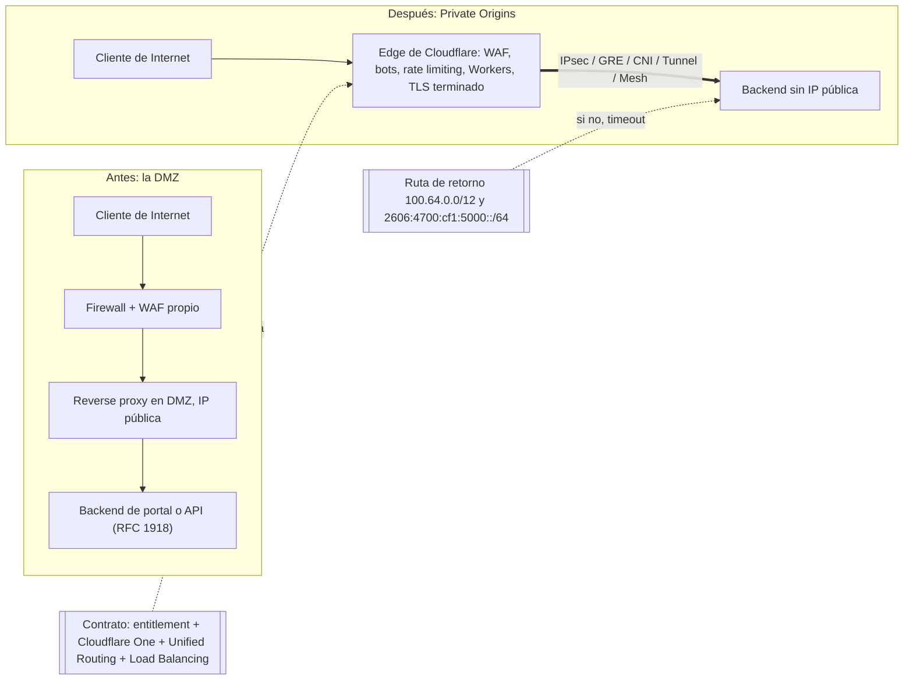
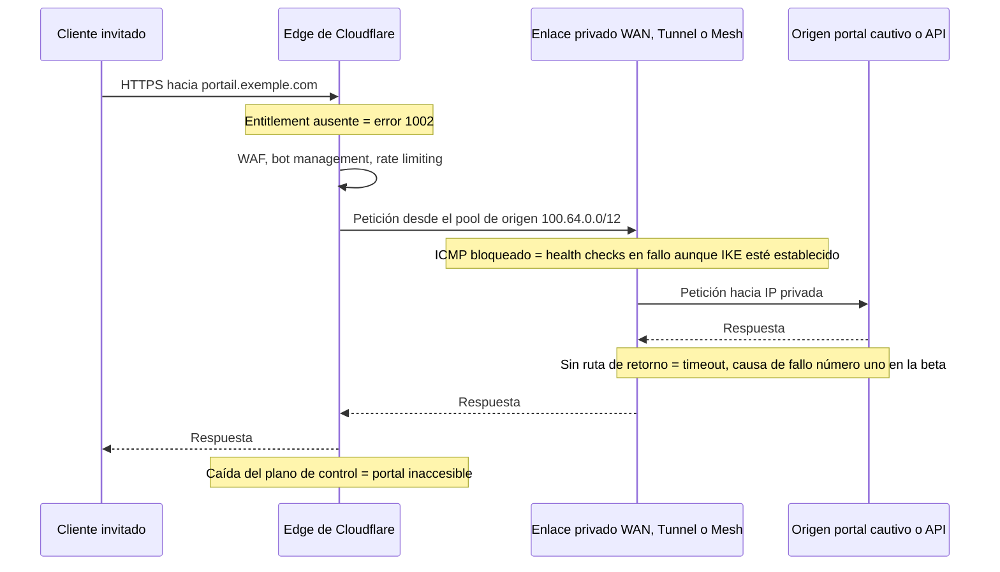

## El día en que el servidor salió de Internet

Desde hace veinte años, publicar un servicio web corporativo sigue el mismo ritual. Se le asigna una dirección en Internet, se lo esconde detrás de un firewall, se lo aísla en una zona tampón que los arquitectos llaman DMZ (zona desmilitarizada) y se cruzan los dedos para que nadie haya colado una regla de filtrado equivocada. La página de conexión Wi-Fi de un hotel, la API que une una cadena de tiendas con su software de caja, el portal que autentica a los ocupantes de una residencia universitaria: todos viven con esa puerta entreabierta a la calle.

El 30 de octubre de 2026, Cloudflare anunció la disponibilidad general de un servicio que propone cerrarla. El principio cabe en una frase: su servidor ya no tiene dirección pública y solo la red de Cloudflare puede alcanzarlo, después de filtrar e inspeccionar cada petición.

Para un departamento de TI que gestiona decenas o cientos de sitios, en hotelería, retail o residencias gestionadas, la promesa es poderosa. También es engañosa si se lee con prisa.

Mi tesis cabe en pocas palabras. La DMZ no desaparece, cambia de naturaleza. Ayer, lo que protegía su servidor era una regla de firewall que usted poseía. Mañana será una opción activada por su contacto comercial, una ruta de red que no se puede olvidar bajo ningún concepto y un plano de control que usted no gobierna. El perímetro se convierte en un contrato.

## De la esclusa a pie de calle al centro de negocios

Una imagen antes de la técnica. La DMZ clásica es la esclusa de entrada que usted construyó en la planta baja de su edificio. Tiene las llaves, elige las cerraduras, pero da a la calle y cualquiera puede venir a sacudir el picaporte.

Private Origins es mudar su recepción a un centro de negocios. Ninguna puerta a la calle. La seguridad del vestíbulo es excelente, probablemente mejor que la suya. Pero quien fija las reglas es el gestor, con las condiciones de su contrato de alquiler. Y el día que el vestíbulo cierra, sus visitantes se quedan en la acera.

*Ayer, capas de filtrado apiladas frente a la calle. Hoy, un único túnel hacia un edge que usted no posee.*

En cuanto a la mecánica, todo parte del DNS. Se crea un registro A o AAAA clásico, proxificado por Cloudflare, que apunta a una dirección privada: una 10.x, una 192.168.x, una dirección que nunca ha sido enrutable en Internet. La red de Cloudflare recibe la petición, termina en sus propios sistemas la sesión cifrada TLS, aplica sus protecciones y después encamina el tráfico hacia su servidor por un enlace privado [1].

Esas protecciones son las del catálogo habitual: el WAF (Web Application Firewall, el firewall de aplicaciones web) con sus reglas gestionadas, la detección de bots y la limitación del número de peticiones por cliente. A ellas se suman la caché, las reglas de reescritura y los Workers, esos pequeños programas que se ejecutan directamente en el borde de la red [1]. Un backend con direccionamiento privado recibe así el mismo blindaje que un sitio público, sin haber estado nunca expuesto.

Para el enlace privado hay seis opciones: IPsec, GRE (un túnel de encapsulación sencillo), CNI (Cloudflare Network Interconnect, una interconexión física directa), Cloudflare Tunnel, Cloudflare Mesh y Cloudflare WAN [1]. El matiz que importa en operación: con WAN, no se ejecuta ningún software en el origen. Con Mesh, un conector se ejecuta dentro de su red privada y hay que operarlo.

Nada de esto surge de la nada. En abril de 2018, Cloudflare presentó Argo Tunnel con una fórmula que todavía lo resume todo: «Only Cloudflare can see the server» [8]. Convertido en Cloudflare Tunnel, su agente `cloudflared` solo abre conexiones salientes, y el tráfico entrante sigue bloqueado en el firewall [7]. Private Origins extiende ese modelo a los túneles de red clásicos, sin agente obligatorio. Es menos una invención que una industrialización. Y el calendario se cumplió: beta cerrada anunciada el 10 de junio con el objetivo «GA in Q4 2026», disponibilidad general (GA) el 30 de octubre [1] [2].

Dos límites que conviene conocer. El enrutamiento privado es automático, y no se puede desactivar, para todos los rangos privados: los tres bloques de la RFC 1918, el 100.64.0.0/10 reservado para el reparto de direcciones en los operadores (RFC 6598) y fc00::/7 en IPv6 [1] [4]. Enviar `private_routing: false` a la API devuelve un error. Y sobre todo, el servicio solo cubre el tráfico de público a privado. El de privado a privado, un sitio que hablaría con otro a través de Cloudflare, sigue en desarrollo, con una beta cerrada prevista para «early 2027» [1].

*Antes, el perímetro era una pila de equipos que usted poseía. Después, depende de objetos contractuales y de una ruta de retorno.*

## Cuatro llaves en lugar de una cerradura

Tomemos el escenario de fallo más frecuente de la beta. El túnel está levantado, el WAF está activo, el nombre DNS está proxificado. Un cliente abre el portal. La petición atraviesa el edge, recorre el túnel, llega al servidor, que responde. Y después, nada. El navegador espera y termina en timeout.

El servidor simplemente respondió a una dirección a la que no sabía cómo devolver el paquete. Cloudflare lo reconoce: la ruta de retorno ausente fue la primera causa de fallo durante la beta [2] [6]. Bienvenidos al nuevo perímetro. Ya no cabe en una regla de firewall, sino en cuatro objetos, dos de ellos contractuales.

**1. El entitlement.** El derecho de uso «Private Origins» debe ser activado por el account team de Cloudflare. Sin él, proxificar una IP privada devuelve el error 1002 [1] [6]. Su capacidad para publicar su portal depende, por tanto, de un indicador activado en el proveedor.

**2. Cloudflare One y Unified Routing.** La conectividad debe pasar por Cloudflare One, la plataforma de red y Zero Trust del proveedor, y Unified Routing es obligatorio salvo con Tunnel [1]. La vía WAN exige además una suscripción a Cloudflare WAN, un entitlement distinto del acceso DNS [5].

**3. La ruta de retorno.** Cloudflare contacta con su origen desde un pool de direcciones de origen: `100.64.0.0/12` en IPv4, `2606:4700:cf1:5000::/64` en IPv6 para WAN y Mesh [1]. Su red debe saber devolver esos paquetes al túnel. La documentación de WAN precisa que ese pool debe ser un /12 privado, el predeterminado o «otro /12 privado» de su elección [5]. Un detalle notable: el prefijo IPv6 figura en el post de GA, pero no en las páginas de documentación de WAN y de resolución de problemas consultadas.

**4. El Load Balancing.** Los health checks de origen, esas sondas que verifican que su servidor responde, requieren el producto Load Balancing [1]. Sin él, no hay conmutación automática hacia un segundo origen.

Alrededor de estas cuatro llaves hay limitaciones. Argo Smart Routing, la optimización de rutas de Cloudflare, no es compatible, como tampoco lo son las IP de egress dedicadas del CDN [1]. El tráfico usa únicamente la red virtual predeterminada: «Selecting a specific virtual network is not supported» [4].

En el lado de WAN, la receta es estricta: dos túneles IPsec anycast, rutas estáticas con prioridad 100 y 101, e ICMP permitido entre los extremos [5] [6]. Si se bloquea ICMP, los health checks fallan aunque la negociación de claves IKE esté establecida. Ese tipo de detalle que cuesta una noche de guardia.

Queda la pregunta que todo comprador plantea primero. El precio no está publicado [1] [9]. A 3 de noviembre, la documentación sigue mostrando «closed beta» y «Enterprise-only» [3]. Mi lectura: GA anunciado, documentación todavía en beta. La metadescripción del post promete el servicio a «every customer with Cloudflare One connectivity», pero el cuerpo describe un entitlement que hay que solicitar. Es el cuerpo el que vale.

La cobertura independiente, por su parte, es casi inexistente cuatro días después del anuncio. El único análisis de terceros serio que he encontrado data de la beta y señala lo esencial: el enrutamiento privado «enruta», no «autentica» [9]. La identidad pasa por Cloudflare Access y por una validación en el origen. Un origen invisible no es un origen autenticado.

*Cada nota es un punto de fallo situado fuera de su firewall.*

## Tres caídas, un único plano de control

El 18 de noviembre de 2025, un archivo de configuración duplicó su tamaño. Nada malicioso: un cambio de permisos en una base de datos ClickHouse había hecho crecer el archivo de características de Bot Management por encima de su límite de 200 entradas, cuando el uso normal ronda las 60. Resultado: unas 5 h 46 de perturbación, de 11 h 20 a 17 h 06 UTC. Cloudflare Access permaneció en fallo hasta el rollback de las 13 h 05, y Turnstile y el dashboard se vieron degradados [10].

El 5 de diciembre de 2025, una alerta más corta. De 8 h 47 a 9 h 12 UTC, alrededor del 28 % del tráfico HTTP se vio afectado, tras un cambio de configuración global (un killswitch del WAF) que despertó un bug de Lua en el antiguo proxy FL1 [11]. Tampoco fue un ataque.

El 20 de febrero de 2026, tercer episodio. Una petición de API cuyo campo `pending_delete` estaba vacío se interpretó como «todos». Se retiraron unos 1.100 prefijos BYOIP (los rangos de direcciones que los clientes aportan a Cloudflare), es decir, el 25 % de los 4.306 prefijos de este tipo. Se vieron afectados varios productos de red (Magic Transit, Spectrum, IP de egress dedicadas), con una remediación completa a las 23 h 03 UTC [12]. El post-mortem declara 6 h 07 de impacto, mientras que sus propias marcas de tiempo, de 17 h 56 a 23 h 03, dan 5 h 07: la discrepancia merece señalarse. Las correcciones previstas van en la buena dirección: tipado de la API, snapshots, circuit breaker.

Seamos honestos. Ninguno de estos incidentes concierne a Private Origins: todos son anteriores a su beta, y el de febrero afectó a otros productos. No prueban que este servicio sea frágil. Prueban que los planos de control compartidos, alimentados por configuraciones enviadas de forma global, pueden caer de golpe, y que las tres caídas nacieron de errores internos.

Ahora viene mi análisis, y es el núcleo del asunto. Con un origen público, cuando el edge cae, existe una puerta de emergencia incómoda pero real: reapuntar el DNS al servidor y aguantar unas horas sin WAF. Con un origen privado, esa puerta ya no existe. No hay ninguna dirección pública hacia la cual conmutar. Añada la concentración del DNS, del TLS, del transporte y del acceso en un mismo proveedor, señalada por Groundy [9], y obtiene un punto único de fallo. Elegante, pero único.

## El portal cautivo, candidato ideal y talón de Aquiles

Para una red Wi-Fi multisitio, el mejor candidato salta a la vista: el portal cautivo. La RFC 8908 (septiembre de 2020) define su API en HTTPS, en formato JSON `application/captive+json` [19]. HTTPS puro, de público a privado: exactamente el perímetro del producto. WAF, limitación de tasa y detección de bots frente a un backend sin IP pública, más Workers para la redirección o la personalización por sitio: encaja muy bien.

La misma lógica vale para las API REST de integración: el PMS (Property Management System, el software de gestión hotelera), la facturación, el back-office.

Pero el portal cautivo tiene una particularidad que no tiene un sitio escaparate. Su disponibilidad condiciona el acceso a la red. Un portal caído no es una página no disponible: es un establecimiento entero cuyos clientes ya no pueden conectarse.

Fuera del perímetro, además, y la lista es larga. RADIUS y RadSec (la autenticación de los usuarios Wi-Fi), CAPWAP (el diálogo entre controlador y puntos de acceso) o MQTT (la mensajería de los objetos conectados) no son HTTP, y el post de GA no los cubre.

Spectrum, el proxy TCP y UDP de Cloudflare, en la beta solo funcionaba a través de Cloudflare Tunnel [2]. El post de GA no dice nada al respecto: por eso no presumo su compatibilidad. En cuanto al tráfico de privado a privado, útil para conectar un controlador de sitio con una nube interna, no es planificable en 2026.

*En un sitio hotelero, el portal cautivo se presta al ejercicio. RADIUS y el diálogo entre controlador y puntos de acceso, no.*

Quedan los puntos duros del multisitio. Algunos están documentados. Otros son inferencias mías, señaladas como tales, que hay que validar con el account team antes de cualquier recomendación firme.

**El direccionamiento que se solapa.** Muchos parques reutilizan la misma 10.x de un sitio a otro. Ahora bien, solo se puede usar la red virtual predeterminada [4]. Mi lectura: es imposible distinguir dos sitios con un plan de direccionamiento idéntico mediante redes virtuales separadas. Requisito probable: un plan de direccionamiento global, o una traducción de direcciones por sitio.

**La convivencia /10 y /12.** No hay incoherencia en Cloudflare. El /10 (100.64.0.0 a 100.127.255.255) es el rango de destino que activa el enrutamiento privado. El /12 (100.64.0.0 a 100.79.255.255) es el pool de origen utilizado hacia el origen, incluido en ese /10.

Mi hipótesis: un sitio cuya LAN, el CGNAT de un operador (la traducción de direcciones compartida) o un overlay ya utilice ese rango puede entrar en colisión con el pool de origen. La documentación de WAN autoriza «otro /12 privado»; el post de GA no lo precisa para Mesh [1] [5].

**Las IP de origen.** No hay IP de egress dedicadas [1]. Si un tercero, proveedor de PMS o banco, filtra sus direcciones de origen, el esquema no funciona.

**La terminación TLS.** Se realiza en Cloudflare [1]. Los datos introducidos por los huéspedes son, por tanto, visibles en claro en el edge. Es un asunto de RGPD que debe analizar con su DPO, no uno que yo vaya a zanjar aquí.

**El coste por sitio.** En el lado de WAN: dos túneles anycast, rutas 100 y 101, ICMP abierto. En el lado de Tunnel o Mesh: un conector que desplegar, actualizar y monitorizar en cada sitio. Ambos tienen un coste, y el Load Balancing se suma a una factura cuya tarifa sigue siendo desconocida.

## Esconder un origen: tres escuelas

Cloudflare no es el único que quiere hacer desaparecer el origen, pero los enfoques divergen.

AWS lanzó CloudFront VPC origins el 20 de noviembre de 2024: un load balancer o una instancia en una subred privada, servido por el CDN sin coste adicional («no additional cost») [13]. Microsoft ofrece Private Link en Azure Front Door, solo en el tier Premium, con aprobación manual en el origen y un límite de 7.200 peticiones por segundo por clúster regional y por perfil [15].

Akamai, por su parte, exige un origen enrutable públicamente: los rangos RFC 1918 se rechazan explícitamente [16]. La protección pasa por Site Shield, una lista de IP de Akamai que hay que autorizar en su firewall, y que el proveedor presenta como «no un sustituto de la autenticación» [17]. No he encontrado un equivalente de «origen privado» en su documentación pública, lo que no prueba que no exista. Zscaler ZPA juega otro partido: conecta usuarios identificados con aplicaciones privadas, mediante un conector exclusivamente saliente [18].

| Oferta | Dónde vive el origen | Control de acceso | Límites notables |
|---|---|---|---|
| Cloudflare Private Origins | Sus sitios o datacenters, vía IPsec, GRE, CNI, Tunnel, Mesh, WAN | Entitlement + ruta de retorno | Precio no publicado, sin egress dedicado, Spectrum sin confirmar en GA |
| AWS CloudFront VPC origins | Subred privada de AWS (ALB, NLB, EC2) | Security group + managed prefix list | Sin gRPC, ni triggers Lambda@Edge en el origen, ni NLB con listener TLS |
| Azure Front Door Premium Private Link | Origen expuesto vía Private Link | Aprobación manual del private endpoint | Solo Premium, sin mTLS, 7.200 RPS, sin mezcla de público y privado en un grupo |
| Akamai con Site Shield | IP pública obligatoria, RFC 1918 rechazado | Allowlist de IP de Akamai en su firewall | Mantenimiento continuo, no es un sustituto de la autenticación |

Mi análisis: los hyperscalers parten del principio de que su origen vive en su nube. Cloudflare apuesta por lo contrario: un origen en su datacenter, en su sitio, en su rack, alcanzado por un túnel. Para una red B2B multisitio, es el único de los cuatro modelos que encaja con la geografía real de los servidores. Eso es lo que hace interesante la oferta. Y es también lo que vuelve más profunda la dependencia.

## Firmar, pero releer el contrato de alquiler

Me mojo. Para los portales HTTPS y las API expuestas, voy. Una superficie de ataque en Internet reducida a cero en el origen es una ganancia real, que ninguna allowlist ni ningún reverse proxy en DMZ aportan. Pero trato la decisión como una compra, no como una configuración de red.

Estas son las preguntas que haría al account team antes de firmar:

- ¿Qué precio, y qué unidad de facturación, incluido el Load Balancing?
- ¿Qué SLA (acuerdo de nivel de servicio) específico para Private Origins?
- ¿Qué ocurre si el entitlement caduca? Mi hipótesis es un error 1002 en todos los orígenes privados. Quiero la respuesta por escrito.
- ¿Qué preaviso en caso de cambio del pool de origen?
- ¿Se admiten Spectrum y UDP en GA?
- ¿Qué reversibilidad, es decir, qué camino documentado para volver a una IP pública filtrada?

Este último punto merece que nos detengamos. El plan de contingencia, en caso de caída prolongada del edge, es precisamente la DMZ que acaba de suprimir. Mi consejo: no la demuela, póngala en reposo. Un camino público de respaldo, documentado, probado cada trimestre, activable en horas en lugar de días. Para un portal cautivo del que depende la conexión de todo un establecimiento, es un mínimo.

*La seguridad del origen se decide ahora tanto en el contrato como en el panel de parcheo.*

Una palabra sobre el marco regulatorio, ateniéndonos a los hechos. La directiva NIS2 (Directiva (UE) 2022/2555, publicada en el Diario Oficial el 27 de diciembre de 2022) trata, en su artículo 21(2)(d), la seguridad de la cadena de suministro [20]. El artículo 21 se dirige a las entidades esenciales e importantes en el sentido de la directiva. El Reglamento de Ejecución (UE) 2024/2690 (documento C(2024)7151) precisa sus medidas, entre ellas criterios de selección de proveedores y cláusulas contractuales, pero solo se aplica a ciertas categorías de proveedores digitales (DNS, registros TLD, nube, centros de datos, CDN, servicios gestionados, etc.), no a todas las entidades NIS2 [21]. Saber si su organización o sus clientes están sujetos a ella, y qué implica para este tipo de servicio, es una cuestión para su departamento jurídico.

La DMZ era un muro que usted mismo construía. Private Origins es un contrato de alquiler que usted firma. El muro se inspeccionaba ladrillo a ladrillo. El contrato de alquiler habrá que leerlo cláusula por cláusula.

_Opiniones personales, no la posición de Wifirst._

## Fuentes

1. [Cloudflare — Cloudflare services for private origins (annonce GA, 30 octobre 2026)](https://blog.cloudflare.com/private-origins-public-to-private/)
2. [Cloudflare — Route public traffic to private applications (annonce beta, 10 juin 2026)](https://blog.cloudflare.com/private-origins-dns-routing/)
3. [Cloudflare Docs — Private origins (beta)](https://developers.cloudflare.com/dns/private-origins/)
4. [Cloudflare Docs — Private network routing](https://developers.cloudflare.com/dns/private-origins/private-network-routing/index.md)
5. [Cloudflare Docs — Set up a private origin via Cloudflare WAN](https://developers.cloudflare.com/dns/private-origins/set-up-via-cloudflare-wan/index.md) (véase también [Cloudflare WAN — Private origin](https://developers.cloudflare.com/cloudflare-wan/private-origin-via-cloudflare-wan/))
6. [Cloudflare Docs — Troubleshooting private origins](https://developers.cloudflare.com/dns/private-origins/troubleshooting/index.md)
7. [Cloudflare Docs — Cloudflare Tunnel](https://developers.cloudflare.com/cloudflare-one/networks/connectors/cloudflare-tunnel/)
8. [Cloudflare — Argo Tunnel: a private link to the public Internet (5 avril 2018)](https://blog.cloudflare.com/argo-tunnel/)
9. [Groundy — Cloudflare routes public traffic to private apps via DNS (23 juin 2026)](https://groundy.com/articles/cloudflare-now-routes-public-traffic-to-private-apps-via-dns-no-vpn/)
10. [Cloudflare — Post-mortem de l'incident du 18 novembre 2025](https://blog.cloudflare.com/18-november-2025-outage/)
11. [Cloudflare — Post-mortem de l'incident du 5 décembre 2025](https://blog.cloudflare.com/5-december-2025-outage/)
12. [Cloudflare — Outage on February 20, 2026 (BYOIP)](https://blog.cloudflare.com/cloudflare-outage-february-20-2026/)
13. [AWS — Amazon CloudFront VPC origins (20 novembre 2024)](https://aws.amazon.com/about-aws/whats-new/2024/11/amazon-cloudfront-vpc-origins)
14. [AWS Docs — Restrict access with VPC origins](https://docs.aws.amazon.com/AmazonCloudFront/latest/DeveloperGuide/private-content-vpc-origins.md)
15. [Microsoft Learn — Azure Front Door Premium Private Link](https://learn.microsoft.com/azure/frontdoor/private-link)
16. [Akamai TechDocs — Custom origin prerequisites](https://techdocs.akamai.com/property-mgr/docs/custom-origin-prerequisites)
17. [Akamai TechDocs — Site Shield](https://techdocs.akamai.com/site-shield/docs/welcome-site-shield)
18. [Zscaler Help — About App Connectors](https://help.zscaler.com/zpa/about-connectors)
19. [IETF — RFC 8908, Captive Portal API (septembre 2020)](https://www.rfc-editor.org/rfc/rfc8908.html)
20. [EUR-Lex — Directive (UE) 2022/2555 (NIS2), article 21](https://eur-lex.europa.eu/legal-content/EN/TXT/HTML/?uri=CELEX%3A32022L2555)
21. [EUR-Lex — Règlement d'exécution (UE) 2024/2690 (NIS2, fournisseurs numériques)](https://eur-lex.europa.eu/eli/reg_impl/2024/2690/oj)
