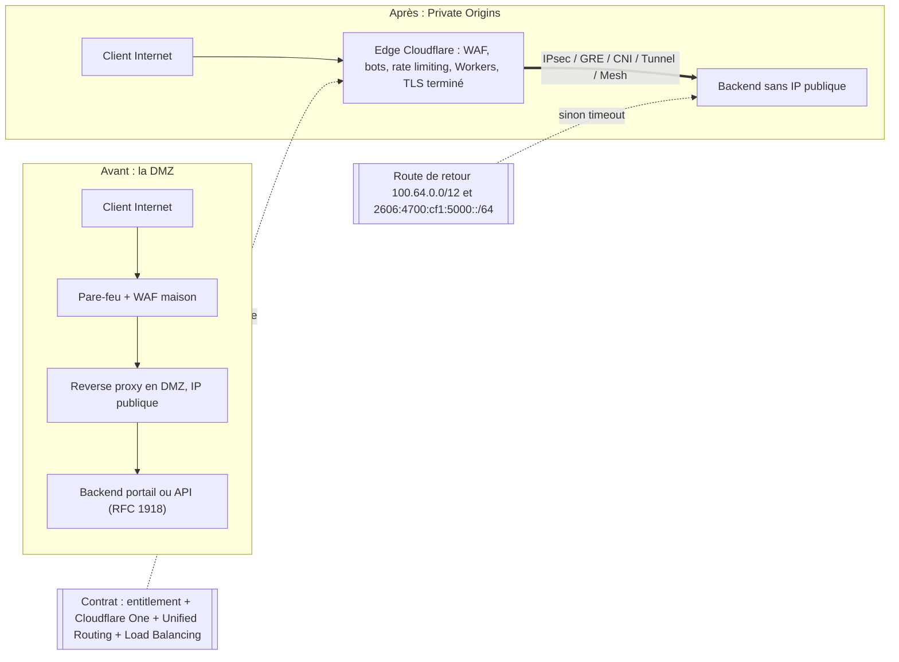
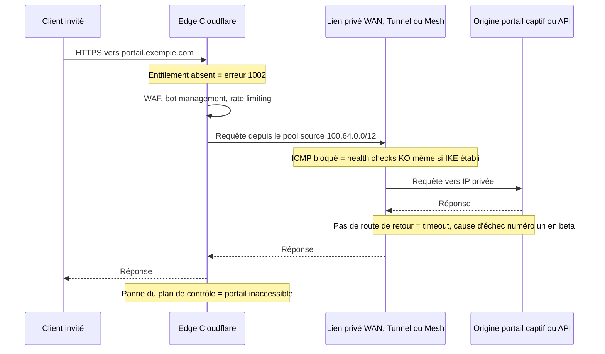

## Le jour où le serveur a quitté Internet

Depuis vingt ans, publier un service web d'entreprise suit le même rituel. On lui donne une adresse sur Internet, on le cache derrière un pare-feu, on l'isole dans une zone tampon que les architectes appellent la DMZ (zone démilitarisée), puis on espère que personne n'a glissé la mauvaise règle de filtrage. La page de connexion Wi-Fi d'un hôtel, l'API qui relie une enseigne à son logiciel de caisse, le portail qui authentifie les occupants d'une résidence étudiante : tous vivent avec cette porte entrouverte sur la rue.

Le 30 octobre 2026, Cloudflare a annoncé la disponibilité générale d'un service qui propose de la refermer. Le principe tient en une phrase : votre serveur n'a plus d'adresse publique, et seul le réseau de Cloudflare peut le joindre, après avoir filtré et inspecté chaque requête.

Pour une DSI qui pilote des dizaines ou des centaines de sites, en hôtellerie, en retail ou en résidences gérées, la promesse est forte. Elle est aussi trompeuse si on la lit trop vite.

Ma thèse tient en quelques mots. La DMZ ne disparaît pas, elle change de nature. Hier, ce qui protégeait votre serveur était une règle de pare-feu que vous possédiez. Demain, ce sera une option activée par votre interlocuteur commercial, une route réseau qu'il ne faut surtout pas oublier et un plan de contrôle que vous ne pilotez pas. Le périmètre devient un contrat.

## Du sas sur rue au centre d'affaires

Une image, avant la technique. La DMZ classique, c'est le sas d'entrée que vous avez construit au rez-de-chaussée de votre immeuble. Vous en avez les clés, vous choisissez les serrures, mais il donne sur la rue et n'importe qui peut venir secouer la poignée.

Private Origins, c'est déménager votre accueil dans un centre d'affaires. Plus aucune porte sur rue. La sécurité du hall est excellente, sans doute meilleure que la vôtre. Mais c'est le gestionnaire qui fixe les règles, aux conditions de son bail. Et le jour où le hall ferme, vos visiteurs restent sur le trottoir.

*Hier, des couches de filtrage empilées face à la rue. Aujourd'hui, un tunnel unique vers un edge que vous ne possédez pas.*

Côté mécanique, tout part du DNS. Vous créez un enregistrement A ou AAAA classique, proxifié par Cloudflare, qui pointe vers une adresse privée : un 10.x, un 192.168.x, une adresse qui n'a jamais été routable sur Internet. Le réseau Cloudflare reçoit la requête, termine chez lui la session chiffrée TLS, applique ses protections, puis achemine le trafic vers votre serveur par un lien privé [1].

Ces protections sont celles du catalogue habituel : le WAF (Web Application Firewall, le pare-feu applicatif) avec ses règles managées, la détection de bots, la limitation du nombre de requêtes par client. S'y ajoutent le cache, les règles de réécriture et les Workers, ces petits programmes exécutés directement en bordure de réseau [1]. Un backend en adressage privé reçoit ainsi le même blindage qu'un site public, sans avoir jamais été exposé.

Pour le lien privé, six options : IPsec, GRE (un tunnel d'encapsulation simple), CNI (Cloudflare Network Interconnect, une interconnexion physique directe), Cloudflare Tunnel, Cloudflare Mesh et Cloudflare WAN [1]. La nuance qui compte en exploitation : avec WAN, aucun logiciel ne tourne sur l'origine. Avec Mesh, un connecteur s'exécute dans votre réseau privé, et il faut l'opérer.

Rien de tout cela ne sort de nulle part. En avril 2018, Cloudflare présentait Argo Tunnel avec une formule qui résume encore tout : « Only Cloudflare can see the server » [8]. Devenu Cloudflare Tunnel, son agent `cloudflared` n'ouvre que des connexions sortantes, l'entrant restant bloqué au pare-feu [7]. Private Origins étend ce modèle aux tunnels réseau classiques, sans agent obligatoire. C'est moins une invention qu'une industrialisation. Et le calendrier a été tenu : beta fermée annoncée le 10 juin avec un objectif « GA in Q4 2026 », disponibilité générale (GA) le 30 octobre [1] [2].

Deux bornes à connaître. Le routage privé est automatique, et non désactivable, pour toutes les plages privées : les trois blocs de la RFC 1918, le 100.64.0.0/10 réservé au partage d'adresses chez les opérateurs (RFC 6598) et fc00::/7 en IPv6 [1] [4]. Envoyer `private_routing: false` à l'API renvoie une erreur. Surtout, le service ne couvre que le trafic public vers privé. Le privé vers privé, un site qui parlerait à un autre via Cloudflare, est encore en développement, avec une beta fermée visée pour « early 2027 » [1].

*Avant, le périmètre était une pile d'équipements que vous possédiez. Après, il dépend d'objets contractuels et d'une route de retour.*

## Quatre clés au lieu d'une serrure

Prenez le scénario d'échec le plus fréquent de la beta. Le tunnel est monté, le WAF est actif, le nom DNS est proxifié. Un client ouvre le portail. La requête traverse l'edge, emprunte le tunnel, atteint le serveur, qui répond. Puis plus rien. Le navigateur attend et finit en timeout.

Le serveur a simplement répondu à une adresse qu'il ne savait pas où renvoyer. Cloudflare le reconnaît : la route de retour manquante était la première cause d'échec pendant la beta [2] [6]. Bienvenue dans le nouveau périmètre. Il ne tient plus dans une règle de pare-feu, mais dans quatre objets, dont deux sont contractuels.

**1. L'entitlement.** Le droit d'usage « Private Origins » doit être activé par l'account team de Cloudflare. Sans lui, proxifier une IP privée renvoie l'erreur 1002 [1] [6]. Votre capacité à publier votre portail dépend donc d'un drapeau positionné chez le fournisseur.

**2. Cloudflare One et Unified Routing.** La connectivité doit passer par Cloudflare One, la plateforme réseau et Zero Trust de l'éditeur, et Unified Routing est requis sauf avec Tunnel [1]. La voie WAN exige en plus un abonnement Cloudflare WAN, un entitlement distinct de l'accès DNS [5].

**3. La route de retour.** Cloudflare contacte votre origine depuis un pool d'adresses source : `100.64.0.0/12` en IPv4, `2606:4700:cf1:5000::/64` en IPv6 pour WAN et Mesh [1]. Votre réseau doit savoir renvoyer ces paquets dans le tunnel. La documentation WAN précise que ce pool doit être un /12 privé, celui par défaut ou « un autre /12 privé » de votre choix [5]. Détail notable : le préfixe IPv6 figure dans le billet GA, mais pas dans les pages de documentation WAN et de dépannage consultées.

**4. Le Load Balancing.** Les health checks d'origine, ces sondes qui vérifient que votre serveur répond, nécessitent le produit Load Balancing [1]. Sans lui, pas de bascule automatique vers une seconde origine.

Autour de ces quatre clés gravitent des limites. Argo Smart Routing, l'optimisation de chemin de Cloudflare, n'est pas supporté, pas plus que les IP d'egress dédiées du CDN [1]. Le trafic emprunte uniquement le réseau virtuel par défaut : « Selecting a specific virtual network is not supported » [4].

Côté WAN, la recette est stricte : deux tunnels IPsec anycast, des routes statiques en priorité 100 et 101, et ICMP autorisé entre les extrémités [5] [6]. Bloquez ICMP, et les health checks échouent alors même que la négociation de clés IKE est établie. Le genre de détail qui coûte une nuit d'astreinte.

Reste la question que tout acheteur pose en premier. Le prix n'est pas publié [1] [9]. Au 3 novembre, la documentation affiche toujours « closed beta » et « Enterprise-only » [3]. Ma lecture : GA annoncé, docs encore en beta. La méta-description du billet promet le service à « every customer with Cloudflare One connectivity », mais le corps décrit un entitlement à demander. C'est le corps qui fait foi.

La couverture indépendante, elle, est quasi absente quatre jours après l'annonce. La seule analyse tierce sérieuse que j'ai trouvée date de la beta, et elle pointe l'essentiel : le routage privé « route », il n'« authentifie » pas [9]. L'identité passe par Cloudflare Access et par une validation côté origine. Une origine invisible n'est pas une origine authentifiée.

*Chaque note est un point de défaillance situé hors de votre pare-feu.*

## Trois pannes, un seul plan de contrôle

Le 18 novembre 2025, un fichier de configuration a doublé de taille. Rien de malveillant : un changement de permissions sur une base ClickHouse avait fait gonfler le fichier de caractéristiques du Bot Management au-delà de sa limite de 200 entrées, quand l'usage normal tourne autour de 60. Résultat : environ 5 h 46 de perturbation, de 11 h 20 à 17 h 06 UTC. Cloudflare Access est resté en échec jusqu'au rollback de 13 h 05, Turnstile et le dashboard ont été dégradés [10].

Le 5 décembre 2025, alerte plus courte. De 8 h 47 à 9 h 12 UTC, environ 28 % du trafic HTTP a été touché, après un changement de configuration global (un killswitch du WAF) qui a réveillé un bug Lua dans l'ancien proxy FL1 [11]. Pas une attaque non plus.

Le 20 février 2026, troisième épisode. Une requête d'API dont le champ `pending_delete` était vide a été interprétée comme « tous ». Environ 1 100 préfixes BYOIP (les plages d'adresses que les clients apportent chez Cloudflare) ont été retirés, soit 25 % des 4 306 préfixes de ce type. Plusieurs produits réseau ont été touchés (Magic Transit, Spectrum, IP d'egress dédiées), avec une remédiation complète à 23 h 03 UTC [12]. Le post-mortem annonce 6 h 07 d'impact, alors que ses propres horodatages, de 17 h 56 à 23 h 03, donnent 5 h 07 : l'écart mérite d'être signalé. Les correctifs prévus vont dans le bon sens : typage de l'API, snapshots, circuit breaker.

Soyons honnêtes. Aucun de ces incidents ne concerne Private Origins : tous sont antérieurs à sa beta, et celui de février visait d'autres produits. Ils ne prouvent pas que ce service est fragile. Ils prouvent que des plans de contrôle partagés, alimentés par des configurations poussées globalement, peuvent tomber d'un bloc, et que les trois pannes sont nées d'erreurs internes.

Voici maintenant mon analyse, et c'est le cœur du sujet. Avec une origine publique, quand l'edge tombe, il existe une porte de secours inconfortable mais réelle : repointer le DNS vers le serveur et encaisser quelques heures sans WAF. Avec une origine privée, cette porte n'existe plus. Il n'y a aucune adresse publique vers laquelle basculer. Ajoutez la concentration du DNS, du TLS, du transport et de l'accès chez un même fournisseur, relevée par Groundy [9], et vous obtenez un point de défaillance unique. Élégant, mais unique.

## Le portail captif, candidat idéal et talon d'Achille

Pour un réseau Wi-Fi multi-sites, le meilleur candidat saute aux yeux : le portail captif. La RFC 8908 (septembre 2020) définit son API en HTTPS, au format JSON `application/captive+json` [19]. Du pur HTTPS, du public vers le privé : exactement le périmètre du produit. WAF, limitation de débit et détection de bots devant un backend sans IP publique, plus des Workers pour la redirection ou l'habillage par site, c'est un très bon fit.

Même logique pour les API REST d'intégration : le PMS (Property Management System, le logiciel de gestion hôtelière), la facturation, le back-office.

Mais le portail captif a une particularité que n'a pas un site vitrine. Sa disponibilité conditionne l'accès au réseau. Un portail en panne, ce n'est pas une page indisponible : c'est un établissement entier dont les clients ne peuvent plus se connecter.

Hors périmètre, ensuite, et la liste est longue. RADIUS et RadSec (l'authentification des utilisateurs Wi-Fi), CAPWAP (le dialogue entre contrôleur et bornes) ou MQTT (la messagerie des objets connectés) ne sont pas du HTTP, et le billet GA ne les couvre pas.

Spectrum, le proxy TCP et UDP de Cloudflare, ne fonctionnait en beta que via Cloudflare Tunnel [2]. Le billet GA n'en dit rien : je ne présume donc pas de son support. Quant au privé vers privé, utile pour relier un contrôleur de site à un cloud interne, il n'est pas planifiable en 2026.

*Sur un site hôtelier, le portail captif se prête à l'exercice. RADIUS et le dialogue contrôleur-bornes, non.*

Restent les points durs du multi-sites. Certains sont documentés. D'autres sont des inférences de ma part, signalées comme telles, à valider avec l'account team avant toute recommandation ferme.

**L'adressage qui se recouvre.** Beaucoup de parcs réutilisent le même 10.x d'un site à l'autre. Or seul le réseau virtuel par défaut est utilisable [4]. Ma lecture : impossible de distinguer deux sites au plan d'adressage identique via des réseaux virtuels séparés. Prérequis probable : un plan d'adressage global, ou une traduction d'adresses par site.

**La cohabitation /10 et /12.** Pas d'incohérence chez Cloudflare. Le /10 (100.64.0.0 à 100.127.255.255) est la plage de destination qui déclenche le routage privé. Le /12 (100.64.0.0 à 100.79.255.255) est le pool source utilisé vers l'origine, inclus dans ce /10.

Mon hypothèse : un site dont le LAN, le CGNAT d'un opérateur (la traduction d'adresses mutualisée) ou un overlay utilise déjà cette plage peut entrer en collision avec le pool source. La doc WAN autorise « un autre /12 privé » ; le billet GA ne le précise pas pour Mesh [1] [5].

**Les IP sources.** Pas d'IP d'egress dédiées [1]. Si un tiers, éditeur de PMS ou banque, filtre vos adresses sources, le schéma ne passe pas.

**La terminaison TLS.** Elle se fait chez Cloudflare [1]. Les données saisies par les invités sont donc visibles en clair sur l'edge. Sujet RGPD à instruire avec votre DPO, pas à trancher ici.

**Le coût par site.** Côté WAN : deux tunnels anycast, routes 100 et 101, ICMP ouvert. Côté Tunnel ou Mesh : un connecteur à déployer, mettre à jour et superviser sur chaque site. Les deux se chiffrent, et le Load Balancing s'ajoute à une facture dont le tarif reste inconnu.

## Cacher une origine : trois écoles

Cloudflare n'est pas seul à vouloir faire disparaître l'origine, mais les approches divergent.

AWS a lancé CloudFront VPC origins le 20 novembre 2024 : un load balancer ou une instance dans un sous-réseau privé, servi par le CDN sans surcoût (« no additional cost ») [13]. Microsoft propose Private Link sur Azure Front Door, en tier Premium uniquement, avec approbation manuelle côté origine et une limite de 7 200 requêtes par seconde par cluster régional et par profil [15].

Akamai, lui, exige une origine routable publiquement : les plages RFC 1918 sont explicitement refusées [16]. La protection passe par Site Shield, une liste d'IP Akamai à autoriser sur votre pare-feu, que l'éditeur présente comme « pas un substitut à l'authentification » [17]. Je n'ai pas trouvé d'équivalent « origine privée » dans sa doc publique, ce qui ne prouve pas qu'il n'existe pas. Zscaler ZPA joue un autre match : il relie des utilisateurs identifiés à des applications privées, via un connecteur sortant uniquement [18].

| Offre | Où vit l'origine | Contrôle d'accès | Limites notables |
|---|---|---|---|
| Cloudflare Private Origins | Vos sites ou datacenters, via IPsec, GRE, CNI, Tunnel, Mesh, WAN | Entitlement + route de retour | Prix non publié, pas d'egress dédié, Spectrum non confirmé au GA |
| AWS CloudFront VPC origins | Sous-réseau privé AWS (ALB, NLB, EC2) | Security group + managed prefix list | Pas de gRPC, ni de triggers Lambda@Edge côté origine, ni de NLB avec listener TLS |
| Azure Front Door Premium Private Link | Origine exposée via Private Link | Approbation manuelle du private endpoint | Premium seulement, pas de mTLS, 7 200 RPS, pas de mix public et privé dans un groupe |
| Akamai avec Site Shield | IP publique obligatoire, RFC 1918 refusé | Allowlist d'IP Akamai sur votre pare-feu | Maintenance continue, pas un substitut à l'authentification |

Mon analyse : les hyperscalers partent du principe que votre origine vit dans leur cloud. Cloudflare parie sur l'inverse, une origine dans votre datacenter, sur votre site, dans votre baie, jointe par un tunnel. Pour un réseau B2B multi-sites, c'est le seul des quatre modèles qui colle à la géographie réelle des serveurs. C'est ce qui rend l'offre intéressante. C'est aussi ce qui rend l'adhérence plus profonde.

## Signer, mais relire le bail

Je tranche. Pour les portails HTTPS et les API exposées, j'y vais. Une surface d'attaque Internet ramenée à zéro sur l'origine est un gain réel, qu'aucune allowlist et aucun reverse proxy en DMZ n'apportent. Mais je traite la décision comme un achat, pas comme une configuration réseau.

Voici les questions que je poserais à l'account team avant de signer :

- Quel prix, et quelle unité de facturation, Load Balancing compris ?
- Quel SLA (engagement de niveau de service) spécifique à Private Origins ?
- Que se passe-t-il si l'entitlement expire ? Mon hypothèse est une erreur 1002 sur toutes les origines privées. Je veux la réponse écrite.
- Quel préavis en cas de changement du pool source ?
- Spectrum et UDP sont-ils supportés au GA ?
- Quelle réversibilité, c'est-à-dire quel chemin documenté pour revenir à une IP publique filtrée ?

Ce dernier point mérite qu'on s'y arrête. Le plan de secours, en cas de panne prolongée de l'edge, c'est précisément la DMZ que vous venez de supprimer. Mon conseil : ne la démolissez pas, mettez-la en sommeil. Un chemin public de repli, documenté, testé chaque trimestre, activable en heures plutôt qu'en jours. Pour un portail captif dont dépend la connexion de tout un établissement, c'est un minimum.

*La sécurité de l'origine se joue désormais autant dans le contrat que dans la baie de brassage.*

Un mot sur le cadre réglementaire, en restant factuel. La directive NIS2 (Directive (UE) 2022/2555, publiée au Journal officiel le 27 décembre 2022) traite, à son article 21(2)(d), de la sécurité de la chaîne d'approvisionnement [20]. L'article 21 vise les entités essentielles et importantes au sens de la directive. Le règlement d'exécution (UE) 2024/2690 (document C(2024)7151) en précise les mesures, dont des critères de sélection des fournisseurs et des clauses contractuelles, mais il ne s'applique qu'à certaines catégories de fournisseurs numériques (DNS, registres TLD, cloud, centres de données, CDN, services gérés, etc.), pas à toutes les entités NIS2 [21]. Savoir si votre organisation ou vos clients en relèvent, et ce que cela implique pour ce type de service, est une question pour votre service juridique.

La DMZ était un mur que vous construisiez vous-même. Private Origins est un bail que vous signez. Le mur, on l'inspectait brique par brique. Le bail, il faudra le lire clause par clause.

_Vues personnelles, pas position Wifirst._

## Sources

1. [Cloudflare — Cloudflare services for private origins (annonce GA, 30 octobre 2026)](https://blog.cloudflare.com/private-origins-public-to-private/)
2. [Cloudflare — Route public traffic to private applications (annonce beta, 10 juin 2026)](https://blog.cloudflare.com/private-origins-dns-routing/)
3. [Cloudflare Docs — Private origins (beta)](https://developers.cloudflare.com/dns/private-origins/)
4. [Cloudflare Docs — Private network routing](https://developers.cloudflare.com/dns/private-origins/private-network-routing/index.md)
5. [Cloudflare Docs — Set up a private origin via Cloudflare WAN](https://developers.cloudflare.com/dns/private-origins/set-up-via-cloudflare-wan/index.md) (voir aussi [Cloudflare WAN — Private origin](https://developers.cloudflare.com/cloudflare-wan/private-origin-via-cloudflare-wan/))
6. [Cloudflare Docs — Troubleshooting private origins](https://developers.cloudflare.com/dns/private-origins/troubleshooting/index.md)
7. [Cloudflare Docs — Cloudflare Tunnel](https://developers.cloudflare.com/cloudflare-one/networks/connectors/cloudflare-tunnel/)
8. [Cloudflare — Argo Tunnel: a private link to the public Internet (5 avril 2018)](https://blog.cloudflare.com/argo-tunnel/)
9. [Groundy — Cloudflare routes public traffic to private apps via DNS (23 juin 2026)](https://groundy.com/articles/cloudflare-now-routes-public-traffic-to-private-apps-via-dns-no-vpn/)
10. [Cloudflare — Post-mortem de l'incident du 18 novembre 2025](https://blog.cloudflare.com/18-november-2025-outage/)
11. [Cloudflare — Post-mortem de l'incident du 5 décembre 2025](https://blog.cloudflare.com/5-december-2025-outage/)
12. [Cloudflare — Outage on February 20, 2026 (BYOIP)](https://blog.cloudflare.com/cloudflare-outage-february-20-2026/)
13. [AWS — Amazon CloudFront VPC origins (20 novembre 2024)](https://aws.amazon.com/about-aws/whats-new/2024/11/amazon-cloudfront-vpc-origins)
14. [AWS Docs — Restrict access with VPC origins](https://docs.aws.amazon.com/AmazonCloudFront/latest/DeveloperGuide/private-content-vpc-origins.md)
15. [Microsoft Learn — Azure Front Door Premium Private Link](https://learn.microsoft.com/azure/frontdoor/private-link)
16. [Akamai TechDocs — Custom origin prerequisites](https://techdocs.akamai.com/property-mgr/docs/custom-origin-prerequisites)
17. [Akamai TechDocs — Site Shield](https://techdocs.akamai.com/site-shield/docs/welcome-site-shield)
18. [Zscaler Help — About App Connectors](https://help.zscaler.com/zpa/about-connectors)
19. [IETF — RFC 8908, Captive Portal API (septembre 2020)](https://www.rfc-editor.org/rfc/rfc8908.html)
20. [EUR-Lex — Directive (UE) 2022/2555 (NIS2), article 21](https://eur-lex.europa.eu/legal-content/EN/TXT/HTML/?uri=CELEX%3A32022L2555)
21. [EUR-Lex — Règlement d'exécution (UE) 2024/2690 (NIS2, fournisseurs numériques)](https://eur-lex.europa.eu/eli/reg_impl/2024/2690/oj)
